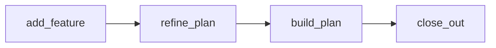
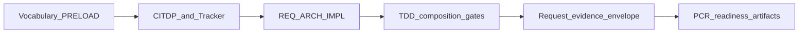
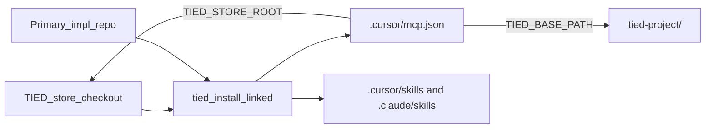

# TIED Methodology

**TIED Methodology Version**: 4.0.0

[TIED](https://github.com/fareedst/tied) means **Token-Integrated Engineering & Development**. This repository is the **TIED store**—clone it, build the workspace, install methodology into your client, then ship compact features with Prompt Composer. Deeper process and the Core seven documents: [client development index](tied-bundle/docs/client-development-index.md).

## Quick start (macOS)

From the TIED repository root on macOS (Unix / Git Bash). Windows and full prerequisites: [Install and use](#install-and-use) below.

### Primary operator delivery path

The **configuration rhythm** (store → client) in four steps:

1. **Clone:** `git clone` the [TIED store](https://github.com/fareedst/tied); `cd` to the store root.
2. **Store workspace build:** `./build-workspace.sh` — details in [Store workspace build](#store-workspace-build) below; `./build-workspace.sh --help`.
3. **Client install:** `./tied-install.sh /path/to/client` (or linked primary install from the greenfield table); `./tied-install.sh --help` (no arguments prints styled help). Methodology refresh: `--refresh`.
4. **Confirm MCP:** `tied_config_get_base_path` → client `tied-project/` — [Optionally enable the MCP server](#2-optionally-enable-the-mcp-server).

Windows store build and install shims: [Install and use](#install-and-use).

<a id="compact-feature-rhythm"></a>

### Compact feature rhythm

After client bootstrap (`tied-install` installs Prompt Composer skills under `.cursor/skills/`), one **REQ-scoped compact feature** in Cursor follows this **coding rhythm**:

| Step | Invoke | Purpose |
| --- | --- | --- |
| 1 | `/add-feature` | New requirement + linked plan (Refine, CITDP Plan, Implement inside the skill) |
| 2 | `/refine-plan` | Improve the linked plan before execution |
| 3 | `/build-plan` | Execute the approved plan (TDD, checklist; omits Refine) |
| 4 | `/close-out` | LEAP sync, `close_out` gate, CHANGELOG, traceable commit when allowed |

(`@add-feature` and the other `@…` names are equivalent aliases in Cursor.)

Canonical skill sources: [add-feature](tools/bundled-prompt-type-skills/add-feature/SKILL.md), [refine-plan](tools/bundled-prompt-type-skills/refine-plan/SKILL.md), [build-plan](tools/bundled-prompt-type-skills/build-plan/SKILL.md), [close-out](tools/bundled-prompt-type-skills/close-out/SKILL.md). **[AGENTS.md](AGENTS.md)** remains authoritative. Optional trial remainders: [catalog-greenfield add-feature](docs/demos/catalog-greenfield-add-feature-prompts.md). For FEAT lifecycle vs REQ-scoped work, see the [multi-harness entry matrix](tied-bundle/docs/client-development-index.md#multi-harness-entry-matrix-cursor-vs-claude-code).



### Store workspace build

From the store root:

```bash
./build-workspace.sh
```

On macOS the default shell is **zsh** — run `./build-workspace.sh` anyway (bash via shebang), or `./build-workspace.zsh`. **Windows:** `.\build-workspace.ps1` or `build-workspace.cmd`.

This produces `mcp-server/dist/index.js`, the umbrella **`tied`** CLI, **`tied agentstream`**, and bootstrap verification gates. The script prints colored steps and hints for common failures. See [TIED source repository setup](#tied-source-repository-setup) for prerequisites and manual equivalents.

### Greenfield

| Situation | Command (from store root) | Next step |
| --- | --- | --- |
| Disposable smoke client | `source scripts/build-commands.sh && test-new-tied-client` (requires a **built store** — run `./build-workspace.sh` on the store clone first) | Open the new client in Cursor; enable MCP |
| External client directory | `./tied-install.sh /path/to/your/project` | [Getting started with a new client project](#getting-started-with-a-new-client-project) |
| Primary implementation repo (code + `tied-project/` in one tree) | `/path/to/tied-store/tied-install.sh --mode linked --store /abs/path/to/tied-store .` from the **primary** root | [Primary implementation repository](#primary-implementation-repository) |

After bootstrap: confirm `tied_config_get_base_path` → client `tied-project/`, then follow [Compact feature rhythm](#compact-feature-rhythm).

**Store-as-primary note:** This git repository is both the store and a TIED client (`tied-project/`). To linked-install into **other** primary repos, use a **separate store clone** as `--store` (see [Methodology development layout](#methodology-development-layout)).

### Brownfield

| Situation | Start here |
| --- | --- |
| Methodology refresh | [methodology-migration.md](tied-bundle/docs/methodology-migration.md) and `tied-install --refresh` |
| Architecture recovery | [Evidence-assured software architecture recovery (EASAR)](docs/methodologies/evidence-assured-software-architecture-recovery.md) |
| External workflows / integrators | [Operating environment externalities](docs/tied-operating-environment-externalities.md) |

Then follow `[PROC-AGENT_REQ_CHECKLIST]` via the [agent requirement implementation checklist](tied-bundle/docs/agent-req-implementation-checklist.md).

### Brownfield comprehension on an existing codebase

**Purpose.** Brownfield comprehension is how TIED learns a legacy or unfamiliar system *before* feature work assumes correct intent. The goal is an evidence-backed **Software Comprehension Model**—declared intent, what code can do, what was observed, environmental effects, failures, and explicit unknowns—not a one-shot repository summary or “tests pass, so we’re fine.” TIED orchestrates this through **Evidence-Driven Program Comprehension (EDPC)** (`[PROC-EDPC_COMPREHENSION]`) and, when promoting sponsor-approved intent into REQ/ARCH, **brownfield intent elevation** (`[PROC-BROWNFIELD_INTENT_ELEVATION]`). Reverse documentation (**Track C**) captures observed behavior in IMPL sidecars only; it does not by itself create approved requirements.

**Typical steps** (depth and tier vary by engagement):

1. **Commission (A)** — Charter, scope matrix, and **evidence-access tier** (`source_static`, `toolchain_readonly`, or `source_change`) on the target repository; validate with MCP `tied_edpc_access_validate` / `tied_edpc_engagement_validate`.
2. **Baseline (B)** — Structural inventory and graph receipts (EASAR workflow **B** under the EDPC umbrella).
3. **Deep slices (C)** — Focused investigation: source graph, claims review, Track C pseudo-code where appropriate.
4. **Ops / change (D–E, when tier allows)** — Failure and operational state, or scoped change-impact analysis.
5. **Intent elevation (when adopting TIED on legacy code)** — Evidence-to-intent matrix, dispositions (`observed`, `approved`, `unresolved`, `rejected`); enrich REQ/ARCH from **`approved`** rows only; close with `brownfield_intent_evidence_validate`.
6. **Verify and publish (F)** — Publish manifest with explicit **`gaps[]`**; optional client assessment (workflow **H**) for external-facing summaries.
7. **Refresh (G)** — Re-run when builds, access, or questions change material claims.

Set the per-request Tracker to `brownfield_intent_elevation.engagement: edpc_full` with `mode: pilot` or `strict` for full choreography; use `report_only` when you need diagnostics without blocking the checklist. Artifacts live under `tied-project/working/{REQ-TOKEN}/evidence/edpc/` (and related brownfield working paths).

**Benefits**

- **Proof boundaries** — Tier caps what agents and tools may do; conclusions stay tied to revisions, environments, and observation windows.
- **Reuse for later TDD/LEAP** — Approved intent and structural receipts feed `[PROC-AGENT_REQ_CHECKLIST]` without treating AI prose as REQ authority.
- **Composable tooling** — EDPC sequences existing MCP passes (source graph, EASAR receipts, claims review, brownfield validation) instead of duplicating ledgers.
- **Honest uncertainty** — Queues and publish gaps document what was not measured, not reproduced, or deferred.

**Costs**

- **Time and sponsor attention** — Adjudication and `approved` promotion are human-gated; `strict` mode can block checklist steps when validation fails.
- **Artifact upkeep** — Charters, access matrices, claim ledgers, and queue files must stay aligned with the target repo and engagement scope.
- **Not universal depth** — The scope matrix intentionally defers domains; a published comprehension is bounded, not a certificate of health.
- **Infrastructure** — Built MCP server, correct `TIED_BASE_PATH`, and (for production evidence) explicit charter approval for `production_touch`.

Deep dives: [EDPC methodology](tied-bundle/docs/EDPC_Methodology_and_Workflows.md), [brownfield intent elevation](tied-bundle/docs/brownfield-intent-elevation.md), [EDPC vocabulary](tied-project/vocab/edpc-comprehension.md), and the [client development index — program comprehension](tied-bundle/docs/client-development-index.md) row.

## Performing work in certifiable workflows

TIED work is designed so intent, evidence, and gates can support **external appraisal** without the repository claiming third-party certification. Deeper methodology narrative lives in the [client development index](tied-bundle/docs/client-development-index.md), [LEAP guide](tied-bundle/docs/LEAP.md), and [methodology diagrams](tied-bundle/docs/methodology-diagrams.md).

### What “certifiable” means here

[Certification of context-adaptive workflows](docs/methodologies/certification-of-workflows.md) distinguishes process compliance, capability, and effectiveness. In this repository, **certifiability readiness** means machine-assessable artifacts (spec, mappings, conformance, capability profile, independent assessment, bounded experiments) that support **`ready_for_external_appraisal`** — not **`certified`**, ISO compliance, or CMMI ratings. Stages **1–5** and **7** are in-repo tooling; stages **6** and **8** are human-owned external appraisal. Vocabulary: [process-certification-readiness.md](tied-project/vocab/process-certification-readiness.md).

### EDSE daily loop

**Evidence-Driven Situational Engineering (EDSE)** composes with TIED: characterize context → select practices (CASE) → execute the checklist → collect verification evidence. See [context-adaptive-engineering.md](tied-project/vocab/context-adaptive-engineering.md).



### Executable process spine

1. **Vocabulary** — client [routing.md](tied-project/vocab/routing.md) → PRELOAD matched glossaries.
2. **Change analysis** — CITDP + per-request Tracker copy ([checklist YAML](tied-bundle/docs/agent-req-implementation-checklist.yaml)).
3. **Stack** — REQ → ARCH → IMPL pseudo-code (with block token comments) before RED tests.
4. **Gates** — `tied gate check --request-token REQ-… --phase pre_implementation|verification|close_out` (see [client development index](tied-bundle/docs/client-development-index.md) § adherence ergonomics).
5. **Envelope** — request evidence envelope at close-out when the Tracker requires it.

Use the [multi-harness entry matrix](tied-bundle/docs/client-development-index.md#multi-harness-entry-matrix-cursor-vs-claude-code) to separate REQ-scoped Prompt Composer work from FEAT lifecycle orchestration.

### Certifiability readiness (`[REQ-TIED_PROCESS_CERTIFICATION_READINESS]`)

Read-only MCP/CLI layer: EDSE process spec, 12207 reference mapping (reference only), conformance matrix, seven-dimension capability profile (no rollup score), independent assessment file ingress, adaptive-effectiveness fixtures, assessor pack.

After `cd mcp-server && npm run build`:

```bash
export TIED_BASE_PATH="/absolute/path/to/tied-project"
node --import tsx --test src/process-certification-readiness/*.test.ts
.cursor/skills/tied-yaml/scripts/tied-cli.sh tied_validate_consistency
```

CLI (same surface as MCP): `tied certification spec-validate`, `conformance-evaluate`, `capability-evaluate`, `independent-assess`, `adaptive-experiment-run`, `readiness-report-compose`, `assessor-pack-generate` — see `mcp-server/src/cli/process-certification-cli.ts`.

### REQ-scoped prompt types

See [Compact feature rhythm](#compact-feature-rhythm) in Quick start. **[AGENTS.md](AGENTS.md)** remains authoritative. Prompt skills do not replace checklist gates or integrated adversarial inquiry when those apply.

### Honest limits

- Valid records ≠ correct product behavior.
- Passing tests ≠ complete edge coverage.
- Readiness **`ready_for_external_appraisal`** ≠ certification or standard compliance.
- Reference mappings do not establish ISO/CMMI conformance claims.

## Install and use

Complete reference for store setup, client bootstrap, MCP, automation, and layout. Operator mechanics for `tied-install` layers: [tools/bootstrap/README.md](tools/bootstrap/README.md).

## TIED source repository setup

These steps prepare **this TIED checkout** (MCP server, npm workspace CLIs, bootstrap engine). They are separate from bootstrapping a **client project** with `tied-install`.

**Prerequisites**

| Tool | Version | Required for |
| --- | --- | --- |
| Node.js | 18+ | `tied-install`, MCP server, bootstrap verification gates |
| Go | — | **Not required** (Go `tools/agentstream/` removed Phase **4d**; see [phase4d-go-oracle-freeze.json](tied-project/working/REQ-TIED_UNIFIED_TOOLCHAIN/phase4d-go-oracle-freeze.json)) |

**Unix / Git Bash / macOS zsh** (from the TIED repository root):

```bash
./build-workspace.sh
```

Manual equivalent (same steps the script runs):

```bash
cd mcp-server && npm install && npm run build
cd ../tools/bootstrap && npm install
```

The **`mcp-server/`** directory is an npm **workspace** (`@tied/mcp`, `@tied/cli`, `@tied/agentstream`, `@tied/bootstrap`, `@tied/yaml-cli`). One install/build at that root compiles the MCP server (`dist/index.js`), the umbrella **`tied`** CLI (`tied mcp` delegates to the same stdio entry), and **`tied agentstream`** (TypeScript-only after Phase **4d**). Ruby `tools/agent-stream` was removed in Phase **4b**. Legacy Go emergency reinstall: [phase4c-deprecation-notice.md](working/REQ-TIED_UNIFIED_TOOLCHAIN/phase4c-deprecation-notice.md) and [phase4d-go-oracle-freeze.json](tied-project/working/REQ-TIED_UNIFIED_TOOLCHAIN/phase4d-go-oracle-freeze.json).

**Windows** (from the TIED repository root):

```powershell
.\build-workspace.ps1
```

Or from **`cmd.exe`**: `build-workspace.cmd`

Manual equivalent:

```cmd
cd mcp-server && npm install && npm run build && cd ..\tools\bootstrap && npm install && cd ..\..
```

What each step enables:

| Step | Produces | Used by |
| --- | --- | --- |
| `mcp-server` workspace build | `mcp-server/dist/index.js`, `mcp-server/node_modules/.bin/tied` | TIED YAML MCP, `tied mcp` / `tied-cli`, `tied-install` (hard prerequisite), YAML lint |
| `tools/bootstrap` install | `js-yaml` for verification gates | `tied-install.sh` / `install-layers.mjs` completion checks |
| `@tied/agentstream` + `@tied/cli` build | `mcp-server/packages/cli/dist/index.js` | `tied agentstream`, `scripts/run-feature-batch-agentstream.sh` |

Notes:

- `npm install` in `mcp-server` also runs `prepare` → `npm run build`, so an explicit `npm run build` is optional but documents intent.
- `scripts/run-feature-batch-agentstream.sh` requires a built `@tied/cli` (`cd mcp-server && npm run build`) unless `AGENTSTREAM` points at another compatible binary.
- See [tools/bootstrap/README.md](tools/bootstrap/README.md) for Windows entry points (`tied-install.cmd`, `test-new-tied-client.cmd`, PowerShell `.ps1` shims).

## Getting started with a new client project

This section is for bootstrapping an **external client directory** from the TIED store checkout. If the client **is** your product repository (code and `tied-project/` in one tree), use [Primary implementation repository](#primary-implementation-repository) instead.

Complete [TIED source repository setup](#tied-source-repository-setup) first. **Prerequisite — built store workspace:** from the TIED store root, run `./build-workspace.sh` before any client install. `tied-install` fails without `mcp-server/dist/index.js` and bootstrap verification dependencies.

### 1. Copy the methodology

From a TIED repository clone, run client install ( `./tied-install.sh` with no arguments prints styled help; use `.` or a path to install):

```bash
./tied-install.sh /path/to/your/project
```

**Windows disposable client smoke** (from the TIED repo):

```cmd
scripts\test-new-tied-client.cmd
```

Or from repo root: `test-new-tied-client.cmd`. PowerShell: `powershell -ExecutionPolicy Bypass -File .\test-new-tied-client.ps1`

**Windows:** from a neighboring client repo (PATHEXT resolves `tied-install.cmd`):

```cmd
..\dev\tied\tied-install.cmd C:\path\to\your\project
```

`tied-install` creates or refreshes the client layout per `--mode` (**linked** by default: methodology stubs and MCP env pointing at the store; **full**: materialized `tied-bundle/` for offline use). It creates missing project indexes under `tied-project/`, and installs the bundled [tied-yaml skill](tools/bundled-tied-yaml-skill/SKILL.md) under `.cursor/skills/tied-yaml/` when appropriate. It does not overwrite an existing `AGENTS.md` or `.cursorrules`.

Methodology-owned YAML under `tied-bundle/` is read-only in the client and can be refreshed by running `tied-install.sh` again. Project-owned REQ/ARCH/IMPL indexes and detail files live at the root of the client’s `tied-project/` directory and are not overwritten.

### 2. Optionally enable the MCP server

The MCP server stays in this TIED repository; it is not copied into the client. After [source setup](#tied-source-repository-setup), `mcp-server/dist/index.js` serves any client. `tied-install.sh` creates `.cursor/mcp.json` with the `tied-yaml` entry when that file is missing, and preserves an existing file byte-for-byte. For manual configuration or details, see [adding TIED MCP and invoking passes](tied-bundle/docs/adding-tied-mcp-and-invoking-passes.md). From the client project root, the recommended Cursor flow is:

```bash
agent mcp enable tied-yaml
```

Approve the project MCP configuration when prompted, then type `quit` to exit the interactive Agent session. Set `TIED_BASE_PATH` to the client’s absolute `tied-project/` directory. If the server binary is outside the client tree, set `TIED_MCP_BIN` to the absolute path of the TIED repository’s `mcp-server/dist/index.js`.

Confirm the server with a tool such as `yaml_index_read` or `tied_config_get_base_path`, or read the `tied://requirements` resource. The [MCP server README](mcp-server/README.md) documents the full tool surface and configuration.

### 3. Work without MCP

If Node or the built server is unavailable, use the documented bootstrap and manual project-YAML workflow:

```bash
./bootstrap_without_mcp.sh /path/to/your/project
```

Read [using TIED without MCP](tied-bundle/docs/using-tied-without-mcp.md) before managing project records by hand.

## Primary implementation repository

Use this path when **one git repository** holds both your application and TIED project data (`tied-project/`). That repo is the **primary implementation repository**. The **TIED store** is a separate checkout of this methodology repository (or a pinned clone such as under `tied_versions/`) with a built MCP server (`mcp-server/dist/index.js`) and bundled skills under `tools/bundled-*`.



### Prerequisites

Complete [TIED source repository setup](#tied-source-repository-setup) on the **store** checkout (Node 18+, `mcp-server/dist/index.js`). The primary repo only needs Node for `tied-install` and optional `--doctor`.

### First-time linked install

From the **primary repository root** (the `.` target), point `--store` at the absolute store path. Do **not** use the primary repo path as the store.

**Unix / Git Bash:**

```bash
/path/to/tied-store/tied-install.sh --mode linked --store /abs/path/to/tied-store .
```

**Windows** (`tied-install.ps1` and `tied-install.cmd` forward the same flags to the Node dispatcher):

```powershell
C:\path\to\tied-store\tied-install.ps1 --mode linked --store C:\path\to\tied-store .
```

```cmd
C:\path\to\tied-store\tied-install.cmd --mode linked --store C:\path\to\tied-store .
```

The installer refuses **self-install** and **nested** store/project layouts (`SELF_INSTALL_REFUSED`): the store root must not equal the primary repo root, and neither tree may contain the other. See `guardSelfInstall` in [tools/bootstrap/lib/layout.mjs](tools/bootstrap/lib/layout.mjs).

### Refresh without `--store`

After the first install, `.cursor/mcp.json` (or `.mcp.json`) records `TIED_STORE_ROOT`. From the primary repo root:

```bash
tied-install --mode linked .
```

Store resolution order: `--store` → environment `TIED_STORE_ROOT` → MCP config → `TIED_REPO_ROOT` when invoked from the store tree. Details: [tools/bootstrap/lib/layers/store.mjs](tools/bootstrap/lib/layers/store.mjs).

### MCP configuration (linked mode)

Linked install refreshes the `tied-yaml` MCP entry when present: `node` with `args` pointing at `{store}/mcp-server/dist/index.js`, and env keys including:

```json
"env": {
  "TIED_BASE_PATH": "C:/path/to/primary/tied-project",
  "TIED_STORE_ROOT": "C:/path/to/tied-store",
  "TIED_METHODOLOGY_BUNDLE_PATH": "C:/path/to/primary/tied-bundle"
}
```

Use absolute paths. `TIED_BASE_PATH` is set to the project traceability directory (`tied-project/`). One Cursor window per implementation repo; confirm with MCP `tied_config_get_base_path`. Optional: set `TIED_MCP_BIN` when the server binary is not under the store layout you use. See [adding TIED MCP and invoking passes](tied-bundle/docs/adding-tied-mcp-and-invoking-passes.md) and [mcp-server/README.md](mcp-server/README.md).

### Skills (linked stubs)

Linked mode writes **stubs** under `.cursor/skills/` (tied-yaml, prompt-type leaf skills, xlate) and `.claude/skills/`; canonical skill bodies remain in the store (`tools/bundled-tied-yaml-skill/`, `tools/bundled-prompt-type-skills/`, etc.). If a stub points at a missing store path, re-run `tied-install --mode linked` with a valid `--store` or use `--mode full`. Optional IDE flow: `agent mcp enable tied-yaml` from the primary repo root.

### Verify checklist

1. Build the **store** (`mcp-server/dist/index.js`).
2. First linked install on the primary repo with `--store`.
3. Open the primary repo in Cursor; approve MCP if prompted.
4. Call `tied_config_get_base_path` and confirm the project traceability directory.
5. Run `node tools/bootstrap/install-layers.mjs --doctor .` from the primary root (Node-only; no bash required on Windows).
6. Optional: `.cursor/skills/tied-yaml/scripts/tied-cli.sh tied_validate_consistency`.

For YAML workflows without IDE MCP, see [TIED YAML agent index](tied-bundle/docs/tied-yaml-agent-index.md) and the [client development index](tied-bundle/docs/client-development-index.md) (Core seven).

### Full mode alternative

`tied-install --mode full` materializes methodology under `tied-bundle/` for offline use (larger tree, different refresh tradeoffs). See profiles in [tools/bootstrap/README.md](tools/bootstrap/README.md).

### Methodology development layout

When you work in **this** TIED git repository as the store **and** also track project REQ/ARCH/IMPL here, keep a **separate** store clone for installing into other primary repos. Do not run `tied-install .` with `--store` equal to the same root (self-install refused). A pinned store under `tied_versions/...` while product code lives elsewhere is a normal pattern.

## Spec-driven execution (optional)

For a new client, an ordered feature-spec YAML can drive one change at a time through the checklist. A spec commonly contains `order`, `feature_name`, `goal`, `rules`, `examples`, `boundary_conditions`, and `out_of_scope`.

Example:

```yaml
- order: 1
  feature_name: "Default search root"
  goal: "A search runs from the current working directory when no root path is provided."
  rules:
    - "If no root path is given, the search root is the current working directory."
    - "The run summary shows the effective search root."
  examples:
    - given: "the current working directory contains app.rb"
      when: "a file-name search for 'app' is run with no root path"
      then: "app.rb is eligible to match and the summary shows the current working directory"
  boundary_conditions:
    - "An empty root path is treated the same as no root path."
  out_of_scope: "Resolving shell aliases or environment-variable syntax in the path"
```

Run one selected spec with the agentstream batch driver (`scripts/run-feature-batch.sh` → `tied agentstream`):

```bash
./scripts/run-feature-batch.sh \
  --workspace . \
  --prompt-file ./tied-project/agent-preload-contract.yaml \
  --lead-checklist-yaml $TIED/tied-bundle/docs/agent-req-implementation-checklist.yaml \
  --feature-spec-batch-yaml ./prompts/initial-specs.yaml \
  --select-order 1
```

`scripts/run-feature-batch.sh` delegates to `scripts/run-feature-batch-agentstream.sh` (`tied agentstream` / `@tied/agentstream` after `./build-workspace.sh` on the store). Optional TIED MCP preflight is enabled with `--tied-mcp-preflight` or `AGENTSTREAM_TIED_MCP_PREFLIGHT=1`; it is off by default. See [mcp-server/packages/agentstream/README.md](mcp-server/packages/agentstream/README.md).

## Tooling and scripts

- `build-workspace.sh` / `build-workspace.ps1` / `build-workspace.cmd` — store workspace build (`mcp-server` + `tools/bootstrap`); `./build-workspace.sh --help`.
- `tied-install.sh` / `tied-install.cmd` / `tied-install.ps1` — layered **client install** (`./tied-install.sh` with no args prints help; use `.` or a path to install).
- `bootstrap_without_mcp.sh` — bootstrap and print next steps for non-MCP use.
- `scripts/run-feature-batch.sh` — delegates to the agentstream batch driver (stable CLI surface; Ruby runner removed Phase **4b**).
- `scripts/run-feature-batch-agentstream.sh` — `tied agentstream` feature-spec and checklist driver.
- `@tied/agentstream` — TypeScript pipeline in `mcp-server/packages/agentstream/`; legacy Go path removed Phase **4d** ([tools/agentstream/README.md](tools/agentstream/README.md) redirect stub only).
- `feature-orchestrator` / `tied` feature commands — feature lifecycle CLI from the same workspace (see [feature-orchestration vocabulary](tied-project/vocab/feature-orchestration.md)).
- `tools/bundled-tied-yaml-skill/` — canonical tied-yaml skill source; clients receive `.cursor/skills/tied-yaml/` via `tied-install`.
- `scripts/yaml_tool.sh` and `scripts/lint_yaml.sh` — canonicalize or lint TIED YAML according to the documented edit loop.
- `scripts/prepare_readme_demo.sh` — bootstrap `tied-project/` when needed and run structured YAML query examples.
- `mcp-server/` — TypeScript MCP server for TIED indexes, details, traceability, and validation.

## Where to read next

The [client development index](tied-bundle/docs/client-development-index.md) names the Core seven documents for applying TIED:

1. [AGENTS.md](AGENTS.md) — repository operating rules.
2. [Vocabulary routing](tied-project/vocab/routing.md) — resolve and preload preferred terms.
3. [Agent requirement implementation checklist](tied-bundle/docs/agent-req-implementation-checklist.md) — the executable process.
4. [Checklist YAML](tied-bundle/docs/agent-req-implementation-checklist.yaml) — the trackable copy of that process.
5. [Processes](tied-bundle/docs/processes.md) — definitions for CITDP, LEAP, TDD, validation, and evidence.
6. [Pseudo-code guide](tied-bundle/docs/pseudocode-writing-and-validation.md) — author and validate IMPL behavior contracts.
7. [CITDP policy and record template](tied-bundle/docs/citdp-policy.md) — determine when to persist change analysis.

For orientation, read [methodology diagrams](tied-bundle/docs/methodology-diagrams.md) and the [LEAP guide](tied-bundle/docs/LEAP.md). Semantic tokens link REQ → ARCH → IMPL → tests → code across client projects. For YAML operations, use the [TIED YAML agent index](tied-bundle/docs/tied-yaml-agent-index.md) and the [tied-yaml skill](tools/bundled-tied-yaml-skill/SKILL.md) (installed under `.cursor/skills/tied-yaml/` in client projects). Agents should read [AGENTS.md](AGENTS.md) before working in a client project.

## Repository layout

```text
stdd/
├── tied-project/              # Committed project traceability (REQ/ARCH/IMPL, vocab, working/)
├── working/                   # Symlink → tied-project/working/ (legacy path alias; canonical prefix is tied-project/working/)
├── tied-bundle/               # Committed methodology corpus in this repo; gitignored on clients
├── mcp-server/                # MCP server + npm workspace (cli, agentstream, bootstrap, yaml-cli)
│   └── packages/agentstream/  # @tied/agentstream — `tied agentstream` implementation
├── tools/
│   ├── bootstrap/             # tied-install engine and client verification gates
│   ├── bundled-tied-yaml-skill/   # Canonical tied-yaml skill (installed into clients)
│   └── agentstream/           # Redirect stub only (Go runner removed Phase 4d)
├── scripts/                   # Bootstrap, batch, YAML, and analysis utilities
├── build-workspace.sh         # Store workspace build (Unix / Git Bash)
├── build-workspace.ps1        # Store workspace build (Windows PowerShell)
├── build-workspace.cmd        # Store workspace build (Windows cmd → ps1)
├── tied-install.sh            # Client install (linked/full)
├── bootstrap_without_mcp.sh   # Non-MCP bootstrap
├── AGENTS.md                  # Agent operating guide
└── CHANGELOG.md               # Methodology version history
```

Client projects keep project-specific data in `tied-project/`; inherited methodology materializes under gitignored `tied-bundle/`. See [tied-install.sh](tied-install.sh) and `how install-matrix` for paths and flags.

## Language-specific adaptation

TIED remains language-independent. Adapt code examples, test commands, and implementation details to the client’s language and tooling while retaining the REQ → ARCH → IMPL → tests → code traceability model.

## License

This document is available as open source under the terms of the [MIT License](https://opensource.org/licenses/MIT).
