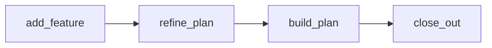
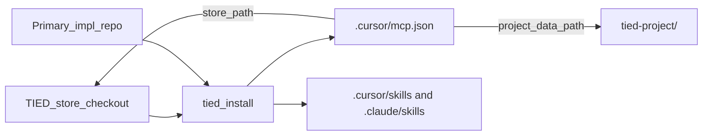

# TIED Methodology

**TIED Methodology Version**: 4.2.1

[TIED](https://github.com/fareedst/tied) means **Token-Integrated Engineering & Development**. This repository is the **TIED store**—clone it, build the workspace, install methodology into your client, then ship compact features with Prompt Composer. **Visual how-to and methodology by example:** [TIED Experience Hub](docs/tied-experience/index.md). Core seven index: [client development index](tied-bundle/docs/client-development-index.md).

**Release highlights (4.2.1):** Methodology patch since 4.2.0 — **NVIDIA Auto-Ontology** external comparison compose (certified semantic layer × TIED harness preflight/read-write seam), plus trial methodology version readout, WF shell exit hardening, checklist gate operator path, and related close-outs. Full notes: [CHANGELOG — 4.2.1](CHANGELOG.md#421---2026-11-07).

- **NVIDIA Auto-Ontology compose (non-tied)** — Wave 1 capture + Wave 2 × TIED improvement analysis; plan packages under `tied-project/non-tied-plans/nvidia-auto-ontology-*` (comparisons local gitignored).
- **Trial methodology version readout** — turn-1 session semver capture for WF/GF trials ([REQ-TRIAL_METHODOLOGY_VERSION_READOUT]).
- **Checklist gate operator path** — `tied gate check` documented in bundled tied-yaml skill ([REQ-TIED_CHECKLIST_GATE_OPERATOR_PATH]).
- **Netflix observability Wave 3 (4.2.0)** — methodology composition matrix row 17 ([REQ-TIED_NETFLIX_ONTOLOGY_OBSERVABILITY_WAVE3]); see [CHANGELOG — 4.2.0](CHANGELOG.md#420---2026-11-07) for MCP HTTPS and store README spine.

## How to use this README

Choose a path by intent—not every section applies to every reader.

| I want to… | Start here |
| --- | --- |
| Run the store on macOS in minutes | [Quick start (macOS)](#quick-start-macos) |
| Learn TIED by example (lenses, diagrams, proof boundaries) | [Explore TIED](#explore-tied) |
| Build the store, install a client, or wire MCP (full reference) | [Install and use](#install-and-use) |
| Keep product code and `tied-project/` in one git repo | [Primary implementation repository](#primary-implementation-repository) |
| Drive checklist work from ordered feature specs | [Spec-driven execution (optional)](#spec-driven-execution-optional) |
| Locate scripts, packages, and directory roles | [Tooling and scripts](#tooling-and-scripts) · [Repository layout](#repository-layout) |

Agents: read [AGENTS.md](AGENTS.md) every session. YAML edits: [TIED YAML agent index](tied-bundle/docs/tied-yaml-agent-index.md).

---

## Quick start (macOS)

**Context:** macOS-first **operator path** from a store clone. This section repeats only what you need to start; prerequisites, Windows entry points, and layout rules live under [Install and use](#install-and-use).

From the TIED repository root on macOS (Unix / Git Bash). Windows and full prerequisites: [Install and use](#install-and-use) below.

### Primary operator delivery path

**Configuration rhythm:** store clone → workspace build → client install → MCP confirm.

| Step | Goal | Command |
| --- | --- | --- |
| 1 | Clone [TIED store](https://github.com/fareedst/tied) | `git clone https://github.com/fareedst/tied` |
| 2 | Build MCP / CLI / bootstrap | `./build-workspace.sh` |
| 3 | Install into client directory | `./tied-install.sh /path/to/client` |
| 4 | Confirm writable root | [Manually accept MCP](#manual-mcp-acceptance), then **`tied_config_get_base_path`** → `tied-project/` |

**Copy-paste spine** (replace `/path/to/client`; run from store root after clone):

```bash
git clone https://github.com/fareedst/tied
cd tied
./build-workspace.sh
./tied-install.sh /path/to/client
```

| When you need… | Command |
| --- | --- |
| Build script help | `./build-workspace.sh --help` |
| Install script help (no args = styled help) | `./tied-install.sh --help` |
| Methodology refresh on an existing client | `./tied-install.sh --refresh /path/to/client` |
| Primary implementation repo (not a separate client path) | See [Greenfield](#greenfield) → primary row, or [Primary implementation repository](#primary-implementation-repository) |

Details: [Store workspace build](#store-workspace-build). Windows store build and install shims: [Install and use](#install-and-use).


### Compact feature rhythm

After client bootstrap (`tied-install` installs Prompt Composer skills under `.cursor/skills/`), one **REQ-scoped compact feature** in Cursor follows this **coding rhythm**:

| Step | Invoke | Purpose |
| --- | --- | --- |
| 1 | `/add-feature` | New requirement + linked plan (Refine, CITDP Plan, Implement inside the skill) |
| 2 | `/refine-plan` | Improve the linked plan before execution |
| 3 | `/build-plan` | Execute the approved plan (TDD, checklist; omits Refine) |
| 4 | `/close-out` | LEAP sync, `close_out` gate, CHANGELOG, traceable commit when allowed |

(`@add-feature` and the other `@…` names are equivalent aliases in Cursor.)

Canonical skill sources: [add-feature](tools/bundled-prompt-type-skills/add-feature/SKILL.md), [refine-plan](tools/bundled-prompt-type-skills/refine-plan/SKILL.md), [build-plan](tools/bundled-prompt-type-skills/build-plan/SKILL.md), [close-out](tools/bundled-prompt-type-skills/close-out/SKILL.md). **[AGENTS.md](AGENTS.md)** remains authoritative. Optional trial remainders: [greenfield add-feature](docs/demos/catalog-greenfield-plan-new-feature-prompts.md) · [four-phase workflow LLM trials](docs/demos/catalog-traditional-workflow-trial-prompts.md). For FEAT lifecycle vs REQ-scoped work, see the [multi-harness entry matrix](tied-bundle/docs/client-development-index.md#multi-harness-entry-matrix-cursor-vs-claude-code).



### Store workspace build

From the store root:

```bash
./build-workspace.sh
```

On macOS the default shell is **zsh** — run `./build-workspace.sh` anyway (bash via shebang), or `./build-workspace.zsh`. **Windows:** `.\build-workspace.ps1` or `build-workspace.cmd`.

This produces `mcp-server/dist/index.js`, the umbrella `tied` CLI, `tied agentstream`, and bootstrap verification gates. The script prints colored steps and hints for common failures. See [TIED source repository setup](#tied-source-repository-setup) for prerequisites and manual equivalents.

### Greenfield

| Situation | Command (from store root) | Next step |
| --- | --- | --- |
| Disposable smoke client | `source scripts/build-commands.sh && test-new-tied-client` (requires a **built store** — run `./build-workspace.sh` on the store clone first) | Open the new client in Cursor; enable MCP |
| External client directory | `./tied-install.sh /path/to/your/project` | [Getting started with a new client project](#getting-started-with-a-new-client-project) |
| Primary implementation repo (code + `tied-project/` in one tree) | `./tied-install.sh /path/to/primary` | [Primary implementation repository](#primary-implementation-repository) |

After bootstrap: confirm `tied_config_get_base_path` → client `tied-project/`, then follow [Compact feature rhythm](#compact-feature-rhythm).

**Store-as-primary note:** This git repository is both the store and a TIED client (`tied-project/`). To install into **other** primary repos, keep a **separate store clone** and run install from that checkout (see [Methodology development layout](#methodology-development-layout) and [tools/bootstrap/README.md](tools/bootstrap/README.md)).

### Brownfield

| Situation | Start here |
| --- | --- |
| Methodology refresh | [methodology-migration.md](tied-bundle/docs/methodology-migration.md) and `./tied-install.sh --refresh /path/to/client` (from store root) |
| Architecture recovery | [Evidence-assured software architecture recovery (EASAR)](docs/methodologies/evidence-assured-software-architecture-recovery.md) |
| External workflows / integrators | [Operating environment externalities](docs/tied-operating-environment-externalities.md) |

Then follow `[PROC-AGENT_REQ_CHECKLIST]` via the [agent requirement implementation checklist](tied-bundle/docs/agent-req-implementation-checklist.md). **Program comprehension (EDPC):** [Engineer lens — brownfield comprehension](docs/tied-experience/engineer-agent-lens.md#brownfield-comprehension).

---

## Explore TIED

**Context:** You have the store checkout and want **methodology by example**—not install commands. The hub routes sponsors, operators, engineers, and facilitators to the same store-backed story.

The [TIED Experience Hub](docs/tied-experience/index.md) teaches methodology with this store as the worked example—aligned facets, audience lanes, and proof boundaries instead of one long README essay.


| If you are… | Lens |
| --- | --- |
| Sponsor / PM | [sponsor-lens.md](docs/tied-experience/sponsor-lens.md) |
| Operator | [operator-lens.md](docs/tied-experience/operator-lens.md) |
| Engineer / agent | [engineer-agent-lens.md](docs/tied-experience/engineer-agent-lens.md) |
| Facilitator | [facilitator-lens.md](docs/tied-experience/facilitator-lens.md) |

Certifiability (not certification): [certification-of-workflows.md](docs/methodologies/certification-of-workflows.md), [client-development-index.md](tied-bundle/docs/client-development-index.md), [process-certification-readiness.md](tied-project/vocab/process-certification-readiness.md), `[REQ-TIED_PROCESS_CERTIFICATION_READINESS]`, `tied certification` — full narrative in the [sponsor](docs/tied-experience/sponsor-lens.md) and [engineer](docs/tied-experience/engineer-agent-lens.md) lenses. Process spine, EDSE, and MCP/CLI readiness commands: [engineer lens](docs/tied-experience/engineer-agent-lens.md). [LEAP guide](tied-bundle/docs/LEAP.md) · [methodology diagrams](tied-bundle/docs/methodology-diagrams.md).

---

## Install and use

**Context:** End-to-end **setup and wiring** after (or instead of) [Quick start](#quick-start-macos). Work through the store build first, then pick the client layout that matches your repository shape.

Complete reference for store setup, client bootstrap, MCP, automation, and layout. Operator mechanics for `tied-install` layers: [tools/bootstrap/README.md](tools/bootstrap/README.md).

| Your situation | Section |
| --- | --- |
| Build MCP, CLI, and bootstrap on the **store** clone | [TIED source repository setup](#tied-source-repository-setup) |
| Install methodology into a **separate client directory** | [Getting started with a new client project](#getting-started-with-a-new-client-project) |
| Product and `tied-project/` in **one primary repo** + separate store checkout | [Primary implementation repository](#primary-implementation-repository) |

## TIED source repository setup

These steps prepare **this TIED checkout** (MCP server, npm workspace CLIs, bootstrap engine). They are separate from bootstrapping a **client project** with `tied-install`.

**Prerequisites**

| Tool | Version | Required for |
| --- | --- | --- |
| Node.js | 18+ | `tied-install`, MCP server, bootstrap verification gates |

**Unix / Git Bash / macOS zsh** (from the TIED repository root):

```bash
./build-workspace.sh
```

Manual equivalent (same steps the script runs):

```bash
cd mcp-server && npm install && npm run build
cd ../tools/bootstrap && npm install
```

The `mcp-server/` directory is an npm **workspace** (`@tied/mcp`, `@tied/cli`, `@tied/agentstream`, `@tied/bootstrap`, `@tied/yaml-cli`). One install/build at that root compiles the MCP server (`dist/index.js`), the umbrella `tied` CLI (`tied mcp` delegates to the same stdio entry), and `tied agentstream` (TypeScript in `mcp-server/packages/agentstream/`).

**Windows** (from the TIED repository root):

```powershell
.\build-workspace.ps1
```

Or from `cmd.exe`: `build-workspace.cmd`

Manual equivalent:

```cmd
cd mcp-server && npm install && npm run build && cd ..\tools\bootstrap && npm install && cd ..\..
```

What each step enables:

| Step | Produces | Used by |
| --- | --- | --- |
| `mcp-server` workspace build | `mcp-server/dist/index.js`, `mcp-server/node_modules/.bin/tied` | TIED YAML MCP, `tied mcp` / `tied-cli`, `tied-install` (hard prerequisite), YAML lint |
| `tools/bootstrap` install | `js-yaml` for verification gates | `tied-install.sh` / `install-layers.mjs` completion checks |
| `@tied/agentstream` + `@tied/cli` build | `mcp-server/packages/cli/dist/index.js` | `tied agentstream`, `scripts/run-feature-batch-agentstream.sh` |

Notes:

- `npm install` in `mcp-server` also runs `prepare` → `npm run build`, so an explicit `npm run build` is optional but documents intent.
- `scripts/run-feature-batch-agentstream.sh` requires a built `@tied/cli` (`cd mcp-server && npm run build`); for a custom agentstream binary, see [mcp-server/packages/agentstream/README.md](mcp-server/packages/agentstream/README.md).
- See [tools/bootstrap/README.md](tools/bootstrap/README.md) for Windows entry points (`tied-install.cmd`, `test-new-tied-client.cmd`, PowerShell `.ps1` shims).

## Getting started with a new client project

This section is for bootstrapping an **external client directory** from the TIED store checkout. If the client **is** your product repository (code and `tied-project/` in one tree), use [Primary implementation repository](#primary-implementation-repository) instead.

Complete [TIED source repository setup](#tied-source-repository-setup) first. **Prerequisite — built store workspace:** from the TIED store root, run `./build-workspace.sh` before any client install. `tied-install` fails without `mcp-server/dist/index.js` and bootstrap verification dependencies.

#### 1. Copy the methodology

From a TIED repository clone, run client install ( `./tied-install.sh` with no arguments prints styled help; use `.` or a path to install):

```bash
./tied-install.sh /path/to/your/project
```

**Windows disposable client smoke** (from the TIED repo):

```cmd
scripts\test-new-tied-client.cmd
```

Or from repo root: `test-new-tied-client.cmd`. PowerShell: `powershell -ExecutionPolicy Bypass -File .\test-new-tied-client.ps1`

**Windows** (from the TIED store root; PATHEXT resolves `tied-install.cmd`):

```cmd
tied-install.cmd C:\path\to\your\project
```

`tied-install` creates or refreshes the client layout (store-backed skill stubs, methodology bundle wiring, and MCP config on disk). It creates missing project indexes under `tied-project/`, and installs the bundled [tied-yaml skill](tools/bundled-tied-yaml-skill/SKILL.md) under `.cursor/skills/tied-yaml/` when appropriate. It does not overwrite an existing `AGENTS.md` or `.cursorrules`. Install profiles and flags: [tools/bootstrap/README.md](tools/bootstrap/README.md) and `./tied-install.sh --help`.

Methodology-owned YAML under `tied-bundle/` is read-only in the client and can be refreshed by running `tied-install.sh` again. Project-owned REQ/ARCH/IMPL indexes and detail files live at the root of the client’s `tied-project/` directory and are not overwritten.

#### 2. Optionally enable the MCP server


The MCP server stays in this TIED repository; it is not copied into the client. After [source setup](#tied-source-repository-setup), `mcp-server/dist/index.js` serves any client. `tied-install.sh` creates `.cursor/mcp.json` with the `tied-yaml` entry when that file is missing, and preserves an existing file byte-for-byte. Install also writes repo-root `.mcp.json` for the Claude harness ([REQ-TIED_CLAUDE_HARNESS](tied-project/requirements/REQ-TIED_CLAUDE_HARNESS.yaml)). For path and MCP wiring details, see [adding TIED MCP and invoking passes](tied-bundle/docs/adding-tied-mcp-and-invoking-passes.md) and [first-party environment catalog](docs/tied-first-party-env-catalog.md) (field names for advanced hand edits).

**Cursor (manual accept)** — open the **client** or **primary** repo (folder containing `tied-project/` and `.cursor/mcp.json`):

1. **Settings** → **Customize** → **MCPs**
2. Under **Connected**, select `tied-yaml`
3. Click the **first inner control** labeled with the **workspace folder basename** (parent of `tied-project/`, e.g. `tied`)
4. Repeat for `tied-yaml-optin` when you need infrequent tools (see [mcp-server README](mcp-server/README.md) — tool profiles)

**Claude CLI (manual enable)** — after `tied-install`, confirm `.mcp.json` at the project root lists `tied-yaml` and `tied-yaml-optin`. From the project root, run `claude` and approve **trust this folder** on first launch. When prompted with **2 new MCP servers found**, keep both servers checked and choose **Enable selected**:

```
────────────────────────────────────────────────────────────────────────────────
  2 new MCP servers found in this project
  Select any you wish to enable.

  MCP servers may execute code or access system resources. All tool calls
  require approval. Learn more in the MCP documentation.

  ❯ [✔] tied-yaml
    [✔] tied-yaml-optin
       Enable selected
 Space to select · Esc to reject all
```

Per-call tool approval still applies in Claude; **Esc** at this menu rejects all servers.

**Verify:** Call `tied_config_get_base_path` and confirm the client’s `tied-project/` directory. Optionally use `yaml_index_read` or the `tied://requirements` resource. When editing `.cursor/mcp.json` by hand, follow [adding TIED MCP and invoking passes](tied-bundle/docs/adding-tied-mcp-and-invoking-passes.md) and the [first-party environment catalog](docs/tied-first-party-env-catalog.md).

**Advanced (Cursor Agent CLI):** From the client project root:

```bash
agent mcp enable tied-yaml
```

Approve the project MCP configuration when prompted, then type `quit`. See [adding TIED MCP §3.3](tied-bundle/docs/adding-tied-mcp-and-invoking-passes.md#33-enable-the-server-in-cursor-cursor-agent-cli).

#### 3. Work without MCP

If Node or the built server is unavailable, use the documented bootstrap and manual project-YAML workflow:

```bash
./bootstrap_without_mcp.sh /path/to/your/project
```

Read [using TIED without MCP](tied-bundle/docs/using-tied-without-mcp.md) before managing project records by hand.

## Primary implementation repository

Use this path when **one git repository** holds both your application and TIED project data (`tied-project/`). That repo is the **primary implementation repository**. The **TIED store** is a separate checkout of this methodology repository (or a pinned clone such as under `tied_versions/`) with a built MCP server (`mcp-server/dist/index.js`) and bundled skills under `tools/bundled-`*.



#### Prerequisites

Complete [TIED source repository setup](#tied-source-repository-setup) on the **store** checkout (Node 18+, `mcp-server/dist/index.js`). Run `tied-install` from the store checkout. The primary repo needs Node only for optional `install-layers.mjs --doctor` and client-side CLI skills.

#### Install from the store

From the **TIED store root** (after `./build-workspace.sh`), install into the primary repository path. Use the same command shape as an external client.

**Unix / Git Bash:**

```bash
./tied-install.sh /path/to/primary
```

**Windows** (from the store root):

```powershell
.\tied-install.ps1 C:\path\to\primary
```

```cmd
tied-install.cmd C:\path\to\primary
```

The installer refuses **self-install** and **nested** store/project layouts (`SELF_INSTALL_REFUSED`): the store root must not equal the primary repo root, and neither tree may contain the other. Details: [tools/bootstrap/README.md](tools/bootstrap/README.md) and `guardSelfInstall` in [tools/bootstrap/lib/layout.mjs](tools/bootstrap/lib/layout.mjs).

Refresh methodology on an existing primary from the store root: `./tied-install.sh --refresh /path/to/primary`.

#### MCP configuration after install

Install refreshes the `tied-yaml` MCP entry when present: `node` with `args` pointing at the built server under the store checkout, and disk paths to the store, `tied-project/`, and the client methodology bundle. Use absolute paths in `.cursor/mcp.json`. One Cursor window per implementation repo; confirm with MCP `tied_config_get_base_path`. See [adding TIED MCP and invoking passes](tied-bundle/docs/adding-tied-mcp-and-invoking-passes.md) and [mcp-server/README.md](mcp-server/README.md).

#### Skills (stubs)

Install writes **stubs** under `.cursor/skills/` (tied-yaml, prompt-type leaf skills, xlate) and `.claude/skills/`; canonical skill bodies remain in the store (`tools/bundled-tied-yaml-skill/`, `tools/bundled-prompt-type-skills/`, etc.). If a stub points at a missing store path, re-run `./tied-install.sh /path/to/primary` from the store root, or see offline profiles in [tools/bootstrap/README.md](tools/bootstrap/README.md). Optional IDE flow: `agent mcp enable tied-yaml` from the primary repo root.

#### Verify checklist

1. Build the **store** (`mcp-server/dist/index.js`).
2. From the store root: `./tied-install.sh /path/to/primary`.
3. Open the primary repo in Cursor; [manually accept MCP](#manual-mcp-acceptance) if prompted.
4. Call `tied_config_get_base_path` and confirm the project traceability directory.
5. Run `node tools/bootstrap/install-layers.mjs --doctor .` from the primary root (Node-only; no bash required on Windows).
6. Optional: `.cursor/skills/tied-yaml/scripts/tied-cli.sh tied_validate_consistency`.

For YAML workflows without IDE MCP, see [TIED YAML agent index](tied-bundle/docs/tied-yaml-agent-index.md) and the [client development index](tied-bundle/docs/client-development-index.md) (Core seven).

Offline install profiles (materialized `tied-bundle/`) and other install flags: [tools/bootstrap/README.md](tools/bootstrap/README.md) and `./tied-install.sh --help`.

### Methodology development layout

When you work in **this** TIED git repository as the store **and** also track project REQ/ARCH/IMPL here, keep a **separate** store clone for installing into other primary repos. Do not use the same directory as both store and primary target (self-install refused). A pinned store under `tied_versions/...` while product code lives elsewhere is a normal pattern. Advanced layout and install flags: [tools/bootstrap/README.md](tools/bootstrap/README.md).

---

## Spec-driven execution (optional)

**Context:** Store and client are already bootstrapped; you want **batch or agentstream** drivers instead of hand-invoking prompt-type skills for each REQ.

For a new client, an ordered feature-spec YAML can drive one change at a time through the checklist. A spec commonly contains `order`, `feature_name`, `goal`, `rules`, `examples`, `boundary_conditions`, and `out_of_scope`.

Example:

```yaml
- order: 1
  feature_name: "Default search root"
  goal: "A search runs from the current working directory when no root path is provided."
  rules:
    - "If no root path is given, the search root is the current working directory."
    - "The run summary shows the effective search root."
  examples:
    - given: "the current working directory contains app.rb"
      when: "a file-name search for 'app' is run with no root path"
      then: "app.rb is eligible to match and the summary shows the current working directory"
  boundary_conditions:
    - "An empty root path is treated the same as no root path."
  out_of_scope: "Resolving shell aliases or environment-variable syntax in the path"
```

Run one selected spec with the agentstream batch driver (`scripts/run-feature-batch.sh` → `tied agentstream`):

```bash
./scripts/run-feature-batch.sh \
  --workspace . \
  --prompt-file ./tied-project/agent-preload-contract.yaml \
  --lead-checklist-yaml $TIED/tied-bundle/docs/agent-req-implementation-checklist.yaml \
  --feature-spec-batch-yaml ./prompts/initial-specs.yaml \
  --select-order 1
```

`scripts/run-feature-batch.sh` delegates to `scripts/run-feature-batch-agentstream.sh` (`tied agentstream` / `@tied/agentstream` after `./build-workspace.sh` on the store). Optional MCP preflight is off by default; enable it via flags documented in [mcp-server/packages/agentstream/README.md](mcp-server/packages/agentstream/README.md).

---

## Tooling and scripts

**Context:** **Reference** list of store-root scripts and packages—use after you know which [install path](#install-and-use) you follow.

- `build-workspace.sh` / `build-workspace.ps1` / `build-workspace.cmd` — store workspace build (`mcp-server` + `tools/bootstrap`); `./build-workspace.sh --help`.
- `tied-install.sh` / `tied-install.cmd` / `tied-install.ps1` — layered **client install** (`./tied-install.sh` with no args prints help; use `.` or a path to install).
- `bootstrap_without_mcp.sh` — bootstrap and print next steps for non-MCP use.
- `scripts/run-feature-batch.sh` — delegates to the agentstream batch driver (stable CLI surface; Ruby runner removed Phase **4b**).
- `scripts/run-feature-batch-agentstream.sh` — `tied agentstream` feature-spec and checklist driver.
- `@tied/agentstream` — TypeScript pipeline in `mcp-server/packages/agentstream/` ([tools/agentstream/README.md](tools/agentstream/README.md) documents the retired `tools/agentstream/` path).
- `feature-orchestrator` / `tied` feature commands — feature lifecycle CLI from the same workspace (see [feature-orchestration vocabulary](tied-project/vocab/feature-orchestration.md)).
- `tools/bundled-tied-yaml-skill/` — canonical tied-yaml skill source; clients receive `.cursor/skills/tied-yaml/` via `tied-install`.
- `scripts/yaml_tool.sh` and `scripts/lint_yaml.sh` — canonicalize or lint TIED YAML according to the documented edit loop.
- `scripts/prepare_readme_demo.sh` — bootstrap `tied-project/` when needed and run structured YAML query examples.
- `mcp-server/` — TypeScript MCP server for TIED indexes, details, traceability, and validation.

## Where to read next

Task-based routes are in [How to use this README](#how-to-use-this-readme). Curated depth:

- [TIED Experience Hub](docs/tied-experience/index.md) or [appendix — full methodology](docs/tied-experience/appendix-methodology.md) (Core seven links)
- [AGENTS.md](AGENTS.md) before every agent session
- [TIED YAML agent index](tied-bundle/docs/tied-yaml-agent-index.md) and [tied-yaml skill](tools/bundled-tied-yaml-skill/SKILL.md)

## Repository layout

**Context:** How this **store** repository is arranged—not the layout `tied-install` creates on a client.

```text
tied/
├── docs/tied-experience/      # Visual methodology hub (audience lenses + appendices)
├── tied-project/              # Committed project traceability (REQ/ARCH/IMPL, vocab, working/)
├── working/                   # Symlink → tied-project/working/ (legacy path alias; canonical prefix is tied-project/working/)
├── tied-bundle/               # Committed methodology corpus in this repo; gitignored on clients
├── mcp-server/                # MCP server + npm workspace (cli, agentstream, bootstrap, yaml-cli)
│   └── packages/agentstream/  # @tied/agentstream — `tied agentstream` implementation
├── tools/
│   ├── bootstrap/             # tied-install engine and client verification gates
│   ├── bundled-tied-yaml-skill/   # Canonical tied-yaml skill (installed into clients)
│   └── agentstream/           # Redirect stub (canonical runner: @tied/agentstream)
├── scripts/                   # Bootstrap, batch, YAML, and analysis utilities
├── build-workspace.sh         # Store workspace build (Unix / Git Bash)
├── build-workspace.ps1        # Store workspace build (Windows PowerShell)
├── build-workspace.cmd        # Store workspace build (Windows cmd → ps1)
├── tied-install.sh            # Client install (from store root)
├── bootstrap_without_mcp.sh   # Non-MCP bootstrap
├── AGENTS.md                  # Agent operating guide
└── CHANGELOG.md               # Methodology version history
```

Client projects keep project-specific data in `tied-project/`; inherited methodology materializes under gitignored `tied-bundle/`. See [tied-install.sh](tied-install.sh) and `how install-matrix` for paths and flags.

## Language-specific adaptation

TIED remains language-independent. Adapt code examples, test commands, and implementation details to the client’s language and tooling while retaining the REQ → ARCH → IMPL → tests → code traceability model.

## License

This document is available as open source under the terms of the [MIT License](https://opensource.org/licenses/MIT).
