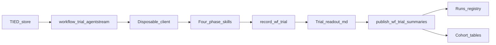

# Workflow trials — how we test, analyze, grade, and summarize

| Field | Value |
| --- | --- |
| **Audience** | Sponsors, curious developers, facilitators new to the corpus |
| **Scope** | Traditional **four-phase** workflow trials (**PROMPT-WF-01…12**) |
| **Not** | Universal TIED onboarding, greenfield-only trials, or a model **leaderboard** |
| **Facilitator index** | [README.md](README.md) |
| **Normative catalog** | [catalog-traditional-workflow-trial-prompts.md](catalogs/catalog-traditional-workflow-trial-prompts.md) |

[REQ-WF_TRIAL_EVALUATION_GUIDE] Store documentation only; adapts to a Reddit-style progress post via [§ Reddit post skeleton](#reddit-post-skeleton).

---

## Overview

**Workflow trials (WF)** measure how well a **vendor agent harness** (Cursor Agent or Claude Code CLI, driven through **`tied agentstream`**) completes a fixed **product workflow** on a disposable TIED client:

`@add-feature` → `@refine-plan` → `@build-plan` → `@close-out`

Each trial uses a short **product remainder** (plain language—no methodology pasted into the prompt). We vary **harness profile** (`cursor` | `claude`), **model configuration** (`MODEL_SLUG`, effort tier), and **prompt index** (`PROMPT-WF-NN`) while holding the workflow steps constant.

Scores are **seven facilitator dimensions** plus explicit **workflow choreography** weighting—not a single `maturity_score` and **not a leaderboard**. One cell does not crown a “best model.”

---

## What a workflow trial is and is not

| It **is** | It **is not** |
| --- | --- |
| A small TypeScript product task on a fresh disposable client | Instructions telling the agent how to “use TIED” in the paste |
| Four **separate** sponsor turns (planning skills, then implementation) | One long chat that mixes planning and coding |
| Comparable cells: one client per **(prompt × harness × model)** | Reusing one client across models or prompts |
| Facilitator **session grading** after inspection | REQ `Implemented` status from `tied_verify` on the store repo |

**Greenfield contrast:** [Greenfield plan-new-feature prompts](../demos/catalog-greenfield-plan-new-feature-prompts.md) stress a different grading shape (no **workflow choreography** dimension). WF trials exist to stress **phase boundaries** and skill hygiene.

**Forbidden framing (normative):** do not publish `maturity_score`, CMMI levels, or wall-clock as a **winner** proxy. Registry **mean** grades are for **sorting rows within a table**, not universal ranking.

---

## How a run is conducted

### Manual path (IDE)

1. From the TIED **store**, bootstrap a disposable client (`test-new-tied-client`).
2. Set the target **model** before turn 1.
3. Run four sponsor turns per the [four-phase protocol](catalogs/catalog-traditional-workflow-trial-prompts.md#four-phase-sponsor-protocol-normative).
4. After each turn, update `trial-workflow-interaction-inventory.v1.json` under the client `tied-project/working/`.

### Orchestrated path (store CLI)

The store wrapper **`workflow_trial_agentstream wf-NN`** (or matrix batches via **`workflow_trial_range`**) bootstraps the client, extracts the catalog prompt, and runs the four-phase **agentstream** batch. Orchestrator evidence lands under the client `tied-project/working/wf-trial-orchestrator-run/evidence/` (`wf-trial-orchestrator-run.v1.json`, stdout/stderr logs).

Details: [Automated agentstream path](catalogs/catalog-traditional-workflow-trial-prompts.md#automated-agentstream-path).

### Shared implementation stack

Unless opted out, orchestrated cells seed **`wf-trial-ts-node-test-v1`**: TypeScript under `src/`, tests via `node --test`, verify with `npm test`. That keeps product proof comparable across harnesses.

---

## What facilitators analyze

After the agent finishes (or aborts), a facilitator in the **store** workspace runs **`@record-wf-trial`** against the disposable client. The skill inspects:

- **Git history** vs expected phase boundaries (product commits before `build-plan` → choreography fail signal).
- **Tests and PLAN** on disk (including composition binding for **WF-09…12**).
- **Gate receipts** and checklist evidence under `tied-project/working/{REQ}/`.
- **`trial-workflow-interaction-inventory.v1.json`** (four turns, skill names).
- **Orchestrator logs** when present (exit code, wall time, stderr finalize).

Each readout records **three completion signals**:

| Signal | Meaning |
| --- | --- |
| **Machine close_out** | Close-out skill allowed traceable commit + CITDP persist |
| **Process contract** | Gates, proof manifest, sponsor-visible honesty |
| **Orchestrator** | Shell/agentstream batch `exit_code` |

**Split signals** are common: orchestrator **`exit_code: 0`** while **machine close_out** is **fail** (e.g. CITDP adversarial fields block `citdp_record_write`). Teaching example: [WF-09 Haiku low @ 1794880253](readouts/trial-readout-PROMPT-WF-09-claudehaiku55low-1794880253-wf-agentstream-wf-09-claude-claudehaiku55low.md) — eight green tests on disk, no traceable product commit.

**Proof boundary:** readouts reconstruct from paths, SHAs, gate narrative, and log excerpts—not full chat transcripts.

**HMEP (separate layer):** stream-json token/cost import under [harness-eval/](harness-eval/README.md) is **independent** from `@record-wf-trial` session grades. Do not merge HMEP metrics into session band tables.

---

## How grading works

Facilitators score **seven dimensions** (weights in the [catalog rubric](catalogs/catalog-traditional-workflow-trial-prompts.md#facilitator-grading-readout)):

| Dimension | Weight (indicative) | Inspects |
| --- | --- | --- |
| Requirement interpretation | 13% | Ambiguity resolved in writing |
| Traceability closure | 17% | Project YAML/code/test alignment |
| Test strategy | 17% | RED in build-plan; composition evidence when required |
| Algorithm / implementation | 17% | Behavior and honest limits |
| Process adherence | 12% | Tracker slugs, gate receipts, close_out honesty |
| **Workflow choreography** | **15%** | Phase boundaries, four turns, plan carry-forward |
| Methodology learning readout | 9% | Often **N/A** for this catalog |

**Bands** use letter grades **A** through **F** with optional **+** / **−**. Each row includes a **Rationale** sentence grounded in the same readout ([normative rules](../../tools/bundled-record-wf-trial-skill/reference.md#session-grading-rationale)).

**Registry compact string:** `{mean} · Req/Tr/Ts/Al/Pr/Ch/Ml` — leading **mean** is the arithmetic average of dimension bands on a 0.0 (**F**)–4.0 (**A**) ladder (`meanCompactGrades` in [read-trial-readout-session-grading.mjs](../../tools/bootstrap/lib/read-trial-readout-session-grading.mjs)). Trailing slash tokens are per-dimension bands for sorting and cohort joins—not REQ implementation status.

**Future-test rule** (in readouts): one trial does not prove methodology effectiveness.

---

## Cohort summaries available now

Committed artifacts (regenerated with **`@publish-wf-trial-summaries`** after new readouts):

| Artifact | Role |
| --- | --- |
| [`readouts/`](readouts/) | **~195** per-run analyses (`trial-readout-PROMPT-WF-*.md`) |
| [traditional-workflow-trial-runs-registry.md](registries/traditional-workflow-trial-runs-registry.md) | Master table + **latest-run comparison matrix** |
| [comparison-table.md](cohort/comparison-table.md) | Project **size layers** + optional grades join |
| [catalog-tied-size-and-trial-statistics.md](catalogs/catalog-tied-size-and-trial-statistics.md) | Column definitions for size proof facets |
| Workflow catalog **Recorded trials** | Human index maintained during `@record-wf-trial` |

Publish skill rebuilds registry and matrix from **readout files on disk** plus catalog links—without re-opening disposable clients.

---

## End-to-end flow

---

## How to explore this corpus

1. [Agent harness evaluation README](README.md) — facilitator map.
2. **This guide** — lifecycle narrative.
3. [Exemplar readout (WF-09 split signals)](readouts/trial-readout-PROMPT-WF-09-claudehaiku55low-1794880253-wf-agentstream-wf-09-claude-claudehaiku55low.md).
4. [Runs registry](registries/traditional-workflow-trial-runs-registry.md) — matrix cells and grades.
5. [Cohort comparison table](cohort/comparison-table.md) — size + wall clock + grades.

Operator commands: [operator-cheatsheet.md](operator-cheatsheet.md).

---

## Reddit post skeleton

Sponsor edits voice before posting. **Do not** frame results as a model leaderboard.

### Hook (1–2 sentences)

We have been running the **same four-step agent workflow** (plan → refine → build → close) across **Cursor and Claude** harnesses, with **~195 committed readouts** and machine-regenerated summary tables—not anecdotal “vibes.”

### What we measure (bullets)

- Small **TypeScript product tasks** on disposable repos (`wf-trial-ts-node-test-v1`).
- **Workflow choreography** (did the agent respect add-feature vs build-plan boundaries?).
- Seven **facilitator dimensions** including traceability, tests, and process gates.
- **Split signals** when the orchestrator passes but close-out is blocked (honesty over greenwashing).

### What is published in the repo

- Per-run **readouts** with session grading tables and rationales.
- **Runs registry** + WF×model **comparison matrix**.
- **Project-size cohort table** (YAML/traceability mass vs unit/composition tests).

### Limitations (required)

- **Not a leaderboard** — means in the registry sort rows; they do not rank “best AI.”
- **No `maturity_score`** — forbidden framing in this program.
- **HMEP token metrics** ([harness-eval](harness-eval/README.md)) are separate from session grades.
- One cell ≠ proof that TIED (or any harness) always works.

### Links (fill for your hosting)

- Corpus index: `docs/agent-harness-evaluation/README.md`
- This guide: `docs/agent-harness-evaluation/workflow-trials-guide.md`
- Example readout: `docs/agent-harness-evaluation/readouts/trial-readout-PROMPT-WF-09-claudehaiku55low-1794880253-wf-agentstream-wf-09-claude-claudehaiku55low.md`