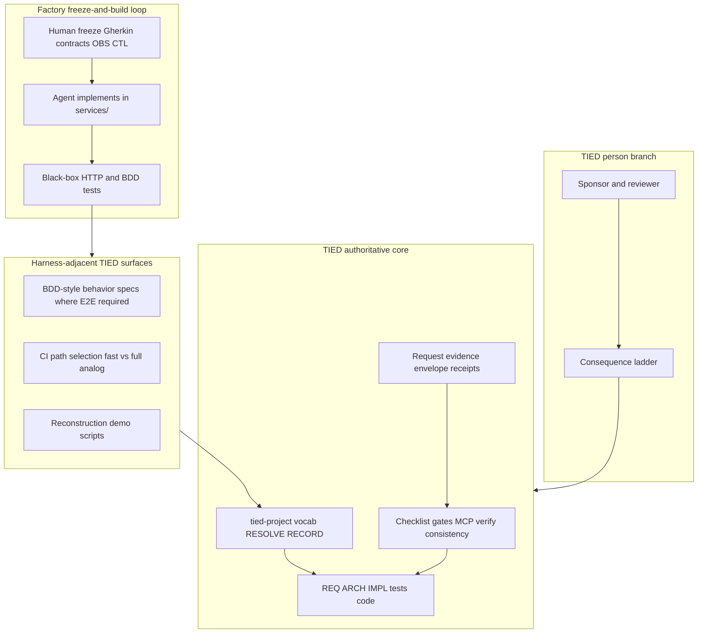

# AI-SDLC ATDD Software Factory × TIED — executable-spec lens

| Field | Value |
| --- | --- |
| **Purpose** | Map the **AI-SDLC ATDD Software Factory** reference repository’s **executable-specification / ATDD factory** model (frozen Gherkin and contracts, protected tests, run records, reconstruction) to TIED as implemented in this repository—with emphasis on **traceability**, **verification gates**, and **evidence**—not adopting the factory as a product or certifying PetClinic outcomes. |
| **Audience** | Sponsors, platform leaders, harness authors, prompt-type operators, methodology owners |
| **Source** | Local read-only inspection of `AI-SDLC-ATDD-SoftwareFactory-main` (author’s Downloads copy, **2026-10-23**). Upstream identity: **AI-SDLC Software Factory** open-source reference (PetClinic reference application). No Wave 1 capture file in this repo; claims below are **target-repo-observed/documented** unless labeled **Factory-reported**. |
| **Evidence boundary** | stdd did **not** run target `npm test`, `spec/run-all.js`, or generate run records during authoring. Metrics such as Checkout Python rebuild with zero interventions are **Factory-reported** from target `README.md` / `BACKLOG.md`, **not_measured** in stdd. |
| **Status / date** | Outreach / analysis snapshot, **2026-10-23** — **reference only; this document does not mint REQ/ARCH/IMPL tokens** |
| **Executable follow-up** | Wave 3 candidates listed in § Phased recommendations (**Defer** until scoped **add-feature** / **build-plan**) |
| **Distinct from** | [Traefik harness × TIED](traefik-harness-platform-vs-tied-agent-management.md) (harness/platform **seam**); [LangChain harness × TIED](langchain-harness-engineering-vs-tied-agent-management.md) (trace/benchmark tuning); [Cursor harness × TIED](cursor-harness-engineering-vs-tied-agent-management.md) (product telemetry); [Heimsbakk × TIED](veronika-heimsbakk-ai-generated-ontologies-vs-tied-agent-management.md) (meaning ownership); [Ludanyi × TIED](andras-ludanyi-illusion-of-measurement-judgment-cooperation-vs-tied-agent-management.md) (people/metrics); [TIED vs well-known methodologies](tied-vs-well-known-methodologies.md) (broad map) |
| **TIED anchors (reference only)** | [AGENTS.md](../../AGENTS.md), [agent-req-implementation-checklist.md](../../tied-bundle/docs/agent-req-implementation-checklist.md), [processes.md](../../tied-bundle/docs/processes.md) ([PROC-TIED_DEV_CYCLE](../../tied-bundle/docs/processes.md)), [pseudocode-writing-and-validation.md](../../tied-bundle/docs/pseudocode-writing-and-validation.md), [quality-assurance](../../tied-project/vocab/quality-assurance.md), [sponsor-agent-relationship.md](../../tied-project/vocab/sponsor-agent-relationship.md), [external-service-three-wave-comparison-template.md](../../tied-bundle/docs/external-service-three-wave-comparison-template.md), [request evidence envelope](../../tied-project/requirements/REQ-REQUEST_EVIDENCE_ENVELOPE.yaml) (existing token reference only) |

---

## Executive summary

The **Software Factory** (target repository) is a **working prototype** that normalizes platform engineering through **repeatable delivery paths**, **executable standards**, and **consistent evidence**. Humans **freeze** business examples (BDD/ATDD), API and domain contracts, observability rules, and delivery controls; agents **build** implementation inside enforced boundaries; **independent evidence** (test run records, review, release records) supports ship decisions (**Factory-reported** product direction in `PROJECT-PLAN.md`, A-28). **PetClinic** is the **reference application**, not the product. The repo combines a **protected `spec/` tree**, **red-first protected tests**, a **black-box HTTP harness**, **`spec/run-all.js`** run records with an **exact-tree hash**, delivery controls tagged **CTL-***, observability **OBS-***, and a **reconstruction experiment** (delete a service; rebuild from frozen specs and tests).

TIED’s center of gravity is **intent traceability and proof during software change in TIED clients**: RESOLVE/RECORD vocabulary, CITDP change definition, REQ → ARCH → IMPL **essence_pseudocode** with block-level token comments, checklist **pre_implementation** gates, strict TDD and composition order, MCP-first **project** YAML writes, **`tied_validate_consistency`**, verification-gated **`tied_verify`**, LEAP on divergence, request **evidence envelopes**, and the sponsor **consequence ladder**. TIED does not ship a multi-tenant “factory SKU”; it ships **methodology** installable into client repos via `tied-install.sh`.

**Compose-don’t-replace:** Borrow **executable-spec discipline** (freeze expectations, red baseline, black-box verification, durable artifacts over chat) as **harness-adjacent** and **process** patterns. Keep **semantic token authority**, **gate receipts**, **MCP YAML writes**, **sponsor costly choices**, and **REQ/ARCH/IMPL graph truth** on the TIED/checklist plane. Do not replace TIED tokens with factory local IDs (`D-*`, `A-*`, `OBS-*`, `CTL-*`) or treat run-record JSON as equivalent to checklist gate state without a scoped integration REQ.

| Center of gravity | AI-SDLC Factory (target repo) | TIED (this repo) |
| --- | --- | --- |
| Primary artifact | Gherkin features, OpenAPI/domain contracts, protected tests | `[REQ-*]` / `[ARCH-*]` / `[IMPL-*]` YAML + pseudo-code + tests |
| Agent boundary | Read-only `spec/` + hook/guard (A-07) | Checklist gates, MCP base path, adversarial depth when enrolled |
| Verification loop | `npm test` / `run-all.js` tiers, cache, `--verify` on tree hash | RED/GREEN TDD, composition tests, `tied_verify`, consistency validation |
| Evidence for reviewers | `test-results/runs/<runId>.json` + suite logs | Gate receipts, manifests, request evidence envelope |
| Product vision | Enterprise/gov **Software Factory** (three layers A-28) | Methodology store + client **tied-project/** traceability |
| Local decision IDs | D-*, A-*, OBS-*, CTL-*, REV-*, GAP-* | Semantic tokens + vocab glossaries |

---

## Source summary (Factory claims only)

Bullets summarize target `README.md`, `PROJECT-PLAN.md`, `docs/development-workflow.md`, `spec/README.md`, `spec/run-all.js`, and `docs/decisions/architecture.md` as read **2026-10-23**. Outcomes unless reproduced in stdd are **Factory-reported**.

- **Factory objective:** Repeatable approved practices, executable standards, consistent evidence, clear ownership, governed exceptions; humans freeze expectations, agents build inside boundaries (**target-repo-observed**).
- **Status:** Working prototype on one reference application; **not** production-ready, certified, or authorized to operate; **no second application yet** (**Factory-reported** in README).
- **PetClinic:** Four JS microservices + frontend; contract, auth, observability, workflow, browser, performance suites; **Checkout rebuilt in Python** by a fresh agent with **zero interventions** (**Factory-reported**).
- **Protected spec:** Agents may read `spec/` but must not create, modify, or delete during build phase (GUARD-01, A-07): deny rules, PreToolUse hook, CODEOWNERS, `guard` workflow, `spec/protected.sha256` (**target-repo-observed**).
- **Black-box tests (A-03):** HTTP-only against services; no importing application code; OTLP to test collector for OBS rules in any language (**target-repo-observed**).
- **Build sequence:** Lock decisions → service features → architecture/guard → derive API contracts → **red** contract tests (agent cannot modify) → workflow features/tests → agent implements until green → delete service and rebuild experiment (**target-repo-observed** in `docs/development-workflow.md`).
- **Run records:** Every `run-all.js` execution writes JSON under `test-results/runs/` with tree hash covering tracked and untracked non-ignored files; `--verify` exits 0 only if gate complete for current tree (**target-repo-observed** in `spec/run-all.js` header comments).
- **Delivery controls:** NIST/SSDF-tagged scenarios in protected `spec/delivery/` (A-16, A-19); governance release records (A-23); policy-governed approver identity (A-29) (**target-repo-observed**).
- **Roadmap:** Governed cloud delivery, operation, **factory core extraction before durable state** (A-26), per-application repos (A-27); guided product experience GUIDE-01 **proposed, not approved** (**Factory-reported**).
- **Reconstruction demo:** `tools/demo/` runs EXP-01 experiment outside protected `npm test`; separate visual baselines for headed demo vs frozen headless suite (**target-repo-observed** in `tools/demo/README.md`).

---

## Relationship to sibling comparisons

| Sibling | What it owns | This document owns |
| --- | --- | --- |
| [Traefik × TIED](traefik-harness-platform-vs-tied-agent-management.md) | Harness vs **platform seam** (auth, fleet egress) | **Executable spec factory**: freeze, protected tests, run records, ATDD delivery |
| [LangChain × TIED](langchain-harness-engineering-vs-tied-agent-management.md) | Trace-driven harness tuning on benchmarks | Not LangSmith / Terminal Bench loops |
| [Cursor × TIED](cursor-harness-engineering-vs-tied-agent-management.md) | Online evals, Keep Rate | Not Cursor product telemetry |
| [Heimsbakk × TIED](veronika-heimsbakk-ai-generated-ontologies-vs-tied-agent-management.md) | Meaning ownership for vocab/tokens | Factory **local IDs** vs TIED tokens—bridge only |
| [Ludanyi × TIED](andras-ludanyi-illusion-of-measurement-judgment-cooperation-vs-tied-agent-management.md) | Proxy metrics and judgment | Factory **evidence for ship** vs TIED **proof for intent change**—related but distinct |
| [TIED vs well-known methodologies](tied-vs-well-known-methodologies.md) | Broad methodology map | **Single external factory reference repo** with PetClinic proof narrative |

Cross-link Traefik when separating **turn orchestration** (agent prompts, BDD steps) from **governance authority** (who may change verification and YAML truth).

---

## Harness lessons → TIED agent management

Subsections map factory mechanisms to TIED surfaces for agent-heavy delivery in **this** repository and TIED **clients**.

### Specification-first workflow vs documentation-first TIED

| Factory pattern | TIED surface | Notes |
| --- | --- | --- |
| Durable repo artifacts over chat (`development-workflow.md`) | `tied-project/working/`, CITDP, committed plans | Both reject session-only requirements |
| Ordered lock → features → contracts → red tests → implement | REQ → ARCH → IMPL → RED tests → code ([PROC-TIED_DEV_CYCLE](../../tied-bundle/docs/processes.md)) | Same epistemic order; different file shapes |
| BACKLOG-driven tasks | Checklist **Tracker** + prompt-type workflows | Factory backlog ≈ harness task list; TIED adds token graph |
| Approved vs proposed designs | Sponsor **costly choices** + CITDP scope | Factory explicit in workflow step 4 |

### Protected spec / GUARD vs MCP YAML authority

| Factory pattern | TIED surface | Notes |
| --- | --- | --- |
| Filesystem + hook deny on `spec/**` (A-07) | **Wrong `TIED_BASE_PATH`** prevention; MCP-only project writes | TIED authority is **tooling + gates**, not repo ACL alone |
| Protected contract tests agent cannot edit | RED tests owned by humans; adversarial inquiry when integrated | Align on non-negotiable verification |
| `guard` CI on manifest hash | `tied_checklist_gate_validate`, `tied_git_hygiene` | Both fail closed on tamper/skipped checks |
| Human-only edits to AGENTS.md in factory | Methodology read-only `tied-bundle/` in clients | Parallel “agent reads, human owns spine” |

### Gherkin, contracts, OBS/CTL vs vocab, REQ, evidence manifests

| Factory pattern | TIED surface | Notes |
| --- | --- | --- |
| Gherkin in `spec/features/` | Composition/E2E where UI required; not REQ substitute | Behavior at harness-adjacent layer |
| OpenAPI/domain in `spec/contracts/` | ARCH decisions + binding inventory + contract tests | **[ARCH-*]** + tests vs OpenAPI files |
| OBS-001..OBS-048 telemetry rules | Quality/evidence chain profiles, assurance tags | **Partial align** on tagged evidence classes |
| CTL-* delivery scenarios (@nist, @ssdf) | Conformance/readiness methodology (EDPC/certification tracks) | Factory embeds compliance in **executable** scenarios |
| D-* business decisions in `docs/specs/` | `[REQ-*]` detail + vocab **RESOLVE** | **Bridge table** in § Touchpoint 1—no second authority |

### `run-all.js`: tiers, cache, verify, tree hash

| Factory pattern | TIED surface | Notes |
| --- | --- | --- |
| `--tier fast` / `full`, `--cache`, `--verify` | Checklist phase gates; verification-gated **`tied_verify`** | Factory optimizes **test re-run**; TIED optimizes **change proof** |
| Tree hash in run record JSON | Request evidence envelope, quality manifests | **Gap** for hash import—Wave 3 **Defer** |
| Reviewers run `npm run test:verify` | Sponsor reads gate receipts + envelope | Both separate “agent said green” from reviewer evidence |
| `--diff A..B` suite selection | Scoped test strategy in CITDP / Tracker | **Composable** CI path selection |

### Factory AGENTS.md + development-workflow vs stdd AGENTS.md + prompt-types

| Factory pattern | TIED surface | Notes |
| --- | --- | --- |
| Agent reads workflow + backlog item | **PRELOAD** vocab routing; prompt-type skills | TIED broader methodology bootstrap |
| Report commands, run records accurately | Debug prefixes; gate diagnostics | Evidence honesty aligned |
| No modify protected spec | No ad-hoc project YAML without MCP/`tied-cli` | Parallel enforcement models |

### Reconstruction / demo tools vs EASAR recovery analog

| Factory pattern | TIED surface | Notes |
| --- | --- | --- |
| Delete Checkout; rebuild from specs/tests (EXP-01) | EASAR / brownfield recovery engagements | **Composable** experiment narrative; not equivalent proof |
| `tools/demo/` not in `npm test` | Working folders vs regenerable `tied-bundle/working/` | Demo ≠ gate authority |
| Separate headed visual baselines | E2E justification in TIED dev cycle | Factory splits demo vs frozen headless explicitly |

---

## Touchpoint 1 — RESOLVE

| Factory local ID / term | TIED preferred term / surface | Notes |
| --- | --- | --- |
| **Software Factory** (product) | Methodology **compose** reference | stdd is not the factory SKU |
| **Protected `spec/`** | Human-owned verification + gates | Add filesystem guard only as client policy **Defer** |
| **Gherkin / ATDD feature** | Composition/E2E spec (harness-adjacent) | Not `[REQ-*]` replacement |
| **A-xx** architecture decision | `[ARCH-*]` detail + decision log | Bridge in prose; do not alias IDs |
| **D-xx** business decision | `[REQ-*]` criteria + vocab | Sponsor-owned intent |
| **OBS-*** observability rule | Evidence/assurance tagging | Map classes, not renumber OBS into tokens |
| **CTL-*** delivery control | Process certification / client DevOps appendix | Executable scenarios vs TIED checklist slugs |
| **Run record / tree hash** | Envelope + gate receipts | Wave 3 import **Defer** |
| **REV-*** / rehearsals | Claims-evidence review; sponsor person branch | Align on independent review |
| **Reconstruction protocol** | Operator experiment; EASAR **analog** | **Factory-reported** outcomes only |

**RESOLVE charter (this comparison):** Canonicalizes **names and mappings** only; does not change sponsor intent authority or mint TIED tokens from comparison prose.

### Disposition key

| Disposition | Meaning in this comparison |
| --- | --- |
| **Align** | TIED materially represents the external intent (scoped). |
| **Composable** | Combine without equivalence claims. |
| **Tension** | Partial overlap; proof boundary must be explicit. |
| **Gap** | External emphasis not in TIED core as-is. |
| **Defer** | Product, client infra, or sponsor-owned choice. |

### Claim labeling

| Label | Use when |
| --- | --- |
| **target-repo-observed/documented** | Structure read from local target tree during authoring |
| **Factory-reported** | Outcomes/metrics claimed in target README/BACKLOG not re-run in stdd |
| **TIED-existing** | Committed docs/tools in stdd |
| **Recommendation-only** | Operator suggestions not yet enforced by gates |
| **`not_measured`** | Whether adopting factory patterns improves TIED client outcomes |

---

## Primary capability matrix

| Concern | TIED COG | Disposition | One-line rationale |
| --- | --- | --- | --- |
| Freeze human-owned expectations before code | REQ/ARCH/IMPL + vocab RESOLVE | **Align** | Same ordering as factory spec lock |
| Agent cannot mutate verification | Protected tests + checklist gates | **Align** | TIED: tests + MCP/checklist, not only `spec/` ACL |
| Executable spec (Gherkin/OpenAPI) | IMPL pseudo-code + tests | **Composable** | Different shapes; same proof intent |
| Red baseline before implementation | TDD + composition-first | **Align** | Factory explicit; TIED mandatory cycle |
| Exact-tree test gate | Manifests/receipts | **Gap** | Factory run record + hash; not identical in TIED |
| Run record JSON for reviewers | Request evidence envelope | **Partial align** | Wave 3 import candidate |
| OBS/CTL delivery tagging | Assurance / evidence chain profile | **Partial align** | Both tag evidence classes |
| Local D/A/OBS IDs vs semantic tokens | `[REQ-*]` graph | **Tension** | Bridge only; no second authority |
| Black-box service harness | Module validation + contract tests | **Align** | Bindings verified without UI-only proof |
| Reconstruction from spec+tests | EASAR Mode C analog | **Composable** | Factory experiment ≠ TIED recovery engagement |
| Platform factory (multi-app) | `tied-install` + client project YAML | **Defer** | stdd is methodology store |
| Chat as requirements record | — | **Align** (anti-pattern) | Both prefer durable artifacts |
| Independent review / rehearsals | Sponsor/reviewer person branch | **Align** | REV-* maps to claims review |
| Second app before core extraction | — | **Defer** | Factory roadmap (A-27); not TIED policy |
| NIST mapping in scenarios (A-16) | Process certification readiness tracks | **Composable** | Traceability vs certification claim |

---

## Authority boundary

The factory’s **product** loop (multi-app factory core, org policy layer) sits **outside** TIED’s authoritative core. TIED clients may **compose** executable-spec and black-box patterns while keeping **token graph** and **gate** authority on the TIED plane.

---

## Anti-patterns (Factory lessons → TIED risk)

| Risk | Symptom | TIED-oriented remedy |
| --- | --- | --- |
| Chat as spec | Agent implements from thread; no frozen checks | Working plans, CITDP, RED tests before code |
| Weakening protected tests | Green by deleting assertions | LEAP; verification gate; sponsor review |
| Run record without tree context | “Tests passed” without hash/manifest | Envelope + gate receipts; label **`not_measured`** until integrated |
| Factory local IDs as TIED tokens | `A-07` copied into `[ARCH-*]` without LEAP | **Bridge table** only; scoped migration via **add-feature** |
| Filesystem guard without gates | Agent bypasses via wrong tool path | MCP base-path check; checklist **pre_implementation** |
| Reconstruction demo as proof | Headed demo passes; headless suite diverges | Separate evidence classes (factory documents this split) |
| Comparison prose mints REQ | New `[REQ-FACTORY-*]` in markdown | Wave 3 only via normal TIED workflows |
| Adopting factory as TIED replacement | Dropping vocab/CITDP for Gherkin-only | **Compose-don’t-replace** |

---

## Compose-don’t-replace: tune executable-spec discipline vs keep TIED authority

| Tune with **factory-inspired** practice (harness/process) | Keep **TIED** authority |
| --- | --- |
| Freeze acceptance examples before agent build | `[REQ-*]` / sponsor intent via vocab RESOLVE |
| Red-first protected contract tests | IMPL block comments + composition tests |
| Black-box HTTP verification of bindings | Module validation mandate |
| Run records for reviewer audit (client policy) | Checklist gate receipts + **`tied_verify`** |
| Reconstruction experiments on throwaway repos | EASAR/recovery scoped engagements |
| CTL/OBS tagged evidence classes | Assurance profiles—not factory scenario IDs in stdd YAML |
| Per-app repos for agent context (A-27) | Client install layout; **`TIED_BASE_PATH`** per window |

---

## Bounded operator recommendations (Recommendation-only)

1. **Operator crosswalk** — When onboarding factory practitioners, link this analysis and [TIED vs well-known methodologies](tied-vs-well-known-methodologies.md); state explicitly that Gherkin/OpenAPI **compose with** REQ/ARCH/IMPL—they do not replace tokens.
2. **Local-ID bridge** — Maintain a client-side table (outside TIED indexes) mapping factory `D-*`/`A-*` to client `[REQ-*]` when brownfielding a factory-style repo into TIED—never dual authority.
3. **Black-box experiment guidance** — For TIED clients adding microservices, prefer composition tests that mirror factory A-03 (HTTP-only, no app imports) before UI E2E.
4. **Exact-tree gate analog** — Before claiming verification complete, align envelope/git tree references with gate receipts; do not assume factory `run-all.js --verify` semantics exist in TIED without Wave 3 REQ.
5. **Reconstruction pilot** — Treat delete-and-rebuild exercises as **research** with **Factory-reported** or locally reproduced evidence; do not substitute for **`tied_validate_consistency`** or module validation.
6. **Second-application criterion** — Defer extracting “factory core” patterns into stdd methodology until a sponsor confirms a second real client application (mirrors factory A-15/A-27 discipline).

---

## Phased recommendations (doc-first)

| Phase | Action | Status |
| --- | --- | --- |
| **0** | This analysis + `.gitignore` allowlist | **Done** (2026-10-23 build-plan) |
| **1** | Optional `client-development-index` three-wave row or bundle crosswalk appendix | **Defer** |
| **2** | Project vocab RECORD (`executable specification factory`, `exact-tree gate`) | **Defer** (costly) |
| **3** | `methodology-composition-matrix.md` row | **Defer** |
| **3** | Run-record / tree-hash fields in request evidence envelope | **Defer** — **add-feature** |
| **3** | Client profile: protected spec + runtime contracts + guard | **Defer** — **add-feature** |
| **3** | Local-ID → token traceability adapter (read-only tooling) | **Defer** |
| **3** | Reconstruction runner skill (non-production pilot) | **Defer** |

---

## Explicit non-adoptions

- Replacing TIED **REQ/ARCH/IMPL** stack with factory **`spec/`** layout as the authoritative traceability graph in stdd
- Certifying, authorizing, or claiming **production readiness** for the factory from this comparison
- Auto-importing factory run records into TIED envelopes **without** scoped REQ and schema review
- Renumbering factory **OBS-***/**CTL-*** into stdd semantic tokens from outreach prose
- OWL/reasoner/enterprise KG core (N/A; see Heimsbakk comparison for meaning-ownership analog)
- Running factory **`npm test`** as proof of TIED methodology effectiveness (**`not_measured`**)

---

## Proof boundary

- Target repository claims and PetClinic metrics are **target-repo-observed/documented** or **Factory-reported**. They are **not** stdd checklist results, **`tied_verify`** outcomes, or independently reproduced experiments in this wave unless explicitly noted.
- TIED surfaces cited describe **TIED-existing** committed behavior at authoring time; composability does not imply the factory is implemented inside stdd.
- Wave 3 behavior changes require normal TIED workflows (**add-feature**, **build-plan**, LEAP, tests)—not comparison markdown alone.
- stdd did **not** execute the target test suite or generate run records during authoring of this document.

---

## Related documents

- [External three-wave comparison template](../../tied-bundle/docs/external-service-three-wave-comparison-template.md)
- [Traefik harness × TIED (sibling)](traefik-harness-platform-vs-tied-agent-management.md)
- [LangChain harness × TIED (sibling)](langchain-harness-engineering-vs-tied-agent-management.md)
- [Heimsbakk × TIED (sibling)](veronika-heimsbakk-ai-generated-ontologies-vs-tied-agent-management.md)
- [Ludanyi × TIED (sibling)](andras-ludanyi-illusion-of-measurement-judgment-cooperation-vs-tied-agent-management.md)
- [TIED vs well-known methodologies](tied-vs-well-known-methodologies.md)
- [Working plan](../../tied-project/working/DOC-AI-SDLC-FACTORY-COMPARISON/PLAN-refine-pass1.md)
- [Agent req implementation checklist](../../tied-bundle/docs/agent-req-implementation-checklist.md)
