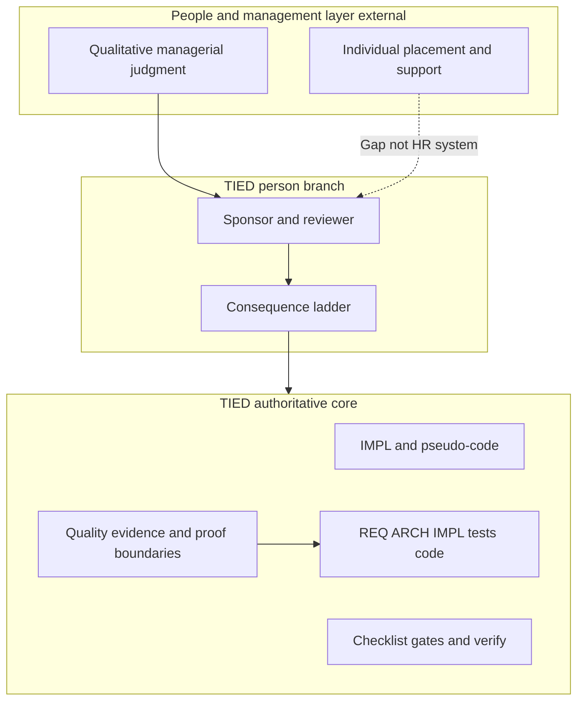

# Ludanyi “Illusion of Measurement” × TIED — agent management lens

| Field | Value |
| --- | --- |
| **Purpose** | Map Andras Ludanyi’s **human-management critique of proxy metrics** (judgment, individuality, cooperation, contextual placement) to TIED as implemented in this repository—with emphasis on **proof boundaries**, sponsor–agent authority, and engineering evidence—not HR performance systems or article history as verified fact. |
| **Audience** | Sponsors, managers, harness authors, prompt-type operators, methodology owners |
| **Source URL** | [LinkedIn Pulse — Ludanyi, 2026-10-22](https://www.linkedin.com/pulse/illusion-measurement-judgment-individuality-teams-andras-ludanyi-k7ave/) (**Ludanyi-reported**); full text **not** in repo — [sibling stub](andras-ludanyi-illusion-of-measurement-judgment-cooperation.md) |
| **Article reference (sibling)** | [andras-ludanyi-illusion-of-measurement-judgment-cooperation.md](andras-ludanyi-illusion-of-measurement-judgment-cooperation.md) — metadata + TL;DR only; **reference only** |
| **Status / date** | Outreach / analysis snapshot, **2026-10-22** — **reference only; this document does not mint REQ/ARCH/IMPL tokens** |
| **Executable follow-up** | *(Wave 3: optional glossary RECORD or client-devops appendix pointer only—**Defer** unless sponsor scopes add-feature)* |
| **Distinct from** | [LangChain harness × TIED](langchain-harness-engineering-vs-tied-agent-management.md) (trace/benchmark harness metrics); [Cursor harness × TIED](cursor-harness-engineering-vs-tied-agent-management.md) (Keep Rate / product telemetry); [QMM Kaizen × TIED](qmm-kaizen-vs-tied.md) (Kaizen loops and proof boundaries); [TIED vs well-known methodologies](tied-vs-well-known-methodologies.md) (broad methodology map) |
| **TIED anchors (reference only)** | [AGENTS.md](../../AGENTS.md), [ai-principles.md](../../tied-bundle/docs/ai-principles.md), [sponsor-agent-relationship.md](../../tied-bundle/docs/sponsor-agent-relationship.md), [processes.md](../../tied-bundle/docs/processes.md), [pseudocode-writing-and-validation.md](../../tied-bundle/docs/pseudocode-writing-and-validation.md), [evidence-chain-profile.md](../../tied-bundle/docs/evidence-chain-profile.md), [client-development-index.md](../../tied-bundle/docs/client-development-index.md), [feedback-to-tied.md](../../tied-project/vocab/feedback-to-tied.md) |

---

## Executive summary

Ludanyi’s article (summarized from sponsor-read content; **not** reproduced in repo) argues that organizational excellence rests on **qualitative managerial judgment**, **distinct individual capability**, **cross-domain translators**, **contextual placement and support**, and **intentional cooperation**—and that proxy metrics (velocity, pull requests, cycle time, ticket counts) create an **illusion of measurement** for inherently qualitative human contribution.

TIED’s center of gravity is different but **complementary**. TIED governs **software change and agent-assisted delivery**: intent traceability (requirements → architecture → implementation → tests → code), mechanical vs human judgment splits, checklist gates, quality evidence manifests, Kaizen-style **`not_measured`** / **`inconclusive`** outcomes, and the sponsor **consequence ladder** for **costly choices**. TIED does **not** model employee performance management, HR placement, or team chemistry as authoritative core semantics.

**Compose-don’t-replace:** Use TIED to make **engineering and agent-governance evidence boundaries** inspectable; retain **manager and sponsor judgment** for people, context, and irreversible organizational choices. Both traditions warn against treating **proxy counts** as authority—for people in the article; for **artifact conformance mistaken for product quality or people merit** in TIED.

| Center of gravity | Ludanyi article (off-repo; **Ludanyi-reported** summary) | TIED (this repo) |
| --- | --- | --- |
| Primary subject | Human performance, team design, managerial judgment | Intent traceability, test-backed change, agent/sponsor authority |
| “Measurement” critique | Velocity/PR-style proxies for human contribution | Checklist counts, token coverage, consistency checks mistaken for quality or merit |
| Individuality | Distinct, well-placed people | Distinct **modules** and **roles** (sponsor, reviewer, agent); **Gap** for individual HR placement |
| Cooperation | Intentional combination toward shared purpose | **Composition tests**, vocabulary **RESOLVE**, sponsor **consequence ladder** |
| Proof | Managerial observation (qualitative) | **Proof boundaries**, manifests, **`not_measured`** / **`inconclusive`** in Kaizen and evidence chain |

---

## Source summary (Ludanyi claims only — off-repo)

Bullets summarize the sibling **TL;DR** (full text not in repo). Historical and empirical claims are **Ludanyi-reported**—not independently verified in this repository.

- **Illusion of measurement:** Complex human capabilities cannot be “measured” in a physical sense; impact, effectiveness, and performance are qualitative and contextual. Proxy indicators (velocity, pull requests, cycle times, ticket counts) substitute bureaucratic control for managerial insight (**user-supplied**).
- **Judgment vs metrics:** Evaluation requires active, qualitative observation—who needs support, who should lead, who should mentor, who are **translators** bridging domain, product, and architecture. Prevented mistakes and clarified requirements may show low personal output on charts (**user-supplied**).
- **Translators:** Rare cross-domain mediators often leave no trace on dashboards; leverage is qualitative (**user-supplied**).
- **Multidisciplinary teams:** Takeuchi/Nonaka rugby metaphor (**user-supplied** history) describes differentiated specialists in constructive tension—not fungible “resources.” Western adoption allegedly flattened this into interchangeable staffing (**user-supplied**).
- **Japanese placement (conceptual):** Toyota Production System cited as misread in the West; article claims respect for individual capability, rigorous fit-to-context, realistic judgment, and support with aptitude aligned to organizational need (**user-supplied**).
- **Coplien / Barnard cooperation:** High-performing software teams (e.g. Borland Quattro Pro cited, **user-supplied**) as small groups of distinct individuals in real-time alignment; cooperation as intentional act of capable individuals toward a common goal (**user-supplied**).
- **Closing prescription:** Abandon superficial quantitative proxies; evaluate strengths, provide targeted support, assign contexts where capabilities flourish (**user-supplied**).

---

## Relationship to sibling comparisons

| Sibling | What it owns | This document owns |
| --- | --- | --- |
| [LangChain harness × TIED](langchain-harness-engineering-vs-tied-agent-management.md) | Trace-driven harness tuning, Terminal Bench narrative | **People/management philosophy** × TIED—not LangSmith traces |
| [Cursor harness × TIED](cursor-harness-engineering-vs-tied-agent-management.md) | Keep Rate, A/B harness ops, tool reliability telemetry | **Anti-proxy-metrics for humans**—not Cursor product metrics |
| [QMM Kaizen × TIED](qmm-kaizen-vs-tied.md) | Kaizen loops, conformance vs effectiveness, **`not_measured`** | **Managerial judgment and HR placement**—cross-link Kaizen proof boundary only |
| [TIED vs well-known methodologies](tied-vs-well-known-methodologies.md) | Broad methodology map | **Single external manager essay** with explicit people-layer boundary |

Do not duplicate harness-metric rows from LangChain/Cursor analyses; cross-link when operators confuse **harness telemetry**, **checklist conformance**, and **people performance**.

---

## Harness lessons → TIED agent management

The article is not a harness post; subsections map **management themes** to TIED surfaces for agent-heavy software delivery.

### Judgment vs mechanical measurement

| Ludanyi pattern (**user-supplied**) | TIED surface | Notes |
| --- | --- | --- |
| Qualitative managerial judgment | Sponsor/reviewer **person branch**; default-proceed vs costly choice | [sponsor-agent-relationship.md](../../tied-bundle/docs/sponsor-agent-relationship.md) |
| Proxy metrics as illusion | **Proof boundary**; mechanical checks vs LLM judgment | [pseudocode-writing-and-validation.md](../../tied-bundle/docs/pseudocode-writing-and-validation.md) |
| “Mistake never made” invisible leverage | Tests/adversarial inquiry catch failures; absence-of-defect stays **judgment** | **Tension:** TIED proves artifact states, not full organizational leverage |
| Dashboard output vs prevention | Token/checklist counts ≠ quality | Align with article intent scoped to **artifacts** |

### Individuality and placement

| Ludanyi pattern | TIED surface | Notes |
| --- | --- | --- |
| Distinct individual capability | **Module** boundaries, independent validation | Not HR competency models |
| Contextual placement of people | **Context-adaptive profile** (CASE, advisory) | Practices for **delivery context**, not HR fit |
| Fungible “resources” anti-pattern | RESOLVE vocabulary; named roles (sponsor, agent) | **Gap** for individual ranking |
| Targeted support | Sponsor ladder, reviewer gates | Support for **delivery**, not performance management system |

### Cooperation and translators

| Ludanyi pattern | TIED surface | Notes |
| --- | --- | --- |
| Translators across domains | **RESOLVE** + **PRELOAD** glossaries; EDPC consultant/sponsor review | Coordination infrastructure, not people taxonomy |
| Multidisciplinary team (Nonaka) | CITDP, module validation, composition tests | Process-shaped cooperation; not rugby metaphor |
| Intentional cooperation | **Composition tests** before wiring; person vs instrument branch | Delivery cooperation evidence |
| Small high-alignment team (Coplien cited) | Working folders, bounded REQ slices | **user-supplied** history—not TIED team-size rule |

### Anti-proxy and scores

| Ludanyi pattern | TIED surface | Notes |
| --- | --- | --- |
| Velocity / PR / cycle time | — (**Defer** org metrics) | Warn when applied to **agents** or **people** |
| Universal effectiveness scores | Forbidden **`score`** / **`maturity`** keys in evidence chain | [evidence-chain-profile.md](../../tied-bundle/docs/evidence-chain-profile.md) |
| Conformance theater | Gate enforcement + **`not_measured`** effectiveness | [feedback-to-tied.md](../../tied-project/vocab/feedback-to-tied.md) Kaizen principles |

---

## Touchpoint 1 — RESOLVE

| Article term (**user-supplied**) | TIED preferred term / surface | Notes |
| --- | --- | --- |
| Qualitative **judgment** vs quantitative **measurement** | **Mechanical checks vs human/LLM judgment**; **proof boundary** | TIED separates machine evidence from sponsor/reviewer judgment |
| **Individual capability** / **placement** | **Gap** — not a TIED core model | Module capability and **sponsor** agency, not HR placement |
| **Translators** | **RESOLVE** + **PRELOAD**; EDPC consultant/sponsor review | Coordination infrastructure, not people-ranking |
| **Cooperation** of distinct individuals | **Person branch** / **instrument branch**; checklist + composition evidence | Delivery cooperation, not org-design theory |
| Proxy metrics (velocity, PRs, cycle time) | **Anti-pattern** when used as authority; test strategy coverage ≠ correctness | Organizational risk when misapplied to TIED artifacts or agents |
| Takeuchi/Nonaka, Japanese management, Coplien | **Article-reported / user-supplied** history | Conceptual background only—not verified in Wave 1–2 |

**RESOLVE charter (this comparison):** Canonicalizes **names and mappings** only; does not change sponsor intent authority or mint TIED tokens from comparison prose.

### Disposition key

| Disposition | Meaning in this comparison |
| --- | --- |
| **Align** | TIED materially represents the external intent (scoped to artifacts/agents). |
| **Composable** | Combine without equivalence claims (manager judgment + TIED evidence). |
| **Tension** | Partial overlap; proof boundary must be explicit. |
| **Gap** | Article emphasis not in TIED core (HR placement, individual merit systems). |
| **Defer** | Org metrics, vendor product, or sponsor-owned people processes. |

### Claim labeling

| Label | Use when |
| --- | --- |
| **Ludanyi-reported** | Article claims and historical citations (off-repo; summarized in sibling TL;DR) |
| **TIED-existing** | Committed docs/tools in this repo |
| **Recommendation-only** | Operator suggestions not implemented |
| **`not_measured`** | Effectiveness of TIED on teams or correctness of article history |

---

## Primary capability matrix

| Concern | TIED COG | Disposition | One-line rationale |
| --- | --- | --- | --- |
| Reject proxy metrics as performance truth | Proof boundary, test-strategy discipline | **Align** | TIED limits what evidence proves |
| Managerial qualitative judgment | Sponsor/reviewer; mechanical vs LLM split | **Composable** | Preserves human authority; not management training |
| Individual capability assessment | — | **Gap** | No canonical individual competency model |
| Contextual placement of people | Context profile (CASE, advisory) | **Tension** | Context for **practices**, not HR fit |
| Cross-functional **translators** | RESOLVE, vocabulary, EDPC | **Composable** | Language/coordination, not role taxonomy |
| Cooperation of distinct contributors | Sponsor–agent, composition evidence | **Composable** | Delivery cooperation, not org design |
| Multidisciplinary team (Nonaka) | CITDP, module validation | **Tension** | Teams work via process; not rugby metaphor |
| Prevent mistakes (invisible leverage) | Adversarial inquiry, tests | **Align** (partial) | Tests catch failures; absence stays judgment |
| Anti–checklist-gaming | Gate enforcement, pairing, non-implication rules | **Align** with limits | Artifacts gamed if read as rankings |
| Velocity / PR / cycle time | — | **Defer** (org) | Out of TIED core; warn on agents/people |
| Aggregate maturity / scores | Forbidden in evidence chain | **Align** | Matches anti-universal-score spirit |
| Employee performance management | — | **Defer** | Sponsor/manager domain outside TIED |

---

## Authority boundary

Manager and HR systems sit **outside** TIED’s authoritative core. TIED ingests **sponsor/reviewer** decisions at the person branch; it does not certify individual employee merit.

---

## Anti-patterns (Ludanyi lessons → TIED risk)

| Risk | Symptom | TIED-oriented remedy |
| --- | --- | --- |
| TIED as people KPI | Token/checklist counts rank engineers | Label **Gap**; use proof boundaries |
| Conformance trap | Gates pass, outcome **not_measured** | Methodology pairing; Kaizen **`not_measured`** |
| Instrumentalizing sponsor | Agent optimizes away costly questions | Sponsor–agent RP-2 agency boundary |
| Velocity on agents | PR volume = agent success | Harness comparisons; observation not authority |
| Flattening translators | Vocab without sponsor listen | Person branch; RESOLVE names only |
| **`tied_validate_consistency` = product quality** | Green consistency, broken UX | Quality-assurance proof boundary text |
| Article history as TIED fact | Takeuchi/Coplien claims in runbooks | Keep **user-supplied**; do not LEAP from prose |

---

## Compose-don’t-replace: tune evidence vs keep people judgment

| Tune with **TIED** (engineering/agent plane) | Keep **manager/sponsor** authority (people plane) |
| --- | --- |
| REQ→ARCH→IMPL traceability, tests, gates | Individual placement, mentorship, HR support |
| RESOLVE/PRELOAD for shared vocabulary | Who leads initiatives; translator recognition |
| Proof boundaries and evidence manifests | Qualitative observation of non-linear contribution |
| Kaizen **`not_measured`** / **`inconclusive`** | When proxy metrics would mislead on people |
| Context profiles for **practices** | Context profiles **not** substitute for fit-to-role HR judgment |
| Mechanical checks on pseudo-code and YAML | LLM and sponsor judgment on scope and costly choices |

---

## Bounded operator recommendations (Recommendation-only)

1. **Separate planes explicitly** — In sponsor briefings, state that TIED proves **change and artifact integrity**, not employee performance or “who is valuable.”
2. **Reuse anti-proxy discipline** — When orgs apply velocity/PR metrics to agents, label **Defer** and point to [Cursor harness × TIED](cursor-harness-engineering-vs-tied-agent-management.md) for product-metric overclaims.
3. **Preserve person branch** — Default-proceed and **costly choice** on the consequence ladder are the TIED analog of “judgment over dashboard”—for **agents**, not a replacement for managers.
4. **Translators → RESOLVE** — Record durable cross-domain terms in client/methodology vocab; do not invent HR role taxonomies from comparison prose.
5. **Pair with QMM doc** — For conformance vs effectiveness and **`not_measured`**, cross-link [QMM Kaizen × TIED](qmm-kaizen-vs-tied.md) instead of restating Loop 2/3 here.
6. **Wave 3 discipline** — Any REQ-bound behavior change from this analysis requires scoped **add-feature** / **build-plan** with gates—not outreach markdown alone.

---

## Phased recommendations (doc-first)

| Phase | Action | Status |
| --- | --- | --- |
| **0** | Reference stub + analysis + git allowlist (no full article in repo) | **Done** (2026-10-22 outreach) |
| **1** | Optional glossary RECORD for “illusion of measurement” as outreach label | **Defer** (reversible; sponsor choice) |
| **1** | Optional row in [client-development-index.md](../../tied-bundle/docs/client-development-index.md) external three-wave table | **Defer** (plan: optional index touch) |
| **2+** | Wave 3 REQ for HR/performance features | **Defer** — explicit non-adoption unless sponsor opens scope |

---

## Explicit non-adoptions

- TIED as **employee performance management** or **placement system**
- Article historical claims (Takeuchi/Nonaka, TPS, Coplien/Borland) as **verified fact** in TIED docs
- Replacing **manager judgment** with checklist completion or MCP metric greens
- Universal **team effectiveness score** derived from TIED artifacts
- Wave 3 REQ unless sponsor opens scoped **add-feature**

---

## Proof boundary

- Ludanyi article claims and historical references are **user-supplied** / **Ludanyi-reported**. They are **not** TIED outcomes, checklist results, or independently verified research in this wave.
- TIED surfaces cited describe **TIED-existing** committed behavior at authoring time; they are not claims that TIED improves team performance or replaces management (**`not_measured`**).
- Organizational proxy metrics (velocity, PRs, cycle time) are **Defer** for TIED core; when they appear in harness/product narratives, label per sibling harness comparisons—not as people-performance proof.
- Sponsor–agent relationship direction may be cited via project requirement detail (**Planned** status)—not a guarantee of full implementation.
- This document introduces **no new** requirement, architecture, or implementation index records **in its body**; Wave 3 changes require normal TIED workflows.

---

## Related documents

- [Article reference stub (sibling)](andras-ludanyi-illusion-of-measurement-judgment-cooperation.md)
- [External three-wave comparison template](../../tied-bundle/docs/external-service-three-wave-comparison-template.md)
- [LangChain harness × TIED](langchain-harness-engineering-vs-tied-agent-management.md)
- [Cursor harness × TIED](cursor-harness-engineering-vs-tied-agent-management.md)
- [QMM Kaizen × TIED](qmm-kaizen-vs-tied.md)
- [TIED vs well-known methodologies](tied-vs-well-known-methodologies.md)
- [Sponsor–agent relationship](../../tied-bundle/docs/sponsor-agent-relationship.md)
- [Client development index](../../tied-bundle/docs/client-development-index.md)
