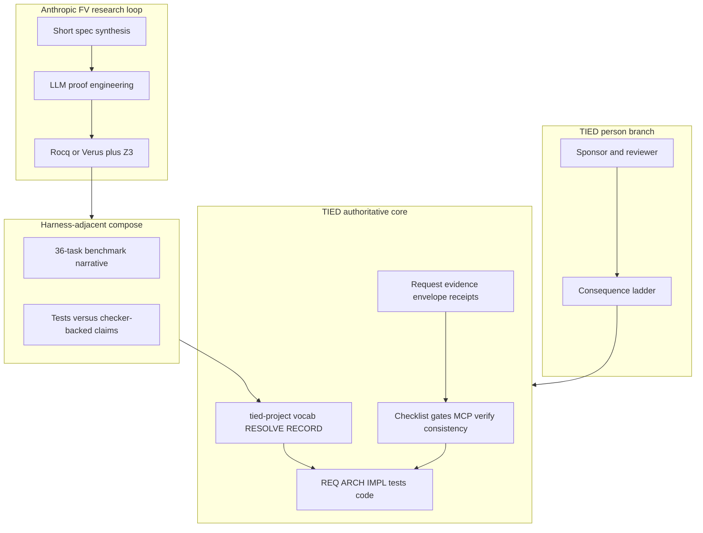

# Anthropic LLM formal verification appendix × TIED — agent management lens

| Field | Value |
| --- | --- |
| **Purpose** | Map Anthropic’s **LLM-scale formal verification** appendix (binary RISC-V proofs, ASan equivalence, Verus interpreter, agent proof engineering, 36-task benchmark) to TIED as implemented in this repository—with emphasis on **proof boundaries**, **traceability**, **tests vs checker-backed claims**, and **agent harness**—not adopting Rocq/Verus/Z3 as TIED gates or certifying Anthropic outcomes. |
| **Audience** | Sponsors, harness authors, formal-methods practitioners, prompt-type operators, methodology owners |
| **Source URL** | [Anthropic CDN PDF appendix — 2026-10-22](https://www-cdn.anthropic.com/files/4zrzovbb/website/6867eadf760258fa8b42a504600cd3c036d16358.pdf) (**Anthropic-reported** for metrics) |
| **Article capture (sibling)** | [anthropic-llm-formal-verification-appendix.md](anthropic-llm-formal-verification-appendix.md) — read-only; **reference only** |
| **Status / date** | Outreach / analysis snapshot, **2026-10-25** — **reference only; this document does not mint REQ/ARCH/IMPL tokens** |
| **Executable follow-up** | Wave 3 candidates in § Phased recommendations (**Defer** until scoped **add-feature** / **build-plan**) |
| **Distinct from** | [Claude code review × TIED](claude-code-team-code-review-vs-tied.md) (PR review / convergence); [LangChain harness × TIED](langchain-harness-engineering-vs-tied-agent-management.md) (trace/benchmark tuning); [AI-SDLC Factory × TIED](ai-sdlc-atdd-software-factory-vs-tied.md) (executable Gherkin/factory specs); [Open Ontologies × TIED](open-ontologies-repository-vs-tied-agent-management.md) (OWL/SHACL validation tooling); [Traefik harness/platform × TIED](traefik-harness-platform-vs-tied-agent-management.md) (harness vs platform seam) |
| **TIED anchors (reference only)** | [AGENTS.md](../../AGENTS.md), [agent-req-implementation-checklist.md](../../tied-bundle/docs/agent-req-implementation-checklist.md), [processes.md](../../tied-bundle/docs/processes.md), [pseudocode-writing-and-validation.md](../../tied-bundle/docs/pseudocode-writing-and-validation.md), [quality-assurance.md](../../tied-project/vocab/quality-assurance.md), [fidelity-research.md](../../tied-project/vocab/fidelity-research.md), [sponsor-agent-relationship.md](../../tied-project/vocab/sponsor-agent-relationship.md), [external-service-three-wave-comparison-template.md](../../tied-bundle/docs/external-service-three-wave-comparison-template.md) |

---

## Executive summary

Anthropic’s appendix (**Anthropic-reported**) argues that LLM agents can produce **machine-checked proofs** at scales previously impractical: Rocq proofs over **RISC-V Linux binaries** (including startup, libc, ASan runtime, fuzz driver), a **three-theorem** pattern linking ASan crash-freeness to user-visible binaries, a **Verus-verified** Rust Python interpreter against a formal λπ-based semantics (with **1.7M** random programs compared to CPython empirically), and a **36-task** benchmark shrinking OSS-Fuzz entry points. A deliberate bug injection study reports **5/7** bugs survived random tests while **7/7** broke proofs (**Anthropic-reported**). Human proof engineers note agents write **short specs** (median **~110 lines**, **Anthropic-reported**) but **verbose** proofs that may hit a complexity wall without better abstractions.

TIED’s center of gravity is **intent traceability and empirical proof during software change in TIED clients**: RESOLVE/RECORD vocabulary, CITDP, REQ → ARCH → IMPL **essence_pseudocode** with block-level token comments, checklist gates, strict TDD and composition order, MCP-first **project** YAML writes, **`pseudocode_validate`**, verification-gated **`tied_verify`**, **`tied_validate_consistency`**, LEAP on divergence, request **evidence envelopes**, depth-gated **adversarial inquiry**, and the sponsor **consequence ladder**. TIED does not ship Rocq, Verus, Z3, or binary semantics models as methodology gates.

**Compose-don’t-replace:** Borrow **short-spec discipline**, **checker vs test honesty**, and **abstraction-debt** lessons as **harness-adjacent** operator guidance. Keep **semantic token authority**, **checklist gate receipts**, **MCP YAML writes**, and **sponsor costly choices** on the TIED/checklist plane. Do not treat Anthropic proof-checker pass as equivalent to **`tied_verify`** or **`tied_checklist_gate_validate`**.

| Center of gravity | Anthropic appendix (**Anthropic-reported**) | TIED (this repo) |
| --- | --- | --- |
| Primary guarantee | Theorem + proof checker (Rocq/Verus/Z3) | Token-linked tests + gates + consistency validation |
| Artifact under proof | Compiled binary or annotated Rust | IMPL pseudo-code, tests, code in client repos |
| Agent role | Proof engineer ( lemmas, models, scripts ) | Implementer against IMPL + RED tests |
| Acceptance | Proof checker exit success | RED→GREEN TDD, composition tests, **`tied_verify`** when gated |
| Fuzzing | Displaced for **proved** entry points | Client policy; not TIED core product |
| Scale narrative | ~600k-line proofs per target; 36-task LLM bench | Checklist + CITDP per change; external benches **Defer** |

---

## Source summary (Anthropic claims only)

Bullets summarize the sibling capture. Metrics and outcomes are **Anthropic-reported**—not independently verified in stdd.

- **Binary interpretation:** Proofs target RISC-V Linux **binaries** directly—stronger than translating fuzz tests to Rocq or interpreting source only (**Anthropic-reported**).
- **Crash definition:** Fault, abort (including assert), or unmodeled syscall/behavior in the formal Linux process model (**Anthropic-reported**).
- **Basic theorem:** No input causes crash for a given (ASan-instrumented) fuzz binary—so that binary need not be fuzzed again (**Anthropic-reported**).
- **Equivalence theorem:** ASan vs normal binary match on stdin/stdout/stderr/exit-or-signal/filesystem trace; equivalence can hide differing crash vs infinite-loop endings (**Anthropic-reported**).
- **Third theorem:** Normal binary also crash-free—closes equivalence gap (**Anthropic-reported**).
- **Input bound:** Inputs under **64 MiB** and all memory layouts in the combined statement (**Anthropic-reported**).
- **Verus interpreter:** **17 tiers**; theorem that returned results match formal semantics; **1.7M** random programs vs CPython (**Anthropic-reported**).
- **Bug injection:** **7** bugs injected; **5** survived random tests; **7** broke proof (**Anthropic-reported**).
- **Rocq scale:** ~**1B** lines attempted; ~**180M** in successful proofs; ~**600k** lines per finished OSS-Fuzz-style proof; cJSON **391**-line entry → **630k**-line proof (**Anthropic-reported**).
- **Proof checker cost:** **30 minutes to several hours** CPU per proof check (**Anthropic-reported**).
- **Short specs:** Median sanitizer spec ~**110** lines vs median program **86 KiB** (**Anthropic-reported**).
- **Expert critique:** Agent proofs verbose; human engineers use calling conventions, disjoint pointers, allocator abstractions; MachCSL-style complexity wall cited (**Anthropic-reported**).
- **36 tasks:** **283–2,491** instructions; mini-ASan; three groups of **12**; plain vs mini-ASan equivalence + no errors (**Anthropic-reported**).
- **Assertions:** LZO round-trip and p11-kit PEM bounds proved as never-firing branches (**Anthropic-reported**).

---

## Relationship to sibling comparisons

| Sibling | What it owns | This document owns |
| --- | --- | --- |
| [Claude review × TIED](claude-code-team-code-review-vs-tied.md) | Anthropic **PR review** / convergence / risk tiers | Anthropic **formal verification** research appendix |
| [LangChain × TIED](langchain-harness-engineering-vs-tied-agent-management.md) | Harness trace/benchmark loops (Terminal Bench) | **Proof-checker** loops and OSS-Fuzz-style **FV benchmark** |
| [AI-SDLC Factory × TIED](ai-sdlc-atdd-software-factory-vs-tied.md) | Frozen Gherkin/contracts + protected tests | **Machine-checked theorems** on binaries/source |
| [Open Ontologies × TIED](open-ontologies-repository-vs-tied-agent-management.md) | OWL/SHACL/graph validation tooling | **Rocq/Verus** proof obligations—not ontology validation |
| [Traefik × TIED](traefik-harness-platform-vs-tied-agent-management.md) | Harness vs platform **seam** | Proof-checker research vs TIED **gate authority** |
| [Heimsbakk × TIED](veronika-heimsbakk-ai-generated-ontologies-vs-tied-agent-management.md) | Meaning ownership for vocab/tokens | **Mathematical** crash-freeness vs traceability |

Cross-link **AI-SDLC** when discussing “tests vs stronger guarantees”; cross-link **LangChain** when citing external agent benchmarks; cross-link **Claude review** only for shared Anthropic authorship—not equivalent mechanisms.

---

## Harness lessons → TIED agent management

Subsections map appendix mechanisms to TIED surfaces for agent-heavy delivery in **this** repository and TIED **clients**.

### Binary semantics vs source-level traceability

| Anthropic pattern | TIED surface | Notes |
| --- | --- | --- |
| Formal RISC-V + Linux process model | — | **Gap** — not in methodology core |
| “Prove the binary you fuzz” | Tests on built artifacts in CI | **Tension** — same shipping intent, different proof class |
| Avoid fuzz→Rocq translation error | IMPL/tests aligned to **built** behavior | **Composable** epistemic caution |
| REQ→ARCH→IMPL→tests→code stack | **Align** on explicit intent before code | Source-level traceability, not binary semantics |

### Three-theorem ASan / trace equivalence

| Anthropic pattern | TIED surface | Notes |
| --- | --- | --- |
| ASan vs normal IO/fs trace equivalence | Assurance profiles, build variants | **Gap** for formal equivalence |
| Crash vs silent loop indistinguishable in trace | Proof boundary on test “pass” | **Tension** — document claim limits |
| Prove normal binary crash-free | Property tests / fuzz in client repos | **Defer** as product; **Composable** as policy |

### Short synthesized specifications

| Anthropic pattern | TIED surface | Notes |
| --- | --- | --- |
| Median ~110-line spec vs large program (**Anthropic-reported**) | REQ acceptance criteria + concise IMPL blocks | **Composable** |
| Spec describes allowed outputs/behaviors | PRE/POST on Active IMPL blocks | **Align** on contract shape |
| Agent proves program matches spec | Agent implements to RED tests + pseudo-code | Different acceptance engine |

### Proof checker wall-clock vs dev inner loop

| Anthropic pattern | TIED surface | Notes |
| --- | --- | --- |
| 30 min–hours per proof check (**Anthropic-reported**) | Fast RED/GREEN unit loop | **Tension** |
| Batch proof engineering | Session working plans, CITDP scope | **Composable** scheduling |
| Mandatory Rocq gate in TIED | — | **Explicit non-adoption** |

### Verbose proofs vs modular abstractions

| Anthropic pattern | TIED surface | Notes |
| --- | --- | --- |
| Register-level repetition in proofs | Bloated IMPL pseudo-code without factoring | **Tension** |
| Human calling-convention / allocator abstractions | Module validation + sidecar refactor LEAP | **Align** on remedy direction |
| Agent-generated encodings/tables (>50% of lines, **Anthropic-reported**) | Agent-generated MCP/tooling scripts in stdd | **Composable** — different artifact |

### Tests vs proofs (5/7 vs 7/7)

| Anthropic pattern | TIED surface | Notes |
| --- | --- | --- |
| Random tests miss injected bugs | RED tests + edge cases; inquiry when integrated | **Composable** narrative |
| Proofs catch all seven | — | **Gap** for SMT/Rocq in TIED |
| **`pseudocode_validate`** | Static IMPL checks before code | **Partial align** — not crash-freeness |
| **`tied_adversarial_inquiry_run`** | Advisory findings; gate-gated confirmation | **Partial align** — not machine proof |

### Verus requires/ensures vs IMPL contracts

| Anthropic pattern | TIED surface | Notes |
| --- | --- | --- |
| requires / ensures / loop invariants | IMPL PRE/POST/EFFECTS/FAILURE_MODES | **Align** vocabulary |
| Z3 discharges obligations | — | **Gap** |
| Tiered interpreter theorems | Layered IMPL blocks + token comments | **Composable** structure |

### Empirical semantics bridge (1.7M programs)

| Anthropic pattern | TIED surface | Notes |
| --- | --- | --- |
| Formal semantics vs CPython sampling | Three-way alignment tests/code/IMPL | **Composable** |
| Evaluation corpus / comparable arms | quality-assurance evaluation terms | **Defer** full methodology bench |
| Empirical bridge ≠ proof of full Python | **proof boundary** | **Align** with TIED honesty norms |

### 36-task research benchmark

| Anthropic pattern | TIED surface | Notes |
| --- | --- | --- |
| mini-ASan + shrunk OSS-Fuzz cores | External benchmark only | **Defer** in-repo reproduction |
| Compare LLMs on proof tasks | LangChain Terminal Bench class | Kaizen observation **optional** |
| Harness + proof checker per agent | Prompt-type + checklist per change | Different scoring function |

### Assertions as crashes (LZO, p11-kit)

| Anthropic pattern | TIED surface | Notes |
| --- | --- | --- |
| assert → abort → crash in model | Failed tests / assertion in CI | **Align** on failure semantics |
| Prove branch never taken at address | Branch coverage in tests | **Gap** for exhaustive proof |
| Round-trip **computational** property | REQ criteria + property-style tests | **Composable** |

### Agent proof tooling and libraries

| Anthropic pattern | TIED surface | Notes |
| --- | --- | --- |
| Re-prove libc/ASan each entry (no import yet) | Re-derive boilerplate in agent YAML | **Tension** — reuse via libraries/LEAP |
| Machine-emitted tables | Generated test vectors / fixtures | **Composable** |
| Expert-guided abstraction discovery | Sponsor + checklist refine; pseudo-code validation | **Recommendation-only** |

---

## Touchpoint 1 — RESOLVE

| Appendix term | TIED preferred term / surface | Notes |
| --- | --- | --- |
| **Formal verification** (Rocq/Verus) | **Analogy** — not TIED core gate | Research/harness-adjacent |
| **Proof checker pass** | **`tied_verify`** / gate receipts (**different claim**) | Do not equate |
| **Crash** (fault/abort/unmodeled) | Test failure, unhandled error, gate **blocked** | No binary semantics in TIED |
| **Theorem / specification** | REQ criteria + IMPL PRE/POST | **Composable** |
| **Trace equivalence** (IO/fs) | — | **Gap** in core |
| **Fuzzing displaced** | Client security policy | **Defer** |
| **Verbose proof** | Verbose IMPL without abstraction | LEAP + `[PROC-PSEUDOCODE_VALIDATION]` |
| **36-task benchmark** | External eval | **Defer** |
| **Short spec (~110 lines)** | Concise IMPL + criteria | **Anthropic-reported** median |
| **MachCSL complexity wall** | Agent scaling risk on pseudo-code | **Tension** |

**RESOLVE charter (this comparison):** Canonicalizes **names and mappings** only; does not change sponsor intent authority or mint TIED tokens from comparison prose.

### Disposition key

| Disposition | Meaning in this comparison |
| --- | --- |
| **Align** | TIED materially represents the external intent (scoped). |
| **Composable** | Combine without equivalence claims. |
| **Tension** | Partial overlap; proof boundary must be explicit. |
| **Gap** | External emphasis not in TIED core. |
| **Defer** | Client infra, vendor research, or sponsor-owned choice. |

### Claim labeling

| Label | Use when |
| --- | --- |
| **Anthropic-reported** | Metrics and outcomes from the appendix PDF |
| **TIED-existing** | Committed docs/tools in stdd |
| **Recommendation-only** | Operator suggestions not yet enforced by gates |
| **`not_measured`** | Whether TIED adoption improves formal verification outcomes |

---

## Primary capability matrix

| Concern | TIED COG | Disposition | One-line rationale |
| --- | --- | --- | --- |
| Machine-checked binary crash-freeness | — | **Gap** | No RISC-V process semantics in methodology |
| Direct binary vs source interpretation | Tests on built artifacts | **Tension** | Same ship intent; different proof class |
| ASan vs normal trace equivalence | Assurance profiles | **Gap** | No IO/fs equivalence theorems |
| Proof checker as acceptance gate | Checklist gates, **`tied_verify`** | **Tension** | Gates = empirical + traceability truth |
| LLM as proof engineer | LLM as IMPL/test implementer | **Composable** | Same harness; different artifacts |
| Short formal spec synthesis | REQ criteria + concise IMPL | **Composable** | **Anthropic-reported** ~110-line median |
| Verbose proof / missing abstractions | Bloated agent pseudo-code | **Tension** | Validation + LEAP refactor |
| Random tests miss bugs; proofs catch | RED + **`pseudocode_validate`** + inquiry | **Composable** | Tests ≠ crash-freeness (**non-implication**) |
| Verus requires/ensures | IMPL PRE/POST/EFFECTS | **Align** | Shared contract vocabulary |
| Z3/SMT discharge | — | **Gap** | Not in TIED toolchain |
| Fuzzing elimination for proved targets | Client fuzz/OSS-Fuzz policy | **Defer** | Not stdd product scope |
| 36-task agent FV benchmark | External research bench | **Defer** | Terminal Bench analog |
| **proof boundary** on evidence | [quality-assurance.md](../../tied-project/vocab/quality-assurance.md) | **Align** | Required for 5/7 vs 7/7 citations |
| Sponsor defines acceptable theorem | CITDP scope; consequence ladder | **Align** | Person-branch authority |
| **`tied_adversarial_inquiry_run`** | Advisory obligation graphs | **Partial align** | Not Rocq proof |
| Re-prove libc/ASan per entry | Missing shared proof libraries in agent work | **Tension** | Methodology reuse via bundle/docs |
| Assertion never fires (LZO/p11-kit) | Property tests linked to REQ | **Composable** | Tests not exhaustive branch proofs |

---

## Authority boundary

Anthropic’s **proof-checker loop** sits outside TIED’s authoritative core. TIED clients may **compose** short-spec and tests-vs-proof honesty; they must not delegate **YAML truth** or **checklist progression** to an external proof checker without a scoped integration REQ.

---

## Anti-patterns (Anthropic lessons → TIED risk)

| Risk | Symptom | TIED-oriented remedy |
| --- | --- | --- |
| Proof checker as TIED gate | “Rocq passed” skips checklist | **`tied_checklist_gate_validate`** + receipts |
| Anthropic metrics as TIED effectiveness | Citing ~600k-line proofs as stdd success | **Anthropic-reported** + **`not_measured`** |
| **`pseudocode_validate` = crash-freeness** | Over-claim on static IMPL checks | **proof boundary** in analysis and QA vocab |
| Mint REQ from comparison | `[REQ-FORMAL-VERIFY-*]` in markdown | Wave 3 via **add-feature** only |
| Green tests after bug injection story | Ignoring 5/7 survived tests lesson | Expand RED cases; inquiry when enrolled |
| Verbose agent IMPL/YAML | Unmaintainable pseudo-code graphs | Module boundaries; LEAP; validation gates |
| Equivalence theorem over-trust | ASan vs prod “equivalent” without third theorem | Document client build/test matrix explicitly |
| 36-task bench as TIED certification | Benchmark rank implies methodology maturity | **Defer**; Kaizen only with denominators |
| Skip **proof boundary** in evidence chain | Manifest implies universal guarantee | `evidence_chain_profile` claim limits |

---

## Compose-don’t-replace: tune FV-inspired discipline vs keep TIED authority

| Tune with **Anthropic-inspired** practice (harness/process) | Keep **TIED** authority |
| --- | --- |
| Write **short specs** before large agent implementation | `[REQ-*]` / sponsor intent via vocab **RESOLVE** |
| Treat **tests and proofs** as different claim classes | **`tied_verify`** + gates — not vendor proof checker |
| Invest in **abstractions** (calling conventions, modules) | IMPL sidecars + `[PROC-PSEUDOCODE_VALIDATION]` |
| Label **Anthropic-reported** research metrics in runbooks | **`not_measured`** on TIED client outcomes |
| Use empirical sampling (1.7M-style) as **sanity** bridge | **`tied_validate_consistency`** + three-way alignment |
| External OSS-Fuzz/FV benchmarks for agent R&D | CITDP + checklist per **scoped** stdd change |

---

## Bounded operator recommendations (Recommendation-only)

1. **Claim-class table** — When citing the 5/7 vs 7/7 injection story, pair it with an explicit **proof boundary**: passing TIED tests does not establish binary crash-freeness.
2. **Short spec before mint** — For large agent YAML/IMPL sessions, require a sponsor-readable **criteria block** (REQ-style) before bulk MCP writes—analogous to median ~110-line specs (**Anthropic-reported**).
3. **Abstraction debt review** — After agent-generated pseudo-code crosses a size/complexity threshold, schedule LEAP refactor or module split—parallel to human FV “calling convention” advice in the appendix.
4. **Do not wire Rocq/Verus into gates** — Any import of external proof artifacts into request evidence envelopes needs schema review and **add-feature**—not outreach markdown.
5. **Cross-link factory and LangChain** — Executable-spec discipline ([AI-SDLC × TIED](ai-sdlc-atdd-software-factory-vs-tied.md)) and harness benchmarks ([LangChain × TIED](langchain-harness-engineering-vs-tied-agent-management.md)) compose with this doc; none replace TIED tokens.
6. **Anthropic engineering split** — PR review compose ([Claude review × TIED](claude-code-team-code-review-vs-tied.md)) is orthogonal to this formal verification appendix.

---

## Phased recommendations (doc-first)

| Phase | Action | Status |
| --- | --- | --- |
| **0** | Wave 1 capture + this analysis + `.gitignore` allowlist | **Done** (2026-10-25 build-plan) |
| **1** | Bundle guide: tests vs checker-backed claims | **Done** (2026-10-26 [REQ-TIED_TESTS_CHECKER_CLAIM_COMPOSE](../../tied-project/requirements/REQ-TIED_TESTS_CHECKER_CLAIM_COMPOSE.yaml)) |
| **1** | `client-development-index` Anthropic comparison + guide rows | **Done** (2026-10-26) |
| **2** | Project vocab RECORD (`checker-backed claim`, `theorem statement`) | **Defer** (costly) |
| **3** | `methodology-composition-matrix.md` formal-methods row | **Defer** |
| **3** | Request evidence envelope: external proof receipt type | **Defer** — **add-feature** |
| **3** | In-repo 36-task-style agent FV benchmark harness | **Defer** |

---

## Explicit non-adoptions

- Mandatory **Rocq/Verus/Z3** gates in TIED checklist or MCP (**replace **`tied_verify`**)
- Claiming TIED delivers **ASan/normal trace equivalence theorems** or **RISC-V crash-freeness** from methodology alone
- **Binary-only** verification replacing source-level tests and IMPL traceability in clients
- Treating **Anthropic-reported** OSS-Fuzz proof scale as stdd checklist or **`tied_verify`** outcomes
- Wave 3 **REQ/ARCH/IMPL** mint from this comparison prose alone
- Replacing **sponsor person-branch** theorem acceptance with agent proof-checker success

---

## Proof boundary

- Appendix metrics (line counts, proof checker runtime, bug injection counts, 36 tasks, median spec size) are **Anthropic-reported**. They are **not** stdd checklist results, Rocq/Verus reruns, or **`tied_verify`** outcomes unless explicitly noted otherwise.
- TIED surfaces cited describe **TIED-existing** committed behavior at authoring time; composability does not imply formal verification is implemented inside stdd.
- Wave 3 behavior changes require normal TIED workflows (**add-feature**, **build-plan**, LEAP, tests)—not comparison markdown alone.
- stdd did **not** run Rocq, Verus, Z3, or Anthropic’s 36-task benchmark during authoring of this document.
- TIED effectiveness relative to Anthropic’s formal verification claims remains **`not_measured`**.

---

## Related documents

- [Appendix capture (sibling)](anthropic-llm-formal-verification-appendix.md)
- [External three-wave comparison template](../../tied-bundle/docs/external-service-three-wave-comparison-template.md)
- [Claude code review × TIED (sibling)](claude-code-team-code-review-vs-tied.md)
- [LangChain harness × TIED (sibling)](langchain-harness-engineering-vs-tied-agent-management.md)
- [AI-SDLC Factory × TIED (sibling)](ai-sdlc-atdd-software-factory-vs-tied.md)
- [Traefik harness/platform × TIED (sibling)](traefik-harness-platform-vs-tied-agent-management.md)
- [TIED vs well-known methodologies](tied-vs-well-known-methodologies.md)
- [Client development index](../../tied-bundle/docs/client-development-index.md)
