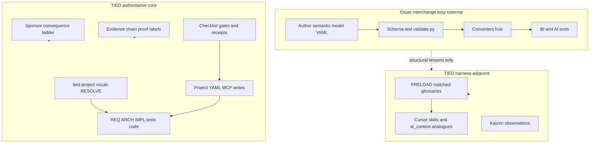

# Apache Ossie × TIED — agent management lens

| Field | Value |
| --- | --- |
| **Purpose** | Map **Apache Ossie** (vendor-neutral analytics semantic model interchange, ontology layer, validation/grader, converters hub, `ai_context`) to TIED as implemented in this repository—with emphasis on **evaluation charter Q1–Q6**, **structural vs conceptual** proof boundaries, and harness compose patterns—not adopting Ossie as TIED core or KPI catalog authority. |
| **Audience** | Sponsors, harness authors, prompt-type operators, methodology owners, data/ontology practitioners |
| **Source URL** | [apache/ossie](https://github.com/apache/ossie) (Apache incubating; spec **0.2.0.dev0** draft) |
| **Article capture (sibling)** | [apache-ossie.md](apache-ossie.md) — read-only; **reference only** |
| **Status / date** | Outreach / analysis snapshot, **2026-11-07** — **reference only; this document does not mint REQ/ARCH/IMPL tokens** |
| **Executable follow-up** | Wave 3 targets in § Phased recommendations (**Defer** unless sponsor scopes **add-feature**) |
| **Distinct from** | [NVIDIA Auto-Ontology × TIED](nvidia-auto-ontology-vs-tied-agent-management.md) (agentic catalog); [Netflix observability × TIED](netflix-ontology-driven-observability-vs-tied-agent-management.md) (ops RDF graph); [Open Ontologies × TIED](open-ontologies-repository-vs-tied-agent-management.md) (RDF plan/apply); [NDTP × TIED](ndtp-ai-ontology-extension-vs-tied-agent-management.md) (TTL wizard); [Heimsbakk × TIED](veronika-heimsbakk-ai-generated-ontologies-vs-tied-agent-management.md) (meaning before OWL essay) |
| **TIED anchors (reference only)** | [AGENTS.md](../../AGENTS.md), [tied-methodology-evaluation-framework.md](../tied-methodology-evaluation-framework.md), [vocabulary-layer-tied-leap-citdp.md](../../tied-bundle/docs/vocabulary-layer-tied-leap-citdp.md), [vocabulary-index-analysis-and-standards.md](../../tied-bundle/docs/vocabulary-index-analysis-and-standards.md), [sponsor-agent-relationship.md](../../tied-project/vocab/sponsor-agent-relationship.md), [agent-req-implementation-checklist.md](../../tied-bundle/docs/agent-req-implementation-checklist.md), [external-service-three-wave-comparison-template.md](../../tied-bundle/docs/external-service-three-wave-comparison-template.md) |

---

## Executive summary

**Apache Ossie** (incubating) standardizes **interchange of analytics semantic metadata**: JSON/YAML **semantic models** (`datasets`, `metrics`, `relationships`, extensions), a parallel **ontology** spec for business concepts, JSON Schema validation and compliance/portability tooling, Python SDK, and a **converters** ecosystem (**spec-observed** / **roadmap-reported**). Roadmap work targets **metric grain**, catalog integration, **conceptual** alignment across models, AI-native fields (`ai_context`, verified queries), and **governance/certification** hooks.

TIED’s center of gravity is **software delivery intent** in client repos: vocab **RESOLVE/RECORD/VALIDATE**, CITDP, REQ → ARCH → IMPL **essence_pseudocode** with block token comments, checklist gates, MCP **project** YAML, evidence-chain **proof boundaries**, optional verification-gated status, and the sponsor **consequence ladder**. TIED does **not** ship enterprise KPI catalogs, semantic query engines, or Ossie interchange as methodology core.

**Compose-don’t-replace:** Borrow **declare-before-consume**, **honest structural validation**, **read vs write authority separation**, **extension registry discipline**, and **scoped AI context blocks** for harness-adjacent surfaces. Keep **token graph authority**, **LEAP/checklist promotion**, **separate Q1 arms**, and **no universal maturity scores** on the TIED plane. Do not treat grader or schema pass as `tied_verify` or cohort defect superiority.

| Center of gravity | Apache Ossie | TIED (this repo) |
| --- | --- | --- |
| Primary artifact | Semantic model + ontology YAML/JSON files | REQ/ARCH/IMPL YAML + pseudo-code + tests |
| “Truth” narrative | Vendor-neutral analytics **definitions** interchange | Traceable **software behavior** intent |
| Agent context | `ai_context` on models/ontologies | PRELOAD glossaries, skills, AGENTS bootstrap |
| Validation | Schema, refs, SQL syntax (`validate.py`) | `tied_validate_consistency`, `lint_yaml`, pseudocode validate |
| Exchange | Converters hub + loss-bounded import/export | `tied-install`, methodology refresh, LEAP |
| Stewardship (future) | Certified metrics, governance hooks (roadmap) | Sponsor ladder, verify when enrolled |

### Evaluation charter mapping (Q1–Q6)

Disposition per [evaluation framework](../tied-methodology-evaluation-framework.md); **`not_measured`** for Ossie × TIED cohorts.

| Q# | Ossie signal | TIED surface | Disposition |
| --- | --- | --- | --- |
| **Q1** | Schema-valid KPI still wrong in production | Fidelity pilot, separate confirmed-finding arm | **Tension** — structural green ≠ defect rate |
| **Q2** | Concept drift across converted models | Traceability + LEAP; no Ossie predictor in TIED | **Defer** / **not_applicable** |
| **Q3** | Business metric SoT confused with code intent | Vocab layer, REQ vs glossary collision | **Composable** (literacy) |
| **Q4** | Validator pass as “governance” | Checklist gate validate, adherence reconcile | **Composable** (different artifacts) |
| **Q5** | Vendor “single source of truth” marketing | Q5 pairs checklist/MCP time with git/PR arms | **Align** on narrative discipline |
| **Q6** | Community WG spec churn | LEAP proposal queue, feedback promotion | **Recommendation-only** |

---

## Source summary (Ossie claims only)

Bullets synthesize sibling [Wave 1 capture](apache-ossie.md). **Ossie-reported**, **spec-observed**, or **roadmap-reported** as labeled.

- **Mission:** End semantic fragmentation across BI/AI/BI stack via one interchange format (**Ossie-reported**).
- **Former OSI** rename; Apache **incubating** (**Ossie-reported**).
- **Draft spec 0.2.0.dev0**; DRAFT banner on core spec (**spec-observed**).
- **Semantic model** root: `version`, `name`, `datasets`; optional metrics, relationships, `custom_extensions`, `ai_context` (**spec-observed**).
- **Ontology** spec: entity vs value types; mapping documents replace deprecated inline mappings (**spec-observed**).
- **OSSIE_SQL_2026** only fully defined portable dialect; others opaque (**spec-observed**).
- **Validation** tooling described against JSON Schema, names, references, SQL (**spec-observed** / **roadmap-reported**).
- **Converters** live in sibling GitHub repo (**spec-observed**).
- **Roadmap:** structural vs **conceptual** interoperability; metric semantics WG; catalog/registry patterns; certification/governance (**roadmap-reported**).
- **NVIDIA Auto-Ontology** cites Ossie import/export (**NVIDIA-reported** in sibling capture — not stdd-verified).

---

## Relationship to sibling comparisons

| Sibling | What it owns | This document owns |
| --- | --- | --- |
| [NVIDIA Auto-Ontology × TIED](nvidia-auto-ontology-vs-tied-agent-management.md) | Generate → Certify → Answer, text-to-SQL MCP, catalog skills | **Neutral interchange spec**, validation/grader, converters — not deployed catalog runtime |
| [Netflix observability × TIED](netflix-ontology-driven-observability-vs-tied-agent-management.md) | Telemetry → RDF graph, MELT, AutoRCA | **File-based semantic model interchange** — not operational harvest graph |
| [Open Ontologies × TIED](open-ontologies-repository-vs-tied-agent-management.md) | RDF plan/apply, Lean certs, 100+ MCP tools | **Analytics YAML/JSON semantics** — not OWL change engine |
| [NDTP × TIED](ndtp-ai-ontology-extension-vs-tied-agent-management.md) | Streamlit TTL wizard | **Validated interchange documents** — not RDF authoring UI |
| [Heimsbakk × TIED](veronika-heimsbakk-ai-generated-ontologies-vs-tied-agent-management.md) | Conversation before authoritative OWL | **Structural + interchange validation** — cross-link for meaning ownership |
| [Arun projection × TIED](arun-srinivasan-every-map-has-a-projection-vs-tied-agent-management.md) | *(Wave 2 pending)* | **Vendor-neutral metric/dataset files** — not legal/upper-ontology projections |

Cross-link **NVIDIA** when operators discuss **certified analytics terms**; this doc covers the **format** NVIDIA may import/export, not Nemotron answer loops.

---

## Harness lessons → TIED agent management

### Structural vs conceptual interoperability

| Ossie pattern | TIED surface | Notes |
| --- | --- | --- |
| Structural: common file shape (**roadmap-reported**) | `lint_yaml`, YAML schema discipline | **Align** on parseable structure |
| Conceptual: shared Customer/Order across models (**roadmap-reported**) | `tied-project/vocab/` legend discipline | **Composable** — different domain (business vs delivery) |
| Ontology layer above datasets | Methodology `tied-bundle/` vs project `tied-project/` | **Composable** “layer” metaphor |
| No bundle format; one model per file | One REQ detail file per token | **Tension** — different granularity |

### Interchange authority vs MCP project YAML writes

| Ossie pattern | TIED surface | Notes |
| --- | --- | --- |
| Converters read/write interchange | MCP **project** YAML mutations only | **Align** on bounded write surfaces |
| `custom_extensions` vendor payloads | Project-only tokens; methodology read-only | **Align** on extension vs core |
| Community WG changes spec | LEAP + sponsor for methodology | **Defer** Ossie governance adoption |

### `ai_context` vs PRELOAD / skills / AGENTS routing

| Ossie pattern | TIED surface | Notes |
| --- | --- | --- |
| `ai_context` on model/ontology | Skill `SKILL.md`, AGENTS bootstrap | **Composable** — embed hints in artifact vs route |
| Roadmap: verified_queries for AI (**roadmap-reported**) | Composition tests, binding inventory | **Composable** — curated examples |
| Discussion: do not over-prescribe key name (**roadmap-reported**) | Stable skill contracts | **Recommendation-only** |

### Metric grain/scoping vs REQ behavioral scope

| Ossie pattern | TIED surface | Notes |
| --- | --- | --- |
| Metrics at dataset vs model scope (**roadmap-reported**) | REQ criteria scope in detail files | **Tension** — KPI grain ≠ behavior criterion |
| Aggregation_method WG (**roadmap-reported**) | IMPL pseudo-code contracts | **Composable** analogy only |
| Cross-dataset dimensions | Cross-REQ traceability | **Gap** — no native KPI graph |

### Ontology concepts vs `tied-project/vocab/`

| Ossie pattern | TIED surface | Notes |
| --- | --- | --- |
| EntityType vs ValueType | Glossary entries vs tokens | **Tension** — homonym “ontology” |
| Built-in concepts (`String`, …) | Semantic token registry | **Defer** mapping |
| Namespace prefixes on ontology | Vocab routing + PRELOAD | **Composable** |

### Schema validation + grader vs `tied_validate_consistency` / `lint_yaml`

| Ossie pattern | TIED surface | Notes |
| --- | --- | --- |
| JSON Schema validation | Index/detail consistency checks | **Align** — Principle 1 structural proof |
| Portability grader | Evidence-chain structural rows | **Composable** — not behavior |
| SQL syntax in validator | Pseudocode validate | **Tension** — different languages |

### Portable SQL dialect vs IMPL pseudo-code expression choices

| Ossie pattern | TIED surface | Notes |
| --- | --- | --- |
| `OSSIE_SQL_2026` portable expressions | IMPL contract grammar (PRE/POST) | **Composable** — declare portable core |
| Opaque vendor dialect strings | Client-specific tooling | **Align** — don’t claim unsupported semantics |
| Semantic query language future WG | **Defer** | Not TIED query layer |

### Converters hub vs methodology refresh / `tied-install`

| Ossie pattern | TIED surface | Notes |
| --- | --- | --- |
| Hub-and-spoke converters repo | `tied-install.sh` refresh of `tied-bundle/` | **Composable** — loss-bounded exchange |
| Import/export with NVIDIA etc. | Client inherits methodology; project YAML preserved | **Tension** — different merge rules |
| No automatic cross-model bundle | LEAP stack propagation | **Gap** — intentional |

### Certification / governance roadmap vs sponsor ladder + verify gates

| Ossie pattern | TIED surface | Notes |
| --- | --- | --- |
| Certified metrics discussions (**roadmap-reported**) | Sponsor costly choices; verify update | **Composable** stewardship metaphor |
| Stable identifiers WG | Token registry + semantic tokens YAML | **Composable** |
| Governance metadata hooks | Evidence envelopes, gate receipts | **Composable** |

### Business SoT vs delivery SoT (evaluation Q3 compose)

| Ossie pattern | TIED surface | Notes |
| --- | --- | --- |
| README “single source of truth” for KPIs | REQ/IMPL as delivery intent authority | **Tension** — Q3 defect origin confusion |
| Agents consume semantic models | Agents consume checklist + YAML | **Composable** — separate planes |
| Valid interchange ≠ correct software | `tied_validate_consistency` ≠ domain QA | **Align** — evaluation Principle 1 |

### Touchpoint 1 — RESOLVE (disposition key)

| Label | Use when |
| --- | --- |
| **Ossie-reported** / **spec-observed** / **roadmap-reported** | Capture/sibling claims |
| **TIED-existing** | Committed stdd surfaces |
| **Recommendation-only** | Compose suggestions not implemented |
| **not_measured** | TIED effectiveness vs Ossie adoption |

---

## Primary capability matrix

| Ossie concern | TIED center of gravity | Disposition | One-line rationale |
| --- | --- | --- | --- |
| Semantic model interchange files | Project REQ/ARCH/IMPL YAML | **Gap** | Different intent plane |
| Ontology concept documents | `tied-project/vocab/` glossaries | **Tension** | Homonyms; compose legend only |
| `ai_context` metadata | Skills + PRELOAD | **Composable** |
| JSON Schema + `validate.py` | `lint_yaml`, validate consistency | **Align** (structural) |
| Portability grader | Binding/composition evidence | **Composable** analogy |
| `OSSIE_SQL_2026` | IMPL pseudo-code contracts | **Composable** |
| Converters ecosystem | tied-install / LEAP | **Composable** |
| Catalog/registry roadmap | MCP resources (read) | **Defer** |
| Certified metrics WG | Sponsor + verify gates | **Composable** |
| AI verified_queries roadmap | Composition tests | **Defer** |
| Extension registry (`extensions/`) | `custom_extensions` vs tokens | **Tension** |
| Apache incubating churn | Methodology version semver | **Defer** |
| NVIDIA Ossie interop | Client domain models | **Defer** product |
| Business SoT marketing | Evaluation Q5 narrative control | **Align** |
| Conceptual interoperability WG | Vocab legend siblings | **Composable** |

---

## Authority boundary

---

## Anti-patterns (Ossie lessons → TIED risk)

| Anti-pattern | Symptom | TIED-oriented remedy |
| --- | --- | --- |
| Valid Ossie file, wrong KPI | Green schema; bad business logic | Fidelity research; don’t conflate Q1 arms |
| Import converter output as REQ | Metrics YAML becomes “requirements” | RESOLVE; separate business vs delivery |
| `ai_context` replaces PRELOAD | Huge inline prompt; skipped vocab | Routing + matched glossaries |
| Ontology homonym overload | “Update ontology” means vocab or Ossie | RECORD + routing.md |
| Grader pass = ship | Structural only | Checklist + tests + sponsor ladder |
| SoT slogan in eval reports | False Q5/Q1 superiority | Evaluation charter external narrative table |
| Methodology in `custom_extensions` | Client writes bundle YAML | PROC methodology read-only |
| Converter loss silent | Drift after import | LEAP on divergence; envelope lineage |

---

## Compose-don’t-replace: tune harness vs keep platform authority

| Tune with **Ossie-inspired** practice | Keep **TIED** authority |
| --- | --- |
| Declare portable dialect/core in skills | IMPL pseudo-code + token comments |
| Optional `ai_context`-like blocks in plans | Project YAML via MCP |
| Honest validator scope docs in skills | Proof boundaries in QA vocab |
| Extension registry discipline | Semantic tokens YAML |
| Converter round-trip checks in client CI | `tied_validate_consistency` |
| Stewardship metaphor for metrics | Sponsor person branch |

---

## Bounded operator recommendations (Recommendation-only)

1. **Read NVIDIA sibling** for deployed catalog agent loop; read **this doc** for interchange format and validation honesty.
2. **Q3 literacy** — When agents mix KPI definitions with software REQ text, route business semantics to sponsor/domain owners; keep MCP writes on delivery tokens.
3. **Q5 literacy** — Ossie SoT language pairs with checklist/MCP wall time and git cycle proxies per evaluation framework; not file-count leaderboards.
4. **PRELOAD before YAML** — Match vocab routing before reading project TIED YAML (Touchpoint 2), analogous to agents reading validated semantic models before SQL.
5. **Wrong base path** — Treat converter targeting wrong tree like wrong `TIED_BASE_PATH`; verify at session start.
6. **Local captures** — Comparison files gitignored unless sponsor allowlists.
7. **Draft spec** — Ossie **0.2.0.dev0** churn means compose patterns are volatile; defer Wave 3 matrix row.

---

## Phased recommendations (doc-first)

| Phase | Action | Status |
| --- | --- | --- |
| **0** | Wave 1 capture + this analysis (local gitignored) | **Done** (2026-11-07 **non-tied-build**) |
| **1** | Capture ↔ analysis sibling links; NVIDIA **Distinct from** reciprocal | **Done** (build) |
| **2** | Evaluation framework: Q3 rubric cross-link “business vs delivery semantics” | **Defer** |
| **2** | `methodology-composition-matrix.md` §2 row (Ossie interchange) | **Defer** |
| **3** | Scoped REQ for non-TIED semantic adapter in evaluation Phase 3 | **Defer** — **add-feature** |
| **3** | Bundle doc hint: ontology comparison legend (Ossie vs vocab) | **Defer** |

---

## Explicit non-adoptions

- **Apache Ossie** runtime, grader, or Python SDK as TIED methodology core
- **Semantic model files** as substitute for REQ/ARCH/IMPL YAML
- **Ontology spec** as replacement for `tied-project/vocab/` governance
- **Converter round-trip success** as `tied_verify` or Q1 evidence
- **Certified metrics** roadmap as automatic TIED gate without sponsor scope
- **Reference semantic query engine** as IMPL execution layer
- Minting REQ/ARCH/IMPL from this comparison prose
- Universal maturity score or evaluation corpus row from this slug alone

---

## Proof boundary

- Ossie claims are **Ossie-reported** / **spec-observed** / **roadmap-reported** via Wave 1 capture; not independently verified in stdd beyond static read.
- TIED surfaces cited are **TIED-existing** at authoring time; composability does not deploy Ossie in this repo.
- **[Evaluation framework](../tied-methodology-evaluation-framework.md):** Q-table informs operator literacy; **not** comparable-arms evidence, corpus enrollment, or maturity scores (Principles 1, 5, 7, 11).
- Wave 3 behavior changes require normal TIED workflows—not comparison markdown alone.
- **`tied_validate_consistency`** was **not** run for this doc-only slug; project YAML unchanged.

---

## Related documents

- [Wave 1 capture (sibling)](apache-ossie.md)
- [External three-wave comparison template](../../tied-bundle/docs/external-service-three-wave-comparison-template.md)
- [NVIDIA Auto-Ontology × TIED (sibling)](nvidia-auto-ontology-vs-tied-agent-management.md)
- [Netflix observability × TIED (sibling)](netflix-ontology-driven-observability-vs-tied-agent-management.md)
- [Open Ontologies × TIED (sibling)](open-ontologies-repository-vs-tied-agent-management.md)
- [Evaluation charter](../tied-methodology-evaluation-framework.md)
- [Working plan slug](../../tied-project/non-tied-plans/apache-ossie-vs-tied/PLAN.md)
