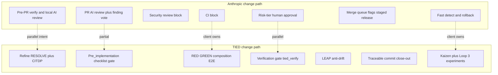

# Claude Code team code review × TIED — comparison

| Field | Value |
| --- | --- |
| **Purpose** | Map Anthropic’s Claude Code team PR review model to TIED as it exists in this repository; state alignments, deferrals, tensions, and gaps; recommend a phased Loop 1–3 improvement path (not an implementation plan). |
| **Audience** | Sponsors, methodology owners, plan authors, agent operators |
| **Source study** | [Solving code review at Anthropic](https://claude.dev/blog/solving-code-review-at-anthropic/) (Anthropic engineering blog, October 2026) — **external methodology**; study input, not adoption target |
| **TIED anchors** | [LEAP](../../tied-bundle/docs/LEAP.md), [processes](../../tied-bundle/docs/processes.md), [AGENTS.md](../../AGENTS.md), [fresh-client-prompt-activation-map](../../tied-bundle/docs/fresh-client-prompt-activation-map.md), [sponsor-agent-relationship](../../tied-project/vocab/sponsor-agent-relationship.md) |
| **Status** | Outreach / analysis document; does not mint REQ/ARCH/IMPL tokens |
| **Last updated** | 2026-10-17 |

**Sibling docs:** [Methodology composition matrix](methodology-composition-matrix.md), [TIED × well-known methodologies](tied-vs-well-known-methodologies.md), [QMM × TIED](qmm-kaizen-vs-tied.md), [Jev × TIED](jev-for-tied-improvement.md), [TIED improvement roadmap](../tied-improvement-roadmap.md), [QMM methodology learning plan](../tied-qmm-methodology-learning-plan.md) (Loop 3).

---

## Executive summary

Anthropic optimizes **human attention** on large agent-assisted codebases with layered automation: local and PR-scoped AI review, security and CI blocks, risk-tiered human approval, gradual release, and fast rollback. Success is measured by **revert/incident rate** and **review convergence** (fewer noisy rounds), not by “a human read every line.”

TIED optimizes **intent traceability and proof before and during implementation**. Its center of gravity is **pre-code**: RESOLVE vocabulary, CITDP, IMPL **essence_pseudocode**, checklist **pre_implementation** gates, strict TDD order, and verification-gated **`tied_verify`**—not post-hoc PR diff review as the authoritative spec.

**Compose-don’t-replace:** Borrow verification-before-handoff, risk-scaled human decisions, reviewer improvement loops, and review **convergence** norms into existing Loop 1 gates, Loop 2 Kaizen observations, and Loop 3 evaluation discipline—**without** making PR bots, merge queues, or hosted AI review products authoritative over REQ→ARCH→IMPL, MCP checklist gates, or sponsor **consequence ladder** decisions for **costly choices**.

**One strategic direction (sponsor review only—not enacted):** Strengthen TIED’s **production system** by composing Anthropic-style layers into TIED’s existing proof stack; see [§ Phased approach](#7-phased-approach-to-improving-tied-recommendations-only).

---

## Source summary (article claims only)

The following summarizes the Anthropic blog post for readers who do not have the article open. It reports **their** claims and tooling emphasis; it does **not** assert that TIED has equivalent outcomes, automation, or metrics.

Anthropic describes code review as serving **two jobs**: (1) find and fix issues before ship, and (2) spread understanding of the codebase. For agent-heavy development they treat job (1) as primary for automation and use targeted explainers for job (2) instead of expecting every reviewer to read every diff line.

They organize review as **seven layers**. **Layer 1** is pre-PR verification plus local AI review (project guidance such as `CLAUDE.md` / `REVIEW.md`, executable checks before opening a PR). **Layer 2** runs AI review on every PR, including multi-agent or voting patterns to surface findings. **Layer 3** is security review that can block merge. **Layer 4** is automated CI (lint, test, build). **Layer 5** scales **human** approval to risk (low-risk paths may need fewer human touchpoints; sensitive areas retain explicit human ownership). **Layer 6** covers merge queue, feature flags, and staged release. **Layer 7** emphasizes fast detection and rollback when something slips through.

Beyond the stack, they describe **reviewer evaluation**: learning from incidents and from false-positive feedback so review prompts and policies improve over time. **Convergence controls** include caps on review rounds, **diff-only** re-review after fixes, suppression of repeated findings, and norms that stop agents from endless nit-fix loops. **Human responsibility** remains for direction, architecture, sensitive paths, evidence quality, and ownership—the automation routes attention rather than eliminating accountability.

The article ties guardrails to **operational outcomes** (reverts, incidents, time-to-recover) rather than to “every line reviewed by a human.” Pre-PR work is framed as cheaper than debate on a shared PR: catch correctness and style issues locally, attach evidence that checks ran, and only then consume org-wide review capacity. PR-level AI review is positioned as a **default**, not an exception, with mechanisms to reduce duplicate or low-value comments so humans see fewer, higher-signal threads.

On **security and CI**, the model is explicitly blocking: certain classes of findings or failing checks prevent merge until resolved or waived through a defined path. **Risk-tier human approval** bridges full automation and cases where judgment, compliance, or blast radius requires a named approver; “low risk” is not treated as “no owner.” **Release mechanics** (merge queue, flags, staged rollout) sit outside the review comment stream but complete safe delivery at scale. **Rollback** closes the loop when detection proves the stack missed something—those events feed reviewer evaluation rather than living only in postmortem docs.

They report organizational metrics (for example higher PR volume with lower revert rates and fewer review rounds per PR). Those figures are **Anthropic-reported**; see [Proof boundary](#proof-boundary) below.

Suggested adoption sequence in the article emphasizes **executable checks first** and **concise project/review guidance** (`CLAUDE.md`-style context plus optional path-scoped review rules) before heavier PR automation or org-wide policy changes.

---

## Second job: learning vs traceability

| Job | Anthropic emphasis | TIED emphasis | Disposition |
| --- | --- | --- | --- |
| Find/fix before ship | Pre-PR verify, PR AI review, blocks, risk-tier humans | Pre_implementation gate, pseudocode validation, RED/GREEN TDD, verification gate | **Composable** (parallel intent, different lifecycle anchor) |
| Spread codebase understanding | Targeted AI explainers; less line-by-line diff reading | Vocabulary PRELOAD, IMPL pseudo-code, module-scoped docs, token graph | **Tension** — both substitute for raw diff reading, with different sources of truth |

---

## Touchpoint 1 — RESOLVE (article → TIED vocabulary)

Analysis content only; this pass does **not** add glossary entries. Durable terms such as **review convergence** need a separate vocabulary decision before RECORD.

| Article term | TIED analogue | Notes |
| --- | --- | --- |
| `CLAUDE.md` / `REVIEW.md` | [AGENTS.md](../../AGENTS.md), client [routing.md](../../tied-project/vocab/routing.md), optional path-scoped **review guidance** | Review-guidance pattern is **not** yet standard in TIED |
| Pre-PR verification | Checklist pre-RED / **pre_implementation** gate, `[PROC-TIED_DEV_CYCLE]`, pseudocode validation | Lifecycle anchor is REQ slice, not PR |
| AI PR review | Integrated **adversarial inquiry** or separately invoked local review (e.g. Bugbot skill) | Not a hosted PR product or TIED authority |
| Blocking findings | `tied_checklist_gate_validate`, open inquiry findings, verification manifest gaps | Deterministic MCP gates |
| CI lint/test/build | Client DevOps (**Defer** in [well-known comparison](tied-vs-well-known-methodologies.md)) | TIED adds YAML/test traceability gates |
| Risk-tier human approval | **Assurance profiles**, CITDP `depth_tier`, **consequence ladder** / **costly choice** | [sponsor-agent-relationship](../../tied-project/vocab/sponsor-agent-relationship.md) |
| Merge queue / flags / staged release | Client release engineering | **Defer** |
| Incident → eval | **Loop 3** methodology learning, Kaizen **operational observation**, adversarial fixture corpus (partial) | Composable with client-owned rollback |
| Review round cap / diff-only re-review | **Gap** in TIED core today | Addressed ad hoc in prompt skills, not checklist receipts |
| Person directing agent owns outcome | **Sponsor** accountability and **delegated work envelope** | **Align** |

### Disposition key

| Disposition | Meaning in this comparison |
| --- | --- |
| **Align** | TIED already represents the article layer’s intent for agent-heavy delivery (scoped as stated). |
| **Composable** | Client or operator can combine without claiming equivalence. |
| **Tension** | Both sides partially true; proof boundary must be explicit. |
| **Gap** | Article emphasis not covered in TIED core today. |
| **Defer** | Client-owned (CI, merge, release) or out of TIED scope. |

---

## Primary layer matrix (article “layer by layer”)

Mirror style: [QMM primary systems matrix](qmm-kaizen-vs-tied.md#primary-qmm-systems-matrix).

| Layer (article) | Loop | TIED center of gravity | Disposition | One-line rationale |
| --- | --- | --- | --- | --- |
| 1 Pre-PR verify + local AI review | 1–2 | Refine, CITDP, pre_implementation gate, pseudocode validation, executable test evidence | **Composable** | Same intent, different lifecycle anchor (REQ slice vs PR). |
| 2 AI review on every PR | 1–2 | Adversarial inquiry (depth-gated); optional local diff review | **Tension** | TIED review is spec/test-aligned; PR review is diff-aligned. |
| 3 Security review blocks merge | 1 | Quality evidence matrix, `quality_security_profile_validate`, assurance profiles | **Align** (scoped) | Blocking obligations exist; not identical to GitHub security bot. |
| 4 Automated CI blocks | 1 | Tests + lint + `tied_validate_consistency` / gates | **Defer** (CI) + **Align** (TIED gates) | Pipeline is client-owned; TIED adds traceability proof. |
| 5 Human approval scaled to risk | 1–2 | Assurance profiles, `depth_tier`, consequence ladder, costly choice | **Align** (intent) **Gap** (automation) | No shipped “classifier picks merge approver count” in TIED core. |
| 6 Merge queue, flags, staged release | — | — | **Defer** | Release engineering; see [DevOps row](tied-vs-well-known-methodologies.md). |
| 7 Fast detect + rollback | 2–3 | Kaizen observations, Loop 3 incident→eval (partial), LEAP for spec drift | **Composable** | Rollback mechanics client-owned; TIED learns from outcomes. |

### Proof boundary

Article metrics (for example ~2× PR volume, ~−40% reverts, review rounds ~2.08→~1.32) are **Anthropic-reported**. Do **not** cite them as TIED outcomes or targets without a separate methodology experiment with explicit denominators and stop criteria.

### Layer flow diagram

### Key tensions (prose)

- **When review runs:** Anthropic shifts review **continuously** (pre-PR + PR). TIED front-loads **spec and test design**—PR review complements but does not substitute for missing IMPL/tests or gate receipts.
- **Source of truth:** PR diff vs **essence_pseudocode** + token graph—**LEAP** is the anti-drift analog of “fix project/review guidance when the reviewer repeats itself.”
- **Noise / agent loops:** Article review-round reduction maps to TIED **Loop 2** risk (agents fix nits endlessly)—today addressed ad hoc in skills, not checklist receipts.
- **Effectiveness measurement:** Anthropic tracks comment disposition and clean-PR false positives; TIED uses **proof boundaries**, **evidence-chain profile**, and Kaizen outcome vs baseline—different denominators; do not copy metrics blindly.

---

## What TIED already does better (for agent-heavy repos)

- **REQ→ARCH→IMPL** spine with `[PROC-IMPL_PSEUDOCODE_TOKENS]` traceability from pseudo-code through tests and code.
- **`tied_validate_consistency`** and verification-gated **`tied_verify`**—status derived from tests where enabled, not from PR comment volume.
- **Quality evidence matrix** and integrated **adversarial inquiry** when `depth_tier` warrants it ([fresh-client-prompt-activation-map](../../tied-bundle/docs/fresh-client-prompt-activation-map.md)).
- **Sponsor agency boundary**—automation and gates inform; **costly choices** stay on the [consequence ladder](../../tied-project/vocab/sponsor-agent-relationship.md).

---

## Learnings worth composing (not wholesale adopt)

1. **Executable verification before handoff** — Strengthen documented “show command output” norms in [client development index](../../tied-bundle/docs/client-development-index.md) and AGENTS close-out (doc patch in a later REQ if desired).
2. **Path-scoped review guidance** — `REVIEW.md` pattern as optional `tied-project/review/` or module stubs (client-owned, not methodology YAML).
3. **Risk-scaled human touchpoints** — Map low/med/high article tiers to **assurance profiles** + CITDP `depth_tier` (advisory sponsor process in this doc; not auto-approve costly choices).
4. **Reviewer improvement loop** — Route false-positive review noise to **`methodology_improvement`** feedback ([feedback-to-tied](../../tied-project/vocab/feedback-to-tied.md)) → Loop 3 experiments ([QMM methodology learning plan](../tied-qmm-methodology-learning-plan.md)).
5. **Convergence policy** — Document recommended agent norms: round cap, diff-only re-review, suppress repeated findings (align with Cursor **Bugbot** skill usage; optional future **prompt-shared** adjunct).

---

## Explicit non-adoptions

- Multi-agent **finding voter** as mandatory gate — TIED keeps deterministic MCP gates authoritative per [Jev × TIED](jev-for-tied-improvement.md) layering.
- **Zero-human merge** for low-risk paths — sponsor/reviewer remains on **consequence ladder** for costly choices.
- Replacing **LEAP/checklist** with PR-only workflow.
- Org SRE merge queue / feature flags as TIED core (**Defer**).

---

## 7. Phased approach to improving TIED (recommendations only)

Phases are **recommendations only**, not implementation authorization. Each behavior-changing phase would require its own sponsor-approved REQ, CITDP, tracker, gates, and LEAP reconciliation.

| Phase | Loop | Theme | Outcome | Proof boundary | TIED implementation (compose) |
| --- | --- | --- | --- | --- | --- |
| **0** | — | This comparison doc + matrix sibling link | Published outreach | Doc review only | Outreach doc + [matrix sibling link](methodology-composition-matrix.md); feedback **`fb-mvclklsa-t5gzbo`** (optional store) |
| **1** | Loop 1 | **Pre-handoff verification charter** | Short guide: executable checks, fresh-context review, evidence before PR/commit | Documentation first; no new MCP authority | **Implemented** — [pre-handoff-verification-charter.md](../../tied-bundle/docs/pre-handoff-verification-charter.md) · [REQ-TIED_PRE_HANDOFF_VERIFICATION_CHARTER](../../tied-project/requirements/REQ-TIED_PRE_HANDOFF_VERIFICATION_CHARTER.yaml) |
| **2** | Loop 1 | **Risk-tier playbook for sponsors** | Relate assurance profiles and `depth_tier` to human review attention and hinge fields | Advisory mapping only; never auto-approve costly choices | **Implemented** — [sponsor-risk-tier-playbook.md](../../tied-bundle/docs/sponsor-risk-tier-playbook.md) · [REQ-TIED_SPONSOR_RISK_TIER_PLAYBOOK](../../tied-project/requirements/REQ-TIED_SPONSOR_RISK_TIER_PLAYBOOK.yaml) |
| **3** | Loop 2 | **Review convergence** | Round cap, diff-only re-review, class-level fixes, repeated-finding suppression | Measure via operational observations and outcome baselines | **Implemented** — [review-convergence-policy.md](../../tied-bundle/docs/review-convergence-policy.md) · [REQ-TIED_REVIEW_CONVERGENCE_POLICY](../../tied-project/requirements/REQ-TIED_REVIEW_CONVERGENCE_POLICY.yaml) |
| **4** | Loop 3 | **Incident/revert evaluation corpus** | Add confirmed post-merge failures and false-positive cases to bounded evaluation corpus | Pilot with explicit denominators, provenance, stop criteria | **Not started** — requires sponsor **`plan-new-feature`** (compose closed QMM machinery; do not reopen W6) |
| **5** | Composable | **Client DevOps integration appendix** | Document PR fields for tests, risk, rollback; CI/release client-owned | Client-layer guidance, not TIED core | **Not started** — recommendations only |

Cross-link phases 4–5 to [TIED improvement roadmap](../tied-improvement-roadmap.md) (feature orchestration close-out) and the closed QMM Loop 3 program—avoid duplicating Batch 0–6 scope.

---

## Optional follow-ups (not in phase 0 scope)

- **Matrix row (deferred):** A new Loop 2 row for “PR-centric / agent code review” in [methodology-composition-matrix.md](methodology-composition-matrix.md) requires sponsor review—the matrix is agent-drafted **37/37 complete** and tracked by `REQ-TIED_METHODOLOGY_COMPOSITION_MATRIX`. Phase 0 adds **sibling link only**, not a new row.
- **`tied_feedback_add`** with type `methodology_improvement` after publish (optional, sponsor-initiated).
- Phases **1–3** delivered via separate `plan-new-feature` passes under applied LEAP **`lp-2026-10-17T16-41-21-621Z-441a8fc5136b`** (store **`main`** @ **`0d0a3b99`**); phase **4+** still require sponsor authorization.

---

## Compose with closed programs (do not reopen scope)

| Program | Relevance to this comparison |
| --- | --- |
| [QMM methodology learning](../tied-qmm-methodology-learning-plan.md) (closed W1–W5) | Phase 4 eval corpus composes Loop 3 machinery; do not reopen W6 or methodology YAML without new REQ. |
| [Kaizen feedback loop](../tied-kaizen-feedback-loop-plan.md) (closed; Phase 3 transport deferred) | Phase 3 convergence noise → **operational observation** + analysis digest. |
| [Jev × TIED](jev-for-tied-improvement.md) | Optional future **shadow** for risk-tier or review triage—never replaces MCP gates. |
| [Feature orchestration roadmap](../tied-improvement-roadmap.md) | Close-out and verify surfaces; not a substitute for PR review layers. |

---

## Related docs

- [`docs/comparisons/methodology-composition-matrix.md`](methodology-composition-matrix.md) — Loop × method surface (sibling link added 2026-10-17)
- [`docs/comparisons/qmm-kaizen-vs-tied.md`](qmm-kaizen-vs-tied.md) — Compose-don’t-replace pattern for external methodology
- [`tied-bundle/docs/citdp-policy.md`](../../tied-bundle/docs/citdp-policy.md) — Outreach-only tracking policy referenced by the authoring plan
