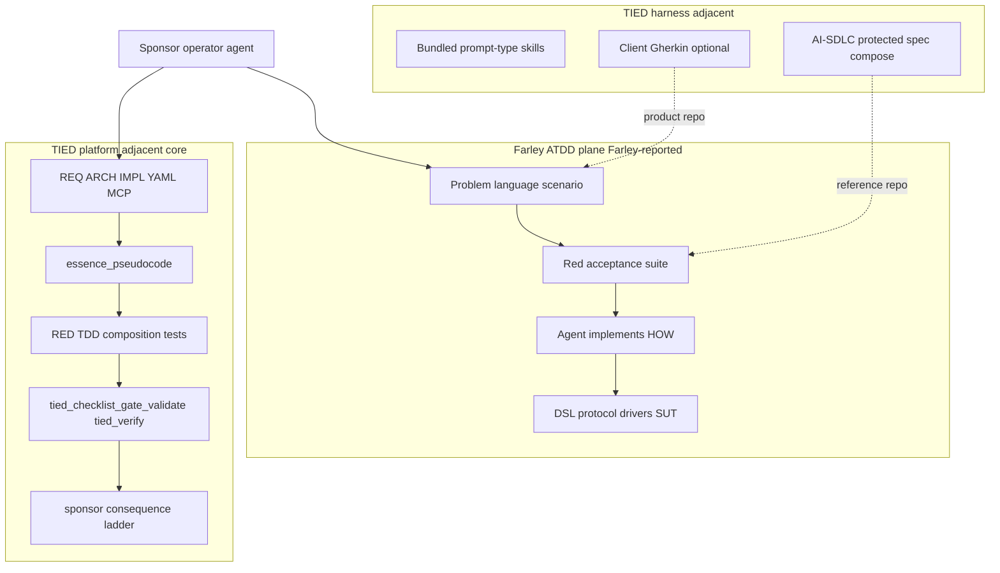

# Dave Farley “Spec Must Be Executable” × TIED — agent management lens

| Field | Value |
| --- | --- |
| **Purpose** | Map Dave Farley’s **executable specification / ATDD** advocacy (verification bottleneck with AI codegen; markdown SDD insufficiency; four-layer WHAT/HOW separation; red-first acceptance; protected tests) to TIED as implemented in this repository—with emphasis on **traceability**, **layered TDD**, and **gate proof**—not adopting Farley’s commercial course, Gherkin as REQ substitute, or mutation testing as TIED core. |
| **Audience** | Sponsors, harness authors, ATDD/BDD practitioners, prompt-type operators, methodology owners |
| **Source URL** | [The Spec Must Be Executable](https://www.linkedin.com/pulse/spec-must-executable-dave-farley-jrnxe/) (Dave Farley, 2026-10-25 — **Farley-reported**) |
| **Article capture (sibling)** | [dave-farley-spec-must-be-executable.md](dave-farley-spec-must-be-executable.md) — metadata + TL;DR only; **full text off-repo** |
| **Status / date** | Outreach / analysis snapshot, **2026-11-17** — **reference only; this document does not mint REQ/ARCH/IMPL tokens** |
| **Executable follow-up** | Wave 3 candidates in § Phased recommendations (**Defer** until scoped **`add-feature`** / **`build-plan`**) |
| **Distinct from** | [AI-SDLC factory × TIED](ai-sdlc-atdd-software-factory-vs-tied.md); [Persante SDD × TIED](persante-sdd-skills-vs-tied-agent-management.md); [TIED vs well-known methodologies](tied-vs-well-known-methodologies.md); [Software engineering degree × TIED](software-engineering-degree-vs-tied.md); [Anthropic FV × TIED](anthropic-llm-formal-verification-vs-tied-agent-management.md); [HackerNoon observability contract × TIED](hackernoon-observability-contract-ci-vs-tied-agent-management.md) |
| **TIED anchors (reference only)** | [AGENTS.md](../../AGENTS.md), [agent-req-implementation-checklist.md](../../tied-bundle/docs/agent-req-implementation-checklist.md), [processes.md](../../tied-bundle/docs/processes.md) ([PROC-TIED_DEV_CYCLE](../../tied-bundle/docs/processes.md)), [pseudocode-writing-and-validation.md](../../tied-bundle/docs/pseudocode-writing-and-validation.md), [sponsor-agent-relationship.md](../../tied-project/vocab/sponsor-agent-relationship.md), [quality-assurance.md](../../tied-project/vocab/quality-assurance.md) |

---

## Executive summary

Farley’s **Farley-reported** thesis is that agent-written code makes **verification** the binding constraint: prompts and markdown intent files do not fail when behavior drifts, while **executable** behavioral examples—written in problem language, run against the real system, and protected from agent tampering—are the practical contract between sponsor intent and shipped code. He frames this as rediscovered ATDD (four-layer separation, iterative scenarios, human-owned acceptance), contrasting fashionable **markdown spec-driven** tooling that leaves “the real spec” in ad hoc tests.

TIED’s center of gravity is a **semantic intent stack** for methodology work: RESOLVE/RECORD vocabulary, CITDP-scoped change, REQ → ARCH → IMPL with **essence_pseudocode** block contracts, strict unit-then-composition TDD, checklist gates, MCP **`tied-project/`** YAML authority, **`tied_verify`** when enrolled, LEAP on divergence, and sponsor **consequence ladder**. TIED does not ship a Cucumber suite as the system of record; it ships **tokens + pseudo-code + tests + gates** as the executable layer for *methodology and client REQ work*.

**Compose-don’t-replace:** Borrow **executable-discipline literacy** (red before agent, intent external to generated tests, small steps, protect verification artifacts). Keep **token graph truth**, **gate receipts**, **MCP writes**, and implement-complete proof on the TIED/checklist plane—not LinkedIn prose, course outcomes, or acceptance green alone.

| Center of gravity | Farley advocacy | TIED (stdd) |
| --- | --- | --- |
| Primary contract | Running acceptance examples (BDD/ATDD) | `[REQ-*]` / `[ARCH-*]` / `[IMPL-*]` + pseudo-code + tests |
| “Spec” medium | Gherkin-style scenarios + harness layers | YAML detail + IMP **essence_pseudocode** |
| Before codegen | One red scenario | RED tests + IMPL/CITDP gates before implementation |
| Protect intent | Tests outside agent reach | Sponsor agency + checklist; factory GUARD **Composable** via [AI-SDLC](ai-sdlc-atdd-software-factory-vs-tied.md) |
| Traceability | Example suite as living spec | Token comments + **`tied_validate_consistency`** |
| Agent role | Implements HOW under frozen WHAT | Implements code under documented stack; human **RESOLVE charter** |
| Effectiveness | Course / industry anecdotes | **`not_measured`** unless evaluation cohort |

### Evaluation charter mapping (Q1–Q6)

Per [tied-methodology-evaluation-framework.md](../../docs/tied-methodology-evaluation-framework.md); cohort **`not_measured`** for this outreach doc.

| Question | Farley plane | TIED plane | Disposition |
| --- | --- | --- | --- |
| **Q1** | ATDD scenario pass rate | Checklist + test pass + gate receipts | **Defer** — different denominators |
| **Q2** | Acceptance suite maintenance cost | YAML/IMPL + LEAP cost | **Composable** literacy |
| **Q3** | Agent lines/day vs review capacity | Agent scope vs sponsor review | **Align** bottleneck narrative |
| **Q4** | Mutation-test holes in acceptance | Adversarial inquiry when enrolled | **Defer** product integration |
| **Q5** | Markdown SDD drift | INDEX/detail drift without tests | **Tension** — both need verify loop |
| **Q6** | Course skill adoption | `tied-install` methodology | **not_measured** |

---

## Source summary (Farley claims only)

From sibling [stub](dave-farley-spec-must-be-executable.md) and [url-fetch receipt](../../tied-project/working/DOC-FARLEY-EXECUTABLE-SPEC-COMPARISON/evidence/url-fetch-receipt.md) (**Farley-reported**; read post at source URL for wording).

- **Consensus narrative:** Independent voices (Martin, Tornhill, Grove, Beck, Bache, Anthropic guidance cited **Farley-reported**) converge on checkable behavioral intent for agent codegen.
- **Three hard problems:** Precise specification, verification, small steps—AI accelerates code output only (**Farley-reported**).
- **Tests-after-code failure mode:** Generated tests inherit code behavior; intent must be authored separately and be measurable (**Farley-reported**).
- **Markdown SDD critique:** Spec Kit–class approaches right diagnosis, wrong medium when nothing goes red (**Farley-reported** third-party quotes).
- **Executable spec definition:** Useful system behavior in problem language; runs against real system; omits HTTP/UI/class names by design (**Farley-reported**).
- **Four layers:** Test cases, DSL, protocol drivers, SUT; swap implementation, keep examples (**Farley-reported**; LMAX history **Farley-reported**).
- **Three operator rules:** Spec before agent + red; protect acceptance tests; one scenario per cycle (**Farley-reported**).
- **Objections:** Iterative not waterfall; selective code reading OK; fix brittle tests via layering + mutation testing pairing (**Farley-reported**); AI-written tests are not TDD without human ownership (**Farley-reported** Ian Cooper cite).
- **Commercial tail:** ATDD course + agent skill bundle—**Farley-reported**; pricing **`not_measured`** in stdd.

No LinkedIn article body or long Gherkin fences are reproduced in-repo.

---

## Relationship to sibling comparisons

| Sibling | What it owns | This document owns |
| --- | --- | --- |
| [AI-SDLC factory × TIED](ai-sdlc-atdd-software-factory-vs-tied.md) | Protected `spec/`, Gherkin, `run-all.js`, PetClinic factory | **Essay-level** ATDD rules, markdown-SDD critique, four-layer pedagogy |
| [Persante SDD × TIED](persante-sdd-skills-vs-tied-agent-management.md) | Wiki `spec.md`, `tasks.json`, product-repo SDD skills | **Running examples** as contract vs markdown FR/AC folders alone |
| [TIED vs well-known methodologies](tied-vs-well-known-methodologies.md) | Broad methodology map | Single **executable spec for agents** practitioner lens |
| [Software engineering degree × TIED](software-engineering-degree-vs-tied.md) | Graduate competency grid | **Convergence narrative** + operator rules, not curriculum mapping |
| [Anthropic FV × TIED](anthropic-llm-formal-verification-vs-tied-agent-management.md) | Checker-backed proof | Empirical acceptance + TDD — different proof plane |
| [HackerNoon observability × TIED](hackernoon-observability-contract-ci-vs-tied-agent-management.md) | Deploy-time observability intent + runtime audit | **Behavioral** intent before codegen; analogy: green without observability ↔ green without intent tests |

Methodology composition matrix **§2 new row**: **Defer** (sponsor).

---

## Harness lessons → TIED agent management

### Verification bottleneck

| Farley pattern | TIED surface | Notes |
| --- | --- | --- |
| Codegen speed >> review | Priority **Tests > Code** in [AGENTS.md](../../AGENTS.md) | **Align** |
| Agent undoes prior checks | LEAP when tests/IMPL diverge | **TIED-existing** |
| Large vague steps | CITDP scope + one REQ slice | **Composable** |

### Red before generation

| Farley pattern | TIED surface | Notes |
| --- | --- | --- |
| One failing acceptance scenario | RED unit/composition tests before code | **Align** [PROC-TIED_DEV_CYCLE](../../tied-bundle/docs/processes.md) |
| Red proves spec can catch wrong answers | Failing test proves criterion is testable | **Composable** |
| Markdown never goes red | YAML without tests drifts | **Tension** — gates + consistency |

### Protected verification contract

| Farley pattern | TIED surface | Notes |
| --- | --- | --- |
| Agent deletes failing tests | Sponsor **agency boundary** | **Align** [sponsor-agent-relationship](../../tied-project/vocab/sponsor-agent-relationship.md) |
| Dedicated specifier role | Human RESOLVE charter | **Align** |
| Filesystem read-only `spec/` | AI-SDLC GUARD — [sibling](ai-sdlc-atdd-software-factory-vs-tied.md) | **Composable** not TIED core |

### WHAT vs HOW separation

| Farley pattern | TIED surface | Notes |
| --- | --- | --- |
| Problem-language scenarios | REQ criteria + domain vocab | **Composable** |
| DSL / drivers / SUT | Unit vs composition vs E2E justification | **Align** module validation |
| IMPL pseudo-code as design | **essence_pseudocode** operational HOW | **TIED-existing** — not Gherkin substitute |

### Markdown SDD vs executable stack

| Farley pattern | TIED surface | Notes |
| --- | --- | --- |
| Spec Kit markdown drift | Persante `spec.md` + TIED YAML | **Cross-link** [Persante](persante-sdd-skills-vs-tied-agent-management.md) |
| Real spec in tests only | Token graph + tests | **Tension** — need both |
| Agent ignores instructions | Checklist + MCP gates | **TIED-existing** |

---

## Touchpoint 1 — RESOLVE

| Farley / ATDD term | TIED preferred term / surface | Disposition |
| --- | --- | --- |
| **Executable specification** | REQ criteria + tests + IMP **essence_pseudocode** | **Composable** |
| **Acceptance test** | Composition/E2E when UI required | **Align** |
| **Four-layer model** | Unit / composition / E2E layering | **Composable** |
| **Spec-driven (markdown)** | Wiki SDD / plan markdown | **Tension** |
| **Protected tests** | Sponsor approval + factory GUARD analog | **Composable** |
| **Mutation testing** | Adversarial / assurance profiles | **Defer** |
| **ATDD skill (commercial)** | Bundled prompt-type skills | **Defer** |
| **Gherkin feature file** | Client product repo artifact | **Defer** as TIED core |

### Disposition key

| Disposition | Meaning |
| --- | --- |
| **Align** | TIED already encodes similar epistemic order. |
| **Composable** | Combine literacy without equivalence. |
| **Tension** | Partial overlap; state proof boundary. |
| **Gap** | Farley emphasis outside TIED authoritative core. |
| **Defer** | Product/client adoption without REQ. |

---

## Primary capability matrix

| Concern | Farley COG | TIED COG | Disposition | Rationale |
| --- | --- | --- | --- | --- |
| Behavioral intent before agent | Red acceptance scenario | RED tests + IMPL pseudo-code | **Align** | Same order, different artifact |
| Executable verification | Running examples | Tests + gates + optional **`tied_verify`** | **Composable** | |
| Traceability graph | Example suite | REQ/ARCH/IMPL tokens | **Gap** primary | TIED adds graph |
| Markdown intent files | Spec Kit class | CITDP/plan markdown | **Tension** | Need verify loop |
| Protect contract from agent | Read-only tests | Sponsor ladder + factory pattern | **Composable** | |
| Small iterative steps | One scenario | One checklist slice / REQ | **Align** | |
| Four-layer delivery harness | DSL/drivers/SUT | Module + composition tests | **Composable** | |
| WHAT/HOW separation | Domain scenarios | REQ vs IMP pseudo-code | **Align** literacy | |
| Agent-generated tests | Not sole intent | Tests name tokens; human owns REQ | **Align** | |
| Mutation testing hole detection | Pair with acceptance | Adversarial depth when enrolled | **Defer** | |
| Course / skill effectiveness | Farley-reported offer | Methodology install | **not_measured** | |
| Formal proof | N/A | Anthropic FV sibling | **Defer** | Different plane |
| Ops “green without signal” | N/A | HackerNoon sibling analogy | **Composable** | |
| Comparison outreach | LinkedIn essay | `@external-service-comparison` | **Composable** | |

---

## Authority boundary

Client **acceptance suites** and Farley **course skill** sit **harness-adjacent**. TIED **implement-complete** and project YAML truth remain on MCP, checklist gates, tests, and sponsor ladder—not LinkedIn advocacy alone.

---

## Anti-patterns (Farley lessons → TIED risk)

| Anti-pattern | Symptom | TIED-oriented remedy |
| --- | --- | --- |
| Markdown spec = done | Agent drifts; nothing red | Tests + **`tied_validate_consistency`** |
| Agent writes acceptance tests | Confirms accidental behavior | Human-owned REQ + RED first |
| Agent deletes failing tests | Green wash | Sponsor costly choice; protected tests |
| `[REQ-*]` replaced by features | Lost ARCH/IMPL trace | Full token stack |
| Paste LinkedIn article in repo | Policy violation | Stub + url receipt only |
| Course outcomes = TIED proof | **Farley-reported** anecdotes | **`not_measured`** |
| Acceptance green = gate complete | Missing receipts | **`tied_checklist_gate_validate`** |
| Gherkin in methodology core | Product coupling | Client layer + TIED tokens |
| Comparison mints REQ | Tokens in markdown | **`add-feature`** only |
| AI-SDLC factory duplicated here | Repeated GUARD matrix | **Cross-link** sibling |

---

## Compose-don’t-replace table

| Tune with Farley literacy | Keep TIED authority |
| --- | --- |
| Ask “what fails silently when chat is green?” | Gates + tests + receipts |
| One red scenario before agent work | **PROC-TIED_DEV_CYCLE** order |
| Protect verification artifacts | Sponsor **agency boundary** |
| Separate WHAT examples from HOW code | IMP **essence_pseudocode** vs production |
| Pair markdown plans with executable checks | CITDP + pseudo-code validation |
| Read Farley for delivery teams | Wave 1–2 proof boundary for methodology |
| Adopt factory GUARD patterns in clients | [AI-SDLC × TIED](ai-sdlc-atdd-software-factory-vs-tied.md) — not auto TIED core |

---

## Bounded operator recommendations (Recommendation-only)

1. **Dual artifacts in client repos** — Product teams may keep **Gherkin/acceptance** suites **and** TIED **REQ/ARCH/IMPL**; map scenarios to `[REQ-*]` criteria in prose tables, not token substitution.
2. **Red proves testability of criteria** — Before large agent runs, ensure at least one failing test targets the stated REQ slice (**TIED-existing** TDD).
3. **Label essay and course claims** — Industry quotes and pricing are **Farley-reported**; methodology effectiveness **`not_measured`** unless enrolled.
4. **Cross-link factory implementation** — When sponsors want filesystem-protected specs, point to [AI-SDLC factory](ai-sdlc-atdd-software-factory-vs-tied.md), not this essay alone.
5. **Cross-link markdown SDD** — [Persante × TIED](persante-sdd-skills-vs-tied-agent-management.md) for wiki workflows; Farley for **executable** contract emphasis.
6. **Pair observability essay** — [HackerNoon × TIED](hackernoon-observability-contract-ci-vs-tied-agent-management.md) for **ops** green-without-signal; this doc for **intent** green-without-red-tests.
7. **Pseudo-code validation** — Treat IMP blocks like “executable design” with `[PROC-PSEUDOCODE_VALIDATION](../../tied-bundle/docs/pseudocode-writing-and-validation.md)` before codegen.

---

## Phased recommendations (doc-first)

| Phase | Action | Status |
| --- | --- | --- |
| **0** | Wave 1 stub + this analysis + git allowlist | **Done** (2026-11-17) |
| **1** | Bundle doc: acceptance-spec vs IMP pseudo-code literacy | **Defer** |
| **2** | Client playbook: protected acceptance + TIED tokens | **Defer** |
| **3** | Methodology composition matrix §2 row | **Defer** |
| **4** | Install Farley ATDD skill as TIED core | **OutOfScope** |

---

## Explicit non-adoptions

- Farley commercial ATDD course or bundled agent skill as **TIED core** or stdd CI gate
- Cucumber/Gherkin as authoritative substitute for `[REQ-*]` / `[ARCH-*]` / `[IMPL-*]`
- Mutation testing pass rates as **`tied_verify`** substitute
- Industry quote consensus as **TIED methodology effectiveness** proof
- Minting `[REQ-*]` / `[ARCH-*]` / `[IMPL-*]` from this comparison prose
- Methodology composition matrix **§2 data row** without scoped REQ
- Pasting LinkedIn article body into repository paths
- Duplicating AI-SDLC protected-spec / run-record narratives (see sibling)

---

## Proof boundary

- Essay claims are **Farley-reported**; not independently verified in stdd.
- TIED surfaces cited describe **TIED-existing** behavior at authoring time.
- Wave 3 behavior requires **`add-feature`** / **`build-plan`** with tests—not comparison markdown alone.
- Full post is **not** stored in-repo; analysis from off-repo read + themes receipt.
- Course enrollment and ATDD skill outcomes **`not_measured`** unless sponsor scopes evaluation.
- This document introduces **no new** REQ/ARCH/IMPL records **in its body**.

---

## Related documents

- [Article stub (sibling)](dave-farley-spec-must-be-executable.md)
- [AI-SDLC ATDD Software Factory × TIED (sibling)](ai-sdlc-atdd-software-factory-vs-tied.md)
- [Persante SDD × TIED (sibling)](persante-sdd-skills-vs-tied-agent-management.md)
- [Software engineering degree × TIED (sibling)](software-engineering-degree-vs-tied.md)
- [HackerNoon observability contract × TIED (sibling)](hackernoon-observability-contract-ci-vs-tied-agent-management.md)
- [Anthropic formal verification × TIED (sibling)](anthropic-llm-formal-verification-vs-tied-agent-management.md)
- [TIED vs well-known methodologies](tied-vs-well-known-methodologies.md)
- [Pseudocode writing and validation](../../tied-bundle/docs/pseudocode-writing-and-validation.md)
- [External three-wave comparison template](../../tied-bundle/docs/external-service-three-wave-comparison-template.md)
- [Working DOC plan](../../tied-project/working/DOC-FARLEY-EXECUTABLE-SPEC-COMPARISON/PLAN-refine-pass1.md)
- [Non-tied plan](../../tied-project/non-tied-plans/dave-farley-spec-must-be-executable-vs-tied/PLAN.md)