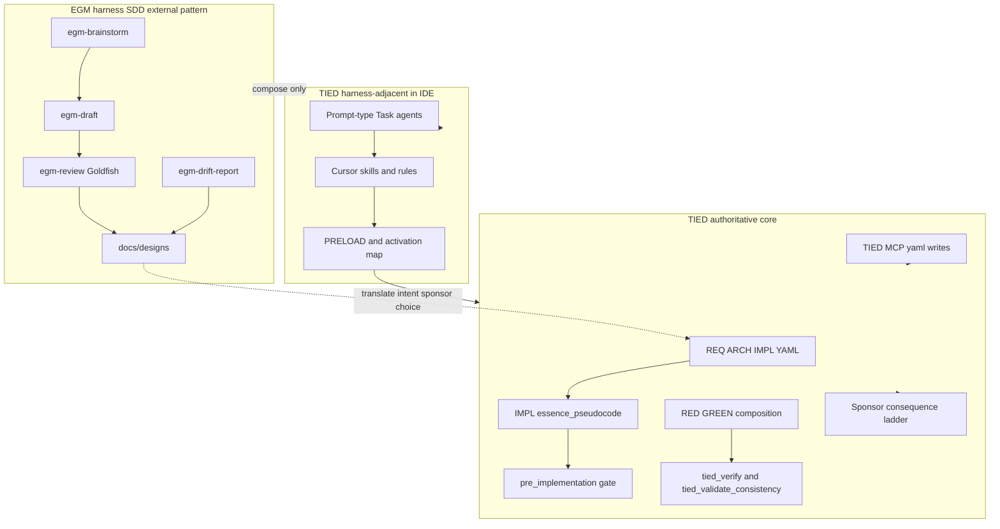

# Google EGM (Elephant–Goldfish) × TIED — agent management lens

| Field | Value |
| --- | --- |
| **Purpose** | Map Google’s open-source **Elephant–Goldfish Model (EGM)** plugin—spec-driven design with context-isolated review—to TIED as it exists in this repository, with emphasis on **harness-adjacent SDD** vs **platform-adjacent** intent proof—not EGM product adoption. |
| **Audience** | Sponsors, harness authors, methodology owners, plan authors |
| **Source URL** | [google/elephant-goldfish-model](https://github.com/google/elephant-goldfish-model); upstream [architecture.md](https://github.com/google/elephant-goldfish-model/blob/main/docs/designs/architecture.md) (2026-06-06) |
| **Evaluation charter** | [tied-methodology-evaluation-framework.md](../tied-methodology-evaluation-framework.md) — Q1–Q6 literacy only until Phase 3 `comparable-arms.v1` |
| **Status / date** | Outreach / analysis snapshot, **2026-11-07** — **reference only; this document does not mint REQ/ARCH/IMPL tokens** |
| **Executable follow-up** | None required; matrix §2 row 19 and evaluation-charter narrative row remain **Defer** unless sponsor promotes via full TIED lane |
| **Distinct from** | [Persante SDD × TIED](persante-sdd-skills-vs-tied-agent-management.md) (wiki `spec.md` contract); [Traefik harness/platform × TIED](traefik-harness-platform-vs-tied-agent-management.md) (fleet seam); [Cursor harness × TIED](cursor-harness-engineering-vs-tied-agent-management.md) (live telemetry); [LangChain harness × TIED](langchain-harness-engineering-vs-tied-agent-management.md) (benchmark trace loop); [LangWatch × TIED](langwatch-rebuilding-51-days-vs-tied-agent-management.md) (refactor lint cage — local sibling when present) |
| **TIED anchors (reference only)** | [AGENTS.md](../../AGENTS.md), [agent-req-implementation-checklist](../../tied-bundle/docs/agent-req-implementation-checklist.md), [fresh-client-prompt-activation-map](../../tied-bundle/docs/fresh-client-prompt-activation-map.md), [sponsor-agent-relationship](../../tied-project/vocab/sponsor-agent-relationship.md), [quality-assurance](../../tied-project/vocab/quality-assurance.md), [fidelity-research](../../tied-project/vocab/fidelity-research.md), [evaluation framework](../tied-methodology-evaluation-framework.md) |

---

## Executive summary

EGM implements **Spec-Driven Development (SDD)** with two deliberate agent roles: the **Elephant** holds project context and drafts specifications; **Goldfish** reviewers examine drafts and referenced source **without** the design conversation, using versioned rubrics in `document_standards/`. Long-form output lives in workspace files and side-panel artifacts—not the main chat stream. Approved designs land under `docs/designs/`; implementation follows human merge of the spec.

TIED’s center of gravity is **tokenized traceability** and **executable proof**: RESOLVE/RECORD vocabulary, CITDP, IMPL **essence_pseudocode**, checklist **pre_implementation** gates, strict TDD order, MCP-first project YAML, **`tied_validate_consistency`**, verification-gated **`tied_verify`**, optional integrated adversarial inquiry, and evaluation-charter **separate arms** for defect and cost claims.

**Compose-don’t-replace:** Use EGM skills for **artifact-first** brainstorm, draft, and multi-stage **Goldfish** review; translate sponsor-approved intent into TIED **REQ** scope and IMPL contracts before heavy implementation. Keep **gate authority**, **`tied_config_get_base_path`**, YAML mutations, and **LEAP** on the TIED/MCP/checklist plane (see [Traefik seam vocabulary](traefik-harness-platform-vs-tied-agent-management.md)).

| Center of gravity | EGM (upstream OSS) | TIED (this repo) |
| --- | --- | --- |
| Primary optimization | Living **markdown designs** + isolated review against rubrics | REQ→ARCH→IMPL traceability + tests + gates |
| Review loop | Fresh subagent **Goldfish** pipeline (five stages) | Checklist gates, **`pseudocode_validate`**, depth-gated inquiry |
| Canonical spec surface | `docs/designs/FEATURE.md`, briefs, review reports | Project YAML + IMPL pseudo-code sidecars |
| Anti-drift | `/egm-drift-report` (docs vs code) | LEAP, scoped analysis, verification manifests |
| Human authority | Engineer owns trade-offs and PR merge | Sponsor **consequence ladder**; costly choices explicit |

### Evaluation framework — Q1–Q6 literacy (not cohort evidence)

| # | Charter question (summary) | EGM narrative role | TIED pairing / status |
| --- | --- | --- | --- |
| **Q1** | Confirmed defects vs matched non-TIED proxies | Illustrates “**approved design ≠ confirmed defect rate**” | **Literacy only** — Goldfish pass is not TIED **confirmed finding** or historical defect proxy; **not_measured** |
| **Q2** | Traceability/fidelity findings predict rework? | Drift-report + review findings are **harness observations** | Compose with fidelity pilot + evidence chain; EGM artifacts alone **Defer** as predictors |
| **Q3** | Defect origin in stack layers | Rubrics touch design/readiness, not REQ→IMPL token graph | TIED fidelity research owns layer taxonomy; EGM **Composable** pre-code |
| **Q4** | Checklist/adherence vs gate failures | No TIED adherence ledger in EGM | **`tied_adherence_reconcile_run`** when enabled; EGM **not_measured** |
| **Q5** | TIED cost vs benefit | Multi-subagent review has **wall-time cost**; no enrolled denominator | Pair with MCP metrics + checklist steps — **not_measured** until cohort export |
| **Q6** | Methodology changes reduce cost without weakening boundaries | EGM plugin updates are **host harness** changes | TIED **LEAP proposal queue** / feedback; do not weaken proof to match review speed |

Future Phase 3 static arms may tag repos `methodology_family: sdd_egm` (e.g. `docs/designs/` count, review artifact presence). **This document does not implement or enroll that adapter.**

---

## Source summary (EGM claims only)

The following summarizes the upstream README and **architecture.md**. Behaviors, persona names, and pipeline steps are **EGM-reported** or **upstream design doc** unless labeled otherwise. They are **not** TIED outcomes.

**Problem framing (four failure modes).**

1. **Hallucination cascades & context pollution** — one thread interviews, designs, and codes; bias accumulates.
2. **Premature implementation (“Weeds Syndrome”)** — agents edit nearby files before placement, YAGNI, and reuse checks.
3. **Chat dump fatigue** — long specs and review logs in chat degrade context and ergonomics.
4. **Documentation drift** — kickoff designs rot as code evolves.

**Design principles.**

- **Elephant & Goldfish** roles (deep context vs zero-context reviewers).
- **Human ownership** of architectural decisions.
- **Artifact-first UX** — deliverables in files/artifacts, not chat dumps.
- **Living specifications** under `docs/designs/`.

**Lifecycle (phases 1–5).**

1. **`/egm-brainstorm`** — multi-lens shootdown; output `concepts_brief.md`.
2. **`/egm-draft`** — section-by-section design; output `design_draft.md` / `docs/designs/*.md`.
3. **`/egm-review`** — five-stage Goldfish pipeline (zoom out, comprehension, critic, intermediate zoom out, implementation readiness).
4. **Human resolve / PR** — `/egm-resolve`, triage findings, human peer review on spec PR.
5. **Implementation & drift** — implement against approved doc; **`/egm-drift-report`** for ongoing doc↔code checks.

**Phase 5 file-boundary convention (upstream):** Phases 1–4 write specification and review artifacts only; after Step 9 passes, **Target Scope & File Boundary** in the plan constrains implementation files—**convention, not enforced by TIED MCP**.

**Harness constraint:** Goldfish reviews require **fresh subagent contexts**; EGM stops the review if the host cannot spawn them (**EGM-reported**).

---

## Failure modes ↔ TIED surfaces

| EGM failure mode | TIED-oriented response | Disposition |
| --- | --- | --- |
| Context pollution in one thread | PRELOAD vocab; checklist scope; Task subagents for fresh context | **Composable** |
| Weeds syndrome (code before design) | **[PROC-TIED_DEV_CYCLE]** — tests/IMPL before production; **pre_implementation** gate | **Align** (intent) |
| Chat dump fatigue | Working folders, PLAN/evidence files; skills discourage wall-of-chat specs | **Composable** |
| Documentation drift | LEAP when code/tests diverge from IMPL; scoped analysis | **Align** + **Tension** with EGM drift-report |

---

## Skill and persona inventory

| EGM skill / layer | Responsibility (upstream) | TIED analogue | Notes |
| --- | --- | --- | --- |
| **`egm-brainstorm`** | Multi-lens ideation, shootdown swarm | Sponsor intent + CITDP; **`feature_refine`** when FEAT-scoped | Harness exploration |
| **`egm-draft`** | Section compiler to design doc | REQ/ARCH/IMPL authoring; IMPL approach fields | **Tension:** markdown design ≠ IMPL pseudo-code |
| **`egm-review`** | Five-stage Goldfish orchestration | **`pseudocode_validate`**; integrated **`tied_adversarial_inquiry_run`** when armed | Goldfish ≠ **`tied_verify`** |
| **`egm-review-loop`** | Configured reviewer groups | Custom review Task profiles | **Composable** |
| **`egm-resolve`** | Triage findings, patch spec | LEAP / sponsor triage on checklist findings | Human authority both sides |
| **`egm-bootstrap`** | Bottom-up codebase docs | Brownfield elevation; EDPC compose when scoped | **Defer** full parity |
| **`egm-drift-report`** | Spec/README vs code | **`tied_scoped_analysis_run`**; LEAP on IMPL drift | Different proof boundary |
| **Goldfish personas** | Rubric-loaded isolated reviewers | Adversarial inquiry personas (depth-gated) | Activation rules differ |
| **`document_standards/`** | Versioned rubrics | IMPL grammar + pseudo-code validation layers | Not interchangeable schemas |

---

## Harness lessons → TIED agent management

### Elephant context vs platform truth

| EGM pattern | TIED surface | Notes |
| --- | --- | --- |
| Elephant loads history, CUJs, codebase maps | **PRELOAD** + routing glossaries | Wrong PRELOAD → wrong reads; analogous to context pollution |
| Draft pauses for section feedback | Sponsor ladder; **reversible** scope splits | Costly choice if dual specs diverge |
| Living `docs/designs/` | **`tied-project/`** YAML + committed working artifacts | **Tension:** two SoT unless translated |

### Goldfish isolation vs confirmation bias

| EGM pattern | TIED surface | Notes |
| --- | --- | --- |
| Fresh subagent reviewers | Cursor **Task** subagents; inquiry at integrated depth | EGM **requires** spawn capability |
| Synthesizer deduplicates findings | Inquiry obligation/finding artifacts (when activated) | Review-gated, not auto-LEAP |
| Step 9 implementation readiness | **`pseudocode_validate`** + composition tests | Rubric pass ≠ RED/GREEN |
| Zoom-out / YAGNI rubrics | BBCE slice discipline; module validation | **Composable** scoping vocabulary |

### Artifact-first UX

| EGM pattern | TIED surface | Notes |
| --- | --- | --- |
| No chat dumps | PLAN.md, session-handoff, gate JSON | Aligns with TIED working placement |
| `RequestFeedback` checkpoints (Antigravity) | Checklist tracker steps | Harness UX; gates still authoritative |
| Review reports as files | Adversarial inquiry four artifacts under `working/…/` when integrated | Different paths |

### Spec PR vs TIED YAML evolution

| EGM pattern | TIED surface | Notes |
| --- | --- | --- |
| Human PR merges FEATURE.md | Git traceability; **not** automatic REQ linkage | Translate → **`yaml_*`** MCP writes |
| Phase 1–4 no production code edits | Pre_implementation / pseudo-code before code | **Align** on intent |
| Implementation agent reads design only | IMPL **essence_pseudocode** drives tests | **Tension** if design doc skips tokens |

---

## Touchpoint 1 — RESOLVE (EGM → TIED vocabulary)

| EGM term / artifact | TIED preferred analogue | Notes |
| --- | --- | --- |
| **`concepts_brief.md`** | Working-folder intent notes; early REQ draft | Not a registered **REQ-*** until promoted |
| **`design_draft.md` / `docs/designs/*.md`** | ARCH/IMPL narrative; **not** authoritative IMPL pseudo-code alone | Sponsor **costly choice** on SoT |
| **Goldfish finding** | Inquiry/fidelity **observation** | Not **confirmed finding** until adjudicated |
| **Implementation readiness (Step 9)** | Pre-code gates + **`pseudocode_validate`** | **Non-1:1** — rubric ≠ test pass |
| **`/egm-drift-report` green** | Scoped analysis signal | Not **`tied_validate_consistency`** |
| **Elephant / Goldfish** | Harness roles vs platform validators | See authority diagram below |

### Disposition key

| Disposition | Meaning in this comparison |
| --- | --- |
| **Align** | TIED already enforces the same intent (different mechanics). |
| **Composable** | Combine EGM skills with TIED without equivalence claims. |
| **Tension** | Dual authority or overlapping spec surfaces need sponsor choice. |
| **Gap** | EGM emphasizes something TIED core does not ship. |
| **Defer** | Host install matrix, product telemetry, or future evaluation adapter. |

### Claim labeling

| Label | Use when |
| --- | --- |
| **EGM-reported** | README, upstream architecture, skill behavior claims |
| **TIED-existing** | Committed docs/tools in this repo |
| **not_measured** | No cohort or charter arm enrolled |
| **Recommendation-only** | Compose suggestions not implemented |

---

## Primary capability matrix

| EGM concern | TIED center of gravity | Disposition | One-line rationale |
| --- | --- | --- | --- |
| Living markdown specifications | REQ/ARCH/IMPL + IMPL sidecars | **Tension** | Compose with explicit SoT; default TIED in TIED clients |
| Multi-stage isolated review | Pseudo-code validate; adversarial inquiry | **Composable** | Fresh review pattern aligns; artifacts differ |
| Artifact-first UX | Working folders, checklist evidence | **Align** (intent) | Reduces chat dump fatigue |
| Human-owned merge of spec | Sponsor ladder; costly choices | **Align** | Agency boundary preserved |
| YAGNI / zoom-out rubrics | BBCE; scope in CITDP | **Composable** | Scoping vocabulary, not automatic |
| Drift detection (docs vs code) | LEAP; scoped analysis | **Composable** | Different tools, same literacy |
| Brainstorm shootdown swarm | Impact discovery; sponsor Q&A | **Composable** | Pre-REQ exploration |
| `document_standards/` rubrics | IMPL grammar + validation layers | **Tension** | Rubric pass ≠ token graph consistency |
| Step 9 readiness | Pre_implementation + TDD order | **Tension** | Design approval ≠ **`tied_verify`** |
| Phase 5 file boundary list | Module validation; binding inventory | **Composable** | Helpful slice discipline |
| Fresh subagent requirement | Task tool delegation | **Defer** (host) | EGM stops without spawn; TIED proof independent |
| Plugin install on coding agent | Skills/rules; agentstream | **Composable** | Harness layer only |
| No TIED YAML / MCP in EGM core | **`tied_config_get_base_path`** + MCP writes | **Align** (seam) | Platform authority stays TIED |
| Evaluation defect rate from review pass | Evaluation charter separate arms | **Gap** | **not_measured** — literacy only |

---

## Authority boundary (EGM harness × TIED core)

Operator skim: [authority-boundary operator checklist](../../tied-project/working/REQ-TIED_HARNESS_PLATFORM_SEAM/authority-boundary-operator-checklist.md). Seam vocabulary: [Traefik harness/platform × TIED](traefik-harness-platform-vs-tied-agent-management.md) (matrix §2 row 13).

---

## Anti-patterns (EGM lessons → TIED risk)

| Anti-pattern | Symptom | TIED-oriented remedy |
| --- | --- | --- |
| Goldfish approval as Q1 proof | Outreach cites design review as defect reduction | Evaluation charter **separate arms**; label **not_measured** |
| Dual spec without SoT | `FEATURE.md` and IMPL YAML diverge | Sponsor **costly choice**; LEAP on drift |
| Drift-report green waives tests | Doc match treated as verification | **`tied_verify`**, gate receipts |
| EGM draft writes project YAML | Harness skill mutates `tied-project/` | MCP-first; **`tied_validate_consistency`** |
| Implementation readiness = shipped quality | Step 9 substitutes RED/GREEN | **[PROC-TIED_DEV_CYCLE]** order |
| Conflate with Persante wiki SDD | Same “SDD” label, different contracts | [Persante comparison](persante-sdd-skills-vs-tied-agent-management.md) |
| Conflate with Spec Kit FEAT shell | Both SDD-flavored | Matrix row 5 — TIED YAML stays authoritative |

---

## Compose-don’t-replace: tune harness vs keep platform authority

| Tune in the **harness** (EGM-style SDD) | Keep **platform-adjacent / MCP / gate** authority |
| --- | --- |
| Brainstorm/draft/review in `docs/designs/` | **REQ/ARCH/IMPL** via **TIED MCP** or **tied-cli** |
| Goldfish findings → triage in `/egm-resolve` | **Confirmed findings** only after fidelity adjudication |
| Drift-report for doc literacy | LEAP when IMPL/tests diverge |
| Section-by-section sponsor feedback | **pre_implementation** gate before code |
| Fresh Task subagent when host cannot run EGM review | Full TIED checklist track on platform plane |

---

## Composition playbook (minimal, recommendation-only)

1. **Explore** — Optional `/egm-brainstorm` or equivalent for trade-offs; RECORD intent in sponsor terms.
2. **SoT choice** — Sponsor declares whether approved design feeds TIED **REQ** scope or remains parallel reference (**default: TIED authoritative**).
3. **Translate** — Elevate decisions into project REQ/ARCH/IMPL + IMPL **essence_pseudocode** (full TIED lane skills).
4. **Implement** — **[PROC-AGENT_REQ_CHECKLIST]** with RED/GREEN; EGM Phase 5 file list may inform BBCE slices only.
5. **Maintain** — Periodic drift checks on **both** planes if dual artifacts exist; LEAP when they disagree.

---

## Explicit non-adoptions

- EGM **plugin marketplace** installs as TIED-shipped core — **Defer** (client harness choice).
- **Goldfish rubric pass** as substitute for **`tied_verify`** or evidence-chain **integrated** profile.
- **Design review completion** as Q1 defect-rate or historical proxy evidence — evaluation **literacy only**.
- Universal **maturity score** from review stages — forbidden by evaluation charter.
- Matrix §2 **row 19** in this build — **Defer** (requires REQ row-count contract 18→19).

---

## Proof boundary

- Pipeline steps, personas, and UX protocol claims from the EGM repository are **EGM-reported** / **upstream design doc**. Do **not** cite them as TIED outcomes, checklist success metrics, or methodology effectiveness.
- TIED surfaces referenced here describe **TIED-existing** committed behavior at authoring time; they are not effectiveness claims.
- Cohort comparisons (Q1–Q6) remain **`not_measured`** until evaluation corpus and `comparable-arms.v1` arms exist per [evaluation framework](../tied-methodology-evaluation-framework.md).
- This document introduces **no new** `[REQ-*]`, `[ARCH-*]`, or `[IMPL-*]` records **in its body**; bracketed tokens name **existing** methodology references only.

---

## Related documents

- [Methodology composition matrix](methodology-composition-matrix.md) (§2 rows 5 Spec Kit, 13 Traefik seam, 14 Cursor, 15 LangChain, 18 LangWatch — **row 19 EGM Defer**)
- [Persante SDD × TIED](persante-sdd-skills-vs-tied-agent-management.md)
- [Traefik harness/platform × TIED](traefik-harness-platform-vs-tied-agent-management.md)
- [Cursor harness engineering × TIED](cursor-harness-engineering-vs-tied-agent-management.md)
- [LangChain harness engineering × TIED](langchain-harness-engineering-vs-tied-agent-management.md)
- [Tied methodology evaluation framework](../tied-methodology-evaluation-framework.md)
- [Authority boundary operator checklist](../../tied-project/working/REQ-TIED_HARNESS_PLATFORM_SEAM/authority-boundary-operator-checklist.md)
- [tied-improvement-roadmap.md](../tied-improvement-roadmap.md) (Spec Kit / external SDD context)
- Non-tied plan: [`tied-project/non-tied-plans/google-egm-elephant-goldfish-vs-tied/PLAN.md`](../../tied-project/non-tied-plans/google-egm-elephant-goldfish-vs-tied/PLAN.md)
