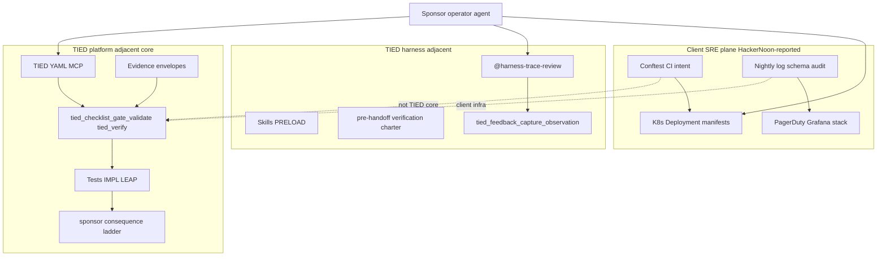

# HackerNoon observability contract CI × TIED — agent management lens

| Field | Value |
| --- | --- |
| **Purpose** | Map Akhil’s **observability contract** practice (K8s manifest minimums, Conftest CI **intent** gate, nightly **runtime** verification; “observably dead” vs green CI) to TIED as implemented in this repository—with emphasis on **proof boundaries**, **gate receipts**, and **intent vs verification**—not adopting OPA, Prometheus/Loki/Tempo, or client microservice policy as TIED core. |
| **Audience** | Sponsors, harness authors, SRE/platform operators, prompt-type operators, methodology owners |
| **Source URL** | [Your CI Pipeline Should Reject Any Service Without an Observability Contract](https://hackernoon.com/your-ci-pipeline-should-reject-any-service-without-an-observability-contract) (Akhil, 2026-06-23 — **HackerNoon-reported**) |
| **Article capture (sibling)** | [hackernoon-observability-contract-ci.md](hackernoon-observability-contract-ci.md) — metadata + TL;DR only; **full text off-repo** |
| **Status / date** | Outreach / analysis snapshot, **2026-11-17** — **reference only; this document does not mint REQ/ARCH/IMPL tokens** |
| **Executable follow-up** | [REQ-TIED_HACKERNOON_OBSERVABILITY_CONTRACT_WAVE3](../../tied-project/requirements/REQ-TIED_HACKERNOON_OBSERVABILITY_CONTRACT_WAVE3.yaml) — Wave 3 Phase 1 intent/verify compose + opt-in receipt CI |
| **Distinct from** | [Netflix observability ontology × TIED](netflix-ontology-driven-observability-vs-tied-agent-management.md); [Open Governance cannot sense × TIED](open-governance-cannot-sense-vs-tied-agent-management.md); [Traefik harness/platform × TIED](traefik-harness-platform-vs-tied-agent-management.md); [LangChain/Cursor harness × TIED](langchain-harness-engineering-vs-tied-agent-management.md); [Ludanyi × TIED](andras-ludanyi-illusion-of-measurement-judgment-cooperation-vs-tied-agent-management.md); [Anthropic FV × TIED](anthropic-llm-formal-verification-vs-tied-agent-management.md) |
| **TIED anchors (reference only)** | [AGENTS.md](../../AGENTS.md), [agent-req-implementation-checklist.md](../../tied-bundle/docs/agent-req-implementation-checklist.md), [harness-trace-observation-loop.md](../../tied-bundle/docs/harness-trace-observation-loop.md), [pre-handoff-verification-charter.md](../../tied-bundle/docs/pre-handoff-verification-charter.md), [sponsor-agent-relationship.md](../../tied-project/vocab/sponsor-agent-relationship.md), [quality-assurance.md](../../tied-project/vocab/quality-assurance.md) |

---

## Executive summary

Akhil’s **HackerNoon-reported** narrative centers on **observably dead** services: technically “fine” by tests and health checks, yet **invisible** to alerting because telemetry wiring was never enforced. After a silent outage, a manual audit found most microservices missing SLOs, trace propagation, or structured logging despite a full LGTM-style stack on paper. The response is an **observability contract**—five manifest requirements—and a **hard CI gate** (Conftest on rendered Kubernetes YAML) plus a **nightly runtime audit** when annotations lie about log shape.

TIED’s center of gravity is **software delivery intent** in implementation repos: vocabulary RESOLVE/RECORD/VALIDATE, CITDP-scoped work, REQ → ARCH → IMPL **essence_pseudocode**, checklist gates, MCP **`tied-project/`** YAML, **`tied_verify`** when enrolled, evidence envelopes, and explicit **`not_measured`** labeling. TIED does not operate client Kubernetes fleets; it can **compose** the same literacy—**declared observability** vs **verified proof**—for agent-management and methodology close-out.

**Compose-don’t-replace:** Treat the essay’s **intent + verification** split as sponsor literacy for **green-without-signal** risks on the TIED plane (chat calm, validate pass, stub capture without receipts). Keep **gate authority**, **MCP YAML truth**, and implement-complete proof on the checklist/TIED plane—not Confluence norms or manifest annotations alone.

| Center of gravity | HackerNoon SRE essay | TIED (stdd) |
| --- | --- | --- |
| Primary subject | Microservice telemetry **wiring** at deploy | REQ/ARCH/IMPL + tests + gates for **shipped behavior** |
| “Green” signal | CI green, `/healthz` 200 | Token consistency, checklist progress — **not** product observability |
| Contract surface | K8s Deployment annotations/labels | Evidence envelopes, gate receipts, IMPL contracts |
| Intent enforcement | Conftest deny rules in PR CI | Checklist slugs, `pseudocode_validate`, pre-commit hooks |
| Verification pass | Nightly log JSON schema audit | **`tied_verify`**, tests, adversarial inquiry when enrolled |
| Silent failure | No pages; Twitter/support finds outage | No gate receipt; chat claims implement-complete |
| Effectiveness | Author fleet anecdotes | **`not_measured`** unless evaluation cohort |

---

## Source summary (HackerNoon claims only)

From sibling [stub](hackernoon-observability-contract-ci.md) (**HackerNoon-reported**; read essay at source URL for wording).

- **Incident:** Customer-facing notification path failed with no alert; discovery via social/support, not monitoring (**HackerNoon-reported**).
- **Root cause (narrative):** Service extraction dropped structured logging config; plain logs broke Loki parsing and alert rules (**HackerNoon-reported**).
- **Audit:** Hand review of fourteen services; many missing SLOs, trace headers, metrics ports, or structured logs while tooling budget was adequate (**HackerNoon-reported**).
- **Contract (five rules):** Structured logging declaration; named metrics port; W3C trace propagation declaration; Alertmanager rule-group label; liveness and readiness probes (**HackerNoon-reported**).
- **CI gate:** Conftest/Rego on rendered manifests blocks merge (**HackerNoon-reported**).
- **Limits:** CI checks **intent** (annotations); lying annotations caught by nightly live log audit (**HackerNoon-reported**).
- **Rollout:** Compliance window for legacy services; strict gate for new services; claimed full compliance and zero silent failures since (**HackerNoon-reported**, **`not_measured`** in stdd).

No vendor YAML, Rego, or workflow bodies are reproduced in-repo per sponsor policy.

---

## Relationship to sibling comparisons

| Sibling | What it owns | This document owns |
| --- | --- | --- |
| [Netflix observability ontology × TIED](netflix-ontology-driven-observability-vs-tied-agent-management.md) | RDF ops graph, MELT harvest, AutoRCA | **Pre-deploy manifest contract** + Conftest CI |
| [Open Governance cannot sense × TIED](open-governance-cannot-sense-vs-tied-agent-management.md) | Organizational odourless harm, board sensing | **Ops telemetry** silent when stack unwired |
| [Traefik harness/platform × TIED](traefik-harness-platform-vs-tied-agent-management.md) | L2 fleet egress observability | In-repo **methodology** gates/envelopes |
| [LangChain/Cursor harness × TIED](langchain-harness-engineering-vs-tied-agent-management.md) | Harness trace/benchmark loops | Analogy: green trace chat ≠ gate receipts |
| [Ludanyi × TIED](andras-ludanyi-illusion-of-measurement-judgment-cooperation-vs-tied-agent-management.md) | People/team proxy metrics | **Green CI** vs missing observability contract |
| [Anthropic FV × TIED](anthropic-llm-formal-verification-vs-tied-agent-management.md) | Checker-backed proof metadata | Runtime log audit — different proof plane |
| [Furmanov harness-profiler × TIED](afurmanov-harness-profiler-vs-tied-agent-management.md) | Factory JSONL structure | PASS lines without telemetry — different COG |

Methodology composition matrix **§2 new row**: **Defer** (sponsor); cross-link row **17** (Netflix) in [Related documents](#related-documents).

---

## Harness lessons → TIED agent management

### Observably dead vs green delivery

| HackerNoon pattern | TIED surface | Notes |
| --- | --- | --- |
| Tests pass, health OK, no alerts | Tests green without composition evidence | **Tension** — PROC-TIED_DEV_CYCLE |
| Wiki “required” telemetry | AGENTS.md norms without gate receipts | **Composable** — doc vs enforced |
| Confluence ignored after week one | Skill prose without checklist activation | **Align** literacy |
| Twitter finds outage | Sponsor finds bug via production, not chat | **Gap** for client runtime |

### Intent gate vs runtime verify

| HackerNoon pattern | TIED surface | Notes |
| --- | --- | --- |
| Manifest annotations at CI | IMPL pseudo-code declared PRE/POST | **Composable** contract vocabulary |
| Lying `structured-logging: enabled` | YAML index present, detail drift | **`tied_validate_consistency`** + tests |
| Nightly Loki JSON audit | **`tied_verify`** when enrolled | **Align** two-layer proof |
| Actionable Conftest deny messages | Gate tool error text | **Composable** operator UX |

### Post-mortem → policy

| HackerNoon pattern | TIED surface | Notes |
| --- | --- | --- |
| Week-long fleet audit | CITDP impact-discovery | **Composable** |
| Gate drives onboarding doc | Kaizen from failing PRs in methodology | **Composable** |
| Six-week compliance window | Sponsor **costly choice** on brownfield | **Align** ladder |

### Harness-adjacent analogy only

| HackerNoon pattern | TIED surface | Notes |
| --- | --- | --- |
| Incomplete distributed traces | HTOL “context discovery” class | **Composable** — [HTOL](../../tied-bundle/docs/harness-trace-observation-loop.md) |
| Green harness logs | Chat claims without command output | **Anti-pattern** — self-verify drift |

---

## Touchpoint 1 — RESOLVE

| HackerNoon / SRE term | TIED preferred term / surface | Disposition |
| --- | --- | --- |
| **Observability contract** | Evidence envelope + gate receipt expectations | **Composable** metaphor |
| **Observably dead** | Implement-complete without receipts | **Tension** |
| **Intent gate** | Checklist / lint at PR boundary | **Composable** |
| **Runtime audit** | **`tied_verify`**, test suite | **Align** spirit |
| **SLO / alert rule group** | Client ops | **Defer** |
| **Conftest / OPA** | Client platform CI | **Defer** |
| **Structured JSON logs** | Diagnostic labels, gate logs | **Composable** slice |
| **Green CI** | Validate/consistency pass | **Tension** — proof boundary |

### Disposition key

| Disposition | Meaning |
| --- | --- |
| **Align** | TIED already encodes intent for **software delivery** scope. |
| **Composable** | Combine literacy without equivalence. |
| **Tension** | Partial overlap; proof boundary required. |
| **Gap** | Essay emphasis outside TIED core. |
| **Defer** | Client K8s/LGTM/OPA infra. |

---

## Primary capability matrix

| Concern | HackerNoon COG | TIED COG | Disposition | Rationale |
| --- | --- | --- | --- | --- |
| Silent customer impact | No pages fired | N/A in methodology repo | **Defer** runtime |
| Green health vs observable | `/healthz` 200, broken telemetry | Checklist green without gates | **Tension** |
| Policy on paper | Confluence page | Markdown guides | **Composable** |
| Enforced contract | Conftest CI | Checklist + project lint | **Align** literacy |
| Intent-only checks | Annotations | Declared IMPL contracts | **Tension** |
| Verification loop | Nightly log audit | Tests + **`tied_verify`** | **Composable** |
| Fleet compliance metrics | Author April snapshot | Evaluation charter | **not_measured** |
| Trace completeness | W3C `traceparent` | HTOL optional | **Gap** primary |
| Alert wiring | Alertmanager label | Client ops | **Defer** |
| Post-mortem policy | Manifest contract | LEAP + Kaizen | **Composable** |
| Docs from gate friction | Onboarding guide | Bundle docs from checklist fails | **Composable** |
| Comparison outreach | HackerNoon essay | `external-service-comparison` | **Composable** |
| Matrix §2 row | N/A | Row **17** sibling | **Defer** new row |

---

## Authority boundary

Client **Conftest** and **Loki audit** sit **platform-adjacent**. TIED **implement-complete** and YAML truth remain on MCP, gates, verification, and sponsor ladder—not Kubernetes annotations in this repository.

---

## Anti-patterns (HackerNoon lessons → TIED risk)

| Anti-pattern | Symptom | TIED-oriented remedy |
| --- | --- | --- |
| Green CI = observable | `tied_validate_consistency` pass only | Tests, **`tied_verify`**, gate receipts |
| Wiki contract | AGENTS.md read once | Checklist-enforced slugs |
| Intent without verify | IMPL declared, never tested | TDD + composition tests |
| Chat observability | “All tests passed” with no log | Executable matrix, pre-handoff charter |
| Essay metrics = TIED proof | “14/14 compliant” cited | **HackerNoon-reported** / **`not_measured`** |
| OPA in stdd core | Commit Rego from article | **Defer** — client CI only |
| HTOL = paging | Trace review as incident response | Kaizen advisory only |
| Comparison mints REQ | Tokens in markdown | **`add-feature`** only |

---

## Compose-don’t-replace table

| Tune with observability-contract literacy | Keep TIED authority |
| --- | --- |
| Ask “what fails **silently** when checks are green?” | Scope to **delivery artifacts** + enrolled verify |
| Pair **intent** (declared contracts) with **verify** (tests/audit) | **`tied_checklist_gate_validate`** outcomes |
| Make gate failures **actionable** (like Conftest messages) | Project lint + gate diagnostics |
| Post-mortem → enforced minimums | CITDP + sponsor costly choice |
| Skipped probes / missing receipts visibility | Open Ontologies skip pattern + gate honesty |
| Read HackerNoon for SRE clients | Wave 1–2 proof boundary for methodology |

---

## Bounded operator recommendations (Recommendation-only)

1. **Name the two layers** — Separate **declared** observability (envelopes, checklist items, IMPL PRE) from **verified** observability (tests, gate receipts, **`tied_verify`** when enrolled).
2. **Reject observably dead close-out** — Do not treat chat calm, stub docs, or consistency pass as implement-complete without gate evidence ([pre-handoff verification charter](../../tied-bundle/docs/pre-handoff-verification-charter.md)).
3. **Label fleet anecdotes** — Author compliance timelines are **HackerNoon-reported**; TIED effectiveness remains **`not_measured`** unless cohort enrolled.
4. **Pair sensing essays** — [Open Governance × TIED](open-governance-cannot-sense-vs-tied-agent-management.md) for **organizational** blind spots; this doc for **ops wiring** blind spots.
5. **Pair graph compose** — [Netflix × TIED](netflix-ontology-driven-observability-vs-tied-agent-management.md) for **runtime identity graph**; this doc for **deploy-time contract**—orthogonal complements.
6. **HTOL for harness slice** — Use `@harness-trace-review` for **session** green-without-signal; not for microservice paging.
7. **Authority skim** — [Traefik × TIED](traefik-harness-platform-vs-tied-agent-management.md) for L2 observability vs in-repo gates.

---

## Phased recommendations (doc-first)

| Phase | Action | Status |
| --- | --- | --- |
| **0** | Wave 1 stub + this analysis + git allowlist | **Done** (2026-11-17) |
| **1** | Optional compose: “receipt contract” checklist for implement-complete | **Implemented** ([hackernoon-observability-contract-compose.md](../../tied-bundle/docs/hackernoon-observability-contract-compose.md), [REQ-TIED_HACKERNOON_OBSERVABILITY_CONTRACT_WAVE3](../../tied-project/requirements/REQ-TIED_HACKERNOON_OBSERVABILITY_CONTRACT_WAVE3.yaml)) |
| **2** | Vocab RECORD (`observably_dead` metaphor in client SRE glossary) | **Defer** |
| **3** | Methodology composition matrix §2 row | **Defer** |
| **4** | Client Conftest pack in stdd CI | **OutOfScope** unless separate platform REQ |

---

## Explicit non-adoptions

- Conftest/Rego observability policies as **TIED core** or committed vendor code from the article
- Prometheus, Loki, Tempo, Alertmanager as mandatory TIED client dependencies
- HackerNoon rollout metrics as **TIED methodology effectiveness** proof
- Manifest intent checks substituting **`tied_checklist_gate_validate`** or **`tied_verify`**
- Minting `[REQ-*]` / `[ARCH-*]` / `[IMPL-*]` from this comparison prose
- Methodology composition matrix **§2 data row** without parent REQ contract
- Pasting HackerNoon article body into repository paths

---

## Proof boundary

- Essay claims are **HackerNoon-reported**; not independently verified in stdd.
- TIED surfaces cited describe **TIED-existing** behavior at authoring time; composability does not deploy the author’s CI gate in stdd.
- Wave 3 behavior requires **`add-feature`** / **`build-plan`** with tests—not comparison markdown alone.
- Full essay is **not** stored in-repo; analysis authored from off-repo read. Client SRE experiments **`not_measured`** unless sponsor scopes evaluation arms.
- This document introduces **no new** REQ/ARCH/IMPL records **in its body**.

---

## Related documents

- [Article stub (sibling)](hackernoon-observability-contract-ci.md)
- [Netflix observability ontology × TIED (sibling)](netflix-ontology-driven-observability-vs-tied-agent-management.md)
- [Open Governance cannot sense × TIED (sibling)](open-governance-cannot-sense-vs-tied-agent-management.md)
- [Traefik harness/platform × TIED](traefik-harness-platform-vs-tied-agent-management.md)
- [Ludanyi × TIED (sibling)](andras-ludanyi-illusion-of-measurement-judgment-cooperation-vs-tied-agent-management.md)
- [Harness trace observation loop](../../tied-bundle/docs/harness-trace-observation-loop.md)
- [Pre-handoff verification charter](../../tied-bundle/docs/pre-handoff-verification-charter.md)
- [External three-wave comparison template](../../tied-bundle/docs/external-service-three-wave-comparison-template.md)
- [Working DOC plan](../../tied-project/working/DOC-HACKERNOON-OBSERVABILITY-CONTRACT-CI-COMPARISON/PLAN-refine-pass1.md)
- [Non-tied plan](../../tied-project/non-tied-plans/hackernoon-observability-contract-ci-vs-tied/PLAN.md)