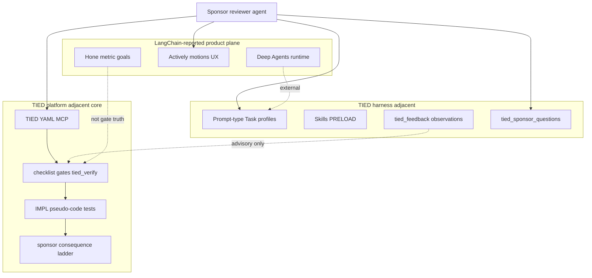

# LangChain goal engineering × TIED — agent management lens

| Field | Value |
| --- | --- |
| **Purpose** | Map LangChain’s **goal engineering** thesis (scope agents so **human feedback** is easy; tacit taste via review UX; **motions** vs per-entity agents) to TIED as implemented in this repository—with emphasis on **sponsor–agent**, **checklist/CITDP scope**, and **harness/platform seam** discipline—not adopting Hone, Actively, or business-metric optimization as TIED core. |
| **Audience** | Sponsors, harness authors, prompt-type operators, methodology owners |
| **Source URL** | [Goal Engineering: How to Design Goals](https://www.langchain.com/blog/goal-engineering) (LangChain blog, November 14, 2026 — **LangChain-reported**) |
| **Article capture (sibling)** | [langchain-goal-engineering.md](langchain-goal-engineering.md) — metadata + TL;DR only; **full text off-repo** |
| **Status / date** | Outreach / analysis snapshot, **2026-11-17** — **reference only; this document does not mint REQ/ARCH/IMPL tokens** |
| **Executable follow-up** | **`REQ-TIED_LANGCHAIN_GOAL_ENGINEERING_WAVE3`** ([goal-engineering-feedback-scope-compose.md](../../tied-bundle/docs/goal-engineering-feedback-scope-compose.md)); further phases via **`refine-plan`** / **`build-plan`** |
| **Distinct from** | [LangChain harness × TIED](langchain-harness-engineering-vs-tied-agent-management.md) (trace/middleware/benchmark loop); [Cursor harness × TIED](cursor-harness-engineering-vs-tied-agent-management.md) (evals, Keep Rate); [Open Governance × TIED](open-governance-cannot-sense-vs-tied-agent-management.md) (board sensing); [Ludanyi × TIED](andras-ludanyi-illusion-of-measurement-judgment-cooperation-vs-tied-agent-management.md) (people proxy metrics); [Traefik × TIED](traefik-harness-platform-vs-tied-agent-management.md) (harness/platform seam architecture) |
| **TIED anchors (reference only)** | [AGENTS.md](../../AGENTS.md), [agent-req-implementation-checklist.md](../../tied-bundle/docs/agent-req-implementation-checklist.md), [sponsor-agent-relationship.md](../../tied-project/vocab/sponsor-agent-relationship.md), [sponsor-two-lane-delivery.md](../../tied-bundle/docs/sponsor-two-lane-delivery.md), [feedback-to-tied.md](../../tied-project/vocab/feedback-to-tied.md), [traefik harness/platform × TIED](traefik-harness-platform-vs-tied-agent-management.md) |

---

## Executive summary

LangChain argues that as agents take **open-ended goals**, operators should practice **goal engineering**: shape agent **scope** so humans can supply **high-quality feedback** cheaply. Written context (docs, APIs) is the easy part; the bottleneck is **tacit** context—taste, brand limits, aggression, deal strategy—that lives only in experts’ heads. **Review UX** and **goal-aligned batching** (Actively’s shift from per-account agents to **motions** across accounts) accelerate learning. Product mentions (**Hone**, **Deep Agents**) illustrate direction; outcomes are **LangChain-reported** only.

TIED’s center of gravity is **declarative software delivery intent**: vocabulary **RESOLVE/RECORD/VALIDATE**, CITDP-scoped change items, REQ → ARCH → IMPL **essence_pseudocode**, checklist gates, MCP **`tied-project/`** YAML, **`tied_verify`** when enrolled, LEAP, and the sponsor **consequence ladder**. TIED does not optimize ad performance or sales motions; it makes **written intent and test-backed claims** inspectable within scope. Tacit sponsor preference is composable via **charter/selection lanes**, **`tied_feedback_*`**, and vocab **RECORD**—not via chat alone.

**Compose-don’t-replace:** Use goal-engineering literacy to **batch harness work** by checklist slug / prompt-type (motions analog) and to invest in **sponsor review surfaces** (`tied_sponsor_questions`, pre-handoff charters). Keep **gate authority**, **YAML truth**, and **implement-complete proof** on the TIED/MCP/checklist plane.

| Center of gravity | LangChain goal engineering | TIED (stdd) |
| --- | --- | --- |
| Primary optimization | Feedback throughput + review UX for long-horizon goals | REQ→ARCH→IMPL traceability + tests + gates |
| Hardest context | Tacit taste via human review loops | IMPL + vocab **RECORD**; sponsor lanes for preference |
| Agent decomposition | Motions (JTBD) vs per-entity agents | Prompt-type **Task** profiles, skills, one REQ-scoped item |
| Context assembly | Background context-gathering agents | PRELOAD routing, **`tied_config_get_base_path`**, scoped reads |
| Success signal | Business metric + human approval (**LangChain-reported**) | **`tied_verify`**, gate receipts — **not** KPI green |

### Evaluation charter mapping (Q1–Q6)

Per [evaluation framework](../tied-methodology-evaluation-framework.md); LangChain goal × TIED cohorts **`not_measured`**.

| Q# | LangChain signal | TIED surface | Disposition |
| --- | --- | --- | --- |
| **Q1** | Delightful review UX | Confirmed-finding arm vs defect proxy | **Tension** — UX ≠ TIED defect rate |
| **Q2** | Learning from feedback loops | Kaizen, `tied_feedback_*` | **Composable** — different artifacts |
| **Q3** | Goal scope alignment | CITDP scope, REQ slug boundaries | **Align** (literacy) |
| **Q4** | Motion-level batching | Checklist slug batching, Task profiles | **Composable** |
| **Q5** | Review time as bottleneck | Q5 pairs MCP/checklist wall time | **Align** on cost narrative |
| **Q6** | Metric-optimizing agents | Methodology kaizen without weakening proof | **Recommendation-only** |

---

## Source summary (LangChain claims only)

From sibling [stub](langchain-goal-engineering.md) (themes **LangChain-reported**; read post at source URL for wording).

- **Trajectory:** Agents moving from tool use to **full tasks** to **open-ended goals**; **Hone** cited for metrics-driven setup.
- **Design principle:** Scope agents so giving **feedback** within that scope is as easy as possible.
- **Context types:** Factual/written context (docs, APIs) vs **tacit** context requiring **human expert feedback**—latter dominates subjective work (e.g. ad copy taste, brand provocativeness).
- **Review bottleneck:** Agent performance limited by learning from feedback → invest in **review UX**.
- **Actively case (v1):** One agent per **account**; goal = move account forward; tacit “how to sell” context fragmented; sparse review moments; hard to transfer learnings across accounts.
- **Actively case (v2):** **Motions** (JTBD, e.g. outbound) across many accounts on **Deep Agents**; similar tasks batch for review; feedback transfers within motion; **background** agents assemble written account context.
- **Future:** Humans teach agents via review; align goals to **easiest human review**; thesis that **prompt/context engineering fade**, **goal engineering remains**.

---

## Relationship to sibling comparisons

| Sibling | What it owns | This document owns |
| --- | --- | --- |
| [LangChain harness × TIED](langchain-harness-engineering-vs-tied-agent-management.md) | LangSmith traces, middleware, Terminal Bench | **Goal scope + review UX** for tacit feedback |
| [Cursor harness × TIED](cursor-harness-engineering-vs-tied-agent-management.md) | Production evals, Keep Rate | Subjective workflows vs live telemetry |
| [Traefik × TIED](traefik-harness-platform-vs-tied-agent-management.md) | Three-layer harness/platform seam | Goal scope as **harness compose** at authority boundary |
| [Open Governance × TIED](open-governance-cannot-sense-vs-tied-agent-management.md) | Organizational sensing, mercaptan | **Product** feedback alignment—not board essay |
| [Ludanyi × TIED](andras-ludanyi-illusion-of-measurement-judgment-cooperation-vs-tied-agent-management.md) | HR/manager proxy metrics | **Agent goal design** for expert feedback |
| [Google Agent Skills × TIED](google-agent-skills-vs-tied-agent-management.md) | Skill-as-product CI | Sales **motions** and CRM UX — **Defer** |

---

## Harness lessons → TIED agent management

### Feedback-aligned scope

| LangChain pattern | TIED surface | Notes |
| --- | --- | --- |
| Scope = easy feedback | One **REQ-scoped** checklist item; CITDP `change_class` | **Align** — avoids “wandering goal” |
| Per-entity agent (account) | Per-file or per-token micro-agents | **Anti-pattern** — sparse sponsor review |
| Motion across entities | Batch by **slug** (`build-plan`, `refine-plan`) | **Composable** — prompt-type router |
| Metrics to optimize (Hone) | **`tied_verify`** on tests, not revenue KPI | **Tension** |

### Tacit vs written context

| LangChain pattern | TIED surface | Notes |
| --- | --- | --- |
| Docs/APIs context | IMPL pseudo-code, MCP detail reads | **Align** |
| Taste in seller’s head | Sponsor **charter lane** / **selection lane** | **Composable** |
| Feedback as teaching signal | `tied_feedback_capture_observation`, `/feedback` skill | **Composable** — not gate truth |
| Subjective work without IMPL | Chat approval only | **Gap** — RECORD or costly choice |

### Review UX and context-gathering split

| LangChain pattern | TIED surface | Notes |
| --- | --- | --- |
| Delightful review UI | IDE diff, PLAN review, `tied_sponsor_questions` | **Composable** — not shipped Actively UI |
| Background context agents | PRELOAD glossaries, brownfield elevation tools | **Composable** |
| Approve-then-act sales loop | Sponsor **consequence ladder**, costly choices | **Align** agency boundary |
| Long-horizon autonomous goal | Open-ended agent without REQ | **Anti-pattern** in TIED clients |

---

## Touchpoint 1 — RESOLVE

| LangChain / vendor term | TIED preferred term / surface | Disposition |
| --- | --- | --- |
| **Goal engineering** | CITDP scope + checklist item goal | **Composable** literacy |
| **Motion** | Prompt-type / skill JTBD batch | **Composable** — not CRM schema |
| **Account context** | Written artifacts, vocab, YAML detail | **Align** when in repo |
| **Tacit context** | Sponsor lanes, hinge fields, selection evidence | **Composable** |
| **Review UX** | Pre-handoff charter, sponsor questions MCP | **Composable** |
| **Metric optimization** | Client KPI outside TIED proof | **Defer** / **Gap** |
| **Deep Agents** | External product name | **Defer** |
| **Context-gathering agent** | PRELOAD / scoped analysis subagent | **Composable** |

### Disposition key

| Disposition | Meaning |
| --- | --- |
| **Align** | TIED already encodes intent for **delivery** scope. |
| **Composable** | Combine patterns without equivalence. |
| **Tension** | Partial overlap; proof boundary required. |
| **Gap** | Vendor emphasis outside TIED core. |
| **Defer** | Product UI, CRM, business metrics. |

---

## Primary capability matrix

| Concern | LangChain COG | TIED COG | Disposition | Rationale |
| --- | --- | --- | --- | --- |
| Tacit expert feedback | Core loop | Sponsor + vocab RECORD | **Composable** | Different surfaces |
| Review UX throughput | Product investment | IDE + checklist evidence | **Composable** | Not Actively UI |
| Written context | Background agents | IMPL, YAML, PRELOAD | **Align** | Repo-local |
| Goal scope design | Motions vs accounts | REQ / CITDP boundaries | **Align** literacy |
| Business metric goals | Hone / ads example | Tests + verify | **Tension** | Proof boundary |
| Long-horizon autonomy | Future thesis | Checklist + gates | **Tension** | Agency boundary |
| Feedback → learning | Human teach loop | Kaizen, LEAP on drift | **Composable** |
| Split gather vs work agents | Actively architecture | PRELOAD vs implement agent | **Composable** |
| Effectiveness proof | Narrative | Evaluation charter | **Defer** / **not_measured** |

---

## Authority boundary

**Human review** in chat or product UI is **harness-adjacent**. **Implement-complete** and **YAML truth** remain on gates, MCP, and verification—not on approval throughput alone.

---

## Anti-patterns (LangChain lessons → TIED risk)

| Anti-pattern | Symptom | TIED-oriented remedy |
| --- | --- | --- |
| Chat approval as gate | “Looks good” ends turn | **`tied_checklist_gate_validate`**, **`tied_verify`** |
| Goal engineering waives IMPL | Subjective ⇒ skip pseudo-code | IMPL + tests for **shipped** behavior; lanes for preference |
| Per-entity micro-scope | One agent per file/account | Scope by REQ/slug; batch review |
| KPI green = TIED done | Metric up, stack untested | Proof boundary; **`not_measured`** |
| Feedback → auto YAML | Review text writes REQ | MCP-first; **`tied_validate_consistency`** |
| Conflate with harness doc | Trace tuning for taste | Use [harness × TIED](langchain-harness-engineering-vs-tied-agent-management.md) for traces only |
| Vendor motion as SoT | CRM “outbound” owns REQ | Client vocab **RECORD**; TIED tokens authoritative |

---

## Compose-don’t-replace table

| Tune with goal-engineering literacy | Keep TIED authority |
| --- | --- |
| Batch agent work by JTBD / motion analog (slug, skill) | **REQ/ARCH/IMPL** via TIED MCP |
| Capture tacit preference in sponsor lanes / feedback | **IMPL essence_pseudocode** for behavior |
| Invest in review ergonomics (PLAN, diff, questions MCP) | **`tied_checklist_gate_validate`** outcomes |
| Background PRELOAD for written context | **PRELOAD** does not replace validate |
| Pair gather-agent vs work-agent mental model | **`tied_config_get_base_path`** before writes |
| Read LangChain sales case as UX pattern only | No Hone/Actively adoption claims |

---

## Bounded operator recommendations (Recommendation-only)

1. **Scope for review** — Prefer one **REQ-scoped** checklist item or non-tied plan slug per session so sponsor feedback batches like a “motion,” not one-off file edits.
2. **Write what can be written** — Tacit taste belongs in vocab **RECORD**, selection evidence, or sponsor **costly choice**—not only in chat after the agent wandered.
3. **Split gather vs build** — Use PRELOAD/scoped analysis for discovery; gate implementation on IMPL + failing tests.
4. **Do not substitute review UX for verify** — Delightful diffs compose with **`tied_verify`**; they do not replace it.
5. **Label KPI loops** — Business metric optimization stories stay **LangChain-reported**; TIED pilots need test denominators.
6. **Pair harness sibling** — Trace/middleware tuning stays in [LangChain harness × TIED](langchain-harness-engineering-vs-tied-agent-management.md).
7. **Authority skim** — [Traefik × TIED](traefik-harness-platform-vs-tied-agent-management.md) + [authority-boundary checklist](../../tied-project/working/REQ-TIED_HARNESS_PLATFORM_SEAM/authority-boundary-operator-checklist.md).

---

## Phased recommendations (doc-first)

| Phase | Action | Status |
| --- | --- | --- |
| **0** | Wave 1 capture + this analysis + allowlist | **Done** (2026-11-17) |
| **1** | Compose guide + checklist + matrix §2 row **20** + index | **Implemented** ([REQ-TIED_LANGCHAIN_GOAL_ENGINEERING_WAVE3](../../tied-project/requirements/REQ-TIED_LANGCHAIN_GOAL_ENGINEERING_WAVE3.yaml)) |
| **2** | Vocab RECORD (`goal-aligned scope` compose term) | **Defer** (sponsor) |
| **3** | Client CRM/sales motion pilots | **OutOfScope** |

---

## Explicit non-adoptions

- **Hone**, **Actively AI**, or **Deep Agents** product stacks as TIED core
- Business **metric optimization** (ads, pipeline velocity) as **`tied_verify`** substitute
- Per-account agent decomposition as TIED methodology default
- Human review throughput as implement-complete proof
- Minting `[REQ-*]` / `[ARCH-*]` / `[IMPL-*]` from this comparison prose
- Methodology composition matrix **§2 data row 20** without scoped REQ

---

## Proof boundary

- Article and Actively case claims are **LangChain-reported**; not independently verified in stdd.
- TIED surfaces cited are **TIED-existing** at authoring time; composability does not ship LangChain products.
- Wave 3 behavior requires **add-feature** / **build-plan** with tests—not comparison markdown alone.
- Effectiveness of goal-engineering patterns in TIED clients is **`not_measured`** unless enrolled in evaluation charter arms.
- This document introduces **no new** REQ/ARCH/IMPL records **in its body**.

---

## Related documents

- [Article capture (sibling)](langchain-goal-engineering.md)
- [LangChain harness × TIED (sibling)](langchain-harness-engineering-vs-tied-agent-management.md)
- [LangChain harness capture](langchain-improving-deep-agents-harness-engineering.md)
- [Traefik harness/platform × TIED](traefik-harness-platform-vs-tied-agent-management.md)
- [Open Governance × TIED](open-governance-cannot-sense-vs-tied-agent-management.md)
- [Sponsor two-lane delivery](../../tied-bundle/docs/sponsor-two-lane-delivery.md)
- [Harness trace observation loop](../../tied-bundle/docs/harness-trace-observation-loop.md)
- [External three-wave comparison template](../../tied-bundle/docs/external-service-three-wave-comparison-template.md)
- [Working DOC plan](../../tied-project/working/DOC-LANGCHAIN-GOAL-ENGINEERING-COMPARISON/PLAN-refine-pass1.md)
- [Non-tied plan](../../tied-project/non-tied-plans/langchain-goal-engineering-vs-tied/PLAN.md)