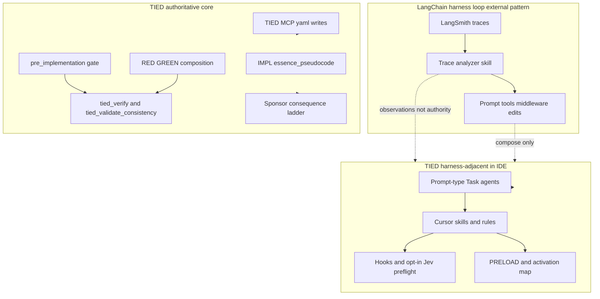

# LangChain harness engineering × TIED — agent management lens

| Field | Value |
| --- | --- |
| **Purpose** | Map LangChain’s **empirical harness-engineering loop** (trace analysis → prompt/tool/middleware edits on a fixed model) to TIED as it exists in this repository, with emphasis on **in-IDE agent management**—orchestration, context delivery, verification hooks, and trace-driven tuning—not LangChain product adoption. |
| **Audience** | Sponsors, harness authors, prompt-type operators, methodology owners |
| **Source URL** | [Improving Deep Agents with harness engineering](https://www.langchain.com/blog/improving-deep-agents-with-harness-engineering) (LangChain blog, February 17, 2026) |
| **Article capture (sibling)** | [langchain-improving-deep-agents-harness-engineering.md](langchain-improving-deep-agents-harness-engineering.md) — read-only capture; **reference only** |
| **Article capture (sibling)** | [cursor-continually-improving-agent-harness.md](cursor-continually-improving-agent-harness.md) — read-only capture; **reference only** |
| **Status / date** | Outreach / analysis snapshot, **2026-10-21** — **reference only; this document does not mint REQ/ARCH/IMPL tokens** |
| **Executable follow-up** | [REQ-TIED_HARNESS_PLATFORM_SEAM](../../tied-project/working/REQ-TIED_HARNESS_PLATFORM_SEAM/PLAN.md), [authority-boundary operator checklist](../../tied-project/working/REQ-TIED_HARNESS_PLATFORM_SEAM/authority-boundary-operator-checklist.md) |
| **Distinct from** | [Traefik harness/platform × TIED](traefik-harness-platform-vs-tied-agent-management.md) (three-layer **seam** mental model); [Cursor harness engineering × TIED](cursor-harness-engineering-vs-tied-agent-management.md) (production evals, online A/B, Keep Rate, tool-reliability ops); [TIED vs Harness²](tied-vs-harness2.md) (recursive **benchmark** harness optimization)—same English word *harness*, different subjects |
| **TIED anchors (reference only)** | [AGENTS.md](../../AGENTS.md), [agent-req-implementation-checklist](../../tied-bundle/docs/agent-req-implementation-checklist.md), [fresh-client-prompt-activation-map](../../tied-bundle/docs/fresh-client-prompt-activation-map.md), [sponsor-agent-relationship](../../tied-project/vocab/sponsor-agent-relationship.md), [agentstream vocab](../../tied-project/vocab/agentstream.md), [agentstream README](../../mcp-server/packages/agentstream/README.md) |

---

## Executive summary

LangChain reports that **harness-only** changes improved their coding agent (`deepagents-cli`) by **13.7 percentage points** on Terminal Bench 2.0 (**52.8% → 66.5%**) while keeping the model fixed (`gpt-5.2-codex`)—**LangChain-reported**; not a TIED outcome. Their improvement recipe compresses the harness design space to **three knobs**: system prompt, tools, and **middleware** (hooks around model and tool calls). The outer loop is **trace-driven**: fetch LangSmith traces, analyze failures in parallel, synthesize harness edits, repeat—optionally with a human in the loop to avoid benchmark overfit.

TIED’s center of gravity is complementary. TIED optimizes **intent traceability and deterministic proof**: RESOLVE/RECORD vocabulary, CITDP, IMPL **essence_pseudocode**, checklist **pre_implementation** gates, strict TDD order, MCP-first project YAML, **`tied_validate_consistency`**, verification-gated **`tied_verify`**, LEAP on drift, and the sponsor **consequence ladder** for **costly choices**. In this repository, **Cursor/Claude turn execution**, prompt-type **Task** profiles, skills, hooks, and **`@tied/agentstream`** behave like LangChain’s **harness layer**; checklist gates, TIED MCP writes, and validation behave like **platform-adjacent authority** (see [Traefik comparison](traefik-harness-platform-vs-tied-agent-management.md) for the seam vocabulary).

**Compose-don’t-replace:** Use traces and harness middleware **analogs** to tune turn quality, context onboarding, and in-run verification nudges; keep **gate authority**, **YAML writes**, **token graph truth**, and **sponsor agency** on the TIED/MCP/checklist plane.

| Center of gravity | LangChain harness study | TIED (this repo) |
| --- | --- | --- |
| Primary optimization | Task score on fixed benchmark with fixed model | REQ→ARCH→IMPL traceability + tests + gates |
| Improvement loop | LangSmith traces → harness edits | Checklist slugs, LEAP, Kaizen, adherence reconcile |
| Canonical proof | Benchmark verifier + in-run self-check | **`pseudocode_validate`**, RED/GREEN, **`tied_verify`** |
| Durable state | Product harness config + trace datasets | Project YAML, IMPL sidecars, gate receipts, working folders |

---

## Source summary (LangChain article claims only)

The following summarizes the captured LangChain post. Numeric results and rankings are **LangChain-reported** unless labeled otherwise.

**Experiment setup.** Terminal Bench 2.0 (**LangChain-reported**: 89 tasks; Harbor orchestration; Daytona sandboxes; scoring after agent runs). Actions stored in LangSmith with latency, token, and cost metrics.

**Baseline.** Default prompt and standard tools+middleware scored **52.8%** with GPT-5.2-Codex (**LangChain-reported**).

**Three optimization knobs.** System prompt, tools, middleware (hooks around model/tool calls)—deliberately narrowed from a larger space (skills, sub-agents, memory, etc.).

**Trace Analyzer Skill (outer loop).**

1. Fetch experiment traces from LangSmith.
2. Spawn parallel error-analysis agents; main agent synthesizes findings and suggestions.
3. Apply targeted harness changes (human review optional; overfit to single tasks warned).

**Build and self-verify (in-run).** Common failure: implement, re-read code, stop without testing. LangChain added prompt guidance: plan/discover → build with tests → verify against **task spec** (not self-code) → fix. **`PreCompletionChecklistMiddleware`** (LangChain product name, **external**) intercepts before exit to force a verification pass—analogous to a “continue until verified” hook.

**Context on behalf of agents.**

- **`LocalContextMiddleware`** (**external**): map `cwd`, parent/child dirs, discover tooling (e.g. Python) via shell—reduce search errors.
- Prompting for **testable** solutions and exact paths where specs require them.
- **Time budget** warnings before timeout—agents poor at time estimation in bounded benches.

**Doom loops.** **`LoopDetectionMiddleware`** (**external**): after *N* edits to the same file, inject “reconsider approach”—short-term heuristic; LangChain notes it may become unnecessary as models improve.

**Reasoning compute.** Reasoning modes (`low`–`xhigh`) traded off against Terminal Bench timeouts. **LangChain-reported**: all-`xhigh` scored **53.9%** vs **63.6%** at `high` due to timeouts; a **xhigh–high–xhigh “sandwich”** (more compute on plan and verify) contributed to **66.5%**. Multi-model harnesses (large model plan, small model implement) mentioned as future direction.

**Practical takeaways (article).** (1) Context engineering on behalf of agents. (2) Aggressive self-verify via tests. (3) Traces as feedback—debug tools and reasoning together. (4) Short-term guardrails around today’s model limits. (5) Tailor harnesses per model; principles generalize but iteration matters.

---

## Relationship to the Traefik harness/platform seam

Use [Traefik harness/platform × TIED](traefik-harness-platform-vs-tied-agent-management.md) for the **three-layer mental model** (harness / platform / targets) and fleet egress patterns. **This document** owns **how LangChain empirically tuned harness Layer 1** on a coding benchmark: which middleware patterns moved scores, and how those patterns map to TIED operator surfaces—without re-deriving the full Traefik article.

LangChain’s named middleware classes (**`PreCompletionChecklistMiddleware`**, **`LocalContextMiddleware`**, **`LoopDetectionMiddleware`**) are **LangChain-reported product identifiers**. They do **not** ship in this repository; below they appear only as **external examples** with TIED **analogs**.

---

## Harness lessons → TIED agent management

### Trace-driven improvement loop

| LangChain pattern | TIED surface | Notes |
| --- | --- | --- |
| LangSmith trace store | Adherence ledger, **`tied_adherence_reconcile_run`**, working evidence under [working-artifact-placement](../../tied-bundle/docs/working-artifact-placement.md) | Committed rationale vs regenerable machine traces |
| Trace Analyzer Skill | Kaizen / **`tied_feedback_*`** observations; prompt-type **skills** as repeatable recipes (**Recommendation-only** for a dedicated trace skill) | Observations **inform**; confirmed process changes route through checklist steps—not automatic LEAP |
| Parallel error-analysis agents | Cursor **Task** subagent delegation (`build-plan`, `refine-plan`, …) | Harness-side fan-out; gate receipts stay platform-adjacent |
| Human review of harness edits | Sponsor **consequence ladder**; costly benchmark overfit → sponsor choice | Avoid encoding waivers only in skill prose |

### Build and self-verify

| LangChain pattern | TIED surface | Notes |
| --- | --- | --- |
| Plan → build → verify → fix prompt | `[PROC-TIED_DEV_CYCLE]`, checklist **test-strategy**, **`tied_verify`** when verification-gated | TIED proof is **failing tests then green**, not “looks OK” re-read |
| Tests as hill-climb signal | Unit RED before code; composition tests at bindings | Aligns with LangChain emphasis on programmatic verification |
| **`PreCompletionChecklistMiddleware`** (external) | **verification-gate** slug; close-out gate scripts; agentstream opt-in preflight chain ([README](../../mcp-server/packages/agentstream/README.md)) | Harness **nudge** composes with deterministic gates—it does not replace them |

### Context delivery (environment, testability, time)

| LangChain pattern | TIED surface | Notes |
| --- | --- | --- |
| **`LocalContextMiddleware`** (external) | Session bootstrap **`tied_config_get_base_path`**; **PRELOAD** from [routing.md](../../tied-project/vocab/routing.md); [activation map §0](../../tied-bundle/docs/fresh-client-prompt-activation-map.md) | Reduces wrong-tree and wrong-vocabulary reads—seam discipline |
| Testability / exact paths in spec | IMPL contracts; composition tests; token comments in tests | Same intent as “measured against programmatic tests” |
| Time budget injection | IDE/session timeouts (**Defer**); agentstream turn planning (**TIED-existing** bounded) | Heuristic harness; not gate authority |

### Doom-loop guardrails

| LangChain pattern | TIED surface | Notes |
| --- | --- | --- |
| **`LoopDetectionMiddleware`** (external) | Opt-in Jev **live tool gate** on Shell/bash; sponsor escalation on repeated costly loops | Model-era heuristic per LangChain; not a substitute for **`tied_checklist_gate_validate`** |
| “Reconsider approach” context | Checklist **loop-back** policy on tracker; `/unblock` for costly stalls ([project-operations-mcp vocab](../../tied-project/vocab/project-operations-mcp.md)) | Person branch owns prolonged stall |

### Reasoning and compute budgeting

| LangChain pattern | TIED surface | Notes |
| --- | --- | --- |
| Reasoning sandwich (xhigh–high–xhigh) | Client IDE model selection (**Defer**); multi-model handoff (**Recommendation-only**) | TIED does not ship reasoning schedulers |
| Timeout vs reasoning tradeoff | Document in client ops; not TIED core | **LangChain-reported** bench constraint |

### Model-specific harness iteration

| LangChain pattern | TIED surface | Notes |
| --- | --- | --- |
| Codex-tuned harness; Claude **59.6%** without same loop (**LangChain-reported**) | Per prompt-type **SKILL.md** and executor profile (`cursor` vs `claude` in agentstream) | Same principles; separate validation per profile |

### Three knobs (prompt, tools, middleware)

| Knob | LangChain focus | TIED harness analog | Platform-adjacent boundary |
| --- | --- | --- | --- |
| System prompt | Problem-solving and verify guidance | [AGENTS.md](../../AGENTS.md), rules, skills, prompt-type bodies | REQ/ARCH/IMPL text loaded read-only from `tied-bundle/` |
| Tools | Standard coding tool surface | IDE tools + TIED MCP for YAML/gates | **Which tools may write project YAML** — MCP/checklist only |
| Middleware | Pre-exit, local context, loop detection | Cursor hooks; agentstream Jev/DAE preflight (opt-in) | Fail-closed guards **compose**; they do not mint gate authority |

---

## Touchpoint 1 — RESOLVE (LangChain → TIED vocabulary)

| External term | TIED preferred term / surface | Notes |
| --- | --- | --- |
| **Harness engineering** (LangChain) | **Harness profile** — Task subagent, skills, hooks, agentstream turns | Not [Harness²](tied-vs-harness2.md) recursive library |
| **Three knobs** | AGENTS.md bootstrap, IDE MCP tools, hooks + opt-in preflight | YAML on **TIED MCP** seam |
| **Trace Analyzer Skill** | Kaizen/adherence recipe; future Loop 3 skill (**Recommendation-only**) | Not **`tied_checklist_gate_validate`** |
| **LangSmith / traces** | Adherence ledger, reconcile, optional adversarial inquiry (depth-gated) | Advisory until checklist-owned confirmation |
| **Middleware** (named classes) | **External examples** → PRELOAD, verification nudge, Jev guard | Not shipped class names in stdd |
| **Self-verification** | **`pseudocode_validate`**, tests, **`tied_verify`**, **`tied_validate_consistency`** | Composes with harness nudges |
| **Terminal Bench 2.0** | **LangChain-reported** benchmark | TIED effectiveness **`not_measured`** until scoped experiment |

### Disposition key

| Disposition | Meaning in this comparison |
| --- | --- |
| **Align** | TIED already represents the article’s intent for agent-heavy delivery (scoped as stated). |
| **Composable** | Operators can combine LangChain-style harness tuning with TIED without equivalence claims. |
| **Tension** | Both sides partially true; proof boundary must be explicit. |
| **Gap** | Article emphasis not covered in TIED core today. |
| **Defer** | Client IDE routing, LangChain product stack, or fleet infra. |

### Claim labeling

| Label | Use when |
| --- | --- |
| **LangChain-reported** | Blog/capture metrics, middleware names, product behavior |
| **TIED-existing** | Committed docs/tools in this repo |
| **Recommendation-only** | Compose suggestions not implemented |

---

## Primary capability matrix

| LangChain concern | TIED center of gravity | Disposition | One-line rationale |
| --- | --- | --- | --- |
| Trace-based outer loop | Adherence, Kaizen, feedback analysis | **Composable** | Traces → observations; gates stay deterministic |
| Trace Analyzer Skill | Skills + Task delegation | **Composable** | Repeatable recipe; not checklist authority |
| Prompt knob | AGENTS.md, skills, prompt-type SKILL.md | **Composable** | Tune harness; token graph is platform-adjacent |
| Tool knob | IDE MCP + tied-yaml MCP | **Tension** | Same surface; YAML writes need seam discipline |
| Middleware knob | Hooks, Jev/agentstream preflight | **Composable** | Opt-in guardrails; not gate receipts |
| Build–verify in-run | TDD + **`tied_verify`** | **Align** (proof) **Tension** (model self-check) | Proof ≠ “re-read my diff” |
| Pre-exit verification hook | Verification gate + harness nudge | **Composable** | Nudge composes with deterministic verify |
| Context injection | PRELOAD + base path + activation map | **Align** (intent) | Onboard agent to repo/vocab, not just cwd |
| Loop detection | Jev block/confirm; sponsor ladder | **Composable** | Short-term heuristic |
| Reasoning budget | Client IDE (**Defer**) | **Defer** | TIED does not schedule reasoning modes |
| Benchmark tuning | External Terminal Bench narrative | **Defer** | **`not_measured`** for TIED until pilot |
| Sub-agent trace analysis | Task tool fan-out | **Align** (pattern) | Matches parallel error analysis |
| Model-specific harness | Per profile SKILL.md | **Composable** | Codex vs Claude gap **LangChain-reported** |

---

## Authority boundary (trace loop × TIED core)

For the Traefik-shaped **egress seam** (fleet MCP gateway, identity), see [Traefik authority diagram](traefik-harness-platform-vs-tied-agent-management.md#authority-boundary-diagram-traefik-seam--tied).

---

## Anti-patterns (LangChain lessons → TIED risk)

| Anti-pattern | Symptom | TIED-oriented remedy |
| --- | --- | --- |
| Benchmark overfit in skills | Prompt encodes one Terminal Bench task trick | Scope changes via CITDP; sponsor review; LEAP when promoted |
| Self-verify replaces gates | “Agent confirmed tests passed” in chat | **`tied_verify`**, gate receipts, manifests |
| Trace loop → automatic YAML | Harness edit writes REQ without MCP | MCP-first; **`tied_validate_consistency`** |
| Middleware as governance | Pre-exit hook waives **pre_implementation** | Checklist gate authority unchanged |
| Cite **66.5%** as TIED success | Outreach overclaim | **LangChain-reported** only; **`not_measured`** |
| Conflate with Harness² | Same word *harness* | [tied-vs-harness2.md](tied-vs-harness2.md) proof boundary |

---

## Compose-don’t-replace: tune harness vs keep platform authority

| Tune in the **harness** (LangChain knobs) | Keep **platform-adjacent / MCP / gate** authority |
| --- | --- |
| Prompt-type choice, subagent prompts, skill wording for RESOLVE hints | **`tied_checklist_gate_validate`** outcomes and waivers |
| Trace review → Kaizen **observations** (not auto LEAP) | Project **REQ/ARCH/IMPL** via **TIED MCP** or **tied-cli** |
| PRELOAD routing, activation map, session context tricks | **IMPL essence_pseudocode** + **`pseudocode_validate`** before heavy implementation |
| Opt-in Jev Shell block / confirm | **Costly choice** on sponsor ladder |
| Harness-native traces under `tied-bundle/working/` | Committed PLAN/evidence under `tied-project/working/` |
| In-run “verify before exit” nudges in skills/hooks | Verification-gated **`tied_verify`** when enabled |

Operator skim: [authority-boundary operator checklist](../../tied-project/working/REQ-TIED_HARNESS_PLATFORM_SEAM/authority-boundary-operator-checklist.md).

---

## Bounded operator recommendations (Recommendation-only)

1. **Session seam first** — **`tied_config_get_base_path`** before YAML mutations; treat mis-pointed MCP like “context discovery failure” at the platform seam.
2. **Encode build–verify in test-strategy** — Checklist evidence should name RED tests and verification commands, not only model self-check language.
3. **Trace → observation, not gate** — Route harness trace review into Kaizen or feedback capture; confirm through owning checklist slug before methodology rule changes.
4. **Label vendor benchmarks** — Terminal Bench deltas stay **LangChain-reported**; TIED pilots need denominators and **`not_measured`** until enrolled.
5. **Middleware as compose** — Document opt-in agentstream/Jev preflight as harness middleware; do not describe it as replacing **`tied_checklist_gate_validate`**.
6. **Defer reasoning schedulers** — Model/reasoning mode policy is client IDE/platform; TIED docs reference **Defer** unless a future scoped REQ says otherwise.
7. **Pair with Traefik doc** — Use this doc for **empirical harness tuning**; use Traefik doc for **seam architecture** when splitting harness vs fleet governance.

---

## Phased recommendations (doc-first)

| Phase | Action | TIED loop |
| --- | --- | --- |
| **0** | This comparison + cross-links | Outreach |
| **1** | **Implemented** — [harness trace observation loop](../../tied-bundle/docs/harness-trace-observation-loop.md) + `@harness-trace-review` ([REQ-TIED_HARNESS_TRACE_OBSERVATION_LOOP](../../tied-project/requirements/REQ-TIED_HARNESS_TRACE_OBSERVATION_LOOP.yaml)) | Loop 2 Kaizen |
| **2** | **Implemented** — [Harness trace learning experiment charter](../../tied-bundle/docs/harness-trace-learning-experiment-charter.md) + templates + store dogfood enrollment ([REQ-TIED_HARNESS_TRACE_LEARNING_PILOT](../../tied-project/requirements/REQ-TIED_HARNESS_TRACE_LEARNING_PILOT.yaml)) | Loop 3 PDSA (sponsor-run; **`not_measured`** until cohort) |
| **3** | **Implemented** — [methodology composition matrix §2 row 15](methodology-composition-matrix.md#section-2-layer-c-adjacent-frameworks) + `@harness-trace-analyzer` ([REQ-TIED_HARNESS_LANGCHAIN_PHASE3](../../tied-project/requirements/REQ-TIED_HARNESS_LANGCHAIN_PHASE3.yaml)) | Sponsor promotion |

---

## Explicit non-adoptions

- **LangChain middleware classes** as TIED-shipped components — **external** names only.
- **Terminal-Bench score** as TIED methodology effectiveness — **LangChain-reported** narrative only.
- **Trace Analyzer Skill** as substitute for **`sub-adversarial-inquiry-pass`** or integrated inquiry activation.
- **Harness-only** success as substitute for REQ→ARCH→IMPL traceability.
- **LangChain product stack** (LangSmith, Harbor, Daytona) as TIED core — **Defer** to client tooling.

---

## Proof boundary

- All Terminal Bench percentages, ranking claims (Top 30 → Top 5), and middleware behavior descriptions sourced from the LangChain blog/capture are **LangChain-reported**. Do **not** cite them as TIED outcomes, checklist success metrics, or methodology effectiveness.
- TIED surfaces referenced here describe **TIED-existing** committed behavior at authoring time; they are not effectiveness claims.
- Any future client pilot that copies LangChain-style trace loops requires its own experiment charter, denominators, and status **`not_measured`** until recorded otherwise.
- This document introduces **no new** `[REQ-*]`, `[ARCH-*]`, or `[IMPL-*]` records **in its body**; seam implementation is tracked separately as **REQ-TIED_HARNESS_PLATFORM_SEAM** (see metadata).

---

## Related documents

- [LangChain article capture (sibling)](langchain-improving-deep-agents-harness-engineering.md)
- [Cursor harness engineering × TIED — agent management lens](cursor-harness-engineering-vs-tied-agent-management.md)
- [Cursor article capture (sibling)](cursor-continually-improving-agent-harness.md)
- [Traefik harness/platform × TIED — agent management lens](traefik-harness-platform-vs-tied-agent-management.md)
- [Traefik article capture](traefik-harness-engineering-vs-platform-engineering.md)
- [TIED vs Harness²](tied-vs-harness2.md)
- [Methodology composition matrix](methodology-composition-matrix.md) (§2 row 13 — Traefik seam; LangChain as empirical evidence)
- [Authority boundary operator checklist](../../tied-project/working/REQ-TIED_HARNESS_PLATFORM_SEAM/authority-boundary-operator-checklist.md)
- [Harness trace observation loop](../../tied-bundle/docs/harness-trace-observation-loop.md) ([REQ-TIED_HARNESS_TRACE_OBSERVATION_LOOP](../../tied-project/requirements/REQ-TIED_HARNESS_TRACE_OBSERVATION_LOOP.yaml))
- [@tied/agentstream README](../../mcp-server/packages/agentstream/README.md)
- [Jev × TIED](jev-for-tied-improvement.md)
