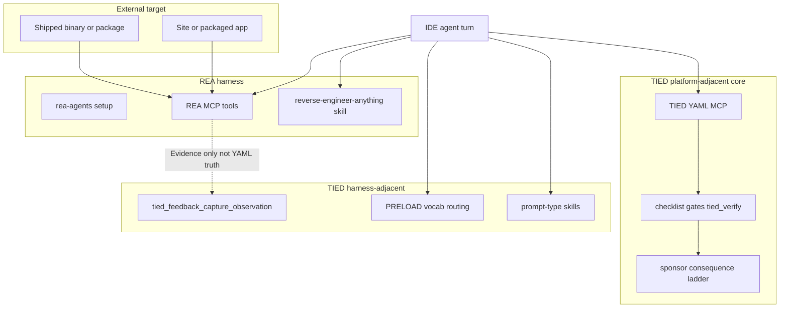

# morluto/rea × TIED — agent management lens

| Field | Value |
| --- | --- |
| **Purpose** | Map **REA** (reverse-engineering MCP + setup-installed skills for Cursor and other agents) to TIED as implemented in this repository—with emphasis on **dual MCP coexistence**, **evidence discipline**, **harness setup boundaries**, and **sponsor authority**—not adopting Ghidra/Hopper workflows or REA binaries as TIED core. |
| **Audience** | Sponsors, harness authors, prompt-type operators, methodology owners, security-minded implementers |
| **Source URL** | [morluto/rea](https://github.com/morluto/rea) · [rea.tools](https://rea.tools/) (morluto, **2026-11-08** capture) |
| **Repository capture (sibling)** | [morluto-rea-reverse-engineering.md](morluto-rea-reverse-engineering.md) — read-only; **reference only** |
| **Status / date** | Outreach / analysis snapshot, **2026-11-08** — **reference only; this document does not mint REQ/ARCH/IMPL tokens** |
| **Executable follow-up** | Wave 3 candidates in § Phased recommendations (**Defer** until scoped **add-feature** / **build-plan**) |
| **Distinct from** | [Open Ontologies × TIED](open-ontologies-repository-vs-tied-agent-management.md) (RDF plan/apply, Lean certs); [Traefik × TIED](traefik-harness-platform-vs-tied-agent-management.md) (harness/platform **seam** vocabulary); [Google agent skills × TIED](google-agent-skills-vs-tied-agent-management.md) (productized skill shipping); [Trail-Code × TIED](tied-vs-trail-code.md) (pre-engagement graft pre-read); [agent-browser skill](../../.agents/skills/agent-browser/SKILL.md) (stdd web UI automation) |
| **TIED anchors (reference only)** | [AGENTS.md](../../AGENTS.md), [agent-req-implementation-checklist.md](../../tied-bundle/docs/agent-req-implementation-checklist.md), [external-service-three-wave-comparison-template.md](../../tied-bundle/docs/external-service-three-wave-comparison-template.md), [sponsor-agent-relationship.md](../../tied-project/vocab/sponsor-agent-relationship.md), [tied-yaml-mcp.md](../../tied-project/vocab/tied-yaml-mcp.md), [harness-trace-observation-loop.md](../../tied-bundle/docs/harness-trace-observation-loop.md) |

---

## Executive summary

**REA** centers on **agent-driven reverse engineering**: a large MCP tool catalog, CLI parity, and `rea-agents setup` that registers MCP plus workflow skills (especially **`reverse-engineer-anything`**) for Cursor and many other clients. Conclusions are packaged as **Evidence** with **limitations** and **unknowns** (`docs/reference/mcp-contracts.md`, **target-repo-observed**).

TIED’s center of gravity is **software intent traceability** in client repos: vocab **RESOLVE/RECORD**, CITDP, REQ → ARCH → IMPL **essence_pseudocode**, checklist gates, MCP-first **project** YAML writes under `tied-project/`, **`tied_validate_consistency`**, verification-gated **`tied_verify`**, LEAP, and the sponsor **consequence ladder**. TIED does **not** ship binary analysis, disassemblers, or decompilation MCP tools.

**Compose-don’t-replace:** Use REA (when sponsor-approved) for **black-box investigation** and evidence-shaped answers about **external** or **shipped** targets. Keep **semantic token authority**, **checklist gate receipts**, **TIED MCP graph truth**, and **costly choices** on the TIED plane. After investigation, any implementation in **your** repo still flows through CITDP, TDD, and LEAP—not through REA conclusions alone.

| Center of gravity | REA (target repo) | TIED (this repo) |
| --- | --- | --- |
| Primary artifact | Evidence records, retained session bundles | `[REQ-*]` / `[ARCH-*]` / `[IMPL-*]` YAML + pseudo-code + tests |
| Agent interface | Domain RE MCP + bundled skills | TIED YAML MCP + prompt-type skills (`tied-install`) |
| Truth claim | Evidence + stated limitations on **target** behavior | Traceability + gates — **not** domain correctness of arbitrary binaries |
| Setup | `rea setup` writes client MCP + skills | `tied-install.sh` writes methodology stubs + TIED MCP path |
| IDE config risk | Dual MCP registration, skill overwrite | `TIED_BASE_PATH` wrong-tree writes |

---

## Source summary (REA claims only)

Bullets summarize sibling [repository capture](morluto-rea-reverse-engineering.md) and upstream docs as read **2026-11-08**. Unless reproduced in stdd, label **REA-reported** or **target-repo-observed**.

- **Product pitch:** One MCP to reverse engineer across binaries, applications, and runtime behavior; see a feature, understand it with evidence, optionally rebuild in your project (**REA-reported**).
- **Distribution:** npm `rea-agents` `6.8.0`, MCP name `io.github.morluto/rea`, MIT (**target-repo-observed**).
- **Setup:** Multi-select agents; staged config writes with backups; optional Hopper install with separate approval; malformed existing config blocks entire transaction (**target-repo-observed**).
- **Evidence contract:** Tools return canonical Evidence in text and structured content; comparison tools authenticate retained or file-backed evidence; integrity failures are refused (**target-repo-observed**).
- **Skill boundary:** Skill install alone does not register MCP; plugin installs bundle server separately from setup-managed state (**target-repo-observed**).
- **Source-repo exclusion:** Ordinary complete source-repository architecture analysis should use normal repo tools—not REA readiness (**target-repo-observed**).
- **Schema tuning:** Compact MCP input schemas by default; output schema profile env for clients with `tools/list` size limits (**target-repo-observed**).
- **Supported agents:** Cursor (`cursor` client id) among 20+ setup targets (**target-repo-observed**).

---

## Relationship to sibling comparisons

| Sibling | What it owns | This document owns |
| --- | --- | --- |
| [Open Ontologies × TIED](open-ontologies-repository-vs-tied-agent-management.md) | RDF lifecycle, Lean certs, 100+ `onto_*` tools | **Reverse engineering** MCP, binary/JS/.NET/web targets, Ghidra/Hopper seam |
| [Traefik × TIED](traefik-harness-platform-vs-tied-agent-management.md) | Harness vs **platform** three-layer model | **REA MCP vs TIED YAML MCP** in one IDE—not Traefik ingress |
| [Google agent skills × TIED](google-agent-skills-vs-tied-agent-management.md) | Shipping skills like products | REA **setup-installed** skills + [skills.sh](https://skills.sh/morluto/rea) distribution |
| [Trail-Code × TIED](tied-vs-trail-code.md) | Pre-read / graft before intent capture | REA as **executable trace** after choosing a **shipped** target |
| [agent-browser](../../.agents/skills/agent-browser/SKILL.md) | Programmatic web UI in stdd | REA browser/scenario capture tools—cite only as external product surface |
| [LangChain × TIED](langchain-harness-engineering-vs-tied-agent-management.md) | Trace-driven harness tuning | Not LangSmith loops |

Cross-link Open Ontologies when comparing **large third-party MCP catalogs**; cross-link Traefik when explaining **which MCP owns project YAML truth**.

---

## Harness lessons → TIED agent management

### Evidence-first investigation

| REA pattern | TIED surface | Notes |
| --- | --- | --- |
| Evidence + limitations on every tool result | Proof boundary, claims-evidence review MCP | **Align** (discipline); artifacts differ |
| `evidence_integrity_mismatch` on bad refs | Gate receipts, envelope validation | **Composable** — same “don’t trust stale ids” spirit |
| Retained session bundles | Working folders, request evidence envelope | **Partial align** — different retention model |
| CLI JSON parity with MCP | `tied-cli.sh` vs IDE MCP | **Composable** operator paths |

### Setup, skills, and dual MCP

| REA pattern | TIED surface | Notes |
| --- | --- | --- |
| `rea setup` mutates `.cursor/mcp.json` + skills | `tied-install.sh`, `.cursor/skills/tied-yaml` | **Tension** — document install order and backups |
| `reverse-engineer-anything` workflow skill | `@external-service-comparison`, domain skills | **Composable** — orthogonal workflows |
| Compact MCP schemas for context | Large TIED MCP surface; agentstream context | **Composable** — profile pattern **Recommendation-only** for doc |
| Official-source README warning | Sponsor **costly choice** on untrusted packages | **Align** agency boundary |

### When to use REA vs TIED surfaces

| REA pattern | TIED surface | Notes |
| --- | --- | --- |
| Skip REA for full source repos | Brownfield CITDP, `tied_source_graph_*` | **Align** — different entry points |
| Investigate → implement in user repo | CITDP + TDD + LEAP on **new** REQ | **Composable** downstream |
| Native provider requirement | — | **Defer** sponsor toolchain |
| RL / AgentEnv bundles | — | **Defer** / **Gap** for TIED core |

### Reliability and recovery (skill)

| REA pattern | TIED surface | Notes |
| --- | --- | --- |
| `rea doctor`, connection recovery ladder | **`DIAGNOSTIC: TIED_CLI_HINDRANCE`** | **Composable** failure taxonomy |
| Do not retry unchanged call on timeout | Minimize failed MCP/tool calls in sessions | **Align** with harness trace “context rot” theme |
| Plugin vs setup-owned registration | Multiple MCP servers in one client | **Tension** — operator must know ownership |

---

## Touchpoint 1 — RESOLVE (REA → TIED vocabulary)

| External term | TIED preferred term / surface | Notes |
| --- | --- | --- |
| **Evidence** (REA) | Observation, gate receipt, envelope field | Not interchangeable with **`tied_verify`** |
| **Setup** / **doctor** | Session bootstrap, `tied_config_get_base_path` | REA setup ≠ TIED install |
| **reverse-engineer-anything** | External domain skill | **Defer** vocab RECORD unless sponsor asks |
| **Limitations** / **unknowns** | Proof boundary, `not_measured` | **Align** labeling discipline |
| **open_binary** / Ghidra dossier | — | **Defer** — not TIED symbols |
| **Implementation in my project** | Scoped REQ, IMPL pseudo-code, tests | Sponsor-owned follow-on |

**Disposition key:** **Align** | **Composable** | **Tension** | **Gap** | **Defer** | **OutOfScope**

**Claim labeling:** **target-repo-observed** | **REA-reported** | **TIED-existing** | **Recommendation-only** | **Defer** | **not_measured**

---

## Primary capability matrix

| Concern | TIED COG | Disposition | One-line rationale |
| --- | --- | --- | --- |
| Black-box binary/JS analysis | — | **Defer** (product) | REA domain; not stdd core |
| Evidence-shaped agent answers | Claims-evidence, proof sections in docs | **Align** | Same skepticism; different schema |
| Large third-party MCP beside TIED | `TIED_BASE_PATH`, dual `mcp.json` | **Composable** | Client policy problem |
| IDE config writes via setup | `tied-install.sh` | **Tension** | Two installers; backup discipline |
| Investigation → traced implementation | CITDP + TDD + LEAP | **Composable** | REA upstream of TIED cycle |
| Skip tool for pure source repos | Impact discovery, brownfield analysis | **Align** | Avoid wrong tool for job |
| MCP schema compaction | Agentstream / context docs | **Composable** | Pattern only |
| Native RE toolchain | Sponsor infra | **Defer** | Ghidra/Hopper not methodology deps |
| REA metrics / badges as TIED proof | **`tied_verify`**, gates | **Gap** (anti-pattern) | **not_measured** |
| Wrong MCP writes project YAML | TIED MCP write isolation | **Align** (risk) | REA must not replace TIED MCP role |
| Session trace / tool errors | Harness trace observation loop | **Composable** | Qualitative analog to context rot |
| Formal REQ from REA conclusions | Checklist + sponsor | **Tension** | Evidence ≠ intent authority |
| RL environments from REA | — | **OutOfScope** | Wave 3 **Defer** |
| Bundled REA in stdd CI | — | **Defer** | Costly sponsor choice |

---

## Authority boundary

REA’s **disassemblers, retained Evidence, and provider bridges** sit **outside** TIED’s authoritative core. TIED clients may **compose** investigation MCP while keeping **token graph** and **gate** authority on the TIED/checklist plane.

---

## Anti-patterns (REA lessons → TIED risk)

| Risk | Symptom | TIED-oriented remedy |
| --- | --- | --- |
| REA Evidence = REQ truth | Mint scope from decompilation prose | CITDP + sponsor translate-sponsor-intent |
| Dual MCP confusion | Agent writes wrong tree | **`tied_config_get_base_path`** every session |
| Setup overwrites skills | Lost tied-yaml skill paths | Install order doc; backups; costly choice on merge |
| Investigation without implementation proof | Feature shipped without tests | **`tied_verify`**, TDD order unchanged |
| Vendor RE metrics as methodology success | Cite npm badges in TIED effectiveness | **not_measured**; proof boundary |
| Run REA on full git clone | Wasted context, wrong tool | Skill rule: normal repo tools first |
| Comparison prose mints REQ | Tokens in markdown | Wave 3 via **add-feature** only |
| Untrusted `npx` from target repo | Supply-chain risk | README official-source rule; sponsor approval |

---

## Compose-don’t-replace: tune investigation harness vs keep TIED authority

| Tune with **REA-inspired** practice (harness/process) | Keep **TIED** authority |
| --- | --- |
| Evidence + limitations in agent-facing answers | IMPL pseudo-code + tests as implementation truth |
| Explicit “unknowns” in investigation output | Gate receipts for **shipped** stdd changes |
| Compact MCP profiles for context | Full TIED MCP when mutating project YAML |
| `rea doctor` style registration health | `tied_validate_consistency` after YAML edits |
| Black-box trace before greenfield spec | CITDP after sponsor confirms scope |
| External target analysis | **tied-project/** token graph |

---

## Bounded operator recommendations (Recommendation-only)

1. **Dual MCP checklist** — **Recommendation-only:** document in client README which MCP may mutate `tied-project/` (TIED only) vs read external targets (REA).
2. **Install order** — **Recommendation-only:** run `tied-install.sh` before or after REA setup with explicit backup review; never assume commutative merges.
3. **Investigation → REQ handoff** — **TIED-existing:** use `add-feature` / CITDP when REA findings motivate **new** behavior in the implementation repo; do not paste Evidence ids as requirements.
4. **Schema profiles** — **Composable:** if TIED MCP context is tight, mirror REA’s compact/full profile **pattern** in operator docs only—not product change.
5. **Source vs shipped boundary** — **Align:** follow REA skill: source-available stdd work uses git/TIED tools; REA for third-party binaries only when sponsor scopes.
6. **Observations from RE sessions** — **TIED-existing:** `tied_feedback_capture_observation` for qualitative harness notes; not gate substitutes.
7. **Open Ontologies cross-read** — **Composable:** when both large MCP servers are enabled, separate **domain** (RE vs RDF) in operator training.

---

## Phased recommendations (doc-first)

| Phase | Action | Status |
| --- | --- | --- |
| **0** | Repository capture + this analysis + `.gitignore` allowlist | **Done** (2026-11-08) |
| **1** | Client-development-index + HTOL dual-MCP compose | **Done** (2026-11-08) — [client-development-index](../../tied-bundle/docs/client-development-index.md), [harness-trace-observation-loop](../../tied-bundle/docs/harness-trace-observation-loop.md) |
| **2** | Project vocab RECORD (`REA Evidence`, `dual MCP seam`) | **Defer** (costly) |
| **3** | `methodology-composition-matrix.md` §2 row | **Defer** |
| **3** | Bundle REA or Ghidra into stdd CI | **Defer** — sponsor infra |
| **3** | REQ for dual-MCP operator checklist in bundle docs | **Defer** — **add-feature** if promoted |

---

## Explicit non-adoptions

- **REA MCP** or **rea-agents** as required TIED methodology dependency
- **Ghidra / Hopper / IDA / Kuna** as TIED core or checklist prerequisites
- **REA Evidence** records as substitutes for gate receipts or **`tied_validate_consistency`**
- **Reverse-engineering conclusions** as automatic LEAP triggers without CITDP
- **REA-reported** reliability or badge metrics as TIED effectiveness proof (**`not_measured`**)
- **RL / AgentEnv** product paths as in-scope TIED features without scoped REQ
- Minting new `[REQ-*]` / `[ARCH-*]` / `[IMPL-*]` records from this comparison prose

---

## Proof boundary

- Upstream README, npm, and site claims are **REA-reported** or **target-repo-observed**. They are **not** stdd checklist results, **`tied_verify`** outcomes, or reproduced disassembly runs in this wave unless explicitly noted.
- TIED surfaces cited describe **TIED-existing** committed behavior at authoring time; composability does not install REA inside stdd.
- Wave 3 behavior changes require normal TIED workflows (**add-feature**, **build-plan**, LEAP, tests)—not comparison markdown alone.
- stdd did **not** execute `rea setup`, REA MCP, native engines, or target CI during authoring of these documents.
- **`tied_validate_consistency`** was **not** run — project YAML unchanged; out of scope for this doc-only bundle.

---

## Related documents

- [Repository capture (sibling)](morluto-rea-reverse-engineering.md)
- [External three-wave comparison template](../../tied-bundle/docs/external-service-three-wave-comparison-template.md)
- [Open Ontologies × TIED (sibling)](open-ontologies-repository-vs-tied-agent-management.md)
- [Traefik harness × TIED (sibling)](traefik-harness-platform-vs-tied-agent-management.md)
- [Google agent skills × TIED (sibling)](google-agent-skills-vs-tied-agent-management.md)
- [Trail-Code × TIED (sibling)](tied-vs-trail-code.md)
- [Working plan](../../tied-project/working/DOC-MORLUTO-REA-COMPARISON/PLAN-refine-pass1.md)
- [Agent req implementation checklist](../../tied-bundle/docs/agent-req-implementation-checklist.md)
