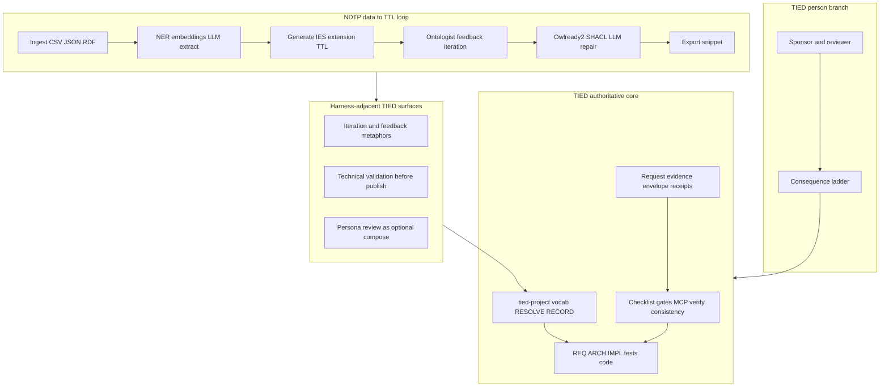

# NDTP AI Ontology Extension × TIED — agent management lens

| Field | Value |
| --- | --- |
| **Purpose** | Map the **NDTP AI Ontology Extension** Streamlit tool (HITL data-to-TTL workflow, LLM generation, Owlready2/SHACL validation, optional persona simulation) to TIED as implemented in this repository—with emphasis on **sponsor agency**, **traceability**, and **proof boundaries**—not adopting RDF/OWL authoring as TIED core or certifying NDTP outputs. |
| **Audience** | Sponsors, ontology/KGM practitioners, harness authors, prompt-type operators, methodology owners |
| **Source** | Local read-only inspection of `ndtp-ai-ontology-extension-main` (**2026-10-26**). Upstream: [National-Digital-Twin/ndtp-ai-ontology-extension](https://github.com/National-Digital-Twin/ndtp-ai-ontology-extension). [Repository capture (sibling)](ndtp-ai-ontology-extension.md) |
| **Evidence boundary** | stdd did **not** run target `pytest`, Streamlit, OpenAI calls, or CI workflows during authoring. README claims are **NDTP-reported**, **not_measured** in stdd. |
| **Status / date** | Outreach / analysis snapshot, **2026-10-26** — **reference only; this document does not mint REQ/ARCH/IMPL tokens** |
| **Executable follow-up** | Wave 3 candidates in § Phased recommendations (**Defer** until scoped **add-feature** / **build-plan**) |
| **Distinct from** | [Open Ontologies × TIED](open-ontologies-repository-vs-tied-agent-management.md) (governance engine, MCP, plan/apply, Lean certs); [Heimsbakk × TIED](veronika-heimsbakk-ai-generated-ontologies-vs-tied-agent-management.md) (essay/meaning ownership); [LangChain × TIED](langchain-harness-engineering-vs-tied-agent-management.md) / [Traefik × TIED](traefik-harness-platform-vs-tied-agent-management.md) (harness/platform seam); [Anthropic FV × TIED](anthropic-llm-formal-verification-vs-tied-agent-management.md) (Rocq/Verus proof obligations) |
| **TIED anchors (reference only)** | [AGENTS.md](../../AGENTS.md), [agent-req-implementation-checklist.md](../../tied-bundle/docs/agent-req-implementation-checklist.md), [processes.md](../../tied-bundle/docs/processes.md), [pseudocode-writing-and-validation.md](../../tied-bundle/docs/pseudocode-writing-and-validation.md), [vocabulary-layer-tied-leap-citdp.md](../../tied-bundle/docs/vocabulary-layer-tied-leap-citdp.md), [sponsor-agent-relationship.md](../../tied-project/vocab/sponsor-agent-relationship.md), [external-service-three-wave-comparison-template.md](../../tied-bundle/docs/external-service-three-wave-comparison-template.md) |

---

## Executive summary

**NDTP AI Ontology Extension** centers on **human-in-the-loop ontology extension authoring** for digital-twin-style data: ingest tabular or RDF sources, extract and match entities (spaCy, embeddings, LLM), generate **IES-aligned** Turtle/OWL snippets with **ontologist feedback** and iteration history, then validate with Owlready2 and optional SHACL—with optional **multi-agent persona discussion** for qualitative review. The product surface is a **Streamlit wizard**, not an agent harness or intent-traceability methodology.

TIED’s center of gravity is **software intent traceability** in client repos: vocab **RESOLVE/RECORD/VALIDATE**, CITDP change definition, REQ → ARCH → IMPL **essence_pseudocode** with block token comments, checklist **pre_implementation** gates, MCP-first **project** YAML writes, **`tied_validate_consistency`**, verification-gated **`tied_verify`**, LEAP on divergence, request **evidence envelopes**, adversarial inquiry when enrolled at integrated depth, and the sponsor **consequence ladder**. TIED is **SKOS-adjacent** at the vocabulary layer and **does not** ship an OWL reasoner or ontology extension workbench.

**Compose-don’t-replace:** Borrow **iteration with explicit human feedback**, **technical validation before export**, and **persona-style review metaphors** as **harness-adjacent** patterns when discussing sponsor/reviewer loops. Keep **semantic token authority**, **checklist gate receipts**, **MCP YAML graph truth**, and **sponsor costly choices** on the TIED plane. Do not treat Owlready2/SHACL green as **`tied_validate_consistency`** or domain correctness; do not treat ABM simulation as integrated adversarial inquiry.

| Center of gravity | NDTP tool (target repo) | TIED (this repo) |
| --- | --- | --- |
| Primary artifact | RDF/Turtle ontology snippets, export files | `[REQ-*]` / `[ARCH-*]` / `[IMPL-*]` YAML + pseudo-code + tests |
| Operator UX | Streamlit four-step wizard | Prompt-type skills + checklist-driven agent workflows |
| Human loop | Ontologist feedback in generation prompts | Sponsor **person branch**, vocab before mint |
| Validation | Owlready2, SHACL, capped LLM TTL repair | `pseudocode_validate`, consistency tools, module tests |
| Agent interface | None (OpenAI from app code) | Bounded TIED YAML MCP + `@external-service-comparison` etc. |
| Domain truth claim | Not claimed by README/validator scope | Traceability/consistency **not** domain correctness |

---

## Source summary (NDTP / target claims only)

Bullets summarize sibling [repository capture](ndtp-ai-ontology-extension.md) and upstream docs as read **2026-10-26**. Unless reproduced in stdd, label **NDTP-reported** or **target-repo-observed**.

- **Product pitch:** AI-assisted ontology development and extension from various data sources with human-in-the-loop workflow (**NDTP-reported** in README).
- **Public funding:** Developed under National Digital Twin Programme with Crown copyright attribution to BIST (**NDTP-reported**).
- **Wizard steps:** Data input → processing → generation → validation (**NDTP-reported**; **target-repo-observed** in `app/main.py`).
- **Formats:** CSV, JSON, RDF/Turtle ingestion (**NDTP-reported**).
- **LLM dependency:** OpenAI API key required for generation and repair paths (**NDTP-reported** / **target-repo-observed** in code).
- **BORO framing:** Generation prompts reference BORO principles and expert ontology engineer role (**target-repo-observed** in `generator.py`).
- **IES extension:** Template instructions reference extending IES Common Ontology with 4D entity/state patterns (**target-repo-observed** in `app/templates/instructions.txt`).
- **TTL repair cap:** Validator documents `max_chatgpt_fixes` (example default 2) for iterative LLM syntax fixes (**target-repo-observed**).
- **Tests:** pytest suites with mocked OpenAI for validation modules (**target-repo-observed**); stdd did not run them.

---

## Relationship to sibling comparisons

| Sibling | What it owns | This document owns |
| --- | --- | --- |
| [Open Ontologies × TIED](open-ontologies-repository-vs-tied-agent-management.md) | **Governance engine**: plan/apply, drift, Lean certs, 122-tool MCP | **Authoring assistant**: Streamlit HITL, data→TTL, LLM iteration |
| [Heimsbakk × TIED](veronika-heimsbakk-ai-generated-ontologies-vs-tied-agent-management.md) | **Meaning ownership** essay; conversation before OWL | **Executable wizard** with `ontologist_feedback` in prompts |
| [AI-SDLC factory × TIED](ai-sdlc-atdd-software-factory-vs-tied.md) | Protected Gherkin, run records, reconstruction | Not software factory ATDD; optional export of TTL only |
| [LangChain × TIED](langchain-harness-engineering-vs-tied-agent-management.md) | Trace/benchmark harness tuning | Not LangSmith loops |
| [Traefik × TIED](traefik-harness-platform-vs-tied-agent-management.md) | Harness vs platform seam | Not ingress/product ops |
| [Anthropic FV × TIED](anthropic-llm-formal-verification-vs-tied-agent-management.md) | Formal proof obligations (Rocq/Verus) | Heuristic reasoner + LLM repair, not proof certificates |
| [TIED vs well-known methodologies](tied-vs-well-known-methodologies.md) | Broad methodology map | **Single NDTP ontology extension repo** for digital twin context |

Cross-link Open Ontologies when operators need **production graph change management**; cross-link Heimsbakk when they conflate **LLM-generated TTL** with **recorded sponsor meaning**.

---

## Harness lessons → TIED agent management

### HITL wizard vs checklist-driven agent management

| NDTP pattern | TIED surface | Notes |
| --- | --- | --- |
| Four-step Streamlit sections | `[PROC-AGENT_REQ_CHECKLIST]` steps, prompt-type skills | **Gap** — different UX plane |
| `AppState` iteration history | Working folders, PLAN, LEAP on divergence | **Partial align** on iteration memory |
| Export final TTL | Git commit of client artifacts | **Defer** — not TIED core |
| Scripts under `scripts/` | `tied-cli`, MCP tools | **Defer** — optional client tooling |

### Ontologist feedback vs sponsor agency

| NDTP pattern | TIED surface | Notes |
| --- | --- | --- |
| `ontologist_feedback` in generation prompt | Sponsor **person branch** | **Partial align** — same agency idea, different artifact |
| One-shot LLM snippet without feedback | Draft without RECORD | **Tension** — Heimsbakk anti-pattern |
| BORO/IES template constraints | Vocab + IMPL contracts | **Composable** — domain vs software intent |

### LLM repair of machine-readable artifacts

| NDTP pattern | TIED surface | Notes |
| --- | --- | --- |
| `iterative_chatgpt_fix_ttl` | LEAP + gated edits | **Tension** — harness may auto-fix without checklist |
| `max_chatgpt_fixes` cap | Retry limits in tools | **Partial align** on bounded automation |
| Model choice (e.g. docstring `o3-mini`) | External LLM dependency | **Defer** operator env |

### Technical validation vs TIED verification

| NDTP pattern | TIED surface | Notes |
| --- | --- | --- |
| Owlready2 / OWL-RL closure | — | **Defer** as TIED core |
| pyshacl / SHACL | `pseudocode_validate`, shape discipline | **Tension** — RDF shape vs intent YAML |
| Reasoner green | `tied_validate_consistency` | **Align** (anti-pattern) — neither implies domain truth |
| pytest unit tests (mocked API) | Module validation mandate | **Partial align** on discipline |

### ABM persona simulation vs adversarial inquiry

| NDTP pattern | TIED surface | Notes |
| --- | --- | --- |
| `simulate_multi_agent_discussion` | Adversarial inquiry when integrated | **Composable** metaphor only |
| Personas from JSON config | Obligation graph, finding ledger | **Gap** — different proof objects |
| Qualitative discussion output | Gate receipts, envelope | **Tension** — not interchangeable |

### No MCP harness vs bounded TIED MCP

| NDTP pattern | TIED surface | Notes |
| --- | --- | --- |
| Streamlit-only operator path | TIED YAML MCP + skills | **Gap** for agent loop |
| OpenAI called from application code | External LLM in harness | **Defer** client policy |
| Contrast Open Ontologies 122-tool MCP | Bounded write surface | **Composable** lesson on profiles |

---

## Touchpoint 1 — RESOLVE

| Target term | TIED preferred term / surface | Notes |
| --- | --- | --- |
| **Ontology extension wizard** | Client domain tooling | **Defer** — not TIED core |
| **Ontologist feedback** | Sponsor/reviewer input before RECORD | Cross-link Heimsbakk |
| **IES / BORO prompts** | Domain vocab; SKOS-adjacent glossary | Analogy only |
| **LLM TTL repair** | LEAP + checklist before pseudo-code/code drift | **Tension** |
| **Owlready2 / SHACL green** | Spec validation, not domain truth | Proof boundary |
| **ABM multi-agent discussion** | Optional review metaphor | Not `[REQ-TIED_ADVERSARIAL_INQUIRY]` substitute |
| **Streamlit session state** | Working token + envelope scope | **Partial align** |
| **NDTP / digital twin programme** | Client context | Outreach cite only — **Defer** |

**RESOLVE charter (this comparison):** Canonicalizes **names and mappings** only; does not change sponsor intent authority or mint TIED tokens from comparison prose.

### Disposition key

| Disposition | Meaning |
| --- | --- |
| **Align** | TIED materially represents the external intent (scoped). |
| **Composable** | Combine without equivalence claims. |
| **Tension** | Partial overlap; proof boundary must be explicit. |
| **Gap** | External emphasis not in TIED core as-is. |
| **Defer** | Product, client infra, or sponsor-owned choice. |

### Claim labeling

| Label | Use when |
| --- | --- |
| **target-repo-observed** | Structure/docs read from local target tree during authoring |
| **NDTP-reported** | Upstream README/programme claims not re-run in stdd |
| **TIED-existing** | Committed docs/tools in stdd (reference existing tokens in prose only) |
| **Recommendation-only** | Operator suggestions not yet enforced by gates |
| **`not_measured`** | Whether adopting target patterns improves TIED client outcomes |

---

## Primary capability matrix

| Concern | TIED COG | Disposition | One-line rationale |
| --- | --- | --- | --- |
| HITL iteration with ontologist feedback | Sponsor person branch, LEAP | **Partial align** | Feedback on TTL, not REQ graph |
| Meaning before machine-readable output | Vocab RESOLVE/RECORD | **Align** | Cross-link Heimsbakk |
| Domain ontology extension (IES/BORO) | SKOS-adjacent vocab only | **Defer** | Not TIED core |
| LLM-generated ontology snippets | IMPL essence_pseudocode + TDD | **Tension** | Different source-of-truth |
| LLM auto-repair of syntax | Gated LEAP, checklist | **Tension** | Harness risk without sponsor |
| OWL/SHACL/reasoner validation | Pseudocode validate, consistency | **Tension** | Validates RDF, not intent YAML |
| Multi-agent persona evaluation (ABM) | Adversarial inquiry | **Composable** | Metaphor only |
| Streamlit operator wizard | Prompt-type skills | **Gap** | Different UX plane |
| Module unit tests (pytest mocks) | Module validation mandate | **Partial align** | Discipline without shared artifact |
| Agent MCP harness | Bounded TIED YAML MCP | **Gap** | Target has no agent MCP surface |
| Traceability graph (REQ/ARCH/IMPL) | TIED token stack | **Gap** | Target exports TTL, not tokens |
| Open Ontologies plan/apply/certs | CITDP + gates | **Composable** | Sibling engine — do not conflate |
| `tied_validate_consistency` = domain truth | — | **Align** (anti-pattern) | Match reasoner scope limits |
| Digital twin / NDTP programme context | Client domain | **Defer** | Funding context only |
| OSS checker CI workflow | Compliance automation | **Defer** | Not ontology correctness matrix |

---

## Authority boundary

The NDTP tool’s **Streamlit app, OpenAI calls, and RDF reasoner** sit **outside** TIED’s authoritative core. TIED clients may **compose** feedback-loop and validation discipline when discussing sponsor agency; they do **not** replace CITDP, token graphs, or checklist gates with an ontology wizard.

---

## Anti-patterns (target lessons → TIED risk)

| Risk | Symptom | TIED-oriented remedy |
| --- | --- | --- |
| Reasoner green = domain truth | Ship ontology because Owlready2 passed | Proof boundary; sponsor review; **`not_measured`** for domain fit |
| LLM TTL repair without sponsor | Harness auto-fixes YAML/TTL silently | LEAP; checklist; person branch |
| ABM as adversarial inquiry | Claim persona chat satisfies integrated inquiry | Use inquiry artifacts when depth applies; else **Defer** |
| Wizard replaces CITDP | Drop REQ stack for Streamlit steps | **Compose-don’t-replace**; non-adoptions |
| NDTP conflated with Open Ontologies | Use plan/apply language for this repo | Sibling ownership table; cross-link engine doc |
| Comparison prose mints REQ | New tokens in markdown | Wave 3 via **add-feature** only |
| Export TTL = TIED traceability | No REQ/ARCH/IMPL for software intent | Separate domain KG from methodology graph |
| OpenAI output = RECORD | Skip vocab RESOLVE | Heimsbakk cross-read; RECORD after sponsor |

---

## Compose-don’t-replace: tune NDTP-inspired practice vs keep TIED authority

| Tune with **NDTP-inspired** practice (harness/process) | Keep **TIED** authority |
| --- | --- |
| Explicit **ontologist/sponsor feedback** before next iteration | Vocab RESOLVE/RECORD; costly choices on scope |
| **Iteration history** visible to reviewer | Working folders, LEAP, git history |
| **Technical validation** before export/publish | `pseudocode_validate`, tests, **`tied_verify`** when enrolled |
| **Capped** automated repair attempts | Checklist gates before auto-editing intent artifacts |
| Persona discussion as **optional** qualitative pass | Adversarial inquiry artifacts when **integrated** |
| RDF extension in **client** digital-twin repos | **REQ/ARCH/IMPL** in **tied-project/** for software methodology |

---

## Bounded operator recommendations (Recommendation-only)

1. **Feedback before next iteration** — **TIED-existing:** treat sponsor/reviewer input as **person branch** authority before bulk YAML or pseudo-code edits; **Composable** with NDTP’s `ontologist_feedback` field concept (**not_measured** for ontology repos).
2. **Separate domain TTL from methodology tokens** — **Recommendation-only:** use NDTP-class tools in client KG workstreams; keep TIED MCP writes on **project** YAML only.
3. **Cap harness auto-repair** — **Partial align:** mirror `max_chatgpt_fixes` spirit for agent auto-edits to intent files — require gate or sponsor ack after N attempts (**Recommendation-only**).
4. **Heimsbakk cross-read** — **TIED-existing:** conversation before authoritative OWL/Turtle; wizard output remains **draft** until domain sign-off.
5. **Open Ontologies cross-read** — When graphs enter production change management, use sibling engine comparison — do not expect NDTP wizard to provide `plan_id` or Lean certs (**Defer** product integration).
6. **ABM as workshop tool only** — **Recommendation-only:** persona simulation may inform comparison doc review; **not** a substitute for checklist gates or inquiry metrics (**not_measured**).
7. **Label external LLM dependency** — **Defer** client policy; document OpenAI usage in client runbooks separately from TIED verify outcomes.

---

## Phased recommendations (doc-first)

| Phase | Action | Status |
| --- | --- | --- |
| **0** | Repository capture + this analysis + `.gitignore` allowlist | **Done** (2026-10-26 build-plan) |
| **1** | Reciprocal links from Open Ontologies / Heimsbakk analyses | **Defer** |
| **2** | Bundle cross-link from [vocabulary-layer-tied-leap-citdp.md](../../tied-bundle/docs/vocabulary-layer-tied-leap-citdp.md) | **Defer** |
| **3** | Project vocab RECORD (`ontology extension wizard`, `LLM TTL repair`) | **Defer** (costly) |
| **3** | `methodology-composition-matrix.md` row | **Defer** |
| **3** | Import ABM pattern into adversarial inquiry | **Defer** — **add-feature** |
| **3** | NDTP tool as bundled client operator path | **Defer** — sponsor-owned infra |

---

## Explicit non-adoptions

- RDF/OWL/SHACL **as TIED methodology core** or replacement for REQ/ARCH/IMPL stacks
- **Streamlit wizard** as the TIED operator UI or substitute for prompt-type skills
- **OpenAI TTL auto-repair** without sponsor/checklist alignment on intent artifacts
- **Owlready2/SHACL green** as proof of **`tied_validate_consistency`** or domain correctness
- **ABM persona simulation** as integrated adversarial inquiry or gate waiver
- **NDTP tool** as replacement for [Open Ontologies](open-ontologies-repository-vs-tied-agent-management.md) governance engine (plan/apply, MCP, certificates)
- Running target **`pytest`** or live OpenAI as proof of TIED methodology effectiveness (**`not_measured`**)
- Minting new REQ/ARCH/IMPL records from this comparison prose

---

## Proof boundary

- Upstream README and programme claims are **NDTP-reported** or **target-repo-observed**. They are **not** stdd checklist results, **`tied_verify`** outcomes, or independently reproduced ontology validations in this wave unless explicitly noted.
- TIED surfaces cited describe **TIED-existing** committed behavior at authoring time; composability does not implement NDTP inside stdd.
- Wave 3 behavior changes require normal TIED workflows (**add-feature**, **build-plan**, LEAP, tests)—not comparison markdown alone.
- stdd did **not** execute the target test suite, Streamlit app, or OpenAI API during authoring of these documents.
- **`tied_validate_consistency`** was **not** run — project YAML unchanged; out of scope for this doc-only bundle.

---

## Related documents

- [Repository capture (sibling)](ndtp-ai-ontology-extension.md)
- [External three-wave comparison template](../../tied-bundle/docs/external-service-three-wave-comparison-template.md)
- [Open Ontologies × TIED (sibling)](open-ontologies-repository-vs-tied-agent-management.md)
- [Heimsbakk × TIED (sibling)](veronika-heimsbakk-ai-generated-ontologies-vs-tied-agent-management.md)
- [AI-SDLC factory × TIED (sibling)](ai-sdlc-atdd-software-factory-vs-tied.md)
- [LangChain harness × TIED (sibling)](langchain-harness-engineering-vs-tied-agent-management.md)
- [Traefik harness × TIED (sibling)](traefik-harness-platform-vs-tied-agent-management.md)
- [Anthropic FV × TIED (sibling)](anthropic-llm-formal-verification-vs-tied-agent-management.md)
- [TIED vs well-known methodologies](tied-vs-well-known-methodologies.md)
- [Working plan](../../tied-project/working/DOC-NDTP-AI-ONTOLOGY-EXTENSION-COMPARISON/PLAN-refine-pass1.md)
- [Agent req implementation checklist](../../tied-bundle/docs/agent-req-implementation-checklist.md)
