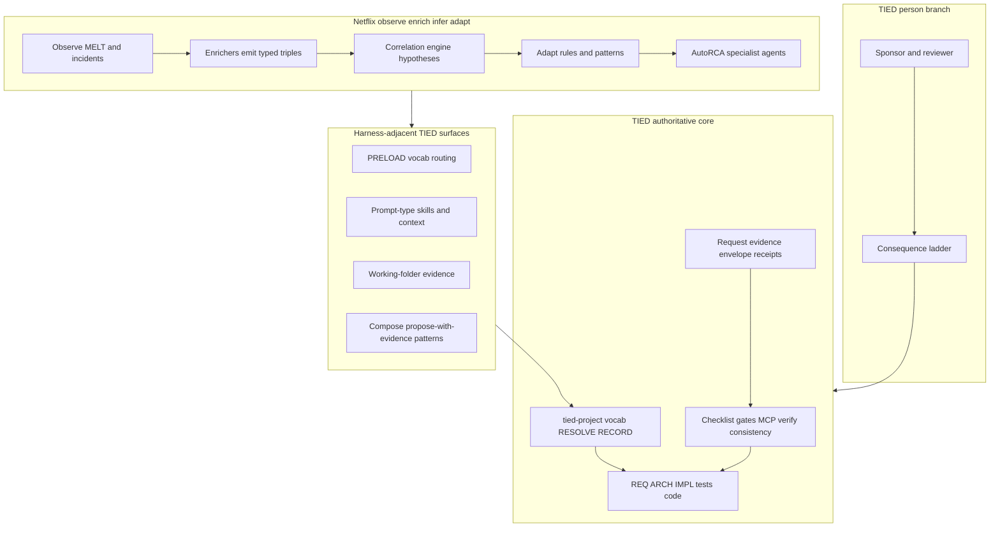

# Netflix ontology-driven observability × TIED — agent management lens

| Field | Value |
| --- | --- |
| **Purpose** | Map Netflix’s **Observability Ontology** (operational RDF knowledge graph, enrichers, correlation engine, knowledge flywheel, AutoRCA) to TIED as implemented in this repository—with emphasis on **agent context delivery**, **naming agreement**, and **proof boundaries**—not adopting SPARQL/QuipuDB as TIED core or certifying Netflix production outcomes. |
| **Audience** | Sponsors, SRE/observability practitioners, harness authors, prompt-type operators, methodology owners |
| **Source** | [Netflix Technology Blog](https://netflixtechblog.com/ontology-driven-observability-building-an-end-to-end-knowledge-graph-at-netflix-scale-421392cf5adf) (**2026-10-16**). [Article capture (sibling)](netflix-ontology-driven-observability.md) |
| **Evidence boundary** | stdd did **not** run Netflix systems, SPARQL queries, or AutoRCA during authoring. Post metrics are **Netflix-reported**, **`not_measured`** in stdd. |
| **Status / date** | Outreach / analysis snapshot, **2026-11-06** — **reference only; this document does not mint REQ/ARCH/IMPL tokens** |
| **Executable follow-up** | [REQ-TIED_NETFLIX_ONTOLOGY_OBSERVABILITY_WAVE3](../../tied-project/requirements/REQ-TIED_NETFLIX_ONTOLOGY_OBSERVABILITY_WAVE3.yaml) — Wave 3 doc compose (**build-plan** 2026-11-07) |
| **Distinct from** | [Open Ontologies × TIED](open-ontologies-repository-vs-tied-agent-management.md) (plan/apply, Lean certs, MCP governance engine); [NDTP × TIED](ndtp-ai-ontology-extension-vs-tied-agent-management.md) (Streamlit HITL TTL wizard); [Heimsbakk × TIED](veronika-heimsbakk-ai-generated-ontologies-vs-tied-agent-management.md) (meaning ownership essay); [LangChain × TIED](langchain-harness-engineering-vs-tied-agent-management.md) (trace-driven harness tuning); [Anthropic FV × TIED](anthropic-llm-formal-verification-vs-tied-agent-management.md) (formal proof obligations) |
| **TIED anchors (reference only)** | [AGENTS.md](../../AGENTS.md), [agent-req-implementation-checklist.md](../../tied-bundle/docs/agent-req-implementation-checklist.md), [processes.md](../../tied-bundle/docs/processes.md), [pseudocode-writing-and-validation.md](../../tied-bundle/docs/pseudocode-writing-and-validation.md), [vocabulary-layer-tied-leap-citdp.md](../../tied-bundle/docs/vocabulary-layer-tied-leap-citdp.md), [sponsor-agent-relationship.md](../../tied-project/vocab/sponsor-agent-relationship.md), [external-service-three-wave-comparison-template.md](../../tied-bundle/docs/external-service-three-wave-comparison-template.md) |

---

## Executive summary

Netflix describes **ontology-driven observability**: a production **Observability Ontology** (RDF/OWL/SHACL/SPARQL) backed by **QuipuDB**, fed by **enrichers** that turn MELT telemetry and incident discourse into typed triples, a **correlation engine** that proposes evidence-backed chains (discarding low confidence), a **knowledge flywheel** (Observe → Enrich → Infer → Adapt), and **AutoRCA** specialist agents that coordinate via the **graph vocabulary**. The post’s diagnosis is that on-call slowness is often **entity disagreement across tools** (application vs service vs cluster), not insufficient dashboards; agents without that shared context **hallucinate** (**Netflix-reported**).

TIED’s center of gravity is **software intent traceability** in client repos: vocab **RESOLVE/RECORD/VALIDATE**, CITDP change definition, REQ → ARCH → IMPL **essence_pseudocode** with block token comments, checklist **pre_implementation** gates, MCP-first **project** YAML writes, **`tied_validate_consistency`**, verification-gated **`tied_verify`**, LEAP on divergence, request **evidence envelopes**, adversarial inquiry when enrolled at integrated depth, and the sponsor **consequence ladder**. TIED is **SKOS-adjacent** at the vocabulary layer and **does not** ship an operational incident knowledge graph or SPARQL interface.

**Compose-don’t-replace:** Borrow **catalog-before-entity**, **ontology-as-code review**, **constrain stochastic outputs to a narrow typed contract**, **specialists sharing one vocabulary**, **human reasoning stored beside machine signals**, and **agents that propose with attached evidence** as **harness-adjacent** patterns (PRELOAD, working folders, checklist ordering). Keep **semantic token authority**, **checklist gate receipts**, **MCP project YAML writes**, and **sponsor costly choices** on the TIED plane. Do not treat SPARQL determinism as **`tied_validate_consistency`** or AutoRCA rankings as sponsor approval.

| Center of gravity | Netflix (post) | TIED (this repo) |
| --- | --- | --- |
| Primary artifact | Operational knowledge graph + SPARQL | `[REQ-*]` / `[ARCH-*]` / `[IMPL-*]` YAML + pseudo-code + tests |
| Identity / naming | Catalog-gated `ops:Application`; refused generic Service | Semantic tokens + `tied-project/vocab/` RESOLVE/RECORD |
| Agent context | Graph as **interface** between specialists | PRELOAD routing, checklist gates, bounded MCP YAML |
| Determinism story | SHACL/OWL contracts on LLM outputs → stable triples | `pseudocode_validate`, consistency tools, verification-gated tests |
| Human authority | Humans approve fixes and ontology changes | Sponsor **person branch**, consequence ladder |
| Runtime scope | Incidents, deploys, metrics at Netflix scale | Software **intent** in client repos — **not** prod telemetry |

---

## Source summary (Netflix claims only)

Bullets summarize sibling [capture](netflix-ontology-driven-observability.md). Unless reproduced in stdd, label **Netflix-reported**.

- **Scale context:** ~65M concurrent streams (live event); &gt;2B requests/day; ~38M logging events/s (**Netflix-reported**).
- **Investigation time:** Example regression ~**4 hours**; most time reconstructing cross-tool relationships, not heavy compute (**Netflix-reported**).
- **Problem framing:** Tool silos (Atlas, Radar, incident.io, PagerDuty, Spinnaker, Slack) disagree on entity identity; SMEs carry mappings (**Netflix-reported**).
- **Stack:** RDF, OWL, SHACL, SPARQL; **QuipuDB** quad store; Turtle archival per harvest (**Netflix-reported**).
- **Catalog gate:** ~**49,000** software catalog entries; no generic Service type; capped dependency edges (**Netflix-reported**).
- **Incident modeling:** Slack threads (e.g. 200 messages) → structured triples (**Netflix-reported**).
- **Determinism ladder:** Five layers; LLM output constrained to allowed predicates; aggregate graph query-stable (**Netflix-reported**).
- **Enrichers:** Sequential load/add/save; best-effort external calls; dozens of enrichers (**Netflix-reported**).
- **Correlation engine:** **13** signal types; 10-minute window; discard confidence &lt; **0.6**; propose-with-evidence (**Netflix-reported**).
- **Flywheel:** Observe / Enrich / Infer / Adapt; encoded incident patterns become proactive insight (**Netflix-reported**).
- **AutoRCA:** Specialist agents; ontology as inter-agent interface; ranked hypotheses with evidence; humans still decide (**Netflix-reported**).
- **Principles:** Identity catalogs, ontology-as-code, open standards, constrain stochastic tools, model human reasoning, humans as approvers (**Netflix-reported**).
- **Future:** Upper (UDA) integration POC for incidents (**Netflix-reported**).

---

## Relationship to sibling comparisons

| Sibling | What it owns | This document owns |
| --- | --- | --- |
| [Heimsbakk × TIED](veronika-heimsbakk-ai-generated-ontologies-vs-tied-agent-management.md) | **Meaning ownership** before machine graphs; LLM OWL anti-patterns | **Runtime operational agreement** on entities; incident chat → triples; catalog gates |
| [Open Ontologies × TIED](open-ontologies-repository-vs-tied-agent-management.md) | **Graph change governance**: plan/apply, Lean certs, large MCP | **Harvest/enrich/flywheel** at prod scale; correlation/AutoRCA consumer loop |
| [NDTP × TIED](ndtp-ai-ontology-extension-vs-tied-agent-management.md) | **Authoring wizard**: data→TTL, HITL ontologist feedback | **Production memory** and cross-signal RCA, not Streamlit extension UI |
| [LangChain × TIED](langchain-harness-engineering-vs-tied-agent-management.md) | Trace-driven harness tuning on benchmarks | **Context graph** as prerequisite for accurate agents (shared diagnosis) |
| [Anthropic FV × TIED](anthropic-llm-formal-verification-vs-tied-agent-management.md) | Formal proof certificates (Rocq/Verus) | Determinism via **shape/type constraints**, not proof obligations |
| [TIED vs well-known methodologies](tied-vs-well-known-methodologies.md) | Broad methodology map | **Single Netflix observability ontology article** |

Cross-link Heimsbakk when operators conflate **SKOS-adjacent TIED vocab** with **enterprise operational OWL**; cross-link Open Ontologies when they need **plan/apply** on ontology edits, not harvest-only graphs.

---

## Harness lessons → TIED agent management

### Cross-tool identity mismatch → shared agreement

| Netflix pattern | TIED surface | Notes |
| --- | --- | --- |
| Application vs service vs cluster naming drift | `[PROC-VOCABULARY_INDEX]` RESOLVE/RECORD | **Align** on naming discipline; different artifact (vocab vs RDF) |
| SME-held mental mappings | Sponsor/reviewer as meaning authority | **Composable** with Heimsbakk |
| Twelve operational namespaces | Client `tied-project/vocab/` glossaries | **Tension** — TIED not a prod entity graph |
| Unified query across incidents/deploys/alerts | Merged read of project + bundle YAML | **Composable** metaphor for traceability joins |

### Catalog-gated entity creation

| Netflix pattern | TIED surface | Notes |
| --- | --- | --- |
| Validate `ops:Application` against software catalog | RESOLVE before minting tokens or vocab entries | **Composable** |
| Reject unvalidated strings as applications | No ad-hoc REQ/ARCH/IMPL symbols without RECORD | **Align** |
| Cap dependency edges in graph | Scope limits in CITDP / impact discovery | **Partial align** |

### Stochastic enrichers → deterministic triples

| Netflix pattern | TIED surface | Notes |
| --- | --- | --- |
| LLM/fuzzy steps inside SHACL-typed envelope | `pseudocode_validate`, IMPL contracts | **Composable** — shape discipline |
| SPARQL answers stable after harvest | `tied_validate_consistency` on YAML indexes | **Tension** — different graph; anti-pattern to equate |
| Agent outputs must fit predicate allowlists | Checklist gates before MCP YAML writes | **Align** on bounded writes |
| Entropy ladder (five layers) | Checklist step ordering + LEAP | **Composable** process metaphor |

### Sequential enricher pipeline (best-effort)

| Netflix pattern | TIED surface | Notes |
| --- | --- | --- |
| Sequential load/add/save enrichers | `[PROC-AGENT_REQ_CHECKLIST]` step order | **Composable** |
| Best-effort metrics/logs calls | Degraded harness context vs hard fail | **Defer** for client ops stacks |
| Race avoidance vs wall-clock cost | Gate receipts over parallel agent chaos | **Partial align** |

### Correlation engine (hypotheses + confidence)

| Netflix pattern | TIED surface | Notes |
| --- | --- | --- |
| Propose chains with stored evidence | Adversarial inquiry findings with provenance | **Composable** when integrated |
| Confidence threshold discard | Advisory vs strict gate policies | **Partial align** |
| Causal priors (deploy before error) | CITDP risk / impact heuristics | **Composable** metaphor |
| Auto-conclude from 0.87 chain | Sponsor person branch on costly choices | **Tension** — Netflix keeps human weigh-in |

### Knowledge flywheel / encoded incident wisdom

| Netflix pattern | TIED surface | Notes |
| --- | --- | --- |
| Observe → Enrich → Infer → Adapt | Kaizen, feedback digest, LEAP proposal queue | **Gap/Tension** — software process memory, not prod graph |
| Patterns become detection rules | Checklist adaptation from evidence | **Composable** at methodology layer |
| “40% of SEV-2s” style wisdom | **`not_measured`** in TIED clients | **Defer** client SRE analytics |

### AutoRCA specialist agents

| Netflix pattern | TIED surface | Notes |
| --- | --- | --- |
| Specialists share graph vocabulary only | PRELOAD matched glossaries; prompt-type Task profiles | **Composable** |
| Ontology as inter-agent interface | `tied-project/vocab/` + token comments | **Tension** — YAML not SPARQL |
| Ranked hypotheses with evidence attachments | Working-folder evidence, inquiry ledger | **Partial align** |
| “Agents without context hallucinate” | LangChain cross-read on harness context | **Align** (diagnosis) |

### Ontology as code (PRs, tests)

| Netflix pattern | TIED surface | Notes |
| --- | --- | --- |
| Version/review/test ontology changes | Git-tracked project YAML + IMPL sidecars | **Align** |
| Turtle diff for debugging | `lint_yaml` on TIED YAML edits | **Composable** diff discipline |
| PR-based ontology contributions | Traceable commit + vocab VALIDATE | **Align** |

### Humans as approvers

| Netflix pattern | TIED surface | Notes |
| --- | --- | --- |
| Route agent proposals through human review | Sponsor consequence ladder | **Align** |
| Engineer still writes the fix | TDD + sponsor scope on behavior change | **Align** |
| Proposed enrichers/ontology changes reviewed | LEAP + person branch on costly choices | **Align** |

---

## Touchpoint 1 — RESOLVE

| Target term | TIED preferred term / surface | Notes |
| --- | --- | --- |
| **Observability Ontology** | Client ops / domain tooling | **Defer** — not TIED core |
| **Enricher** | Harness step or skill metaphor | **Composable** only |
| **Knowledge flywheel** | Kaizen / feedback loop | **Composable** metaphor |
| **AutoRCA** | Client SRE product | **Defer** |
| **ops:Application** | Software component in client catalog | Analogy to RESOLVE before tokens |
| **MELT** | Client telemetry stack | **Defer** |
| **Correlation chain** | Hypothesis with evidence | Cross-link adversarial inquiry |
| **QuipuDB / SPARQL** | — | **Defer** — no TIED equivalent |

**RESOLVE charter (this comparison):** Canonicalizes **names and mappings** only; does not change sponsor intent authority or mint TIED tokens from comparison prose.

### Disposition key

| Disposition | Meaning |
| --- | --- |
| **Align** | TIED materially represents the external intent (scoped). |
| **Composable** | Combine without equivalence claims. |
| **Tension** | Partial overlap; proof boundary must be explicit. |
| **Gap** | External emphasis not in TIED core as-is. |
| **Defer** | Product, client infra, or sponsor-owned choice. |

### Claim labeling

| Label | Use when |
| --- | --- |
| **Netflix-reported** | Post metrics and product claims not re-run in stdd |
| **TIED-existing** | Committed docs/tools in stdd (reference existing tokens in prose only) |
| **Recommendation-only** | Operator suggestions not yet enforced by gates |
| **`not_measured`** | Whether adopting Netflix patterns improves TIED client outcomes |

---

## Primary capability matrix

| Concern | TIED COG | Disposition | One-line rationale |
| --- | --- | --- | --- |
| Cross-tool entity identity agreement | Vocab RESOLVE/RECORD | **Composable** | TIED vocab, not prod RDF graph |
| Catalog-before-entity | RESOLVE before mint | **Align** | Same discipline as `ops:Application` gate |
| Operational incident knowledge graph | — | **Gap** | TIED traces software intent, not Atlas/Radar |
| MELT unified observability layer | — | **Defer** | Client SRE infra |
| Stochastic→deterministic via type system | `pseudocode_validate`, IMPL contracts | **Composable** | Parallel lesson, different artifact |
| SPARQL-stable graph | `tied_validate_consistency` | **Tension** (anti-pattern) | Neither implies domain truth |
| Sequential best-effort enrichers | Checklist step order | **Composable** | Process ordering, not harvest pipeline |
| Correlation engine with confidence | Adversarial inquiry / evidence | **Composable** | Propose-with-evidence, not auto-RCA |
| Knowledge flywheel memory | Kaizen, LEAP, feedback | **Tension** | Methodology learning ≠ prod graph memory |
| Specialist agents + shared vocabulary | PRELOAD, skills, Task profiles | **Composable** | Graph ≡ vocab+tokens metaphorically |
| Agent context delivery (anti-hallucination) | Bootstrap + routing | **Align** (diagnosis) | Cross-link LangChain for tuning loop |
| Ontology-as-code in git | Project YAML + IMPL sidecars | **Align** | Same change-review instinct |
| Human approvers for agent proposals | Sponsor person branch | **Align** | Costly choices stay with sponsor |
| Open Ontologies plan/apply/certs | CITDP + gates | **Composable** | Sibling engine for graph **governance** edits |
| Upper / UDA integration | Client domain modeling | **Defer** | Netflix future work |
| Mint REQ from comparison prose | — | **Align** (anti-pattern) | Wave 3 via **add-feature** only |

---

## Authority boundary

Netflix’s **QuipuDB, enrichers, correlation engine, and AutoRCA** sit **outside** TIED’s authoritative core. TIED clients may **compose** catalog discipline, constrained agent outputs, and shared vocabulary lessons when managing coding agents; they do **not** replace CITDP, token graphs, or checklist gates with an operational SPARQL graph.

---

## Anti-patterns (Netflix lessons → TIED risk)

| Risk | Symptom | TIED-oriented remedy |
| --- | --- | --- |
| SPARQL green = intent truth | Treat graph query success as sponsor sign-off | Proof boundary; **`tied_validate_consistency`** scope; person branch |
| AutoRCA rank = approval | Skip checklist on top hypothesis | Costly choice on behavior change; gates |
| Incident graph = REQ traceability | No REQ/ARCH/IMPL for software change | Separate ops KG from methodology graph |
| Unconstrained LLM triples | Harness writes YAML without MCP/gates | MCP-first writes; `lint_yaml`; LEAP |
| Generic “Service” token | Collapsed meanings in vocab/tokens | RESOLVE; Heimsbakk cross-read |
| Flywheel wisdom without evidence | Adopt “40% SEV-2” style stats in gates | Label **`not_measured`**; client-owned analytics |
| Comparison prose mints REQ | New tokens in markdown | Wave 3 via **add-feature** only |
| More dashboards fix naming drift | Ignore vocab PRELOAD before agent runs | Bootstrap routing; LangChain context lesson |

---

## Compose-don’t-replace: tune Netflix-inspired practice vs keep TIED authority

| Tune with **Netflix-inspired** practice (harness/process) | Keep **TIED** authority |
| --- | --- |
| **Catalog-before-entity** when naming concepts in agent work | Vocab RESOLVE/RECORD; token registry |
| **Narrow output contracts** for stochastic agent steps | IMPL pseudo-code shapes; `pseudocode_validate` |
| **Specialists share one vocabulary** (PRELOAD, glossaries) | REQ/ARCH/IMPL graph; not SPARQL as SoT |
| **Propose with evidence** (confidence + provenance) | Adversarial inquiry artifacts when integrated |
| **Store human reasoning** beside machine outputs | Sponsor review; working-folder receipts |
| **Ontology-as-code** review habits for graphs client owns | **Project** YAML MCP writes; checklist gates |

---

## Bounded operator recommendations (Recommendation-only)

1. **PRELOAD before agent turns on cross-cutting incidents** — **Composable** with Netflix’s “agents without context hallucinate”; use `tied-project/vocab/routing.md` matched glossaries (**not_measured** for RCA quality).
2. **RESOLVE before new symbols** — **TIED-existing:** mirror catalog-gate instinct when minting tokens or UI labels; do not scrape strings into authoritative names.
3. **Constrain harness outputs** — **Partial align:** typed predicate allowlists ↔ checklist + MCP write surface; cap silent auto-edits (**Recommendation-only**).
4. **Heimsbakk + Netflix pair-read** — Meaning conversation (Heimsbakk) plus operational identity agreement (Netflix) before client OWL/RDF adoption (**Recommendation-only**).
5. **Open Ontologies for governance edits** — When client ontologies need plan/apply, use sibling engine comparison — Netflix harvest loop is **not** a substitute (**Defer** integration).
6. **Label Netflix metrics** — **Netflix-reported** only in outreach; never as TIED verify outcomes (**TIED-existing** labeling discipline).
7. **Separate ops graph from methodology graph** — Client SRE may build QuipuDB-class systems; TIED MCP stays on **tied-project/** software intent (**Recommendation-only**).

---

## Phased recommendations (doc-first)

| Phase | Action | Status |
| --- | --- | --- |
| **0** | Capture + this analysis + `.gitignore` allowlist | **Done** (2026-11-06 **non-tied-build**) |
| **1** | Reciprocal links from Open Ontologies / NDTP / Heimsbakk / LangChain analyses | **Implemented** (Wave 3 slice C; ontology siblings verified) |
| **2** | Bundle cross-link from [vocabulary-layer-tied-leap-citdp.md](../../tied-bundle/docs/vocabulary-layer-tied-leap-citdp.md) | **Implemented** (operational identity vs meaning ownership subsection) |
| **3** | `methodology-composition-matrix.md` §2 row | **Implemented** (row **17**; [REQ-TIED_NETFLIX_ONTOLOGY_OBSERVABILITY_WAVE3](../../tied-project/requirements/REQ-TIED_NETFLIX_ONTOLOGY_OBSERVABILITY_WAVE3.yaml)) |
| **3** | Client observability ontology as bundled operator path | **Defer** — sponsor-owned infra |
| **3** | Harness trace loop cites Netflix context graph | **Implemented** (HTOL [Source studies (Netflix compose)](../../tied-bundle/docs/harness-trace-observation-loop.md#source-studies-netflix-compose)) |

---

## Explicit non-adoptions

- **QuipuDB**, production **SPARQL** graph, and Netflix **AutoRCA** as TIED methodology core
- **MELT** telemetry platform or incident.io/PagerDuty integrations as TIED checklist substitutes
- **Correlation engine** auto-remediation without sponsor/checklist alignment
- **SHACL/OWL harvest green** as proof of **`tied_validate_consistency`** or domain correctness
- **Upper/UDA** integration as TIED bundle scope
- Minting new REQ/ARCH/IMPL records from this comparison prose
- Claiming Netflix incident-time or RCA effectiveness as TIED outcomes (**`not_measured`**)

---

## Proof boundary

- Post claims are **Netflix-reported**. They are **not** stdd checklist results, **`tied_verify`** outcomes, or independently reproduced observability validations unless explicitly noted.
- TIED surfaces cited describe **TIED-existing** committed behavior at authoring time; composability does not implement Netflix systems inside stdd.
- Wave 3 behavior changes require normal TIED workflows (**add-feature**, **build-plan**, LEAP, tests)—not comparison markdown alone.
- stdd did **not** execute Netflix production pipelines, SPARQL queries, or AutoRCA during authoring.
- **`tied_validate_consistency`** runs after **[REQ-TIED_NETFLIX_ONTOLOGY_OBSERVABILITY_WAVE3](../../tied-project/requirements/REQ-TIED_NETFLIX_ONTOLOGY_OBSERVABILITY_WAVE3.yaml)** Wave 3 implement; earlier Waves 1–2 were doc-only without project YAML mint from comparison prose.

---

## Related documents

- [Article capture (sibling)](netflix-ontology-driven-observability.md)
- [External three-wave comparison template](../../tied-bundle/docs/external-service-three-wave-comparison-template.md)
- [Open Ontologies × TIED (sibling)](open-ontologies-repository-vs-tied-agent-management.md)
- [NDTP × TIED (sibling)](ndtp-ai-ontology-extension-vs-tied-agent-management.md)
- [Heimsbakk × TIED (sibling)](veronika-heimsbakk-ai-generated-ontologies-vs-tied-agent-management.md)
- [LangChain harness × TIED (sibling)](langchain-harness-engineering-vs-tied-agent-management.md)
- [Anthropic FV × TIED (sibling)](anthropic-llm-formal-verification-vs-tied-agent-management.md)
- [TIED vs well-known methodologies](tied-vs-well-known-methodologies.md)
- [Working plan](../../tied-project/non-tied-plans/netflix-ontology-observability-vs-tied/PLAN.md)
- [Agent req implementation checklist](../../tied-bundle/docs/agent-req-implementation-checklist.md)
