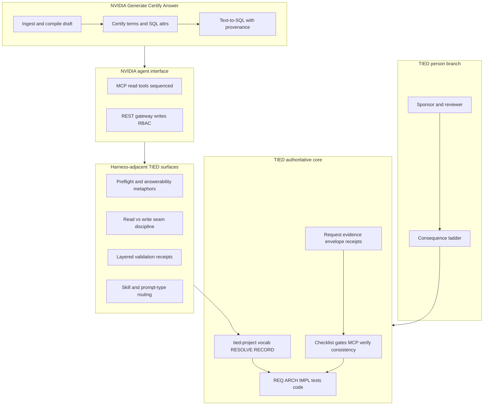

# NVIDIA Auto-Ontology × TIED — agent management lens

| Field | Value |
| --- | --- |
| **Purpose** | Map **NVIDIA Auto-Ontology** (enterprise analytics semantic layer, Generate → Certify → Answer, read-only MCP + governed REST writes, three agent skills) to TIED as implemented in this repository—with emphasis on **preflight gates**, **read/write seam discipline**, **multi-layer validation**, and **sponsor agency**—not adopting text-to-SQL runtime or pgvector catalog as TIED core. |
| **Audience** | Sponsors, harness authors, prompt-type operators, methodology owners, data/ontology practitioners evaluating compose patterns |
| **Source** | [NVIDIA/auto-ontology](https://github.com/NVIDIA/auto-ontology) (**NVIDIA-reported** / **skill-doc-observed**). [Methodology capture (sibling)](nvidia-auto-ontology.md) |
| **Evidence boundary** | stdd did **not** deploy Auto-Ontology, run BIRD/ontology-sql-eval, or execute live MCP during authoring. Product and skill claims are **NVIDIA-reported** or **skill-doc-observed**, **not_measured** for TIED client outcomes. |
| **Status / date** | Outreach / analysis snapshot, **2026-11-07** — **reference only; this document does not mint REQ/ARCH/IMPL tokens** |
| **Executable follow-up** | Wave 3 candidates in § Phased recommendations (**Defer** until scoped **add-feature** / **build-plan**) |
| **Distinct from** | [Apache Ossie × TIED](apache-ossie-vs-tied-agent-management.md) (**vendor-neutral interchange spec + grader**; NVIDIA owns Generate/Certify/Answer agentic catalog); [Netflix observability × TIED](netflix-ontology-driven-observability-vs-tied-agent-management.md) (operational RDF flywheel); [NDTP × TIED](ndtp-ai-ontology-extension-vs-tied-agent-management.md) (TTL HITL wizard); [Open Ontologies × TIED](open-ontologies-repository-vs-tied-agent-management.md) (governance plan/apply); [Heimsbakk × TIED](veronika-heimsbakk-ai-generated-ontologies-vs-tied-agent-management.md) (meaning before OWL); [LangChain × TIED](langchain-harness-engineering-vs-tied-agent-management.md) (trace/bench loops) |
| **TIED anchors (reference only)** | [AGENTS.md](../../AGENTS.md), [agent-req-implementation-checklist.md](../../tied-bundle/docs/agent-req-implementation-checklist.md), [pseudocode-writing-and-validation.md](../../tied-bundle/docs/pseudocode-writing-and-validation.md), [vocabulary-layer-tied-leap-citdp.md](../../tied-bundle/docs/vocabulary-layer-tied-leap-citdp.md), [sponsor-agent-relationship.md](../../tied-project/vocab/sponsor-agent-relationship.md), [external-service-three-wave-comparison-template.md](../../tied-bundle/docs/external-service-three-wave-comparison-template.md) |

---

## Executive summary

**NVIDIA Auto-Ontology** is an open **agentic analytics context layer**: it **generates** a draft semantic graph from warehouse metadata, has stewards **certify** terms and SQL attributes, and **answers** natural-language questions with SQL, execution steps, and repair loops—exposed to harnesses through **read-only MCP**, **CLI**, and **RBAC-gated REST** writes via a public Next.js gateway (**NVIDIA-reported**). Repo-root **`AGENTS.md`** routes three catalog skills with explicit workflow ownership, “no invented operations,” and handshake-truth for MCP tools (**skill-doc-observed**).

TIED’s center of gravity is **software delivery intent** in client repos: vocab **RESOLVE/RECORD/VALIDATE**, CITDP, REQ → ARCH → IMPL **essence_pseudocode**, checklist **pre_implementation** gates, MCP-first **project** YAML writes, **`tied_validate_consistency`**, optional **`tied_verify`**, LEAP, request **evidence envelopes**, and the sponsor **consequence ladder**. TIED is **SKOS-adjacent** at the vocabulary layer and **does not** ship Nemotron text-to-SQL, enterprise catalog ingestion, or certified **revenue** metrics as methodology tokens.

**Compose-don’t-replace:** Borrow **readiness and answerability before expensive tool calls**, **MCP read vs authoritative write separation**, **fail-closed model gaps**, **layered validation** (intent / artifact / rows / prose analogues), **scoped publication with export diff**, and **skill handoff tables** as harness-adjacent improvements. Keep **semantic token authority**, **checklist gate receipts**, **project YAML MCP truth**, and **sponsor costly choices** on the TIED plane. Do not treat semantic **compilation ready** or certified business **Terms** as **`tied_validate_consistency`** or domain correctness for software requirements.

| Center of gravity | NVIDIA Auto-Ontology | TIED (this repo) |
| --- | --- | --- |
| Primary artifact | Terms, SQL attributes, relationships + provenant answers | `[REQ-*]` / `[ARCH-*]` / `[IMPL-*]` YAML + pseudo-code + tests |
| Trust model | Generate → Certify → Answer | CITDP → gates → sponsor ladder |
| Agent reads | MCP semantic tools (sequenced) | MCP resources/tools + vocab PRELOAD |
| Agent writes | REST `/api` with permissions | **Project** YAML via tied-yaml MCP |
| Preflight | `check_readiness`, `check_answerable` | Checklist activation, gate validate, pseudocode validate |
| “Green” mistake | SQL executed ≠ question answered | Tests pass ≠ requirements met (verify when enrolled) |

---

## Source summary (NVIDIA claims only)

Bullets synthesize sibling [methodology capture](nvidia-auto-ontology.md). Unless reproduced in stdd, label **NVIDIA-reported** or **skill-doc-observed**.

- **Problem statement:** Agents need where data lives, meaning, trust, lineage, and similarity—not just fast wrong answers (**NVIDIA-reported**).
- **Lifecycle:** Ingestion **Generate** → human/skill **Certify** → **Answer** with SQL + steps + repair (**NVIDIA-reported**).
- **Primitives:** Terms, SQL attributes (reusable measures), relationships/joins (**NVIDIA-reported**).
- **Harness:** `nvidia-ontology-setup`, `-management`, `-query` skills; composed lifecycle through publication readback (**skill-doc-observed**).
- **MCP:** Read-only; advertises tool **sequence** at handshake; `ask_question` is expensive full text-to-SQL (**skill-doc-observed**, `docs/mcp.md`).
- **Gateway:** Writes and chat through Next.js origin; FastAPI/ingestion ports private; header trust boundary (**NVIDIA-reported**).
- **Validation:** Material question, SQL, rows, truncation, prose checked separately (**skill-doc-observed**).
- **Publication:** Scoped export backup, exact re-export diff; known import issues fail closed (#250, #265, #267) (**skill-doc-observed**).
- **Models:** REASONING / NON_REASONING / EMBED / RERANK NIM roles; optional KumoRFM predictive path with data-upload caveat (**NVIDIA-reported**).
- **Interop:** Apache Ossie import/export; complements existing semantic models (**NVIDIA-reported**).
- **Contributions:** Not accepting external PRs; integration via issues (**NVIDIA-reported**).

---

## Relationship to sibling comparisons

| Sibling | What it owns | This document owns |
| --- | --- | --- |
| [Netflix × TIED](netflix-ontology-driven-observability-vs-tied-agent-management.md) | Prod telemetry → RDF graph, MELT, correlation engine, AutoRCA | **Certified analytics semantic layer**, MCP query sequence, text-to-SQL provenance |
| [NDTP × TIED](ndtp-ai-ontology-extension-vs-tied-agent-management.md) | Streamlit HITL TTL extension wizard | **Deployed semantic layer** skills + MCP, not RDF authoring UI |
| [Open Ontologies × TIED](open-ontologies-repository-vs-tied-agent-management.md) | Governance engine, plan/apply, Lean certs, broad MCP | **Answerability preflight** and publication readback—not plan/apply engine |
| [Heimsbakk × TIED](veronika-heimsbakk-ai-generated-ontologies-vs-tied-agent-management.md) | Conversation before authoritative OWL | **Certify** step vs draft generation; cross-read for meaning ownership |
| [LangChain × TIED](langchain-harness-engineering-vs-tied-agent-management.md) | Trace/benchmark harness tuning | **Tool sequencing** (readiness before ask), not LangSmith loops |
| [Apache Ossie × TIED](apache-ossie-vs-tied-agent-management.md) | Neutral semantic model **interchange**, validation, converters | **Deployed catalog** runtime, MCP query sequence, text-to-SQL |
| [Open Ontologies capture](open-ontologies-repository.md) | Product governance narrative | Auto-Ontology is **customer-deployed** analytics layer, not Open Ontologies engine |

Cross-link Netflix when operators discuss **operational identity** graphs; cross-link Open Ontologies when they need **production graph change management**; cross-link Heimsbakk when they conflate **certified Term** with **recorded sponsor meaning** for software intent.

---

## Harness lessons → TIED agent management

### Readiness and answerability preflight

| NVIDIA pattern | TIED surface | Notes |
| --- | --- | --- |
| `check_readiness` (compile + live DB) | Checklist activation, `tied_checklist_activation_collect` | **Composable** — block expensive turns when prerequisites missing |
| `check_answerable` before `ask_question` | `tied_checklist_gate_validate`, `tied_gate_check` | **Composable** — cheap coverage before implementation |
| Glossary readable but SQL fails | Semantic compile vs connection mismatch | **Align** (anti-pattern) — like YAML valid but tests not runnable |
| Clarify when coverage &lt; 1 | `tied_sponsor_questions`, mid-lane deferral | **Composable** |

### MCP read vs authoritative write

| NVIDIA pattern | TIED surface | Notes |
| --- | --- | --- |
| MCP read-only; REST writes via gateway | MCP **project** YAML writes only; methodology read-only | **Align** on seam discipline |
| FastAPI trusts forwarded user header | `TIED_BASE_PATH` wrong-repo write risk | **Tension** — both need deployment boundary discipline |
| Token acts as owner (RBAC) | API token / session scope in harness | **Partial align** |
| Handshake tool list &gt; skill table | Live tied-yaml tool surface vs skill docs | **Recommendation-only** |

### Skill router and gap receipts

| NVIDIA pattern | TIED surface | Notes |
| --- | --- | --- |
| `AGENTS.md` skill ownership table | Prompt-type skills (`non-tied-*`, `build-plan`, …) | **Composable** |
| No invented operations | `non-tied-boundary`, explicit gap in handoff | **Align** |
| Unsupported step → receipt | Request evidence envelope, working PLAN | **Composable** |
| Skills sync to public `nvidia/skills` catalog | `.cursor/skills`, bundled prompt-type skills | **Defer** — different distribution |

### Layered query validation

| NVIDIA pattern | TIED surface | Notes |
| --- | --- | --- |
| Material intent vs SQL vs rows vs prose | `pseudocode_validate`, tests vs narrative | **Composable** metaphor |
| Truncated rows weaken claims | Partial test coverage vs full E2E | **Partial align** |
| observed / recommended / committed states | Sponsor ladder; adversarial inquiry evidence | **Composable** |
| SQL repair loop | LEAP after failing tests | **Tension** — auto-repair needs gates |

### Modeling and publication contracts

| NVIDIA pattern | TIED surface | Notes |
| --- | --- | --- |
| Measure/relationship contracts before edit | IMPL PRE/POST, CITDP scope | **Partial align** |
| Model gap when API cannot express design | Costly choice / scope reduction | **Align** |
| Export scope + SHA-256 rollback | `tied_git_hygiene`, envelope hashes | **Composable** |
| Certification ≠ atomic promotion | Verification-gated status; honest Wave 3 defer | **Align** (anti-pattern parity) |
| Learn loop (certified corrections) | Kaizen feedback, LEAP proposal queue | **Partial align** |

### Enterprise semantic layer vs software intent graph

| NVIDIA pattern | TIED surface | Notes |
| --- | --- | --- |
| Business Term = revenue, Customer | `[REQ-*]` token, vocab entry | **Tension** — different namespaces |
| SQL attribute reuse | IMPL SQL-shaped pseudo-code blocks | **Composable** metaphor only |
| pgvector retrieval | — | **Gap** / **Defer** for TIED core |
| BIRD / ontology-sql-eval | Module tests, contract tests | **Defer** — different proof object |

---

## Touchpoint 1 — RESOLVE

| Target term | TIED preferred term / surface | Notes |
| --- | --- | --- |
| **Term** (Auto-Ontology) | Domain concept in client vocab; not REQ token | Analytics vs software intent |
| **Certify** (semantic layer) | Sponsor sign-off before costly choice / verify update | **Partial align** with Heimsbakk “meaning recorded” |
| **check_answerable** | Gate/coverage check before build | **Composable** name in harness docs only |
| **Semantic compilation** | `tied_validate_consistency` | **Tension** — do not equate |
| **SQL attribute** | IMPL measure-like pseudo-code | Metaphor; not interchangeable |
| **MCP read tools** | Bounded read surface (resources, read MCP) | **Align** on read/write split |
| **Publication readback** | Evidence envelope + git diff discipline | **Composable** |
| **model gap** | Explicit defer / scope gap in PLAN | **Align** |

**RESOLVE charter (this comparison):** Canonicalizes **names and mappings** only; does not change sponsor intent authority or mint TIED tokens from comparison prose.

### Disposition key

| Disposition | Meaning |
| --- | --- |
| **Align** | TIED materially represents the external intent (scoped). |
| **Composable** | Combine without equivalence claims. |
| **Tension** | Partial overlap; proof boundary must be explicit. |
| **Gap** | External emphasis not in TIED core as-is. |
| **Defer** | Product, client infra, or sponsor-owned choice. |

### Claim labeling

| Label | Use when |
| --- | --- |
| **NVIDIA-reported** | README/product claims not re-run in stdd |
| **skill-doc-observed** | Upstream `AGENTS.md` / skills / `docs/mcp.md` |
| **TIED-existing** | Committed docs/tools in stdd |
| **Recommendation-only** | Operator suggestions not yet enforced by gates |
| **`not_measured`** | Whether compose patterns improve TIED outcomes |

---

## Primary capability matrix

| Concern | TIED COG | Disposition | One-line rationale |
| --- | --- | --- | --- |
| Enterprise text-to-SQL product | — | **Defer** | Client analytics infra |
| Generate/Certify/Answer lifecycle | CITDP + sponsor certify metaphor | **Composable** | Different artifacts |
| Readiness before expensive MCP call | Checklist/gate preflight | **Composable** |
| Answerability grading | Gate validate, scope questions | **Composable** |
| MCP read-only query plane | tied-yaml read + vocab PRELOAD | **Partial align** |
| REST write gateway + RBAC | Project YAML MCP writes only | **Align** (seam) |
| Three skill ownership router | Prompt-type skills | **Composable** |
| Query validation layers | pseudocode_validate + tests | **Composable** |
| Publication export diff + rollback | git hygiene, envelope | **Composable** |
| Nemotron / pgvector catalog | External LLM policy | **Defer** |
| Ossie semantic interchange | Client domain models | **Defer** |
| Certified Term = REQ token | Token graph | **Align** (anti-pattern) |
| `tied_validate_consistency` = SQL green | Consistency vs domain | **Align** (anti-pattern) |
| BIRD benchmark as TIED proof | — | **Defer** — **not_measured** |

---

## Authority boundary

NVIDIA’s **Postgres catalog, Nemotron inference, and text-to-SQL runtime** sit **outside** TIED’s authoritative core. TIED may **compose** preflight, seam, and validation discipline in harness docs and operator practice; it does **not** replace CITDP, project YAML MCP, or checklist gates with Auto-Ontology deployment.

---

## Anti-patterns (NVIDIA lessons → TIED risk)

| Risk | Symptom | TIED-oriented remedy |
| --- | --- | --- |
| Skip to `ask_question` | Minutes of model spend on unready deploy | Document readiness/answerability analogues before expensive tools |
| MCP write assumed | Agent mutates glossary via MCP | Hand off writes to tied-yaml MCP + person branch |
| SQL ran = answered | Wrong population or fanout | Tests + pseudocode validate; sponsor review |
| Compilation ready = verify done | Empty glossary masked | `tied_validate_consistency` + tests; not product UI state |
| Skill table stale | Wrong tool invoked | Trust live MCP handshake / OpenAPI owners |
| Chat success = published | No export diff | Envelope + git hygiene before promote |
| Business Term minted as REQ | Namespace collision | RESOLVE in vocab; separate analytics KG |
| Comparison prose mints REQ | New tokens in markdown | Wave 3 via **add-feature** only |
| BIRD score = TIED quality | Benchmark conflation | **not_measured**; separate proof objects |

---

## Compose-don’t-replace: tune NVIDIA-inspired practice vs keep TIED authority

| Tune with **NVIDIA-inspired** practice (harness/process) | Keep **TIED** authority |
| --- | --- |
| **Readiness → answerability → act** tool sequencing | Checklist order; gate validate before implementation |
| **Read-only MCP** for discovery questions | **Project** YAML MCP for index/detail writes |
| **Explicit model gap** responses | Costly choice ladder; no silent scope invention |
| **Multi-layer validation** before claim-bearing answers | Tests, pseudocode validate, verify when enrolled |
| **Scoped export diff** before semantic promotion | LEAP + traceable commit discipline |
| **Three-skill** setup / manage / query handoffs | Prompt-type skills + plan disk handoff |
| Client **Auto-Ontology** beside agent IDE | **tied-project/** intent graph unchanged |

---

## Bounded operator recommendations (Recommendation-only)

1. **Preflight expensive tools** — Before long MCP or build turns, mirror `check_readiness` / `check_answerable`: confirm checklist activation, base path, and scope (**Composable**; **not_measured** for latency savings).
2. **Never conflate certify Term with RECORD REQ** — Analytics stewardship vs software intent tokens; cross-read [Heimsbakk × TIED](veronika-heimsbakk-ai-generated-ontologies-vs-tied-agent-management.md) (**TIED-existing** discipline).
3. **Hand writes across the seam** — Reads via MCP/resources; project YAML mutations via tied-yaml MCP only (**Align** with NVIDIA read/write split).
4. **Layer validation** — Do not ship from narrative alone when rows/tests exist; analogue to SQL/rows/prose split (**Recommendation-only**).
5. **Publication = diff + receipt** — For significant TIED YAML promotion, keep export/diff habits from publication skill metaphor (**Composable** with `tied_git_hygiene`).
6. **Netflix pair-read** — Operational identity (Netflix) vs certified metrics (NVIDIA) vs software tokens (TIED)—three namespaces (**Recommendation-only**).
7. **Label NVIDIA metrics** — **NVIDIA-reported** only; never as **`tied_verify`** outcomes.

---

## Phased recommendations (doc-first)

| Phase | Action | Status |
| --- | --- | --- |
| **0** | Wave 1 capture + this analysis (local gitignored) | **Done** (2026-11-07 **non-tied-build**) |
| **1** | Reciprocal “Distinct from” / sibling backlinks (Netflix, NDTP, Open Ontologies) | **Defer** (local-only) |
| **2** | [agent-req-implementation-checklist.md](../../tied-bundle/docs/agent-req-implementation-checklist.md) note: expensive-tool **preflight** pattern | **Defer** — doc-only |
| **2** | [vocabulary-layer-tied-leap-citdp.md](../../tied-bundle/docs/vocabulary-layer-tied-leap-citdp.md): **certified vs draft** meaning (Certify vs Heimsbakk) | **Defer** |
| **2** | [harness-trace-observation-loop.md](../../tied-bundle/docs/harness-trace-observation-loop.md): MCP **sequencing** / skip-to-expensive-call failure mode | **Defer** |
| **3** | [methodology-composition-matrix.md](methodology-composition-matrix.md) §2 row **18** (NVIDIA semantic layer compose) | **Defer** — row contract |
| **3** | Scoped REQ e.g. `REQ-TIED_NVIDIA_AUTO_ONTOLOGY_WAVE3` (docs + matrix only) | **Defer** — sponsor **add-feature** |
| **3** | Client-deploy Auto-Ontology next to TIED MCP | **Defer** — sponsor-owned infra |

---

## Explicit non-adoptions

- **Auto-Ontology runtime**, Nemotron defaults, and **pgvector** catalog as TIED methodology core
- **text-to-SQL** over client warehouses as substitute for **`tied_verify`** or module tests
- **Semantic compilation ready** UI state as proof of **`tied_validate_consistency`**
- **Certified business Terms** as **`[REQ-*]`** tokens without scoped **add-feature**
- **MCP write** to glossary/catalog (product design) confused with **tied-yaml** project writes
- **BIRD / ontology-sql-eval** scores as TIED effectiveness evidence (**`not_measured`**)
- **KumoRFM** upload path as TIED checklist substitute
- Minting new REQ/ARCH/IMPL records from this comparison prose
- Replacing [Open Ontologies](open-ontologies-repository-vs-tied-agent-management.md) governance with Auto-Ontology product

---

## Proof boundary

- Product and skill claims are **NVIDIA-reported** or **skill-doc-observed**. They are **not** stdd checklist results, **`tied_verify`** outcomes, or reproduced text-to-SQL benchmarks unless explicitly noted.
- TIED surfaces cited describe **TIED-existing** behavior at authoring time; composability does not deploy Auto-Ontology inside stdd.
- Wave 3 behavior changes require normal TIED workflows (**add-feature**, **build-plan**, LEAP, tests)—not comparison markdown alone.
- stdd did **not** deploy Auto-Ontology or run **ontology-sql-eval** during authoring.
- **`tied_validate_consistency`** was **not** run — project YAML unchanged; doc-only slug.

---

## Related documents

- [Methodology capture (sibling)](nvidia-auto-ontology.md)
- [External three-wave comparison template](../../tied-bundle/docs/external-service-three-wave-comparison-template.md)
- [Netflix observability × TIED (sibling)](netflix-ontology-driven-observability-vs-tied-agent-management.md)
- [NDTP × TIED (sibling)](ndtp-ai-ontology-extension-vs-tied-agent-management.md)
- [Open Ontologies × TIED (sibling)](open-ontologies-repository-vs-tied-agent-management.md)
- [Heimsbakk × TIED (sibling)](veronika-heimsbakk-ai-generated-ontologies-vs-tied-agent-management.md)
- [LangChain harness × TIED (sibling)](langchain-harness-engineering-vs-tied-agent-management.md)
- [Working plan slug](../../tied-project/non-tied-plans/nvidia-auto-ontology-vs-tied/PLAN.md)
