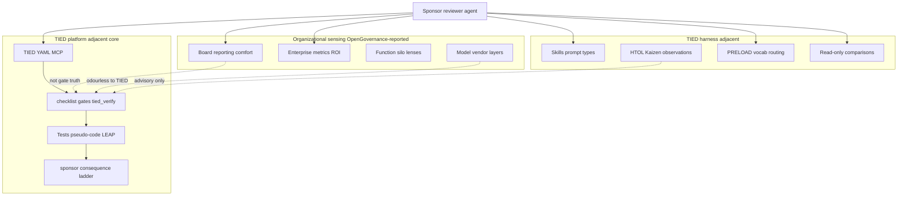

# Open Governance “Cannot Sense” × TIED — agent management lens

| Field | Value |
| --- | --- |
| **Purpose** | Map Tony Fish / Open Governance’s **governance sensing** essay (odourless AI harm, metric greenwash, cropped ontologies, mercaptan design, pattern recognition vs optimisation) to TIED as implemented in this repository—with emphasis on **proof boundaries**, **deliberate observability**, and **sponsor judgment**—not adopting Open Governance as TIED core or certifying board practice. |
| **Audience** | Sponsors, harness authors, prompt-type operators, methodology owners |
| **Source URL** | [We cannot sense what we cannot sense](https://opengovernance.net/we-cannot-sense-what-we-cannot-sense-9e0dd14f5941) (Tony Fish, Nov 2026 — **OpenGovernance-reported**) |
| **Article capture (sibling)** | [open-governance-cannot-sense.md](open-governance-cannot-sense.md) — metadata + TL;DR only; **full text off-repo** |
| **Status / date** | Outreach / analysis snapshot, **2026-11-17** — **reference only; this document does not mint REQ/ARCH/IMPL tokens** |
| **Executable follow-up** | Wave 3 Phase 1 **`REQ-TIED_OPEN_GOVERNANCE_SENSING_WAVE3`** ([compose guide](../../tied-bundle/docs/governance-sensing-proof-boundary-compose.md)); further phases via **`refine-plan`** / **`build-plan`** |
| **Distinct from** | [Ludanyi × TIED](andras-ludanyi-illusion-of-measurement-judgment-cooperation-vs-tied-agent-management.md); [Traefik × TIED](traefik-harness-platform-vs-tied-agent-management.md); [Open Ontologies × TIED](open-ontologies-repository-vs-tied-agent-management.md); [LangChain/Cursor harness × TIED](langchain-harness-engineering-vs-tied-agent-management.md); [HackerNoon observability contract CI × TIED](hackernoon-observability-contract-ci-vs-tied-agent-management.md); [Open Specter × TIED](open-specter-legal-workspace-vs-tied-agent-management.md) |
| **TIED anchors (reference only)** | [AGENTS.md](../../AGENTS.md), [agent-req-implementation-checklist.md](../../tied-bundle/docs/agent-req-implementation-checklist.md), [harness-trace-observation-loop.md](../../tied-bundle/docs/harness-trace-observation-loop.md), [tied-methodology-evaluation-framework.md](../tied-methodology-evaluation-framework.md), [sponsor-agent-relationship.md](../../tied-project/vocab/sponsor-agent-relationship.md), [working-artifact-placement.md](../../tied-bundle/docs/working-artifact-placement.md) |

---

## Executive summary

**Open Governance (Tony Fish)** argues that familiar **governance-by-reporting** fails when harms have **no sensor**: model-layer edits, identical headline scores with edge divergence, agents without stake, green dashboards after desurgence, and **cropped** ontologies that make absences invisible. The essay’s **mercaptan** metaphor asks what we **engineer to be noticeable**; **pattern recognition** is a grown sense that needs friction and permission to be wrong—not something optimisation dashboards preserve (**OpenGovernance-reported**).

TIED’s center of gravity is **software delivery intent** in implementation repos: vocabulary **RESOLVE/RECORD/VALIDATE**, CITDP, REQ → ARCH → IMPL **essence_pseudocode**, checklist gates, MCP **`tied-project/`** YAML, **`tied_verify`** when enrolled, LEAP, sponsor **consequence ladder**, and explicit **`not_measured`** / proof-boundary labeling. TIED does **not** sense all organizational reality; it makes **declared change intent and test-backed claims** inspectable within scope.

**Compose-don’t-replace:** Use Fish’s board questions as **sponsor literacy** for what YAML/gates **cannot** see (vendor model drift, enterprise politics, uncategorized people). Use TIED’s **mercaptan analogs**—gate receipts, skipped/not-run visibility, `tied_config_get_base_path`, diagnostic labels, adversarial inquiry artifacts when enrolled—as **deliberate smell** for the **software traceability** slice only. Never treat absence of alarm in chat or green checklist progress as absence of product or organizational risk.

| Center of gravity | Open Governance essay | TIED (stdd) |
| --- | --- | --- |
| Primary subject | Board/organizational sensing, AI odourless harm | REQ/ARCH/IMPL + tests + gates for **shipped behavior** |
| “Green” signal | Dashboard comfort, ROI triumphs | Token coverage, consistency checks — **not** product quality alone |
| Cropped frame | Silo lenses, row ontologies | `tied-project/vocab/` + token graph — **scoped** to delivery |
| Mercaptan | Who adds smell to AI? | Operator-enforced validate/verify, evidence envelopes |
| Pattern sense | Consurgence, paradox, stories of changing mind | Sponsor judgment + LEAP when stack diverges |
| Agent as sensor | Risk if outsourced to layers-edited models | Harness observes; **gates** remain authoritative |

### Evaluation charter mapping (Q1–Q6)

Per [evaluation framework](../tied-methodology-evaluation-framework.md); Open Governance × TIED cohorts **`not_measured`**.

| Q# | Open Governance signal | TIED surface | Disposition |
| --- | --- | --- | --- |
| **Q1** | Comfortable board papers | Confirmed-finding arm vs defect proxy | **Tension** — comfort ≠ TIED defect rate |
| **Q2** | Desurgence / wrong metric | Fidelity research, Kaizen | **Defer** — no predictor wired |
| **Q3** | Cropped ontology / silo | Stack origin vocabulary → REQ layer | **Composable** (literacy) |
| **Q4** | Pattern recognition stories | Checklist adherence evidence | **Composable** — different artifacts |
| **Q5** | Efficiency that hides cost | Q5 pairs MCP/checklist time with git/PR arms | **Align** on cost-narrative discipline |
| **Q6** | More AI sensing = better governance | Methodology kaizen without weakening proof | **Recommendation-only** |

---

## Source summary (Open Governance claims only)

From sibling [stub](open-governance-cannot-sense.md) (themes **OpenGovernance-reported**; read essay at source URL for wording).

- **Sensor limits:** H₂S can paralyze smell at lethal doses; CO/CO₂ undetectable until harm—metaphor for AI harms without sensory channel.
- **Odourless poisons:** Abliterated weights, fractal training divergence at edges, agents with “nothing to lose,” poisoned pages changing agent behavior.
- **Success-smelling poisons:** Desurgence, wrong metrics → #NOTHING, Aswan/silt parable, numb board when meetings feel easy.
- **Frame outside existence:** Palantír crop, silo lenses, invisible censorship gaps in training data.
- **Mercaptan:** Deliberate engineering of noticeability; incentive question for AI; walled gardens and financial gravity.
- **Walls:** Containment moves risk; air gaps ≠ safety (Stuxnet); regulation sees only named categories.
- **Pattern recognition:** Cassava/cyanide generational pattern; immune drift; paradox vs single-resolution optimisation; AI as possible mercaptan or outsourced nose.
- **Closing questions:** Six board-room prompts on un-sensed harm, mercaptan, model provability, changing mind, cost of green, permission to be wrong.

---

## Relationship to sibling comparisons

| Sibling | What it owns | This document owns |
| --- | --- | --- |
| [Ludanyi × TIED](andras-ludanyi-illusion-of-measurement-judgment-cooperation-vs-tied-agent-management.md) | People/team proxy metrics illusion | **Instrument and frame limits** for AI/governance sensing |
| [Traefik × TIED](traefik-harness-platform-vs-tied-agent-management.md) | Harness vs platform seam | **Epistemic** “cannot sense” vs TIED **artifact** trace plane |
| [Open Ontologies × TIED](open-ontologies-repository-vs-tied-agent-management.md) | Graph plan/apply, cert visibility | **Cropped ontology** metaphor → vocab PRELOAD only |
| [Netflix/NDTP ontology × TIED](netflix-ontology-driven-observability-vs-tied-agent-management.md) | Ops RDF flywheel | Organizational board sensing — **not** ops telemetry |
| [LangChain/Cursor harness × TIED](langchain-harness-engineering-vs-tied-agent-management.md) | Vendor trace metrics | HTOL as optional compose; traces ≠ gate truth |
| [Open Specter × TIED](open-specter-legal-workspace-vs-tied-agent-management.md) | Legal matter UI | Governance **essay**, not legal product |

---

## Harness lessons → TIED agent management

### Odourless harm vs deliberate observability

| Open Governance pattern | TIED surface | Notes |
| --- | --- | --- |
| Cannot smell weight edit | Pinned commits, tests, `tied_verify` when enrolled | **Gap** for vendor model weights |
| Edge divergence, average fine | Composition tests, adversarial inquiry when enrolled | **Composable** — scoped REQ |
| Agent reads poisoned page | Tool safety evaluators, sponsor scope | **Partial align**; not web content provenance core |
| Silence when smell “gone” | Skipped gate / not-run visibility | Compose [Open Ontologies](open-ontologies-repository-vs-tied-agent-management.md) skip pattern |

### Green dashboard / wrong thing measured

| Open Governance pattern | TIED surface | Notes |
| --- | --- | --- |
| #NOTHING when metric wrong | `not_measured`, proof boundary in docs | **Align** labeling discipline |
| Token coverage = done | **`tied_validate_consistency`** ≠ product quality | **Tension** — anti-pattern |
| Checklist all green | Implement-complete needs gate receipts | **Align** charter Q1 |
| Desurgence of conditions | Rush TDD/skip composition | **Tension** — PROC-TIED_DEV_CYCLE |

### Cropped frame / ontology row

| Open Governance pattern | TIED surface | Notes |
| --- | --- | --- |
| Uncategorized → invisible | Unrouted vocab, missing PRELOAD | **Composable** — routing.md |
| Silo lens | Client vs bundle vocab layers | **Align** two-layer vocab |
| Question outside frame | CITDP scope, sponsor questions MCP | **Composable** |

### Mercaptan / walls / pattern recognition

| Open Governance pattern | TIED surface | Notes |
| --- | --- | --- |
| Engineer noticeability | `DEBUG:`/`DIAGNOSTIC:`, gate diagnostics | **Composable** |
| Wall without sense | Banning tools vs gates + MCP seam | **Tension** with Traefik containment critique |
| Pattern from friction | Sponsor stories, LEAP, working folders | **Align** process |
| Outsource sensing to AI | Chat “looks fine” without commands | **Anti-pattern** — HTOL observation only |

---

## Touchpoint 1 — RESOLVE

| Open Governance / essay term | TIED preferred term / surface | Disposition |
| --- | --- | --- |
| **Sense / smell** | Proof boundary, observable evidence | **Composable** |
| **Mercaptan** | Deliberate gate receipt, validate output | **Recommendation-only** metaphor |
| **Desurgence / consurgence** | Conditions for LEAP, sponsor ladder | **Literacy only** |
| **Cropped Palantír** | Merged vs project YAML view; vocab routing | **Composable** |
| **Pattern recognition** | Sponsor judgment, adversarial findings (when enrolled) | **Tension** with automation |
| **Board comfort** | Sparse tracker / outreach gate honesty | **Composable** |
| **Agentic poisoned page** | Scoped fetch, comparison skill read-only | **Defer** vendor fleet |
| **Nothing to lose (AI)** | Agency boundary, consequence ladder | **Align** |
| **Green dashboard** | Verify-derived status when enrolled | **Tension** |

### Disposition key

| Disposition | Meaning |
| --- | --- |
| **Align** | TIED already encodes the intent for **software delivery** scope. |
| **Composable** | Combine literacy or doc patterns without equivalence. |
| **Tension** | Partial overlap; proof boundary required. |
| **Gap** | Essay emphasis outside TIED core. |
| **Defer** | Enterprise board, model supply chain, client infra. |

---

## Primary capability matrix

| Concern | Open Governance COG | TIED COG | Disposition | Rationale |
| --- | --- | --- | --- | --- |
| Un-sensed organizational harm | Board reporting blind spots | Client process | **Defer** | TIED not enterprise GRC |
| Un-sensed **software** intent drift | N/A (essay) | IMPL + tests + LEAP | **Align** | Scoped delivery |
| Model weight / layer edit | Odourless safety layer | Harness model choice | **Gap** | No weight provenance in TIED |
| Metric greenwashing | ROI / efficiency | Token/checklist metrics | **Tension** | Label proof boundary |
| Cropped category ontology | Enterprise row types | `[REQ-*]` + vocab | **Composable** | Different domain |
| Mercaptan design | Who adds AI smell? | Validate, verify, receipts | **Composable** | Slice-specific |
| Agent outsourced sensing | Hand nose to AI | Gates + sponsor branch | **Align** anti-pattern |
| Skipped / silent validation | #NOTHING alarms | Skipped visibility compose | **Composable** |
| Containment wall | Air gap fantasy | MCP seam discipline | **Composable** with Traefik |
| Pattern / paradox thinking | Hold dual readings | Pseudo-code + sponsor | **Composable** |
| Permission to be wrong | Consurgence conditions | Costly vs reversible choice | **Align** ladder |
| Public fear vs slow harm | Headline asymmetry | `not_measured` in outreach | **Align** |
| Comparison as governance | Medium essay series | `external-service-comparison` | **Composable** |
| Effectiveness proof | Narrative | Evaluation charter arms | **Defer** / **not_measured** |

---

## Authority boundary

Organizational **sensing** and vendor **model layers** sit **outside** TIED’s authoritative core. TIED clients may **compose** mercaptan-style discipline (show skips, require receipts) while keeping **REQ graph truth** and **gates** on the TIED/checklist plane.

---

## Anti-patterns (Open Governance lessons → TIED risk)

| Risk | Symptom | TIED-oriented remedy |
| --- | --- | --- |
| Smell gone = safe | Chat calm after failed smell test | Sponsor story + test evidence |
| Green checklist = shipped quality | Tokens present, behavior wrong | **`tied_verify`**, tests |
| YAML consistent = product correct | Validate pass only | Proof boundary labels |
| Agent as sole sensor | No command output cited | Executable matrix, gate receipts |
| Cropped vocab | Wrong PRELOAD, missing concepts | **RESOLVE** routing |
| Wall instead of sense | Disable MCP “for security” | Seam discipline, not blind walls |
| Comparison mints REQ | Tokens in markdown | **`add-feature`** only |
| HTOL observation = gate pass | Trace review as implement-complete | [harness trace loop](../../tied-bundle/docs/harness-trace-observation-loop.md) |
| Outreach comfort | DOC tracker ignored sparse gates | Honest **blocked** pre_implementation on outreach |

---

## Compose-don’t-replace table

| Tune with Open Governance-inspired practice | Keep TIED authority |
| --- | --- |
| Ask “what harm has **no signal** in our reporting?” | Scope to **software change** + enrolled verify |
| Mercaptan for model/agent drift (client) | **`tied_config_get_base_path`**, pinned deps in client CI |
| Board “last time data said fine but we changed mind” | Sponsor **costly choice** documentation |
| Pattern recognition / paradox literacy | LEAP when code/tests diverge from IMPL |
| Deliberate **skipped** visibility | Gate diagnostics, Open Ontologies compose pattern |
| Read-only external comparisons | Wave 1–2 proof boundary |
| Fish’s six closing questions in sponsor charter | Not substitute for **`tied_validate_consistency`** |

---

## Bounded operator recommendations (Recommendation-only)

1. **Scope the smell** — Use TIED mercaptan analogs only for **traceable delivery**: tests, gates, validate output, evidence envelopes—not board packs or model cards unless client REQ says so.
2. **Label odourless zones** — In CITDP, list what TIED **cannot** sense (vendor weights, production traffic, HR outcomes) beside what it **can** (REQ→code links).
3. **Never outsource the nose** — Agent summaries do not replace **`tied_checklist_gate_validate`** / **`tied_verify`** receipts for implement-complete claims.
4. **Comfort check** — If many turns pass with no uneasy sponsor review on costly choices, treat as **OpenGovernance-reported** signal to revisit scope—not as TIED success.
5. **Pair essays** — Read [Ludanyi × TIED](andras-ludanyi-illusion-of-measurement-judgment-cooperation-vs-tied-agent-management.md) for **people metrics**; this doc for **instrument/frame** limits.
6. **Capture method** — Cloudflare-blocked sources: **`agent-browser read`** or sponsor paste; store receipt under `tied-project/working/DOC-*/evidence/`.

---

## Phased recommendations (doc-first)

| Phase | Action | Status |
| --- | --- | --- |
| **0** | Wave 1 capture + this analysis + allowlist | **Done** (2026-11-17) |
| **1** | [governance-sensing-proof-boundary-compose.md](../../tied-bundle/docs/governance-sensing-proof-boundary-compose.md) + client-development-index Quick reads + odourless checklist | **Implemented** ([REQ-TIED_OPEN_GOVERNANCE_SENSING_WAVE3](../../tied-project/requirements/REQ-TIED_OPEN_GOVERNANCE_SENSING_WAVE3.yaml)) |
| **2** | Vocab RECORD (`desurgence`, `mercaptan` as governance metaphor) | **Defer** (sponsor) |
| **3** | [methodology-composition-matrix.md](methodology-composition-matrix.md) row | **Defer** |
| **3** | Enroll Open Governance themes in evaluation corpus | **OutOfScope** unless sponsor scopes experiment |

---

## Explicit non-adoptions

- Open Governance / Tony Fish essay series as authoritative TIED methodology source
- Board comfort heuristics as **`tied_verify`** substitutes
- Organizational ontology (claimant/patient row) as replacement for **`tied-project/vocab/`**
- AI-as-mercaptan vendor narrative as TIED effectiveness proof (**`not_measured`**)
- Containment-only security posture as substitute for MCP seam + gates
- Minting `[REQ-*]` / `[ARCH-*]` / `[IMPL-*]` from this comparison prose
- Treating `tied_validate_consistency` as sensing **all** AI organizational harm

---

## Proof boundary

- Essay claims are **OpenGovernance-reported**; linked prior posts and research are **not** independently verified in stdd.
- TIED surfaces cited describe **TIED-existing** behavior at authoring time; composability does not deploy Open Governance tooling in stdd.
- Wave 3 behavior changes require normal TIED workflows (**add-feature**, **build-plan**, LEAP, tests)—not comparison markdown alone.
- Full essay is **not** stored in-repo; analysis was authored from an off-repo read. No organizational or model runtime experiments (**`static_only`**).
- Wave 3 Phase 1 **`REQ-TIED_OPEN_GOVERNANCE_SENSING_WAVE3`** minted project YAML for doc-compose; run **`tied_validate_consistency`** after further edits.

---

## Related documents

- [Article capture (sibling)](open-governance-cannot-sense.md)
- [External three-wave comparison template](../../tied-bundle/docs/external-service-three-wave-comparison-template.md)
- [Working plan](../../tied-project/working/DOC-OPEN-GOVERNANCE-CANNOT-SENSE-COMPARISON/PLAN-refine-pass1.md)
- [Ludanyi × TIED (sibling)](andras-ludanyi-illusion-of-measurement-judgment-cooperation-vs-tied-agent-management.md)
- [Traefik harness/platform × TIED (sibling)](traefik-harness-platform-vs-tied-agent-management.md)
- [Open Ontologies × TIED (sibling)](open-ontologies-repository-vs-tied-agent-management.md)
- [Governance sensing proof-boundary compose](../../tied-bundle/docs/governance-sensing-proof-boundary-compose.md) ([REQ-TIED_OPEN_GOVERNANCE_SENSING_WAVE3](../../tied-project/requirements/REQ-TIED_OPEN_GOVERNANCE_SENSING_WAVE3.yaml))
- [Harness trace observation loop](../../tied-bundle/docs/harness-trace-observation-loop.md)
- [Agent req implementation checklist](../../tied-bundle/docs/agent-req-implementation-checklist.md)