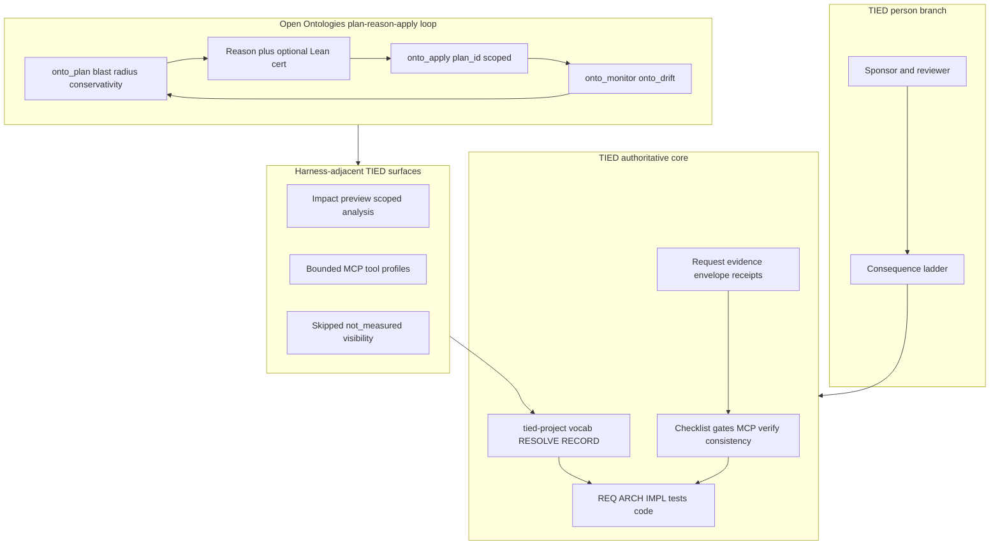

# Open Ontologies × TIED — agent management lens

| Field | Value |
| --- | --- |
| **Purpose** | Map the **Open Ontologies** Rust ontology engine (plan/apply lifecycle, MCP/CLI tool surface, Lean derivation certificates, CI skip visibility) to TIED as implemented in this repository—with emphasis on **traceability**, **evidence**, **bounded tool profiles**, and **sponsor authority**—not adopting RDF/OWL as TIED core or certifying upstream outcomes. |
| **Audience** | Sponsors, ontology/KGM practitioners, harness authors, prompt-type operators, methodology owners |
| **Source** | Local read-only inspection of `open-ontologies-main` (**2026-10-23**). Upstream: [fabio-rovai/open-ontologies](https://github.com/fabio-rovai/open-ontologies). [Repository capture (sibling)](open-ontologies-repository.md) |
| **Evidence boundary** | stdd did **not** run target `cargo test`, Lean checkers, MCP `serve`, or CI workflows during authoring. Metrics and badges in upstream README are **Tesseract-reported**, **not_measured** in stdd. |
| **Status / date** | Outreach / analysis snapshot, **2026-10-23** — **reference only; this document does not mint REQ/ARCH/IMPL tokens** |
| **Executable follow-up** | Wave 3 candidates in § Phased recommendations (**Defer** until scoped **add-feature** / **build-plan**) |
| **Distinct from** | [Heimsbakk × TIED](veronika-heimsbakk-ai-generated-ontologies-vs-tied-agent-management.md) (essay/meaning ownership); [AI-SDLC factory × TIED](ai-sdlc-atdd-software-factory-vs-tied.md) (executable spec, run records); [Traefik × TIED](traefik-harness-platform-vs-tied-agent-management.md) (harness/platform seam); [LangChain × TIED](langchain-harness-engineering-vs-tied-agent-management.md) (trace/benchmark harness) |
| **TIED anchors (reference only)** | [AGENTS.md](../../AGENTS.md), [agent-req-implementation-checklist.md](../../tied-bundle/docs/agent-req-implementation-checklist.md), [processes.md](../../tied-bundle/docs/processes.md), [pseudocode-writing-and-validation.md](../../tied-bundle/docs/pseudocode-writing-and-validation.md), [vocabulary-layer-tied-leap-citdp.md](../../tied-bundle/docs/vocabulary-layer-tied-leap-citdp.md), [sponsor-agent-relationship.md](../../tied-project/vocab/sponsor-agent-relationship.md), [external-service-three-wave-comparison-template.md](../../tied-bundle/docs/external-service-three-wave-comparison-template.md) |

---

## Executive summary

**Open Ontologies** centers on **production RDF/OWL change management** with an agent-facing loop: generate or load graphs, validate and reason, optionally emit **Lean-checkable derivation certificates**, and apply **Terraform-style** plan/enforce/apply/monitor/drift cycles with persisted `plan_id`, blast-radius scoring, and optional conservativity analysis. A **large MCP tool surface** (122 tools in `docs/tool-reference.md` at default profile; **110** in bundled `SKILL.md` — **target-repo-observed doc drift**) sits on Oxigraph + SQLite with strict documentation of **what green checks prove and do not prove**.

TIED’s center of gravity is **software intent traceability** in client repos: vocab **RESOLVE/RECORD**, CITDP change definition, REQ → ARCH → IMPL **essence_pseudocode** with block token comments, checklist **pre_implementation** gates, MCP-first **project** YAML writes, **`tied_validate_consistency`**, verification-gated **`tied_verify`**, LEAP on divergence, request **evidence envelopes**, adversarial inquiry when enrolled, and the sponsor **consequence ladder**. TIED is **SKOS-adjacent** at the vocabulary layer and **does not** ship an OWL reasoner or ontology plan/apply engine.

**Compose-don’t-replace:** Borrow **pre-change impact preview**, **independent checkable evidence**, **session-scoped plan/apply identity**, **explicit skipped/not-run validation visibility**, and **bounded MCP profiles** as **harness-adjacent** and **process** patterns. Keep **semantic token authority**, **checklist gate receipts**, **MCP YAML graph truth**, and **sponsor costly choices** on the TIED plane. Do not treat Lean certificate success as **`tied_validate_consistency`** or domain correctness.

| Center of gravity | Open Ontologies (target repo) | TIED (this repo) |
| --- | --- | --- |
| Primary artifact | RDF/OWL graphs, plans, certificates | `[REQ-*]` / `[ARCH-*]` / `[IMPL-*]` YAML + pseudo-code + tests |
| Change preview | `onto_plan`, blast radius, conservativity opt-in | CITDP impact, `tied_plumb_diff_impact_preview`, scoped analysis |
| Apply boundary | Stored `plan_id`, session-scoped defaults | Checklist gates, LEAP, git + working folders |
| Reviewer evidence | Lean `oo-cert`, CI gate tables, differential tests | Gate receipts, envelopes, claims-evidence review |
| Agent interface | 100+ `onto_*` MCP tools | Bounded TIED YAML MCP + prompt-type skills |
| Domain truth claim | Explicitly **not** claimed by certificates/README | Consistency/traceability **not** domain correctness |

---

## Source summary (target claims only)

Bullets summarize sibling [repository capture](open-ontologies-repository.md) and upstream docs as read **2026-10-23**. Unless reproduced in stdd, label **Tesseract-reported** or **target-repo-observed**.

- **Product pitch:** Plan ontology changes, see consequences before apply; give reviewers checkable proof without trusting the author (**Tesseract-reported** in README).
- **Single binary:** Rust CLI + MCP + optional Studio; in-memory Oxigraph; no JVM (**target-repo-observed**).
- **Lifecycle:** Plan → enforce → apply → monitor → drift loop; complete desired-state Turtle semantics; risk scoring; locked IRIs; optional conservativity block (**target-repo-observed** in `docs/lifecycle.md`).
- **Certificates:** Forward-chaining reasoner can write `oo-cert/1`; Lean theorem `OOCert.certificate_sound`; scope/temporal selection constraints documented (**target-repo-observed**).
- **Terraform analogy intentional:** README states plan is **semantic**, not just structural SHAPE-only (**Tesseract-reported**).
- **Tool inventory:** `docs/tool-reference.md` — **122 tools** default profile; eight tools gated by optional Cargo features (**target-repo-observed**).
- **CI transparency:** `docs/ci-gates.md` — strict vs skip vs not-run matrix; `OO_REQUIRE_FIXTURES=1` fails closed when fixtures required (**target-repo-observed**).
- **Honesty on limits:** Unsatisfiability guarantees partial; prover opinions vs measured properties distinguished in README (**target-repo-observed**).

---

## Relationship to sibling comparisons

| Sibling | What it owns | This document owns |
| --- | --- | --- |
| [Heimsbakk × TIED](veronika-heimsbakk-ai-generated-ontologies-vs-tied-agent-management.md) | **Meaning ownership** for LLM-generated OWL; conversation before syntax | **Executable engine**: plan/apply, certs, MCP lifecycle, CI gates |
| [AI-SDLC factory × TIED](ai-sdlc-atdd-software-factory-vs-tied.md) | Protected Gherkin/contracts, run records, reconstruction | **Graph change planning** and **derivation certificates** — not PetClinic ATDD |
| [Traefik × TIED](traefik-harness-platform-vs-tied-agent-management.md) | Harness vs **platform** seam (auth, fleet) | Not ingress/middleware product comparison |
| [LangChain × TIED](langchain-harness-engineering-vs-tied-agent-management.md) | Trace-driven harness tuning | Not LangSmith benchmark loops |
| [TIED vs well-known methodologies](tied-vs-well-known-methodologies.md) | Broad methodology map | **Single external ontology engine repo** with formal evidence story |

Cross-link Heimsbakk when operators conflate **SKOS-adjacent TIED vocab** with **enterprise OWL engineering**; cross-link factory when comparing **durable evidence artifacts** (certificates vs run records).

---

## Harness lessons → TIED agent management

### Plan-before-apply vs CITDP + checklist gates

| Open Ontologies pattern | TIED surface | Notes |
| --- | --- | --- |
| `onto_plan` with blast radius / risk | CITDP **impact-discovery**, **risk-assessment** | Different artifact (RDF delta vs token graph) |
| Persisted `plan_id` across invocations | Working folders, committed PLAN, envelope lineage | **Partial align** on durable plan identity |
| Session-scoped “most recent plan” | Per-request token / envelope scope | **Recommendation-only** to avoid cross-session apply |
| Complete desired-state semantics | LEAP + explicit scope in CITDP | **Tension** — Terraform metaphor ≠ YAML replace semantics |

### Certificates and independent verification

| Open Ontologies pattern | TIED surface | Notes |
| --- | --- | --- |
| Lean `oo-cert` on derivations | Claims-evidence review, gate receipts | **Composable** proof objects |
| Reviewer runs checker without trusting author | Sponsor **person branch** | **Align** on agency boundary |
| Certificate scope / temporal selection | Envelope provenance fields | **Gap** for cert-shaped imports — Wave 3 **Defer** |
| “Green cert” ≠ domain truth | Proof boundary in QA vocab | **Align** (anti-pattern parity) |

### Large MCP surface vs bounded TIED MCP

| Open Ontologies pattern | TIED surface | Notes |
| --- | --- | --- |
| 122 `onto_*` tools (tool reference) | TIED YAML MCP tool set + skills | **Tension** — scale vs bounded write surface |
| Optional feature-gated tools | Tool availability / diagnostics | **Partial align** with explicit errors when missing |
| Profile floors (`onto_status`, validate, load…) | Session bootstrap, `tied_config_get_base_path` | **Composable** operator visibility |
| SKILL.md agent workflow | Prompt-type skills, PRELOAD routing | Harness-adjacent loop, not ontology core |

### CI skip visibility vs verification-gated TIED

| Open Ontologies pattern | TIED surface | Notes |
| --- | --- | --- |
| `skip_unless` / `OO_REQUIRE_FIXTURES=1` | Checklist gates, **`tied_verify`** when enrolled | Target documents **skipped** legs loudly |
| `docs/ci-gates.md` maintenance table | Gate diagnostics in MCP | **Recommendation-only**: surface **not_measured** skips in operator UX |
| Differential Rust/Python/Lean tests | Adversarial inquiry at integrated depth | Different artifacts; both reject silent shrink |

### Meaning ownership (compose with Heimsbakk)

| Open Ontologies pattern | TIED surface | Notes |
| --- | --- | --- |
| SHACL/OWL validation on loaded graph | `pseudocode_validate`, vocab discipline | Validates **shape**, not sponsor intent |
| Conservativity opt-in on plans | Vocab **RESOLVE** before token mint | Heimsbakk **Align** — conversation before authoritative graph |
| LLM generate–validate–iterate (`SKILL.md`) | Agent drafts vs RECORD | Draft until sponsor RECORD |

---

## Touchpoint 1 — RESOLVE

| Target term | TIED preferred term / surface | Notes |
| --- | --- | --- |
| **onto_plan / onto_apply** | CITDP + checklist **pre_implementation** | Metaphor only |
| **plan_id** | Working token + envelope / gate receipt ids | Do not alias into `[REQ-*]` |
| **Lean certificate** | Independent evidence artifact | Not universal TIED verifier |
| **122 / 110 MCP tools** | Bounded MCP profile | Document drift; no stdd canonical count |
| **Terraform lifecycle** | Git + LEAP + gates | **Defer** full semantics adoption |
| **Oxigraph store** | — | **Defer** — not TIED core |
| **SHACL / OWL reasoner** | Vocab + pseudo-code validation | Heimsbakk non-OWL boundary |
| **Semantic impact preview** | `tied_plumb_diff_impact_preview` | **Recommendation-only** exploration |

**RESOLVE charter (this comparison):** Canonicalizes **names and mappings** only; does not change sponsor intent authority or mint TIED tokens from comparison prose.

### Disposition key

| Disposition | Meaning |
| --- | --- |
| **Align** | TIED materially represents the external intent (scoped). |
| **Composable** | Combine without equivalence claims. |
| **Tension** | Partial overlap; proof boundary must be explicit. |
| **Gap** | External emphasis not in TIED core as-is. |
| **Defer** | Product, client infra, or sponsor-owned choice. |

### Claim labeling

| Label | Use when |
| --- | --- |
| **target-repo-observed** | Structure/docs read from local target tree during authoring |
| **Tesseract-reported** | Upstream README/marketing claims not re-run in stdd |
| **TIED-existing** | Committed docs/tools in stdd (reference existing tokens in prose only) |
| **Recommendation-only** | Operator suggestions not yet enforced by gates |
| **`not_measured`** | Whether adopting target patterns improves TIED client outcomes |

---

## Primary capability matrix

| Concern | TIED COG | Disposition | One-line rationale |
| --- | --- | --- | --- |
| Pre-change impact preview | `tied_plumb_diff_impact_preview`, CITDP impact | **Partial align** | RDF plan vs REQ graph |
| Plan / apply / rollback narrative | Checklist + LEAP + git | **Composable** | Useful metaphor; not equivalent |
| Lean derivation certificates | Claims-evidence, gate receipts | **Composable** | Different proof object |
| Independent cert verification | Sponsor/reviewer person branch | **Align** | Reject “trust the author” |
| Lineage + drift detection | Git, source graph, LEAP | **Tension** | RDF drift ≠ code drift without adapter |
| Bounded MCP tool surface | Tool input compatibility, skill boundaries | **Partial align** | TIED bounds writes; target scales read/write tools |
| CI skip visibility | Verification-gated mode, gate diagnostics | **Gap** → doc recommendation | Make skipped states visible to operators |
| Adversarial / differential tests | Adversarial inquiry when integrated | **Tension** | Target CI vs TIED inquiry artifacts |
| SHACL / OWL validation | Pseudocode validate, vocab discipline | **Tension** | Spec shape vs intent ownership |
| Meaning ownership before mint | Vocab RESOLVE/RECORD | **Align** | Cross-link Heimsbakk |
| Session-scoped plan identity | Request evidence envelope, working token | **Partial align** | Prevent cross-session apply confusion |
| Executable spec run records | AI-SDLC factory comparison | **Composable** | Evidence crosswalk only |
| Terraform for all TIED changes | — | **Defer** | Non-adoption |
| `tied_validate_consistency` = domain truth | — | **Align** (anti-pattern) | Match target cert scope limits |

---

## Authority boundary

The ontology engine’s **RDF store, reasoner, and 122-tool MCP plane** sit **outside** TIED’s authoritative core. TIED clients may **compose** preview, evidence, and visibility patterns while keeping **token graph** and **gate** authority on the TIED/checklist plane.

---

## Anti-patterns (target lessons → TIED risk)

| Risk | Symptom | TIED-oriented remedy |
| --- | --- | --- |
| Cert green = domain truth | Ship ontology because Lean passed | Proof boundary; sponsor review; **`not_measured`** for domain fit |
| Plan/apply without intent | Blast radius low but semantics shift | Vocab RESOLVE; Heimsbakk blueprint; costly choices on scope |
| 122-tool MCP without profile | Agent calls wrong `onto_*` surface | Bounded tool docs; PRELOAD; client MCP allowlists |
| Silent CI skip success | Green workflow, skipped Lean leg | Mirror `OO_REQUIRE_FIXTURES` honesty in gate diagnostics |
| Terraform metaphor overreach | Treat REQ YAML like complete desired-state delete | CITDP scope; LEAP; no omission-as-deletion without sponsor |
| Comparison prose mints REQ | New tokens in markdown | Wave 3 via **add-feature** only |
| OWL stack replaces TIED | Drop CITDP for SHACL-only | **Compose-don’t-replace**; non-adoptions below |
| Cross-session plan apply | Wrong session’s `plan_id` | Envelope/session binding **Recommendation-only** |

---

## Compose-don’t-replace: tune ontology-engine discipline vs keep TIED authority

| Tune with **Open Ontologies-inspired** practice (harness/process) | Keep **TIED** authority |
| --- | --- |
| Semantic pre-change preview before apply | CITDP impact + sponsor scope approval |
| Checkable evidence bundles for reviewers | Gate receipts + envelope — not Lean as sole gate |
| Explicit skipped / not-run validation states | **`tied_verify`** + checklist when enrolled |
| Session-scoped plan/apply identity | Working token + envelope lineage |
| Differential testing culture (Rust/Python/Lean) | Adversarial inquiry when **integrated** depth applies |
| Generate–validate–iterate agent loops | Draft vocab/IMPL until RECORD and RED tests |
| RDF lifecycle in **client** KG repos | **REQ/ARCH/IMPL** graph in **tied-project/** |

---

## Bounded operator recommendations (Recommendation-only)

1. **Pre-change impact preview** — **TIED-existing:** use `tied_plumb_diff_impact_preview` and CITDP impact discovery before large YAML edits; **Gap:** no RDF-shaped plan artifact in TIED core (**not_measured** for ontology repos).
2. **Portable evidence bindings** — **Recommendation-only:** when exporting gate or inquiry results, align field names with certificate-style “asserted vs derived” separation for sponsor review; Wave 3 import **Defer**.
3. **Session plan/apply identity** — **Partial align:** bind working-folder token and envelope to a single agent session before destructive apply operations in client automation.
4. **Tool-surface profiles** — **TIED-existing:** document which MCP tools mutate project YAML vs read-only; **Recommendation-only:** client policy mirroring target “profile floor” pattern for non-TIED MCP servers.
5. **Skipped / not_measured visibility** — **Gap:** checklist UX could echo `docs/ci-gates.md` strict vs skip table for operator-facing diagnostics (**Recommendation-only**).
6. **Heimsbakk cross-read** — **TIED-existing:** require vocab RESOLVE before bulk token mint; use Open Ontologies only as **external** KG tooling, not meaning authority.
7. **Factory cross-read** — **Composable:** compare Lean certificates to factory run records as **evidence shapes**, not interchangeable gates.

---

## Phased recommendations (doc-first)

| Phase | Action | Status |
| --- | --- | --- |
| **0** | Repository capture + this analysis + `.gitignore` allowlist | **Done** (2026-10-23 build-plan) |
| **1** | Optional bundle cross-link from [vocabulary-layer-tied-leap-citdp.md](../../tied-bundle/docs/vocabulary-layer-tied-leap-citdp.md) | **Defer** |
| **2** | Project vocab RECORD (`ontology plan apply`, `derivation certificate`) | **Defer** (costly) |
| **3** | `methodology-composition-matrix.md` row | **Defer** |
| **3** | Certificate-shaped fields in request evidence envelope | **Defer** — **add-feature** |
| **3** | Client profile: semantic diff preview for non-YAML assets | **Partial** — `change-impact-profile.v1` + **impact-preview.v2** via [REQ-TIED_OPEN_ONTOLOGIES_WAVE3](../../tied-project/requirements/REQ-TIED_OPEN_ONTOLOGIES_WAVE3.yaml) (path/glob legs; **not_measured** semantics) |
| **3** | Request evidence envelope `independent_proofs[]` | **Done** — [REQ-TIED_OPEN_ONTOLOGIES_WAVE3](../../tied-project/requirements/REQ-TIED_OPEN_ONTOLOGIES_WAVE3.yaml) |
| **3** | Integrate Open Ontologies MCP as optional client tool | **Defer** — sponsor-owned infra |

---

## Explicit non-adoptions

- RDF/OWL/SHACL **as TIED methodology core** or replacement for `[REQ-*]` / `[ARCH-*]` / `[IMPL-*]`
- **122-tool** (or 110-tool) ontology MCP surface as the default TIED agent toolchain
- **Lean 4** as universal TIED verifier (certificates are **target-repo-observed** evidence for **derivations**, not stdd gates)
- **Terraform complete-desired-state semantics** for all TIED YAML or git changes
- Claiming **domain correctness** from **`tied_validate_consistency`** green (same anti-pattern as over-reading Lean certs)
- Running target **`cargo test`** or CI as proof of TIED methodology effectiveness (**`not_measured`**)
- Minting new `[REQ-*]` / `[ARCH-*]` / `[IMPL-*]` records from this comparison prose

---

## Proof boundary

- Upstream claims, star counts, and demo narratives are **Tesseract-reported** or **target-repo-observed**. They are **not** stdd checklist results, **`tied_verify`** outcomes, or independently reproduced Lean runs in this wave unless explicitly noted.
- TIED surfaces cited describe **TIED-existing** committed behavior at authoring time; composability does not implement Open Ontologies inside stdd.
- Wave 3 behavior changes require normal TIED workflows (**add-feature**, **build-plan**, LEAP, tests)—not comparison markdown alone.
- stdd did **not** execute the target test suite, Lean checkers, or MCP server during authoring of these documents.
- **`tied_validate_consistency`** was **not** run — project YAML unchanged; out of scope for this doc-only bundle.

---

## Related documents

- [Repository capture (sibling)](open-ontologies-repository.md)
- [External three-wave comparison template](../../tied-bundle/docs/external-service-three-wave-comparison-template.md)
- [Heimsbakk × TIED (sibling)](veronika-heimsbakk-ai-generated-ontologies-vs-tied-agent-management.md)
- [AI-SDLC factory × TIED (sibling)](ai-sdlc-atdd-software-factory-vs-tied.md)
- [Traefik harness × TIED (sibling)](traefik-harness-platform-vs-tied-agent-management.md)
- [LangChain harness × TIED (sibling)](langchain-harness-engineering-vs-tied-agent-management.md)
- [TIED vs well-known methodologies](tied-vs-well-known-methodologies.md)
- [Working plan](../../tied-project/working/DOC-OPEN-ONTOLOGIES-COMPARISON/PLAN-refine-pass1.md)
- [Agent req implementation checklist](../../tied-bundle/docs/agent-req-implementation-checklist.md)
