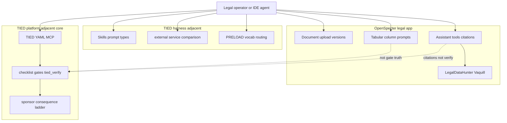

# Open Specter × TIED — agent management + legal product lens

| Field | Value |
| --- | --- |
| **Purpose** | Map **Open Specter** (legal matter workspace, tabular extraction, workflow library, citation-backed assistant) to TIED as implemented in this repository—with emphasis on **dual center-of-gravity** (legal SaaS vs software traceability harness), **proof boundaries**, and **compose-don’t-replace**—not adopting Open Specter as TIED core or legal authority. |
| **Audience** | Sponsors, legal-tech operators, harness authors, prompt-type operators, methodology owners |
| **Source URL** | [QuanteraAI/OpenSpecter](https://github.com/QuanteraAI/OpenSpecter) @ `b29bdf9e` (2026-11-17 capture) |
| **Article capture (sibling)** | [open-specter-legal-workspace.md](open-specter-legal-workspace.md) — read-only; **reference only** |
| **Status / date** | Outreach / analysis snapshot, **2026-11-17** — **reference only; this document does not mint REQ/ARCH/IMPL tokens** |
| **Executable follow-up** | Wave 3 **Defer** (§ Phased recommendations); behavior changes only via **`add-feature`** / **`build-plan`** |
| **Distinct from** | [morluto/rea × TIED](morluto-rea-reverse-engineering-vs-tied-agent-management.md); [Google agent skills × TIED](google-agent-skills-vs-tied-agent-management.md); [Persante SDD × TIED](persante-sdd-skills-vs-tied-agent-management.md); [Apache Ossie × TIED](apache-ossie-vs-tied-agent-management.md); [AI-SDLC factory × TIED](ai-sdlc-atdd-software-factory-vs-tied.md); [Traefik harness/platform × TIED](traefik-harness-platform-vs-tied-agent-management.md) |
| **TIED anchors (reference only)** | [AGENTS.md](../../AGENTS.md), [agent-req-implementation-checklist.md](../../tied-bundle/docs/agent-req-implementation-checklist.md), [external-service-three-wave-comparison-template.md](../../tied-bundle/docs/external-service-three-wave-comparison-template.md), [tied-methodology-evaluation-framework.md](../tied-methodology-evaluation-framework.md), [sponsor-agent-relationship.md](../../tied-project/vocab/sponsor-agent-relationship.md), [harness-trace-observation-loop.md](../../tied-bundle/docs/harness-trace-observation-loop.md) |

---

## Executive summary

**Open Specter** centers on **legal work product**: matters (`projects`), versioned client documents, **tabular reviews** that run column prompts across batches, a large library of **practice-tagged workflows** (assistant and tabular types), and an assistant that cites documents and calls tools like **`generate_docx`** for deliverables. Optional **LegalDataHunter** and **Vaquill** routes add external research with operator-supplied keys (**OpenSpecter-reported** / **target-repo-observed**).

TIED’s center of gravity is **software delivery intent** in implementation repos: vocabulary **RESOLVE/RECORD/VALIDATE**, CITDP, REQ → ARCH → IMPL **essence_pseudocode**, checklist gates, MCP **`tied-project/`** YAML, **`tied_verify`** when enrolled, LEAP, and the sponsor **consequence ladder**. TIED is **not** a legal matter system and does **not** certify legal citations or research results.

**Compose-don’t-replace:** Treat Open Specter’s workflows and tabular columns as **domain procedure libraries** and citation UI as **evidence-discipline UX** parallels—useful for operators who run both a legal workspace and TIED clients. Keep **token graph authority**, **gate receipts**, and **checklist verification** on the TIED plane. Never equate tabular cell output or legal citations with **`tied_verify`** or REQ satisfaction.

| Center of gravity | Open Specter | TIED (stdd) |
| --- | --- | --- |
| Primary artifact | Matter docs, tabular cells, chat transcripts, generated DOCX | REQ/ARCH/IMPL YAML + pseudo-code + tests |
| Procedure packaging | `prompt_md`, `columns_config`, builtin legal templates | Skills, prompt-types, checklist slugs |
| “Truth” claim | Document-grounded legal assistance (**not_measured** here) | Traceable **software behavior** intent |
| Multi-tenant model | Supabase RLS + sharing | Per-repo `tied-project/` + MCP base path |
| Agent/runtime | In-app LLM + tools | IDE agents + TIED YAML MCP + external comparisons |

### Evaluation charter mapping (Q1–Q6)

Per [evaluation framework](../tied-methodology-evaluation-framework.md); Open Specter × TIED cohorts **`not_measured`**.

| Q# | Open Specter signal | TIED surface | Disposition |
| --- | --- | --- | --- |
| **Q1** | “Green” tabular fill or confident chat answer | Confirmed-finding arm vs defect proxy | **Tension** — UI success ≠ TIED defect rate |
| **Q2** | Wrong extraction → matter risk | Fidelity research, LEAP | **Defer** — no predictor wired |
| **Q3** | Error in column prompt vs wrong source doc | Stack origin vocabulary → REQ layer | **Composable** (literacy only) |
| **Q4** | Workflow template used consistently | Checklist adherence evidence | **Composable** — different artifacts |
| **Q5** | LLM + research API cost per matter | Q5 pairs MCP/checklist time with git/PR arms | **Align** on cost narrative discipline |
| **Q6** | More builtin workflows = “better” product | Methodology kaizen without weakening proof | **Recommendation-only** |

---

## Source summary (Open Specter claims only)

From sibling [capture](open-specter-legal-workspace.md). **OpenSpecter-reported** or **target-repo-observed**.

- **Features:** Projects, documents, assistant, tabular reviews, workflows, activity, shortcuts, voice (**OpenSpecter-reported**).
- **Legal research:** LegalDataHunter (178 jurisdictions), Vaquill (**OpenSpecter-reported**).
- **Fork:** Mike AGPL baseline; Quantera UI + guest mode + extra templates (**OpenSpecter-reported**).
- **Stack:** Next 16, React 19, Express API, Supabase, R2/local storage (**OpenSpecter-reported**).
- **Builtin workflows:** 24 `builtin-*` ids in frontend registry (**target-repo-observed**).
- **Tools:** `generate_docx`, `read_document`, `edit_document`; citation rules in system prompt (**target-repo-observed**).
- **Proxy layout:** FastAPI `server.py` → Node backend (**target-repo-observed**).
- **License:** AGPL-3.0 (**target-repo-observed**).

---

## Relationship to sibling comparisons

| Sibling | What it owns | This document owns |
| --- | --- | --- |
| [morluto/rea × TIED](morluto-rea-reverse-engineering-vs-tied-agent-management.md) | RE MCP, binary Evidence | **Legal matter workspace**, tabular legal extraction |
| [Google / Persante skills × TIED](google-agent-skills-vs-tied-agent-management.md) | Shipping skills in dev repos | **In-app workflow editor**, legal builtin library |
| [Apache Ossie × TIED](apache-ossie-vs-tied-agent-management.md) | Analytics semantic interchange | **Document batch Q&A tables**, not KPI YAML |
| [AI-SDLC factory × TIED](ai-sdlc-atdd-software-factory-vs-tied.md) | Factory TDD pipeline | **Legal review UI**, not unit-test factory |
| [Netflix / NDTP / Open Ontologies × TIED](netflix-ontology-driven-observability-vs-tied-agent-management.md) | Ontology/observability RDF | **Citation + matter RLS**, not ops graph |
| [Traefik × TIED](traefik-harness-platform-vs-tied-agent-management.md) | Harness vs platform seam | **Product runtime** vs IDE harness (cite only) |

---

## Harness lessons → TIED agent management

### Workflow templates vs prompt-types

| Open Specter pattern | TIED surface | Notes |
| --- | --- | --- |
| `assistant` / `tabular` workflow types | `non-tied-plan`, `external-service-comparison`, `add-feature` | **Composable** — domain vs delivery procedures |
| 24+ builtin legal `prompt_md` | Bundled skills under `.cursor/skills/` | **Gap** for legal domain in TIED core |
| User-authored workflow share/hide | Sponsor-owned template libraries | **Defer** product feature |
| Practice tags (Corporate, Litigation, …) | `tied-project/vocab/` domain glossaries | **Composable** if sponsor RECORDs legal terms |

### Tabular column prompts vs capability matrices

| Open Specter pattern | TIED surface | Notes |
| --- | --- | --- |
| Column `prompt` × document batch | Comparison capability matrices, CITDP tables | **Composable** shape |
| Cell `summary` / `reasoning` / citations | Gate receipts, envelope fields | **Tension** — legal cell ≠ verify outcome |
| Export to Excel | Outreach reports | **Defer** |

### Citations vs claims-evidence

| Open Specter pattern | TIED surface | Notes |
| --- | --- | --- |
| System prompt citation instructions | Proof boundary, claim labeling | **Align** (discipline) |
| `cite-button` copy format | Claims-evidence review MCP (advisory) | **Composable** |
| Legal research hit snippets | External **Defer** — vendor APIs | **not_measured** accuracy |

### Document versions vs LEAP metaphor

| Open Specter pattern | TIED surface | Notes |
| --- | --- | --- |
| `document_versions` per matter | REQ→ARCH→IMPL stack consistency | **Composable** metaphor only |
| Active version for chat context | IMPL pseudo-code as implementation truth | **Tension** — different SoT |

### LLM tools vs MCP discipline

| Open Specter pattern | TIED surface | Notes |
| --- | --- | --- |
| `generate_docx` deliverables | MCP YAML writes via `tied-cli` | **Composable** — both are tool-backed |
| `read_document` before prose reply | Read-before-claim in pseudo-code validation | **Align** pattern |
| Multi-provider tool schema adapters | Large TIED MCP surface | **Composable** — context budgeting |

### Legal research APIs vs external boundary

| Open Specter pattern | TIED surface | Notes |
| --- | --- | --- |
| LegalDataHunter / Vaquill keys | No bundled legal research in TIED | **Defer** |
| Operator-owned credentials only | Sponsor costly choice on third-party keys | **Align** agency |

### RLS and sharing vs sponsor agency

| Open Specter pattern | TIED surface | Notes |
| --- | --- | --- |
| Project `shared_with`, workflow shares | Client data boundaries, privacy tiers | **Composable** |
| Guest anonymous + cleanup job | **Defer** security model for TIED | Sponsor infra |

### Matter-centric UI vs repo-centric TIED

| Open Specter pattern | TIED surface | Notes |
| --- | --- | --- |
| Matters and uploads | Git repo + `tied-project/` | **Gap** — orthogonal primary nouns |
| Activity timeline | Checklist execution evidence | **Composable** UX analog |

### AGPL product vs methodology distribution

| Open Specter pattern | TIED surface | Notes |
| --- | --- | --- |
| AGPL hosted legal app | Methodology via `tied-install` | **Explicit non-adoption** |
| AGPL change documentation duty | LEAP + traceable commit | **Tension** — different license jobs |

### Dual backend layout vs operator clarity

| Open Specter pattern | TIED surface | Notes |
| --- | --- | --- |
| FastAPI proxy + nested Express | Single-repo mental model for agents | **Recommendation-only** doc clarity for brownfield |
| `open-specter-main/` nested tree | Brownfield CITDP / EDPC | **Composable** inventory pattern |

---

## Touchpoint 1 — RESOLVE (Open Specter → TIED vocabulary)

| External term | TIED preferred term / surface | Notes |
| --- | --- | --- |
| **Project** (matter) | Client repo / engagement | Not `tied-project/` |
| **Tabular review** | Structured matrix (comparison doc) | Not checklist Tracker |
| **Workflow** | Skill or prompt-type procedure | Not `[PROC-*]` unless RECORDd |
| **Citation** | Labeled claim + source | Not gate receipt |
| **Builtin workflow** | External domain template | **Defer** RECORD unless sponsor asks |
| **Conditions precedent checklist** | Domain output artifact | **OutOfScope** for TIED symbols |

**Disposition key:** Align | Composable | Tension | Gap | Defer | OutOfScope

**Claim labeling:** OpenSpecter-reported | target-repo-observed | TIED-existing | Recommendation-only | Defer | not_measured

---

## Primary capability matrix

| Concern | TIED COG | Disposition | One-line rationale |
| --- | --- | --- | --- |
| Legal matter/document SoT | — | **Defer** (product) | Not TIED core |
| Tabular batch extraction UI | Comparison matrices | **Composable** | Shape only |
| Builtin legal workflow library | Skills / PRELOAD | **Gap** | Domain content external |
| Document-grounded citations | Proof boundary labeling | **Align** (discipline) | Different artifact |
| `generate_docx` deliverables | — | **Defer** | Product tool |
| Legal research APIs | — | **Defer** | Third-party keys |
| Workflow `prompt_md` editing | `non-tied-plan` prose | **Composable** | Procedure docs |
| Supabase RLS sharing model | Sponsor agency, privacy tiers | **Composable** | Client infra |
| Chat tool multi-provider adapters | MCP context docs | **Composable** |
| Tabular pass as REQ verification | `tied_verify`, gates | **Gap** (anti-pattern) | **not_measured** |
| Matter UI for TIED implementers | Brownfield EDPC | **Composable** | Separate products |
| AGPL app in methodology repo | `tied-install` | **Defer** | License boundary |
| Dual-tree repo layout | Source graph / inventory | **Composable** | Operator clarity |
| Legal accuracy metrics as TIED proof | Evaluation charter Q1 | **Gap** (anti-pattern) | **not_measured** |
| External comparison Waves 1–2 | `@external-service-comparison` | **Align** | This engagement pattern |

---

## Authority boundary

Open Specter’s **matter data, tabular cells, and legal citations** sit **outside** TIED’s authoritative core. TIED clients may **compose** discipline patterns (read-before-claim, labeled sources) while keeping **REQ graph** and **gates** on the TIED/checklist plane.

---

## Anti-patterns (Open Specter lessons → TIED risk)

| Risk | Symptom | TIED-oriented remedy |
| --- | --- | --- |
| Tabular fill = requirement met | Ship code without tests | **`tied_verify`**, TDD order |
| Legal citation = gate receipt | Skip checklist | Proof boundary labels |
| Workflow template = IMPL | Pseudo-code drift | LEAP + pseudo-code tokens |
| Research API hit = ARCH decision | Vendor narrative as truth | **Defer**, sponsor confirmation |
| AGPL app bundled in methodology | License contamination | **Explicit non-adoption** |
| Comparison prose mints REQ | Tokens in markdown | **`add-feature`** only |
| Confuse matter SoT with repo SoT | Wrong MCP tree | **`tied_config_get_base_path`** |

---

## Compose-don’t-replace table

| Tune with Open Specter-inspired practice | Keep TIED authority |
| --- | --- |
| Column prompts for repeatable review dimensions | IMPL pseudo-code + tests |
| Citation + quote discipline in answers | Gate receipts for shipped changes |
| Workflow library by practice area | Token graph under `tied-project/` |
| Document version awareness | LEAP when code diverges |
| Operator-owned API keys narrative | Sponsor costly choice ladder |
| Tabular export for sponsor review | Not substitute for `tied_validate_consistency` |

---

## Bounded operator recommendations (Recommendation-only)

1. **Separate products** — Run Open Specter for **legal matter work**; run TIED checklist for **software delivery** in implementation repos—do not merge matter ids into REQ tokens.
2. **Label exports** — If tabular exports inform a TIED change request, mark cells **OpenSpecter-reported** / **not_measured** until sponsor translates intent (translate-sponsor-intent checklist slug).
3. **Dual-tree inventory** — When brownfield legal repo also hosts code, record layout in CITDP/brownfield notes (FastAPI proxy + nested API) before agents assume single-root Express.
4. **Research API boundary** — LegalDataHunter/Vaquill outputs are **Defer** inputs to ARCH/IMPL—not automatic citations in TIED YAML.
5. **Comparison skill** — Use `@external-service-comparison` / this plan track for further legal vendors; Wave 3 behavior stays **`add-feature`**.

---

## Phased recommendations (doc-first)

| Phase | Action | Status |
| --- | --- | --- |
| **0** | Wave 1 capture + this analysis + allowlist | **Done** (2026-11-17 build) |
| **1** | Cross-link in client-development-index | **Defer** |
| **2** | Legal-domain vocab RECORD (`tied-project/vocab/`) | **Defer** (sponsor) |
| **3** | Methodology composition matrix row | **Defer** |
| **3** | Integrate Open Specter in stdd CI | **OutOfScope** |

---

## Explicit non-adoptions

- Open Specter as required TIED dependency or `tied-install` bundle
- Tabular cell output or legal citations as **`tied_verify`** substitutes
- LegalDataHunter/Vaquill as TIED methodology MCP
- Matter/project RLS model as TIED client security baseline
- Legal workflow templates as IMPL pseudo-code without scoped REQ
- Open Specter-reported jurisdiction coverage as TIED effectiveness proof (**`not_measured`**)
- Minting `[REQ-*]` / `[ARCH-*]` / `[IMPL-*]` from this comparison prose

---

## Proof boundary

- README and product claims are **OpenSpecter-reported** or **target-repo-observed**. They are **not** stdd checklist results, **`tied_verify`** outcomes, or live legal evaluations unless explicitly noted.
- TIED surfaces cited describe **TIED-existing** behavior at authoring time; composability does not deploy Open Specter inside stdd.
- Wave 3 behavior changes require normal TIED workflows (**add-feature**, **build-plan**, LEAP, tests)—not comparison markdown alone.
- stdd did **not** run Open Specter, legal APIs, or Supabase apply during authoring (**`static_only`**).
- **`tied_validate_consistency`** was **not** run — no project YAML changes.

---

## Related documents

- [Repository capture (sibling)](open-specter-legal-workspace.md)
- [External three-wave comparison template](../../tied-bundle/docs/external-service-three-wave-comparison-template.md)
- [Non-tied plan](../../tied-project/non-tied-plans/open-specter-legal-workspace-vs-tied/PLAN.md)
- [Target repo receipt](../../tied-project/non-tied-plans/open-specter-legal-workspace-vs-tied/evidence/target-repo-receipt.md)
- [morluto/rea × TIED (sibling)](morluto-rea-reverse-engineering-vs-tied-agent-management.md)
- [Google agent skills × TIED (sibling)](google-agent-skills-vs-tied-agent-management.md)
- [Agent req implementation checklist](../../tied-bundle/docs/agent-req-implementation-checklist.md)