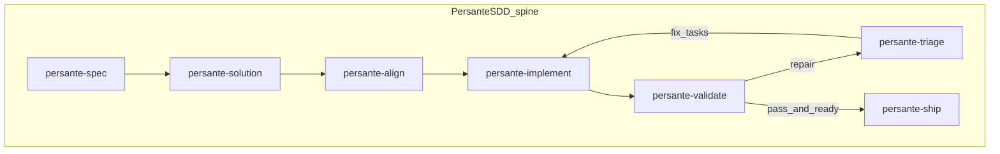

# Persante SDD skills (wiki/spec-driven) — summary

| Field | Value |
| --- | --- |
| **Purpose** | Describe **Persante**’s repository-resident **spec-driven development (SDD)** skills: artifact layout, phase flow, governance limits, and supporting helpers — for readers who do not have that repository checked out. |
| **Audience** | Sponsors, methodology owners, plan authors, agent operators |
| **Source** | Developer clone: `/Users/fareed/Documents/persante/repos/ticketing-platform/.claude/skills/persante-*/` · contract: `persante-sdd-workflow/references/artifact-contract.md` · support skill: `persante-sdd-workflow/SKILL.md` |
| **Status** | Analysis document; **does not mint** REQ/ARCH/IMPL tokens |
| **Last updated** | 2026-11-06 |

**Sibling doc:** [Persante SDD skills × TIED agent management](persante-sdd-skills-vs-tied-agent-management.md)

---

## Executive summary

**Persante SDD** is a **wiki-first**, **repo-local** methodology: each feature lives under `wiki/specs/NNN-<slug>/` with a written **`spec.md`** (the product contract), a **`solution.md`** (technical approach + verification design), a **`tasks.json`** task graph, and an **`evidence/`** folder for phase reports and events. There is **no separate issue tracker** in the skills as written; **`persante-spec`** interviews the developer and records what an issue would hold into `spec.md`.

Phase agents implement a **linear spine** (spec → solution → align → implement → validate → triage → ship), with **hard caps** on alignment evaluations and review repair cycles, a **mandatory independent reviewer** for the review phase, and **Bitbucket**-centric **PR verification** (`verify-pr`) as the delivery record. The **`persante-sdd-workflow`** skill supplies **`workflow.py`** to validate structure, emit events, and cross-check an open PR against committed artifacts; it also records **fork provenance** (Michael Duddy’s dev-environment skills at commit `99063e7`, dated 2026-10-31).

Infra skills (**naming lint**, **Azure what-if review**, **dev deploy**) sit **beside** the SDD spine; they do not replace specification or traceability work.

---

## Phase model



**Repair loop (conceptual):** `persante-validate` may request changes and open **`RF-*`** findings; `persante-triage` dispositions them and may append fix **`T###`** tasks; `persante-implement` executes accepted fixes. `persante-ship` orchestrates these phases and enforces iteration limits (see **Governance**).

---

## Skills inventory

### Phase and orchestration skills

| Skill | Responsibility (one line) |
| --- | --- |
| **persante-spec** | Interview → capture confirmed **`spec.md`** under `wiki/specs/NNN-<slug>/` with stable **`US-*`**, **`FR-*`**, **`NFR-*`**, **`AC-*`** IDs; **Persante has no issue tracker** — the interview replaces it. |
| **persante-solution** | From a **confirmed** spec, author **`solution.md`** plus **`tasks.json`**: approach, file-level plan, **`V-*`** verification steps tied to requirements, acyclic task dependencies. |
| **persante-align** | Cross-check spec, solution, tasks, and verification for gaps; write **`evidence/alignment-<n>.md`**; **`alignment.attempts` ≤ 5**; implementation blocked without a **PASS** on the latest evaluation. |
| **persante-implement** | Execute **ready** tasks in dependency order; optional **parallel** task agents with **git worktrees** when scopes are disjoint; record evidence in **`evidence/implementation.md`**; orchestrator **re-runs verification** after integrating task commits (reported output alone is not evidence). |
| **persante-validate** | **Independent second opinion** (`persante-reviewer` subagent); write **`evidence/review-<n>.md`**, populate **`RF-*`** in `tasks.json`; on pass, may run **wiki ingest** (unless ship orchestrates timing). |
| **persante-triage** | Disposition **`RF-*`**: accept → add fix tasks; reject/defer with rules (required findings cannot be deferred); may send back to align if verification/traceability changed materially. |
| **persante-ship** | End-to-end orchestration to a **Bitbucket PR**: planning through **ingest**, **push**, **`bin/pr.sh`**, **`workflow.py verify-pr`**; **does not merge**; may require **final independent review** after repair cycles. |
| **persante-sdd-workflow** | **Contract + `workflow.py`**: `init`, `validate --phase …`, `ready`, `event`, `set`, **`verify-pr`** (Bitbucket REST API 2.0, `ATLASSIAN_API_TOKEN` / `ATLASSIAN_EMAIL`); documents fork from Michael Duddy’s skills at **`99063e7`** (2026-10-31). |

### Infra adjuncts (outside the core SDD spine)

| Skill | Responsibility (one line) |
| --- | --- |
| **persante-naming-lint** | Run `infra/scripts/naming_lint.py` against naming decisions; explain violations with links to wiki decisions; read-only unless developer asks to edit templates. |
| **persante-whatif-review** | Run `infra/scripts/whatif.sh` for one **dev** concern; summarize JSON with **flagged** risky changes first; never deploys; what-if JSON stays out of commits. |
| **persante-deploy** | **Dev-only** Azure deploy via **`infra/scripts/deploy.sh`** / **`deploy-all.sh`** after naming lint, what-if review, explicit developer **yes** (with stricter rules when **flagged** changes exist). |

---

## Artifacts and identifiers

Features use the layout (simplified from the contract):

```text
wiki/specs/NNN-<slug>/
├── spec.md
├── solution.md
├── tasks.json
└── evidence/
    ├── events.jsonl
    ├── alignment-<n>.md
    ├── implementation.md
    ├── review-<n>.md
    ├── triage-<n>.md
    └── blockers.md   # when blocked
```

| Namespace | Role |
| --- | --- |
| **`US-*`** | User stories in **`spec.md`** |
| **`FR-*`**, **`NFR-*`** | Functional and non-functional requirements |
| **`AC-*`** | Acceptance criteria |
| **`V-*`** | Verification steps in **`solution.md`** (commands or human procedures, expected results, what they prove) |
| **`T###`** | Tasks in **`tasks.json`** (dependency edges, file scope, verification IDs) |
| **`RF-*`** | Independent review findings (severity, disposition, optional **`leaves_requirement_unproven`**) |
| **`events.jsonl`** | Append-only phase history via **`workflow.py event`** |
| **`verify-pr`** | Non-writing PR check + printable summary for the PR body (Bitbucket API; compares live PR to committed feature folder) |

`tasks.json` also tracks **`alignment.*`** and **`review.*`** (including **`review.revision`** full SHA). The helper accepts **`claude`**-harness features only.

---

## Governance and limits

| Mechanism | Rule (as stated in skills / contract) |
| --- | --- |
| **Alignment attempts** | At most **5** total evaluations; do not implement without latest **PASS** |
| **Review repair cycles** | Count **`review → triage → implement`** sequences; at most **5**; ship still demands a **final independent review** on the current head after repairs |
| **Independent review** | **`persante-validate`** must launch a **separate** reviewer agent (`persante-reviewer`); self-review does not satisfy the phase |
| **Finding deferral** | Only **non-blocking** **low** findings (and not **`leaves_requirement_unproven: true`**) may be deferred without follow-up; required findings must be fixed or rejected with reasoning |
| **Ship / PR** | Opens or updates a **Bitbucket** PR via **`bin/pr.sh`**; runs **`workflow.py verify-pr`**; puts summary in PR description; **never merges** |
| **Post-ingest freeze** | After successful wiki ingest, the feature folder is **frozen** except for ship events and blocker reports (per ship + contract) |

---

## Proof boundary

- This summary is based on **read-only inspection** of skills at the **developer machine path** above. **This repository does not vendor** those files; readers with other checkouts should re-verify against their tree.
- **`persante-sdd-workflow`** records **fork provenance**: Michael Duddy’s dev-environment skills at commit **`99063e7`** on **2026-10-31**; Persante changes are **not synced back** upstream.
