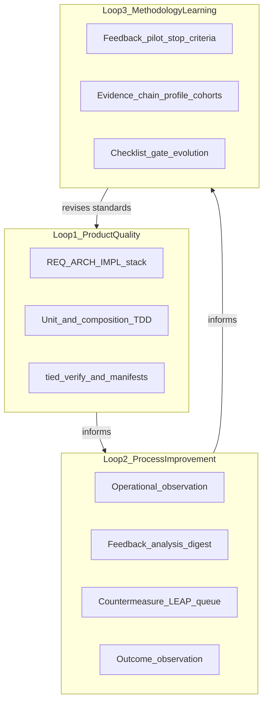

# QMM (Kaizen & quality management) × TIED — comparison

| Field | Value |
| --- | --- |
| **Purpose** | Map classic quality-management methodologies (QMM) to TIED as it exists in this repository; state alignments, deferrals, tensions, and gaps; recommend one strategic direction (not an implementation plan). |
| **Audience** | Sponsors, methodology owners, plan authors, agent operators |
| **Source study** | [`prompts/2026-10-10-1-qmm.md`](../../prompts/2026-10-10-1-qmm.md) |
| **TIED anchors** | [LEAP](../../tied-bundle/docs/LEAP.md), [processes](../../tied-bundle/docs/processes.md), [AGENTS.md](../../AGENTS.md), [Kaizen feedback loop plan](../tied-kaizen-feedback-loop-plan.md), [feedback-to-tied](../../tied-project/vocab/feedback-to-tied.md), [quality-assurance](../../tied-project/vocab/quality-assurance.md) |
| **Status** | Analysis document (2026-10-10); does not mint REQ/ARCH/IMPL tokens |
| **Last updated** | 2026-10-10 |

---

## Executive summary

TIED already implements a strong **Loop 1 (product quality)** through documentation-first LEAP, mandatory TDD ordering, verification gates, and traceable REQ/ARCH/IMPL. It has recently closed a substantial **Loop 2 (process improvement)** via the Kaizen feedback program (operational observations through outcome observations and a bounded pilot), with **Phase 3 transport deferred**. Relative to the sponsor study’s full QMM stack, the largest honest gap is **Loop 3 (methodology improvement)**: TIED can audit conformance and collect pilot-level evidence, but it does not yet treat every change to its own rules as a logged experiment with pre-declared predictions and sustained variation discipline across cohorts and time.

**One strategic direction (sponsor review only—not approved methodology change):** strengthen Loop 3 by composing existing Kaizen and evidence-chain machinery so that changes to checklist steps, gate policies, and assurance profiles follow the same **hypothesis → baseline → countermeasure → outcome observation** pattern already defined for the **production system**, including cohort-level readouts and explicit willingness to reverse rules that fail to demonstrate value—without adding universal scores, mandatory Six Sigma tooling, or DORA ingestion into TIED core.

---

## Complementarity

| Center of gravity | QMM study | TIED today |
| --- | --- | --- |
| Primary asset | Continuous, evidence-supported improvement of product *and* process | Semantic DB (REQ/ARCH/IMPL) + deterministic MCP gates + checklist receipts |
| Learning mechanism | PDSA experiments; SPC to avoid confusing noise with progress | CITDP/plan-implement-verify; **proof boundaries**, denominators, `inconclusive` / `not_measured` |
| Process loop | Kaizen observe → improve → measure | **Kaizen loop**: **operational observation** → **feedback analysis** → **countermeasure** → **outcome observation** vs **baseline** |
| Methodology loop | CMMI Optimizing; revise standards from sustained evidence | Partial: **evidence-chain profile**, **client cohort**, **feedback pilot** + **stop criteria** |
| Risk | Conformance without effectiveness | Heavy gate adherence by design; Kaizen principles warn against “endless churn” |

**Compose-don’t-replace:** QMM does not replace TIED’s token graph, LEAP, or MCP writes. TIED does not fully instantiate ISO certification, CMMI appraisal, DORA dashboards, or SPC control charts.

---

## Touchpoint 1 — RESOLVE (sponsor study → TIED vocabulary)

| Sponsor / QMM term | TIED preferred term | Notes |
| --- | --- | --- |
| Kaizen (cultural principle) | **Kaizen loop** (sponsor label) | Not a score or storage enum; see [feedback-to-tied](../../tied-project/vocab/feedback-to-tied.md) |
| Observe reality / abnormality | **operational observation** | Point-of-work capture; **receipt** ≠ notification |
| Process fix / systemic change | **countermeasure** vs **correction** | Hotfix restore ≠ Kaizen-shaped improvement |
| Did it get better | **outcome observation** vs **baseline** | Values include `inconclusive`, `not_measured` |
| Improvement experiment | CITDP + checklist slice; Kaizen **follow-up window** | Not every rule change is yet a logged **hypothesis** |
| Quality of the whole system | **production system** (TIED work system) | Application under test only when observation names it |
| Auditable QMS | Gates, manifests, working-folder placement | [PROC-WORKING_ARTIFACT_PLACEMENT](../../tied-bundle/docs/working-artifact-placement.md) |
| Statistical discipline | **proof boundary**, **denominator**, pilot metrics | No control-chart layer in TIED |
| Conformance | Checklist completion, gate receipts, adherence ledger | Strong TIED emphasis |
| Effectiveness | Tests pass, `tied_verify`, verification evidence manifest | Verification-gated mode where enabled |
| Improvement capability | Kaizen outcome loop + LEAP proposals + evidence-chain statistics (partial) | Loop 3 weakest vs study |
| Logic elevation | [PROC-LEAP], IMPL **essence_pseudocode** | Product logic authored in pseudo-code first |

---

## Three nested loops (study frame)

The sponsor study’s section 5 nests three loops; TIED maps to them as follows.

| Loop | Study emphasis | TIED evidence (this repo) |
| --- | --- | --- |
| 1 — Product quality | XP/TDD, requirements → verification | [LEAP](../../tied-bundle/docs/LEAP.md), [PROC-TIED_DEV_CYCLE](../../tied-bundle/docs/processes.md), module validation, composition tests before wiring |
| 2 — Development process | Kaizen, PDSA, DMAIC | Closed Kaizen program Phases **1–2, 4–7**; **Phase 3 transport deferred** ([Kaizen plan](../tied-kaizen-feedback-loop-plan.md)); MCP `tied_feedback_*` tools |
| 3 — Methodology improvement | Deming, CMMI Optimizing, SPC | Vocabulary + pilots + evidence-chain reporting; **gap** on universal PDSA for rule changes and SPC time-series |

**Proof boundary:** Kaizen runtime claims below are anchored to the Kaizen plan status (2026-10-08) and project REQ close-outs referenced there—not to every client deployment.

---

## Primary QMM systems matrix

For row-level **TIED mechanism** fill-in (vocabulary, intent stack, change analysis, and related columns), use the expanded inventory in [methodology-composition-matrix.md §1](methodology-composition-matrix.md#section-1-qmm-loop) (**27** loop × method rows).

Disposition key: **Align** | **Defer** | **Tension** | **Gap** (see plan refine pass for definitions).

| System | Loop | TIED center of gravity | Disposition | Rationale |
| --- | --- | --- | --- | --- |
| **PDCA / PDSA** | 2–3 | CITDP, agent checklist, Kaizen **countermeasure** / **outcome observation** | **Tension** | Plan–do–study–act appears in planning and verification, but methodology rule changes are not yet uniformly recorded as **predictions vs observed outcomes**. |
| **TQM** | 1–2 | REQ→ARCH→IMPL→tests traceability; **production system** | **Align** | Quality as a property of the whole agent/TIED work system, not a late inspection gate—scoped to methodology + project YAML, not enterprise-wide TQM. |
| **Lean / Kaizen** | 2 | **Kaizen loop**, **operational observation**, friction in **feedback analysis** | **Align** | Program **closed** on local/export pilot; Phases 1–2, 4–7 implemented; Phase 3 transport **deferred**. |
| **Six Sigma / DMAIC** | 2 | Scoped [adversarial inquiry](../../tied-project/vocab/fidelity-research.md), CITDP root-cause steps | **Defer** | No org-wide DMAIC or defect-rate program; appropriate for selected high-risk changes, not every task. |
| **SPC** | 3 | **Proof boundary**, denominators, pilot **stop criteria**, `inconclusive` | **Gap** | Philosophy matches “don’t treat every fluctuation as progress”; no control charts or sustained process time-series interpretation in TIED. |
| **ISO 9001** | 1–3 | Auditable gates, verification manifests, committed vs local working roots | **Align** | QMS-shaped traceability and evidence; not ISO 9001 certification. |
| **CMMI L4–5** | 3 | **Evidence-chain profile**, **client cohort**, **evidence-chain statistics report** | **Gap** | Fragments of quantitative/optimizing maturity; not org-wide CMMI capability levels. |
| **XP / TDD** | 1 | Unit-first TDD, composition tests, justified E2E | **Align** | Core [PROC-TIED_DEV_CYCLE](../../tied-bundle/docs/processes.md) ordering. |
| **Scrum** | 2 | Checklist transparency, adaptation via LEAP/checklist | **Defer** | Empiricism without Scrum roles, events, or sprint metrics. |
| **DORA** | 2 | — | **Defer** | Delivery throughput/ stability metrics live in client CI/ops unless a future REQ scopes them. |
| **SRE** | 1 | **Residual risk**, **waiver**, reliability rows in assurance matrix | **Tension** | Error-budget *idea* parallels bounded risk acceptance; TIED core does not ship SLO/error-budget product semantics. |

---

## Three learning mechanisms (study emphasis)

### A. PDSA — improvement as experimental learning

The study stresses **predictions versus observed outcomes**, not merely changing process or running a retrospective.

| Study claim | TIED today | Disposition |
| --- | --- | --- |
| Hypothesize before change | CITDP **change-definition**, test strategy, Kaizen **baseline** | Partial **Align** |
| Study compares prediction to result | Verification manifests, **outcome observation**, adversarial findings (scoped) | Partial **Align** |
| Act retains or reverses practice | LEAP proposal queue; Kaizen **regression** routes to analysis | Partial **Align** |
| Every methodology rule is an experiment | Checklist/gate evolution is not yet uniformly hypothesis-logged | **Gap** / **Tension** |

### B. DMAIC — causal investigation for recurring problems

| Study claim | TIED today | Disposition |
| --- | --- | --- |
| Define–measure–analyze–improve–control for recurring defects | CITDP impact/risk, **feedback analysis** with denominators, integrated adversarial inquiry for eligible changes | **Defer** (scoped tools, not universal DMAIC) |
| Statistical rigor on defect rates | Test adequacy, quality evidence matrix; not Six Sigma analytics | **Defer** |

### C. SPC — common cause vs special cause

| Study claim | TIED today | Disposition |
| --- | --- | --- |
| Distinguish ordinary variation from meaningful change | **Proof boundary**, explicit `unknown` / `not_measured`, pilot metrics with denominators | **Align** (concept) |
| Control charts / time-series process interpretation | Not implemented | **Gap** |
| Avoid endless procedural tweaks from noise | Kaizen principle: do not confuse churn with learning ([feedback-to-tied](../../tied-project/vocab/feedback-to-tied.md)) | **Align** (intent) |

---

## Software-specific methods (study §3)

| Approach | Evidence / feedback in study | TIED mapping | Disposition |
| --- | --- | --- | --- |
| **XP** | Tests, integration, refactoring | TDD + composition + LEAP | **Align** |
| **TDD** | Executable expectations | Mandatory unit RED before code | **Align** |
| **Scrum** | Transparency, inspection, adaptation | Checklist + gates; no Scrum process | **Defer** |
| **DevOps / DORA** | Delivery performance metrics | Client pipelines; not TIED index fields | **Defer** |
| **SRE** | SLOs, error budgets, postmortems | Waivers/residual risk; reliability assurance rows | **Tension** |

---

## Three objectives (study §6)

| Objective | Question (study) | How TIED answers today | Where the study pushes further |
| --- | --- | --- | --- |
| **Conformance** | Did we follow the defined process? | `tied_checklist_gate_validate`, checklist Tracker, adherence ledger, gate receipts | Risk: high conformance weight without paired effectiveness readout for *methodology* changes |
| **Effectiveness** | Did the process produce the desired result? | Tests green, `tied_verify`, verification evidence manifest, REQ/IMPL status when verification-gated | Product effectiveness is stronger than proof that *process rules* improved outcomes |
| **Improvement capability** | Does the process learn reliably? | Kaizen loop + LEAP proposals + evidence-chain cohort tooling (partial) | Loop 3: sustained, cross-project proof that rule changes work; SPC-style variation discipline |

---

## Strategic suggestion (high level only)

The sponsor study’s proposed foundation—**Kaizen** as cultural principle, **PDSA** as learning mechanism, **SPC** as evidence interpretation, **CMMI Optimizing** as long-term aspiration, with software tests and ops telemetry as inputs—is directionally compatible with TIED’s existing investments. The lowest-risk way to improve TIED is not to import another framework wholesale, but to **extend Loop 3 using vocabulary and MCP paths that already exist**:

Treat changes to TIED’s own **production system** (checklist steps, gate policies, assurance profiles, prompt-type workflows) as **first-class PDSA experiments**: record a **hypothesis** and **baseline** before promoting a **countermeasure** into canonical methodology or project practice; close with **outcome observations** and, where privacy and cohort compatibility allow, **evidence-chain statistics** across clients— and retain the study’s discipline of **reversing rules that fail to demonstrate value**.

**Explicit non-goals for this recommendation:** no new universal KPI or Kaizen score; no mandatory Six Sigma tooling; no DORA ingestion spec; no control-chart infrastructure in TIED core; no implied approval to edit `tied-bundle/` methodology without a separate sponsor change request.

Adoption of this direction is a **costly choice** for a future scoped REQ or plan—not enacted by this comparison document.

---

## Honest gaps (summary)

1. **PDSA prediction log** for methodology rule changes—not only for feature CITDP or Kaizen operational observations.
2. **SPC machinery**—control charts / sustained time-series interpretation beyond denominators and proof boundaries.
3. **DORA and delivery telemetry**—deferred to client ops unless explicitly scoped.
4. **CMMI L4–5 completeness**—evidence-chain and pilot fragments vs org-wide quantitative management.
5. **Conformance trap**—TIED optimizes auditable procedure; the study and Kaizen principles require pairing conformance with measured effectiveness and learning.

---

## Related docs

- [`docs/tied-qmm-methodology-learning-plan.md`](../tied-qmm-methodology-learning-plan.md) — **QMM program plan (closed 2026-10-10)** — W1–W5 implement complete; W6 waived at program exit
- [`docs/tied-qmm-w1-methodology-pdsa-plan.md`](../tied-qmm-w1-methodology-pdsa-plan.md) — W1 child plan (`REQ-METHODOLOGY-LEARNING-EXPERIMENT`, implement complete)
- [`docs/tied-kaizen-feedback-loop-plan.md`](../tied-kaizen-feedback-loop-plan.md) — Kaizen program status and phase contract
- [`tied-project/vocab/feedback-to-tied.md`](../../tied-project/vocab/feedback-to-tied.md) — Kaizen loop vocabulary and MCP naming bridge
- [`tied-project/vocab/quality-assurance.md`](../../tied-project/vocab/quality-assurance.md) — Proof boundaries, pilots, evidence-chain profile
- [`tied-bundle/docs/LEAP.md`](../../tied-bundle/docs/LEAP.md) — Logic elevation and propagation
- [`docs/comparisons/jev-for-tied-improvement.md`](jev-for-tied-improvement.md) — Sibling comparison pattern (decision coprocessor × TIED)
- [`prompts/2026-10-10-1-qmm.md`](../../prompts/2026-10-10-1-qmm.md) — Frozen sponsor study
