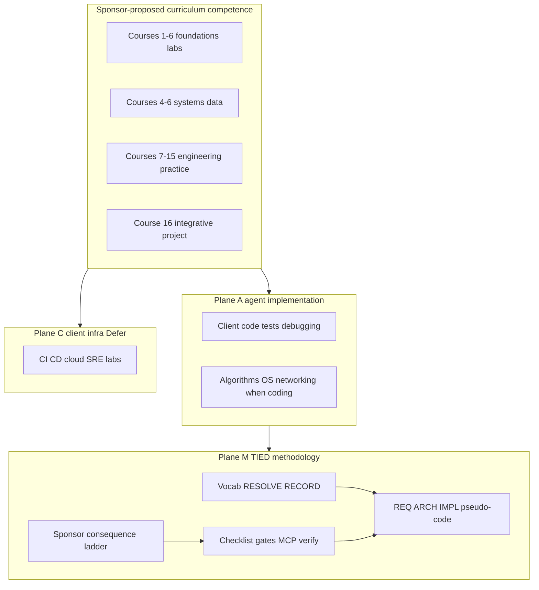

# Software engineering degree × TIED — graduate competency observance grid

| Field | Value |
| --- | --- |
| **Purpose** | Map **Sponsor-proposed** CS/software-engineering curriculum detail points to TIED **Interpretation** (graduate-engineer judgment) and **Observance** across planes **M** (methodology), **A** (agent implementation), **C** (client infra) — outreach persona, not accreditation. |
| **Audience** | Sponsors, methodology owners, educators comparing TIED to graduate SE competence |
| **Curriculum capture (sibling)** | [software-engineering-degree.md](software-engineering-degree.md) (**Sponsor-proposed**, captured **2026-10-26**) |
| **Evidence boundary** | No university accreditation; no assertion that TIED replaces labs, runtime courses, or certifies operators passed Course 2. Effectiveness **not_measured**. |
| **Status / date** | Wave 2 analysis snapshot **2026-10-26** — reference only; does **not** mint REQ/ARCH/IMPL |
| **Distinct from** | [TIED vs well-known methodologies](tied-vs-well-known-methodologies.md) (organizational process map); [AI-SDLC factory × TIED](ai-sdlc-atdd-software-factory-vs-tied.md); harness comparisons (LangChain, Cursor, Traefik) |
| **TIED anchors (reference only)** | [AGENTS.md](../../AGENTS.md), [agent-req-implementation-checklist.md](../../tied-bundle/docs/agent-req-implementation-checklist.md), [processes.md](../../tied-bundle/docs/processes.md), [sponsor-agent-relationship.md](../../tied-project/vocab/sponsor-agent-relationship.md), [external-service-three-wave-comparison-template.md](../../tied-bundle/docs/external-service-three-wave-comparison-template.md) |
| **Row target** | **887** analysis rows (**884** under courses 1–16 + **3** curriculum framing) |

---

## Executive summary

The **Sponsor-proposed** curriculum describes graduate software-engineering competence across **16 courses**, **167 numbered modules**, and **887** hyphenated detail points (see sibling capture). TIED’s center of gravity is **traceable agent-assisted change** in client repos: vocab discipline, CITDP, REQ → ARCH → IMPL pseudo-code, checklist gates, MCP-first project YAML, verification when enrolled, LEAP on divergence, and sponsor **consequence ladder** — not replacing CS foundations labs or certifying degree outcomes.

**Compose-don’t-replace:** Use the curriculum as a **competency persona** for what a TIED-guided agent should **understand** (plane **A**) while keeping **methodology authority** on plane **M**. Defer cloud, CI product ownership, and formal degree assessment to plane **C** or **Defer** unless client scope includes them.

| Center of gravity | Curriculum (**Sponsor-proposed**) | TIED (this repo) |
| --- | --- | --- |
| Primary artifact | Course modules + 887 detail bullets | REQ/ARCH/IMPL YAML + IMPL pseudo-code + tests |
| Proof of competence | Labs, exams, capstone (**not** in this doc) | Checklist gates, envelopes, `tied_validate_consistency` / `tied_verify` when enrolled |
| Agentic engineering | Courses 14–15 integrative themes | Bounded MCP, prompt-type skills, sponsor ladder |
| Foundations (1–6) | Programming, algorithms, systems | **Gap M**; **A** when implementing client code |
| Accreditation claim | Undergraduate degree intent | **Explicit non-adoption** — outreach persona only |

| Mastery dimension (capture) | TIED crosswalk | Primary plane |
| --- | --- | --- |
| Conceptual | IMPL contracts, ARCH decisions, proof boundaries | M, A |
| Practical | `[PROC-TIED_DEV_CYCLE]`, client implementation | A |
| Evaluative | Gates, envelopes, `tied_verify` when enrolled | M |

| Scale (capture) | TIED crosswalk | Disposition |
| --- | --- | --- |
| Algorithm | Client code quality when implementing | **Gap M** for core methodology |
| Component | Module validation, composition tests | **Composable** |
| Complete system | E2E justification, integration evidence | **Composable** |
| Engineering process | CITDP, checklist, LEAP | **Align** |

---

## Source summary

Bullets summarize the in-repo capture only (**Sponsor-proposed**). Module count in capture intro text cites “~175 instructional modules”; measurable **167** numbered module headings are used for verification (see [PLAN-refine-pass3.md](../../tied-project/working/DOC-SOFTWARE-ENGINEERING-DEGREE-COMPARISON/PLAN-refine-pass3.md)).

- **16 courses** in four parts: **I.** Computing Foundations; **II.** Software Engineering; **III.** AI and Agentic Software Engineering; **IV.** Integrative Engineering.
- **887** hyphenated detail points (**884** under courses + **3** framing definitions before Part I).
- Agentic programming integrated from Course 14 onward; process/evidence emphasis in Course 15.
- Mathematics and general education excluded by sponsor scope.
- No stdd run of external accreditation or educational effectiveness studies (**not_measured**).

---

## Relationship to sibling comparisons

| Sibling | What it owns | This document owns |
| --- | --- | --- |
| [TIED vs well-known methodologies](tied-vs-well-known-methodologies.md) | Agile/XP/QMM **organizational** frames | **CS curriculum grid** → TIED observance per bullet |
| [AI-SDLC factory × TIED](ai-sdlc-atdd-software-factory-vs-tied.md) | Executable spec factory, run records | Graduate **competency** mapping, not factory mechanics |
| [Open Ontologies × TIED](open-ontologies-repository-vs-tied-agent-management.md) | RDF plan/apply, certificates | Not ontology engine comparison |
| [LangChain harness × TIED](langchain-harness-engineering-vs-tied-agent-management.md) | Trace/benchmark harness loops | Course 14–15 agentic overlap only |
| Other harness docs (Traefik, Cursor) | Harness/platform seams | **Defer** duplicating harness prose |

---

## Competency themes → TIED surfaces

### Courses 7–12 (requirements through DevOps)

| Theme | TIED surface | Disposition |
| --- | --- | --- |
| Requirements & domain modeling | Vocab RESOLVE, REQ tokens, CITDP | **Align M** |
| Architecture & modularity | ARCH decisions, module validation | **Align M** |
| Maintenance & comprehension | Source graph tools, working folders | **Composable** |
| V&V / TDD / ATDD | `[PROC-TIED_DEV_CYCLE]`, `tied_verify` | **Align M** |
| Security & safety | Proof boundary, tool safety references | **Partial align** |
| DevOps / SRE | stdd CI exists; not methodology core | **Defer C** |

### Courses 14–15 (agentic engineering)

| Theme | TIED surface | Disposition |
| --- | --- | --- |
| Tool use & MCP | Bounded TIED YAML MCP, skill boundaries | **Partial align M** |
| Delegation & human oversight | Sponsor ladder, agency boundary | **Align M** |
| Process & evidence | Checklist gates, evidence envelopes | **Align M** |
| Chat as requirements | REQ/ARCH/IMPL stack required | **Tension** (anti-pattern) |

---

## Touchpoint 1 — RESOLVE

| Sponsor/source term | TIED preferred term / surface | Disposition |
| --- | --- | --- |
| **CS graduate software engineer** | Competency persona for TIED operator + agent | **Recommendation-only** |
| **Observance plane M/A/C** | Document-local column labels | **Composable** |
| **Interpretation / Observance** | Wave 2 table fields | Document-local |
| **Curriculum point** | Verbatim **Sponsor-proposed** bullet | Source label |
| **TIED-existing** | Committed stdd behavior cited in prose | Claim label |
| **Course 15 agentic process** | Prompt-type skills + checklist | **Partial align** |

**RESOLVE charter:** Names and mappings only; no RECORD of project vocab unless sponsor promotes. No token mint from comparison prose.

### Disposition key

| Disposition | Meaning |
| --- | --- |
| **Align** | TIED materially represents the curriculum intent (scoped). |
| **Composable** | Combine without equivalence or certification claims. |
| **Tension** | Partial overlap; proof boundary required. |
| **Gap** | Curriculum emphasis not in TIED methodology core. |
| **Defer** | Client infra, product, or sponsor-owned choice. |
| **N/A** | Not applicable to TIED lens for this point. |

---

## Primary capability matrix

| Course (concise) | TIED COG | Disposition | Primary plane |
| --- | --- | --- | --- |
| 1 Programming construction | IMPL contracts, TDD in clients | **Composable** | A |
| 2 Algorithms / complexity | — | **Gap M** | A |
| 3 Languages / compilers | pseudo-code grammar, lint | **Tension** | M/A |
| 4 Architecture / OS | DEBUG/TRACE in AGENTS.md | **Composable** | A/C |
| 5 Networking / distributed | async vocab, module boundaries | **Partial align** | A |
| 6 Databases / data eng | — | **Defer C** | A/C |
| 7 Requirements / domain | vocab RESOLVE, REQ tokens | **Align** | M |
| 8 Software architecture | ARCH decisions, module validation | **Align** | M |
| 9 Maintenance / comprehension | CITDP, source graph tools | **Composable** | M/A |
| 10 V&V / quality | PROC-TIED_DEV_CYCLE, tied_verify | **Align** | M |
| 11 Security / safety | proof boundary, tool safety refs | **Partial align** | M/A |
| 12 DevOps / SRE | stdd CI exists; not methodology core | **Defer** | C |
| 13 AI / LLM engineering | — product LLM course | **Gap M** | A |
| 14 Agentic programming | MCP, skills, delegation | **Partial align** | M |
| 15 Process / evidence / agentic dev | checklist, envelopes, sponsor ladder | **Align** | M |
| 16 Capstone | working folders + client project | **Composable** | M/A |

---

## Authority boundary

Graduate **competence** (curriculum) informs what agents should **apply** in client work (**A**). **M** holds authoritative traceability and gates. **C** is deferred unless client REQ owns infra.

---

## Anti-patterns

| Risk | Symptom | TIED-oriented remedy |
| --- | --- | --- |
| Consistency = CS mastery | `tied_validate_consistency` green implies algorithms/OS competence | Proof boundary; plane **M** vs **A**; **Gap M** for foundations |
| Curriculum = TIED certification | Wave 2 doc treated as accreditation | **Sponsor-proposed** + **not_measured**; explicit non-adoptions |
| Chat as requirements | Agent narrative replaces REQ/ARCH/IMPL | Course 7/15 crosswalk; token stack required |
| Unbounded agent autonomy | Skills/MCP without gates | Course 14–15 themes; sponsor ladder; pre_implementation gate |
| TIED ships DevOps/cloud/LLM runtime | Courses 12–13 read as product promises | **Defer C** / **Gap M**; client-owned infra |
| Comparison mints REQ | New tokens in markdown | Wave 3 via **add-feature** only |
| Single gate waives inquiry | Doc outreach claimed as integrated activation | Honest gate note; minimal depth |

---

## Compose-don’t-replace

| Tune with **graduate SE curriculum** lens (persona) | Keep **TIED** authority |
| --- | --- |
| Expect agents to debug, test, and structure client code (**A**) | **M** checklist + MCP YAML writes + LEAP |
| Use curriculum as review rubric for agent outputs | Sponsor costly choices; not automatic enforcement |
| Map V&V themes to TDD and gates | `tied_verify` when enrolled — not university exam |
| Agentic themes → bounded skills/MCP | Unbounded tool access **anti-pattern** |
| Capstone integrative thinking | Client project + CITDP — TIED is not a degree program |

---

## Bounded operator recommendations (Recommendation-only)

1. **Use plane columns in code review** — Label whether a finding is methodology (**M**), implementation (**A**), or client infra (**C**) before opening REQ scope.
2. **Cross-read Course 15 with AGENTS.md** — Process/evidence bullets align with checklist and sponsor ladder; do not treat as optional flavor text.
3. **Foundations courses 1–6** — Train agents on **A** expectations; do not add fake REQ tokens for algorithms labs.
4. **Optional client-development-index link** — **Defer** until sponsor wants methodology index cross-link.
5. **methodology-composition-matrix row** — **Defer** (costly).
6. **Wave 3 competency profile REQ** — **Defer** — requires scoped **add-feature**.

---

## Phased recommendations

| Phase | Action | Status |
| --- | --- | --- |
| **0** | Wave 1 normalize + this Wave 2 grid + git allowlist | **This build-plan (2026-10-26)** |
| **1** | Split Wave 2 into part files if review pain | **Defer** unless sponsor asks |
| **2** | Project vocab RECORD (`graduate_engineer_persona`, `observance_plane`) | **Defer** |
| **3** | REQ “TIED graduate competency profile” | **Defer** — **add-feature** |

---

## Explicit non-adoptions

- TIED as **accredited university program** or degree issuer
- Replacing **programming labs** (Courses 1–6) with checklist prose alone
- **Certifying** agents or operators passed formal course assessments via comparison doc
- Shipping **DevOps/cloud/LLM runtime** as universal TIED methodology core (Courses 12–13)
- **Unbounded** agent autonomy without checklist gates (Courses 14–15)
- Minting new `[REQ-*]` / `[ARCH-*]` / `[IMPL-*]` from comparison tables

---

## Proof boundary

- Curriculum content is **Sponsor-proposed** in-repo capture, not an external accredited syllabus verified by stdd.
- TIED surfaces cited are **TIED-existing** at authoring time; composability does not implement degree programs inside stdd.
- **`tied_validate_consistency`** was **not** run — no project YAML changed.
- Educational effectiveness and graduate outcomes **not_measured**.
- Wave 3 behavior requires normal TIED workflows — not comparison markdown alone.

---

## Related documents

- [Curriculum capture (sibling)](software-engineering-degree.md)
- [External three-wave comparison template](../../tied-bundle/docs/external-service-three-wave-comparison-template.md)
- [TIED vs well-known methodologies](tied-vs-well-known-methodologies.md)
- [Working plan pass 3](../../tied-project/working/DOC-SOFTWARE-ENGINEERING-DEGREE-COMPARISON/PLAN-refine-pass3.md)
- [Agent req implementation checklist](../../tied-bundle/docs/agent-req-implementation-checklist.md)

---

## Table of contents — bullet inventory

- [Curriculum framing (3 rows)](#curriculum-framing-3-rows)
- [Part III — AI and Agentic Software Engineering (Courses 13–15)](#part-iii--ai-and-agentic-software-engineering-courses-1315)
- [Part II — Software Engineering (Courses 7–12)](#part-ii--software-engineering-courses-712)
- [Part I — Computing Foundations (Courses 1–6)](#part-i--computing-foundations-courses-16)
- [Part IV — Integrative Engineering (Course 16)](#part-iv--integrative-engineering-course-16)

### Courses 1–16

- [Course 1. Programming and Software Construction](#course-1-programming-and-software-construction)
- [Course 2. Algorithms, Data Structures, and Computational Complexity](#course-2-algorithms-data-structures-and-computational-complexity)
- [Course 3. Programming Languages, Compilers, and Program Analysis](#course-3-programming-languages-compilers-and-program-analysis)
- [Course 4. Computer Architecture, Operating Systems, and Runtime Behavior](#course-4-computer-architecture-operating-systems-and-runtime-behavior)
- [Course 5. Networking, Concurrency, and Distributed Systems](#course-5-networking-concurrency-and-distributed-systems)
- [Course 6. Databases and Data Engineering](#course-6-databases-and-data-engineering)
- [Course 7. Requirements Engineering, Domain Modeling, and Human Interaction](#course-7-requirements-engineering-domain-modeling-and-human-interaction)
- [Course 8. Software Architecture and System Design](#course-8-software-architecture-and-system-design)
- [Course 9. Software Maintenance, Reverse Engineering, and Program Comprehension](#course-9-software-maintenance-reverse-engineering-and-program-comprehension)
- [Course 10. Verification, Validation, and Software Quality](#course-10-verification-validation-and-software-quality)
- [Course 11. Software Security, Privacy, and Safety](#course-11-software-security-privacy-and-safety)
- [Course 12. DevOps, Platform Engineering, and Site Reliability](#course-12-devops-platform-engineering-and-site-reliability)
- [Course 13. Artificial Intelligence and Language Model Engineering](#course-13-artificial-intelligence-and-language-model-engineering)
- [Course 14. Agentic Programming and Autonomous Software Systems](#course-14-agentic-programming-and-autonomous-software-systems)
- [Course 15. Software Engineering Process, Evidence, and Agentic Development](#course-15-software-engineering-process-evidence-and-agentic-development)
- [Course 16. Software Engineering Capstone — Two Semesters](#course-16-software-engineering-capstone-two-semesters)

---

## Curriculum framing (3 rows)

| Curriculum point | Interpretation | Observance | Disposition | Plane |
| --- | --- | --- | --- | --- |
| Course: A major body of computer science or software engineering knowledge. | A **course** is the comparison’s coarse grain (16 bodies of knowledge); Wave 2 maps each **detailed coverage** bullet under modules — not course titles alone. | **M:** three-wave comparison labels; **A:** interpret curriculum as **Sponsor-proposed** input to agent judgment | Composable | M,A |
| Module: A coherent subject taught within the course. | A **module** groups one teachable subject; TIED observance applies at **detailed coverage** rows, with module titles as context only. | **M:** three-wave comparison labels; **A:** interpret curriculum as **Sponsor-proposed** input to agent judgment | Composable | M,A |
| Detailed coverage: The specific concepts, mechanisms, techniques, and practices included in that module. | Each hyphenated **detailed coverage** line becomes one Interpretation + Observance row (**887** total including three framing definitions). | **M:** three-wave comparison labels; **A:** interpret curriculum as **Sponsor-proposed** input to agent judgment | Composable | M,A |

## Part III — AI and Agentic Software Engineering (Courses 13–15)

### Course 13. Artificial Intelligence and Language Model Engineering

#### 1. Classical artificial intelligence

| Curriculum point | Interpretation | Observance | Disposition | Plane |
| --- | --- | --- | --- | --- |
| Problem representation and state-space search. | In “Classical artificial intelligence”, this **Sponsor-proposed** point emphasizes Problem representation and state-space search. AI/ML runtime and model engineering are outside TIED methodology core (**Gap M**); client integration remains plane **A**. | **M:** — (no LLM product/runtime in methodology); **A:** client ML/LLM integration when scoped; **C:** Defer training/infra | Gap | A |
| Heuristic search and goal-directed reasoning. | In “Classical artificial intelligence”, this **Sponsor-proposed** point emphasizes Heuristic search and goal-directed reasoning. AI/ML runtime and model engineering are outside TIED methodology core (**Gap M**); client integration remains plane **A**. | **M:** — (no LLM product/runtime in methodology); **A:** client ML/LLM integration when scoped; **C:** Defer training/infra | Gap | A |
| Knowledge representation and rule-based systems. | In “Classical artificial intelligence”, this **Sponsor-proposed** point emphasizes Knowledge representation and rule-based systems. AI/ML runtime and model engineering are outside TIED methodology core (**Gap M**); client integration remains plane **A**. | **M:** — (no LLM product/runtime in methodology); **A:** client ML/LLM integration when scoped; **C:** Defer training/infra | Gap | A |
| Planning, constraints, and decision procedures. | In “Classical artificial intelligence”, this **Sponsor-proposed** point emphasizes Planning, constraints, and decision procedures. AI/ML runtime and model engineering are outside TIED methodology core (**Gap M**); client integration remains plane **A**. | **M:** — (no LLM product/runtime in methodology); **A:** client ML/LLM integration when scoped; **C:** Defer training/infra | Gap | A |
| Reactive versus deliberative AI systems. | In “Classical artificial intelligence”, this **Sponsor-proposed** point emphasizes Reactive versus deliberative AI systems. AI/ML runtime and model engineering are outside TIED methodology core (**Gap M**); client integration remains plane **A**. | **M:** — (no LLM product/runtime in methodology); **A:** client ML/LLM integration when scoped; **C:** Defer training/infra | Gap | A |

#### 2. Machine learning and neural networks

| Curriculum point | Interpretation | Observance | Disposition | Plane |
| --- | --- | --- | --- | --- |
| Supervised, unsupervised, and reinforcement learning. | ML literacy is graduate **A** competence for client features; TIED **M** does not certify model quality — only traced change to client repos. | **M:** — (no LLM product/runtime in methodology); **A:** client ML/LLM integration when scoped; **C:** Defer training/infra | Gap | A |
| Training, validation, and test datasets. | ML literacy is graduate **A** competence for client features; TIED **M** does not certify model quality — only traced change to client repos. | **M:** — (no LLM product/runtime in methodology); **A:** client ML/LLM integration when scoped; **C:** Defer training/infra | Gap | A |
| Features, labels, parameters, and learned representations. | ML literacy is graduate **A** competence for client features; TIED **M** does not certify model quality — only traced change to client repos. | **M:** — (no LLM product/runtime in methodology); **A:** client ML/LLM integration when scoped; **C:** Defer training/infra | Gap | A |
| Neural network layers, activations, and training concepts. | ML literacy is graduate **A** competence for client features; TIED **M** does not certify model quality — only traced change to client repos. | **M:** — (no LLM product/runtime in methodology); **A:** client ML/LLM integration when scoped; **C:** Defer training/infra | Gap | A |
| Generalization, overfitting, and distribution shift. | ML literacy is graduate **A** competence for client features; TIED **M** does not certify model quality — only traced change to client repos. | **M:** — (no LLM product/runtime in methodology); **A:** client ML/LLM integration when scoped; **C:** Defer training/infra | Gap | A |

#### 3. Transformers and language models

| Curriculum point | Interpretation | Observance | Disposition | Plane |
| --- | --- | --- | --- | --- |
| Transformer architecture and attention mechanisms. | LLM mechanics are **Gap M**: TIED orchestrates agents but does not ship model training or inference product coursework; **A** applies when client code integrates models. | **M:** — (no LLM product/runtime in methodology); **A:** client ML/LLM integration when scoped; **C:** Defer training/infra | Gap | A |
| Token embeddings and positional representations. | LLM mechanics are **Gap M**: TIED orchestrates agents but does not ship model training or inference product coursework; **A** applies when client code integrates models. | **M:** — (no LLM product/runtime in methodology); **A:** client ML/LLM integration when scoped; **C:** Defer training/infra | Gap | A |
| Pretraining and instruction tuning. | LLM mechanics are **Gap M**: TIED orchestrates agents but does not ship model training or inference product coursework; **A** applies when client code integrates models. | **M:** — (no LLM product/runtime in methodology); **A:** client ML/LLM integration when scoped; **C:** Defer training/infra | Gap | A |
| Autoregressive generation. | LLM mechanics are **Gap M**: TIED orchestrates agents but does not ship model training or inference product coursework; **A** applies when client code integrates models. | **M:** — (no LLM product/runtime in methodology); **A:** client ML/LLM integration when scoped; **C:** Defer training/infra | Gap | A |
| Model scale, capabilities, and inference characteristics. | LLM mechanics are **Gap M**: TIED orchestrates agents but does not ship model training or inference product coursework; **A** applies when client code integrates models. | **M:** — (no LLM product/runtime in methodology); **A:** client ML/LLM integration when scoped; **C:** Defer training/infra | Gap | A |

#### 4. Tokenization, context, and inference

| Curriculum point | Interpretation | Observance | Disposition | Plane |
| --- | --- | --- | --- | --- |
| Tokenization algorithms and vocabulary representations. | LLM mechanics are **Gap M**: TIED orchestrates agents but does not ship model training or inference product coursework; **A** applies when client code integrates models. | **M:** `[PROC-VOCABULARY_INDEX]` RESOLVE/RECORD; **A:** consistent naming in artifacts | Align | M,A |
| Context windows and attention limitations. | LLM mechanics are **Gap M**: TIED orchestrates agents but does not ship model training or inference product coursework; **A** applies when client code integrates models. | **M:** — (no LLM product/runtime in methodology); **A:** client ML/LLM integration when scoped; **C:** Defer training/infra | Gap | A |
| Sampling temperature, top-p, and output variability. | LLM mechanics are **Gap M**: TIED orchestrates agents but does not ship model training or inference product coursework; **A** applies when client code integrates models. | **M:** — (no LLM product/runtime in methodology); **A:** client ML/LLM integration when scoped; **C:** Defer training/infra | Gap | A |
| Context truncation and information loss. | LLM mechanics are **Gap M**: TIED orchestrates agents but does not ship model training or inference product coursework; **A** applies when client code integrates models. | **M:** — (no LLM product/runtime in methodology); **A:** client ML/LLM integration when scoped; **C:** Defer training/infra | Gap | A |
| KV caches, batching, and inference efficiency. | LLM mechanics are **Gap M**: TIED orchestrates agents but does not ship model training or inference product coursework; **A** applies when client code integrates models. | **M:** — (no LLM product/runtime in methodology); **A:** client ML/LLM integration when scoped; **C:** Defer training/infra | Gap | A |

#### 5. Prompt engineering and structured generation

| Curriculum point | Interpretation | Observance | Disposition | Plane |
| --- | --- | --- | --- | --- |
| Instructions, examples, and task constraints. | Applied LLM patterns overlap harness themes (LangChain sibling **Defer** for duplicate prose): bounded tools, proof boundaries, **not_measured** effectiveness unless client tests. | **M:** — (no LLM product/runtime in methodology); **A:** client ML/LLM integration when scoped; **C:** Defer training/infra | Gap | A |
| Prompt templates and role separation. | Applied LLM patterns overlap harness themes (LangChain sibling **Defer** for duplicate prose): bounded tools, proof boundaries, **not_measured** effectiveness unless client tests. | **M:** — (no LLM product/runtime in methodology); **A:** client ML/LLM integration when scoped; **C:** Defer training/infra | Gap | A |
| JSON schemas and constrained output generation. | Applied LLM patterns overlap harness themes (LangChain sibling **Defer** for duplicate prose): bounded tools, proof boundaries, **not_measured** effectiveness unless client tests. | **M:** — (no LLM product/runtime in methodology); **A:** client ML/LLM integration when scoped; **C:** Defer training/infra | Gap | A |
| Validation, parsing, and repair of model output. | Applied LLM patterns overlap harness themes (LangChain sibling **Defer** for duplicate prose): bounded tools, proof boundaries, **not_measured** effectiveness unless client tests. | **M:** — (no LLM product/runtime in methodology); **A:** client ML/LLM integration when scoped; **C:** Defer training/infra | Gap | A |
| Prompt robustness and sensitivity testing. | Applied LLM patterns overlap harness themes (LangChain sibling **Defer** for duplicate prose): bounded tools, proof boundaries, **not_measured** effectiveness unless client tests. | **M:** — (no LLM product/runtime in methodology); **A:** client ML/LLM integration when scoped; **C:** Defer training/infra | Gap | A |

#### 6. Retrieval-augmented generation

| Curriculum point | Interpretation | Observance | Disposition | Plane |
| --- | --- | --- | --- | --- |
| Document segmentation and chunking. | Applied LLM patterns overlap harness themes (LangChain sibling **Defer** for duplicate prose): bounded tools, proof boundaries, **not_measured** effectiveness unless client tests. | **M:** — (no LLM product/runtime in methodology); **A:** client ML/LLM integration when scoped; **C:** Defer training/infra | Gap | A |
| Embeddings and vector similarity search. | LLM mechanics are **Gap M**: TIED orchestrates agents but does not ship model training or inference product coursework; **A** applies when client code integrates models. | **M:** — (no LLM product/runtime in methodology); **A:** client ML/LLM integration when scoped; **C:** Defer training/infra | Gap | A |
| Keyword, semantic, and hybrid retrieval. | Applied LLM patterns overlap harness themes (LangChain sibling **Defer** for duplicate prose): bounded tools, proof boundaries, **not_measured** effectiveness unless client tests. | **M:** — (no LLM product/runtime in methodology); **A:** client ML/LLM integration when scoped; **C:** Defer training/infra | Gap | A |
| Metadata filtering and reranking. | Applied LLM patterns overlap harness themes (LangChain sibling **Defer** for duplicate prose): bounded tools, proof boundaries, **not_measured** effectiveness unless client tests. | **M:** — (no LLM product/runtime in methodology); **A:** client ML/LLM integration when scoped; **C:** Defer training/infra | Gap | A |
| Context assembly and source attribution. | Applied LLM patterns overlap harness themes (LangChain sibling **Defer** for duplicate prose): bounded tools, proof boundaries, **not_measured** effectiveness unless client tests. | **M:** — (no LLM product/runtime in methodology); **A:** client ML/LLM integration when scoped; **C:** Defer training/infra | Gap | A |
| Retrieval quality and grounded-answer evaluation. | Applied LLM patterns overlap harness themes (LangChain sibling **Defer** for duplicate prose): bounded tools, proof boundaries, **not_measured** effectiveness unless client tests. | **M:** — (no LLM product/runtime in methodology); **A:** client ML/LLM integration when scoped; **C:** Defer training/infra | Gap | A |

#### 7. Model adaptation

| Curriculum point | Interpretation | Observance | Disposition | Plane |
| --- | --- | --- | --- | --- |
| Prompting versus retrieval versus fine-tuning. | LLM mechanics are **Gap M**: TIED orchestrates agents but does not ship model training or inference product coursework; **A** applies when client code integrates models. | **M:** — (no LLM product/runtime in methodology); **A:** client ML/LLM integration when scoped; **C:** Defer training/infra | Gap | A |
| Supervised fine-tuning. | LLM mechanics are **Gap M**: TIED orchestrates agents but does not ship model training or inference product coursework; **A** applies when client code integrates models. | **M:** — (no LLM product/runtime in methodology); **A:** client ML/LLM integration when scoped; **C:** Defer training/infra | Gap | A |
| Parameter-efficient adaptation such as LoRA. | In “Model adaptation”, this **Sponsor-proposed** point emphasizes Parameter-efficient adaptation such as LoRA. AI/ML runtime and model engineering are outside TIED methodology core (**Gap M**); client integration remains plane **A**. | **M:** — (no LLM product/runtime in methodology); **A:** client ML/LLM integration when scoped; **C:** Defer training/infra | Gap | A |
| Domain adaptation and data preparation. | In “Model adaptation”, this **Sponsor-proposed** point emphasizes Domain adaptation and data preparation. AI/ML runtime and model engineering are outside TIED methodology core (**Gap M**); client integration remains plane **A**. | **M:** — (no LLM product/runtime in methodology); **A:** client ML/LLM integration when scoped; **C:** Defer training/infra | Gap | A |
| Evaluating adaptation benefits and regressions. | Applied LLM patterns overlap harness themes (LangChain sibling **Defer** for duplicate prose): bounded tools, proof boundaries, **not_measured** effectiveness unless client tests. | **M:** — (no LLM product/runtime in methodology); **A:** client ML/LLM integration when scoped; **C:** Defer training/infra | Gap | A |

#### 8. Model selection and deployment

| Curriculum point | Interpretation | Observance | Disposition | Plane |
| --- | --- | --- | --- | --- |
| Hosted versus locally deployed models. | In “Model selection and deployment”, this **Sponsor-proposed** point emphasizes Hosted versus locally deployed models. Operations and platform concerns defer to client infra unless explicitly in client REQ. | **M:** —; **A:** apply when client owns pipeline; **C:** Defer as TIED methodology core | Defer | C |
| General-purpose versus specialized models. | In “Model selection and deployment”, this **Sponsor-proposed** point emphasizes General-purpose versus specialized models. Operations and platform concerns defer to client infra unless explicitly in client REQ. | **M:** —; **A:** apply when client owns pipeline; **C:** Defer as TIED methodology core | Defer | C |
| Capability, context length, latency, and cost trade-offs. | In “Model selection and deployment”, this **Sponsor-proposed** point emphasizes Capability, context length, latency, and cost trade-offs. Operations and platform concerns defer to client infra unless explicitly in client REQ. | **M:** —; **A:** apply when client owns pipeline; **C:** Defer as TIED methodology core | Defer | C |
| Quantization and inference optimization. | In “Model selection and deployment”, this **Sponsor-proposed** point emphasizes Quantization and inference optimization. Operations and platform concerns defer to client infra unless explicitly in client REQ. | **M:** —; **A:** apply when client owns pipeline; **C:** Defer as TIED methodology core | Defer | C |
| Caching, batching, and serving architectures. | In “Model selection and deployment”, this **Sponsor-proposed** point emphasizes Caching, batching, and serving architectures. Operations and platform concerns defer to client infra unless explicitly in client REQ. | **M:** —; **A:** apply when client owns pipeline; **C:** Defer as TIED methodology core | Defer | C |

#### 9. Model limitations and uncertainty

| Curriculum point | Interpretation | Observance | Disposition | Plane |
| --- | --- | --- | --- | --- |
| Hallucination and unsupported claims. | Applied LLM patterns overlap harness themes (LangChain sibling **Defer** for duplicate prose): bounded tools, proof boundaries, **not_measured** effectiveness unless client tests. | **M:** — (no LLM product/runtime in methodology); **A:** client ML/LLM integration when scoped; **C:** Defer training/infra | Gap | A |
| Context omissions and attention failures. | LLM mechanics are **Gap M**: TIED orchestrates agents but does not ship model training or inference product coursework; **A** applies when client code integrates models. | **M:** — (no LLM product/runtime in methodology); **A:** client ML/LLM integration when scoped; **C:** Defer training/infra | Gap | A |
| Sensitivity to prompt wording and ordering. | Applied LLM patterns overlap harness themes (LangChain sibling **Defer** for duplicate prose): bounded tools, proof boundaries, **not_measured** effectiveness unless client tests. | **M:** — (no LLM product/runtime in methodology); **A:** client ML/LLM integration when scoped; **C:** Defer training/infra | Gap | A |
| Dataset bias and knowledge limitations. | ML literacy is graduate **A** competence for client features; TIED **M** does not certify model quality — only traced change to client repos. | **M:** — (no LLM product/runtime in methodology); **A:** client ML/LLM integration when scoped; **C:** Defer training/infra | Gap | A |
| Confidence estimates versus demonstrated correctness. | In “Model limitations and uncertainty”, this **Sponsor-proposed** point emphasizes Confidence estimates versus demonstrated correctness. AI/ML runtime and model engineering are outside TIED methodology core (**Gap M**); client integration remains plane **A**. | **M:** — (no LLM product/runtime in methodology); **A:** client ML/LLM integration when scoped; **C:** Defer training/infra | Gap | A |
| Detecting and communicating uncertainty. | In “Model limitations and uncertainty”, this **Sponsor-proposed** point emphasizes Detecting and communicating uncertainty. AI/ML runtime and model engineering are outside TIED methodology core (**Gap M**); client integration remains plane **A**. | **M:** — (no LLM product/runtime in methodology); **A:** client ML/LLM integration when scoped; **C:** Defer training/infra | Gap | A |

#### 10. AI evaluation and benchmarking

| Curriculum point | Interpretation | Observance | Disposition | Plane |
| --- | --- | --- | --- | --- |
| Benchmark design and representative task selection. | Applied LLM patterns overlap harness themes (LangChain sibling **Defer** for duplicate prose): bounded tools, proof boundaries, **not_measured** effectiveness unless client tests. | **M:** — (no LLM product/runtime in methodology); **A:** client ML/LLM integration when scoped; **C:** Defer training/infra | Gap | A |
| Exact-match, semantic, and task-completion evaluation. | Applied LLM patterns overlap harness themes (LangChain sibling **Defer** for duplicate prose): bounded tools, proof boundaries, **not_measured** effectiveness unless client tests. | **M:** — (no LLM product/runtime in methodology); **A:** client ML/LLM integration when scoped; **C:** Defer training/infra | Gap | A |
| Model-based judges and judge calibration. | Applied LLM patterns overlap harness themes (LangChain sibling **Defer** for duplicate prose): bounded tools, proof boundaries, **not_measured** effectiveness unless client tests. | **M:** — (no LLM product/runtime in methodology); **A:** client ML/LLM integration when scoped; **C:** Defer training/infra | Gap | A |
| Human evaluation and inter-rater agreement. | Applied LLM patterns overlap harness themes (LangChain sibling **Defer** for duplicate prose): bounded tools, proof boundaries, **not_measured** effectiveness unless client tests. | **M:** — (no LLM product/runtime in methodology); **A:** client ML/LLM integration when scoped; **C:** Defer training/infra | Gap | A |
| Robustness, adversarial inputs, and distribution shift. | Applied LLM patterns overlap harness themes (LangChain sibling **Defer** for duplicate prose): bounded tools, proof boundaries, **not_measured** effectiveness unless client tests. | **M:** — (no LLM product/runtime in methodology); **A:** client ML/LLM integration when scoped; **C:** Defer training/infra | Gap | A |
| Regression testing across model versions. | Applied LLM patterns overlap harness themes (LangChain sibling **Defer** for duplicate prose): bounded tools, proof boundaries, **not_measured** effectiveness unless client tests. | **M:** `[PROC-TIED_DEV_CYCLE]`; **A:** write failing tests before production code | Align | M,A |

#### 11. Responsible AI and governance

| Curriculum point | Interpretation | Observance | Disposition | Plane |
| --- | --- | --- | --- | --- |
| Privacy and data handling. | In “Responsible AI and governance”, this **Sponsor-proposed** point emphasizes Privacy and data handling. AI/ML runtime and model engineering are outside TIED methodology core (**Gap M**); client integration remains plane **A**. | **M:** — (no LLM product/runtime in methodology); **A:** client ML/LLM integration when scoped; **C:** Defer training/infra | Gap | A |
| Training data provenance and licensing. | In “Responsible AI and governance”, this **Sponsor-proposed** point emphasizes Training data provenance and licensing. AI/ML runtime and model engineering are outside TIED methodology core (**Gap M**); client integration remains plane **A**. | **M:** — (no LLM product/runtime in methodology); **A:** client ML/LLM integration when scoped; **C:** Defer training/infra | Gap | A |
| Bias, fairness, and disparate impacts. | In “Responsible AI and governance”, this **Sponsor-proposed** point emphasizes Bias, fairness, and disparate impacts. AI/ML runtime and model engineering are outside TIED methodology core (**Gap M**); client integration remains plane **A**. | **M:** — (no LLM product/runtime in methodology); **A:** client ML/LLM integration when scoped; **C:** Defer training/infra | Gap | A |
| Transparency and explainability limitations. | In “Responsible AI and governance”, this **Sponsor-proposed** point emphasizes Transparency and explainability limitations. AI/ML runtime and model engineering are outside TIED methodology core (**Gap M**); client integration remains plane **A**. | **M:** — (no LLM product/runtime in methodology); **A:** client ML/LLM integration when scoped; **C:** Defer training/infra | Gap | A |
| Human oversight and accountability. | In “Responsible AI and governance”, this **Sponsor-proposed** point emphasizes Human oversight and accountability. AI/ML runtime and model engineering are outside TIED methodology core (**Gap M**); client integration remains plane **A**. | **M:** — (no LLM product/runtime in methodology); **A:** client ML/LLM integration when scoped; **C:** Defer training/infra | Gap | A |
| Model lifecycle governance and risk management. | In “Responsible AI and governance”, this **Sponsor-proposed** point emphasizes Model lifecycle governance and risk management. AI/ML runtime and model engineering are outside TIED methodology core (**Gap M**); client integration remains plane **A**. | **M:** — (no LLM product/runtime in methodology); **A:** client ML/LLM integration when scoped; **C:** Defer training/infra | Gap | A |

### Course 14. Agentic Programming and Autonomous Software Systems

#### 1. Agents versus deterministic workflows

| Curriculum point | Interpretation | Observance | Disposition | Plane |
| --- | --- | --- | --- | --- |
| Deterministic pipelines and scripted automation. | In “Agents versus deterministic workflows”, this **Sponsor-proposed** point emphasizes Deterministic pipelines and scripted automation. Operations and platform concerns defer to client infra unless explicitly in client REQ. | **M:** —; **A:** apply when client owns pipeline; **C:** Defer as TIED methodology core | Defer | C |
| Model-directed decisions and branching behavior. | In “Agents versus deterministic workflows”, this **Sponsor-proposed** point emphasizes Model-directed decisions and branching behavior. Agentic execution composes with bounded MCP/skills and sponsor authority — not unbounded autonomy. | **M:** bounded MCP + prompt-type skills + sponsor ladder; **A:** least-privilege tool use | Composable | M,A |
| Agent loops: observe, reason, act, and evaluate. | In “Agents versus deterministic workflows”, this **Sponsor-proposed** point emphasizes Agent loops: observe, reason, act, and evaluate. Agentic execution composes with bounded MCP/skills and sponsor authority — not unbounded autonomy. | **M:** bounded MCP + prompt-type skills + sponsor ladder; **A:** least-privilege tool use | Composable | M,A |
| Goal-directed versus event-driven execution. | In “Agents versus deterministic workflows”, this **Sponsor-proposed** point emphasizes Goal-directed versus event-driven execution. Agentic execution composes with bounded MCP/skills and sponsor authority — not unbounded autonomy. | **M:** bounded MCP + prompt-type skills + sponsor ladder; **A:** least-privilege tool use | Composable | M,A |
| Selecting agentic behavior only where it provides value. | In “Agents versus deterministic workflows”, this **Sponsor-proposed** point emphasizes Selecting agentic behavior only where it provides value. Agentic execution composes with bounded MCP/skills and sponsor authority — not unbounded autonomy. | **M:** bounded MCP + prompt-type skills + sponsor ladder; **A:** least-privilege tool use | Composable | M,A |
| Identifying operations that require deterministic guarantees. | In “Agents versus deterministic workflows”, this **Sponsor-proposed** point emphasizes Identifying operations that require deterministic guarantees. Intent must flow REQ → ARCH → IMPL with consistency validation before merge-ready claims. | **M:** REQ/ARCH/IMPL + `tied_validate_consistency`; **A:** token comments in tests/code | Align | M,A |

#### 2. Tool use and function calling

| Curriculum point | Interpretation | Observance | Disposition | Plane |
| --- | --- | --- | --- | --- |
| Tool declarations, schemas, and typed parameters. | Tool interfaces mirror bounded TIED YAML MCP: least privilege, `tied_config_get_base_path` before writes, diagnostics on failure — not unbounded vendor tool sprawl. | **M:** bounded MCP + prompt-type skills + sponsor ladder; **A:** least-privilege tool use; **Anchor:** LangChain harness comparison (defer duplicate prose). | Composable | M,A |
| Tool discovery and selection. | Tool interfaces mirror bounded TIED YAML MCP: least privilege, `tied_config_get_base_path` before writes, diagnostics on failure — not unbounded vendor tool sprawl. | **M:** bounded MCP + prompt-type skills + sponsor ladder; **A:** least-privilege tool use; **Anchor:** LangChain harness comparison (defer duplicate prose). | Composable | M,A |
| Input validation and output interpretation. | Tool interfaces mirror bounded TIED YAML MCP: least privilege, `tied_config_get_base_path` before writes, diagnostics on failure — not unbounded vendor tool sprawl. | **M:** bounded MCP + prompt-type skills + sponsor ladder; **A:** least-privilege tool use; **Anchor:** LangChain harness comparison (defer duplicate prose). | Composable | M,A |
| Tool errors, retries, and exception handling. | Tool interfaces mirror bounded TIED YAML MCP: least privilege, `tied_config_get_base_path` before writes, diagnostics on failure — not unbounded vendor tool sprawl. | **M:** bounded MCP + prompt-type skills + sponsor ladder; **A:** least-privilege tool use; **Anchor:** LangChain harness comparison (defer duplicate prose). | Composable | M,A |
| Tool composition and chained operations. | Tool interfaces mirror bounded TIED YAML MCP: least privilege, `tied_config_get_base_path` before writes, diagnostics on failure — not unbounded vendor tool sprawl. | **M:** bounded MCP + prompt-type skills + sponsor ladder; **A:** least-privilege tool use; **Anchor:** LangChain harness comparison (defer duplicate prose). | Composable | M,A |
| Side effects, authorization, and idempotency. | Tool interfaces mirror bounded TIED YAML MCP: least privilege, `tied_config_get_base_path` before writes, diagnostics on failure — not unbounded vendor tool sprawl. | **M:** bounded MCP + prompt-type skills + sponsor ladder; **A:** least-privilege tool use; **Anchor:** LangChain harness comparison (defer duplicate prose). | Composable | M,A |

#### 3. Context, memory, and state

| Curriculum point | Interpretation | Observance | Disposition | Plane |
| --- | --- | --- | --- | --- |
| Working context versus persistent memory. | In “Context, memory, and state”, this **Sponsor-proposed** point emphasizes Working context versus persistent memory. Agentic execution composes with bounded MCP/skills and sponsor authority — not unbounded autonomy. | **M:** bounded MCP + prompt-type skills + sponsor ladder; **A:** least-privilege tool use | Composable | M,A |
| Conversation history and task state. | In “Context, memory, and state”, this **Sponsor-proposed** point emphasizes Conversation history and task state. Agentic execution composes with bounded MCP/skills and sponsor authority — not unbounded autonomy. | **M:** bounded MCP + prompt-type skills + sponsor ladder; **A:** least-privilege tool use | Composable | M,A |
| Context selection, compression, and summarization. | In “Context, memory, and state”, this **Sponsor-proposed** point emphasizes Context selection, compression, and summarization. Agentic execution composes with bounded MCP/skills and sponsor authority — not unbounded autonomy. | **M:** bounded MCP + prompt-type skills + sponsor ladder; **A:** least-privilege tool use | Composable | M,A |
| Retrieval from external knowledge stores. | In “Context, memory, and state”, this **Sponsor-proposed** point emphasizes Retrieval from external knowledge stores. Agentic execution composes with bounded MCP/skills and sponsor authority — not unbounded autonomy. | **M:** bounded MCP + prompt-type skills + sponsor ladder; **A:** least-privilege tool use | Composable | M,A |
| State persistence and memory invalidation. | In “Context, memory, and state”, this **Sponsor-proposed** point emphasizes State persistence and memory invalidation. Agentic execution composes with bounded MCP/skills and sponsor authority — not unbounded autonomy. | **M:** bounded MCP + prompt-type skills + sponsor ladder; **A:** least-privilege tool use | Composable | M,A |
| Provenance, freshness, and trust of remembered information. | In “Context, memory, and state”, this **Sponsor-proposed** point emphasizes Provenance, freshness, and trust of remembered information. Agentic execution composes with bounded MCP/skills and sponsor authority — not unbounded autonomy. | **M:** bounded MCP + prompt-type skills + sponsor ladder; **A:** least-privilege tool use | Composable | M,A |

#### 4. Task planning and execution

| Curriculum point | Interpretation | Observance | Disposition | Plane |
| --- | --- | --- | --- | --- |
| Goal decomposition and subtask generation. | In “Task planning and execution”, this **Sponsor-proposed** point emphasizes Goal decomposition and subtask generation. Agentic execution composes with bounded MCP/skills and sponsor authority — not unbounded autonomy. | **M:** bounded MCP + prompt-type skills + sponsor ladder; **A:** least-privilege tool use | Composable | M,A |
| Dependency graphs and task ordering. | In “Task planning and execution”, this **Sponsor-proposed** point emphasizes Dependency graphs and task ordering. Agentic execution composes with bounded MCP/skills and sponsor authority — not unbounded autonomy. | **M:** bounded MCP + prompt-type skills + sponsor ladder; **A:** least-privilege tool use | Composable | M,A |
| Planning before execution versus dynamic replanning. | In “Task planning and execution”, this **Sponsor-proposed** point emphasizes Planning before execution versus dynamic replanning. Agentic execution composes with bounded MCP/skills and sponsor authority — not unbounded autonomy. | **M:** bounded MCP + prompt-type skills + sponsor ladder; **A:** least-privilege tool use | Composable | M,A |
| Progress tracking and completion criteria. | In “Task planning and execution”, this **Sponsor-proposed** point emphasizes Progress tracking and completion criteria. Agentic execution composes with bounded MCP/skills and sponsor authority — not unbounded autonomy. | **M:** bounded MCP + prompt-type skills + sponsor ladder; **A:** least-privilege tool use | Composable | M,A |
| Handling incomplete instructions and uncertain outcomes. | In “Task planning and execution”, this **Sponsor-proposed** point emphasizes Handling incomplete instructions and uncertain outcomes. Agentic execution composes with bounded MCP/skills and sponsor authority — not unbounded autonomy. | **M:** bounded MCP + prompt-type skills + sponsor ladder; **A:** least-privilege tool use | Composable | M,A |
| Detecting stalled, circular, or unproductive execution. | In “Task planning and execution”, this **Sponsor-proposed** point emphasizes Detecting stalled, circular, or unproductive execution. Agentic execution composes with bounded MCP/skills and sponsor authority — not unbounded autonomy. | **M:** bounded MCP + prompt-type skills + sponsor ladder; **A:** least-privilege tool use | Composable | M,A |

#### 5. Agent orchestration

| Curriculum point | Interpretation | Observance | Disposition | Plane |
| --- | --- | --- | --- | --- |
| Sequential and parallel agent operations. | Delegation must stay inside prompt-type skills and Task envelopes with sponsor visibility — graduate agentic practice without autonomy that bypasses gates. | **M:** bounded MCP + prompt-type skills + sponsor ladder; **A:** least-privilege tool use | Composable | M,A |
| Routing tasks to specialized agents. | Delegation must stay inside prompt-type skills and Task envelopes with sponsor visibility — graduate agentic practice without autonomy that bypasses gates. | **M:** bounded MCP + prompt-type skills + sponsor ladder; **A:** least-privilege tool use | Composable | M,A |
| Supervisor-worker and hierarchical arrangements. | Delegation must stay inside prompt-type skills and Task envelopes with sponsor visibility — graduate agentic practice without autonomy that bypasses gates. | **M:** bounded MCP + prompt-type skills + sponsor ladder; **A:** least-privilege tool use | Composable | M,A |
| Explicit state-machine orchestration. | Delegation must stay inside prompt-type skills and Task envelopes with sponsor visibility — graduate agentic practice without autonomy that bypasses gates. | **M:** bounded MCP + prompt-type skills + sponsor ladder; **A:** least-privilege tool use | Composable | M,A |
| Event-driven execution and conditional branching. | Delegation must stay inside prompt-type skills and Task envelopes with sponsor visibility — graduate agentic practice without autonomy that bypasses gates. | **M:** bounded MCP + prompt-type skills + sponsor ladder; **A:** least-privilege tool use | Composable | M,A |
| Error propagation, cancellation, and recovery. | Delegation must stay inside prompt-type skills and Task envelopes with sponsor visibility — graduate agentic practice without autonomy that bypasses gates. | **M:** bounded MCP + prompt-type skills + sponsor ladder; **A:** least-privilege tool use | Composable | M,A |

#### 6. Multi-agent systems

| Curriculum point | Interpretation | Observance | Disposition | Plane |
| --- | --- | --- | --- | --- |
| Agent roles, responsibilities, and capabilities. | Delegation must stay inside prompt-type skills and Task envelopes with sponsor visibility — graduate agentic practice without autonomy that bypasses gates. | **M:** bounded MCP + prompt-type skills + sponsor ladder; **A:** least-privilege tool use | Composable | M,A |
| Delegation contracts and output expectations. | Delegation must stay inside prompt-type skills and Task envelopes with sponsor visibility — graduate agentic practice without autonomy that bypasses gates. | **M:** REQ/ARCH/IMPL + `tied_validate_consistency`; **A:** token comments in tests/code; **Anchor:** LangChain harness comparison (defer duplicate prose). | Align | M,A |
| Communication protocols and shared artifacts. | Delegation must stay inside prompt-type skills and Task envelopes with sponsor visibility — graduate agentic practice without autonomy that bypasses gates. | **M:** bounded MCP + prompt-type skills + sponsor ladder; **A:** least-privilege tool use | Composable | M,A |
| Coordination, consensus, and conflict resolution. | Delegation must stay inside prompt-type skills and Task envelopes with sponsor visibility — graduate agentic practice without autonomy that bypasses gates. | **M:** bounded MCP + prompt-type skills + sponsor ladder; **A:** least-privilege tool use | Composable | M,A |
| Redundant or adversarial review. | Delegation must stay inside prompt-type skills and Task envelopes with sponsor visibility — graduate agentic practice without autonomy that bypasses gates. | **M:** bounded MCP + prompt-type skills + sponsor ladder; **A:** least-privilege tool use | Composable | M,A |
| Costs and risks of multi-agent complexity. | Delegation must stay inside prompt-type skills and Task envelopes with sponsor visibility — graduate agentic practice without autonomy that bypasses gates. | **M:** bounded MCP + prompt-type skills + sponsor ladder; **A:** least-privilege tool use | Composable | M,A |

#### 7. Agent interfaces, protocols, and skills

| Curriculum point | Interpretation | Observance | Disposition | Plane |
| --- | --- | --- | --- | --- |
| Model Context Protocol (MCP) concepts. | Tool interfaces mirror bounded TIED YAML MCP: least privilege, `tied_config_get_base_path` before writes, diagnostics on failure — not unbounded vendor tool sprawl. | **M:** bounded MCP + prompt-type skills + sponsor ladder; **A:** least-privilege tool use; **Anchor:** LangChain harness comparison (defer duplicate prose). | Composable | M,A |
| Tools, resources, prompts, and capability discovery. | In “Agent interfaces, protocols, and skills”, this **Sponsor-proposed** point emphasizes Tools, resources, prompts, and capability discovery. Agentic execution composes with bounded MCP/skills and sponsor authority — not unbounded autonomy. | **M:** bounded MCP + prompt-type skills + sponsor ladder; **A:** least-privilege tool use; **Anchor:** LangChain harness comparison (defer duplicate prose). | Composable | M,A |
| Tool-provider contracts and interface schemas. | In “Agent interfaces, protocols, and skills”, this **Sponsor-proposed** point emphasizes Tool-provider contracts and interface schemas. Intent must flow REQ → ARCH → IMPL with consistency validation before merge-ready claims. | **M:** REQ/ARCH/IMPL + `tied_validate_consistency`; **A:** token comments in tests/code; **Anchor:** LangChain harness comparison (defer duplicate prose). | Align | M,A |
| Reusable procedural skills and instructions. | In “Agent interfaces, protocols, and skills”, this **Sponsor-proposed** point emphasizes Reusable procedural skills and instructions. Agentic execution composes with bounded MCP/skills and sponsor authority — not unbounded autonomy. | **M:** bounded MCP + prompt-type skills + sponsor ladder; **A:** least-privilege tool use; **Anchor:** LangChain harness comparison (defer duplicate prose). | Composable | M,A |
| Client-server trust boundaries. | In “Agent interfaces, protocols, and skills”, this **Sponsor-proposed** point emphasizes Client-server trust boundaries. Agentic execution composes with bounded MCP/skills and sponsor authority — not unbounded autonomy. | **M:** bounded MCP + prompt-type skills + sponsor ladder; **A:** least-privilege tool use; **Anchor:** LangChain harness comparison (defer duplicate prose). | Composable | M,A |
| Versioning, compatibility, and permission management. | Tool interfaces mirror bounded TIED YAML MCP: least privilege, `tied_config_get_base_path` before writes, diagnostics on failure — not unbounded vendor tool sprawl. | **M:** bounded MCP + prompt-type skills + sponsor ladder; **A:** least-privilege tool use; **Anchor:** LangChain harness comparison (defer duplicate prose). | Composable | M,A |

#### 8. Persistent workflow execution

| Curriculum point | Interpretation | Observance | Disposition | Plane |
| --- | --- | --- | --- | --- |
| Explicit execution state and checkpoints. | In “Persistent workflow execution”, this **Sponsor-proposed** point emphasizes Explicit execution state and checkpoints. Agentic execution composes with bounded MCP/skills and sponsor authority — not unbounded autonomy. | **M:** bounded MCP + prompt-type skills + sponsor ladder; **A:** least-privilege tool use | Composable | M,A |
| Resuming after process interruption. | In “Persistent workflow execution”, this **Sponsor-proposed** point emphasizes Resuming after process interruption. Agentic execution composes with bounded MCP/skills and sponsor authority — not unbounded autonomy. | **M:** bounded MCP + prompt-type skills + sponsor ladder; **A:** least-privilege tool use | Composable | M,A |
| Durable task queues and workflow engines. | In “Persistent workflow execution”, this **Sponsor-proposed** point emphasizes Durable task queues and workflow engines. Agentic execution composes with bounded MCP/skills and sponsor authority — not unbounded autonomy. | **M:** bounded MCP + prompt-type skills + sponsor ladder; **A:** least-privilege tool use | Composable | M,A |
| State transitions and transition guards. | In “Persistent workflow execution”, this **Sponsor-proposed** point emphasizes State transitions and transition guards. Agentic execution composes with bounded MCP/skills and sponsor authority — not unbounded autonomy. | **M:** bounded MCP + prompt-type skills + sponsor ladder; **A:** least-privilege tool use | Composable | M,A |
| Retrying without duplicating completed side effects. | In “Persistent workflow execution”, this **Sponsor-proposed** point emphasizes Retrying without duplicating completed side effects. Agentic execution composes with bounded MCP/skills and sponsor authority — not unbounded autonomy. | **M:** bounded MCP + prompt-type skills + sponsor ladder; **A:** least-privilege tool use | Composable | M,A |
| Recovery from partially completed operations. | In “Persistent workflow execution”, this **Sponsor-proposed** point emphasizes Recovery from partially completed operations. Agentic execution composes with bounded MCP/skills and sponsor authority — not unbounded autonomy. | **M:** bounded MCP + prompt-type skills + sponsor ladder; **A:** least-privilege tool use | Composable | M,A |

#### 9. Security and execution boundaries

| Curriculum point | Interpretation | Observance | Disposition | Plane |
| --- | --- | --- | --- | --- |
| Least-privilege tool access. | In “Security and execution boundaries”, this **Sponsor-proposed** point emphasizes Least-privilege tool access. Agentic execution composes with bounded MCP/skills and sponsor authority — not unbounded autonomy. | **M:** bounded MCP + prompt-type skills + sponsor ladder; **A:** least-privilege tool use; **Anchor:** LangChain harness comparison (defer duplicate prose). | Composable | M,A |
| Sandboxed command execution. | In “Security and execution boundaries”, this **Sponsor-proposed** point emphasizes Sandboxed command execution. Agentic execution composes with bounded MCP/skills and sponsor authority — not unbounded autonomy. | **M:** bounded MCP + prompt-type skills + sponsor ladder; **A:** least-privilege tool use | Composable | M,A |
| Filesystem and network restrictions. | In “Security and execution boundaries”, this **Sponsor-proposed** point emphasizes Filesystem and network restrictions. Agentic execution composes with bounded MCP/skills and sponsor authority — not unbounded autonomy. | **M:** bounded MCP + prompt-type skills + sponsor ladder; **A:** least-privilege tool use | Composable | M,A |
| Secrets isolation and credential handling. | In “Security and execution boundaries”, this **Sponsor-proposed** point emphasizes Secrets isolation and credential handling. Agentic execution composes with bounded MCP/skills and sponsor authority — not unbounded autonomy. | **M:** bounded MCP + prompt-type skills + sponsor ladder; **A:** least-privilege tool use | Composable | M,A |
| Prompt injection and untrusted tool results. | In “Security and execution boundaries”, this **Sponsor-proposed** point emphasizes Prompt injection and untrusted tool results. Agentic execution composes with bounded MCP/skills and sponsor authority — not unbounded autonomy. | **M:** bounded MCP + prompt-type skills + sponsor ladder; **A:** least-privilege tool use; **Anchor:** LangChain harness comparison (defer duplicate prose). | Composable | M,A |
| Restricting unauthorized external actions. | In “Security and execution boundaries”, this **Sponsor-proposed** point emphasizes Restricting unauthorized external actions. Agentic execution composes with bounded MCP/skills and sponsor authority — not unbounded autonomy. | **M:** bounded MCP + prompt-type skills + sponsor ladder; **A:** least-privilege tool use | Composable | M,A |

#### 10. Human-agent interaction and control

| Curriculum point | Interpretation | Observance | Disposition | Plane |
| --- | --- | --- | --- | --- |
| Approval gates and delegated authority. | Delegation must stay inside prompt-type skills and Task envelopes with sponsor visibility — graduate agentic practice without autonomy that bypasses gates. | **M:** bounded MCP + prompt-type skills + sponsor ladder; **A:** least-privilege tool use; **Anchor:** LangChain harness comparison (defer duplicate prose). | Composable | M,A |
| Interrupting, inspecting, and resuming execution. | In “Human-agent interaction and control”, this **Sponsor-proposed** point emphasizes Interrupting, inspecting, and resuming execution. Agentic execution composes with bounded MCP/skills and sponsor authority — not unbounded autonomy. | **M:** bounded MCP + prompt-type skills + sponsor ladder; **A:** least-privilege tool use | Composable | M,A |
| Explaining proposed actions and observed results. | In “Human-agent interaction and control”, this **Sponsor-proposed** point emphasizes Explaining proposed actions and observed results. Agentic execution composes with bounded MCP/skills and sponsor authority — not unbounded autonomy. | **M:** bounded MCP + prompt-type skills + sponsor ladder; **A:** least-privilege tool use | Composable | M,A |
| Escalating uncertainty, risk, and policy conflicts. | In “Human-agent interaction and control”, this **Sponsor-proposed** point emphasizes Escalating uncertainty, risk, and policy conflicts. Agentic execution composes with bounded MCP/skills and sponsor authority — not unbounded autonomy. | **M:** bounded MCP + prompt-type skills + sponsor ladder; **A:** least-privilege tool use | Composable | M,A |
| Human override and emergency termination. | In “Human-agent interaction and control”, this **Sponsor-proposed** point emphasizes Human override and emergency termination. Agentic execution composes with bounded MCP/skills and sponsor authority — not unbounded autonomy. | **M:** bounded MCP + prompt-type skills + sponsor ladder; **A:** least-privilege tool use | Composable | M,A |
| Maintaining auditable decision histories. | In “Human-agent interaction and control”, this **Sponsor-proposed** point emphasizes Maintaining auditable decision histories. Agentic execution composes with bounded MCP/skills and sponsor authority — not unbounded autonomy. | **M:** bounded MCP + prompt-type skills + sponsor ladder; **A:** least-privilege tool use | Composable | M,A |

#### 11. Agent evaluation and failure analysis

| Curriculum point | Interpretation | Observance | Disposition | Plane |
| --- | --- | --- | --- | --- |
| Task success versus plausible output. | In “Agent evaluation and failure analysis”, this **Sponsor-proposed** point emphasizes Task success versus plausible output. Agentic execution composes with bounded MCP/skills and sponsor authority — not unbounded autonomy. | **M:** bounded MCP + prompt-type skills + sponsor ladder; **A:** least-privilege tool use | Composable | M,A |
| Tool-selection and argument-correctness evaluation. | In “Agent evaluation and failure analysis”, this **Sponsor-proposed** point emphasizes Tool-selection and argument-correctness evaluation. Agentic execution composes with bounded MCP/skills and sponsor authority — not unbounded autonomy. | **M:** bounded MCP + prompt-type skills + sponsor ladder; **A:** least-privilege tool use; **Anchor:** LangChain harness comparison (defer duplicate prose). | Composable | M,A |
| Trajectory and execution-trace analysis. | In “Agent evaluation and failure analysis”, this **Sponsor-proposed** point emphasizes Trajectory and execution-trace analysis. Agentic execution composes with bounded MCP/skills and sponsor authority — not unbounded autonomy. | **M:** bounded MCP + prompt-type skills + sponsor ladder; **A:** least-privilege tool use | Composable | M,A |
| Tool misuse, loops, omissions, and premature completion. | In “Agent evaluation and failure analysis”, this **Sponsor-proposed** point emphasizes Tool misuse, loops, omissions, and premature completion. Agentic execution composes with bounded MCP/skills and sponsor authority — not unbounded autonomy. | **M:** bounded MCP + prompt-type skills + sponsor ladder; **A:** least-privilege tool use; **Anchor:** LangChain harness comparison (defer duplicate prose). | Composable | M,A |
| Benchmark suites and repeatability. | In “Agent evaluation and failure analysis”, this **Sponsor-proposed** point emphasizes Benchmark suites and repeatability. Agentic execution composes with bounded MCP/skills and sponsor authority — not unbounded autonomy. | **M:** bounded MCP + prompt-type skills + sponsor ladder; **A:** least-privilege tool use | Composable | M,A |
| Independent verification of external effects. | In “Agent evaluation and failure analysis”, this **Sponsor-proposed** point emphasizes Independent verification of external effects. Agentic execution composes with bounded MCP/skills and sponsor authority — not unbounded autonomy. | **M:** bounded MCP + prompt-type skills + sponsor ladder; **A:** least-privilege tool use | Composable | M,A |

#### 12. Autonomy, reliability, and resource trade-offs

| Curriculum point | Interpretation | Observance | Disposition | Plane |
| --- | --- | --- | --- | --- |
| Reasoning effort versus execution latency. | In “Autonomy, reliability, and resource trade-offs”, this **Sponsor-proposed** point emphasizes Reasoning effort versus execution latency. Agentic execution composes with bounded MCP/skills and sponsor authority — not unbounded autonomy. | **M:** bounded MCP + prompt-type skills + sponsor ladder; **A:** least-privilege tool use | Composable | M,A |
| Token, tool-call, and monetary budgets. | Tool interfaces mirror bounded TIED YAML MCP: least privilege, `tied_config_get_base_path` before writes, diagnostics on failure — not unbounded vendor tool sprawl. | **M:** bounded MCP + prompt-type skills + sponsor ladder; **A:** least-privilege tool use; **Anchor:** LangChain harness comparison (defer duplicate prose). | Composable | M,A |
| Execution deadlines and task cancellation. | In “Autonomy, reliability, and resource trade-offs”, this **Sponsor-proposed** point emphasizes Execution deadlines and task cancellation. Agentic execution composes with bounded MCP/skills and sponsor authority — not unbounded autonomy. | **M:** bounded MCP + prompt-type skills + sponsor ladder; **A:** least-privilege tool use | Composable | M,A |
| Probability of success across multi-step workflows. | In “Autonomy, reliability, and resource trade-offs”, this **Sponsor-proposed** point emphasizes Probability of success across multi-step workflows. Agentic execution composes with bounded MCP/skills and sponsor authority — not unbounded autonomy. | **M:** bounded MCP + prompt-type skills + sponsor ladder; **A:** least-privilege tool use | Composable | M,A |
| Cost of supervision versus autonomous operation. | In “Autonomy, reliability, and resource trade-offs”, this **Sponsor-proposed** point emphasizes Cost of supervision versus autonomous operation. Agentic execution composes with bounded MCP/skills and sponsor authority — not unbounded autonomy. | **M:** bounded MCP + prompt-type skills + sponsor ladder; **A:** least-privilege tool use | Composable | M,A |
| Deciding where autonomy should stop. | In “Autonomy, reliability, and resource trade-offs”, this **Sponsor-proposed** point emphasizes Deciding where autonomy should stop. Agentic execution composes with bounded MCP/skills and sponsor authority — not unbounded autonomy. | **M:** bounded MCP + prompt-type skills + sponsor ladder; **A:** least-privilege tool use | Composable | M,A |

#### 13. Graceful degradation and bounded autonomy

| Curriculum point | Interpretation | Observance | Disposition | Plane |
| --- | --- | --- | --- | --- |
| Maximum execution depth and iteration limits. | In “Graceful degradation and bounded autonomy”, this **Sponsor-proposed** point emphasizes Maximum execution depth and iteration limits. Agentic execution composes with bounded MCP/skills and sponsor authority — not unbounded autonomy. | **M:** bounded MCP + prompt-type skills + sponsor ladder; **A:** least-privilege tool use | Composable | M,A |
| Failure thresholds and circuit breakers. | In “Graceful degradation and bounded autonomy”, this **Sponsor-proposed** point emphasizes Failure thresholds and circuit breakers. Agentic execution composes with bounded MCP/skills and sponsor authority — not unbounded autonomy. | **M:** bounded MCP + prompt-type skills + sponsor ladder; **A:** least-privilege tool use | Composable | M,A |
| Fallback from agents to deterministic procedures. | In “Graceful degradation and bounded autonomy”, this **Sponsor-proposed** point emphasizes Fallback from agents to deterministic procedures. Agentic execution composes with bounded MCP/skills and sponsor authority — not unbounded autonomy. | **M:** bounded MCP + prompt-type skills + sponsor ladder; **A:** least-privilege tool use | Composable | M,A |
| Safe partial completion. | In “Graceful degradation and bounded autonomy”, this **Sponsor-proposed** point emphasizes Safe partial completion. Agentic execution composes with bounded MCP/skills and sponsor authority — not unbounded autonomy. | **M:** bounded MCP + prompt-type skills + sponsor ladder; **A:** least-privilege tool use | Composable | M,A |
| Explicit unresolved-task reporting. | In “Graceful degradation and bounded autonomy”, this **Sponsor-proposed** point emphasizes Explicit unresolved-task reporting. Agentic execution composes with bounded MCP/skills and sponsor authority — not unbounded autonomy. | **M:** bounded MCP + prompt-type skills + sponsor ladder; **A:** least-privilege tool use | Composable | M,A |
| Recovery, rollback, and human escalation. | In “Graceful degradation and bounded autonomy”, this **Sponsor-proposed** point emphasizes Recovery, rollback, and human escalation. Operations and platform concerns defer to client infra unless explicitly in client REQ. | **M:** —; **A:** apply when client owns pipeline; **C:** Defer as TIED methodology core | Defer | C |

### Course 15. Software Engineering Process, Evidence, and Agentic Development

#### 1. Software development lifecycles

| Curriculum point | Interpretation | Observance | Disposition | Plane |
| --- | --- | --- | --- | --- |
| Waterfall, iterative, incremental, and agile processes. | In “Software development lifecycles”, this **Sponsor-proposed** point emphasizes Waterfall, iterative, incremental, and agile processes. Claims require gate-quality evidence and explicit proof-boundary labeling. | **M:** gates, envelopes, proof boundaries; **A:** reproducible commands in client repo | Align | M,A |
| Scrum, Kanban, and continuous delivery. | In “Software development lifecycles”, this **Sponsor-proposed** point emphasizes Scrum, Kanban, and continuous delivery. Claims require gate-quality evidence and explicit proof-boundary labeling. | **M:** gates, envelopes, proof boundaries; **A:** reproducible commands in client repo | Align | M,A |
| Lifecycle selection according to uncertainty and risk. | In “Software development lifecycles”, this **Sponsor-proposed** point emphasizes Lifecycle selection according to uncertainty and risk. Claims require gate-quality evidence and explicit proof-boundary labeling. | **M:** gates, envelopes, proof boundaries; **A:** reproducible commands in client repo | Align | M,A |
| Short feedback loops and incremental commitments. | In “Software development lifecycles”, this **Sponsor-proposed** point emphasizes Short feedback loops and incremental commitments. Claims require gate-quality evidence and explicit proof-boundary labeling. | **M:** gates, envelopes, proof boundaries; **A:** reproducible commands in client repo | Align | M,A |
| Work-in-progress controls and task completion criteria. | In “Software development lifecycles”, this **Sponsor-proposed** point emphasizes Work-in-progress controls and task completion criteria. Claims require gate-quality evidence and explicit proof-boundary labeling. | **M:** gates, envelopes, proof boundaries; **A:** reproducible commands in client repo | Align | M,A |
| Process adaptation as project conditions change. | In “Software development lifecycles”, this **Sponsor-proposed** point emphasizes Process adaptation as project conditions change. Claims require gate-quality evidence and explicit proof-boundary labeling. | **M:** gates, envelopes, proof boundaries; **A:** reproducible commands in client repo | Align | M,A |

#### 2. Lean engineering and improvement systems

| Curriculum point | Interpretation | Observance | Disposition | Plane |
| --- | --- | --- | --- | --- |
| Lean principles and waste reduction. | In “Lean engineering and improvement systems”, this **Sponsor-proposed** point emphasizes Lean principles and waste reduction. Claims require gate-quality evidence and explicit proof-boundary labeling. | **M:** gates, envelopes, proof boundaries; **A:** reproducible commands in client repo | Align | M,A |
| Kaizen and continuous improvement. | In “Lean engineering and improvement systems”, this **Sponsor-proposed** point emphasizes Kaizen and continuous improvement. Claims require gate-quality evidence and explicit proof-boundary labeling. | **M:** gates, envelopes, proof boundaries; **A:** reproducible commands in client repo | Align | M,A |
| Plan-Do-Check-Act cycles. | In “Lean engineering and improvement systems”, this **Sponsor-proposed** point emphasizes Plan-Do-Check-Act cycles. Claims require gate-quality evidence and explicit proof-boundary labeling. | **M:** gates, envelopes, proof boundaries; **A:** reproducible commands in client repo | Align | M,A |
| Theory of constraints and bottleneck reduction. | In “Lean engineering and improvement systems”, this **Sponsor-proposed** point emphasizes Theory of constraints and bottleneck reduction. Claims require gate-quality evidence and explicit proof-boundary labeling. | **M:** gates, envelopes, proof boundaries; **A:** reproducible commands in client repo | Align | M,A |
| Feedback from defects, production behavior, and stakeholders. | In “Lean engineering and improvement systems”, this **Sponsor-proposed** point emphasizes Feedback from defects, production behavior, and stakeholders. Intent must flow REQ → ARCH → IMPL with consistency validation before merge-ready claims. | **M:** REQ/ARCH/IMPL + `tied_validate_consistency`; **A:** token comments in tests/code; **Anchor:** sponsor-agent-relationship vocab. | Align | M,A |
| Measuring whether process changes improve outcomes. | In “Lean engineering and improvement systems”, this **Sponsor-proposed** point emphasizes Measuring whether process changes improve outcomes. Claims require gate-quality evidence and explicit proof-boundary labeling. | **M:** gates, envelopes, proof boundaries; **A:** reproducible commands in client repo | Align | M,A |

#### 3. Specification-driven and test-driven development

| Curriculum point | Interpretation | Observance | Disposition | Plane |
| --- | --- | --- | --- | --- |
| Specifications as explicit behavioral contracts. | In “Specification-driven and test-driven development”, this **Sponsor-proposed** point emphasizes Specifications as explicit behavioral contracts. Verification discipline: failing tests precede production code at the appropriate test level. | **M:** `[PROC-TIED_DEV_CYCLE]`; **A:** write failing tests before production code | Align | M,A |
| Requirement refinement into testable assertions. | Change control is LEAP + git hygiene + tied-project YAML — the operational form of graduate traceability practice. | **M:** `[PROC-TIED_DEV_CYCLE]`; **A:** write failing tests before production code | Align | M,A |
| Test-first implementation cycles. | In “Specification-driven and test-driven development”, this **Sponsor-proposed** point emphasizes Test-first implementation cycles. Verification discipline: failing tests precede production code at the appropriate test level. | **M:** `[PROC-TIED_DEV_CYCLE]`; **A:** write failing tests before production code | Align | M,A |
| Acceptance-test-driven development. | In “Specification-driven and test-driven development”, this **Sponsor-proposed** point emphasizes Acceptance-test-driven development. Verification discipline: failing tests precede production code at the appropriate test level. | **M:** `[PROC-TIED_DEV_CYCLE]`; **A:** write failing tests before production code | Align | M,A |
| Formal invariants and specification consistency. | In “Specification-driven and test-driven development”, this **Sponsor-proposed** point emphasizes Formal invariants and specification consistency. Verification discipline: failing tests precede production code at the appropriate test level. | **M:** `[PROC-TIED_DEV_CYCLE]`; **A:** write failing tests before production code | Align | M,A |
| Separating expected behavior from implementation details. | In “Specification-driven and test-driven development”, this **Sponsor-proposed** point emphasizes Separating expected behavior from implementation details. Verification discipline: failing tests precede production code at the appropriate test level. | **M:** `[PROC-TIED_DEV_CYCLE]`; **A:** write failing tests before production code | Align | M,A |

#### 4. Agent-assisted engineering activities

| Curriculum point | Interpretation | Observance | Disposition | Plane |
| --- | --- | --- | --- | --- |
| Requirements extraction and clarification. | Change control is LEAP + git hygiene + tied-project YAML — the operational form of graduate traceability practice. | **M:** REQ/ARCH/IMPL + `tied_validate_consistency`; **A:** token comments in tests/code | Align | M,A |
| Architecture alternatives and design evaluation. | In “Agent-assisted engineering activities”, this **Sponsor-proposed** point emphasizes Architecture alternatives and design evaluation. Agentic execution composes with bounded MCP/skills and sponsor authority — not unbounded autonomy. | **M:** bounded MCP + prompt-type skills + sponsor ladder; **A:** least-privilege tool use | Composable | M,A |
| Source generation and code modification. | In “Agent-assisted engineering activities”, this **Sponsor-proposed** point emphasizes Source generation and code modification. Agentic execution composes with bounded MCP/skills and sponsor authority — not unbounded autonomy. | **M:** bounded MCP + prompt-type skills + sponsor ladder; **A:** least-privilege tool use | Composable | M,A |
| Automated test generation and execution. | In “Agent-assisted engineering activities”, this **Sponsor-proposed** point emphasizes Automated test generation and execution. Agentic execution composes with bounded MCP/skills and sponsor authority — not unbounded autonomy. | **M:** bounded MCP + prompt-type skills + sponsor ladder; **A:** least-privilege tool use | Composable | M,A |
| Code review, documentation, and refactoring. | In “Agent-assisted engineering activities”, this **Sponsor-proposed** point emphasizes Code review, documentation, and refactoring. Agentic execution composes with bounded MCP/skills and sponsor authority — not unbounded autonomy. | **M:** bounded MCP + prompt-type skills + sponsor ladder; **A:** least-privilege tool use | Composable | M,A |
| Using agents for reverse engineering and defect investigation. | In “Agent-assisted engineering activities”, this **Sponsor-proposed** point emphasizes Using agents for reverse engineering and defect investigation. Agentic execution composes with bounded MCP/skills and sponsor authority — not unbounded autonomy. | **M:** bounded MCP + prompt-type skills + sponsor ladder; **A:** least-privilege tool use | Composable | M,A |

#### 5. Planning agentic engineering work

| Curriculum point | Interpretation | Observance | Disposition | Plane |
| --- | --- | --- | --- | --- |
| Converting requirements into executable work plans. | Change control is LEAP + git hygiene + tied-project YAML — the operational form of graduate traceability practice. | **M:** REQ/ARCH/IMPL + `tied_validate_consistency`; **A:** token comments in tests/code | Align | M,A |
| Decomposing work into bounded units. | In “Planning agentic engineering work”, this **Sponsor-proposed** point emphasizes Decomposing work into bounded units. Agentic execution composes with bounded MCP/skills and sponsor authority — not unbounded autonomy. | **M:** bounded MCP + prompt-type skills + sponsor ladder; **A:** least-privilege tool use | Composable | M,A |
| Dependency ordering and prerequisite verification. | Process gates are **TIED-existing** checklist enforcement — curriculum process themes align here more tightly than anywhere else in the grid. | **M:** REQ/ARCH/IMPL + `tied_validate_consistency`; **A:** token comments in tests/code | Align | M,A |
| Completion conditions and evidence requirements. | Evidence-first delivery matches request evidence envelopes, gate receipts, and reproducible commands — graduate process engineering on the **M** plane. | **M:** REQ/ARCH/IMPL + `tied_validate_consistency`; **A:** token comments in tests/code | Align | M,A |
| Replanning when results contradict assumptions. | In “Planning agentic engineering work”, this **Sponsor-proposed** point emphasizes Replanning when results contradict assumptions. Agentic execution composes with bounded MCP/skills and sponsor authority — not unbounded autonomy. | **M:** bounded MCP + prompt-type skills + sponsor ladder; **A:** least-privilege tool use | Composable | M,A |
| Preventing unverified task completion claims. | In “Planning agentic engineering work”, this **Sponsor-proposed** point emphasizes Preventing unverified task completion claims. Agentic execution composes with bounded MCP/skills and sponsor authority — not unbounded autonomy. | **M:** bounded MCP + prompt-type skills + sponsor ladder; **A:** least-privilege tool use | Composable | M,A |

#### 6. Delegation and context engineering

| Curriculum point | Interpretation | Observance | Disposition | Plane |
| --- | --- | --- | --- | --- |
| Defining the delegated scope of authority. | Process gates are **TIED-existing** checklist enforcement — curriculum process themes align here more tightly than anywhere else in the grid. | **M:** bounded MCP + prompt-type skills + sponsor ladder; **A:** least-privilege tool use | Composable | M,A |
| Providing relevant requirements, constraints, and artifacts. | Change control is LEAP + git hygiene + tied-project YAML — the operational form of graduate traceability practice. | **M:** REQ/ARCH/IMPL + `tied_validate_consistency`; **A:** token comments in tests/code | Align | M,A |
| Context filtering and avoiding irrelevant information. | In “Delegation and context engineering”, this **Sponsor-proposed** point emphasizes Context filtering and avoiding irrelevant information. Agentic execution composes with bounded MCP/skills and sponsor authority — not unbounded autonomy. | **M:** bounded MCP + prompt-type skills + sponsor ladder; **A:** least-privilege tool use | Composable | M,A |
| Agent-to-agent handoff contracts. | In “Delegation and context engineering”, this **Sponsor-proposed** point emphasizes Agent-to-agent handoff contracts. Intent must flow REQ → ARCH → IMPL with consistency validation before merge-ready claims. | **M:** REQ/ARCH/IMPL + `tied_validate_consistency`; **A:** token comments in tests/code | Align | M,A |
| Managing context degradation and information loss. | In “Delegation and context engineering”, this **Sponsor-proposed** point emphasizes Managing context degradation and information loss. Agentic execution composes with bounded MCP/skills and sponsor authority — not unbounded autonomy. | **M:** bounded MCP + prompt-type skills + sponsor ladder; **A:** least-privilege tool use | Composable | M,A |
| Preventing uncontrolled expansion of work scope. | In “Delegation and context engineering”, this **Sponsor-proposed** point emphasizes Preventing uncontrolled expansion of work scope. Agentic execution composes with bounded MCP/skills and sponsor authority — not unbounded autonomy. | **M:** bounded MCP + prompt-type skills + sponsor ladder; **A:** least-privilege tool use | Composable | M,A |

#### 7. Traceability and change propagation

| Curriculum point | Interpretation | Observance | Disposition | Plane |
| --- | --- | --- | --- | --- |
| Unique requirement, design, and implementation identifiers. | Change control is LEAP + git hygiene + tied-project YAML — the operational form of graduate traceability practice. | **M:** REQ/ARCH/IMPL + `tied_validate_consistency`; **A:** token comments in tests/code | Align | M,A |
| Linking requirements, architecture, implementation, tests, and code. | Change control is LEAP + git hygiene + tied-project YAML — the operational form of graduate traceability practice. | **M:** REQ/ARCH/IMPL + `tied_validate_consistency`; **A:** token comments in tests/code | Align | M,A |
| Traceability matrices and dependency graphs. | Change control is LEAP + git hygiene + tied-project YAML — the operational form of graduate traceability practice. | **M:** REQ/ARCH/IMPL + `tied_validate_consistency`; **A:** token comments in tests/code | Align | M,A |
| Identifying missing or contradictory links. | Change control is LEAP + git hygiene + tied-project YAML — the operational form of graduate traceability practice. | **M:** REQ/ARCH/IMPL + `tied_validate_consistency`; **A:** token comments in tests/code | Align | M,A |
| Change impact across artifacts. | Change control is LEAP + git hygiene + tied-project YAML — the operational form of graduate traceability practice. | **M:** REQ/ARCH/IMPL + `tied_validate_consistency`; **A:** token comments in tests/code | Align | M,A |
| Automated traceability consistency checks. | Change control is LEAP + git hygiene + tied-project YAML — the operational form of graduate traceability practice. | **M:** REQ/ARCH/IMPL + `tied_validate_consistency`; **A:** token comments in tests/code | Align | M,A |

#### 8. Evidence collection and independent verification

| Curriculum point | Interpretation | Observance | Disposition | Plane |
| --- | --- | --- | --- | --- |
| Defining claims that require supporting evidence. | Evidence-first delivery matches request evidence envelopes, gate receipts, and reproducible commands — graduate process engineering on the **M** plane. | **M:** REQ/ARCH/IMPL + `tied_validate_consistency`; **A:** token comments in tests/code | Align | M,A |
| Capturing test results, traces, and measurements. | Evidence-first delivery matches request evidence envelopes, gate receipts, and reproducible commands — graduate process engineering on the **M** plane. | **M:** gates, envelopes, proof boundaries; **A:** reproducible commands in client repo | Align | M,A |
| Distinguishing generated assertions from independent observations. | Evidence-first delivery matches request evidence envelopes, gate receipts, and reproducible commands — graduate process engineering on the **M** plane. | **M:** IMPL PRE/POST/EFFECTS + `pseudocode_validate`; **A:** honor contracts in code | Align | M,A |
| Reproducible verification procedures. | Evidence-first delivery matches request evidence envelopes, gate receipts, and reproducible commands — graduate process engineering on the **M** plane. | **M:** gates, envelopes, proof boundaries; **A:** reproducible commands in client repo | Align | M,A |
| Reviewer independence and separation of responsibility. | Evidence-first delivery matches request evidence envelopes, gate receipts, and reproducible commands — graduate process engineering on the **M** plane. | **M:** gates, envelopes, proof boundaries; **A:** reproducible commands in client repo | Align | M,A |
| Evaluating evidence completeness, relevance, and trustworthiness. | Evidence-first delivery matches request evidence envelopes, gate receipts, and reproducible commands — graduate process engineering on the **M** plane. | **M:** gates, envelopes, proof boundaries; **A:** reproducible commands in client repo | Align | M,A |

#### 9. Nondeterministic output evaluation

| Curriculum point | Interpretation | Observance | Disposition | Plane |
| --- | --- | --- | --- | --- |
| Repeated trials and observed variability. | In “Nondeterministic output evaluation”, this **Sponsor-proposed** point emphasizes Repeated trials and observed variability. Claims require gate-quality evidence and explicit proof-boundary labeling. | **M:** gates, envelopes, proof boundaries; **A:** reproducible commands in client repo | Align | M,A |
| Semantic equivalence versus exact equality. | In “Nondeterministic output evaluation”, this **Sponsor-proposed** point emphasizes Semantic equivalence versus exact equality. Claims require gate-quality evidence and explicit proof-boundary labeling. | **M:** gates, envelopes, proof boundaries; **A:** reproducible commands in client repo | Align | M,A |
| Evaluator models and deterministic validators. | In “Nondeterministic output evaluation”, this **Sponsor-proposed** point emphasizes Evaluator models and deterministic validators. Claims require gate-quality evidence and explicit proof-boundary labeling. | **M:** gates, envelopes, proof boundaries; **A:** reproducible commands in client repo | Align | M,A |
| Reference implementations and differential evaluation. | In “Nondeterministic output evaluation”, this **Sponsor-proposed** point emphasizes Reference implementations and differential evaluation. Claims require gate-quality evidence and explicit proof-boundary labeling. | **M:** gates, envelopes, proof boundaries; **A:** reproducible commands in client repo | Align | M,A |
| Controlled experimental comparisons. | In “Nondeterministic output evaluation”, this **Sponsor-proposed** point emphasizes Controlled experimental comparisons. Claims require gate-quality evidence and explicit proof-boundary labeling. | **M:** gates, envelopes, proof boundaries; **A:** reproducible commands in client repo | Align | M,A |
| Measuring agent reliability across task distributions. | In “Nondeterministic output evaluation”, this **Sponsor-proposed** point emphasizes Measuring agent reliability across task distributions. Agentic execution composes with bounded MCP/skills and sponsor authority — not unbounded autonomy. | **M:** bounded MCP + prompt-type skills + sponsor ladder; **A:** least-privilege tool use | Composable | M,A |

#### 10. Human-agent collaboration

| Curriculum point | Interpretation | Observance | Disposition | Plane |
| --- | --- | --- | --- | --- |
| Division of responsibility between humans and agents. | In “Human-agent collaboration”, this **Sponsor-proposed** point emphasizes Division of responsibility between humans and agents. Agentic execution composes with bounded MCP/skills and sponsor authority — not unbounded autonomy. | **M:** bounded MCP + prompt-type skills + sponsor ladder; **A:** least-privilege tool use; **Anchor:** sponsor-agent-relationship vocab. | Composable | M,A |
| Review, approval, and escalation boundaries. | Oversight aligns with sponsor-agent relationship and consequence ladder: costly choices escalate to sponsor, not silent agent commit. | **M:** bounded MCP + prompt-type skills + sponsor ladder; **A:** least-privilege tool use; **Anchor:** sponsor-agent-relationship vocab. | Composable | M,A |
| Human judgment in ambiguous design decisions. | In “Human-agent collaboration”, this **Sponsor-proposed** point emphasizes Human judgment in ambiguous design decisions. Shared language is resolved and recorded in vocab before tokens and public names harden. | **M:** `[PROC-VOCABULARY_INDEX]` RESOLVE/RECORD; **A:** consistent naming in artifacts; **Anchor:** sponsor-agent-relationship vocab. | Align | M,A |
| Resolving contradictory agent recommendations. | In “Human-agent collaboration”, this **Sponsor-proposed** point emphasizes Resolving contradictory agent recommendations. Agentic execution composes with bounded MCP/skills and sponsor authority — not unbounded autonomy. | **M:** bounded MCP + prompt-type skills + sponsor ladder; **A:** least-privilege tool use; **Anchor:** sponsor-agent-relationship vocab. | Composable | M,A |
| Trust calibration and automation bias. | In “Human-agent collaboration”, this **Sponsor-proposed** point emphasizes Trust calibration and automation bias. Agentic execution composes with bounded MCP/skills and sponsor authority — not unbounded autonomy. | **M:** bounded MCP + prompt-type skills + sponsor ladder; **A:** least-privilege tool use; **Anchor:** sponsor-agent-relationship vocab. | Composable | M,A |
| Maintaining clear responsibility for final outcomes. | In “Human-agent collaboration”, this **Sponsor-proposed** point emphasizes Maintaining clear responsibility for final outcomes. Agentic execution composes with bounded MCP/skills and sponsor authority — not unbounded autonomy. | **M:** bounded MCP + prompt-type skills + sponsor ladder; **A:** least-privilege tool use; **Anchor:** sponsor-agent-relationship vocab. | Composable | M,A |

#### 11. Quality gates and governance

| Curriculum point | Interpretation | Observance | Disposition | Plane |
| --- | --- | --- | --- | --- |
| Required checks before design, implementation, and release. | Process gates are **TIED-existing** checklist enforcement — curriculum process themes align here more tightly than anywhere else in the grid. | **M:** REQ/ARCH/IMPL + `tied_validate_consistency`; **A:** token comments in tests/code | Align | M,A |
| Automated and human validation gates. | Process gates are **TIED-existing** checklist enforcement — curriculum process themes align here more tightly than anywhere else in the grid. | **M:** gates, envelopes, proof boundaries; **A:** reproducible commands in client repo; **Anchor:** sponsor-agent-relationship vocab. | Align | M,A |
| Traceability, provenance, and audit trails. | Evidence-first delivery matches request evidence envelopes, gate receipts, and reproducible commands — graduate process engineering on the **M** plane. | **M:** REQ/ARCH/IMPL + `tied_validate_consistency`; **A:** token comments in tests/code | Align | M,A |
| Exception handling and controlled waivers. | Process gates are **TIED-existing** checklist enforcement — curriculum process themes align here more tightly than anywhere else in the grid. | **M:** gates, envelopes, proof boundaries; **A:** reproducible commands in client repo | Align | M,A |
| Evidence-based acceptance or rejection. | Evidence-first delivery matches request evidence envelopes, gate receipts, and reproducible commands — graduate process engineering on the **M** plane. | **M:** gates, envelopes, proof boundaries; **A:** reproducible commands in client repo | Align | M,A |
| Preventing unverified agent-generated changes from entering production. | Process gates are **TIED-existing** checklist enforcement — curriculum process themes align here more tightly than anywhere else in the grid. | **M:** bounded MCP + prompt-type skills + sponsor ladder; **A:** least-privilege tool use | Composable | M,A |

#### 12. Engineering ethics and professional responsibility

| Curriculum point | Interpretation | Observance | Disposition | Plane |
| --- | --- | --- | --- | --- |
| Duty of care and professional accountability. | In “Engineering ethics and professional responsibility”, this **Sponsor-proposed** point emphasizes Duty of care and professional accountability. Claims require gate-quality evidence and explicit proof-boundary labeling. | **M:** gates, envelopes, proof boundaries; **A:** reproducible commands in client repo | Align | M,A |
| Risks to users, operators, and third parties. | In “Engineering ethics and professional responsibility”, this **Sponsor-proposed** point emphasizes Risks to users, operators, and third parties. Claims require gate-quality evidence and explicit proof-boundary labeling. | **M:** gates, envelopes, proof boundaries; **A:** reproducible commands in client repo | Align | M,A |
| Transparency and disclosure of limitations. | In “Engineering ethics and professional responsibility”, this **Sponsor-proposed** point emphasizes Transparency and disclosure of limitations. Claims require gate-quality evidence and explicit proof-boundary labeling. | **M:** gates, envelopes, proof boundaries; **A:** reproducible commands in client repo | Align | M,A |
| Data privacy and intellectual-property concerns. | In “Engineering ethics and professional responsibility”, this **Sponsor-proposed** point emphasizes Data privacy and intellectual-property concerns. Claims require gate-quality evidence and explicit proof-boundary labeling. | **M:** gates, envelopes, proof boundaries; **A:** reproducible commands in client repo | Align | M,A |
| Responsibility for autonomous-agent actions. | In “Engineering ethics and professional responsibility”, this **Sponsor-proposed** point emphasizes Responsibility for autonomous-agent actions. Agentic execution composes with bounded MCP/skills and sponsor authority — not unbounded autonomy. | **M:** bounded MCP + prompt-type skills + sponsor ladder; **A:** least-privilege tool use | Composable | M,A |
| Choosing acceptable trade-offs under uncertainty. | In “Engineering ethics and professional responsibility”, this **Sponsor-proposed** point emphasizes Choosing acceptable trade-offs under uncertainty. Claims require gate-quality evidence and explicit proof-boundary labeling. | **M:** gates, envelopes, proof boundaries; **A:** reproducible commands in client repo | Align | M,A |

#### 13. Empirical evaluation of engineering methods

| Curriculum point | Interpretation | Observance | Disposition | Plane |
| --- | --- | --- | --- | --- |
| Defining engineering-process hypotheses. | In “Empirical evaluation of engineering methods”, this **Sponsor-proposed** point emphasizes Defining engineering-process hypotheses. Claims require gate-quality evidence and explicit proof-boundary labeling. | **M:** gates, envelopes, proof boundaries; **A:** reproducible commands in client repo | Align | M,A |
| Measuring defect rates, rework, and lead time. | In “Empirical evaluation of engineering methods”, this **Sponsor-proposed** point emphasizes Measuring defect rates, rework, and lead time. Claims require gate-quality evidence and explicit proof-boundary labeling. | **M:** gates, envelopes, proof boundaries; **A:** reproducible commands in client repo | Align | M,A |
| Comparing agent-assisted and conventional approaches. | In “Empirical evaluation of engineering methods”, this **Sponsor-proposed** point emphasizes Comparing agent-assisted and conventional approaches. Agentic execution composes with bounded MCP/skills and sponsor authority — not unbounded autonomy. | **M:** bounded MCP + prompt-type skills + sponsor ladder; **A:** least-privilege tool use | Composable | M,A |
| Controlling for task difficulty and experience. | In “Empirical evaluation of engineering methods”, this **Sponsor-proposed** point emphasizes Controlling for task difficulty and experience. Claims require gate-quality evidence and explicit proof-boundary labeling. | **M:** gates, envelopes, proof boundaries; **A:** reproducible commands in client repo | Align | M,A |
| Assessing evidence quality and validation costs. | Evidence-first delivery matches request evidence envelopes, gate receipts, and reproducible commands — graduate process engineering on the **M** plane. | **M:** gates, envelopes, proof boundaries; **A:** reproducible commands in client repo | Align | M,A |
| Adapting processes based on measured outcomes. | In “Empirical evaluation of engineering methods”, this **Sponsor-proposed** point emphasizes Adapting processes based on measured outcomes. Claims require gate-quality evidence and explicit proof-boundary labeling. | **M:** gates, envelopes, proof boundaries; **A:** reproducible commands in client repo | Align | M,A |

## Part II — Software Engineering (Courses 7–12)

### Course 7. Requirements Engineering, Domain Modeling, and Human Interaction

#### 1. Stakeholder discovery and problem definition

| Curriculum point | Interpretation | Observance | Disposition | Plane |
| --- | --- | --- | --- | --- |
| Identifying stakeholders, users, operators, and affected parties. | Elicitation discipline: graduate engineers separate sponsors, users, and affected parties before design. TIED maps this to sponsor prompts, vocab RESOLVE, and CITDP scope — not informal chat as authority. | **M:** REQ/ARCH/IMPL + `tied_validate_consistency`; **A:** token comments in tests/code; **Anchor:** sponsor-agent-relationship vocab. | Align | M,A |
| Interviews, observation, workshops, and document analysis. | Discovery techniques inform sponsor intake; durable intent still lands in tied-project REQ/ARCH after RESOLVE — workshops are not a substitute for tokens. | **M:** REQ/ARCH/IMPL + `tied_validate_consistency`; **A:** token comments in tests/code; **Anchor:** sponsor-agent-relationship vocab. | Align | M,A |
| Separating stated requests from underlying needs. | Needs versus requests: a graduate engineer challenges ambiguous intent. Agents must not treat conversation as REQ; sponsor-owned tokens and checklist steps hold authority. | **M:** REQ/ARCH/IMPL + `tied_validate_consistency`; **A:** token comments in tests/code; **Anchor:** sponsor-agent-relationship vocab. | Align | M,A |
| Establishing system purpose, scope, and boundaries. | Elicitation discipline: graduate engineers separate sponsors, users, and affected parties before design. TIED maps this to sponsor prompts, vocab RESOLVE, and CITDP scope — not informal chat as authority. | **M:** REQ/ARCH/IMPL + `tied_validate_consistency`; **A:** token comments in tests/code; **Anchor:** sponsor-agent-relationship vocab. | Align | M,A |
| Identifying assumptions, uncertainties, and conflicts. | Explicit assumptions and conflicts belong in CITDP risk-assessment and REQ detail — silent ambiguity is an anti-pattern for both graduate RE and TIED sponsors. | **M:** REQ/ARCH/IMPL + `tied_validate_consistency`; **A:** token comments in tests/code; **Anchor:** sponsor-agent-relationship vocab. | Align | M,A |

#### 2. Functional and nonfunctional requirements

| Curriculum point | Interpretation | Observance | Disposition | Plane |
| --- | --- | --- | --- | --- |
| Describing behaviors, inputs, outputs, and outcomes. | Quality attributes belong in REQ/ARCH detail and tests — not ad-hoc agent assertions. Measurable thresholds align with verification-gated status when enrolled. | **M:** REQ/ARCH/IMPL + `tied_validate_consistency`; **A:** token comments in tests/code | Align | M,A |
| Performance, reliability, availability, and security requirements. | Quality attributes belong in REQ/ARCH detail and tests — not ad-hoc agent assertions. Measurable thresholds align with verification-gated status when enrolled. | **M:** REQ/ARCH/IMPL + `tied_validate_consistency`; **A:** token comments in tests/code | Align | M,A |
| Maintainability, usability, portability, and operational constraints. | Quality attributes belong in REQ/ARCH detail and tests — not ad-hoc agent assertions. Measurable thresholds align with verification-gated status when enrolled. | **M:** REQ/ARCH/IMPL + `tied_validate_consistency`; **A:** token comments in tests/code | Align | M,A |
| Measurable quality targets and acceptance thresholds. | Quality attributes belong in REQ/ARCH detail and tests — not ad-hoc agent assertions. Measurable thresholds align with verification-gated status when enrolled. | **M:** REQ/ARCH/IMPL + `tied_validate_consistency`; **A:** token comments in tests/code | Align | M,A |
| Distinguishing requirements from implementation choices. | Quality attributes belong in REQ/ARCH detail and tests — not ad-hoc agent assertions. Measurable thresholds align with verification-gated status when enrolled. | **M:** REQ/ARCH/IMPL + `tied_validate_consistency`; **A:** token comments in tests/code | Align | M,A |

#### 3. Domain-driven design and bounded contexts

| Curriculum point | Interpretation | Observance | Disposition | Plane |
| --- | --- | --- | --- | --- |
| Domain vocabulary and ubiquitous language. | Domain-driven design language maps directly to tied-project vocab RECORD and RESOLVE before minting semantic tokens — bounded contexts are not optional naming polish. | **M:** `[PROC-VOCABULARY_INDEX]` RESOLVE/RECORD; **A:** consistent naming in artifacts | Align | M,A |
| Entities, value objects, aggregates, and domain services. | Domain-driven design language maps directly to tied-project vocab RECORD and RESOLVE before minting semantic tokens — bounded contexts are not optional naming polish. | **M:** gates, envelopes, proof boundaries; **A:** reproducible commands in client repo | Align | M,A |
| Business invariants and consistency boundaries. | Scope control mirrors CITDP change-definition and impact-discovery: what is in/out of a request token before ARCH/IMPL work expands. | **M:** IMPL PRE/POST/EFFECTS + `pseudocode_validate`; **A:** honor contracts in code | Align | M,A |
| Bounded contexts and context relationships. | Domain-driven design language maps directly to tied-project vocab RECORD and RESOLVE before minting semantic tokens — bounded contexts are not optional naming polish. | **M:** REQ/ARCH/IMPL + `tied_validate_consistency`; **A:** token comments in tests/code | Align | M,A |
| Domain events and domain-specific behaviors. | Domain-driven design language maps directly to tied-project vocab RECORD and RESOLVE before minting semantic tokens — bounded contexts are not optional naming polish. | **M:** REQ/ARCH/IMPL + `tied_validate_consistency`; **A:** token comments in tests/code | Align | M,A |

#### 4. Use cases, scenarios, and user stories

| Curriculum point | Interpretation | Observance | Disposition | Plane |
| --- | --- | --- | --- | --- |
| Actors, goals, triggers, and success conditions. | Scenarios inform CITDP and tests; durable intent still lives in REQ/ARCH/IMPL — not story cards alone. | **M:** REQ/ARCH/IMPL + `tied_validate_consistency`; **A:** token comments in tests/code | Align | M,A |
| Main flows, alternative flows, and exception flows. | Scenarios inform CITDP and tests; durable intent still lives in REQ/ARCH/IMPL — not story cards alone. | **M:** REQ/ARCH/IMPL + `tied_validate_consistency`; **A:** token comments in tests/code | Align | M,A |
| User journeys and interaction sequences. | Scenarios inform CITDP and tests; durable intent still lives in REQ/ARCH/IMPL — not story cards alone. | **M:** REQ/ARCH/IMPL + `tied_validate_consistency`; **A:** token comments in tests/code | Align | M,A |
| Scenario-based requirement discovery. | Scenarios inform CITDP and tests; durable intent still lives in REQ/ARCH/IMPL — not story cards alone. | **M:** REQ/ARCH/IMPL + `tied_validate_consistency`; **A:** token comments in tests/code | Align | M,A |
| Acceptance examples and executable specifications. | Scenarios inform CITDP and tests; durable intent still lives in REQ/ARCH/IMPL — not story cards alone. | **M:** REQ/ARCH/IMPL + `tied_validate_consistency`; **A:** token comments in tests/code | Align | M,A |

#### 5. Ambiguity, incompleteness, and conflicting requirements

| Curriculum point | Interpretation | Observance | Disposition | Plane |
| --- | --- | --- | --- | --- |
| Detecting undefined terminology and hidden assumptions. | Explicit assumptions and conflicts belong in CITDP risk-assessment and REQ detail — silent ambiguity is an anti-pattern for both graduate RE and TIED sponsors. | **M:** REQ/ARCH/IMPL + `tied_validate_consistency`; **A:** token comments in tests/code | Align | M,A |
| Discovering missing cases and unspecified outcomes. | Explicit assumptions and conflicts belong in CITDP risk-assessment and REQ detail — silent ambiguity is an anti-pattern for both graduate RE and TIED sponsors. | **M:** REQ/ARCH/IMPL + `tied_validate_consistency`; **A:** token comments in tests/code | Align | M,A |
| Identifying inconsistent or incompatible requirements. | Explicit assumptions and conflicts belong in CITDP risk-assessment and REQ detail — silent ambiguity is an anti-pattern for both graduate RE and TIED sponsors. | **M:** REQ/ARCH/IMPL + `tied_validate_consistency`; **A:** token comments in tests/code | Align | M,A |
| Constructing counterexamples and probing questions. | Explicit assumptions and conflicts belong in CITDP risk-assessment and REQ detail — silent ambiguity is an anti-pattern for both graduate RE and TIED sponsors. | **M:** REQ/ARCH/IMPL + `tied_validate_consistency`; **A:** token comments in tests/code | Align | M,A |
| Recording unresolved decisions and their consequences. | Explicit assumptions and conflicts belong in CITDP risk-assessment and REQ detail — silent ambiguity is an anti-pattern for both graduate RE and TIED sponsors. | **M:** REQ/ARCH/IMPL + `tied_validate_consistency`; **A:** token comments in tests/code | Align | M,A |

#### 6. Constraints, invariants, and acceptance criteria

| Curriculum point | Interpretation | Observance | Disposition | Plane |
| --- | --- | --- | --- | --- |
| Preconditions, postconditions, and allowed state changes. | Domain-driven design language maps directly to tied-project vocab RECORD and RESOLVE before minting semantic tokens — bounded contexts are not optional naming polish. | **M:** IMPL PRE/POST/EFFECTS + `pseudocode_validate`; **A:** honor contracts in code | Align | M,A |
| Safety and correctness invariants. | Domain-driven design language maps directly to tied-project vocab RECORD and RESOLVE before minting semantic tokens — bounded contexts are not optional naming polish. | **M:** IMPL PRE/POST/EFFECTS + `pseudocode_validate`; **A:** honor contracts in code | Align | M,A |
| Boundary conditions and prohibited behaviors. | Scope control mirrors CITDP change-definition and impact-discovery: what is in/out of a request token before ARCH/IMPL work expands. | **M:** REQ/ARCH/IMPL + `tied_validate_consistency`; **A:** token comments in tests/code | Align | M,A |
| Observable acceptance tests and expected outcomes. | Domain-driven design language maps directly to tied-project vocab RECORD and RESOLVE before minting semantic tokens — bounded contexts are not optional naming polish. | **M:** `[PROC-TIED_DEV_CYCLE]`; **A:** write failing tests before production code | Align | M,A |
| Distinguishing mandatory behavior from preferences. | Domain-driven design language maps directly to tied-project vocab RECORD and RESOLVE before minting semantic tokens — bounded contexts are not optional naming polish. | **M:** REQ/ARCH/IMPL + `tied_validate_consistency`; **A:** token comments in tests/code | Align | M,A |

#### 7. Behavioral and state-based specifications

| Curriculum point | Interpretation | Observance | Disposition | Plane |
| --- | --- | --- | --- | --- |
| State machines and state-transition tables. | In “Behavioral and state-based specifications”, this **Sponsor-proposed** point emphasizes State machines and state-transition tables. Intent must flow REQ → ARCH → IMPL with consistency validation before merge-ready claims. | **M:** REQ/ARCH/IMPL + `tied_validate_consistency`; **A:** token comments in tests/code | Align | M,A |
| Sequence diagrams and interaction protocols. | In “Behavioral and state-based specifications”, this **Sponsor-proposed** point emphasizes Sequence diagrams and interaction protocols. Intent must flow REQ → ARCH → IMPL with consistency validation before merge-ready claims. | **M:** REQ/ARCH/IMPL + `tied_validate_consistency`; **A:** token comments in tests/code | Align | M,A |
| Event-response rules and temporal requirements. | In “Behavioral and state-based specifications”, this **Sponsor-proposed** point emphasizes Event-response rules and temporal requirements. Intent must flow REQ → ARCH → IMPL with consistency validation before merge-ready claims. | **M:** REQ/ARCH/IMPL + `tied_validate_consistency`; **A:** token comments in tests/code | Align | M,A |
| Concurrent behavior and exceptional states. | In “Behavioral and state-based specifications”, this **Sponsor-proposed** point emphasizes Concurrent behavior and exceptional states. Intent must flow REQ → ARCH → IMPL with consistency validation before merge-ready claims. | **M:** REQ/ARCH/IMPL + `tied_validate_consistency`; **A:** token comments in tests/code | Align | M,A |
| Behavioral equivalence and specification consistency. | In “Behavioral and state-based specifications”, this **Sponsor-proposed** point emphasizes Behavioral equivalence and specification consistency. Intent must flow REQ → ARCH → IMPL with consistency validation before merge-ready claims. | **M:** REQ/ARCH/IMPL + `tied_validate_consistency`; **A:** token comments in tests/code | Align | M,A |

#### 8. Human-computer interaction

| Curriculum point | Interpretation | Observance | Disposition | Plane |
| --- | --- | --- | --- | --- |
| User-centered design and task analysis. | In “Human-computer interaction”, this **Sponsor-proposed** point emphasizes User-centered design and task analysis. Intent must flow REQ → ARCH → IMPL with consistency validation before merge-ready claims. | **M:** REQ/ARCH/IMPL + `tied_validate_consistency`; **A:** token comments in tests/code; **Anchor:** sponsor-agent-relationship vocab. | Align | M,A |
| Interface navigation, feedback, and error prevention. | In “Human-computer interaction”, this **Sponsor-proposed** point emphasizes Interface navigation, feedback, and error prevention. Intent must flow REQ → ARCH → IMPL with consistency validation before merge-ready claims. | **M:** REQ/ARCH/IMPL + `tied_validate_consistency`; **A:** token comments in tests/code; **Anchor:** sponsor-agent-relationship vocab. | Align | M,A |
| Accessibility principles and assistive technology. | UX exploration is **A** in client products; methodology **M** still requires traceable REQ if behavior changes ship. | **M:** REQ/ARCH/IMPL + `tied_validate_consistency`; **A:** token comments in tests/code; **Anchor:** sponsor-agent-relationship vocab. | Align | M,A |
| Cognitive load and information presentation. | In “Human-computer interaction”, this **Sponsor-proposed** point emphasizes Cognitive load and information presentation. Intent must flow REQ → ARCH → IMPL with consistency validation before merge-ready claims. | **M:** REQ/ARCH/IMPL + `tied_validate_consistency`; **A:** token comments in tests/code; **Anchor:** sponsor-agent-relationship vocab. | Align | M,A |
| Usability evaluation and interaction testing. | Quality attributes belong in REQ/ARCH detail and tests — not ad-hoc agent assertions. Measurable thresholds align with verification-gated status when enrolled. | **M:** REQ/ARCH/IMPL + `tied_validate_consistency`; **A:** token comments in tests/code; **Anchor:** sponsor-agent-relationship vocab. | Align | M,A |

#### 9. Requirements traceability

| Curriculum point | Interpretation | Observance | Disposition | Plane |
| --- | --- | --- | --- | --- |
| Requirement identifiers and structured links. | In “Requirements traceability”, this **Sponsor-proposed** point emphasizes Requirement identifiers and structured links. Intent must flow REQ → ARCH → IMPL with consistency validation before merge-ready claims. | **M:** REQ/ARCH/IMPL + `tied_validate_consistency`; **A:** token comments in tests/code | Align | M,A |
| Mapping requirements to architecture, implementation, and tests. | In “Requirements traceability”, this **Sponsor-proposed** point emphasizes Mapping requirements to architecture, implementation, and tests. Intent must flow REQ → ARCH → IMPL with consistency validation before merge-ready claims. | **M:** REQ/ARCH/IMPL + `tied_validate_consistency`; **A:** token comments in tests/code | Align | M,A |
| Detecting missing, unsupported, or orphaned artifacts. | In “Requirements traceability”, this **Sponsor-proposed** point emphasizes Detecting missing, unsupported, or orphaned artifacts. Intent must flow REQ → ARCH → IMPL with consistency validation before merge-ready claims. | **M:** REQ/ARCH/IMPL + `tied_validate_consistency`; **A:** token comments in tests/code | Align | M,A |
| Change propagation and impact analysis. | In “Requirements traceability”, this **Sponsor-proposed** point emphasizes Change propagation and impact analysis. Intent must flow REQ → ARCH → IMPL with consistency validation before merge-ready claims. | **M:** REQ/ARCH/IMPL + `tied_validate_consistency`; **A:** token comments in tests/code | Align | M,A |
| Maintaining traceability evidence as systems evolve. | In “Requirements traceability”, this **Sponsor-proposed** point emphasizes Maintaining traceability evidence as systems evolve. Intent must flow REQ → ARCH → IMPL with consistency validation before merge-ready claims. | **M:** REQ/ARCH/IMPL + `tied_validate_consistency`; **A:** token comments in tests/code | Align | M,A |

#### 10. Validation and prioritization

| Curriculum point | Interpretation | Observance | Disposition | Plane |
| --- | --- | --- | --- | --- |
| Prototypes, reviews, simulations, and stakeholder walkthroughs. | Elicitation discipline: graduate engineers separate sponsors, users, and affected parties before design. TIED maps this to sponsor prompts, vocab RESOLVE, and CITDP scope — not informal chat as authority. | **M:** REQ/ARCH/IMPL + `tied_validate_consistency`; **A:** token comments in tests/code; **Anchor:** sponsor-agent-relationship vocab. | Align | M,A |
| Risk-based and value-based prioritization. | In “Validation and prioritization”, this **Sponsor-proposed** point emphasizes Risk-based and value-based prioritization. Intent must flow REQ → ARCH → IMPL with consistency validation before merge-ready claims. | **M:** REQ/ARCH/IMPL + `tied_validate_consistency`; **A:** token comments in tests/code | Align | M,A |
| Cost, dependencies, uncertainty, and sequencing. | Explicit assumptions and conflicts belong in CITDP risk-assessment and REQ detail — silent ambiguity is an anti-pattern for both graduate RE and TIED sponsors. | **M:** REQ/ARCH/IMPL + `tied_validate_consistency`; **A:** token comments in tests/code | Align | M,A |
| Negotiating requirements and documenting decisions. | In “Validation and prioritization”, this **Sponsor-proposed** point emphasizes Negotiating requirements and documenting decisions. Intent must flow REQ → ARCH → IMPL with consistency validation before merge-ready claims. | **M:** REQ/ARCH/IMPL + `tied_validate_consistency`; **A:** token comments in tests/code | Align | M,A |
| Confirming that specifications represent actual needs. | In “Validation and prioritization”, this **Sponsor-proposed** point emphasizes Confirming that specifications represent actual needs. Intent must flow REQ → ARCH → IMPL with consistency validation before merge-ready claims. | **M:** REQ/ARCH/IMPL + `tied_validate_consistency`; **A:** token comments in tests/code | Align | M,A |

### Course 8. Software Architecture and System Design

#### 1. Abstraction and decomposition

| Curriculum point | Interpretation | Observance | Disposition | Plane |
| --- | --- | --- | --- | --- |
| Functional and responsibility-based decomposition. | In “Abstraction and decomposition”, this **Sponsor-proposed** point emphasizes Functional and responsibility-based decomposition. Intent must flow REQ → ARCH → IMPL with consistency validation before merge-ready claims. | **M:** REQ/ARCH/IMPL + `tied_validate_consistency`; **A:** token comments in tests/code | Align | M,A |
| Coupling, cohesion, and dependency direction. | In “Abstraction and decomposition”, this **Sponsor-proposed** point emphasizes Coupling, cohesion, and dependency direction. Intent must flow REQ → ARCH → IMPL with consistency validation before merge-ready claims. | **M:** REQ/ARCH/IMPL + `tied_validate_consistency`; **A:** token comments in tests/code | Align | M,A |
| Information hiding and stable interfaces. | In “Abstraction and decomposition”, this **Sponsor-proposed** point emphasizes Information hiding and stable interfaces. Intent must flow REQ → ARCH → IMPL with consistency validation before merge-ready claims. | **M:** REQ/ARCH/IMPL + `tied_validate_consistency`; **A:** token comments in tests/code | Align | M,A |
| Complexity management through boundaries. | In “Abstraction and decomposition”, this **Sponsor-proposed** point emphasizes Complexity management through boundaries. Intent must flow REQ → ARCH → IMPL with consistency validation before merge-ready claims. | **M:** REQ/ARCH/IMPL + `tied_validate_consistency`; **A:** token comments in tests/code | Align | M,A |
| Evaluating competing decompositions. | In “Abstraction and decomposition”, this **Sponsor-proposed** point emphasizes Evaluating competing decompositions. Intent must flow REQ → ARCH → IMPL with consistency validation before merge-ready claims. | **M:** REQ/ARCH/IMPL + `tied_validate_consistency`; **A:** token comments in tests/code | Align | M,A |

#### 2. Modularity and component design

| Curriculum point | Interpretation | Observance | Disposition | Plane |
| --- | --- | --- | --- | --- |
| Modules, components, libraries, services, and subsystems. | In “Modularity and component design”, this **Sponsor-proposed** point emphasizes Modules, components, libraries, services, and subsystems. Intent must flow REQ → ARCH → IMPL with consistency validation before merge-ready claims. | **M:** REQ/ARCH/IMPL + `tied_validate_consistency`; **A:** token comments in tests/code | Align | M,A |
| Encapsulation of state and behavior. | In “Modularity and component design”, this **Sponsor-proposed** point emphasizes Encapsulation of state and behavior. Intent must flow REQ → ARCH → IMPL with consistency validation before merge-ready claims. | **M:** REQ/ARCH/IMPL + `tied_validate_consistency`; **A:** token comments in tests/code | Align | M,A |
| Dependency injection and inversion. | In “Modularity and component design”, this **Sponsor-proposed** point emphasizes Dependency injection and inversion. Intent must flow REQ → ARCH → IMPL with consistency validation before merge-ready claims. | **M:** REQ/ARCH/IMPL + `tied_validate_consistency`; **A:** token comments in tests/code | Align | M,A |
| Component contracts and lifecycle management. | In “Modularity and component design”, this **Sponsor-proposed** point emphasizes Component contracts and lifecycle management. Intent must flow REQ → ARCH → IMPL with consistency validation before merge-ready claims. | **M:** REQ/ARCH/IMPL + `tied_validate_consistency`; **A:** token comments in tests/code | Align | M,A |
| Independent development, testing, and replacement. | In “Modularity and component design”, this **Sponsor-proposed** point emphasizes Independent development, testing, and replacement. Intent must flow REQ → ARCH → IMPL with consistency validation before merge-ready claims. | **M:** REQ/ARCH/IMPL + `tied_validate_consistency`; **A:** token comments in tests/code | Align | M,A |

#### 3. Architectural patterns

| Curriculum point | Interpretation | Observance | Disposition | Plane |
| --- | --- | --- | --- | --- |
| Layered and hexagonal architectures. | Structural decomposition aligns with ARCH module boundaries and `[REQ-MODULE_VALIDATION]` — architecture decisions precede integration code. | **M:** REQ/ARCH/IMPL + `tied_validate_consistency`; **A:** token comments in tests/code; **Anchor:** module validation + ARCH decisions. | Align | M,A |
| Ports and adapters. | Architectural tradeoffs belong in ARCH records with explicit consequences — same graduate judgment TIED expects before costly choices. | **M:** REQ/ARCH/IMPL + `tied_validate_consistency`; **A:** token comments in tests/code; **Anchor:** module validation + ARCH decisions. | Align | M,A |
| Client-server, microservices, and modular monoliths. | Structural decomposition aligns with ARCH module boundaries and `[REQ-MODULE_VALIDATION]` — architecture decisions precede integration code. | **M:** REQ/ARCH/IMPL + `tied_validate_consistency`; **A:** token comments in tests/code; **Anchor:** module validation + ARCH decisions. | Align | M,A |
| Event-driven and message-oriented architectures. | Architectural tradeoffs belong in ARCH records with explicit consequences — same graduate judgment TIED expects before costly choices. | **M:** REQ/ARCH/IMPL + `tied_validate_consistency`; **A:** token comments in tests/code; **Anchor:** module validation + ARCH decisions. | Align | M,A |
| CQRS, event sourcing, and pipeline designs. | Architectural tradeoffs belong in ARCH records with explicit consequences — same graduate judgment TIED expects before costly choices. | **M:** —; **A:** apply when client owns pipeline; **C:** Defer as TIED methodology core; **Anchor:** module validation + ARCH decisions. | Defer | C |
| Criteria for selecting and combining patterns. | Architectural tradeoffs belong in ARCH records with explicit consequences — same graduate judgment TIED expects before costly choices. | **M:** REQ/ARCH/IMPL + `tied_validate_consistency`; **A:** token comments in tests/code; **Anchor:** module validation + ARCH decisions. | Align | M,A |

#### 4. Vertical slices and domain boundaries

| Curriculum point | Interpretation | Observance | Disposition | Plane |
| --- | --- | --- | --- | --- |
| Feature-centered organization. | In “Vertical slices and domain boundaries”, this **Sponsor-proposed** point emphasizes Feature-centered organization. Intent must flow REQ → ARCH → IMPL with consistency validation before merge-ready claims. | **M:** REQ/ARCH/IMPL + `tied_validate_consistency`; **A:** token comments in tests/code | Align | M,A |
| Keeping behavior and dependencies within a feature boundary. | In “Vertical slices and domain boundaries”, this **Sponsor-proposed** point emphasizes Keeping behavior and dependencies within a feature boundary. Intent must flow REQ → ARCH → IMPL with consistency validation before merge-ready claims. | **M:** REQ/ARCH/IMPL + `tied_validate_consistency`; **A:** token comments in tests/code | Align | M,A |
| Shared infrastructure versus shared business logic. | In “Vertical slices and domain boundaries”, this **Sponsor-proposed** point emphasizes Shared infrastructure versus shared business logic. Operations and platform concerns defer to client infra unless explicitly in client REQ. | **M:** —; **A:** apply when client owns pipeline; **C:** Defer as TIED methodology core | Defer | C |
| Bounded-context alignment. | In “Vertical slices and domain boundaries”, this **Sponsor-proposed** point emphasizes Bounded-context alignment. Intent must flow REQ → ARCH → IMPL with consistency validation before merge-ready claims. | **M:** REQ/ARCH/IMPL + `tied_validate_consistency`; **A:** token comments in tests/code | Align | M,A |
| Minimizing cross-feature changes. | In “Vertical slices and domain boundaries”, this **Sponsor-proposed** point emphasizes Minimizing cross-feature changes. Intent must flow REQ → ARCH → IMPL with consistency validation before merge-ready claims. | **M:** REQ/ARCH/IMPL + `tied_validate_consistency`; **A:** token comments in tests/code | Align | M,A |

#### 5. API and interface architecture

| Curriculum point | Interpretation | Observance | Disposition | Plane |
| --- | --- | --- | --- | --- |
| Service contracts and interface semantics. | In “API and interface architecture”, this **Sponsor-proposed** point emphasizes Service contracts and interface semantics. Intent must flow REQ → ARCH → IMPL with consistency validation before merge-ready claims. | **M:** REQ/ARCH/IMPL + `tied_validate_consistency`; **A:** token comments in tests/code; **Anchor:** module validation + ARCH decisions. | Align | M,A |
| REST, RPC, and asynchronous event interfaces. | In “API and interface architecture”, this **Sponsor-proposed** point emphasizes REST, RPC, and asynchronous event interfaces. Intent must flow REQ → ARCH → IMPL with consistency validation before merge-ready claims. | **M:** REQ/ARCH/IMPL + `tied_validate_consistency`; **A:** token comments in tests/code; **Anchor:** module validation + ARCH decisions. | Align | M,A |
| Versioning, deprecation, and compatibility. | In “API and interface architecture”, this **Sponsor-proposed** point emphasizes Versioning, deprecation, and compatibility. Intent must flow REQ → ARCH → IMPL with consistency validation before merge-ready claims. | **M:** REQ/ARCH/IMPL + `tied_validate_consistency`; **A:** token comments in tests/code; **Anchor:** module validation + ARCH decisions. | Align | M,A |
| Error models and failure signaling. | In “API and interface architecture”, this **Sponsor-proposed** point emphasizes Error models and failure signaling. Intent must flow REQ → ARCH → IMPL with consistency validation before merge-ready claims. | **M:** REQ/ARCH/IMPL + `tied_validate_consistency`; **A:** token comments in tests/code; **Anchor:** module validation + ARCH decisions. | Align | M,A |
| Schema evolution and contract testing. | Evolutionary change runs through CITDP + LEAP when code/tests diverge from IMPL — comprehension work is not drive-by edits. | **M:** REQ/ARCH/IMPL + `tied_validate_consistency`; **A:** token comments in tests/code; **Anchor:** module validation + ARCH decisions. | Align | M,A |

#### 6. State and transaction architecture

| Curriculum point | Interpretation | Observance | Disposition | Plane |
| --- | --- | --- | --- | --- |
| Ownership and location of mutable state. | In “State and transaction architecture”, this **Sponsor-proposed** point emphasizes Ownership and location of mutable state. Intent must flow REQ → ARCH → IMPL with consistency validation before merge-ready claims. | **M:** REQ/ARCH/IMPL + `tied_validate_consistency`; **A:** token comments in tests/code; **Anchor:** module validation + ARCH decisions. | Align | M,A |
| Stateless versus stateful components. | In “State and transaction architecture”, this **Sponsor-proposed** point emphasizes Stateless versus stateful components. Intent must flow REQ → ARCH → IMPL with consistency validation before merge-ready claims. | **M:** REQ/ARCH/IMPL + `tied_validate_consistency`; **A:** token comments in tests/code; **Anchor:** module validation + ARCH decisions. | Align | M,A |
| Transaction scopes and consistency boundaries. | In “State and transaction architecture”, this **Sponsor-proposed** point emphasizes Transaction scopes and consistency boundaries. Intent must flow REQ → ARCH → IMPL with consistency validation before merge-ready claims. | **M:** REQ/ARCH/IMPL + `tied_validate_consistency`; **A:** token comments in tests/code; **Anchor:** module validation + ARCH decisions. | Align | M,A |
| Persistence abstractions and caching. | In “State and transaction architecture”, this **Sponsor-proposed** point emphasizes Persistence abstractions and caching. Intent must flow REQ → ARCH → IMPL with consistency validation before merge-ready claims. | **M:** REQ/ARCH/IMPL + `tied_validate_consistency`; **A:** token comments in tests/code; **Anchor:** module validation + ARCH decisions. | Align | M,A |
| Coordinating state changes across components. | In “State and transaction architecture”, this **Sponsor-proposed** point emphasizes Coordinating state changes across components. Intent must flow REQ → ARCH → IMPL with consistency validation before merge-ready claims. | **M:** REQ/ARCH/IMPL + `tied_validate_consistency`; **A:** token comments in tests/code; **Anchor:** module validation + ARCH decisions. | Align | M,A |

#### 7. Quality attributes and trade-offs

| Curriculum point | Interpretation | Observance | Disposition | Plane |
| --- | --- | --- | --- | --- |
| Reliability, availability, security, and performance. | Architectural tradeoffs belong in ARCH records with explicit consequences — same graduate judgment TIED expects before costly choices. | **M:** REQ/ARCH/IMPL + `tied_validate_consistency`; **A:** token comments in tests/code | Align | M,A |
| Maintainability, portability, extensibility, and testability. | Architectural tradeoffs belong in ARCH records with explicit consequences — same graduate judgment TIED expects before costly choices. | **M:** REQ/ARCH/IMPL + `tied_validate_consistency`; **A:** token comments in tests/code | Align | M,A |
| Scalability and operational cost. | Architectural tradeoffs belong in ARCH records with explicit consequences — same graduate judgment TIED expects before costly choices. | **M:** REQ/ARCH/IMPL + `tied_validate_consistency`; **A:** token comments in tests/code | Align | M,A |
| Quality-attribute scenarios and measurable targets. | Architectural tradeoffs belong in ARCH records with explicit consequences — same graduate judgment TIED expects before costly choices. | **M:** REQ/ARCH/IMPL + `tied_validate_consistency`; **A:** token comments in tests/code | Align | M,A |
| Identifying competing architectural goals. | Architectural tradeoffs belong in ARCH records with explicit consequences — same graduate judgment TIED expects before costly choices. | **M:** REQ/ARCH/IMPL + `tied_validate_consistency`; **A:** token comments in tests/code; **Anchor:** module validation + ARCH decisions. | Align | M,A |

#### 8. Architecture decisions and documentation

| Curriculum point | Interpretation | Observance | Disposition | Plane |
| --- | --- | --- | --- | --- |
| Architecture decision records. | In “Architecture decisions and documentation”, this **Sponsor-proposed** point emphasizes Architecture decision records. Intent must flow REQ → ARCH → IMPL with consistency validation before merge-ready claims. | **M:** REQ/ARCH/IMPL + `tied_validate_consistency`; **A:** token comments in tests/code; **Anchor:** module validation + ARCH decisions. | Align | M,A |
| Alternatives, constraints, and consequences. | In “Architecture decisions and documentation”, this **Sponsor-proposed** point emphasizes Alternatives, constraints, and consequences. Intent must flow REQ → ARCH → IMPL with consistency validation before merge-ready claims. | **M:** REQ/ARCH/IMPL + `tied_validate_consistency`; **A:** token comments in tests/code; **Anchor:** module validation + ARCH decisions. | Align | M,A |
| Component, deployment, and runtime views. | In “Architecture decisions and documentation”, this **Sponsor-proposed** point emphasizes Component, deployment, and runtime views. Operations and platform concerns defer to client infra unless explicitly in client REQ. | **M:** —; **A:** apply when client owns pipeline; **C:** Defer as TIED methodology core; **Anchor:** module validation + ARCH decisions. | Defer | C |
| Context and sequence diagrams. | In “Architecture decisions and documentation”, this **Sponsor-proposed** point emphasizes Context and sequence diagrams. Intent must flow REQ → ARCH → IMPL with consistency validation before merge-ready claims. | **M:** REQ/ARCH/IMPL + `tied_validate_consistency`; **A:** token comments in tests/code; **Anchor:** module validation + ARCH decisions. | Align | M,A |
| Recording assumptions and decisions that may need revision. | In “Architecture decisions and documentation”, this **Sponsor-proposed** point emphasizes Recording assumptions and decisions that may need revision. Intent must flow REQ → ARCH → IMPL with consistency validation before merge-ready claims. | **M:** REQ/ARCH/IMPL + `tied_validate_consistency`; **A:** token comments in tests/code; **Anchor:** module validation + ARCH decisions. | Align | M,A |

#### 9. Architecture evaluation and failure analysis

| Curriculum point | Interpretation | Observance | Disposition | Plane |
| --- | --- | --- | --- | --- |
| Scenario-based architecture reviews. | In “Architecture evaluation and failure analysis”, this **Sponsor-proposed** point emphasizes Scenario-based architecture reviews. Claims require gate-quality evidence and explicit proof-boundary labeling. | **M:** gates, envelopes, proof boundaries; **A:** reproducible commands in client repo; **Anchor:** module validation + ARCH decisions. | Align | M,A |
| Identifying single points of failure. | In “Architecture evaluation and failure analysis”, this **Sponsor-proposed** point emphasizes Identifying single points of failure. Intent must flow REQ → ARCH → IMPL with consistency validation before merge-ready claims. | **M:** REQ/ARCH/IMPL + `tied_validate_consistency`; **A:** token comments in tests/code; **Anchor:** module validation + ARCH decisions. | Align | M,A |
| Dependency, fault-propagation, and bottleneck analysis. | In “Architecture evaluation and failure analysis”, this **Sponsor-proposed** point emphasizes Dependency, fault-propagation, and bottleneck analysis. Intent must flow REQ → ARCH → IMPL with consistency validation before merge-ready claims. | **M:** REQ/ARCH/IMPL + `tied_validate_consistency`; **A:** token comments in tests/code; **Anchor:** module validation + ARCH decisions. | Align | M,A |
| Technical debt and architectural erosion. | Evolutionary change runs through CITDP + LEAP when code/tests diverge from IMPL — comprehension work is not drive-by edits. | **M:** REQ/ARCH/IMPL + `tied_validate_consistency`; **A:** token comments in tests/code; **Anchor:** module validation + ARCH decisions. | Align | M,A |
| Evolutionary risks and migration options. | Evolutionary change runs through CITDP + LEAP when code/tests diverge from IMPL — comprehension work is not drive-by edits. | **M:** REQ/ARCH/IMPL + `tied_validate_consistency`; **A:** token comments in tests/code; **Anchor:** module validation + ARCH decisions. | Align | M,A |

#### 10. Architectural fitness and evolution

| Curriculum point | Interpretation | Observance | Disposition | Plane |
| --- | --- | --- | --- | --- |
| Automated architectural constraints. | Evolutionary change runs through CITDP + LEAP when code/tests diverge from IMPL — comprehension work is not drive-by edits. | **M:** REQ/ARCH/IMPL + `tied_validate_consistency`; **A:** token comments in tests/code; **Anchor:** module validation + ARCH decisions. | Align | M,A |
| Dependency rules and architecture tests. | Evolutionary change runs through CITDP + LEAP when code/tests diverge from IMPL — comprehension work is not drive-by edits. | **M:** REQ/ARCH/IMPL + `tied_validate_consistency`; **A:** token comments in tests/code; **Anchor:** module validation + ARCH decisions. | Align | M,A |
| Fitness functions for quality attributes. | Architectural tradeoffs belong in ARCH records with explicit consequences — same graduate judgment TIED expects before costly choices. | **M:** REQ/ARCH/IMPL + `tied_validate_consistency`; **A:** token comments in tests/code; **Anchor:** module validation + ARCH decisions. | Align | M,A |
| Incremental restructuring and modernization. | Evolutionary change runs through CITDP + LEAP when code/tests diverge from IMPL — comprehension work is not drive-by edits. | **M:** REQ/ARCH/IMPL + `tied_validate_consistency`; **A:** token comments in tests/code; **Anchor:** module validation + ARCH decisions. | Align | M,A |
| Monitoring architecture as the implementation changes. | Evolutionary change runs through CITDP + LEAP when code/tests diverge from IMPL — comprehension work is not drive-by edits. | **M:** —; **A:** apply when client owns pipeline; **C:** Defer as TIED methodology core; **Anchor:** module validation + ARCH decisions. | Defer | C |

### Course 9. Software Maintenance, Reverse Engineering, and Program Comprehension

#### 1. Codebase discovery

| Curriculum point | Interpretation | Observance | Disposition | Plane |
| --- | --- | --- | --- | --- |
| Repository structure and module inventory. | In “Codebase discovery”, this **Sponsor-proposed** point emphasizes Repository structure and module inventory. Intent must flow REQ → ARCH → IMPL with consistency validation before merge-ready claims. | **M:** REQ/ARCH/IMPL + `tied_validate_consistency`; **A:** token comments in tests/code | Align | M,A |
| Build systems, languages, dependencies, and configurations. | In “Codebase discovery”, this **Sponsor-proposed** point emphasizes Build systems, languages, dependencies, and configurations. Intent must flow REQ → ARCH → IMPL with consistency validation before merge-ready claims. | **M:** REQ/ARCH/IMPL + `tied_validate_consistency`; **A:** token comments in tests/code | Align | M,A |
| Entry points, execution modes, and deployment artifacts. | In “Codebase discovery”, this **Sponsor-proposed** point emphasizes Entry points, execution modes, and deployment artifacts. Operations and platform concerns defer to client infra unless explicitly in client REQ. | **M:** —; **A:** apply when client owns pipeline; **C:** Defer as TIED methodology core | Defer | C |
| Identifying unused, duplicated, or generated code. | In “Codebase discovery”, this **Sponsor-proposed** point emphasizes Identifying unused, duplicated, or generated code. Intent must flow REQ → ARCH → IMPL with consistency validation before merge-ready claims. | **M:** REQ/ARCH/IMPL + `tied_validate_consistency`; **A:** token comments in tests/code | Align | M,A |
| Constructing an initial system map. | In “Codebase discovery”, this **Sponsor-proposed** point emphasizes Constructing an initial system map. Intent must flow REQ → ARCH → IMPL with consistency validation before merge-ready claims. | **M:** REQ/ARCH/IMPL + `tied_validate_consistency`; **A:** token comments in tests/code | Align | M,A |

#### 2. Static and dynamic analysis

| Curriculum point | Interpretation | Observance | Disposition | Plane |
| --- | --- | --- | --- | --- |
| Syntax-tree and symbol analysis. | In “Static and dynamic analysis”, this **Sponsor-proposed** point emphasizes Syntax-tree and symbol analysis. Intent must flow REQ → ARCH → IMPL with consistency validation before merge-ready claims. | **M:** REQ/ARCH/IMPL + `tied_validate_consistency`; **A:** token comments in tests/code | Align | M,A |
| Call graphs and dependency graphs. | In “Static and dynamic analysis”, this **Sponsor-proposed** point emphasizes Call graphs and dependency graphs. Intent must flow REQ → ARCH → IMPL with consistency validation before merge-ready claims. | **M:** REQ/ARCH/IMPL + `tied_validate_consistency`; **A:** token comments in tests/code | Align | M,A |
| Runtime tracing and instrumentation. | In “Static and dynamic analysis”, this **Sponsor-proposed** point emphasizes Runtime tracing and instrumentation. Intent must flow REQ → ARCH → IMPL with consistency validation before merge-ready claims. | **M:** REQ/ARCH/IMPL + `tied_validate_consistency`; **A:** token comments in tests/code | Align | M,A |
| Code search and structural pattern detection. | In “Static and dynamic analysis”, this **Sponsor-proposed** point emphasizes Code search and structural pattern detection. Intent must flow REQ → ARCH → IMPL with consistency validation before merge-ready claims. | **M:** REQ/ARCH/IMPL + `tied_validate_consistency`; **A:** token comments in tests/code | Align | M,A |
| Reconciling static predictions with runtime observations. | In “Static and dynamic analysis”, this **Sponsor-proposed** point emphasizes Reconciling static predictions with runtime observations. Intent must flow REQ → ARCH → IMPL with consistency validation before merge-ready claims. | **M:** REQ/ARCH/IMPL + `tied_validate_consistency`; **A:** token comments in tests/code | Align | M,A |

#### 3. Execution and dataflow reconstruction

| Curriculum point | Interpretation | Observance | Disposition | Plane |
| --- | --- | --- | --- | --- |
| Following execution from inputs to outputs. | In “Execution and dataflow reconstruction”, this **Sponsor-proposed** point emphasizes Following execution from inputs to outputs. Intent must flow REQ → ARCH → IMPL with consistency validation before merge-ready claims. | **M:** REQ/ARCH/IMPL + `tied_validate_consistency`; **A:** token comments in tests/code | Align | M,A |
| Tracking mutations and state transitions. | In “Execution and dataflow reconstruction”, this **Sponsor-proposed** point emphasizes Tracking mutations and state transitions. Intent must flow REQ → ARCH → IMPL with consistency validation before merge-ready claims. | **M:** REQ/ARCH/IMPL + `tied_validate_consistency`; **A:** token comments in tests/code | Align | M,A |
| Identifying external reads and writes. | In “Execution and dataflow reconstruction”, this **Sponsor-proposed** point emphasizes Identifying external reads and writes. Intent must flow REQ → ARCH → IMPL with consistency validation before merge-ready claims. | **M:** REQ/ARCH/IMPL + `tied_validate_consistency`; **A:** token comments in tests/code | Align | M,A |
| Mapping control paths, loops, and exception handling. | In “Execution and dataflow reconstruction”, this **Sponsor-proposed** point emphasizes Mapping control paths, loops, and exception handling. Intent must flow REQ → ARCH → IMPL with consistency validation before merge-ready claims. | **M:** REQ/ARCH/IMPL + `tied_validate_consistency`; **A:** token comments in tests/code | Align | M,A |
| Detecting implicit dependencies and side effects. | In “Execution and dataflow reconstruction”, this **Sponsor-proposed** point emphasizes Detecting implicit dependencies and side effects. Intent must flow REQ → ARCH → IMPL with consistency validation before merge-ready claims. | **M:** REQ/ARCH/IMPL + `tied_validate_consistency`; **A:** token comments in tests/code | Align | M,A |

#### 4. Behavioral reconstruction

| Curriculum point | Interpretation | Observance | Disposition | Plane |
| --- | --- | --- | --- | --- |
| Recovering undocumented rules. | Documentation complements REQ/ARCH/IMPL; pseudo-code and vocab glossaries are the methodology-preferred durable knowledge. | **M:** REQ/ARCH/IMPL + `tied_validate_consistency`; **A:** token comments in tests/code | Align | M,A |
| Inferring preconditions and postconditions. | In “Behavioral reconstruction”, this **Sponsor-proposed** point emphasizes Inferring preconditions and postconditions. Contracts and pre/post conditions belong in IMPL pseudo-code before implementation. | **M:** IMPL PRE/POST/EFFECTS + `pseudocode_validate`; **A:** honor contracts in code | Align | M,A |
| Characterizing current behavior with tests. | In “Behavioral reconstruction”, this **Sponsor-proposed** point emphasizes Characterizing current behavior with tests. Intent must flow REQ → ARCH → IMPL with consistency validation before merge-ready claims. | **M:** REQ/ARCH/IMPL + `tied_validate_consistency`; **A:** token comments in tests/code | Align | M,A |
| Distinguishing intended behavior from implemented behavior. | In “Behavioral reconstruction”, this **Sponsor-proposed** point emphasizes Distinguishing intended behavior from implemented behavior. Intent must flow REQ → ARCH → IMPL with consistency validation before merge-ready claims. | **M:** REQ/ARCH/IMPL + `tied_validate_consistency`; **A:** token comments in tests/code | Align | M,A |
| Identifying unexplained and unreachable behaviors. | In “Behavioral reconstruction”, this **Sponsor-proposed** point emphasizes Identifying unexplained and unreachable behaviors. Intent must flow REQ → ARCH → IMPL with consistency validation before merge-ready claims. | **M:** REQ/ARCH/IMPL + `tied_validate_consistency`; **A:** token comments in tests/code | Align | M,A |

#### 5. Legacy systems and hidden assumptions

| Curriculum point | Interpretation | Observance | Disposition | Plane |
| --- | --- | --- | --- | --- |
| Historical compatibility and obsolete interfaces. | Evolutionary change runs through CITDP + LEAP when code/tests diverge from IMPL — comprehension work is not drive-by edits. | **M:** REQ/ARCH/IMPL + `tied_validate_consistency`; **A:** token comments in tests/code | Align | M,A |
| Implicit environmental and timing assumptions. | Evolutionary change runs through CITDP + LEAP when code/tests diverge from IMPL — comprehension work is not drive-by edits. | **M:** REQ/ARCH/IMPL + `tied_validate_consistency`; **A:** token comments in tests/code | Align | M,A |
| Hidden global state and cross-module coupling. | Evolutionary change runs through CITDP + LEAP when code/tests diverge from IMPL — comprehension work is not drive-by edits. | **M:** REQ/ARCH/IMPL + `tied_validate_consistency`; **A:** token comments in tests/code | Align | M,A |
| Dependency on undocumented data formats. | Evolutionary change runs through CITDP + LEAP when code/tests diverge from IMPL — comprehension work is not drive-by edits. | **M:** REQ/ARCH/IMPL + `tied_validate_consistency`; **A:** token comments in tests/code | Align | M,A |
| Assumptions that become invalid under change. | Evolutionary change runs through CITDP + LEAP when code/tests diverge from IMPL — comprehension work is not drive-by edits. | **M:** REQ/ARCH/IMPL + `tied_validate_consistency`; **A:** token comments in tests/code | Align | M,A |

#### 6. Refactoring and modernization

| Curriculum point | Interpretation | Observance | Disposition | Plane |
| --- | --- | --- | --- | --- |
| Extracting functions, modules, and interfaces. | Evolutionary change runs through CITDP + LEAP when code/tests diverge from IMPL — comprehension work is not drive-by edits. | **M:** REQ/ARCH/IMPL + `tied_validate_consistency`; **A:** token comments in tests/code | Align | M,A |
| Dependency isolation and incremental replacement. | Evolutionary change runs through CITDP + LEAP when code/tests diverge from IMPL — comprehension work is not drive-by edits. | **M:** REQ/ARCH/IMPL + `tied_validate_consistency`; **A:** token comments in tests/code | Align | M,A |
| Strangler migration and compatibility layers. | Evolutionary change runs through CITDP + LEAP when code/tests diverge from IMPL — comprehension work is not drive-by edits. | **M:** REQ/ARCH/IMPL + `tied_validate_consistency`; **A:** token comments in tests/code | Align | M,A |
| Safe restructuring using characterization tests. | Evolutionary change runs through CITDP + LEAP when code/tests diverge from IMPL — comprehension work is not drive-by edits. | **M:** REQ/ARCH/IMPL + `tied_validate_consistency`; **A:** token comments in tests/code | Align | M,A |
| Reducing complexity without changing externally observable behavior. | Evolutionary change runs through CITDP + LEAP when code/tests diverge from IMPL — comprehension work is not drive-by edits. | **M:** REQ/ARCH/IMPL + `tied_validate_consistency`; **A:** token comments in tests/code | Align | M,A |

#### 7. Behavior preservation and compatibility

| Curriculum point | Interpretation | Observance | Disposition | Plane |
| --- | --- | --- | --- | --- |
| Public API and binary compatibility. | In “Behavior preservation and compatibility”, this **Sponsor-proposed** point emphasizes Public API and binary compatibility. Intent must flow REQ → ARCH → IMPL with consistency validation before merge-ready claims. | **M:** REQ/ARCH/IMPL + `tied_validate_consistency`; **A:** token comments in tests/code | Align | M,A |
| Data compatibility and schema migration. | In “Behavior preservation and compatibility”, this **Sponsor-proposed** point emphasizes Data compatibility and schema migration. Intent must flow REQ → ARCH → IMPL with consistency validation before merge-ready claims. | **M:** REQ/ARCH/IMPL + `tied_validate_consistency`; **A:** token comments in tests/code | Align | M,A |
| Regression and differential testing. | In “Behavior preservation and compatibility”, this **Sponsor-proposed** point emphasizes Regression and differential testing. Intent must flow REQ → ARCH → IMPL with consistency validation before merge-ready claims. | **M:** REQ/ARCH/IMPL + `tied_validate_consistency`; **A:** token comments in tests/code | Align | M,A |
| Golden-master and snapshot techniques. | In “Behavior preservation and compatibility”, this **Sponsor-proposed** point emphasizes Golden-master and snapshot techniques. Intent must flow REQ → ARCH → IMPL with consistency validation before merge-ready claims. | **M:** REQ/ARCH/IMPL + `tied_validate_consistency`; **A:** token comments in tests/code | Align | M,A |
| Identifying tolerated defects that have become dependencies. | In “Behavior preservation and compatibility”, this **Sponsor-proposed** point emphasizes Identifying tolerated defects that have become dependencies. Intent must flow REQ → ARCH → IMPL with consistency validation before merge-ready claims. | **M:** REQ/ARCH/IMPL + `tied_validate_consistency`; **A:** token comments in tests/code | Align | M,A |

#### 8. Defect localization and root-cause analysis

| Curriculum point | Interpretation | Observance | Disposition | Plane |
| --- | --- | --- | --- | --- |
| Failure reproduction and minimization. | In “Defect localization and root-cause analysis”, this **Sponsor-proposed** point emphasizes Failure reproduction and minimization. Claims require gate-quality evidence and explicit proof-boundary labeling. | **M:** gates, envelopes, proof boundaries; **A:** reproducible commands in client repo | Align | M,A |
| Fault isolation and hypothesis testing. | In “Defect localization and root-cause analysis”, this **Sponsor-proposed** point emphasizes Fault isolation and hypothesis testing. Intent must flow REQ → ARCH → IMPL with consistency validation before merge-ready claims. | **M:** REQ/ARCH/IMPL + `tied_validate_consistency`; **A:** token comments in tests/code | Align | M,A |
| Change history and regression bisection. | In “Defect localization and root-cause analysis”, this **Sponsor-proposed** point emphasizes Change history and regression bisection. Intent must flow REQ → ARCH → IMPL with consistency validation before merge-ready claims. | **M:** REQ/ARCH/IMPL + `tied_validate_consistency`; **A:** token comments in tests/code | Align | M,A |
| Causal chains, triggers, and latent defects. | In “Defect localization and root-cause analysis”, this **Sponsor-proposed** point emphasizes Causal chains, triggers, and latent defects. Intent must flow REQ → ARCH → IMPL with consistency validation before merge-ready claims. | **M:** REQ/ARCH/IMPL + `tied_validate_consistency`; **A:** token comments in tests/code | Align | M,A |
| Separating primary causes from secondary failures. | In “Defect localization and root-cause analysis”, this **Sponsor-proposed** point emphasizes Separating primary causes from secondary failures. Intent must flow REQ → ARCH → IMPL with consistency validation before merge-ready claims. | **M:** REQ/ARCH/IMPL + `tied_validate_consistency`; **A:** token comments in tests/code | Align | M,A |

#### 9. Change impact and migration planning

| Curriculum point | Interpretation | Observance | Disposition | Plane |
| --- | --- | --- | --- | --- |
| Dependency impact analysis. | In “Change impact and migration planning”, this **Sponsor-proposed** point emphasizes Dependency impact analysis. Intent must flow REQ → ARCH → IMPL with consistency validation before merge-ready claims. | **M:** REQ/ARCH/IMPL + `tied_validate_consistency`; **A:** token comments in tests/code | Align | M,A |
| Identifying affected requirements and tests. | In “Change impact and migration planning”, this **Sponsor-proposed** point emphasizes Identifying affected requirements and tests. Intent must flow REQ → ARCH → IMPL with consistency validation before merge-ready claims. | **M:** REQ/ARCH/IMPL + `tied_validate_consistency`; **A:** token comments in tests/code | Align | M,A |
| Estimating migration and compatibility risk. | In “Change impact and migration planning”, this **Sponsor-proposed** point emphasizes Estimating migration and compatibility risk. Intent must flow REQ → ARCH → IMPL with consistency validation before merge-ready claims. | **M:** REQ/ARCH/IMPL + `tied_validate_consistency`; **A:** token comments in tests/code | Align | M,A |
| Incremental rollout and rollback planning. | In “Change impact and migration planning”, this **Sponsor-proposed** point emphasizes Incremental rollout and rollback planning. Operations and platform concerns defer to client infra unless explicitly in client REQ. | **M:** —; **A:** apply when client owns pipeline; **C:** Defer as TIED methodology core | Defer | C |
| Establishing evidence that a change is safe. | In “Change impact and migration planning”, this **Sponsor-proposed** point emphasizes Establishing evidence that a change is safe. Claims require gate-quality evidence and explicit proof-boundary labeling. | **M:** gates, envelopes, proof boundaries; **A:** reproducible commands in client repo | Align | M,A |

#### 10. Operational and environmental effects

| Curriculum point | Interpretation | Observance | Disposition | Plane |
| --- | --- | --- | --- | --- |
| Filesystem, network, database, and external-service interactions. | In “Operational and environmental effects”, this **Sponsor-proposed** point emphasizes Filesystem, network, database, and external-service interactions. Intent must flow REQ → ARCH → IMPL with consistency validation before merge-ready claims. | **M:** REQ/ARCH/IMPL + `tied_validate_consistency`; **A:** token comments in tests/code | Align | M,A |
| Configuration and environment sensitivity. | In “Operational and environmental effects”, this **Sponsor-proposed** point emphasizes Configuration and environment sensitivity. Intent must flow REQ → ARCH → IMPL with consistency validation before merge-ready claims. | **M:** REQ/ARCH/IMPL + `tied_validate_consistency`; **A:** token comments in tests/code | Align | M,A |
| Resource consumption and performance consequences. | In “Operational and environmental effects”, this **Sponsor-proposed** point emphasizes Resource consumption and performance consequences. Intent must flow REQ → ARCH → IMPL with consistency validation before merge-ready claims. | **M:** REQ/ARCH/IMPL + `tied_validate_consistency`; **A:** token comments in tests/code | Align | M,A |
| Failure propagation across system boundaries. | In “Operational and environmental effects”, this **Sponsor-proposed** point emphasizes Failure propagation across system boundaries. Intent must flow REQ → ARCH → IMPL with consistency validation before merge-ready claims. | **M:** REQ/ARCH/IMPL + `tied_validate_consistency`; **A:** token comments in tests/code | Align | M,A |
| Detecting degraded or already-failing components. | In “Operational and environmental effects”, this **Sponsor-proposed** point emphasizes Detecting degraded or already-failing components. Intent must flow REQ → ARCH → IMPL with consistency validation before merge-ready claims. | **M:** REQ/ARCH/IMPL + `tied_validate_consistency`; **A:** token comments in tests/code | Align | M,A |
| Understanding system behavior under abnormal operating conditions. | In “Operational and environmental effects”, this **Sponsor-proposed** point emphasizes Understanding system behavior under abnormal operating conditions. Intent must flow REQ → ARCH → IMPL with consistency validation before merge-ready claims. | **M:** REQ/ARCH/IMPL + `tied_validate_consistency`; **A:** token comments in tests/code | Align | M,A |

### Course 10. Verification, Validation, and Software Quality

#### 1. Software testing levels

| Curriculum point | Interpretation | Observance | Disposition | Plane |
| --- | --- | --- | --- | --- |
| Unit, component, integration, system, and acceptance tests. | In “Software testing levels”, this **Sponsor-proposed** point emphasizes Unit, component, integration, system, and acceptance tests. Verification discipline: failing tests precede production code at the appropriate test level. | **M:** `[PROC-TIED_DEV_CYCLE]`; **A:** write failing tests before production code | Align | M,A |
| Test isolation and dependency substitution. | In “Software testing levels”, this **Sponsor-proposed** point emphasizes Test isolation and dependency substitution. Verification discipline: failing tests precede production code at the appropriate test level. | **M:** `[PROC-TIED_DEV_CYCLE]`; **A:** write failing tests before production code | Align | M,A |
| Test doubles, mocks, stubs, and fakes. | Test levels match `[PROC-TIED_DEV_CYCLE]`: unit first, composition before UI, E2E only when justified — graduate V&V rhythm without skipping RED. | **M:** `[PROC-TIED_DEV_CYCLE]`; **A:** write failing tests before production code | Align | M,A |
| End-to-end testing and realistic environments. | In “Software testing levels”, this **Sponsor-proposed** point emphasizes End-to-end testing and realistic environments. Verification discipline: failing tests precede production code at the appropriate test level. | **M:** `[PROC-TIED_DEV_CYCLE]`; **A:** write failing tests before production code | Align | M,A |
| Selecting tests for different failure classes. | In “Software testing levels”, this **Sponsor-proposed** point emphasizes Selecting tests for different failure classes. Verification discipline: failing tests precede production code at the appropriate test level. | **M:** `[PROC-TIED_DEV_CYCLE]`; **A:** write failing tests before production code | Align | M,A |

#### 2. Test-driven and behavior-driven development

| Curriculum point | Interpretation | Observance | Disposition | Plane |
| --- | --- | --- | --- | --- |
| Red-green-refactor development cycle. | In “Test-driven and behavior-driven development”, this **Sponsor-proposed** point emphasizes Red-green-refactor development cycle. Verification discipline: failing tests precede production code at the appropriate test level. | **M:** `[PROC-TIED_DEV_CYCLE]`; **A:** write failing tests before production code | Align | M,A |
| Test-first specification of behavior. | In “Test-driven and behavior-driven development”, this **Sponsor-proposed** point emphasizes Test-first specification of behavior. Verification discipline: failing tests precede production code at the appropriate test level. | **M:** `[PROC-TIED_DEV_CYCLE]`; **A:** write failing tests before production code | Align | M,A |
| Executable examples and acceptance scenarios. | In “Test-driven and behavior-driven development”, this **Sponsor-proposed** point emphasizes Executable examples and acceptance scenarios. Verification discipline: failing tests precede production code at the appropriate test level. | **M:** `[PROC-TIED_DEV_CYCLE]`; **A:** write failing tests before production code | Align | M,A |
| Tests as contracts and design feedback. | In “Test-driven and behavior-driven development”, this **Sponsor-proposed** point emphasizes Tests as contracts and design feedback. Verification discipline: failing tests precede production code at the appropriate test level. | **M:** `[PROC-TIED_DEV_CYCLE]`; **A:** write failing tests before production code | Align | M,A |
| Avoiding implementation-coupled and brittle tests. | In “Test-driven and behavior-driven development”, this **Sponsor-proposed** point emphasizes Avoiding implementation-coupled and brittle tests. Verification discipline: failing tests precede production code at the appropriate test level. | **M:** `[PROC-TIED_DEV_CYCLE]`; **A:** write failing tests before production code | Align | M,A |

#### 3. Property-based, fuzz, and mutation testing

| Curriculum point | Interpretation | Observance | Disposition | Plane |
| --- | --- | --- | --- | --- |
| Input generators and constrained test domains. | In “Property-based, fuzz, and mutation testing”, this **Sponsor-proposed** point emphasizes Input generators and constrained test domains. Verification discipline: failing tests precede production code at the appropriate test level. | **M:** `[PROC-TIED_DEV_CYCLE]`; **A:** write failing tests before production code | Align | M,A |
| Properties, invariants, and metamorphic relations. | In “Property-based, fuzz, and mutation testing”, this **Sponsor-proposed** point emphasizes Properties, invariants, and metamorphic relations. Verification discipline: failing tests precede production code at the appropriate test level. | **M:** `[PROC-TIED_DEV_CYCLE]`; **A:** write failing tests before production code | Align | M,A |
| Shrinking failing examples. | In “Property-based, fuzz, and mutation testing”, this **Sponsor-proposed** point emphasizes Shrinking failing examples. Verification discipline: failing tests precede production code at the appropriate test level. | **M:** `[PROC-TIED_DEV_CYCLE]`; **A:** write failing tests before production code | Align | M,A |
| Coverage-guided fuzzing. | Test levels match `[PROC-TIED_DEV_CYCLE]`: unit first, composition before UI, E2E only when justified — graduate V&V rhythm without skipping RED. | **M:** `[PROC-TIED_DEV_CYCLE]`; **A:** write failing tests before production code | Align | M,A |
| Mutation operators and surviving mutations. | In “Property-based, fuzz, and mutation testing”, this **Sponsor-proposed** point emphasizes Mutation operators and surviving mutations. Verification discipline: failing tests precede production code at the appropriate test level. | **M:** `[PROC-TIED_DEV_CYCLE]`; **A:** write failing tests before production code | Align | M,A |
| Evaluating the ability of tests to detect defects. | In “Property-based, fuzz, and mutation testing”, this **Sponsor-proposed** point emphasizes Evaluating the ability of tests to detect defects. Verification discipline: failing tests precede production code at the appropriate test level. | **M:** `[PROC-TIED_DEV_CYCLE]`; **A:** write failing tests before production code | Align | M,A |

#### 4. Formal specifications and contracts

| Curriculum point | Interpretation | Observance | Disposition | Plane |
| --- | --- | --- | --- | --- |
| Preconditions, postconditions, and invariants. | Formal methods compose with `pseudocode_validate` and claims-evidence patterns — TIED does not replace full model checking in core methodology. | **M:** REQ/ARCH/IMPL + `tied_validate_consistency`; **A:** token comments in tests/code | Align | M,A |
| Design by contract. | Formal methods compose with `pseudocode_validate` and claims-evidence patterns — TIED does not replace full model checking in core methodology. | **M:** REQ/ARCH/IMPL + `tied_validate_consistency`; **A:** token comments in tests/code | Align | M,A |
| State-transition and behavioral specifications. | Formal methods compose with `pseudocode_validate` and claims-evidence patterns — TIED does not replace full model checking in core methodology. | **M:** REQ/ARCH/IMPL + `tied_validate_consistency`; **A:** token comments in tests/code | Align | M,A |
| Safety and liveness properties. | Formal methods compose with `pseudocode_validate` and claims-evidence patterns — TIED does not replace full model checking in core methodology. | **M:** REQ/ARCH/IMPL + `tied_validate_consistency`; **A:** token comments in tests/code | Align | M,A |
| Refinement relationships between specifications and implementations. | Formal methods compose with `pseudocode_validate` and claims-evidence patterns — TIED does not replace full model checking in core methodology. | **M:** REQ/ARCH/IMPL + `tied_validate_consistency`; **A:** token comments in tests/code | Align | M,A |

#### 5. Model checking and symbolic execution

| Curriculum point | Interpretation | Observance | Disposition | Plane |
| --- | --- | --- | --- | --- |
| Finite-state models and reachable states. | Formal methods compose with `pseudocode_validate` and claims-evidence patterns — TIED does not replace full model checking in core methodology. | **M:** `[PROC-TIED_DEV_CYCLE]`; **A:** write failing tests before production code | Align | M,A |
| Temporal properties and state exploration. | Formal methods compose with `pseudocode_validate` and claims-evidence patterns — TIED does not replace full model checking in core methodology. | **M:** `[PROC-TIED_DEV_CYCLE]`; **A:** write failing tests before production code | Align | M,A |
| Counterexample generation. | Formal methods compose with `pseudocode_validate` and claims-evidence patterns — TIED does not replace full model checking in core methodology. | **M:** `[PROC-TIED_DEV_CYCLE]`; **A:** write failing tests before production code | Align | M,A |
| Symbolic paths and path constraints. | Formal methods compose with `pseudocode_validate` and claims-evidence patterns — TIED does not replace full model checking in core methodology. | **M:** `[PROC-TIED_DEV_CYCLE]`; **A:** write failing tests before production code | Align | M,A |
| State explosion and bounded verification. | Formal methods compose with `pseudocode_validate` and claims-evidence patterns — TIED does not replace full model checking in core methodology. | **M:** `[PROC-TIED_DEV_CYCLE]`; **A:** write failing tests before production code | Align | M,A |
| Selecting practical verification boundaries. | Formal methods compose with `pseudocode_validate` and claims-evidence patterns — TIED does not replace full model checking in core methodology. | **M:** `[PROC-TIED_DEV_CYCLE]`; **A:** write failing tests before production code | Align | M,A |

#### 6. Static analysis and runtime verification

| Curriculum point | Interpretation | Observance | Disposition | Plane |
| --- | --- | --- | --- | --- |
| Type checking, linting, and abstract interpretation. | Formal methods compose with `pseudocode_validate` and claims-evidence patterns — TIED does not replace full model checking in core methodology. | **M:** `[PROC-TIED_DEV_CYCLE]`; **A:** write failing tests before production code | Align | M,A |
| Taint analysis and security-oriented analysis. | Formal methods compose with `pseudocode_validate` and claims-evidence patterns — TIED does not replace full model checking in core methodology. | **M:** `[PROC-TIED_DEV_CYCLE]`; **A:** write failing tests before production code | Align | M,A |
| Dataflow and resource-lifetime analysis. | Formal methods compose with `pseudocode_validate` and claims-evidence patterns — TIED does not replace full model checking in core methodology. | **M:** `[PROC-TIED_DEV_CYCLE]`; **A:** write failing tests before production code | Align | M,A |
| Runtime assertions and invariant monitoring. | Formal methods compose with `pseudocode_validate` and claims-evidence patterns — TIED does not replace full model checking in core methodology. | **M:** —; **A:** apply when client owns pipeline; **C:** Defer as TIED methodology core | Defer | C |
| False positives, false negatives, and soundness limitations. | Formal methods compose with `pseudocode_validate` and claims-evidence patterns — TIED does not replace full model checking in core methodology. | **M:** `[PROC-TIED_DEV_CYCLE]`; **A:** write failing tests before production code | Align | M,A |

#### 7. Fault injection and chaos testing

| Curriculum point | Interpretation | Observance | Disposition | Plane |
| --- | --- | --- | --- | --- |
| Deliberate failures of components and dependencies. | In “Fault injection and chaos testing”, this **Sponsor-proposed** point emphasizes Deliberate failures of components and dependencies. Verification discipline: failing tests precede production code at the appropriate test level. | **M:** `[PROC-TIED_DEV_CYCLE]`; **A:** write failing tests before production code | Align | M,A |
| Crash-point and recovery testing. | In “Fault injection and chaos testing”, this **Sponsor-proposed** point emphasizes Crash-point and recovery testing. Verification discipline: failing tests precede production code at the appropriate test level. | **M:** `[PROC-TIED_DEV_CYCLE]`; **A:** write failing tests before production code | Align | M,A |
| Timeouts, partitions, packet loss, and delayed responses. | In “Fault injection and chaos testing”, this **Sponsor-proposed** point emphasizes Timeouts, partitions, packet loss, and delayed responses. Verification discipline: failing tests precede production code at the appropriate test level. | **M:** `[PROC-TIED_DEV_CYCLE]`; **A:** write failing tests before production code | Align | M,A |
| Disk-full, resource-exhaustion, and corruption scenarios. | In “Fault injection and chaos testing”, this **Sponsor-proposed** point emphasizes Disk-full, resource-exhaustion, and corruption scenarios. Verification discipline: failing tests precede production code at the appropriate test level. | **M:** `[PROC-TIED_DEV_CYCLE]`; **A:** write failing tests before production code | Align | M,A |
| Recovery invariants and graceful degradation. | In “Fault injection and chaos testing”, this **Sponsor-proposed** point emphasizes Recovery invariants and graceful degradation. Verification discipline: failing tests precede production code at the appropriate test level. | **M:** `[PROC-TIED_DEV_CYCLE]`; **A:** write failing tests before production code | Align | M,A |

#### 8. Concurrency and distributed-system testing

| Curriculum point | Interpretation | Observance | Disposition | Plane |
| --- | --- | --- | --- | --- |
| Race detection and scheduling variation. | Test levels match `[PROC-TIED_DEV_CYCLE]`: unit first, composition before UI, E2E only when justified — graduate V&V rhythm without skipping RED. | **M:** `[PROC-TIED_DEV_CYCLE]`; **A:** write failing tests before production code | Align | M,A |
| Deterministic simulation where practical. | Test levels match `[PROC-TIED_DEV_CYCLE]`: unit first, composition before UI, E2E only when justified — graduate V&V rhythm without skipping RED. | **M:** `[PROC-TIED_DEV_CYCLE]`; **A:** write failing tests before production code | Align | M,A |
| Testing retries, duplicate delivery, and reordering. | Test levels match `[PROC-TIED_DEV_CYCLE]`: unit first, composition before UI, E2E only when justified — graduate V&V rhythm without skipping RED. | **M:** `[PROC-TIED_DEV_CYCLE]`; **A:** write failing tests before production code | Align | M,A |
| State-machine and protocol testing. | Test levels match `[PROC-TIED_DEV_CYCLE]`: unit first, composition before UI, E2E only when justified — graduate V&V rhythm without skipping RED. | **M:** `[PROC-TIED_DEV_CYCLE]`; **A:** write failing tests before production code | Align | M,A |
| Testing idempotency, consistency, and recovery. | Test levels match `[PROC-TIED_DEV_CYCLE]`: unit first, composition before UI, E2E only when justified — graduate V&V rhythm without skipping RED. | **M:** `[PROC-TIED_DEV_CYCLE]`; **A:** write failing tests before production code | Align | M,A |

#### 9. Coverage and evidence adequacy

| Curriculum point | Interpretation | Observance | Disposition | Plane |
| --- | --- | --- | --- | --- |
| Statement, branch, path, and condition coverage. | Test levels match `[PROC-TIED_DEV_CYCLE]`: unit first, composition before UI, E2E only when justified — graduate V&V rhythm without skipping RED. | **M:** `[PROC-TIED_DEV_CYCLE]`; **A:** write failing tests before production code | Align | M,A |
| Requirements and behavioral coverage. | Test levels match `[PROC-TIED_DEV_CYCLE]`: unit first, composition before UI, E2E only when justified — graduate V&V rhythm without skipping RED. | **M:** `[PROC-TIED_DEV_CYCLE]`; **A:** write failing tests before production code | Align | M,A |
| Risk-weighted test selection. | Test levels match `[PROC-TIED_DEV_CYCLE]`: unit first, composition before UI, E2E only when justified — graduate V&V rhythm without skipping RED. | **M:** `[PROC-TIED_DEV_CYCLE]`; **A:** write failing tests before production code | Align | M,A |
| Evaluating test effectiveness rather than test count. | Test levels match `[PROC-TIED_DEV_CYCLE]`: unit first, composition before UI, E2E only when justified — graduate V&V rhythm without skipping RED. | **M:** `[PROC-TIED_DEV_CYCLE]`; **A:** write failing tests before production code | Align | M,A |
| Identifying untested assumptions and failure modes. | Test levels match `[PROC-TIED_DEV_CYCLE]`: unit first, composition before UI, E2E only when justified — graduate V&V rhythm without skipping RED. | **M:** `[PROC-TIED_DEV_CYCLE]`; **A:** write failing tests before production code | Align | M,A |

#### 10. Verification versus validation

| Curriculum point | Interpretation | Observance | Disposition | Plane |
| --- | --- | --- | --- | --- |
| Conformance to specifications versus fitness for intended use. | Formal methods compose with `pseudocode_validate` and claims-evidence patterns — TIED does not replace full model checking in core methodology. | **M:** REQ/ARCH/IMPL + `tied_validate_consistency`; **A:** token comments in tests/code | Align | M,A |
| Independent reviews and acceptance evidence. | Formal methods compose with `pseudocode_validate` and claims-evidence patterns — TIED does not replace full model checking in core methodology. | **M:** `[PROC-TIED_DEV_CYCLE]`; **A:** write failing tests before production code | Align | M,A |
| Traceability between claims and observations. | Formal methods compose with `pseudocode_validate` and claims-evidence patterns — TIED does not replace full model checking in core methodology. | **M:** REQ/ARCH/IMPL + `tied_validate_consistency`; **A:** token comments in tests/code | Align | M,A |
| Handling ambiguous or incomplete specifications. | Formal methods compose with `pseudocode_validate` and claims-evidence patterns — TIED does not replace full model checking in core methodology. | **M:** REQ/ARCH/IMPL + `tied_validate_consistency`; **A:** token comments in tests/code | Align | M,A |
| Explicit uncertainty and limitations of evidence. | Formal methods compose with `pseudocode_validate` and claims-evidence patterns — TIED does not replace full model checking in core methodology. | **M:** gates, envelopes, proof boundaries; **A:** reproducible commands in client repo | Align | M,A |

#### 11. Reliability and continuous quality improvement

| Curriculum point | Interpretation | Observance | Disposition | Plane |
| --- | --- | --- | --- | --- |
| Defect classification and escape analysis. | In “Reliability and continuous quality improvement”, this **Sponsor-proposed** point emphasizes Defect classification and escape analysis. Verification discipline: failing tests precede production code at the appropriate test level. | **M:** `[PROC-TIED_DEV_CYCLE]`; **A:** write failing tests before production code | Align | M,A |
| Failure frequency, severity, and impact. | In “Reliability and continuous quality improvement”, this **Sponsor-proposed** point emphasizes Failure frequency, severity, and impact. Intent must flow REQ → ARCH → IMPL with consistency validation before merge-ready claims. | **M:** REQ/ARCH/IMPL + `tied_validate_consistency`; **A:** token comments in tests/code | Align | M,A |
| Reliability indicators and operational evidence. | In “Reliability and continuous quality improvement”, this **Sponsor-proposed** point emphasizes Reliability indicators and operational evidence. Claims require gate-quality evidence and explicit proof-boundary labeling. | **M:** gates, envelopes, proof boundaries; **A:** reproducible commands in client repo | Align | M,A |
| Quality gates and trend analysis. | In “Reliability and continuous quality improvement”, this **Sponsor-proposed** point emphasizes Quality gates and trend analysis. Verification discipline: failing tests precede production code at the appropriate test level. | **M:** `[PROC-TIED_DEV_CYCLE]`; **A:** write failing tests before production code | Align | M,A |
| Root-cause investigation and preventive improvements. | In “Reliability and continuous quality improvement”, this **Sponsor-proposed** point emphasizes Root-cause investigation and preventive improvements. Verification discipline: failing tests precede production code at the appropriate test level. | **M:** `[PROC-TIED_DEV_CYCLE]`; **A:** write failing tests before production code | Align | M,A |
| Improving the development process using measured results. | In “Reliability and continuous quality improvement”, this **Sponsor-proposed** point emphasizes Improving the development process using measured results. Verification discipline: failing tests precede production code at the appropriate test level. | **M:** `[PROC-TIED_DEV_CYCLE]`; **A:** write failing tests before production code | Align | M,A |

### Course 11. Software Security, Privacy, and Safety

#### 1. Threat modeling

| Curriculum point | Interpretation | Observance | Disposition | Plane |
| --- | --- | --- | --- | --- |
| Assets, adversaries, trust boundaries, and attack surfaces. | Security engineering is **A** in client code plus proof-boundary discipline in **M**; TIED cites tool-safety and adversarial inquiry when enrolled — not universal pen-test certification. | **M:** gates, envelopes, proof boundaries; **A:** reproducible commands in client repo | Align | M,A |
| Threat enumeration and attack trees. | Security engineering is **A** in client code plus proof-boundary discipline in **M**; TIED cites tool-safety and adversarial inquiry when enrolled — not universal pen-test certification. | **M:** gates, envelopes, proof boundaries; **A:** reproducible commands in client repo | Align | M,A |
| STRIDE-style threat categorization. | Security engineering is **A** in client code plus proof-boundary discipline in **M**; TIED cites tool-safety and adversarial inquiry when enrolled — not universal pen-test certification. | **M:** gates, envelopes, proof boundaries; **A:** reproducible commands in client repo | Align | M,A |
| Likelihood, impact, and prioritization. | Security engineering is **A** in client code plus proof-boundary discipline in **M**; TIED cites tool-safety and adversarial inquiry when enrolled — not universal pen-test certification. | **M:** gates, envelopes, proof boundaries; **A:** reproducible commands in client repo | Align | M,A |
| Mapping threats to architecture and controls. | Security engineering is **A** in client code plus proof-boundary discipline in **M**; TIED cites tool-safety and adversarial inquiry when enrolled — not universal pen-test certification. | **M:** gates, envelopes, proof boundaries; **A:** reproducible commands in client repo | Align | M,A |

#### 2. Authentication and authorization

| Curriculum point | Interpretation | Observance | Disposition | Plane |
| --- | --- | --- | --- | --- |
| Identity, authentication, and session management. | Security engineering is **A** in client code plus proof-boundary discipline in **M**; TIED cites tool-safety and adversarial inquiry when enrolled — not universal pen-test certification. | **M:** gates, envelopes, proof boundaries; **A:** reproducible commands in client repo | Align | M,A |
| Roles, attributes, and policy-based access control. | Security engineering is **A** in client code plus proof-boundary discipline in **M**; TIED cites tool-safety and adversarial inquiry when enrolled — not universal pen-test certification. | **M:** gates, envelopes, proof boundaries; **A:** reproducible commands in client repo | Align | M,A |
| Least privilege and separation of duties. | Security engineering is **A** in client code plus proof-boundary discipline in **M**; TIED cites tool-safety and adversarial inquiry when enrolled — not universal pen-test certification. | **M:** gates, envelopes, proof boundaries; **A:** reproducible commands in client repo | Align | M,A |
| Credential lifecycle and token security. | Security engineering is **A** in client code plus proof-boundary discipline in **M**; TIED cites tool-safety and adversarial inquiry when enrolled — not universal pen-test certification. | **M:** gates, envelopes, proof boundaries; **A:** reproducible commands in client repo | Align | M,A |
| Authorization at service and data boundaries. | Security engineering is **A** in client code plus proof-boundary discipline in **M**; TIED cites tool-safety and adversarial inquiry when enrolled — not universal pen-test certification. | **M:** gates, envelopes, proof boundaries; **A:** reproducible commands in client repo | Align | M,A |

#### 3. Cryptography and secure communication

| Curriculum point | Interpretation | Observance | Disposition | Plane |
| --- | --- | --- | --- | --- |
| Encryption, hashing, and message authentication. | Security engineering is **A** in client code plus proof-boundary discipline in **M**; TIED cites tool-safety and adversarial inquiry when enrolled — not universal pen-test certification. | **M:** gates, envelopes, proof boundaries; **A:** reproducible commands in client repo | Align | M,A |
| Symmetric and asymmetric cryptography. | In “Cryptography and secure communication”, this **Sponsor-proposed** point emphasizes Symmetric and asymmetric cryptography. Claims require gate-quality evidence and explicit proof-boundary labeling. | **M:** gates, envelopes, proof boundaries; **A:** reproducible commands in client repo | Align | M,A |
| Digital signatures and certificate chains. | In “Cryptography and secure communication”, this **Sponsor-proposed** point emphasizes Digital signatures and certificate chains. Claims require gate-quality evidence and explicit proof-boundary labeling. | **M:** gates, envelopes, proof boundaries; **A:** reproducible commands in client repo | Align | M,A |
| TLS and secure transport configuration. | In “Cryptography and secure communication”, this **Sponsor-proposed** point emphasizes TLS and secure transport configuration. Claims require gate-quality evidence and explicit proof-boundary labeling. | **M:** gates, envelopes, proof boundaries; **A:** reproducible commands in client repo | Align | M,A |
| Key generation, storage, rotation, and revocation. | In “Cryptography and secure communication”, this **Sponsor-proposed** point emphasizes Key generation, storage, rotation, and revocation. Claims require gate-quality evidence and explicit proof-boundary labeling. | **M:** gates, envelopes, proof boundaries; **A:** reproducible commands in client repo | Align | M,A |
| Correct use of established cryptographic libraries. | In “Cryptography and secure communication”, this **Sponsor-proposed** point emphasizes Correct use of established cryptographic libraries. Claims require gate-quality evidence and explicit proof-boundary labeling. | **M:** gates, envelopes, proof boundaries; **A:** reproducible commands in client repo | Align | M,A |

#### 4. Secure development and supply-chain security

| Curriculum point | Interpretation | Observance | Disposition | Plane |
| --- | --- | --- | --- | --- |
| Secure coding standards. | In “Secure development and supply-chain security”, this **Sponsor-proposed** point emphasizes Secure coding standards. Claims require gate-quality evidence and explicit proof-boundary labeling. | **M:** gates, envelopes, proof boundaries; **A:** reproducible commands in client repo | Align | M,A |
| Dependency vulnerability assessment. | Security engineering is **A** in client code plus proof-boundary discipline in **M**; TIED cites tool-safety and adversarial inquiry when enrolled — not universal pen-test certification. | **M:** gates, envelopes, proof boundaries; **A:** reproducible commands in client repo | Align | M,A |
| Software bills of materials. | In “Secure development and supply-chain security”, this **Sponsor-proposed** point emphasizes Software bills of materials. Claims require gate-quality evidence and explicit proof-boundary labeling. | **M:** gates, envelopes, proof boundaries; **A:** reproducible commands in client repo | Align | M,A |
| Signed artifacts and build provenance. | In “Secure development and supply-chain security”, this **Sponsor-proposed** point emphasizes Signed artifacts and build provenance. Claims require gate-quality evidence and explicit proof-boundary labeling. | **M:** gates, envelopes, proof boundaries; **A:** reproducible commands in client repo | Align | M,A |
| Reproducible builds and protected pipelines. | In “Secure development and supply-chain security”, this **Sponsor-proposed** point emphasizes Reproducible builds and protected pipelines. Operations and platform concerns defer to client infra unless explicitly in client REQ. | **M:** —; **A:** apply when client owns pipeline; **C:** Defer as TIED methodology core | Defer | C |
| Dependency confusion and compromised build environments. | In “Secure development and supply-chain security”, this **Sponsor-proposed** point emphasizes Dependency confusion and compromised build environments. Claims require gate-quality evidence and explicit proof-boundary labeling. | **M:** gates, envelopes, proof boundaries; **A:** reproducible commands in client repo | Align | M,A |

#### 5. Input validation and application vulnerabilities

| Curriculum point | Interpretation | Observance | Disposition | Plane |
| --- | --- | --- | --- | --- |
| SQL, command, and template injection. | Security engineering is **A** in client code plus proof-boundary discipline in **M**; TIED cites tool-safety and adversarial inquiry when enrolled — not universal pen-test certification. | **M:** gates, envelopes, proof boundaries; **A:** reproducible commands in client repo | Align | M,A |
| Cross-site scripting and cross-site request forgery. | Security engineering is **A** in client code plus proof-boundary discipline in **M**; TIED cites tool-safety and adversarial inquiry when enrolled — not universal pen-test certification. | **M:** REQ/ARCH/IMPL + `tied_validate_consistency`; **A:** token comments in tests/code | Align | M,A |
| Server-side request forgery and path traversal. | Security engineering is **A** in client code plus proof-boundary discipline in **M**; TIED cites tool-safety and adversarial inquiry when enrolled — not universal pen-test certification. | **M:** REQ/ARCH/IMPL + `tied_validate_consistency`; **A:** token comments in tests/code | Align | M,A |
| Deserialization vulnerabilities. | Security engineering is **A** in client code plus proof-boundary discipline in **M**; TIED cites tool-safety and adversarial inquiry when enrolled — not universal pen-test certification. | **M:** gates, envelopes, proof boundaries; **A:** reproducible commands in client repo | Align | M,A |
| Output encoding and context-specific escaping. | Security engineering is **A** in client code plus proof-boundary discipline in **M**; TIED cites tool-safety and adversarial inquiry when enrolled — not universal pen-test certification. | **M:** gates, envelopes, proof boundaries; **A:** reproducible commands in client repo | Align | M,A |
| Applying established web application security guidance. | Security engineering is **A** in client code plus proof-boundary discipline in **M**; TIED cites tool-safety and adversarial inquiry when enrolled — not universal pen-test certification. | **M:** gates, envelopes, proof boundaries; **A:** reproducible commands in client repo | Align | M,A |

#### 6. Sandboxing and isolation

| Curriculum point | Interpretation | Observance | Disposition | Plane |
| --- | --- | --- | --- | --- |
| Process and container isolation. | In “Sandboxing and isolation”, this **Sponsor-proposed** point emphasizes Process and container isolation. Claims require gate-quality evidence and explicit proof-boundary labeling. | **M:** gates, envelopes, proof boundaries; **A:** reproducible commands in client repo | Align | M,A |
| Restricted execution environments. | In “Sandboxing and isolation”, this **Sponsor-proposed** point emphasizes Restricted execution environments. Claims require gate-quality evidence and explicit proof-boundary labeling. | **M:** gates, envelopes, proof boundaries; **A:** reproducible commands in client repo | Align | M,A |
| Capability-based access. | In “Sandboxing and isolation”, this **Sponsor-proposed** point emphasizes Capability-based access. Claims require gate-quality evidence and explicit proof-boundary labeling. | **M:** gates, envelopes, proof boundaries; **A:** reproducible commands in client repo | Align | M,A |
| Filesystem, network, and command restrictions. | In “Sandboxing and isolation”, this **Sponsor-proposed** point emphasizes Filesystem, network, and command restrictions. Claims require gate-quality evidence and explicit proof-boundary labeling. | **M:** gates, envelopes, proof boundaries; **A:** reproducible commands in client repo | Align | M,A |
| Resource quotas and execution limits. | In “Sandboxing and isolation”, this **Sponsor-proposed** point emphasizes Resource quotas and execution limits. Claims require gate-quality evidence and explicit proof-boundary labeling. | **M:** gates, envelopes, proof boundaries; **A:** reproducible commands in client repo | Align | M,A |
| Containing untrusted or generated code. | In “Sandboxing and isolation”, this **Sponsor-proposed** point emphasizes Containing untrusted or generated code. Claims require gate-quality evidence and explicit proof-boundary labeling. | **M:** gates, envelopes, proof boundaries; **A:** reproducible commands in client repo | Align | M,A |

#### 7. Privacy engineering

| Curriculum point | Interpretation | Observance | Disposition | Plane |
| --- | --- | --- | --- | --- |
| Data classification and minimization. | In “Privacy engineering”, this **Sponsor-proposed** point emphasizes Data classification and minimization. Claims require gate-quality evidence and explicit proof-boundary labeling. | **M:** gates, envelopes, proof boundaries; **A:** reproducible commands in client repo | Align | M,A |
| Purpose limitation and retention. | In “Privacy engineering”, this **Sponsor-proposed** point emphasizes Purpose limitation and retention. Claims require gate-quality evidence and explicit proof-boundary labeling. | **M:** gates, envelopes, proof boundaries; **A:** reproducible commands in client repo | Align | M,A |
| Consent and access management. | In “Privacy engineering”, this **Sponsor-proposed** point emphasizes Consent and access management. Claims require gate-quality evidence and explicit proof-boundary labeling. | **M:** gates, envelopes, proof boundaries; **A:** reproducible commands in client repo | Align | M,A |
| Encryption, pseudonymization, and de-identification. | Security engineering is **A** in client code plus proof-boundary discipline in **M**; TIED cites tool-safety and adversarial inquiry when enrolled — not universal pen-test certification. | **M:** IMPL PRE/POST/EFFECTS + `pseudocode_validate`; **A:** honor contracts in code | Align | M,A |
| Deletion, auditability, and information lifecycle controls. | Human review maps to sponsor/reviewer person-branch and gate receipts — not optional social ritual after agent output. | **M:** gates, envelopes, proof boundaries; **A:** reproducible commands in client repo | Align | M,A |

#### 8. Vulnerability assessment and testing

| Curriculum point | Interpretation | Observance | Disposition | Plane |
| --- | --- | --- | --- | --- |
| Static and dynamic application security testing. | Security engineering is **A** in client code plus proof-boundary discipline in **M**; TIED cites tool-safety and adversarial inquiry when enrolled — not universal pen-test certification. | **M:** gates, envelopes, proof boundaries; **A:** reproducible commands in client repo | Align | M,A |
| Dependency and configuration scanning. | Security engineering is **A** in client code plus proof-boundary discipline in **M**; TIED cites tool-safety and adversarial inquiry when enrolled — not universal pen-test certification. | **M:** gates, envelopes, proof boundaries; **A:** reproducible commands in client repo | Align | M,A |
| Penetration-testing methodologies. | Security engineering is **A** in client code plus proof-boundary discipline in **M**; TIED cites tool-safety and adversarial inquiry when enrolled — not universal pen-test certification. | **M:** gates, envelopes, proof boundaries; **A:** reproducible commands in client repo | Align | M,A |
| Security fuzzing and adversarial testing. | Security engineering is **A** in client code plus proof-boundary discipline in **M**; TIED cites tool-safety and adversarial inquiry when enrolled — not universal pen-test certification. | **M:** gates, envelopes, proof boundaries; **A:** reproducible commands in client repo | Align | M,A |
| Vulnerability triage, remediation, and verification. | Security engineering is **A** in client code plus proof-boundary discipline in **M**; TIED cites tool-safety and adversarial inquiry when enrolled — not universal pen-test certification. | **M:** gates, envelopes, proof boundaries; **A:** reproducible commands in client repo | Align | M,A |

#### 9. Security operations and incident response

| Curriculum point | Interpretation | Observance | Disposition | Plane |
| --- | --- | --- | --- | --- |
| Audit logging and security telemetry. | Human review maps to sponsor/reviewer person-branch and gate receipts — not optional social ritual after agent output. | **M:** —; **A:** apply when client owns pipeline; **C:** Defer as TIED methodology core | Defer | C |
| Detection, investigation, and containment. | In “Security operations and incident response”, this **Sponsor-proposed** point emphasizes Detection, investigation, and containment. Operations and platform concerns defer to client infra unless explicitly in client REQ. | **M:** —; **A:** apply when client owns pipeline; **C:** Defer as TIED methodology core | Defer | C |
| Forensic preservation of evidence. | In “Security operations and incident response”, this **Sponsor-proposed** point emphasizes Forensic preservation of evidence. Operations and platform concerns defer to client infra unless explicitly in client REQ. | **M:** —; **A:** apply when client owns pipeline; **C:** Defer as TIED methodology core | Defer | C |
| Incident recovery and remediation. | In “Security operations and incident response”, this **Sponsor-proposed** point emphasizes Incident recovery and remediation. Operations and platform concerns defer to client infra unless explicitly in client REQ. | **M:** —; **A:** apply when client owns pipeline; **C:** Defer as TIED methodology core | Defer | C |
| Post-incident analysis and control improvement. | In “Security operations and incident response”, this **Sponsor-proposed** point emphasizes Post-incident analysis and control improvement. Operations and platform concerns defer to client infra unless explicitly in client REQ. | **M:** —; **A:** apply when client owns pipeline; **C:** Defer as TIED methodology core | Defer | C |

#### 10. Safety engineering

| Curriculum point | Interpretation | Observance | Disposition | Plane |
| --- | --- | --- | --- | --- |
| Hazards versus security threats. | Security engineering is **A** in client code plus proof-boundary discipline in **M**; TIED cites tool-safety and adversarial inquiry when enrolled — not universal pen-test certification. | **M:** gates, envelopes, proof boundaries; **A:** reproducible commands in client repo | Align | M,A |
| Hazard identification and impact analysis. | Safety-critical systems need client REQ scope; TIED gates reduce unverified agent change — they do not certify hazard analysis. | **M:** gates, envelopes, proof boundaries; **A:** reproducible commands in client repo | Align | M,A |
| Fault trees and failure-mode analysis. | Safety-critical systems need client REQ scope; TIED gates reduce unverified agent change — they do not certify hazard analysis. | **M:** gates, envelopes, proof boundaries; **A:** reproducible commands in client repo | Align | M,A |
| Fail-safe defaults and bounded behavior. | Safety-critical systems need client REQ scope; TIED gates reduce unverified agent change — they do not certify hazard analysis. | **M:** gates, envelopes, proof boundaries; **A:** reproducible commands in client repo | Align | M,A |
| Redundancy, interlocks, and emergency controls. | Safety-critical systems need client REQ scope; TIED gates reduce unverified agent change — they do not certify hazard analysis. | **M:** gates, envelopes, proof boundaries; **A:** reproducible commands in client repo | Align | M,A |
| Safety evidence and assurance arguments. | Safety-critical systems need client REQ scope; TIED gates reduce unverified agent change — they do not certify hazard analysis. | **M:** gates, envelopes, proof boundaries; **A:** reproducible commands in client repo | Align | M,A |

#### 11. AI and agent-specific security

| Curriculum point | Interpretation | Observance | Disposition | Plane |
| --- | --- | --- | --- | --- |
| Prompt injection and malicious retrieved content. | In “AI and agent-specific security”, this **Sponsor-proposed** point emphasizes Prompt injection and malicious retrieved content. Claims require gate-quality evidence and explicit proof-boundary labeling. | **M:** gates, envelopes, proof boundaries; **A:** reproducible commands in client repo | Align | M,A |
| Tool-output poisoning and trust-boundary violations. | In “AI and agent-specific security”, this **Sponsor-proposed** point emphasizes Tool-output poisoning and trust-boundary violations. Claims require gate-quality evidence and explicit proof-boundary labeling. | **M:** gates, envelopes, proof boundaries; **A:** reproducible commands in client repo | Align | M,A |
| Excessive permissions and unauthorized actions. | Security engineering is **A** in client code plus proof-boundary discipline in **M**; TIED cites tool-safety and adversarial inquiry when enrolled — not universal pen-test certification. | **M:** gates, envelopes, proof boundaries; **A:** reproducible commands in client repo | Align | M,A |
| Data exfiltration through prompts or tools. | In “AI and agent-specific security”, this **Sponsor-proposed** point emphasizes Data exfiltration through prompts or tools. Claims require gate-quality evidence and explicit proof-boundary labeling. | **M:** gates, envelopes, proof boundaries; **A:** reproducible commands in client repo | Align | M,A |
| Agent-to-agent trust and delegated authority. | Security engineering is **A** in client code plus proof-boundary discipline in **M**; TIED cites tool-safety and adversarial inquiry when enrolled — not universal pen-test certification. | **M:** gates, envelopes, proof boundaries; **A:** reproducible commands in client repo | Align | M,A |
| Human approval gates and auditable execution. | Human review maps to sponsor/reviewer person-branch and gate receipts — not optional social ritual after agent output. | **M:** gates, envelopes, proof boundaries; **A:** reproducible commands in client repo | Align | M,A |

### Course 12. DevOps, Platform Engineering, and Site Reliability

#### 1. Build and dependency engineering

| Curriculum point | Interpretation | Observance | Disposition | Plane |
| --- | --- | --- | --- | --- |
| Build graphs and dependency resolution. | In “Build and dependency engineering”, this **Sponsor-proposed** point emphasizes Build graphs and dependency resolution. Operations and platform concerns defer to client infra unless explicitly in client REQ. | **M:** —; **A:** apply when client owns pipeline; **C:** Defer as TIED methodology core | Defer | C |
| Reproducible and deterministic builds. | In “Build and dependency engineering”, this **Sponsor-proposed** point emphasizes Reproducible and deterministic builds. Claims require gate-quality evidence and explicit proof-boundary labeling. | **M:** gates, envelopes, proof boundaries; **A:** reproducible commands in client repo | Align | M,A |
| Artifact creation and packaging. | Delivery and operations are plane **C**: client-owned pipelines. stdd may exemplify CI; TIED methodology does not mandate a cloud product. | **M:** —; **A:** apply when client owns pipeline; **C:** Defer as TIED methodology core | Defer | C |
| Dependency version pinning. | In “Build and dependency engineering”, this **Sponsor-proposed** point emphasizes Dependency version pinning. Operations and platform concerns defer to client infra unless explicitly in client REQ. | **M:** —; **A:** apply when client owns pipeline; **C:** Defer as TIED methodology core | Defer | C |
| Build caching and incremental compilation. | In “Build and dependency engineering”, this **Sponsor-proposed** point emphasizes Build caching and incremental compilation. Operations and platform concerns defer to client infra unless explicitly in client REQ. | **M:** —; **A:** apply when client owns pipeline; **C:** Defer as TIED methodology core | Defer | C |
| Artifact integrity and provenance. | Delivery and operations are plane **C**: client-owned pipelines. stdd may exemplify CI; TIED methodology does not mandate a cloud product. | **M:** —; **A:** apply when client owns pipeline; **C:** Defer as TIED methodology core | Defer | C |

#### 2. Continuous integration and delivery

| Curriculum point | Interpretation | Observance | Disposition | Plane |
| --- | --- | --- | --- | --- |
| Automated build, test, and validation pipelines. | Delivery and operations are plane **C**: client-owned pipelines. stdd may exemplify CI; TIED methodology does not mandate a cloud product. | **M:** —; **A:** apply when client owns pipeline; **C:** Defer as TIED methodology core | Defer | C |
| Pipeline stages and quality gates. | Delivery and operations are plane **C**: client-owned pipelines. stdd may exemplify CI; TIED methodology does not mandate a cloud product. | **M:** —; **A:** apply when client owns pipeline; **C:** Defer as TIED methodology core | Defer | C |
| Parallel testing and environment management. | In “Continuous integration and delivery”, this **Sponsor-proposed** point emphasizes Parallel testing and environment management. Operations and platform concerns defer to client infra unless explicitly in client REQ. | **M:** —; **A:** apply when client owns pipeline; **C:** Defer as TIED methodology core | Defer | C |
| Release approval and automated deployment. | Delivery and operations are plane **C**: client-owned pipelines. stdd may exemplify CI; TIED methodology does not mandate a cloud product. | **M:** —; **A:** apply when client owns pipeline; **C:** Defer as TIED methodology core | Defer | C |
| Secrets and credentials in CI/CD environments. | Delivery and operations are plane **C**: client-owned pipelines. stdd may exemplify CI; TIED methodology does not mandate a cloud product. | **M:** —; **A:** apply when client owns pipeline; **C:** Defer as TIED methodology core | Defer | C |
| Pipeline failure diagnosis. | Delivery and operations are plane **C**: client-owned pipelines. stdd may exemplify CI; TIED methodology does not mandate a cloud product. | **M:** —; **A:** apply when client owns pipeline; **C:** Defer as TIED methodology core | Defer | C |

#### 3. Cloud and infrastructure engineering

| Curriculum point | Interpretation | Observance | Disposition | Plane |
| --- | --- | --- | --- | --- |
| Virtual machines, containers, and orchestration. | Delivery and operations are plane **C**: client-owned pipelines. stdd may exemplify CI; TIED methodology does not mandate a cloud product. | **M:** —; **A:** apply when client owns pipeline; **C:** Defer as TIED methodology core | Defer | C |
| Infrastructure as code. | Delivery and operations are plane **C**: client-owned pipelines. stdd may exemplify CI; TIED methodology does not mandate a cloud product. | **M:** —; **A:** apply when client owns pipeline; **C:** Defer as TIED methodology core | Defer | C |
| Network and storage configuration. | In “Cloud and infrastructure engineering”, this **Sponsor-proposed** point emphasizes Network and storage configuration. Operations and platform concerns defer to client infra unless explicitly in client REQ. | **M:** —; **A:** apply when client owns pipeline; **C:** Defer as TIED methodology core | Defer | C |
| Service discovery and workload placement. | In “Cloud and infrastructure engineering”, this **Sponsor-proposed** point emphasizes Service discovery and workload placement. Operations and platform concerns defer to client infra unless explicitly in client REQ. | **M:** —; **A:** apply when client owns pipeline; **C:** Defer as TIED methodology core | Defer | C |
| Environment isolation and configuration. | In “Cloud and infrastructure engineering”, this **Sponsor-proposed** point emphasizes Environment isolation and configuration. Operations and platform concerns defer to client infra unless explicitly in client REQ. | **M:** —; **A:** apply when client owns pipeline; **C:** Defer as TIED methodology core | Defer | C |
| Infrastructure testing and drift detection. | In “Cloud and infrastructure engineering”, this **Sponsor-proposed** point emphasizes Infrastructure testing and drift detection. Operations and platform concerns defer to client infra unless explicitly in client REQ. | **M:** —; **A:** apply when client owns pipeline; **C:** Defer as TIED methodology core | Defer | C |

#### 4. Release and deployment strategies

| Curriculum point | Interpretation | Observance | Disposition | Plane |
| --- | --- | --- | --- | --- |
| Versioning and release artifact management. | Delivery and operations are plane **C**: client-owned pipelines. stdd may exemplify CI; TIED methodology does not mandate a cloud product. | **M:** —; **A:** apply when client owns pipeline; **C:** Defer as TIED methodology core | Defer | C |
| Rolling, blue-green, and canary deployments. | Delivery and operations are plane **C**: client-owned pipelines. stdd may exemplify CI; TIED methodology does not mandate a cloud product. | **M:** —; **A:** apply when client owns pipeline; **C:** Defer as TIED methodology core | Defer | C |
| Feature flags and progressive delivery. | Delivery and operations are plane **C**: client-owned pipelines. stdd may exemplify CI; TIED methodology does not mandate a cloud product. | **M:** —; **A:** apply when client owns pipeline; **C:** Defer as TIED methodology core | Defer | C |
| Database and API compatibility during rollout. | Delivery and operations are plane **C**: client-owned pipelines. stdd may exemplify CI; TIED methodology does not mandate a cloud product. | **M:** —; **A:** apply when client owns pipeline; **C:** Defer as TIED methodology core | Defer | C |
| Rollback, roll-forward, and recovery procedures. | Delivery and operations are plane **C**: client-owned pipelines. stdd may exemplify CI; TIED methodology does not mandate a cloud product. | **M:** —; **A:** apply when client owns pipeline; **C:** Defer as TIED methodology core | Defer | C |

#### 5. Observability

| Curriculum point | Interpretation | Observance | Disposition | Plane |
| --- | --- | --- | --- | --- |
| Structured logs and contextual identifiers. | Delivery and operations are plane **C**: client-owned pipelines. stdd may exemplify CI; TIED methodology does not mandate a cloud product. | **M:** —; **A:** apply when client owns pipeline; **C:** Defer as TIED methodology core | Defer | C |
| Metrics, dimensions, histograms, and aggregation. | Delivery and operations are plane **C**: client-owned pipelines. stdd may exemplify CI; TIED methodology does not mandate a cloud product. | **M:** —; **A:** apply when client owns pipeline; **C:** Defer as TIED methodology core | Defer | C |
| Distributed traces and request correlation. | Delivery and operations are plane **C**: client-owned pipelines. stdd may exemplify CI; TIED methodology does not mandate a cloud product. | **M:** —; **A:** apply when client owns pipeline; **C:** Defer as TIED methodology core | Defer | C |
| Dashboards, alerts, and operational signals. | Delivery and operations are plane **C**: client-owned pipelines. stdd may exemplify CI; TIED methodology does not mandate a cloud product. | **M:** —; **A:** apply when client owns pipeline; **C:** Defer as TIED methodology core | Defer | C |
| Identifying symptoms and tracing causal relationships. | Delivery and operations are plane **C**: client-owned pipelines. stdd may exemplify CI; TIED methodology does not mandate a cloud product. | **M:** —; **A:** apply when client owns pipeline; **C:** Defer as TIED methodology core | Defer | C |

#### 6. Service reliability management

| Curriculum point | Interpretation | Observance | Disposition | Plane |
| --- | --- | --- | --- | --- |
| Service-level indicators. | Delivery and operations are plane **C**: client-owned pipelines. stdd may exemplify CI; TIED methodology does not mandate a cloud product. | **M:** —; **A:** apply when client owns pipeline; **C:** Defer as TIED methodology core | Defer | C |
| Service-level objectives and agreements. | Delivery and operations are plane **C**: client-owned pipelines. stdd may exemplify CI; TIED methodology does not mandate a cloud product. | **M:** —; **A:** apply when client owns pipeline; **C:** Defer as TIED methodology core | Defer | C |
| Availability and latency measurement. | In “Service reliability management”, this **Sponsor-proposed** point emphasizes Availability and latency measurement. Operations and platform concerns defer to client infra unless explicitly in client REQ. | **M:** —; **A:** apply when client owns pipeline; **C:** Defer as TIED methodology core | Defer | C |
| Error budgets and release risk. | Delivery and operations are plane **C**: client-owned pipelines. stdd may exemplify CI; TIED methodology does not mandate a cloud product. | **M:** —; **A:** apply when client owns pipeline; **C:** Defer as TIED methodology core | Defer | C |
| Balancing reliability investment against delivery. | In “Service reliability management”, this **Sponsor-proposed** point emphasizes Balancing reliability investment against delivery. Operations and platform concerns defer to client infra unless explicitly in client REQ. | **M:** —; **A:** apply when client owns pipeline; **C:** Defer as TIED methodology core | Defer | C |

#### 7. Capacity, performance, and cost

| Curriculum point | Interpretation | Observance | Disposition | Plane |
| --- | --- | --- | --- | --- |
| Load generation and representative workload testing. | Delivery and operations are plane **C**: client-owned pipelines. stdd may exemplify CI; TIED methodology does not mandate a cloud product. | **M:** —; **A:** apply when client owns pipeline; **C:** Defer as TIED methodology core | Defer | C |
| Throughput, concurrency, and latency distributions. | In “Capacity, performance, and cost”, this **Sponsor-proposed** point emphasizes Throughput, concurrency, and latency distributions. Operations and platform concerns defer to client infra unless explicitly in client REQ. | **M:** —; **A:** apply when client owns pipeline; **C:** Defer as TIED methodology core | Defer | C |
| CPU, memory, storage, and network saturation. | Delivery and operations are plane **C**: client-owned pipelines. stdd may exemplify CI; TIED methodology does not mandate a cloud product. | **M:** —; **A:** apply when client owns pipeline; **C:** Defer as TIED methodology core | Defer | C |
| Scaling policies and resource planning. | Delivery and operations are plane **C**: client-owned pipelines. stdd may exemplify CI; TIED methodology does not mandate a cloud product. | **M:** —; **A:** apply when client owns pipeline; **C:** Defer as TIED methodology core | Defer | C |
| Cloud cost attribution and cost-performance trade-offs. | In “Capacity, performance, and cost”, this **Sponsor-proposed** point emphasizes Cloud cost attribution and cost-performance trade-offs. Operations and platform concerns defer to client infra unless explicitly in client REQ. | **M:** —; **A:** apply when client owns pipeline; **C:** Defer as TIED methodology core | Defer | C |

#### 8. Operational resilience

| Curriculum point | Interpretation | Observance | Disposition | Plane |
| --- | --- | --- | --- | --- |
| Redundancy and high availability. | In “Operational resilience”, this **Sponsor-proposed** point emphasizes Redundancy and high availability. Operations and platform concerns defer to client infra unless explicitly in client REQ. | **M:** —; **A:** apply when client owns pipeline; **C:** Defer as TIED methodology core | Defer | C |
| Failure detection and automated recovery. | In “Operational resilience”, this **Sponsor-proposed** point emphasizes Failure detection and automated recovery. Operations and platform concerns defer to client infra unless explicitly in client REQ. | **M:** —; **A:** apply when client owns pipeline; **C:** Defer as TIED methodology core | Defer | C |
| Backup and disaster recovery. | Delivery and operations are plane **C**: client-owned pipelines. stdd may exemplify CI; TIED methodology does not mandate a cloud product. | **M:** —; **A:** apply when client owns pipeline; **C:** Defer as TIED methodology core | Defer | C |
| Regional and dependency failures. | In “Operational resilience”, this **Sponsor-proposed** point emphasizes Regional and dependency failures. Operations and platform concerns defer to client infra unless explicitly in client REQ. | **M:** —; **A:** apply when client owns pipeline; **C:** Defer as TIED methodology core | Defer | C |
| Recovery objectives and continuity planning. | In “Operational resilience”, this **Sponsor-proposed** point emphasizes Recovery objectives and continuity planning. Operations and platform concerns defer to client infra unless explicitly in client REQ. | **M:** —; **A:** apply when client owns pipeline; **C:** Defer as TIED methodology core | Defer | C |
| Routine recovery drills. | In “Operational resilience”, this **Sponsor-proposed** point emphasizes Routine recovery drills. Operations and platform concerns defer to client infra unless explicitly in client REQ. | **M:** —; **A:** apply when client owns pipeline; **C:** Defer as TIED methodology core | Defer | C |

#### 9. Automated operations and configuration

| Curriculum point | Interpretation | Observance | Disposition | Plane |
| --- | --- | --- | --- | --- |
| Declarative configuration and desired state. | In “Automated operations and configuration”, this **Sponsor-proposed** point emphasizes Declarative configuration and desired state. Operations and platform concerns defer to client infra unless explicitly in client REQ. | **M:** —; **A:** apply when client owns pipeline; **C:** Defer as TIED methodology core | Defer | C |
| Configuration versioning. | In “Automated operations and configuration”, this **Sponsor-proposed** point emphasizes Configuration versioning. Operations and platform concerns defer to client infra unless explicitly in client REQ. | **M:** —; **A:** apply when client owns pipeline; **C:** Defer as TIED methodology core | Defer | C |
| Automated provisioning and reconciliation. | Delivery and operations are plane **C**: client-owned pipelines. stdd may exemplify CI; TIED methodology does not mandate a cloud product. | **M:** —; **A:** apply when client owns pipeline; **C:** Defer as TIED methodology core | Defer | C |
| Scheduled tasks and operational runbooks. | Delivery and operations are plane **C**: client-owned pipelines. stdd may exemplify CI; TIED methodology does not mandate a cloud product. | **M:** —; **A:** apply when client owns pipeline; **C:** Defer as TIED methodology core | Defer | C |
| Safe automation, idempotency, and rollback. | Delivery and operations are plane **C**: client-owned pipelines. stdd may exemplify CI; TIED methodology does not mandate a cloud product. | **M:** —; **A:** apply when client owns pipeline; **C:** Defer as TIED methodology core | Defer | C |

#### 10. Production debugging and incident management

| Curriculum point | Interpretation | Observance | Disposition | Plane |
| --- | --- | --- | --- | --- |
| Incident severity and triage. | Delivery and operations are plane **C**: client-owned pipelines. stdd may exemplify CI; TIED methodology does not mandate a cloud product. | **M:** —; **A:** apply when client owns pipeline; **C:** Defer as TIED methodology core | Defer | C |
| Live-system diagnostics. | Delivery and operations are plane **C**: client-owned pipelines. stdd may exemplify CI; TIED methodology does not mandate a cloud product. | **M:** —; **A:** apply when client owns pipeline; **C:** Defer as TIED methodology core | Defer | C |
| Correlation of changes and failures. | Delivery and operations are plane **C**: client-owned pipelines. stdd may exemplify CI; TIED methodology does not mandate a cloud product. | **M:** —; **A:** apply when client owns pipeline; **C:** Defer as TIED methodology core | Defer | C |
| Mitigation versus permanent remediation. | Delivery and operations are plane **C**: client-owned pipelines. stdd may exemplify CI; TIED methodology does not mandate a cloud product. | **M:** —; **A:** apply when client owns pipeline; **C:** Defer as TIED methodology core | Defer | C |
| Incident communication and coordination. | Delivery and operations are plane **C**: client-owned pipelines. stdd may exemplify CI; TIED methodology does not mandate a cloud product. | **M:** —; **A:** apply when client owns pipeline; **C:** Defer as TIED methodology core | Defer | C |
| Preserving diagnostic evidence. | Delivery and operations are plane **C**: client-owned pipelines. stdd may exemplify CI; TIED methodology does not mandate a cloud product. | **M:** —; **A:** apply when client owns pipeline; **C:** Defer as TIED methodology core | Defer | C |

#### 11. Continuous operational improvement

| Curriculum point | Interpretation | Observance | Disposition | Plane |
| --- | --- | --- | --- | --- |
| Blameless postmortems and contributing factors. | Delivery and operations are plane **C**: client-owned pipelines. stdd may exemplify CI; TIED methodology does not mandate a cloud product. | **M:** —; **A:** apply when client owns pipeline; **C:** Defer as TIED methodology core | Defer | C |
| Reliability trend analysis. | In “Continuous operational improvement”, this **Sponsor-proposed** point emphasizes Reliability trend analysis. Operations and platform concerns defer to client infra unless explicitly in client REQ. | **M:** —; **A:** apply when client owns pipeline; **C:** Defer as TIED methodology core | Defer | C |
| Defect and incident recurrence prevention. | Delivery and operations are plane **C**: client-owned pipelines. stdd may exemplify CI; TIED methodology does not mandate a cloud product. | **M:** —; **A:** apply when client owns pipeline; **C:** Defer as TIED methodology core | Defer | C |
| Improving alerts, runbooks, and automation. | Delivery and operations are plane **C**: client-owned pipelines. stdd may exemplify CI; TIED methodology does not mandate a cloud product. | **M:** —; **A:** apply when client owns pipeline; **C:** Defer as TIED methodology core | Defer | C |
| Measuring whether corrective actions work. | In “Continuous operational improvement”, this **Sponsor-proposed** point emphasizes Measuring whether corrective actions work. Operations and platform concerns defer to client infra unless explicitly in client REQ. | **M:** —; **A:** apply when client owns pipeline; **C:** Defer as TIED methodology core | Defer | C |
| Using production evidence to revise architecture and engineering practices. | In “Continuous operational improvement”, this **Sponsor-proposed** point emphasizes Using production evidence to revise architecture and engineering practices. Claims require gate-quality evidence and explicit proof-boundary labeling. | **M:** gates, envelopes, proof boundaries; **A:** reproducible commands in client repo | Align | M,A |

## Part I — Computing Foundations (Courses 1–6)

### Course 1. Programming and Software Construction

#### 1. Programming paradigms

| Curriculum point | Interpretation | Observance | Disposition | Plane |
| --- | --- | --- | --- | --- |
| Procedural: procedures, mutable state, control flow, decomposition. | Foundations (Course 1): Foundations implementation skill expected in client code and tests; TIED methodology does not substitute for labs or runtime drills. Applies directly when the agent implements or tests client code reflecting this topic. | **M:** —; **A:** expected when implementing/testing client code; **C:** Defer labs/CI unless client REQ | Composable | A |
| Object-oriented: classes, interfaces, encapsulation, inheritance, composition. | Foundations (Course 1): Foundations implementation skill expected in client code and tests; TIED methodology does not substitute for labs or runtime drills. Applies directly when the agent implements or tests client code reflecting this topic. | **M:** —; **A:** expected when implementing/testing client code; **C:** Defer labs/CI unless client REQ | Composable | A |
| Functional: pure functions, immutability, higher-order functions, closures. | Foundations (Course 1): Foundations implementation skill expected in client code and tests; TIED methodology does not substitute for labs or runtime drills. Applies directly when the agent implements or tests client code reflecting this topic. | **M:** —; **A:** expected when implementing/testing client code; **C:** Defer labs/CI unless client REQ | Composable | A |
| Event-driven: callbacks, event loops, observers, handlers. | Foundations (Course 1): Foundations implementation skill expected in client code and tests; TIED methodology does not substitute for labs or runtime drills. Applies directly when the agent implements or tests client code reflecting this topic. | **M:** —; **A:** expected when implementing/testing client code; **C:** Defer labs/CI unless client REQ | Composable | A |
| Selecting paradigms according to problem characteristics. | Foundations (Course 1): Foundations implementation skill expected in client code and tests; TIED methodology does not substitute for labs or runtime drills. Applies directly when the agent implements or tests client code reflecting this topic. | **M:** —; **A:** expected when implementing/testing client code; **C:** Defer labs/CI unless client REQ | Composable | A |

#### 2. Variables, types, and control structures

| Curriculum point | Interpretation | Observance | Disposition | Plane |
| --- | --- | --- | --- | --- |
| Primitive, composite, nullable, and user-defined types. | Foundations (Course 1): Foundations implementation skill expected in client code and tests; TIED methodology does not substitute for labs or runtime drills. Applies directly when the agent implements or tests client code reflecting this topic. | **M:** —; **A:** expected when implementing/testing client code; **C:** Defer labs/CI unless client REQ | Composable | A |
| Expressions, operators, evaluation order, type conversion. | Foundations (Course 1): Foundations implementation skill expected in client code and tests; TIED methodology does not substitute for labs or runtime drills. Applies directly when the agent implements or tests client code reflecting this topic. | **M:** —; **A:** expected when implementing/testing client code; **C:** Defer labs/CI unless client REQ | Composable | A |
| Conditional execution, iteration, pattern matching. | Foundations (Course 1): Foundations implementation skill expected in client code and tests; TIED methodology does not substitute for labs or runtime drills. Applies directly when the agent implements or tests client code reflecting this topic. | **M:** —; **A:** expected when implementing/testing client code; **C:** Defer labs/CI unless client REQ | Composable | A |
| Variable scope, lifetime, visibility, initialization. | Foundations (Course 1): Foundations implementation skill expected in client code and tests; TIED methodology does not substitute for labs or runtime drills. Applies directly when the agent implements or tests client code reflecting this topic. | **M:** —; **A:** expected when implementing/testing client code; **C:** Defer labs/CI unless client REQ | Composable | A |
| Static versus dynamic typing and runtime type errors. | Foundations (Course 1): Foundations implementation skill expected in client code and tests; TIED methodology does not substitute for labs or runtime drills. Applies directly when the agent implements or tests client code reflecting this topic. | **M:** —; **A:** expected when implementing/testing client code; **C:** Defer labs/CI unless client REQ | Composable | A |

#### 3. Data structures, modules, and interfaces

| Curriculum point | Interpretation | Observance | Disposition | Plane |
| --- | --- | --- | --- | --- |
| Collections, records, maps, sets, and sequences. | Foundations (Course 1): Foundations implementation skill expected in client code and tests; TIED methodology does not substitute for labs or runtime drills. Applies directly when the agent implements or tests client code reflecting this topic. | **M:** —; **A:** expected when implementing/testing client code; **C:** Defer labs/CI unless client REQ | Composable | A |
| Abstract data types and encapsulated representations. | Foundations (Course 1): Foundations implementation skill expected in client code and tests; TIED methodology does not substitute for labs or runtime drills. Applies directly when the agent implements or tests client code reflecting this topic. | **M:** —; **A:** expected when implementing/testing client code; **C:** Defer labs/CI unless client REQ | Composable | A |
| Modules, namespaces, packages, and dependency boundaries. | Foundations (Course 1): Foundations implementation skill expected in client code and tests; TIED methodology does not substitute for labs or runtime drills. Applies directly when the agent implements or tests client code reflecting this topic. | **M:** —; **A:** expected when implementing/testing client code; **C:** Defer labs/CI unless client REQ | Composable | A |
| Public contracts versus private implementation. | Foundations (Course 1): Intent must flow REQ → ARCH → IMPL with consistency validation before merge-ready claims. Applies directly when the agent implements or tests client code reflecting this topic. | **M:** REQ/ARCH/IMPL + `tied_validate_consistency`; **A:** token comments in tests/code | Align | M,A |
| Reusable libraries and dependency management. | Foundations (Course 1): Foundations implementation skill expected in client code and tests; TIED methodology does not substitute for labs or runtime drills. Applies directly when the agent implements or tests client code reflecting this topic. | **M:** —; **A:** expected when implementing/testing client code; **C:** Defer labs/CI unless client REQ | Composable | A |

#### 4. Recursion, exceptions, and resource management

| Curriculum point | Interpretation | Observance | Disposition | Plane |
| --- | --- | --- | --- | --- |
| Recursive decomposition, base cases, stack behavior. | Foundations (Course 1): Foundations implementation skill expected in client code and tests; TIED methodology does not substitute for labs or runtime drills. Applies directly when the agent implements or tests client code reflecting this topic. | **M:** —; **A:** expected when implementing/testing client code; **C:** Defer labs/CI unless client REQ | Composable | A |
| Error propagation, exception handling, and recovery. | Foundations (Course 1): Foundations implementation skill expected in client code and tests; TIED methodology does not substitute for labs or runtime drills. Applies directly when the agent implements or tests client code reflecting this topic. | **M:** —; **A:** expected when implementing/testing client code; **C:** Defer labs/CI unless client REQ | Composable | A |
| Result types, error codes, and failure signaling. | Foundations (Course 1): Foundations implementation skill expected in client code and tests; TIED methodology does not substitute for labs or runtime drills. Applies directly when the agent implements or tests client code reflecting this topic. | **M:** —; **A:** expected when implementing/testing client code; **C:** Defer labs/CI unless client REQ | Composable | A |
| Resource acquisition and deterministic cleanup. | Foundations (Course 1): Foundations implementation skill expected in client code and tests; TIED methodology does not substitute for labs or runtime drills. Applies directly when the agent implements or tests client code reflecting this topic. | **M:** —; **A:** expected when implementing/testing client code; **C:** Defer labs/CI unless client REQ | Composable | A |
| Files, memory, network handles, and resource ownership. | Foundations (Course 1): Foundations implementation skill expected in client code and tests; TIED methodology does not substitute for labs or runtime drills. Applies directly when the agent implements or tests client code reflecting this topic. | **M:** —; **A:** expected when implementing/testing client code; **C:** Defer labs/CI unless client REQ | Composable | A |

#### 5. File I/O, serialization, and command-line programs

| Curriculum point | Interpretation | Observance | Disposition | Plane |
| --- | --- | --- | --- | --- |
| Byte streams versus character streams and encodings. | CLI and shell integration are graduate **A** skills when building client tools; TIED does not replace runtime labs — traced REQ/ARCH/IMPL applies when shipped behavior changes. | **M:** —; **A:** expected when implementing/testing client code; **C:** Defer labs/CI unless client REQ | Composable | A |
| Text, CSV, JSON, YAML, and binary formats. | CLI and shell integration are graduate **A** skills when building client tools; TIED does not replace runtime labs — traced REQ/ARCH/IMPL applies when shipped behavior changes. | **M:** —; **A:** expected when implementing/testing client code; **C:** Defer labs/CI unless client REQ | Composable | A |
| Parsing, validation, serialization, and schema compatibility. | CLI and shell integration are graduate **A** skills when building client tools; TIED does not replace runtime labs — traced REQ/ARCH/IMPL applies when shipped behavior changes. | **M:** —; **A:** expected when implementing/testing client code; **C:** Defer labs/CI unless client REQ | Composable | A |
| Command-line arguments, environment variables, configuration. | CLI and shell integration are graduate **A** skills when building client tools; TIED does not replace runtime labs — traced REQ/ARCH/IMPL applies when shipped behavior changes. | **M:** —; **A:** expected when implementing/testing client code; **C:** Defer labs/CI unless client REQ | Composable | A |
| Standard input/output, pipes, exit codes, and shell integration. | CLI and shell integration are graduate **A** skills when building client tools; TIED does not replace runtime labs — traced REQ/ARCH/IMPL applies when shipped behavior changes. | **M:** —; **A:** expected when implementing/testing client code; **C:** Defer labs/CI unless client REQ | Composable | A |

#### 6. Debugging, profiling, and instrumentation

| Curriculum point | Interpretation | Observance | Disposition | Plane |
| --- | --- | --- | --- | --- |
| Breakpoints, stepping, watches, stack traces. | Foundations (Course 1): Foundations implementation skill expected in client code and tests; TIED methodology does not substitute for labs or runtime drills. Applies directly when the agent implements or tests client code reflecting this topic. | **M:** —; **A:** expected when implementing/testing client code; **C:** Defer labs/CI unless client REQ | Composable | A |
| Hypothesis-driven debugging and defect reproduction. | Foundations (Course 1): Claims require gate-quality evidence and explicit proof-boundary labeling. Applies directly when the agent implements or tests client code reflecting this topic. | **M:** gates, envelopes, proof boundaries; **A:** reproducible commands in client repo | Align | M,A |
| Logging, assertions, diagnostic counters, trace output. | Foundations (Course 1): Contracts and pre/post conditions belong in IMPL pseudo-code before implementation. Applies directly when the agent implements or tests client code reflecting this topic. | **M:** IMPL PRE/POST/EFFECTS + `pseudocode_validate`; **A:** honor contracts in code | Align | M,A |
| CPU, memory, and I/O profiling. | Foundations (Course 1): Foundations implementation skill expected in client code and tests; TIED methodology does not substitute for labs or runtime drills. Applies directly when the agent implements or tests client code reflecting this topic. | **M:** —; **A:** expected when implementing/testing client code; **C:** Defer labs/CI unless client REQ | Composable | A |
| Distinguishing symptoms, causes, and contributing conditions. | Foundations (Course 1): Foundations implementation skill expected in client code and tests; TIED methodology does not substitute for labs or runtime drills. Applies directly when the agent implements or tests client code reflecting this topic. | **M:** —; **A:** expected when implementing/testing client code; **C:** Defer labs/CI unless client REQ | Composable | A |

#### 7. Development environments and version control

| Curriculum point | Interpretation | Observance | Disposition | Plane |
| --- | --- | --- | --- | --- |
| Compilers, interpreters, runtimes, and build tools. | Foundations (Course 1): Foundations implementation skill expected in client code and tests; TIED methodology does not substitute for labs or runtime drills. Applies directly when the agent implements or tests client code reflecting this topic. | **M:** —; **A:** expected when implementing/testing client code; **C:** Defer labs/CI unless client REQ | Composable | A |
| Integrated development environments and command-line tools. | CLI and shell integration are graduate **A** skills when building client tools; TIED does not replace runtime labs — traced REQ/ARCH/IMPL applies when shipped behavior changes. | **M:** —; **A:** expected when implementing/testing client code; **C:** Defer labs/CI unless client REQ | Composable | A |
| Git branches, commits, diffs, merges, and conflict resolution. | Foundations (Course 1): Foundations implementation skill expected in client code and tests; TIED methodology does not substitute for labs or runtime drills. Applies directly when the agent implements or tests client code reflecting this topic. | **M:** —; **A:** expected when implementing/testing client code; **C:** Defer labs/CI unless client REQ | Composable | A |
| Dependency installation and environment reproducibility. | Foundations (Course 1): Claims require gate-quality evidence and explicit proof-boundary labeling. Applies directly when the agent implements or tests client code reflecting this topic. | **M:** gates, envelopes, proof boundaries; **A:** reproducible commands in client repo | Align | M,A |
| Collaborative workflows, pull requests, and reviews. | Foundations (Course 1): Intent must flow REQ → ARCH → IMPL with consistency validation before merge-ready claims. Applies directly when the agent implements or tests client code reflecting this topic. | **M:** REQ/ARCH/IMPL + `tied_validate_consistency`; **A:** token comments in tests/code | Align | M,A |

#### 8. Defensive programming and maintainability

| Curriculum point | Interpretation | Observance | Disposition | Plane |
| --- | --- | --- | --- | --- |
| Preconditions, postconditions, and invariants. | Foundations (Course 1): Contracts and pre/post conditions belong in IMPL pseudo-code before implementation. Applies directly when the agent implements or tests client code reflecting this topic. | **M:** IMPL PRE/POST/EFFECTS + `pseudocode_validate`; **A:** honor contracts in code | Align | M,A |
| Input validation and error containment. | Foundations (Course 1): Foundations implementation skill expected in client code and tests; TIED methodology does not substitute for labs or runtime drills. Applies directly when the agent implements or tests client code reflecting this topic. | **M:** —; **A:** expected when implementing/testing client code; **C:** Defer labs/CI unless client REQ | Composable | A |
| Naming, cohesion, readability, and documentation. | Foundations (Course 1): Shared language is resolved and recorded in vocab before tokens and public names harden. Applies directly when the agent implements or tests client code reflecting this topic. | **M:** `[PROC-VOCABULARY_INDEX]` RESOLVE/RECORD; **A:** consistent naming in artifacts | Align | M,A |
| Refactoring without changing observable behavior. | Foundations (Course 1): Foundations implementation skill expected in client code and tests; TIED methodology does not substitute for labs or runtime drills. Applies directly when the agent implements or tests client code reflecting this topic. | **M:** —; **A:** expected when implementing/testing client code; **C:** Defer labs/CI unless client REQ | Composable | A |
| Small automated tests and basic quality checks. | Foundations (Course 1): Foundations implementation skill expected in client code and tests; TIED methodology does not substitute for labs or runtime drills. Applies directly when the agent implements or tests client code reflecting this topic. | **M:** —; **A:** expected when implementing/testing client code; **C:** Defer labs/CI unless client REQ | Composable | A |

### Course 2. Algorithms, Data Structures, and Computational Complexity

#### 1. Fundamental data structures

| Curriculum point | Interpretation | Observance | Disposition | Plane |
| --- | --- | --- | --- | --- |
| Arrays, dynamic arrays, linked lists. | Foundations (Course 2): Algorithmic and complexity literacy is plane **A** when coding; **Gap M** for methodology core — TIED does not certify this course. Applies directly when the agent implements or tests client code reflecting this topic. | **M:** —; **A:** select/analyze implementations in client work; **C:** Defer formal course assessment | Gap | A |
| Stacks, queues, deques, priority queues. | Foundations (Course 2): Algorithmic and complexity literacy is plane **A** when coding; **Gap M** for methodology core — TIED does not certify this course. Applies directly when the agent implements or tests client code reflecting this topic. | **M:** —; **A:** select/analyze implementations in client work; **C:** Defer formal course assessment | Gap | A |
| Trees, binary search trees, balanced trees. | Foundations (Course 2): Algorithmic and complexity literacy is plane **A** when coding; **Gap M** for methodology core — TIED does not certify this course. Applies directly when the agent implements or tests client code reflecting this topic. | **M:** —; **A:** select/analyze implementations in client work; **C:** Defer formal course assessment | Gap | A |
| Graph representations and adjacency structures. | Foundations (Course 2): Algorithmic and complexity literacy is plane **A** when coding; **Gap M** for methodology core — TIED does not certify this course. Applies directly when the agent implements or tests client code reflecting this topic. | **M:** —; **A:** select/analyze implementations in client work; **C:** Defer formal course assessment | Gap | A |
| Operation costs, memory layouts, and access patterns. | Foundations (Course 2): Algorithmic and complexity literacy is plane **A** when coding; **Gap M** for methodology core — TIED does not certify this course. Applies directly when the agent implements or tests client code reflecting this topic. | **M:** —; **A:** select/analyze implementations in client work; **C:** Defer formal course assessment | Gap | A |

#### 2. Hashing and indexing

| Curriculum point | Interpretation | Observance | Disposition | Plane |
| --- | --- | --- | --- | --- |
| Hash functions, collision resolution, load factors. | Foundations (Course 2): Algorithmic and complexity literacy is plane **A** when coding; **Gap M** for methodology core — TIED does not certify this course. Applies directly when the agent implements or tests client code reflecting this topic. | **M:** —; **A:** select/analyze implementations in client work; **C:** Defer formal course assessment | Gap | A |
| Hash maps, hash sets, resizing. | Foundations (Course 2): Algorithmic and complexity literacy is plane **A** when coding; **Gap M** for methodology core — TIED does not certify this course. Applies directly when the agent implements or tests client code reflecting this topic. | **M:** —; **A:** select/analyze implementations in client work; **C:** Defer formal course assessment | Gap | A |
| Tree-based indexes and ordered access. | Foundations (Course 2): Algorithmic and complexity literacy is plane **A** when coding; **Gap M** for methodology core — TIED does not certify this course. Applies directly when the agent implements or tests client code reflecting this topic. | **M:** —; **A:** select/analyze implementations in client work; **C:** Defer formal course assessment | Gap | A |
| Index selection for lookup, insertion, and range queries. | Foundations (Course 2): Algorithmic and complexity literacy is plane **A** when coding; **Gap M** for methodology core — TIED does not certify this course. Applies directly when the agent implements or tests client code reflecting this topic. | **M:** —; **A:** select/analyze implementations in client work; **C:** Defer formal course assessment | Gap | A |
| Trade-offs between memory, speed, and ordering. | Foundations (Course 2): Algorithmic and complexity literacy is plane **A** when coding; **Gap M** for methodology core — TIED does not certify this course. Applies directly when the agent implements or tests client code reflecting this topic. | **M:** —; **A:** select/analyze implementations in client work; **C:** Defer formal course assessment | Gap | A |

#### 3. Sorting and searching

| Curriculum point | Interpretation | Observance | Disposition | Plane |
| --- | --- | --- | --- | --- |
| Linear and binary search. | Foundations (Course 2): Algorithmic and complexity literacy is plane **A** when coding; **Gap M** for methodology core — TIED does not certify this course. Applies directly when the agent implements or tests client code reflecting this topic. | **M:** —; **A:** select/analyze implementations in client work; **C:** Defer formal course assessment | Gap | A |
| Insertion, selection, merge, heap, and quicksort. | Foundations (Course 2): Algorithmic and complexity literacy is plane **A** when coding; **Gap M** for methodology core — TIED does not certify this course. Applies directly when the agent implements or tests client code reflecting this topic. | **M:** —; **A:** select/analyze implementations in client work; **C:** Defer formal course assessment | Gap | A |
| Stable versus unstable sorting. | Foundations (Course 2): Algorithmic and complexity literacy is plane **A** when coding; **Gap M** for methodology core — TIED does not certify this course. Applies directly when the agent implements or tests client code reflecting this topic. | **M:** —; **A:** select/analyze implementations in client work; **C:** Defer formal course assessment | Gap | A |
| In-place versus auxiliary-memory algorithms. | Foundations (Course 2): Algorithmic and complexity literacy is plane **A** when coding; **Gap M** for methodology core — TIED does not certify this course. Applies directly when the agent implements or tests client code reflecting this topic. | **M:** —; **A:** select/analyze implementations in client work; **C:** Defer formal course assessment | Gap | A |
| Searching sorted, unsorted, and indexed data. | Foundations (Course 2): Algorithmic and complexity literacy is plane **A** when coding; **Gap M** for methodology core — TIED does not certify this course. Applies directly when the agent implements or tests client code reflecting this topic. | **M:** —; **A:** select/analyze implementations in client work; **C:** Defer formal course assessment | Gap | A |

#### 4. Algorithm design techniques

| Curriculum point | Interpretation | Observance | Disposition | Plane |
| --- | --- | --- | --- | --- |
| Recursion and recursive decomposition. | Foundations (Course 2): Algorithmic and complexity literacy is plane **A** when coding; **Gap M** for methodology core — TIED does not certify this course. Applies directly when the agent implements or tests client code reflecting this topic. | **M:** —; **A:** select/analyze implementations in client work; **C:** Defer formal course assessment | Gap | A |
| Divide-and-conquer strategies. | Foundations (Course 2): Algorithmic and complexity literacy is plane **A** when coding; **Gap M** for methodology core — TIED does not certify this course. Applies directly when the agent implements or tests client code reflecting this topic. | **M:** —; **A:** select/analyze implementations in client work; **C:** Defer formal course assessment | Gap | A |
| Greedy algorithms and correctness conditions. | Foundations (Course 2): Algorithmic and complexity literacy is plane **A** when coding; **Gap M** for methodology core — TIED does not certify this course. Applies directly when the agent implements or tests client code reflecting this topic. | **M:** —; **A:** select/analyze implementations in client work; **C:** Defer formal course assessment | Gap | A |
| Dynamic programming and overlapping subproblems. | Foundations (Course 2): Algorithmic and complexity literacy is plane **A** when coding; **Gap M** for methodology core — TIED does not certify this course. Applies directly when the agent implements or tests client code reflecting this topic. | **M:** —; **A:** select/analyze implementations in client work; **C:** Defer formal course assessment | Gap | A |
| Backtracking, branch-and-bound, and pruning. | Foundations (Course 2): Algorithmic and complexity literacy is plane **A** when coding; **Gap M** for methodology core — TIED does not certify this course. Applies directly when the agent implements or tests client code reflecting this topic. | **M:** —; **A:** select/analyze implementations in client work; **C:** Defer formal course assessment | Gap | A |

#### 5. Graph algorithms

| Curriculum point | Interpretation | Observance | Disposition | Plane |
| --- | --- | --- | --- | --- |
| Depth-first and breadth-first traversal. | Foundations (Course 2): Algorithmic and complexity literacy is plane **A** when coding; **Gap M** for methodology core — TIED does not certify this course. Applies directly when the agent implements or tests client code reflecting this topic. | **M:** —; **A:** select/analyze implementations in client work; **C:** Defer formal course assessment | Gap | A |
| Connected components and cycle detection. | Foundations (Course 2): Algorithmic and complexity literacy is plane **A** when coding; **Gap M** for methodology core — TIED does not certify this course. Applies directly when the agent implements or tests client code reflecting this topic. | **M:** —; **A:** select/analyze implementations in client work; **C:** Defer formal course assessment | Gap | A |
| Topological sorting and dependency ordering. | Foundations (Course 2): Algorithmic and complexity literacy is plane **A** when coding; **Gap M** for methodology core — TIED does not certify this course. Applies directly when the agent implements or tests client code reflecting this topic. | **M:** —; **A:** select/analyze implementations in client work; **C:** Defer formal course assessment | Gap | A |
| Shortest-path and minimum-spanning-tree algorithms. | Foundations (Course 2): Algorithmic and complexity literacy is plane **A** when coding; **Gap M** for methodology core — TIED does not certify this course. Applies directly when the agent implements or tests client code reflecting this topic. | **M:** —; **A:** select/analyze implementations in client work; **C:** Defer formal course assessment | Gap | A |
| Applications to scheduling, routing, and dependency analysis. | Foundations (Course 2): Algorithmic and complexity literacy is plane **A** when coding; **Gap M** for methodology core — TIED does not certify this course. Applies directly when the agent implements or tests client code reflecting this topic. | **M:** —; **A:** select/analyze implementations in client work; **C:** Defer formal course assessment | Gap | A |

#### 6. Complexity analysis

| Curriculum point | Interpretation | Observance | Disposition | Plane |
| --- | --- | --- | --- | --- |
| Best, average, expected, and worst-case performance. | Foundations (Course 2): Algorithmic and complexity literacy is plane **A** when coding; **Gap M** for methodology core — TIED does not certify this course. Applies directly when the agent implements or tests client code reflecting this topic. | **M:** —; **A:** select/analyze implementations in client work; **C:** Defer formal course assessment | Gap | A |
| Big-O, Big-Theta, and Big-Omega notation. | Foundations (Course 2): Algorithmic and complexity literacy is plane **A** when coding; **Gap M** for methodology core — TIED does not certify this course. Applies directly when the agent implements or tests client code reflecting this topic. | **M:** —; **A:** select/analyze implementations in client work; **C:** Defer formal course assessment | Gap | A |
| Time-space trade-offs and amortized cost. | Foundations (Course 2): Algorithmic and complexity literacy is plane **A** when coding; **Gap M** for methodology core — TIED does not certify this course. Applies directly when the agent implements or tests client code reflecting this topic. | **M:** —; **A:** select/analyze implementations in client work; **C:** Defer formal course assessment | Gap | A |
| Effects of input size, distribution, and structure. | Foundations (Course 2): Algorithmic and complexity literacy is plane **A** when coding; **Gap M** for methodology core — TIED does not certify this course. Applies directly when the agent implements or tests client code reflecting this topic. | **M:** —; **A:** select/analyze implementations in client work; **C:** Defer formal course assessment | Gap | A |
| Recognizing scalability limits. | Foundations (Course 2): Algorithmic and complexity literacy is plane **A** when coding; **Gap M** for methodology core — TIED does not certify this course. Applies directly when the agent implements or tests client code reflecting this topic. | **M:** —; **A:** select/analyze implementations in client work; **C:** Defer formal course assessment | Gap | A |

#### 7. Algorithm correctness

| Curriculum point | Interpretation | Observance | Disposition | Plane |
| --- | --- | --- | --- | --- |
| Preconditions, postconditions, and loop invariants. | Foundations (Course 2): Contracts and pre/post conditions belong in IMPL pseudo-code before implementation. Applies directly when the agent implements or tests client code reflecting this topic. | **M:** IMPL PRE/POST/EFFECTS + `pseudocode_validate`; **A:** honor contracts in code | Align | M,A |
| Termination arguments and partial versus total correctness. | Foundations (Course 2): Algorithmic and complexity literacy is plane **A** when coding; **Gap M** for methodology core — TIED does not certify this course. Applies directly when the agent implements or tests client code reflecting this topic. | **M:** —; **A:** select/analyze implementations in client work; **C:** Defer formal course assessment | Gap | A |
| Inductive reasoning about recursive algorithms. | Foundations (Course 2): Algorithmic and complexity literacy is plane **A** when coding; **Gap M** for methodology core — TIED does not certify this course. Applies directly when the agent implements or tests client code reflecting this topic. | **M:** —; **A:** select/analyze implementations in client work; **C:** Defer formal course assessment | Gap | A |
| Counterexamples and boundary conditions. | Foundations (Course 2): Algorithmic and complexity literacy is plane **A** when coding; **Gap M** for methodology core — TIED does not certify this course. Applies directly when the agent implements or tests client code reflecting this topic. | **M:** —; **A:** select/analyze implementations in client work; **C:** Defer formal course assessment | Gap | A |
| Distinguishing mathematical correctness from implementation correctness. | Foundations (Course 2): Algorithmic and complexity literacy is plane **A** when coding; **Gap M** for methodology core — TIED does not certify this course. Applies directly when the agent implements or tests client code reflecting this topic. | **M:** —; **A:** select/analyze implementations in client work; **C:** Defer formal course assessment | Gap | A |

#### 8. Algorithm evaluation

| Curriculum point | Interpretation | Observance | Disposition | Plane |
| --- | --- | --- | --- | --- |
| Benchmark design and representative workloads. | Foundations (Course 2): Algorithmic and complexity literacy is plane **A** when coding; **Gap M** for methodology core — TIED does not certify this course. Applies directly when the agent implements or tests client code reflecting this topic. | **M:** —; **A:** select/analyze implementations in client work; **C:** Defer formal course assessment | Gap | A |
| Input generation and adversarial cases. | Foundations (Course 2): Algorithmic and complexity literacy is plane **A** when coding; **Gap M** for methodology core — TIED does not certify this course. Applies directly when the agent implements or tests client code reflecting this topic. | **M:** —; **A:** select/analyze implementations in client work; **C:** Defer formal course assessment | Gap | A |
| Cache effects, allocation overhead, and constant factors. | Foundations (Course 2): Algorithmic and complexity literacy is plane **A** when coding; **Gap M** for methodology core — TIED does not certify this course. Applies directly when the agent implements or tests client code reflecting this topic. | **M:** —; **A:** select/analyze implementations in client work; **C:** Defer formal course assessment | Gap | A |
| Comparing theoretical predictions with measurements. | Foundations (Course 2): Algorithmic and complexity literacy is plane **A** when coding; **Gap M** for methodology core — TIED does not certify this course. Applies directly when the agent implements or tests client code reflecting this topic. | **M:** —; **A:** select/analyze implementations in client work; **C:** Defer formal course assessment | Gap | A |
| Profiling and performance regression detection. | Foundations (Course 2): Algorithmic and complexity literacy is plane **A** when coding; **Gap M** for methodology core — TIED does not certify this course. Applies directly when the agent implements or tests client code reflecting this topic. | **M:** —; **A:** select/analyze implementations in client work; **C:** Defer formal course assessment | Gap | A |

#### 9. Computational limits

| Curriculum point | Interpretation | Observance | Disposition | Plane |
| --- | --- | --- | --- | --- |
| Decision problems and computability. | Foundations (Course 2): Algorithmic and complexity literacy is plane **A** when coding; **Gap M** for methodology core — TIED does not certify this course. Applies directly when the agent implements or tests client code reflecting this topic. | **M:** —; **A:** select/analyze implementations in client work; **C:** Defer formal course assessment | Gap | A |
| Decidability and undecidable problems. | Foundations (Course 2): Algorithmic and complexity literacy is plane **A** when coding; **Gap M** for methodology core — TIED does not certify this course. Applies directly when the agent implements or tests client code reflecting this topic. | **M:** —; **A:** select/analyze implementations in client work; **C:** Defer formal course assessment | Gap | A |
| P, NP, and NP-completeness. | Foundations (Course 2): Algorithmic and complexity literacy is plane **A** when coding; **Gap M** for methodology core — TIED does not certify this course. Applies directly when the agent implements or tests client code reflecting this topic. | **M:** —; **A:** select/analyze implementations in client work; **C:** Defer formal course assessment | Gap | A |
| Reductions and computational hardness. | Foundations (Course 2): Algorithmic and complexity literacy is plane **A** when coding; **Gap M** for methodology core — TIED does not certify this course. Applies directly when the agent implements or tests client code reflecting this topic. | **M:** —; **A:** select/analyze implementations in client work; **C:** Defer formal course assessment | Gap | A |
| Heuristics, approximations, and bounded solutions. | Foundations (Course 2): Algorithmic and complexity literacy is plane **A** when coding; **Gap M** for methodology core — TIED does not certify this course. Applies directly when the agent implements or tests client code reflecting this topic. | **M:** —; **A:** select/analyze implementations in client work; **C:** Defer formal course assessment | Gap | A |

### Course 3. Programming Languages, Compilers, and Program Analysis

#### 1. Language syntax and semantics

| Curriculum point | Interpretation | Observance | Disposition | Plane |
| --- | --- | --- | --- | --- |
| Grammars, tokens, productions, and syntax trees. | Foundations (Course 3): Contracts and pre/post conditions belong in IMPL pseudo-code before implementation. Applies directly when the agent implements or tests client code reflecting this topic. | **M:** IMPL PRE/POST/EFFECTS + `pseudocode_validate`; **A:** honor contracts in code | Align | M,A |
| Operational and denotational views of program behavior. | Foundations (Course 3): Contracts and pre/post conditions belong in IMPL pseudo-code before implementation. Applies directly when the agent implements or tests client code reflecting this topic. | **M:** IMPL PRE/POST/EFFECTS + `pseudocode_validate`; **A:** honor contracts in code | Align | M,A |
| Expression evaluation and execution semantics. | Foundations (Course 3): Contracts and pre/post conditions belong in IMPL pseudo-code before implementation. Applies directly when the agent implements or tests client code reflecting this topic. | **M:** IMPL PRE/POST/EFFECTS + `pseudocode_validate`; **A:** honor contracts in code | Align | M,A |
| Ambiguity and language-design trade-offs. | Foundations (Course 3): Shared language is resolved and recorded in vocab before tokens and public names harden. Applies directly when the agent implements or tests client code reflecting this topic. | **M:** `[PROC-VOCABULARY_INDEX]` RESOLVE/RECORD; **A:** consistent naming in artifacts | Align | M,A |
| Syntactic correctness versus semantic correctness. | Foundations (Course 3): Contracts and pre/post conditions belong in IMPL pseudo-code before implementation. Applies directly when the agent implements or tests client code reflecting this topic. | **M:** IMPL PRE/POST/EFFECTS + `pseudocode_validate`; **A:** honor contracts in code | Align | M,A |

#### 2. Type systems

| Curriculum point | Interpretation | Observance | Disposition | Plane |
| --- | --- | --- | --- | --- |
| Static, dynamic, strong, and weak typing. | Foundations (Course 3): Contracts and pre/post conditions belong in IMPL pseudo-code before implementation. Applies directly when the agent implements or tests client code reflecting this topic. | **M:** IMPL PRE/POST/EFFECTS + `pseudocode_validate`; **A:** honor contracts in code | Align | M,A |
| Type inference, checking, and compatibility. | Foundations (Course 3): Contracts and pre/post conditions belong in IMPL pseudo-code before implementation. Applies directly when the agent implements or tests client code reflecting this topic. | **M:** IMPL PRE/POST/EFFECTS + `pseudocode_validate`; **A:** honor contracts in code | Align | M,A |
| Generic types, parametric polymorphism, subtyping. | Foundations (Course 3): Contracts and pre/post conditions belong in IMPL pseudo-code before implementation. Applies directly when the agent implements or tests client code reflecting this topic. | **M:** IMPL PRE/POST/EFFECTS + `pseudocode_validate`; **A:** honor contracts in code | Align | M,A |
| Sum types, product types, and algebraic data types. | Foundations (Course 3): Contracts and pre/post conditions belong in IMPL pseudo-code before implementation. Applies directly when the agent implements or tests client code reflecting this topic. | **M:** IMPL PRE/POST/EFFECTS + `pseudocode_validate`; **A:** honor contracts in code | Align | M,A |
| Null safety, ownership, and type-based guarantees. | Foundations (Course 3): Contracts and pre/post conditions belong in IMPL pseudo-code before implementation. Applies directly when the agent implements or tests client code reflecting this topic. | **M:** IMPL PRE/POST/EFFECTS + `pseudocode_validate`; **A:** honor contracts in code | Align | M,A |

#### 3. Interpreters, compilers, and virtual machines

| Curriculum point | Interpretation | Observance | Disposition | Plane |
| --- | --- | --- | --- | --- |
| Source-to-source and native compilation. | Foundations (Course 3): Contracts and pre/post conditions belong in IMPL pseudo-code before implementation. Applies directly when the agent implements or tests client code reflecting this topic. | **M:** IMPL PRE/POST/EFFECTS + `pseudocode_validate`; **A:** honor contracts in code | Align | M,A |
| Interpretation and bytecode execution. | Foundations (Course 3): Contracts and pre/post conditions belong in IMPL pseudo-code before implementation. Applies directly when the agent implements or tests client code reflecting this topic. | **M:** IMPL PRE/POST/EFFECTS + `pseudocode_validate`; **A:** honor contracts in code | Align | M,A |
| Virtual machines and just-in-time compilation. | Foundations (Course 3): Contracts and pre/post conditions belong in IMPL pseudo-code before implementation. Applies directly when the agent implements or tests client code reflecting this topic. | **M:** IMPL PRE/POST/EFFECTS + `pseudocode_validate`; **A:** honor contracts in code | Align | M,A |
| Compilation versus runtime errors. | Foundations (Course 3): Contracts and pre/post conditions belong in IMPL pseudo-code before implementation. Applies directly when the agent implements or tests client code reflecting this topic. | **M:** IMPL PRE/POST/EFFECTS + `pseudocode_validate`; **A:** honor contracts in code | Align | M,A |
| Runtime libraries, linking, and loading. | Foundations (Course 3): Contracts and pre/post conditions belong in IMPL pseudo-code before implementation. Applies directly when the agent implements or tests client code reflecting this topic. | **M:** IMPL PRE/POST/EFFECTS + `pseudocode_validate`; **A:** honor contracts in code | Align | M,A |

#### 4. Lexing, parsing, and abstract syntax trees

| Curriculum point | Interpretation | Observance | Disposition | Plane |
| --- | --- | --- | --- | --- |
| Lexical analysis and token streams. | Foundations (Course 3): Contracts and pre/post conditions belong in IMPL pseudo-code before implementation. Applies directly when the agent implements or tests client code reflecting this topic. | **M:** IMPL PRE/POST/EFFECTS + `pseudocode_validate`; **A:** honor contracts in code | Align | M,A |
| Recursive-descent and grammar-based parsers. | Foundations (Course 3): Contracts and pre/post conditions belong in IMPL pseudo-code before implementation. Applies directly when the agent implements or tests client code reflecting this topic. | **M:** IMPL PRE/POST/EFFECTS + `pseudocode_validate`; **A:** honor contracts in code | Align | M,A |
| Concrete syntax trees versus abstract syntax trees. | Foundations (Course 3): Contracts and pre/post conditions belong in IMPL pseudo-code before implementation. Applies directly when the agent implements or tests client code reflecting this topic. | **M:** IMPL PRE/POST/EFFECTS + `pseudocode_validate`; **A:** honor contracts in code | Align | M,A |
| Parse errors and error recovery. | Foundations (Course 3): Contracts and pre/post conditions belong in IMPL pseudo-code before implementation. Applies directly when the agent implements or tests client code reflecting this topic. | **M:** IMPL PRE/POST/EFFECTS + `pseudocode_validate`; **A:** honor contracts in code | Align | M,A |
| AST traversal and transformation. | Foundations (Course 3): Contracts and pre/post conditions belong in IMPL pseudo-code before implementation. Applies directly when the agent implements or tests client code reflecting this topic. | **M:** IMPL PRE/POST/EFFECTS + `pseudocode_validate`; **A:** honor contracts in code | Align | M,A |

#### 5. Memory and execution models

| Curriculum point | Interpretation | Observance | Disposition | Plane |
| --- | --- | --- | --- | --- |
| Stack frames, heap allocation, object layouts. | Foundations (Course 3): Contracts and pre/post conditions belong in IMPL pseudo-code before implementation. Applies directly when the agent implements or tests client code reflecting this topic. | **M:** IMPL PRE/POST/EFFECTS + `pseudocode_validate`; **A:** honor contracts in code | Align | M,A |
| Garbage collection and reference counting. | Foundations (Course 3): Contracts and pre/post conditions belong in IMPL pseudo-code before implementation. Applies directly when the agent implements or tests client code reflecting this topic. | **M:** IMPL PRE/POST/EFFECTS + `pseudocode_validate`; **A:** honor contracts in code | Align | M,A |
| Manual allocation and ownership systems. | Foundations (Course 3): Contracts and pre/post conditions belong in IMPL pseudo-code before implementation. Applies directly when the agent implements or tests client code reflecting this topic. | **M:** IMPL PRE/POST/EFFECTS + `pseudocode_validate`; **A:** honor contracts in code | Align | M,A |
| Aliasing, pointer safety, and memory lifetime. | Foundations (Course 3): Contracts and pre/post conditions belong in IMPL pseudo-code before implementation. Applies directly when the agent implements or tests client code reflecting this topic. | **M:** IMPL PRE/POST/EFFECTS + `pseudocode_validate`; **A:** honor contracts in code | Align | M,A |
| Memory leaks, dangling references, and use-after-free errors. | Foundations (Course 3): Contracts and pre/post conditions belong in IMPL pseudo-code before implementation. Applies directly when the agent implements or tests client code reflecting this topic. | **M:** IMPL PRE/POST/EFFECTS + `pseudocode_validate`; **A:** honor contracts in code | Align | M,A |

#### 6. Scope, binding, and evaluation

| Curriculum point | Interpretation | Observance | Disposition | Plane |
| --- | --- | --- | --- | --- |
| Lexical versus dynamic scope. | Foundations (Course 3): Contracts and pre/post conditions belong in IMPL pseudo-code before implementation. Applies directly when the agent implements or tests client code reflecting this topic. | **M:** IMPL PRE/POST/EFFECTS + `pseudocode_validate`; **A:** honor contracts in code | Align | M,A |
| Variable binding and name resolution. | Foundations (Course 3): Contracts and pre/post conditions belong in IMPL pseudo-code before implementation. Applies directly when the agent implements or tests client code reflecting this topic. | **M:** IMPL PRE/POST/EFFECTS + `pseudocode_validate`; **A:** honor contracts in code | Align | M,A |
| Closures and captured environments. | Foundations (Course 3): Contracts and pre/post conditions belong in IMPL pseudo-code before implementation. Applies directly when the agent implements or tests client code reflecting this topic. | **M:** IMPL PRE/POST/EFFECTS + `pseudocode_validate`; **A:** honor contracts in code | Align | M,A |
| Eager versus lazy evaluation. | Foundations (Course 3): Contracts and pre/post conditions belong in IMPL pseudo-code before implementation. Applies directly when the agent implements or tests client code reflecting this topic. | **M:** IMPL PRE/POST/EFFECTS + `pseudocode_validate`; **A:** honor contracts in code | Align | M,A |
| Evaluation order and observable side effects. | Foundations (Course 3): Contracts and pre/post conditions belong in IMPL pseudo-code before implementation. Applies directly when the agent implements or tests client code reflecting this topic. | **M:** IMPL PRE/POST/EFFECTS + `pseudocode_validate`; **A:** honor contracts in code | Align | M,A |

#### 7. Intermediate representations

| Curriculum point | Interpretation | Observance | Disposition | Plane |
| --- | --- | --- | --- | --- |
| Abstract syntax and compiler IR. | Foundations (Course 3): Contracts and pre/post conditions belong in IMPL pseudo-code before implementation. Applies directly when the agent implements or tests client code reflecting this topic. | **M:** IMPL PRE/POST/EFFECTS + `pseudocode_validate`; **A:** honor contracts in code | Align | M,A |
| Control-flow graphs and basic blocks. | Foundations (Course 3): Contracts and pre/post conditions belong in IMPL pseudo-code before implementation. Applies directly when the agent implements or tests client code reflecting this topic. | **M:** IMPL PRE/POST/EFFECTS + `pseudocode_validate`; **A:** honor contracts in code | Align | M,A |
| Static single assignment form. | Foundations (Course 3): Contracts and pre/post conditions belong in IMPL pseudo-code before implementation. Applies directly when the agent implements or tests client code reflecting this topic. | **M:** IMPL PRE/POST/EFFECTS + `pseudocode_validate`; **A:** honor contracts in code | Align | M,A |
| Data dependencies and def-use chains. | Foundations (Course 3): Contracts and pre/post conditions belong in IMPL pseudo-code before implementation. Applies directly when the agent implements or tests client code reflecting this topic. | **M:** IMPL PRE/POST/EFFECTS + `pseudocode_validate`; **A:** honor contracts in code | Align | M,A |
| Compiler optimization and code generation. | Foundations (Course 3): Contracts and pre/post conditions belong in IMPL pseudo-code before implementation. Applies directly when the agent implements or tests client code reflecting this topic. | **M:** IMPL PRE/POST/EFFECTS + `pseudocode_validate`; **A:** honor contracts in code | Align | M,A |

#### 8. Static and dynamic program analysis

| Curriculum point | Interpretation | Observance | Disposition | Plane |
| --- | --- | --- | --- | --- |
| Control-flow and dataflow analysis. | Foundations (Course 3): Contracts and pre/post conditions belong in IMPL pseudo-code before implementation. Applies directly when the agent implements or tests client code reflecting this topic. | **M:** IMPL PRE/POST/EFFECTS + `pseudocode_validate`; **A:** honor contracts in code | Align | M,A |
| Reaching definitions and liveness. | Foundations (Course 3): Contracts and pre/post conditions belong in IMPL pseudo-code before implementation. Applies directly when the agent implements or tests client code reflecting this topic. | **M:** IMPL PRE/POST/EFFECTS + `pseudocode_validate`; **A:** honor contracts in code | Align | M,A |
| Abstract interpretation fundamentals. | Foundations (Course 3): Contracts and pre/post conditions belong in IMPL pseudo-code before implementation. Applies directly when the agent implements or tests client code reflecting this topic. | **M:** IMPL PRE/POST/EFFECTS + `pseudocode_validate`; **A:** honor contracts in code | Align | M,A |
| Type analysis, taint analysis, and dependency analysis. | Foundations (Course 3): Contracts and pre/post conditions belong in IMPL pseudo-code before implementation. Applies directly when the agent implements or tests client code reflecting this topic. | **M:** IMPL PRE/POST/EFFECTS + `pseudocode_validate`; **A:** honor contracts in code | Align | M,A |
| Runtime instrumentation and dynamic tracing. | Foundations (Course 3): Contracts and pre/post conditions belong in IMPL pseudo-code before implementation. Applies directly when the agent implements or tests client code reflecting this topic. | **M:** IMPL PRE/POST/EFFECTS + `pseudocode_validate`; **A:** honor contracts in code | Align | M,A |

#### 9. Program transformation and code generation

| Curriculum point | Interpretation | Observance | Disposition | Plane |
| --- | --- | --- | --- | --- |
| AST-based rewriting and refactoring. | Foundations (Course 3): Contracts and pre/post conditions belong in IMPL pseudo-code before implementation. Applies directly when the agent implements or tests client code reflecting this topic. | **M:** IMPL PRE/POST/EFFECTS + `pseudocode_validate`; **A:** honor contracts in code | Align | M,A |
| Source-to-source transformation. | Foundations (Course 3): Contracts and pre/post conditions belong in IMPL pseudo-code before implementation. Applies directly when the agent implements or tests client code reflecting this topic. | **M:** IMPL PRE/POST/EFFECTS + `pseudocode_validate`; **A:** honor contracts in code | Align | M,A |
| Code templates versus structural generators. | Foundations (Course 3): Contracts and pre/post conditions belong in IMPL pseudo-code before implementation. Applies directly when the agent implements or tests client code reflecting this topic. | **M:** IMPL PRE/POST/EFFECTS + `pseudocode_validate`; **A:** honor contracts in code | Align | M,A |
| Automated migrations and API transformations. | Foundations (Course 3): Contracts and pre/post conditions belong in IMPL pseudo-code before implementation. Applies directly when the agent implements or tests client code reflecting this topic. | **M:** IMPL PRE/POST/EFFECTS + `pseudocode_validate`; **A:** honor contracts in code | Align | M,A |
| Correctness preservation and transformation validation. | Foundations (Course 3): Contracts and pre/post conditions belong in IMPL pseudo-code before implementation. Applies directly when the agent implements or tests client code reflecting this topic. | **M:** IMPL PRE/POST/EFFECTS + `pseudocode_validate`; **A:** honor contracts in code | Align | M,A |

### Course 4. Computer Architecture, Operating Systems, and Runtime Behavior

#### 1. Machine representation and processor architecture

| Curriculum point | Interpretation | Observance | Disposition | Plane |
| --- | --- | --- | --- | --- |
| Binary data, integers, floating-point representation. | Foundations (Course 4): Foundations implementation skill expected in client code and tests; TIED methodology does not substitute for labs or runtime drills. Applies directly when the agent implements or tests client code reflecting this topic. | **M:** —; **A:** expected when implementing/testing client code; **C:** Defer labs/CI unless client REQ | Composable | A |
| Endianness, alignment, and machine word sizes. | Foundations (Course 4): Foundations implementation skill expected in client code and tests; TIED methodology does not substitute for labs or runtime drills. Applies directly when the agent implements or tests client code reflecting this topic. | **M:** —; **A:** expected when implementing/testing client code; **C:** Defer labs/CI unless client REQ | Composable | A |
| Registers, instruction sets, and addressing modes. | Foundations (Course 4): Foundations implementation skill expected in client code and tests; TIED methodology does not substitute for labs or runtime drills. Applies directly when the agent implements or tests client code reflecting this topic. | **M:** —; **A:** expected when implementing/testing client code; **C:** Defer labs/CI unless client REQ | Composable | A |
| Assembly language and machine-level execution. | Foundations (Course 4): Foundations implementation skill expected in client code and tests; TIED methodology does not substitute for labs or runtime drills. Applies directly when the agent implements or tests client code reflecting this topic. | **M:** —; **A:** expected when implementing/testing client code; **C:** Defer labs/CI unless client REQ | Composable | A |
| CPU pipelines, branches, and instruction execution. | Foundations (Course 4): Operations and platform concerns defer to client infra unless explicitly in client REQ. Applies directly when the agent implements or tests client code reflecting this topic. | **M:** —; **A:** apply when client owns pipeline; **C:** Defer as TIED methodology core | Defer | C |

#### 2. Processes, threads, and scheduling

| Curriculum point | Interpretation | Observance | Disposition | Plane |
| --- | --- | --- | --- | --- |
| Process creation, termination, and hierarchy. | Foundations (Course 4): Foundations implementation skill expected in client code and tests; TIED methodology does not substitute for labs or runtime drills. Applies directly when the agent implements or tests client code reflecting this topic. | **M:** —; **A:** expected when implementing/testing client code; **C:** Defer labs/CI unless client REQ | Composable | A |
| Threads, context switching, and scheduling. | Foundations (Course 4): Foundations implementation skill expected in client code and tests; TIED methodology does not substitute for labs or runtime drills. Applies directly when the agent implements or tests client code reflecting this topic. | **M:** —; **A:** expected when implementing/testing client code; **C:** Defer labs/CI unless client REQ | Composable | A |
| User mode versus kernel mode. | Foundations (Course 4): Foundations implementation skill expected in client code and tests; TIED methodology does not substitute for labs or runtime drills. Applies directly when the agent implements or tests client code reflecting this topic. | **M:** —; **A:** expected when implementing/testing client code; **C:** Defer labs/CI unless client REQ | Composable | A |
| Process isolation and interprocess communication. | Foundations (Course 4): Foundations implementation skill expected in client code and tests; TIED methodology does not substitute for labs or runtime drills. Applies directly when the agent implements or tests client code reflecting this topic. | **M:** —; **A:** expected when implementing/testing client code; **C:** Defer labs/CI unless client REQ | Composable | A |
| CPU-bound versus I/O-bound execution. | Foundations (Course 4): Foundations implementation skill expected in client code and tests; TIED methodology does not substitute for labs or runtime drills. Applies directly when the agent implements or tests client code reflecting this topic. | **M:** —; **A:** expected when implementing/testing client code; **C:** Defer labs/CI unless client REQ | Composable | A |

#### 3. Virtual memory and protection

| Curriculum point | Interpretation | Observance | Disposition | Plane |
| --- | --- | --- | --- | --- |
| Address spaces, pages, and page tables. | Foundations (Course 4): Foundations implementation skill expected in client code and tests; TIED methodology does not substitute for labs or runtime drills. Applies directly when the agent implements or tests client code reflecting this topic. | **M:** —; **A:** expected when implementing/testing client code; **C:** Defer labs/CI unless client REQ | Composable | A |
| Virtual-to-physical address translation. | Foundations (Course 4): Operations and platform concerns defer to client infra unless explicitly in client REQ. Applies directly when the agent implements or tests client code reflecting this topic. | **M:** —; **A:** apply when client owns pipeline; **C:** Defer as TIED methodology core | Defer | C |
| Stack, heap, mapped files, and shared memory. | Foundations (Course 4): Foundations implementation skill expected in client code and tests; TIED methodology does not substitute for labs or runtime drills. Applies directly when the agent implements or tests client code reflecting this topic. | **M:** —; **A:** expected when implementing/testing client code; **C:** Defer labs/CI unless client REQ | Composable | A |
| Protection boundaries and access violations. | Foundations (Course 4): Foundations implementation skill expected in client code and tests; TIED methodology does not substitute for labs or runtime drills. Applies directly when the agent implements or tests client code reflecting this topic. | **M:** —; **A:** expected when implementing/testing client code; **C:** Defer labs/CI unless client REQ | Composable | A |
| Paging, swapping, and memory pressure. | Foundations (Course 4): Foundations implementation skill expected in client code and tests; TIED methodology does not substitute for labs or runtime drills. Applies directly when the agent implements or tests client code reflecting this topic. | **M:** —; **A:** expected when implementing/testing client code; **C:** Defer labs/CI unless client REQ | Composable | A |

#### 4. Filesystems and storage

| Curriculum point | Interpretation | Observance | Disposition | Plane |
| --- | --- | --- | --- | --- |
| Files, directories, inodes, and metadata. | Foundations (Course 4): Foundations implementation skill expected in client code and tests; TIED methodology does not substitute for labs or runtime drills. Applies directly when the agent implements or tests client code reflecting this topic. | **M:** —; **A:** expected when implementing/testing client code; **C:** Defer labs/CI unless client REQ | Composable | A |
| File descriptors and filesystem APIs. | Foundations (Course 4): Foundations implementation skill expected in client code and tests; TIED methodology does not substitute for labs or runtime drills. Applies directly when the agent implements or tests client code reflecting this topic. | **M:** —; **A:** expected when implementing/testing client code; **C:** Defer labs/CI unless client REQ | Composable | A |
| Buffered I/O, caching, and writeback. | Foundations (Course 4): Foundations implementation skill expected in client code and tests; TIED methodology does not substitute for labs or runtime drills. Applies directly when the agent implements or tests client code reflecting this topic. | **M:** —; **A:** expected when implementing/testing client code; **C:** Defer labs/CI unless client REQ | Composable | A |
| Journaling, atomic rename, and crash consistency. | Foundations (Course 4): Foundations implementation skill expected in client code and tests; TIED methodology does not substitute for labs or runtime drills. Applies directly when the agent implements or tests client code reflecting this topic. | **M:** —; **A:** expected when implementing/testing client code; **C:** Defer labs/CI unless client REQ | Composable | A |
| Storage durability and filesystem failure modes. | Foundations (Course 4): Foundations implementation skill expected in client code and tests; TIED methodology does not substitute for labs or runtime drills. Applies directly when the agent implements or tests client code reflecting this topic. | **M:** —; **A:** expected when implementing/testing client code; **C:** Defer labs/CI unless client REQ | Composable | A |

#### 5. System calls, signals, and interrupts

| Curriculum point | Interpretation | Observance | Disposition | Plane |
| --- | --- | --- | --- | --- |
| User-kernel transitions. | Foundations (Course 4): Foundations implementation skill expected in client code and tests; TIED methodology does not substitute for labs or runtime drills. Applies directly when the agent implements or tests client code reflecting this topic. | **M:** —; **A:** expected when implementing/testing client code; **C:** Defer labs/CI unless client REQ | Composable | A |
| System call conventions and error handling. | Foundations (Course 4): Foundations implementation skill expected in client code and tests; TIED methodology does not substitute for labs or runtime drills. Applies directly when the agent implements or tests client code reflecting this topic. | **M:** —; **A:** expected when implementing/testing client code; **C:** Defer labs/CI unless client REQ | Composable | A |
| Signals, handlers, and process control. | Foundations (Course 4): Foundations implementation skill expected in client code and tests; TIED methodology does not substitute for labs or runtime drills. Applies directly when the agent implements or tests client code reflecting this topic. | **M:** —; **A:** expected when implementing/testing client code; **C:** Defer labs/CI unless client REQ | Composable | A |
| Hardware interrupts and device interaction. | Foundations (Course 4): Foundations implementation skill expected in client code and tests; TIED methodology does not substitute for labs or runtime drills. Applies directly when the agent implements or tests client code reflecting this topic. | **M:** —; **A:** expected when implementing/testing client code; **C:** Defer labs/CI unless client REQ | Composable | A |
| Blocking, nonblocking, and asynchronous I/O. | Foundations (Course 4): Foundations implementation skill expected in client code and tests; TIED methodology does not substitute for labs or runtime drills. Applies directly when the agent implements or tests client code reflecting this topic. | **M:** —; **A:** expected when implementing/testing client code; **C:** Defer labs/CI unless client REQ | Composable | A |

#### 6. Synchronization and concurrency

| Curriculum point | Interpretation | Observance | Disposition | Plane |
| --- | --- | --- | --- | --- |
| Shared memory and synchronization requirements. | Foundations (Course 4): Intent must flow REQ → ARCH → IMPL with consistency validation before merge-ready claims. Applies directly when the agent implements or tests client code reflecting this topic. | **M:** REQ/ARCH/IMPL + `tied_validate_consistency`; **A:** token comments in tests/code | Align | M,A |
| Mutexes, semaphores, condition variables. | Foundations (Course 4): Foundations implementation skill expected in client code and tests; TIED methodology does not substitute for labs or runtime drills. Applies directly when the agent implements or tests client code reflecting this topic. | **M:** —; **A:** expected when implementing/testing client code; **C:** Defer labs/CI unless client REQ | Composable | A |
| Atomic operations and memory-ordering constraints. | Foundations (Course 4): Foundations implementation skill expected in client code and tests; TIED methodology does not substitute for labs or runtime drills. Applies directly when the agent implements or tests client code reflecting this topic. | **M:** —; **A:** expected when implementing/testing client code; **C:** Defer labs/CI unless client REQ | Composable | A |
| Race conditions and deadlocks. | Foundations (Course 4): Foundations implementation skill expected in client code and tests; TIED methodology does not substitute for labs or runtime drills. Applies directly when the agent implements or tests client code reflecting this topic. | **M:** —; **A:** expected when implementing/testing client code; **C:** Defer labs/CI unless client REQ | Composable | A |
| Livelock, starvation, and contention. | Foundations (Course 4): Foundations implementation skill expected in client code and tests; TIED methodology does not substitute for labs or runtime drills. Applies directly when the agent implements or tests client code reflecting this topic. | **M:** —; **A:** expected when implementing/testing client code; **C:** Defer labs/CI unless client REQ | Composable | A |

#### 7. Memory hierarchy and performance

| Curriculum point | Interpretation | Observance | Disposition | Plane |
| --- | --- | --- | --- | --- |
| Registers, CPU caches, main memory, storage. | Foundations (Course 4): Foundations implementation skill expected in client code and tests; TIED methodology does not substitute for labs or runtime drills. Applies directly when the agent implements or tests client code reflecting this topic. | **M:** —; **A:** expected when implementing/testing client code; **C:** Defer labs/CI unless client REQ | Composable | A |
| Spatial and temporal locality. | Foundations (Course 4): Foundations implementation skill expected in client code and tests; TIED methodology does not substitute for labs or runtime drills. Applies directly when the agent implements or tests client code reflecting this topic. | **M:** —; **A:** expected when implementing/testing client code; **C:** Defer labs/CI unless client REQ | Composable | A |
| Cache misses, page faults, and latency. | Foundations (Course 4): Foundations implementation skill expected in client code and tests; TIED methodology does not substitute for labs or runtime drills. Applies directly when the agent implements or tests client code reflecting this topic. | **M:** —; **A:** expected when implementing/testing client code; **C:** Defer labs/CI unless client REQ | Composable | A |
| CPU utilization versus system throughput. | Foundations (Course 4): Foundations implementation skill expected in client code and tests; TIED methodology does not substitute for labs or runtime drills. Applies directly when the agent implements or tests client code reflecting this topic. | **M:** —; **A:** expected when implementing/testing client code; **C:** Defer labs/CI unless client REQ | Composable | A |
| Performance bottlenecks across hardware layers. | Foundations (Course 4): Foundations implementation skill expected in client code and tests; TIED methodology does not substitute for labs or runtime drills. Applies directly when the agent implements or tests client code reflecting this topic. | **M:** —; **A:** expected when implementing/testing client code; **C:** Defer labs/CI unless client REQ | Composable | A |

#### 8. Containers and isolation

| Curriculum point | Interpretation | Observance | Disposition | Plane |
| --- | --- | --- | --- | --- |
| Operating-system namespaces and resource controls. | Foundations (Course 4): Foundations implementation skill expected in client code and tests; TIED methodology does not substitute for labs or runtime drills. Applies directly when the agent implements or tests client code reflecting this topic. | **M:** —; **A:** expected when implementing/testing client code; **C:** Defer labs/CI unless client REQ | Composable | A |
| Container filesystems and process isolation. | Foundations (Course 4): Foundations implementation skill expected in client code and tests; TIED methodology does not substitute for labs or runtime drills. Applies directly when the agent implements or tests client code reflecting this topic. | **M:** —; **A:** expected when implementing/testing client code; **C:** Defer labs/CI unless client REQ | Composable | A |
| Resource quotas and enforcement. | Foundations (Course 4): Foundations implementation skill expected in client code and tests; TIED methodology does not substitute for labs or runtime drills. Applies directly when the agent implements or tests client code reflecting this topic. | **M:** —; **A:** expected when implementing/testing client code; **C:** Defer labs/CI unless client REQ | Composable | A |
| Virtual machines versus operating-system containers. | Foundations (Course 4): Foundations implementation skill expected in client code and tests; TIED methodology does not substitute for labs or runtime drills. Applies directly when the agent implements or tests client code reflecting this topic. | **M:** —; **A:** expected when implementing/testing client code; **C:** Defer labs/CI unless client REQ | Composable | A |
| Container security and isolation limitations. | Foundations (Course 4): Foundations implementation skill expected in client code and tests; TIED methodology does not substitute for labs or runtime drills. Applies directly when the agent implements or tests client code reflecting this topic. | **M:** —; **A:** expected when implementing/testing client code; **C:** Defer labs/CI unless client REQ | Composable | A |

#### 9. Crash recovery and process failure

| Curriculum point | Interpretation | Observance | Disposition | Plane |
| --- | --- | --- | --- | --- |
| Abrupt termination versus graceful shutdown. | Foundations (Course 4): Foundations implementation skill expected in client code and tests; TIED methodology does not substitute for labs or runtime drills. Applies directly when the agent implements or tests client code reflecting this topic. | **M:** —; **A:** expected when implementing/testing client code; **C:** Defer labs/CI unless client REQ | Composable | A |
| Volatile state versus persistent state. | Foundations (Course 4): Foundations implementation skill expected in client code and tests; TIED methodology does not substitute for labs or runtime drills. Applies directly when the agent implements or tests client code reflecting this topic. | **M:** —; **A:** expected when implementing/testing client code; **C:** Defer labs/CI unless client REQ | Composable | A |
| Flush, synchronization, and durability guarantees. | Foundations (Course 4): Foundations implementation skill expected in client code and tests; TIED methodology does not substitute for labs or runtime drills. Applies directly when the agent implements or tests client code reflecting this topic. | **M:** —; **A:** expected when implementing/testing client code; **C:** Defer labs/CI unless client REQ | Composable | A |
| Recovery records, checkpoints, and journals. | Foundations (Course 4): Foundations implementation skill expected in client code and tests; TIED methodology does not substitute for labs or runtime drills. Applies directly when the agent implements or tests client code reflecting this topic. | **M:** —; **A:** expected when implementing/testing client code; **C:** Defer labs/CI unless client REQ | Composable | A |
| Process supervision and restart behavior. | Foundations (Course 4): Foundations implementation skill expected in client code and tests; TIED methodology does not substitute for labs or runtime drills. Applies directly when the agent implements or tests client code reflecting this topic. | **M:** —; **A:** expected when implementing/testing client code; **C:** Defer labs/CI unless client REQ | Composable | A |

### Course 5. Networking, Concurrency, and Distributed Systems

#### 1. Network protocols and transport

| Curriculum point | Interpretation | Observance | Disposition | Plane |
| --- | --- | --- | --- | --- |
| IP addressing, routing, DNS, and name resolution. | Foundations (Course 5): Foundations implementation skill expected in client code and tests; TIED methodology does not substitute for labs or runtime drills. Applies directly when the agent implements or tests client code reflecting this topic. | **M:** —; **A:** expected when implementing/testing client code; **C:** Defer labs/CI unless client REQ | Composable | A |
| TCP connections, retransmissions, and congestion. | Foundations (Course 5): Foundations implementation skill expected in client code and tests; TIED methodology does not substitute for labs or runtime drills. Applies directly when the agent implements or tests client code reflecting this topic. | **M:** —; **A:** expected when implementing/testing client code; **C:** Defer labs/CI unless client REQ | Composable | A |
| UDP datagrams and delivery limitations. | Foundations (Course 5): Foundations implementation skill expected in client code and tests; TIED methodology does not substitute for labs or runtime drills. Applies directly when the agent implements or tests client code reflecting this topic. | **M:** —; **A:** expected when implementing/testing client code; **C:** Defer labs/CI unless client REQ | Composable | A |
| HTTP requests, headers, status codes, and connection reuse. | Foundations (Course 5): Intent must flow REQ → ARCH → IMPL with consistency validation before merge-ready claims. Applies directly when the agent implements or tests client code reflecting this topic. | **M:** REQ/ARCH/IMPL + `tied_validate_consistency`; **A:** token comments in tests/code | Align | M,A |
| TLS handshakes, encryption, and certificate verification. | Foundations (Course 5): Foundations implementation skill expected in client code and tests; TIED methodology does not substitute for labs or runtime drills. Applies directly when the agent implements or tests client code reflecting this topic. | **M:** —; **A:** expected when implementing/testing client code; **C:** Defer labs/CI unless client REQ | Composable | A |

#### 2. Network programming

| Curriculum point | Interpretation | Observance | Disposition | Plane |
| --- | --- | --- | --- | --- |
| Socket creation, binding, listening, and connection. | Foundations (Course 5): Foundations implementation skill expected in client code and tests; TIED methodology does not substitute for labs or runtime drills. Applies directly when the agent implements or tests client code reflecting this topic. | **M:** —; **A:** expected when implementing/testing client code; **C:** Defer labs/CI unless client REQ | Composable | A |
| Blocking versus nonblocking operations. | Foundations (Course 5): Foundations implementation skill expected in client code and tests; TIED methodology does not substitute for labs or runtime drills. Applies directly when the agent implements or tests client code reflecting this topic. | **M:** —; **A:** expected when implementing/testing client code; **C:** Defer labs/CI unless client REQ | Composable | A |
| Connection lifecycles and resource cleanup. | Foundations (Course 5): Foundations implementation skill expected in client code and tests; TIED methodology does not substitute for labs or runtime drills. Applies directly when the agent implements or tests client code reflecting this topic. | **M:** —; **A:** expected when implementing/testing client code; **C:** Defer labs/CI unless client REQ | Composable | A |
| Network errors, timeouts, and disconnections. | Foundations (Course 5): Foundations implementation skill expected in client code and tests; TIED methodology does not substitute for labs or runtime drills. Applies directly when the agent implements or tests client code reflecting this topic. | **M:** —; **A:** expected when implementing/testing client code; **C:** Defer labs/CI unless client REQ | Composable | A |
| Framing messages over byte-stream protocols. | Foundations (Course 5): Foundations implementation skill expected in client code and tests; TIED methodology does not substitute for labs or runtime drills. Applies directly when the agent implements or tests client code reflecting this topic. | **M:** —; **A:** expected when implementing/testing client code; **C:** Defer labs/CI unless client REQ | Composable | A |

#### 3. Communication models

| Curriculum point | Interpretation | Observance | Disposition | Plane |
| --- | --- | --- | --- | --- |
| Request-response APIs and REST conventions. | Foundations (Course 5): Intent must flow REQ → ARCH → IMPL with consistency validation before merge-ready claims. Applies directly when the agent implements or tests client code reflecting this topic. | **M:** REQ/ARCH/IMPL + `tied_validate_consistency`; **A:** token comments in tests/code | Align | M,A |
| RPC, serialization, and service contracts. | Foundations (Course 5): Intent must flow REQ → ARCH → IMPL with consistency validation before merge-ready claims. Applies directly when the agent implements or tests client code reflecting this topic. | **M:** REQ/ARCH/IMPL + `tied_validate_consistency`; **A:** token comments in tests/code | Align | M,A |
| WebSockets and persistent bidirectional connections. | Foundations (Course 5): Foundations implementation skill expected in client code and tests; TIED methodology does not substitute for labs or runtime drills. Applies directly when the agent implements or tests client code reflecting this topic. | **M:** —; **A:** expected when implementing/testing client code; **C:** Defer labs/CI unless client REQ | Composable | A |
| Publish-subscribe and message-oriented communication. | Foundations (Course 5): Foundations implementation skill expected in client code and tests; TIED methodology does not substitute for labs or runtime drills. Applies directly when the agent implements or tests client code reflecting this topic. | **M:** —; **A:** expected when implementing/testing client code; **C:** Defer labs/CI unless client REQ | Composable | A |
| Streaming and long-lived communication sessions. | Foundations (Course 5): Foundations implementation skill expected in client code and tests; TIED methodology does not substitute for labs or runtime drills. Applies directly when the agent implements or tests client code reflecting this topic. | **M:** —; **A:** expected when implementing/testing client code; **C:** Defer labs/CI unless client REQ | Composable | A |

#### 4. Concurrent and asynchronous execution

| Curriculum point | Interpretation | Observance | Disposition | Plane |
| --- | --- | --- | --- | --- |
| Threads, processes, coroutines, and event loops. | Foundations (Course 5): Foundations implementation skill expected in client code and tests; TIED methodology does not substitute for labs or runtime drills. Applies directly when the agent implements or tests client code reflecting this topic. | **M:** —; **A:** expected when implementing/testing client code; **C:** Defer labs/CI unless client REQ | Composable | A |
| Futures, promises, tasks, and asynchronous I/O. | Foundations (Course 5): Foundations implementation skill expected in client code and tests; TIED methodology does not substitute for labs or runtime drills. Applies directly when the agent implements or tests client code reflecting this topic. | **M:** —; **A:** expected when implementing/testing client code; **C:** Defer labs/CI unless client REQ | Composable | A |
| Shared-state versus message-passing concurrency. | Foundations (Course 5): Foundations implementation skill expected in client code and tests; TIED methodology does not substitute for labs or runtime drills. Applies directly when the agent implements or tests client code reflecting this topic. | **M:** —; **A:** expected when implementing/testing client code; **C:** Defer labs/CI unless client REQ | Composable | A |
| Cancellation, deadlines, and structured concurrency. | Foundations (Course 5): Foundations implementation skill expected in client code and tests; TIED methodology does not substitute for labs or runtime drills. Applies directly when the agent implements or tests client code reflecting this topic. | **M:** —; **A:** expected when implementing/testing client code; **C:** Defer labs/CI unless client REQ | Composable | A |
| Work queues and task coordination. | Foundations (Course 5): Foundations implementation skill expected in client code and tests; TIED methodology does not substitute for labs or runtime drills. Applies directly when the agent implements or tests client code reflecting this topic. | **M:** —; **A:** expected when implementing/testing client code; **C:** Defer labs/CI unless client REQ | Composable | A |

#### 5. Distributed state and consistency

| Curriculum point | Interpretation | Observance | Disposition | Plane |
| --- | --- | --- | --- | --- |
| Replication and authoritative state ownership. | Foundations (Course 5): Foundations implementation skill expected in client code and tests; TIED methodology does not substitute for labs or runtime drills. Applies directly when the agent implements or tests client code reflecting this topic. | **M:** —; **A:** expected when implementing/testing client code; **C:** Defer labs/CI unless client REQ | Composable | A |
| Strong versus eventual consistency. | Foundations (Course 5): Foundations implementation skill expected in client code and tests; TIED methodology does not substitute for labs or runtime drills. Applies directly when the agent implements or tests client code reflecting this topic. | **M:** —; **A:** expected when implementing/testing client code; **C:** Defer labs/CI unless client REQ | Composable | A |
| Linearizability and consistency guarantees. | Foundations (Course 5): Foundations implementation skill expected in client code and tests; TIED methodology does not substitute for labs or runtime drills. Applies directly when the agent implements or tests client code reflecting this topic. | **M:** —; **A:** expected when implementing/testing client code; **C:** Defer labs/CI unless client REQ | Composable | A |
| Ordering, logical clocks, and distributed events. | Foundations (Course 5): Foundations implementation skill expected in client code and tests; TIED methodology does not substitute for labs or runtime drills. Applies directly when the agent implements or tests client code reflecting this topic. | **M:** —; **A:** expected when implementing/testing client code; **C:** Defer labs/CI unless client REQ | Composable | A |
| Consistency, availability, and network-partition trade-offs. | Foundations (Course 5): Foundations implementation skill expected in client code and tests; TIED methodology does not substitute for labs or runtime drills. Applies directly when the agent implements or tests client code reflecting this topic. | **M:** —; **A:** expected when implementing/testing client code; **C:** Defer labs/CI unless client REQ | Composable | A |

#### 6. Messaging and event processing

| Curriculum point | Interpretation | Observance | Disposition | Plane |
| --- | --- | --- | --- | --- |
| Queues, topics, brokers, and consumers. | Foundations (Course 5): Foundations implementation skill expected in client code and tests; TIED methodology does not substitute for labs or runtime drills. Applies directly when the agent implements or tests client code reflecting this topic. | **M:** —; **A:** expected when implementing/testing client code; **C:** Defer labs/CI unless client REQ | Composable | A |
| Delivery acknowledgments and consumer offsets. | Foundations (Course 5): Foundations implementation skill expected in client code and tests; TIED methodology does not substitute for labs or runtime drills. Applies directly when the agent implements or tests client code reflecting this topic. | **M:** —; **A:** expected when implementing/testing client code; **C:** Defer labs/CI unless client REQ | Composable | A |
| Event ordering, reordering, and duplication. | Foundations (Course 5): Foundations implementation skill expected in client code and tests; TIED methodology does not substitute for labs or runtime drills. Applies directly when the agent implements or tests client code reflecting this topic. | **M:** —; **A:** expected when implementing/testing client code; **C:** Defer labs/CI unless client REQ | Composable | A |
| At-most-once and at-least-once delivery. | Foundations (Course 5): Foundations implementation skill expected in client code and tests; TIED methodology does not substitute for labs or runtime drills. Applies directly when the agent implements or tests client code reflecting this topic. | **M:** —; **A:** expected when implementing/testing client code; **C:** Defer labs/CI unless client REQ | Composable | A |
| Event sourcing and stream processing. | Foundations (Course 5): Foundations implementation skill expected in client code and tests; TIED methodology does not substitute for labs or runtime drills. Applies directly when the agent implements or tests client code reflecting this topic. | **M:** —; **A:** expected when implementing/testing client code; **C:** Defer labs/CI unless client REQ | Composable | A |

#### 7. Transactions and reliable operations

| Curriculum point | Interpretation | Observance | Disposition | Plane |
| --- | --- | --- | --- | --- |
| Atomic operations within local boundaries. | Foundations (Course 5): Foundations implementation skill expected in client code and tests; TIED methodology does not substitute for labs or runtime drills. Applies directly when the agent implements or tests client code reflecting this topic. | **M:** —; **A:** expected when implementing/testing client code; **C:** Defer labs/CI unless client REQ | Composable | A |
| Idempotency keys and duplicate suppression. | Foundations (Course 5): Foundations implementation skill expected in client code and tests; TIED methodology does not substitute for labs or runtime drills. Applies directly when the agent implements or tests client code reflecting this topic. | **M:** —; **A:** expected when implementing/testing client code; **C:** Defer labs/CI unless client REQ | Composable | A |
| Retry strategies, exponential backoff, and jitter. | Foundations (Course 5): Foundations implementation skill expected in client code and tests; TIED methodology does not substitute for labs or runtime drills. Applies directly when the agent implements or tests client code reflecting this topic. | **M:** —; **A:** expected when implementing/testing client code; **C:** Defer labs/CI unless client REQ | Composable | A |
| Distributed workflows, sagas, and compensating actions. | Foundations (Course 5): Foundations implementation skill expected in client code and tests; TIED methodology does not substitute for labs or runtime drills. Applies directly when the agent implements or tests client code reflecting this topic. | **M:** —; **A:** expected when implementing/testing client code; **C:** Defer labs/CI unless client REQ | Composable | A |
| Safe operation under ambiguous completion outcomes. | Foundations (Course 5): Shared language is resolved and recorded in vocab before tokens and public names harden. Applies directly when the agent implements or tests client code reflecting this topic. | **M:** `[PROC-VOCABULARY_INDEX]` RESOLVE/RECORD; **A:** consistent naming in artifacts | Align | M,A |

#### 8. Partial failures and resilience

| Curriculum point | Interpretation | Observance | Disposition | Plane |
| --- | --- | --- | --- | --- |
| Network partitions, lost responses, and delayed messages. | Foundations (Course 5): Foundations implementation skill expected in client code and tests; TIED methodology does not substitute for labs or runtime drills. Applies directly when the agent implements or tests client code reflecting this topic. | **M:** —; **A:** expected when implementing/testing client code; **C:** Defer labs/CI unless client REQ | Composable | A |
| Timeout selection and deadline propagation. | Foundations (Course 5): Foundations implementation skill expected in client code and tests; TIED methodology does not substitute for labs or runtime drills. Applies directly when the agent implements or tests client code reflecting this topic. | **M:** —; **A:** expected when implementing/testing client code; **C:** Defer labs/CI unless client REQ | Composable | A |
| Circuit breakers, bulkheads, and failure containment. | Foundations (Course 5): Foundations implementation skill expected in client code and tests; TIED methodology does not substitute for labs or runtime drills. Applies directly when the agent implements or tests client code reflecting this topic. | **M:** —; **A:** expected when implementing/testing client code; **C:** Defer labs/CI unless client REQ | Composable | A |
| Retry storms and cascading failures. | Foundations (Course 5): Foundations implementation skill expected in client code and tests; TIED methodology does not substitute for labs or runtime drills. Applies directly when the agent implements or tests client code reflecting this topic. | **M:** —; **A:** expected when implementing/testing client code; **C:** Defer labs/CI unless client REQ | Composable | A |
| Distinguishing unavailable, slow, and incorrect services. | Foundations (Course 5): Foundations implementation skill expected in client code and tests; TIED methodology does not substitute for labs or runtime drills. Applies directly when the agent implements or tests client code reflecting this topic. | **M:** —; **A:** expected when implementing/testing client code; **C:** Defer labs/CI unless client REQ | Composable | A |

#### 9. Replication, coordination, and consensus

| Curriculum point | Interpretation | Observance | Disposition | Plane |
| --- | --- | --- | --- | --- |
| Leader election and replicated state machines. | Foundations (Course 5): Foundations implementation skill expected in client code and tests; TIED methodology does not substitute for labs or runtime drills. Applies directly when the agent implements or tests client code reflecting this topic. | **M:** —; **A:** expected when implementing/testing client code; **C:** Defer labs/CI unless client REQ | Composable | A |
| Quorums and majority-based decisions. | Foundations (Course 5): Foundations implementation skill expected in client code and tests; TIED methodology does not substitute for labs or runtime drills. Applies directly when the agent implements or tests client code reflecting this topic. | **M:** —; **A:** expected when implementing/testing client code; **C:** Defer labs/CI unless client REQ | Composable | A |
| Consensus concepts, including Raft. | Foundations (Course 5): Foundations implementation skill expected in client code and tests; TIED methodology does not substitute for labs or runtime drills. Applies directly when the agent implements or tests client code reflecting this topic. | **M:** —; **A:** expected when implementing/testing client code; **C:** Defer labs/CI unless client REQ | Composable | A |
| Split-brain behavior and fencing. | Foundations (Course 5): Foundations implementation skill expected in client code and tests; TIED methodology does not substitute for labs or runtime drills. Applies directly when the agent implements or tests client code reflecting this topic. | **M:** —; **A:** expected when implementing/testing client code; **C:** Defer labs/CI unless client REQ | Composable | A |
| Coordination service failure and recovery. | Foundations (Course 5): Foundations implementation skill expected in client code and tests; TIED methodology does not substitute for labs or runtime drills. Applies directly when the agent implements or tests client code reflecting this topic. | **M:** —; **A:** expected when implementing/testing client code; **C:** Defer labs/CI unless client REQ | Composable | A |

#### 10. Scalability and capacity management

| Curriculum point | Interpretation | Observance | Disposition | Plane |
| --- | --- | --- | --- | --- |
| Horizontal versus vertical scaling. | Foundations (Course 5): Foundations implementation skill expected in client code and tests; TIED methodology does not substitute for labs or runtime drills. Applies directly when the agent implements or tests client code reflecting this topic. | **M:** —; **A:** expected when implementing/testing client code; **C:** Defer labs/CI unless client REQ | Composable | A |
| Load balancing and partitioning. | Foundations (Course 5): Foundations implementation skill expected in client code and tests; TIED methodology does not substitute for labs or runtime drills. Applies directly when the agent implements or tests client code reflecting this topic. | **M:** —; **A:** expected when implementing/testing client code; **C:** Defer labs/CI unless client REQ | Composable | A |
| Throughput, latency, concurrency, and utilization. | Foundations (Course 5): Foundations implementation skill expected in client code and tests; TIED methodology does not substitute for labs or runtime drills. Applies directly when the agent implements or tests client code reflecting this topic. | **M:** —; **A:** expected when implementing/testing client code; **C:** Defer labs/CI unless client REQ | Composable | A |
| Backpressure, queue growth, and admission control. | Foundations (Course 5): Foundations implementation skill expected in client code and tests; TIED methodology does not substitute for labs or runtime drills. Applies directly when the agent implements or tests client code reflecting this topic. | **M:** —; **A:** expected when implementing/testing client code; **C:** Defer labs/CI unless client REQ | Composable | A |
| Performance testing and bottleneck identification. | Foundations (Course 5): Foundations implementation skill expected in client code and tests; TIED methodology does not substitute for labs or runtime drills. Applies directly when the agent implements or tests client code reflecting this topic. | **M:** —; **A:** expected when implementing/testing client code; **C:** Defer labs/CI unless client REQ | Composable | A |

### Course 6. Databases and Data Engineering

#### 1. Relational data modeling

| Curriculum point | Interpretation | Observance | Disposition | Plane |
| --- | --- | --- | --- | --- |
| Entities, attributes, relationships, and cardinality. | Foundations (Course 6): Operations and platform concerns defer to client infra unless explicitly in client REQ. Applies directly when the agent implements or tests client code reflecting this topic. | **M:** —; **A:** apply when client owns pipeline; **C:** Defer as TIED methodology core | Defer | C |
| Primary keys, foreign keys, and uniqueness constraints. | Foundations (Course 6): Operations and platform concerns defer to client infra unless explicitly in client REQ. Applies directly when the agent implements or tests client code reflecting this topic. | **M:** —; **A:** apply when client owns pipeline; **C:** Defer as TIED methodology core | Defer | C |
| Normalization and controlled denormalization. | Foundations (Course 6): Operations and platform concerns defer to client infra unless explicitly in client REQ. Applies directly when the agent implements or tests client code reflecting this topic. | **M:** —; **A:** apply when client owns pipeline; **C:** Defer as TIED methodology core | Defer | C |
| Schema design and integrity enforcement. | Foundations (Course 6): Operations and platform concerns defer to client infra unless explicitly in client REQ. Applies directly when the agent implements or tests client code reflecting this topic. | **M:** —; **A:** apply when client owns pipeline; **C:** Defer as TIED methodology core | Defer | C |
| Mapping application domain models to relational structures. | Foundations (Course 6): Intent must flow REQ → ARCH → IMPL with consistency validation before merge-ready claims. Applies directly when the agent implements or tests client code reflecting this topic. | **M:** REQ/ARCH/IMPL + `tied_validate_consistency`; **A:** token comments in tests/code | Align | M,A |

#### 2. SQL and query execution

| Curriculum point | Interpretation | Observance | Disposition | Plane |
| --- | --- | --- | --- | --- |
| Selection, projection, joins, grouping, and aggregation. | Foundations (Course 6): Operations and platform concerns defer to client infra unless explicitly in client REQ. Applies directly when the agent implements or tests client code reflecting this topic. | **M:** —; **A:** apply when client owns pipeline; **C:** Defer as TIED methodology core | Defer | C |
| Subqueries, common table expressions, and window functions. | Foundations (Course 6): Operations and platform concerns defer to client infra unless explicitly in client REQ. Applies directly when the agent implements or tests client code reflecting this topic. | **M:** —; **A:** apply when client owns pipeline; **C:** Defer as TIED methodology core | Defer | C |
| Indexes and execution plans. | Foundations (Course 6): Operations and platform concerns defer to client infra unless explicitly in client REQ. Applies directly when the agent implements or tests client code reflecting this topic. | **M:** —; **A:** apply when client owns pipeline; **C:** Defer as TIED methodology core | Defer | C |
| Query optimization and statistics. | Foundations (Course 6): Operations and platform concerns defer to client infra unless explicitly in client REQ. Applies directly when the agent implements or tests client code reflecting this topic. | **M:** —; **A:** apply when client owns pipeline; **C:** Defer as TIED methodology core | Defer | C |
| Avoiding unnecessary scans, joins, and data transfers. | Foundations (Course 6): Operations and platform concerns defer to client infra unless explicitly in client REQ. Applies directly when the agent implements or tests client code reflecting this topic. | **M:** —; **A:** apply when client owns pipeline; **C:** Defer as TIED methodology core | Defer | C |

#### 3. Transactions and isolation

| Curriculum point | Interpretation | Observance | Disposition | Plane |
| --- | --- | --- | --- | --- |
| Atomicity, consistency, isolation, and durability. | Foundations (Course 6): Operations and platform concerns defer to client infra unless explicitly in client REQ. Applies directly when the agent implements or tests client code reflecting this topic. | **M:** —; **A:** apply when client owns pipeline; **C:** Defer as TIED methodology core | Defer | C |
| Locking, multiversion concurrency control, and snapshots. | Foundations (Course 6): Operations and platform concerns defer to client infra unless explicitly in client REQ. Applies directly when the agent implements or tests client code reflecting this topic. | **M:** —; **A:** apply when client owns pipeline; **C:** Defer as TIED methodology core | Defer | C |
| Read phenomena, lost updates, and write conflicts. | Foundations (Course 6): Operations and platform concerns defer to client infra unless explicitly in client REQ. Applies directly when the agent implements or tests client code reflecting this topic. | **M:** —; **A:** apply when client owns pipeline; **C:** Defer as TIED methodology core | Defer | C |
| Deadlocks, retries, and transaction boundaries. | Foundations (Course 6): Operations and platform concerns defer to client infra unless explicitly in client REQ. Applies directly when the agent implements or tests client code reflecting this topic. | **M:** —; **A:** apply when client owns pipeline; **C:** Defer as TIED methodology core | Defer | C |
| Appropriate isolation guarantees for application invariants. | Foundations (Course 6): Contracts and pre/post conditions belong in IMPL pseudo-code before implementation. Applies directly when the agent implements or tests client code reflecting this topic. | **M:** IMPL PRE/POST/EFFECTS + `pseudocode_validate`; **A:** honor contracts in code | Align | M,A |

#### 4. Nonrelational database models

| Curriculum point | Interpretation | Observance | Disposition | Plane |
| --- | --- | --- | --- | --- |
| Document databases and nested records. | Foundations (Course 6): Operations and platform concerns defer to client infra unless explicitly in client REQ. Applies directly when the agent implements or tests client code reflecting this topic. | **M:** —; **A:** apply when client owns pipeline; **C:** Defer as TIED methodology core | Defer | C |
| Key-value stores and access-by-key patterns. | Foundations (Course 6): Operations and platform concerns defer to client infra unless explicitly in client REQ. Applies directly when the agent implements or tests client code reflecting this topic. | **M:** —; **A:** apply when client owns pipeline; **C:** Defer as TIED methodology core | Defer | C |
| Wide-column databases and distributed partitioning. | Foundations (Course 6): Operations and platform concerns defer to client infra unless explicitly in client REQ. Applies directly when the agent implements or tests client code reflecting this topic. | **M:** —; **A:** apply when client owns pipeline; **C:** Defer as TIED methodology core | Defer | C |
| Graph databases and relationship traversal. | Foundations (Course 6): Operations and platform concerns defer to client infra unless explicitly in client REQ. Applies directly when the agent implements or tests client code reflecting this topic. | **M:** —; **A:** apply when client owns pipeline; **C:** Defer as TIED methodology core | Defer | C |
| Selecting a data model according to query and consistency requirements. | Foundations (Course 6): Intent must flow REQ → ARCH → IMPL with consistency validation before merge-ready claims. Applies directly when the agent implements or tests client code reflecting this topic. | **M:** REQ/ARCH/IMPL + `tied_validate_consistency`; **A:** token comments in tests/code | Align | M,A |

#### 5. Distributed data management

| Curriculum point | Interpretation | Observance | Disposition | Plane |
| --- | --- | --- | --- | --- |
| Primary-replica and multi-primary architectures. | Foundations (Course 6): Operations and platform concerns defer to client infra unless explicitly in client REQ. Applies directly when the agent implements or tests client code reflecting this topic. | **M:** —; **A:** apply when client owns pipeline; **C:** Defer as TIED methodology core | Defer | C |
| Partitioning, sharding, and replica placement. | Foundations (Course 6): Operations and platform concerns defer to client infra unless explicitly in client REQ. Applies directly when the agent implements or tests client code reflecting this topic. | **M:** —; **A:** apply when client owns pipeline; **C:** Defer as TIED methodology core | Defer | C |
| Replication lag and read consistency. | Foundations (Course 6): Operations and platform concerns defer to client infra unless explicitly in client REQ. Applies directly when the agent implements or tests client code reflecting this topic. | **M:** —; **A:** apply when client owns pipeline; **C:** Defer as TIED methodology core | Defer | C |
| Distributed transactions and coordination. | Foundations (Course 6): Operations and platform concerns defer to client infra unless explicitly in client REQ. Applies directly when the agent implements or tests client code reflecting this topic. | **M:** —; **A:** apply when client owns pipeline; **C:** Defer as TIED methodology core | Defer | C |
| Data rebalancing and node-failure recovery. | Foundations (Course 6): Operations and platform concerns defer to client infra unless explicitly in client REQ. Applies directly when the agent implements or tests client code reflecting this topic. | **M:** —; **A:** apply when client owns pipeline; **C:** Defer as TIED methodology core | Defer | C |

#### 6. Data pipelines and event processing

| Curriculum point | Interpretation | Observance | Disposition | Plane |
| --- | --- | --- | --- | --- |
| Batch versus streaming pipelines. | Foundations (Course 6): Operations and platform concerns defer to client infra unless explicitly in client REQ. Applies directly when the agent implements or tests client code reflecting this topic. | **M:** —; **A:** apply when client owns pipeline; **C:** Defer as TIED methodology core | Defer | C |
| Extraction, transformation, and loading. | Foundations (Course 6): Operations and platform concerns defer to client infra unless explicitly in client REQ. Applies directly when the agent implements or tests client code reflecting this topic. | **M:** —; **A:** apply when client owns pipeline; **C:** Defer as TIED methodology core | Defer | C |
| Change data capture and event ingestion. | Foundations (Course 6): Operations and platform concerns defer to client infra unless explicitly in client REQ. Applies directly when the agent implements or tests client code reflecting this topic. | **M:** —; **A:** apply when client owns pipeline; **C:** Defer as TIED methodology core | Defer | C |
| Stream processing, windows, and late-arriving events. | Foundations (Course 6): Operations and platform concerns defer to client infra unless explicitly in client REQ. Applies directly when the agent implements or tests client code reflecting this topic. | **M:** —; **A:** apply when client owns pipeline; **C:** Defer as TIED methodology core | Defer | C |
| Pipeline retries, checkpoints, and replay. | Foundations (Course 6): Operations and platform concerns defer to client infra unless explicitly in client REQ. Applies directly when the agent implements or tests client code reflecting this topic. | **M:** —; **A:** apply when client owns pipeline; **C:** Defer as TIED methodology core | Defer | C |

#### 7. Data integrity and schema evolution

| Curriculum point | Interpretation | Observance | Disposition | Plane |
| --- | --- | --- | --- | --- |
| Constraints and application-level validation. | Foundations (Course 6): Operations and platform concerns defer to client infra unless explicitly in client REQ. Applies directly when the agent implements or tests client code reflecting this topic. | **M:** —; **A:** apply when client owns pipeline; **C:** Defer as TIED methodology core | Defer | C |
| Backward- and forward-compatible schema changes. | Foundations (Course 6): Operations and platform concerns defer to client infra unless explicitly in client REQ. Applies directly when the agent implements or tests client code reflecting this topic. | **M:** —; **A:** apply when client owns pipeline; **C:** Defer as TIED methodology core | Defer | C |
| Database migration strategies. | Foundations (Course 6): Operations and platform concerns defer to client infra unless explicitly in client REQ. Applies directly when the agent implements or tests client code reflecting this topic. | **M:** —; **A:** apply when client owns pipeline; **C:** Defer as TIED methodology core | Defer | C |
| Data correction, deduplication, and reconciliation. | Foundations (Course 6): Operations and platform concerns defer to client infra unless explicitly in client REQ. Applies directly when the agent implements or tests client code reflecting this topic. | **M:** —; **A:** apply when client owns pipeline; **C:** Defer as TIED methodology core | Defer | C |
| Coordinating schema updates with software deployments. | Foundations (Course 6): Operations and platform concerns defer to client infra unless explicitly in client REQ. Applies directly when the agent implements or tests client code reflecting this topic. | **M:** —; **A:** apply when client owns pipeline; **C:** Defer as TIED methodology core | Defer | C |

#### 8. Data provenance and quality

| Curriculum point | Interpretation | Observance | Disposition | Plane |
| --- | --- | --- | --- | --- |
| Identifying data sources and transformation history. | Foundations (Course 6): Operations and platform concerns defer to client infra unless explicitly in client REQ. Applies directly when the agent implements or tests client code reflecting this topic. | **M:** —; **A:** apply when client owns pipeline; **C:** Defer as TIED methodology core | Defer | C |
| Lineage across applications and pipelines. | Foundations (Course 6): Operations and platform concerns defer to client infra unless explicitly in client REQ. Applies directly when the agent implements or tests client code reflecting this topic. | **M:** —; **A:** apply when client owns pipeline; **C:** Defer as TIED methodology core | Defer | C |
| Completeness, accuracy, consistency, and freshness. | Foundations (Course 6): Operations and platform concerns defer to client infra unless explicitly in client REQ. Applies directly when the agent implements or tests client code reflecting this topic. | **M:** —; **A:** apply when client owns pipeline; **C:** Defer as TIED methodology core | Defer | C |
| Detecting corruption, duplication, and unexpected changes. | Foundations (Course 6): Operations and platform concerns defer to client infra unless explicitly in client REQ. Applies directly when the agent implements or tests client code reflecting this topic. | **M:** —; **A:** apply when client owns pipeline; **C:** Defer as TIED methodology core | Defer | C |
| Auditing and explaining derived results. | Foundations (Course 6): Claims require gate-quality evidence and explicit proof-boundary labeling. Applies directly when the agent implements or tests client code reflecting this topic. | **M:** gates, envelopes, proof boundaries; **A:** reproducible commands in client repo | Align | M,A |

#### 9. Backup, recovery, and retention

| Curriculum point | Interpretation | Observance | Disposition | Plane |
| --- | --- | --- | --- | --- |
| Full, incremental, and point-in-time backups. | Foundations (Course 6): Operations and platform concerns defer to client infra unless explicitly in client REQ. Applies directly when the agent implements or tests client code reflecting this topic. | **M:** —; **A:** apply when client owns pipeline; **C:** Defer as TIED methodology core | Defer | C |
| Recovery logs and transaction replay. | Foundations (Course 6): Operations and platform concerns defer to client infra unless explicitly in client REQ. Applies directly when the agent implements or tests client code reflecting this topic. | **M:** —; **A:** apply when client owns pipeline; **C:** Defer as TIED methodology core | Defer | C |
| Recovery point and recovery time objectives. | Foundations (Course 6): Operations and platform concerns defer to client infra unless explicitly in client REQ. Applies directly when the agent implements or tests client code reflecting this topic. | **M:** —; **A:** apply when client owns pipeline; **C:** Defer as TIED methodology core | Defer | C |
| Retention, archival, and deletion policies. | Foundations (Course 6): Operations and platform concerns defer to client infra unless explicitly in client REQ. Applies directly when the agent implements or tests client code reflecting this topic. | **M:** —; **A:** apply when client owns pipeline; **C:** Defer as TIED methodology core | Defer | C |
| Backup integrity verification and restoration testing. | Foundations (Course 6): Operations and platform concerns defer to client infra unless explicitly in client REQ. Applies directly when the agent implements or tests client code reflecting this topic. | **M:** —; **A:** apply when client owns pipeline; **C:** Defer as TIED methodology core | Defer | C |

#### 10. Data access and application performance

| Curriculum point | Interpretation | Observance | Disposition | Plane |
| --- | --- | --- | --- | --- |
| Connection pooling and transaction lifetimes. | Foundations (Course 6): Operations and platform concerns defer to client infra unless explicitly in client REQ. Applies directly when the agent implements or tests client code reflecting this topic. | **M:** —; **A:** apply when client owns pipeline; **C:** Defer as TIED methodology core | Defer | C |
| Query batching and N+1 query avoidance. | Foundations (Course 6): Operations and platform concerns defer to client infra unless explicitly in client REQ. Applies directly when the agent implements or tests client code reflecting this topic. | **M:** —; **A:** apply when client owns pipeline; **C:** Defer as TIED methodology core | Defer | C |
| Caching and cache invalidation. | Foundations (Course 6): Operations and platform concerns defer to client infra unless explicitly in client REQ. Applies directly when the agent implements or tests client code reflecting this topic. | **M:** —; **A:** apply when client owns pipeline; **C:** Defer as TIED methodology core | Defer | C |
| Pagination and large-result handling. | Foundations (Course 6): Operations and platform concerns defer to client infra unless explicitly in client REQ. Applies directly when the agent implements or tests client code reflecting this topic. | **M:** —; **A:** apply when client owns pipeline; **C:** Defer as TIED methodology core | Defer | C |
| Database telemetry, slow-query diagnosis, and capacity planning. | Foundations (Course 6): Operations and platform concerns defer to client infra unless explicitly in client REQ. Applies directly when the agent implements or tests client code reflecting this topic. | **M:** —; **A:** apply when client owns pipeline; **C:** Defer as TIED methodology core | Defer | C |

## Part IV — Integrative Engineering (Course 16)

### Course 16. Software Engineering Capstone — Two Semesters

#### 1. Problem discovery and requirements

| Curriculum point | Interpretation | Observance | Disposition | Plane |
| --- | --- | --- | --- | --- |
| Identify the sponsoring problem and stakeholder needs. | In “Problem discovery and requirements”, this **Sponsor-proposed** point emphasizes Identify the sponsoring problem and stakeholder needs. Intent must flow REQ → ARCH → IMPL with consistency validation before merge-ready claims. | **M:** REQ/ARCH/IMPL + `tied_validate_consistency`; **A:** token comments in tests/code | Align | M,A |
| Establish objectives, scope, and explicit non-goals. | In “Problem discovery and requirements”, this **Sponsor-proposed** point emphasizes Establish objectives, scope, and explicit non-goals. Intent must flow REQ → ARCH → IMPL with consistency validation before merge-ready claims. | **M:** REQ/ARCH/IMPL + `tied_validate_consistency`; **A:** token comments in tests/code | Align | M,A |
| Discover conflicting requirements and unknowns. | In “Problem discovery and requirements”, this **Sponsor-proposed** point emphasizes Discover conflicting requirements and unknowns. Intent must flow REQ → ARCH → IMPL with consistency validation before merge-ready claims. | **M:** REQ/ARCH/IMPL + `tied_validate_consistency`; **A:** token comments in tests/code | Align | M,A |
| Develop measurable functional and quality requirements. | In “Problem discovery and requirements”, this **Sponsor-proposed** point emphasizes Develop measurable functional and quality requirements. Intent must flow REQ → ARCH → IMPL with consistency validation before merge-ready claims. | **M:** REQ/ARCH/IMPL + `tied_validate_consistency`; **A:** token comments in tests/code | Align | M,A |
| Establish acceptance criteria and traceability. | In “Problem discovery and requirements”, this **Sponsor-proposed** point emphasizes Establish acceptance criteria and traceability. Intent must flow REQ → ARCH → IMPL with consistency validation before merge-ready claims. | **M:** REQ/ARCH/IMPL + `tied_validate_consistency`; **A:** token comments in tests/code | Align | M,A |

#### 2. Feasibility and risk analysis

| Curriculum point | Interpretation | Observance | Disposition | Plane |
| --- | --- | --- | --- | --- |
| Compare solution architectures and technologies. | Professional responsibility includes proof boundaries, honest gate notes, and not claiming **not_measured** outcomes as certification. | **M:** gates, envelopes, proof boundaries; **A:** reproducible commands in client repo | Align | M,A |
| Assess implementation, deployment, and operational risks. | Professional responsibility includes proof boundaries, honest gate notes, and not claiming **not_measured** outcomes as certification. | **M:** —; **A:** apply when client owns pipeline; **C:** Defer as TIED methodology core | Defer | C |
| Identify high-impact assumptions. | Professional responsibility includes proof boundaries, honest gate notes, and not claiming **not_measured** outcomes as certification. | **M:** gates, envelopes, proof boundaries; **A:** reproducible commands in client repo | Align | M,A |
| Prototype uncertain or technically risky components. | Professional responsibility includes proof boundaries, honest gate notes, and not claiming **not_measured** outcomes as certification. | **M:** gates, envelopes, proof boundaries; **A:** reproducible commands in client repo | Align | M,A |
| Document decisions and rejected alternatives. | Professional responsibility includes proof boundaries, honest gate notes, and not claiming **not_measured** outcomes as certification. | **M:** gates, envelopes, proof boundaries; **A:** reproducible commands in client repo | Align | M,A |

#### 3. System implementation

| Curriculum point | Interpretation | Observance | Disposition | Plane |
| --- | --- | --- | --- | --- |
| Construct integrated application components. | Integrative capstone maps to client project + CITDP working folders + sponsor review — TIED supports the process; it is not a degree-granting institution. | **M:** gates, envelopes, proof boundaries; **A:** reproducible commands in client repo | Align | M,A |
| Apply modular design and explicit interfaces. | In “System implementation”, this **Sponsor-proposed** point emphasizes Apply modular design and explicit interfaces. Claims require gate-quality evidence and explicit proof-boundary labeling. | **M:** gates, envelopes, proof boundaries; **A:** reproducible commands in client repo | Align | M,A |
| Implement persistent data and transaction behavior. | In “System implementation”, this **Sponsor-proposed** point emphasizes Implement persistent data and transaction behavior. Claims require gate-quality evidence and explicit proof-boundary labeling. | **M:** gates, envelopes, proof boundaries; **A:** reproducible commands in client repo | Align | M,A |
| Manage configuration and external dependencies. | In “System implementation”, this **Sponsor-proposed** point emphasizes Manage configuration and external dependencies. Claims require gate-quality evidence and explicit proof-boundary labeling. | **M:** gates, envelopes, proof boundaries; **A:** reproducible commands in client repo | Align | M,A |
| Produce maintainable, version-controlled source code. | In “System implementation”, this **Sponsor-proposed** point emphasizes Produce maintainable, version-controlled source code. Claims require gate-quality evidence and explicit proof-boundary labeling. | **M:** gates, envelopes, proof boundaries; **A:** reproducible commands in client repo | Align | M,A |

#### 4. Distributed systems and integration

| Curriculum point | Interpretation | Observance | Disposition | Plane |
| --- | --- | --- | --- | --- |
| Build and integrate service interfaces. | Integrative capstone maps to client project + CITDP working folders + sponsor review — TIED supports the process; it is not a degree-granting institution. | **M:** gates, envelopes, proof boundaries; **A:** reproducible commands in client repo | Align | M,A |
| Handle asynchronous communication and partial failure. | Integrative capstone maps to client project + CITDP working folders + sponsor review — TIED supports the process; it is not a degree-granting institution. | **M:** gates, envelopes, proof boundaries; **A:** reproducible commands in client repo | Align | M,A |
| Implement retries, idempotency, and durable operations. | Integrative capstone maps to client project + CITDP working folders + sponsor review — TIED supports the process; it is not a degree-granting institution. | **M:** gates, envelopes, proof boundaries; **A:** reproducible commands in client repo | Align | M,A |
| Verify data consistency across boundaries. | Integrative capstone maps to client project + CITDP working folders + sponsor review — TIED supports the process; it is not a degree-granting institution. | **M:** gates, envelopes, proof boundaries; **A:** reproducible commands in client repo | Align | M,A |
| Test integration under realistic network conditions. | Integrative capstone maps to client project + CITDP working folders + sponsor review — TIED supports the process; it is not a degree-granting institution. | **M:** gates, envelopes, proof boundaries; **A:** reproducible commands in client repo | Align | M,A |

#### 5. Agentic engineering integration

| Curriculum point | Interpretation | Observance | Disposition | Plane |
| --- | --- | --- | --- | --- |
| Use agents for bounded engineering tasks. | Integrative capstone maps to client project + CITDP working folders + sponsor review — TIED supports the process; it is not a degree-granting institution. | **M:** bounded MCP + prompt-type skills + sponsor ladder; **A:** least-privilege tool use | Composable | M,A |
| Implement explicit delegation contracts. | Integrative capstone maps to client project + CITDP working folders + sponsor review — TIED supports the process; it is not a degree-granting institution. | **M:** REQ/ARCH/IMPL + `tied_validate_consistency`; **A:** token comments in tests/code | Align | M,A |
| Preserve plans, execution histories, and outputs. | Integrative capstone maps to client project + CITDP working folders + sponsor review — TIED supports the process; it is not a degree-granting institution. | **M:** bounded MCP + prompt-type skills + sponsor ladder; **A:** least-privilege tool use | Composable | M,A |
| Apply approval and independent verification gates. | Integrative capstone maps to client project + CITDP working folders + sponsor review — TIED supports the process; it is not a degree-granting institution. | **M:** bounded MCP + prompt-type skills + sponsor ladder; **A:** least-privilege tool use | Composable | M,A |
| Measure agent success, rework, cost, and failure modes. | Integrative capstone maps to client project + CITDP working folders + sponsor review — TIED supports the process; it is not a degree-granting institution. | **M:** bounded MCP + prompt-type skills + sponsor ladder; **A:** least-privilege tool use | Composable | M,A |

#### 6. Independent verification

| Curriculum point | Interpretation | Observance | Disposition | Plane |
| --- | --- | --- | --- | --- |
| Establish correctness properties and invariants. | In “Independent verification”, this **Sponsor-proposed** point emphasizes Establish correctness properties and invariants. Contracts and pre/post conditions belong in IMPL pseudo-code before implementation. | **M:** IMPL PRE/POST/EFFECTS + `pseudocode_validate`; **A:** honor contracts in code | Align | M,A |
| Construct unit, integration, and acceptance tests. | Integrative capstone maps to client project + CITDP working folders + sponsor review — TIED supports the process; it is not a degree-granting institution. | **M:** `[PROC-TIED_DEV_CYCLE]`; **A:** write failing tests before production code | Align | M,A |
| Apply property-based or model-based testing where appropriate. | In “Independent verification”, this **Sponsor-proposed** point emphasizes Apply property-based or model-based testing where appropriate. Claims require gate-quality evidence and explicit proof-boundary labeling. | **M:** gates, envelopes, proof boundaries; **A:** reproducible commands in client repo | Align | M,A |
| Verify requirements independently of the generating agent. | In “Independent verification”, this **Sponsor-proposed** point emphasizes Verify requirements independently of the generating agent. Intent must flow REQ → ARCH → IMPL with consistency validation before merge-ready claims. | **M:** REQ/ARCH/IMPL + `tied_validate_consistency`; **A:** token comments in tests/code | Align | M,A |
| Document evidence and uncovered risks. | Professional responsibility includes proof boundaries, honest gate notes, and not claiming **not_measured** outcomes as certification. | **M:** gates, envelopes, proof boundaries; **A:** reproducible commands in client repo | Align | M,A |

#### 7. Traceability and engineering evidence

| Curriculum point | Interpretation | Observance | Disposition | Plane |
| --- | --- | --- | --- | --- |
| Connect requirements to architectural decisions. | In “Traceability and engineering evidence”, this **Sponsor-proposed** point emphasizes Connect requirements to architectural decisions. Intent must flow REQ → ARCH → IMPL with consistency validation before merge-ready claims. | **M:** REQ/ARCH/IMPL + `tied_validate_consistency`; **A:** token comments in tests/code | Align | M,A |
| Connect designs to implementations and tests. | In “Traceability and engineering evidence”, this **Sponsor-proposed** point emphasizes Connect designs to implementations and tests. Intent must flow REQ → ARCH → IMPL with consistency validation before merge-ready claims. | **M:** REQ/ARCH/IMPL + `tied_validate_consistency`; **A:** token comments in tests/code | Align | M,A |
| Identify omissions and contradictions. | In “Traceability and engineering evidence”, this **Sponsor-proposed** point emphasizes Identify omissions and contradictions. Intent must flow REQ → ARCH → IMPL with consistency validation before merge-ready claims. | **M:** REQ/ARCH/IMPL + `tied_validate_consistency`; **A:** token comments in tests/code | Align | M,A |
| Maintain evidence for important claims. | In “Traceability and engineering evidence”, this **Sponsor-proposed** point emphasizes Maintain evidence for important claims. Intent must flow REQ → ARCH → IMPL with consistency validation before merge-ready claims. | **M:** REQ/ARCH/IMPL + `tied_validate_consistency`; **A:** token comments in tests/code | Align | M,A |
| Demonstrate reproducibility of verification results. | In “Traceability and engineering evidence”, this **Sponsor-proposed** point emphasizes Demonstrate reproducibility of verification results. Intent must flow REQ → ARCH → IMPL with consistency validation before merge-ready claims. | **M:** REQ/ARCH/IMPL + `tied_validate_consistency`; **A:** token comments in tests/code | Align | M,A |

#### 8. Failure, security, and resilience evaluation

| Curriculum point | Interpretation | Observance | Disposition | Plane |
| --- | --- | --- | --- | --- |
| Perform threat and failure-mode analysis. | In “Failure, security, and resilience evaluation”, this **Sponsor-proposed** point emphasizes Perform threat and failure-mode analysis. Claims require gate-quality evidence and explicit proof-boundary labeling. | **M:** gates, envelopes, proof boundaries; **A:** reproducible commands in client repo | Align | M,A |
| Inject crashes, timeouts, and dependency failures. | In “Failure, security, and resilience evaluation”, this **Sponsor-proposed** point emphasizes Inject crashes, timeouts, and dependency failures. Claims require gate-quality evidence and explicit proof-boundary labeling. | **M:** gates, envelopes, proof boundaries; **A:** reproducible commands in client repo | Align | M,A |
| Demonstrate recovery and data integrity. | In “Failure, security, and resilience evaluation”, this **Sponsor-proposed** point emphasizes Demonstrate recovery and data integrity. Claims require gate-quality evidence and explicit proof-boundary labeling. | **M:** gates, envelopes, proof boundaries; **A:** reproducible commands in client repo | Align | M,A |
| Test security boundaries and authorization. | In “Failure, security, and resilience evaluation”, this **Sponsor-proposed** point emphasizes Test security boundaries and authorization. Claims require gate-quality evidence and explicit proof-boundary labeling. | **M:** gates, envelopes, proof boundaries; **A:** reproducible commands in client repo | Align | M,A |
| Evaluate whether degraded behavior remains acceptable. | In “Failure, security, and resilience evaluation”, this **Sponsor-proposed** point emphasizes Evaluate whether degraded behavior remains acceptable. Claims require gate-quality evidence and explicit proof-boundary labeling. | **M:** gates, envelopes, proof boundaries; **A:** reproducible commands in client repo | Align | M,A |

#### 9. Deployment and production operations

| Curriculum point | Interpretation | Observance | Disposition | Plane |
| --- | --- | --- | --- | --- |
| Implement CI/CD and reproducible builds. | In “Deployment and production operations”, this **Sponsor-proposed** point emphasizes Implement CI/CD and reproducible builds. Operations and platform concerns defer to client infra unless explicitly in client REQ. | **M:** —; **A:** apply when client owns pipeline; **C:** Defer as TIED methodology core | Defer | C |
| Deploy to a representative production environment. | Integrative capstone maps to client project + CITDP working folders + sponsor review — TIED supports the process; it is not a degree-granting institution. | **M:** —; **A:** apply when client owns pipeline; **C:** Defer as TIED methodology core | Defer | C |
| Configure logs, metrics, traces, and alerts. | In “Deployment and production operations”, this **Sponsor-proposed** point emphasizes Configure logs, metrics, traces, and alerts. Operations and platform concerns defer to client infra unless explicitly in client REQ. | **M:** —; **A:** apply when client owns pipeline; **C:** Defer as TIED methodology core | Defer | C |
| Establish operational targets and recovery procedures. | In “Deployment and production operations”, this **Sponsor-proposed** point emphasizes Establish operational targets and recovery procedures. Operations and platform concerns defer to client infra unless explicitly in client REQ. | **M:** —; **A:** apply when client owns pipeline; **C:** Defer as TIED methodology core | Defer | C |
| Perform performance, capacity, and reliability testing. | In “Deployment and production operations”, this **Sponsor-proposed** point emphasizes Perform performance, capacity, and reliability testing. Operations and platform concerns defer to client infra unless explicitly in client REQ. | **M:** —; **A:** apply when client owns pipeline; **C:** Defer as TIED methodology core | Defer | C |

#### 10. Maintenance and controlled evolution

| Curriculum point | Interpretation | Observance | Disposition | Plane |
| --- | --- | --- | --- | --- |
| Introduce revised or conflicting requirements. | In “Maintenance and controlled evolution”, this **Sponsor-proposed** point emphasizes Introduce revised or conflicting requirements. Intent must flow REQ → ARCH → IMPL with consistency validation before merge-ready claims. | **M:** REQ/ARCH/IMPL + `tied_validate_consistency`; **A:** token comments in tests/code | Align | M,A |
| Assess system-wide change impact. | In “Maintenance and controlled evolution”, this **Sponsor-proposed** point emphasizes Assess system-wide change impact. Claims require gate-quality evidence and explicit proof-boundary labeling. | **M:** gates, envelopes, proof boundaries; **A:** reproducible commands in client repo | Align | M,A |
| Modify architecture and implementation safely. | In “Maintenance and controlled evolution”, this **Sponsor-proposed** point emphasizes Modify architecture and implementation safely. Claims require gate-quality evidence and explicit proof-boundary labeling. | **M:** gates, envelopes, proof boundaries; **A:** reproducible commands in client repo | Align | M,A |
| Preserve compatibility and regressions tests. | In “Maintenance and controlled evolution”, this **Sponsor-proposed** point emphasizes Preserve compatibility and regressions tests. Claims require gate-quality evidence and explicit proof-boundary labeling. | **M:** gates, envelopes, proof boundaries; **A:** reproducible commands in client repo | Align | M,A |
| Demonstrate recovery from introduced defects. | In “Maintenance and controlled evolution”, this **Sponsor-proposed** point emphasizes Demonstrate recovery from introduced defects. Claims require gate-quality evidence and explicit proof-boundary labeling. | **M:** gates, envelopes, proof boundaries; **A:** reproducible commands in client repo | Align | M,A |
| Measure the effect of changes on quality. | In “Maintenance and controlled evolution”, this **Sponsor-proposed** point emphasizes Measure the effect of changes on quality. Claims require gate-quality evidence and explicit proof-boundary labeling. | **M:** gates, envelopes, proof boundaries; **A:** reproducible commands in client repo | Align | M,A |

#### 11. Documentation and engineering defense

| Curriculum point | Interpretation | Observance | Disposition | Plane |
| --- | --- | --- | --- | --- |
| Deliver requirements, architecture, and operational documentation. | Integrative capstone maps to client project + CITDP working folders + sponsor review — TIED supports the process; it is not a degree-granting institution. | **M:** REQ/ARCH/IMPL + `tied_validate_consistency`; **A:** token comments in tests/code | Align | M,A |
| Demonstrate normal and abnormal execution. | In “Documentation and engineering defense”, this **Sponsor-proposed** point emphasizes Demonstrate normal and abnormal execution. Claims require gate-quality evidence and explicit proof-boundary labeling. | **M:** gates, envelopes, proof boundaries; **A:** reproducible commands in client repo | Align | M,A |
| Present verification claims and supporting evidence. | Integrative capstone maps to client project + CITDP working folders + sponsor review — TIED supports the process; it is not a degree-granting institution. | **M:** gates, envelopes, proof boundaries; **A:** reproducible commands in client repo | Align | M,A |
| Defend architectural and engineering choices. | In “Documentation and engineering defense”, this **Sponsor-proposed** point emphasizes Defend architectural and engineering choices. Claims require gate-quality evidence and explicit proof-boundary labeling. | **M:** gates, envelopes, proof boundaries; **A:** reproducible commands in client repo | Align | M,A |
| Explain limitations, unresolved risks, and alternatives. | Professional responsibility includes proof boundaries, honest gate notes, and not claiming **not_measured** outcomes as certification. | **M:** gates, envelopes, proof boundaries; **A:** reproducible commands in client repo | Align | M,A |

#### 12. Quantitative project evaluation

| Curriculum point | Interpretation | Observance | Disposition | Plane |
| --- | --- | --- | --- | --- |
| Measure requirement satisfaction. | In “Quantitative project evaluation”, this **Sponsor-proposed** point emphasizes Measure requirement satisfaction. Intent must flow REQ → ARCH → IMPL with consistency validation before merge-ready claims. | **M:** REQ/ARCH/IMPL + `tied_validate_consistency`; **A:** token comments in tests/code | Align | M,A |
| Evaluate defect rates and test effectiveness. | In “Quantitative project evaluation”, this **Sponsor-proposed** point emphasizes Evaluate defect rates and test effectiveness. Claims require gate-quality evidence and explicit proof-boundary labeling. | **M:** gates, envelopes, proof boundaries; **A:** reproducible commands in client repo | Align | M,A |
| Measure runtime reliability and performance. | In “Quantitative project evaluation”, this **Sponsor-proposed** point emphasizes Measure runtime reliability and performance. Claims require gate-quality evidence and explicit proof-boundary labeling. | **M:** gates, envelopes, proof boundaries; **A:** reproducible commands in client repo | Align | M,A |
| Assess maintainability and technical debt. | In “Quantitative project evaluation”, this **Sponsor-proposed** point emphasizes Assess maintainability and technical debt. Claims require gate-quality evidence and explicit proof-boundary labeling. | **M:** gates, envelopes, proof boundaries; **A:** reproducible commands in client repo | Align | M,A |
| Evaluate agent productivity and supervision cost. | In “Quantitative project evaluation”, this **Sponsor-proposed** point emphasizes Evaluate agent productivity and supervision cost. Agentic execution composes with bounded MCP/skills and sponsor authority — not unbounded autonomy. | **M:** bounded MCP + prompt-type skills + sponsor ladder; **A:** least-privilege tool use | Composable | M,A |
| Identify improvements to the engineering process. | In “Quantitative project evaluation”, this **Sponsor-proposed** point emphasizes Identify improvements to the engineering process. Claims require gate-quality evidence and explicit proof-boundary labeling. | **M:** gates, envelopes, proof boundaries; **A:** reproducible commands in client repo | Align | M,A |

