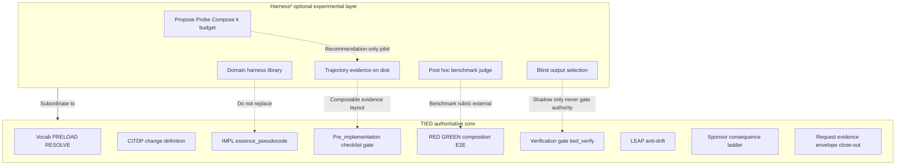

# TIED vs Harness² — traceability stack vs recursive harness optimization

| Field | Value |
| --- | --- |
| **Purpose** | Position TIED against Harness² (recursive agent harnessing) as complementary systems: TIED governs intent, change process, evidence authority, and proof; Harness² optimizes prompts, tools, memory, and orchestration around a fixed model on unseen tasks. |
| **Audience** | Sponsors, harness authors, methodology owners, and teams evaluating bounded composition without adoption claims. |
| **Status / date** | Snapshot comparison, 2026-10-18 — **reference only**; this document does not mint REQ/ARCH/IMPL tokens. |
| **Harness² snapshot** | Local read-only study input: `harness2` `0.1.0`, Apache-2.0, Python 3.12+ (reviewed 2026-10-18). Paper: [arXiv:2610.14224](https://arxiv.org/abs/2610.14224) — **external methodology**. |
| **Primary Harness² sources** | Upstream README, `docs/EXPERIMENTS.md`, `docs/BENCHMARKS.md`, `pyproject.toml`, `tests/test_workflow.py`, `harness2/core/{recursion,schedule,context,selection,ledger,library,judge,tree,proposer,spec,runmark,report}.py`, `harness2/substrate/{opencode,codex}.py`. |
| **TIED anchors (reference only)** | [REQ-TIED_SETUP](../../tied-project/requirements/REQ-TIED_SETUP.yaml), checklist gate enforcement ([ARCH-TIED_CHECKLIST_GATE_ENFORCEMENT](../../tied-project/architecture-decisions/ARCH-TIED_CHECKLIST_GATE_ENFORCEMENT.yaml) / [IMPL-TIED_CHECKLIST_GATE_ENFORCEMENT](../../tied-project/implementation-decisions/IMPL-TIED_CHECKLIST_GATE_ENFORCEMENT.yaml)), [agentstream vocab](../../tied-project/vocab/agentstream.md), [agentstream README](../../mcp-server/packages/agentstream/README.md). |
| **Sibling docs** | [Methodology composition matrix](methodology-composition-matrix.md), [Jev × TIED](jev-for-tied-improvement.md), [QMM × TIED](qmm-kaizen-vs-tied.md), [TIED vs Trail-Code](tied-vs-trail-code.md), [Claude Code team review × TIED](claude-code-team-code-review-vs-tied.md). |

## Executive summary

Harness² and TIED optimize different centers of gravity on the same agent-heavy problem space.

| Dimension | Harness² | TIED |
| --- | --- | --- |
| **Optimization target** | Harness quality on **unseen** benchmark tasks (executor + editable harness components) | **Intent traceability** and **proof** before and during implementation |
| **Canonical state** | Adopted harness trees + per-domain **experience library** on disk | Project YAML, IMPL **essence_pseudocode**, tests, vocabulary, gate receipts |
| **Authority** | Blind selection of anonymized outputs, then post-hoc judge scoring | `tied_checklist_gate_validate`, tests, `tied_validate_consistency`, sponsor **consequence ladder** |
| **Recursion metaphor** | Task-level Propose–Probe–Compose; harnessing-level reflection into library | Checklist slug order, `@tied/agentstream` turns, LEAP when artifacts diverge |

**Compose-don’t-replace:** Harness² may inform **experimental** execution and improvement loops (trajectory evidence, pilot budgets, optional shadow comparisons) **subordinate** to TIED gates, TDD, and provenance. It does **not** replace REQ→ARCH→IMPL, MCP checklist authority, PRELOAD vocabulary, or IMPL pseudo-code contracts.

---

## Source summary (Harness² only)

The following summarizes Harness² public materials for readers who do not have the repository open. Metrics and score deltas are **Harness²-reported** unless labeled **Harness²-code/tests**.

Harness² defines a **harness** as the system around a model (prompts, tools, memory, skills, orchestration). **Harnessing** is optimizing that system while **model weights stay fixed**.

Two recursion levels (**Harness²-reported** narrative; pipeline diagram in upstream README):

1. **Task-level recursion** — contrastive **Propose–Probe–Compose**: propose harness edits, probe effects on the **same** task, compose a refined harness from behavioral contrasts **without ground-truth feedback** during improvement.
2. **Harnessing-level recursion** — after adoption, reflection stores the adopted harness and evidence-supported lessons in a persistent **improvement harness** / per-domain library for later tasks.

Eight editable harness components (**Harness²-reported**): system prompt, guardrails, memory, tool guidance, subagents, skills, scripts, plugins.

Across three professional benchmarks and four model–harness configurations, upstream README claims a single Harness² step improves GLM-5 and Gemini 3.5 Flash over base harnesses, with gains of up to **11.5 points** on WorkBuddy-Bench, **4.5 points** on JobBench, and **11.8 percentage points** on LAB partial pass rate (**Harness²-reported**). Increasing task-level recursion budget `k` is claimed to bring further gains (**Harness²-reported**).

Supported substrates (**Harness²-reported**): parallel and sequential recursion, OpenCode and Codex executors, JobBench, LAB, WorkBuddy-Bench.

---

## Mechanism deep dive (code-backed)

### Propose–Probe–Compose and budgets

**Harness²-code/tests:** `harness2/core/recursion.py` implements parallel and sequential task-level recursion. Module docstring: each mode schedules **4k rollouts** and **3k improvement stages**, including shared base executions; invalid proposals get one retry before inheriting the current harness.

**Harness²-code/tests:** `harness2/core/ledger.py` defines the budget identity **R = 4k** rollouts and **P = 3k** improvement stages (base executions count toward each mode). `tests/test_workflow.py` asserts `(ledger["R"], ledger["P"]) == (4 * k, 3 * k)` for demo runs.

### Parallel vs sequential scheduling

**Harness²-code/tests:** `harness2/core/schedule.py` drives one task, one domain, or a sweep. Run namespaces follow `<bench>-<substrate>-<mode><k>[-s<seed>][-<tag>]`. On-disk mode tokens: `agg` (parallel) and `seq` (sequential). **Harness²-reported** / EXPERIMENTS: parallel explores `k` invariant and `k` domain-specific candidates then `k` compositions; sequential carries refined harness and accumulated evidence through `k` steps.

### Context, evidence tree, and grader isolation

**Harness²-code/tests:** `harness2/core/context.py` builds the evidence tree proposers read (task, full rollouts, deliverables, harness tree, library index, candidate pool). Evidence is file-backed so trajectories are not prompt-truncated.

**Harness²-code/tests:** `tests/test_workflow.py` requires reflection artifacts (rollouts, pool diffs, adoption, harness scripts) and asserts `reference_answer.txt` does not appear in the tree; `context.assert_tree_has_no_grader_verdicts` rejects grader-like strings in experience material.

### Selection, judge, and measurement order

**Harness²-code/tests:** `harness2/core/selection.py` chooses among anonymized final outputs, then reflects. Judge reads outputs **only after** selection (`harness2/core/judge.py` module docstring: judge failure is `None`, never zero, and excluded from denominator).

**Harness²-reported** (BENCHMARKS): adapters remove rubric criteria from material passed to the improver where documented (e.g. LAB); JobBench rubrics stay outside improver evidence; public rubrics on Hugging Face imply **web-access risk** (EXPERIMENTS web-access section).

### Library, resume, and fingerprints

**Harness²-code/tests:** `harness2/core/library.py` stores per-domain adopted harness trees and `EXPERIENCE.md`; tasks within a domain run in order and read only earlier entries; libraries scoped by benchmark, executor, mode, budget, seed.

**Harness²-code/tests:** `tests/test_workflow.py` verifies resume skips completed tasks, repairs post-selection tampering, and keeps failed reflection (`NO_ENTRY`) out of the library on resume.

### Structural validation and proposal repair

**Harness²-code/tests:** Invalid proposals retry with feedback (`PREVIOUS ATTEMPT WAS REJECTED` in mission) and accumulate cost (`test_invalid_proposal_retries_with_feedback_and_accumulates_cost`).

### On-disk results layout

**Harness²-reported:** Default roots `runs/lab/`, `runs/jb/`, `runs/wb/<subset>/` with summaries, deliverables, adopted harnesses, reflection notes, graded results. Same command resumes; incompatible model/task changes require new `HARNESS2_RUNS_DIR` (EXPERIMENTS).

---

## Touchpoint 1 — RESOLVE (Harness² / paper → TIED vocabulary)

| External term | TIED preferred term | Notes |
| --- | --- | --- |
| **Harness** (eight editable components) | **Agent execution surface** / **prompt-type workflow** | TIED governs checklist + gates; Harness² optimizes prompts/tools/memory around a fixed model |
| **Harnessing** | **Runtime improvement loop** (external) vs **LEAP + Kaizen** (TIED) | Do not equate harness refinement with REQ→ARCH→IMPL propagation |
| **Task-level recursion** (Propose–Probe–Compose) | **Experimental turn orchestration** | Contrast with `@tied/agentstream` turns and checklist slug order |
| **Harnessing-level recursion** | **Domain lesson library** (external) vs **project YAML + vocab + feedback** (TIED durable state) |
| **Improvement harness** | Not TIED **IMPL essence_pseudocode** | Lessons are executor-scoped; TIED contracts are token-linked |
| **Blind final selection** | **Shadow / advisory selection** (compose only) | Must not override `tied_checklist_gate_validate` or sponsor **costly choice** |
| **Judge / grader tripwires** | **Benchmark rubric** (external) vs **tests + gates + proof boundary** (TIED) |
| **On-disk ledger / resume fingerprint** | **Working evidence layout** (composable pattern) vs **request evidence envelope** (TIED close-out) |
| **Fixed budget identity (`k`, mode, seed)** | **Pilot budget + stop criteria** ([quality-assurance](../../tied-project/vocab/quality-assurance.md)) | Any TIED pilot needs denominators and `not_measured` discipline |
| **OpenCode / Codex substrate** | **Client-owned executor adapter** | Defer network/sandbox/licensing to operating-environment row |

### Disposition key

| Disposition | Meaning in this comparison |
| --- | --- |
| **Align** | TIED already represents the same intent (scoped as stated). |
| **Composable** | Client or operator can combine without claiming equivalence. |
| **Tension** | Both sides partially true; proof boundary must be explicit. |
| **Gap** | Harness² emphasis not covered in TIED core today. |
| **Defer** | Client-owned substrate, CI, or out of TIED scope. |

### Claim labeling (used in this document)

| Label | Use when |
| --- | --- |
| **Harness²-reported** | README, paper, BENCHMARKS narrative metrics |
| **Harness²-code/tests** | Behavior supported by cited file/test |
| **TIED-existing** | Anchors to committed REQ/ARCH/IMPL/docs |
| **Recommendation-only** | Compose suggestions not implemented |

---

## Primary capability matrix

| Area | Harness² emphasis | TIED emphasis | Disposition |
| --- | --- | --- | --- |
| Optimization target | Harness quality on unseen tasks | Intent traceability + proof | **Tension** |
| Canonical state | Adopted harness + per-domain library | Project YAML, IMPL pseudo-code, tests | **Tension** |
| Recursion / turns | P–P–C loops, `k` budget | Checklist slugs, agentstream turns | **Composable** |
| Evidence / context | Execution trajectories on disk | Envelopes, gate receipts, working placement | **Composable** |
| Validation | Graders, rubrics, tripwires | `pseudocode_validate`, tests, `tied_validate_consistency` | **Tension** |
| Selection / judging | Blind selection + post-hoc judge | Gates, `tied_verify`, sponsor ladder | **Gap** (partial compose) |
| Memory | Domain library of adopted harnesses | Vocab + feedback + LEAP stack | **Composable** |
| Budgets / reproducibility | `k`, mode, seed, run dir identity | Pilot charters, denominators, stop criteria | **Align** (intent) |
| Substrate adapters | OpenCode, Codex, bridge | Executor behind agentstream / client CI | **Defer** (client-owned) |
| Security / network / license | GCP, Docker benches, web access docs | OEE, assurance profiles, proof boundary | **Defer** + **Tension** |

---

## Authority boundary diagram

Harness² belongs in an **optional experimental layer** around TIED core authorities—not as a replacement for gates, YAML MCP writes, PRELOAD, IMPL pseudo-code, or costly-choice sponsor branch.

---

## What Harness² does not replace

Harness² should not be treated as an alternative authority for:

- requirements and sponsor intent;
- architecture decisions or implementation contracts;
- semantic-token registration and REQ → ARCH → IMPL traceability;
- domain-vocabulary RESOLVE, PRELOAD, RECORD, or VALIDATE;
- IMPL `essence_pseudocode` and its block-level token comments;
- unit-test-first or composition-test-first sequencing;
- module validation and testability classification;
- CITDP risk/change-surface analysis;
- TIED YAML writes or project/methodology write isolation;
- checklist gate `allowed` decisions, waivers, or gate receipts;
- `tied_validate_consistency`, token validation, or pseudo-code validation;
- LEAP propagation when tests or code diverge from documented intent;
- sponsor **costly choice** decisions on the consequence ladder.

Conversely, TIED should not claim to replace Harness²’s purpose-built **harness refinement on unseen benchmark tasks** unless TIED intentionally scopes, pilots, and validates an equivalent loop with explicit denominators.

---

## Bounded composition opportunities (Recommendation-only)

All items below are **Recommendation-only** and subordinate to TIED gates, TDD, and provenance.

1. **Evidence-on-disk layouts** — Mirror Harness²’s file-backed trajectory trees under `tied-bundle/working/{REQ-TOKEN}/` for integrated depth, without letting raw rollouts become authoritative over IMPL or tests.
2. **Trajectory-grounded divergence analysis** — Use execution contrasts to inform Kaizen observations or Loop 3 hypotheses; route confirmed findings through owning checklist steps, not ad-hoc stack edits.
3. **Explicit pilot budgets** — Adopt `k`, mode, seed, and run-namespace discipline when running any harness experiment inside a TIED client; document stop criteria and API cost ceilings per [quality-assurance](../../tied-project/vocab/quality-assurance.md).
4. **Domain lesson distillation** — Map Harness² library semantics to **feedback** and vocabulary RECORD, not to silent IMPL changes.
5. **Optional blind/shadow comparisons** — Compare candidate agent outputs without granting selection logic gate authority; keep `tied_checklist_gate_validate` deterministic.
6. **Adapter seam near `@tied/agentstream`** — Client-owned executor wiring (OpenCode/Codex/custom) stays outside TIED methodology YAML; document OEE and licensing per benchmark.

---

## Explicit non-adoptions

Do **not** treat the following Harness² patterns as TIED defaults:

- LLM selector bias from blind choice prompts without human/sponsor review on costly paths;
- Single-rollout attribution when checklist evidence requires reproducible gate receipts;
- Rubric or benchmark leakage when executors have unrestricted web access (**Harness²-reported** validation note in EXPERIMENTS);
- Full-bench API cost without pilot denominators and sponsor approval;
- Network/sandbox assumptions from Codex or Docker benchmark adapters copied into production agent policy without OEE review;
- Library/resume semantics that skip contamination checks (post-selection tampering repair is Harness²-specific — **Harness²-code/tests**);
- Conflating **harness improvement** on benchmarks with **product correctness** under REQ→ARCH→IMPL.

---

## Phased recommendations (doc-first)

| Phase | Scope | TIED action | Proof status |
| --- | --- | --- | --- |
| **0** | This comparison doc | Publish analysis-only artifact; link composition matrix | **TIED-existing** (documentation) |
| **1** | Feedback / observation | Record compose hypotheses in Kaizen/feedback; no MCP gate changes | **Recommendation-only** |
| **2** | Optional methodology learning experiment | Baseline + `not_measured` until denominators exist (see [QMM × TIED Loop 3 honesty](qmm-kaizen-vs-tied.md)) | **not_measured** until experiment |
| **3** | Matrix row + REQ | Separate sponsor **costly choice** / `plan-new-feature`; do not edit [methodology-composition-matrix.md](methodology-composition-matrix.md) in Phase 0 | **Deferred** |

---

## Implementation snapshot (2026-10-18)

**Scope:** `[REQ-TIED_BOUNDED_COMPOSITION]` build-plan Slices 0–5 in the STDD methodology repo (default-off, advisory-only analyzers).

| Opportunity (doc § recommendations) | STDD module | Proof status |
| --- | --- | --- |
| Pilot budgets | `mcp-server/src/bounded-composition/pilot-budget.ts` | **TIED-shipped** — unit + composition tests; `pilot-budget.v1`; R=4k/P=3k formula field only |
| Trajectory evidence-on-disk | `trajectory-manifest.ts`, `working-root.ts` trajectories class | **TIED-shipped** — local `tied-bundle/working/{REQ}/trajectories/`; compact manifests |
| Divergence analysis | `divergence-analysis.ts` | **TIED-shipped** — read-only reports; no finding-ledger/YAML writes |
| Lesson distillation | `lesson-distillation.ts` | **TIED-shipped** — draft-only; explicit operator bridge |
| Advisory shadow comparison | `shadow-comparison.ts` | **TIED-shipped** — `selection_authority: none`; gate regression composition test |
| AgentDriver seam | `agentstream-seam.ts` + composition with schedule executor | **TIED-shipped** — injectable driver; cursor/claude/dry_run unchanged; **C2 deferred** (no external binaries) |

**Verification (Slice 5):** 45/45 `bounded-composition` tests; seven-row binding inventory validated; integrated adversarial inquiry at `bc-verify-20261018` / `bc-closeout-20261018`; checklist **verification** gate `allowed: true`; request-evidence envelope `fail_on_error_gaps` with **blocking_gap_count=0** (advisory inquiry warns only). **Machine close_out** remains **deferred** until sponsor **traceable-commit**.

**Still deferred (sponsor):** methodology-composition-matrix row (**C1**); concrete OpenCode/Codex adapter (**C2**); effectiveness claims remain **`not_measured`**.

---

## Proof boundary

- README and paper score deltas (for example up to **11.5** / **4.5** / **11.8** point gains) are **Harness²-reported**. Do **not** cite them as TIED outcomes, targets, or checklist success metrics.
- **Harness²-code/tests** behaviors describe the external snapshot’s engineering contracts, not TIED shipped features.
- Any future TIED pilot that borrows Harness² mechanics requires its own scoped REQ/CITDP, explicit budgets, and effectiveness status **`not_measured`** until an enrolled experiment records otherwise.
- This document introduces **no new** `[REQ-*]`, `[ARCH-*]`, or `[IMPL-*]` work items.

---

## Related documents

- [Methodology composition matrix](methodology-composition-matrix.md)
- [Jev for TIED improvement](jev-for-tied-improvement.md)
- [QMM Kaizen vs TIED](qmm-kaizen-vs-tied.md)
- [TIED vs Trail-Code/Graft](tied-vs-trail-code.md)
- [Claude Code team code review vs TIED](claude-code-team-code-review-vs-tied.md)
- [Agentstream README](../../mcp-server/packages/agentstream/README.md)
- [Quality assurance vocabulary](../../tied-project/vocab/quality-assurance.md)
- [Sponsor–agent relationship](../../tied-project/vocab/sponsor-agent-relationship.md)
