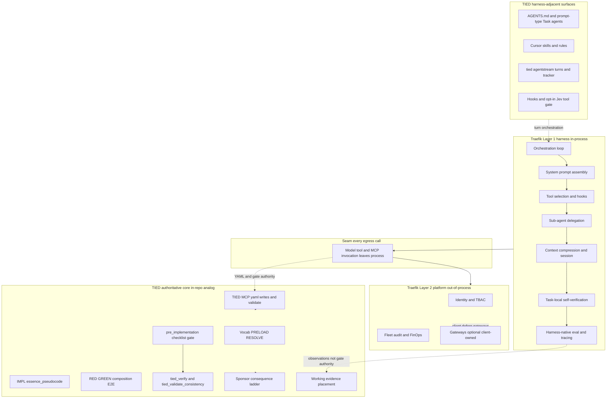

# Traefik harness vs platform × TIED — agent management lens

| Field | Value |
| --- | --- |
| **Purpose** | Map Traefik’s harness-engineering vs platform-engineering mental model to TIED as it exists in this repository, with emphasis on **in-IDE agent management** (orchestration, prompts, tools, subagents, context, eval/tracing, session lifecycle)—not enterprise gateway products as the center of gravity. |
| **Audience** | Sponsors, harness authors, prompt-type operators, methodology owners, and teams separating **turn orchestration** from **governance authority** without conflating this article with the Harness² research paper. |
| **Source URL** | [Harness Engineering vs Platform Engineering: A Mental Model for How Both Win](https://traefik.io/blog/harness-engineering-vs-platform-engineering-a-mental-model-for-how-both-win) (Traefik blog, May 7, 2026) |
| **Article captures (siblings)** | Traefik: [traefik-harness-engineering-vs-platform-engineering.md](traefik-harness-engineering-vs-platform-engineering.md); LangChain (Terminal Bench 2.0 harness study): [langchain-improving-deep-agents-harness-engineering.md](langchain-improving-deep-agents-harness-engineering.md) — read-only captures; **reference only** |
| **Status / date** | Outreach / analysis snapshot, **2026-10-20** — **reference only; this document does not mint REQ/ARCH/IMPL tokens** |
| **Executable follow-up** | [REQ-TIED_HARNESS_PLATFORM_SEAM](../../tied-project/working/REQ-TIED_HARNESS_PLATFORM_SEAM/PLAN.md) — operator docs and authority checklist derived from this comparison; tokens live in project YAML, not in this outreach file |
| **Distinct from** | [TIED vs Harness²](tied-vs-harness2.md) (recursive harness optimization paper/tooling)—same English word *harness*, different subject matter |
| **TIED anchors (reference only)** | [AGENTS.md](../../AGENTS.md), [agent-req-implementation-checklist](../../tied-bundle/docs/agent-req-implementation-checklist.md), [fresh-client-prompt-activation-map](../../tied-bundle/docs/fresh-client-prompt-activation-map.md), [sponsor-agent-relationship](../../tied-project/vocab/sponsor-agent-relationship.md), [agentstream vocab](../../tied-project/vocab/agentstream.md), [agentstream README](../../mcp-server/packages/agentstream/README.md) |

---

## Executive summary

Traefik argues that production agentic systems have **three layers** with a deliberate **seam** between them. **Layer 1 (harness)** is everything in-process around one agent: orchestration loop, system prompt assembly, tool definitions and execution, hooks and middleware, sub-agent delegation, in-process memory, context compression, session lifecycle, structured output parsing, and task-local self-verification. **Layer 2 (platform)** is out-of-process fleet governance: identity, authorization, audit, rate limits, cost attribution, secrets injection, content filtering, regional routing, failover, and cross-agent observability—often expressed as gateway patterns (API, AI, MCP) but defined architecturally as **uniform enforcement at egress**. **Layer 3 (targets)** are models, MCP servers, and application APIs treated as governed dependencies.

TIED’s center of gravity is different and complementary. TIED optimizes **intent traceability and proof before and during implementation**: RESOLVE/RECORD vocabulary discipline, CITDP change definition, IMPL **essence_pseudocode** with block-level token comments, checklist **pre_implementation** gates, strict TDD order, MCP-first project YAML writes, **`tied_validate_consistency`**, verification-gated **`tied_verify`**, LEAP when artifacts diverge, and the sponsor **consequence ladder** for **costly choices**. In a Traefik-shaped deployment, much of that stack behaves like **platform-adjacent governance** (deterministic gates, YAML authority, validation)—while **Cursor/Claude turn execution**, prompt-type skills, rules, hooks, and **`@tied/agentstream`** pipeline assembly behave like the **harness**.

**Compose-don’t-replace:** Tune orchestration, context, subagent delegation, and harness-native tracing in the layer where latency and task semantics live; keep **gate authority**, **project YAML writes**, **token traceability**, and **sponsor agency** on the TIED/MCP/checklist plane. Do not collapse “make the agent faster” with “decide what shipped is allowed to mean.”

---

## Source summary (Traefik article claims only)

The following summarizes the captured Traefik post for readers who do not have the article open. Benchmark anecdotes (LangChain Terminal-Bench gains — see [LangChain harness capture](langchain-improving-deep-agents-harness-engineering.md) for primary source; Cursor harness team practices; Opus self-verification) are **Traefik-reported industry narrative** where cited via Traefik, **LangChain-reported** where cited via the LangChain capture, and not TIED outcomes.

The article reframes 2026 discourse: the **model is half the system; the harness is the other half**—but the harness alone is not the whole architecture. **Platform engineering** owns cross-cutting concerns that must be **consistent, auditable, and durable** across many agents and harness frameworks. The **seam** is where every model call and tool invocation leaves the agent process; a clean seam lets harnesses churn while governance accretes.

Harness scope is **task-specific and model-specific**; improvements compound via **tracing, evaluation harnesses, and iterative tuning**. Platform scope is **fleet-wide**; the article warns of **governance gravitational pull**—auth, routing, secrets, and audit creeping into harness middleware for speed or vendor stickiness.

Anti-patterns named in the article include **auth in the harness**, **per-product harness with no platform**, **harness vendor as governance vendor**, **model lists hard-coded in harness config**, and **MCP servers as direct dependencies** without a governed egress. Forward-looking claims: harnesses may **thin** as models absorb capabilities; platforms **thicken** as autonomy increases audit surface.

---

## Harness engineering lessons for TIED agent management

This section maps Traefik **Layer 1 (harness)** concerns to concrete TIED surfaces in this repository. Enterprise gateways appear only where they illustrate the **platform seam**—not as the primary operator story for TIED clients.

### Orchestration loop and session lifecycle

| Traefik harness concern | TIED surface | Notes |
| --- | --- | --- |
| ReAct / thought–action–observation loop | Cursor Agent / Claude Code **live executor**; optional **`tied agentstream`** multi-turn pipeline | Agentstream **Turn** + **ChainFromPrevious** ([agentstream vocab](../../tied-project/vocab/agentstream.md)) models session chain vs fresh session; checklist **tracker** dispositions gate progression |
| Session persistence and checkpointing | **Authoritative Tracker** (`checklist-tracker.v1`), adherence ledger, working markers | Committed rationale under `tied-project/working/`; machine evidence under `tied-bundle/working/` per [working-artifact-placement](../../tied-bundle/docs/working-artifact-placement.md) |
| Lifecycle management | Prompt-type workflows (`add-feature`, `build-plan`, `non-tied-plan`, …) via **Task** subagents | Each prompt type is a **bounded harness profile**; TIED-tracked types subordinate to checklist slugs |

### System prompt assembly, rules, and skills

| Traefik harness concern | TIED surface | Notes |
| --- | --- | --- |
| System prompt assembly | [AGENTS.md](../../AGENTS.md) loader → methodology docs; **`.cursor/rules`**, **`.cursor/skills/`** installed by `tied-install.sh` | Global bootstrap is harness territory; **REQ/ARCH/IMPL** content is platform-adjacent authority loaded read-only from `tied-bundle/` |
| Hooks and middleware | Cursor **hooks** (e.g. adherence append bridge); agentstream **Jev harness preflight/live tool gate** (opt-in) | Jev paths **fail-closed** on blocking tool proposals—they do **not** replace **`tied_checklist_gate_validate`** or MCP YAML writes ([agentstream README](../../mcp-server/packages/agentstream/README.md)) |
| Domain task encoding | Client **`tied-project/vocab/`**, path-scoped review guidance, prompt-type **SKILL.md** bodies | RESOLVE before naming; RECORD in vocab is **not** a substitute for IMPL pseudo-code |

### Tools, MCP, and subagent delegation

| Traefik harness concern | TIED surface | Notes |
| --- | --- | --- |
| Tool definitions and execution | IDE **Shell**, **Grep**, dynamic MCP tools; **TIED MCP** (`project-*-tied-yaml`) for YAML/gates | **Wrong `TIED_BASE_PATH`** is the client analog of “MCP direct without platform”—writes land in the wrong tree ([AGENTS.md](../../AGENTS.md) session bootstrap) |
| Sub-agent delegation | Cursor **Task** tool + `.cursor/agents/*` wrappers; prompt-type router (`add-feature`, `question`, `non-tied-plan`, …) | Delegation logic is harness-side; **gate receipts** and **verification** remain platform-adjacent |
| Tool selection for a task | Model + skill instructions; optional Jev **evaluateHarnessToolCall** on Shell/bash | Task-specific selection stays in harness; **which tools may mutate project YAML** is MCP/checklist policy |

### Context, compression, and memory

| Traefik harness concern | TIED surface | Notes |
| --- | --- | --- |
| Context window compression | IDE context management; agentstream **pipeline Build** source order; PRELOAD glossary routing | TIED **PRELOAD** reduces wrong-vocabulary reads—orthogonal to token compression |
| In-process memory | Chat/session state in IDE; **feedback** and Kaizen store (durable learning, not IMPL authority) | Do not treat chat memory as **essence_pseudocode** or gate state |
| Offloading long reasoning | Working folders, request evidence envelopes, trajectory manifests (bounded composition) | File-backed evidence composes with gates; raw rollouts must not override tests/IMPL ([tied-vs-harness2.md](tied-vs-harness2.md) proof boundary) |

### Self-verification, eval, and tracing

| Traefik harness concern | TIED surface | Notes |
| --- | --- | --- |
| Self-verification of model output | **`pseudocode_validate`**, RED/GREEN tests, **`tied_verify`**, **`tied_validate_consistency`** | TIED **verification** is proof-oriented, not “model re-reads its diff” alone |
| Eval and tracing of agent reasoning | Adherence ledger, **`tied_adherence_reconcile_run`**, integrated **adversarial inquiry** (depth-gated), Kaizen / Loop 3 corpora | Harness-native traces inform **observations**; confirmed findings route through owning checklist steps |
| Benchmark-style harness tuning | External (LangChain/Cursor narratives in article) | Any TIED pilot needs explicit budgets and **`not_measured`** effectiveness status |

### Platform-adjacent TIED governance (Traefik Layer 2 analog in-repo)

| Traefik platform concern | TIED analog (this repo) | Harness must not absorb |
| --- | --- | --- |
| Authorization to invoke tools/data | Checklist gates, **`tied_edpc_*`** / quality validators where scoped, assurance profiles | Ad-hoc “you may edit YAML” in a skill without MCP base-path check |
| Audit trail | Gate receipts, adherence ledger event classes, request evidence envelope | Self-reported “tests passed” without manifest refs |
| Consistent validation across agents | **`tied_validate_consistency`**, **`yaml_index_validate`**, token validation scripts | Per-operator manual YAML edits bypassing MCP |
| Identity / fleet egress | **Defer** to client infra (gateways, SSO)—document in client DevOps appendix | Encoding tenant auth only in `.cursor/skills` |

### Sponsor–agent boundary (cross-cutting)

Traefik’s “application team owns harness; platform owns fleet governance” parallels TIED’s **agency boundary**: the **instrument branch** (agent, gates, receipts) vs the **person branch** (sponsor, reviewer). Automation and MCP gates **inform**; **costly choices** stay on the [consequence ladder](../../tied-project/vocab/sponsor-agent-relationship.md). Prompt-type routers must not silently approve scope that CITDP or sponsor charter would classify as costly.

---

## Touchpoint 1 — RESOLVE (Traefik / industry → TIED vocabulary)

| External term | TIED preferred term / surface | Notes |
| --- | --- | --- |
| **Harness** (in-process wrapper) | **Agent execution surface** — IDE agent, **harness profile** (`cursor` \| `claude`), prompt-type **Task** subagent | Distinct from Harness² paper “harness optimization” ([tied-vs-harness2.md](tied-vs-harness2.md)) |
| **Platform** (out-of-process fleet) | **Client platform layer** (gateways, identity, FinOps) + **TIED MCP governance plane** (YAML, gates, validate) | TIED in-repo platform analog is MCP/checklist/validate—not Traefik product |
| **Seam** (harness ↔ platform) | **Authority boundary** — harness turns vs **gate authority** / MCP writes / sponsor ladder | Same intent as Harness² authority diagram; different external source |
| **Triple Gate** (API / AI / MCP) | **Egress control point** (client-owned) | Mention as platform pattern only; TIED does not ship gateways |
| **Orchestration loop** | **Turn pipeline** — agentstream **Turn**, checklist slug order, Cursor multi-step agent | Latency-sensitive; stays harness-side |
| **Sub-agent delegation** | **Task** subagent + `.cursor/agents/*` prompt-type wrappers | Internal to one operator session; not fleet identity |
| **Self-verification** | **`pseudocode_validate`**, tests, **`tied_verify`** | Model self-check composes; does not replace gates |
| **Eval / tracing** (reasoning) | **Adherence ledger**, reconcile, adversarial inquiry artifacts, Kaizen observations | Advisory until checklist-owned confirmation |
| **Session persistence** | **Tracker** + **ChainFromPrevious** + working placement | Tracker is authoritative for checklist progress |
| **Tool call** | IDE tools + **TIED MCP tools** | YAML mutations **only** via MCP/tied-cli skill path |
| **MCP server** (target) | **TIED MCP** + third-party MCP namespaces | Configure **`TIED_BASE_PATH`** like a platform seam for project writes |
| **pre_implementation gate** | Checklist slug + **`tied_checklist_gate_validate`** / DAE agentstream preflight | Platform-adjacent; runs before heavy implementation turns when enabled |

### Disposition key

| Disposition | Meaning in this comparison |
| --- | --- |
| **Align** | TIED already represents the article layer’s intent for agent-heavy delivery (scoped as stated). |
| **Composable** | Client or operator can combine Traefik-style harness tuning with TIED without equivalence claims. |
| **Tension** | Both sides partially true; proof boundary must be explicit. |
| **Gap** | Article emphasis not covered in TIED core today. |
| **Defer** | Enterprise gateway/Fleet infra, client CI, or out of TIED methodology scope. |

---

## Primary layer matrix (Traefik three layers × TIED)

| Traefik layer / concern | TIED center of gravity | Disposition | One-line rationale |
| --- | --- | --- | --- |
| L1 Orchestration loop | IDE agent + agentstream executor | **Composable** | TIED checklist orders work; IDE runs the loop. |
| L1 Prompt assembly | AGENTS.md, skills, rules, prompt-type SKILL.md | **Composable** | Bootstrap is harness; token graph is platform-adjacent. |
| L1 Tool defs & execution | Shell/IDE MCP + tied-yaml MCP | **Tension** | Same tool surface; YAML writes require MCP seam discipline. |
| L1 Hooks / middleware | Cursor hooks, Jev harness tool gate (opt-in) | **Composable** | Fail-closed guardrails; not checklist gate authority. |
| L1 Sub-agent delegation | Task + prompt-type agents | **Align** (pattern) | Matches “internal planning fan-out.” |
| L1 Context compression | IDE + pipeline Build order | **Defer** (IDE) + **Composable** (PRELOAD) | TIED reduces wrong reads; not token math. |
| L1 Session / checkpoint | Tracker, adherence, working roots | **Align** | File-backed session state tied to checklist evidence. |
| L1 Self-verification | Tests, pseudocode_validate, tied_verify | **Align** (proof) **Tension** (model self-check) | TIED proof ≠ model “am I done?” heuristic alone. |
| L1 Eval / tracing (reasoning) | Adherence, inquiry, Kaizen | **Composable** | Traces feed learning; gates stay deterministic. |
| L2 Identity / auth | Client SSO + gateway (**Defer**) | **Defer** | Not TIED core; don’t encode in skills as sole control. |
| L2 Tool authorization (TBAC) | Gates, assurance profiles, EDPC validators (scoped) | **Align** (intent) **Gap** (fleet TBAC) | In-repo gates are not enterprise MCP gateway. |
| L2 Audit / observability | Gate receipts, adherence ledger, envelopes | **Align** (scoped) | Cross-session audit in working evidence layout. |
| L2 Rate limits / cost / secrets | Client platform (**Defer**) | **Defer** | CFO/FinOps at egress; not harness middleware long-term. |
| L2 MCP egress governance | Client MCP gateway (**Defer**) | **Defer** | Article remedy; TIED warns via wrong-base-path class of bugs. |
| L3 Models | Client model choice; harness **model class** request | **Defer** | Policy routing is platform; fit-per-subtask is harness. |
| L3 MCP / APIs as targets | TIED MCP, cursor-origin, third-party MCP | **Composable** | Treat as dependencies with configured seams. |
| **Governance gravitational pull** | Skills absorbing gate/YAML authority | **Tension** | Anti-pattern: “auth in harness” → gate logic in ad-hoc prompts. |
| **Sponsor accountability** | Consequence ladder, costly choice | **Align** | Person branch owns irreversible scope. |

---

## Anti-patterns (article → TIED risk)

| Traefik anti-pattern | Symptom in agent-heavy TIED clients | TIED-oriented remedy |
| --- | --- | --- |
| **Auth in the harness** | “Only edit `tied-project/` if you feel confident” in a skill; waiver language in subagent prompts | Keep **gate authority** on MCP/checklist; costly paths on sponsor ladder |
| **Per-product harness with no platform** | Each repo uses different ad-hoc YAML edit habits; no **`tied_validate_consistency`** in CI | Standardize **TIED MCP base path**, validation in client CI, shared checklist YAML |
| **Harness vendor as governance vendor** | Treating Cursor rules as sole spec for REQ→ARCH→IMPL | Rules/skills **compose** with IMPL pseudo-code and gates—they do not replace them |
| **Model list in harness config** | Hard-coded model in scripts while policy needs region/cost routing | **Defer** model policy to client platform; harness requests capability class |
| **MCP direct without platform seam** | Bypassing tied-yaml MCP for “speed”; multi-root workspace wrong **`TIED_BASE_PATH`** | MCP-first YAML; session-start **`tied_config_get_base_path`**; document **TIED_YAML_BYPASS** only when tooling gaps force it |
| **Eval without proof boundary** | Citing Terminal-Bench or vendor blog gains as TIED methodology success | Label **Traefik-reported** / **vendor-reported**; TIED effectiveness **`not_measured`** until enrolled experiments |

---

## Authority boundary diagram (Traefik seam × TIED)

---

## Compose-don’t-replace: tune harness vs keep platform authority

| Operator should tune in the **harness** (Layer 1) | Must stay **platform / MCP / gate** authority |
| --- | --- |
| Prompt-type choice, subagent delegation, and turn prompts | **`tied_checklist_gate_validate`** outcomes and waivers |
| Skill wording for RESOLVE hints (not RECORD into TIED YAML via chat) | Project **REQ/ARCH/IMPL** writes via **TIED MCP** or **tied-cli** |
| Agentstream **harness profile** (`cursor` vs `claude`), dry-run previews | **Authoritative Tracker** completion receipts and evidence ref resolution |
| Context tricks: PRELOAD routing, pipeline source order, path-scoped REVIEW.md | **IMPL essence_pseudocode** and **`pseudocode_validate`** before implementation |
| Hooks and opt-in Jev **Shell** blocking (fail-closed) | **Costly choice** and scope expansion on sponsor ladder |
| Harness-native trace capture under `tied-bundle/working/` | Committed rationale and PLAN docs under `tied-project/working/` |
| Iterative prompt/tool tuning from Kaizen or Loop 3 **observations** | LEAP propagation and token registry updates after confirmed drift |
| Session chain vs fresh session (**ChainFromPrevious**) | Verification-gated **`tied_verify`** status when enabled |

---

## Bounded recommendations for TIED client operators (Recommendation-only)

All items are **Recommendation-only**; they do not mint tokens or change MCP gate authority.

1. **Session bootstrap seam** — Start every implementation session with **`tied_config_get_base_path`** (or tied-cli equivalent) before any YAML mutation; treat mis-pointed MCP like Traefik’s “MCP direct without gateway” class of defect.
2. **Prompt-type as harness profiles** — Document which Task subagents are TIED-tracked vs **non-tied-plan** / **question**; keep delegation instructions from implying gate waivers.
3. **Agentstream preflight chain** — When running batch checklist pipelines, understand opt-in **DAE gate preflight** and **Jev harness** as **harness middleware** that composes with, not replaces, checklist gates ([agentstream README](../../mcp-server/packages/agentstream/README.md)).
4. **Evidence placement discipline** — Mirror Traefik’s “reasoning internal / audit external” split using [working-artifact-placement](../../tied-bundle/docs/working-artifact-placement.md): committed handoff vs regenerable machine evidence.
5. **Eval loop honesty** — Use adversarial inquiry, adherence reconcile, and Kaizen for **improvement hypotheses**; cite vendor benchmark stories only as **external**, with **`not_measured`** TIED effectiveness until denominators exist.
6. **Thin harness, thick governance readiness** — As models absorb self-verification, invest in **test + gate + envelope** thickness rather than duplicating fleet auth inside `.cursor/skills`.
7. **Client platform before harness consolidation** — For multi-team clients, standardize **`tied_validate_consistency`** and MCP config before arguing about a single IDE harness vendor.

---

## Explicit non-adoptions

- **Triple Gate product stack** as TIED core — **Defer** to client infrastructure; comparison uses the pattern only to name the seam.
- **Authorization encoded only in skills or subagent prompts** — contradicts TIED gate and sponsor models.
- **Terminal-Bench-style “harness is the product”** as substitute for REQ→ARCH→IMPL traceability.
- **Conflating this Traefik article with Harness²** — see [tied-vs-harness2.md](tied-vs-harness2.md) for recursive benchmark harnessing.
- **Bypassing MCP** for routine project YAML because “platform latency” — wrong-base-path risk dominates microsecond savings.

---

## Proof boundary

- Traefik’s industry anecdotes (LangChain rank gains, Cursor harness team practices, Opus self-verification, gateway latency orders of magnitude) are **Traefik-reported** or **vendor-reported** in the Traefik capture; LangChain Terminal Bench metrics in [langchain-improving-deep-agents-harness-engineering.md](langchain-improving-deep-agents-harness-engineering.md) are **LangChain-reported**. Do **not** cite them as TIED outcomes, checklist success metrics, or methodology effectiveness.
- TIED surfaces referenced here (**TIED-existing**) describe committed docs and tooling behavior at authoring time; they are not effectiveness claims.
- Any future client pilot that borrows Traefik-style harness/platform separation for agent management requires its own scoped experiment charter, explicit denominators, and status **`not_measured`** until recorded otherwise.
- This document introduces **no new** `[REQ-*]`, `[ARCH-*]`, or `[IMPL-*]` records **in its body**; scoped implementation is tracked separately as **REQ-TIED_HARNESS_PLATFORM_SEAM** (see metadata table).

---

## Related documents

- [Authority boundary operator checklist](../../tied-project/working/REQ-TIED_HARNESS_PLATFORM_SEAM/authority-boundary-operator-checklist.md) — fast skim before turns (REQ-TIED_HARNESS_PLATFORM_SEAM)
- [Traefik article capture (sibling)](traefik-harness-engineering-vs-platform-engineering.md)
- [LangChain harness engineering article capture (sibling)](langchain-improving-deep-agents-harness-engineering.md)
- [TIED vs Harness²](tied-vs-harness2.md) — distinct “harness” subject; recursive optimization vs Traefik fleet seam
- [Methodology composition matrix](methodology-composition-matrix.md)
- [Claude Code team code review × TIED](claude-code-team-code-review-vs-tied.md) — compose-don’t-replace pattern for external methodology
- [@tied/agentstream README](../../mcp-server/packages/agentstream/README.md)
- [Agentstream vocabulary](../../tied-project/vocab/agentstream.md)
- [Sponsor–agent relationship](../../tied-project/vocab/sponsor-agent-relationship.md)
- [Working artifact placement](../../tied-bundle/docs/working-artifact-placement.md)
- [Fresh client prompt activation map](../../tied-bundle/docs/fresh-client-prompt-activation-map.md)
