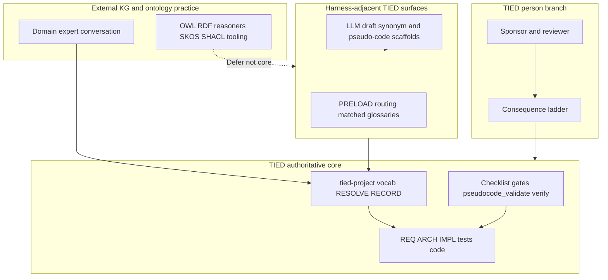

# Heimsbakk “AI-generated Ontologies” × TIED — agent management lens

| Field | Value |
| --- | --- |
| **Purpose** | Map Veronika Heimsbakk’s **meaning-ownership critique of LLM-generated ontologies** (conversation, human blueprint, draft enrichment, authorship vs review) to TIED as implemented in this repository—with emphasis on **vocabulary**, **token traceability**, and **sponsor–agent authority**—not enterprise RDF/OWL tooling or article claims as verified fact. |
| **Audience** | Sponsors, ontology/KGM practitioners, harness authors, prompt-type operators, methodology owners |
| **Source URL** | [On AI-generated Ontologies — Heimsbakk, 2026-10-22](https://veronahe.substack.com/p/on-ai-generated-ontologies) (**Heimsbakk-reported**); full text **not** in repo — [sibling stub](veronika-heimsbakk-on-ai-generated-ontologies.md) |
| **Article reference (sibling)** | [veronika-heimsbakk-on-ai-generated-ontologies.md](veronika-heimsbakk-on-ai-generated-ontologies.md) — metadata + TL;DR only; **reference only** |
| **Status / date** | Outreach / analysis snapshot, **2026-10-22** — **reference only; this document does not mint REQ/ARCH/IMPL tokens** |
| **Executable follow-up** | *(Wave 3: P1 bundle doc updates in this build; P2–P3 **Defer** unless sponsor scopes add-feature)* |
| **Distinct from** | [Ludanyi × TIED](andras-ludanyi-illusion-of-measurement-judgment-cooperation-vs-tied-agent-management.md) (people/proxy metrics); [LangChain harness × TIED](langchain-harness-engineering-vs-tied-agent-management.md) (trace/benchmark); [Cursor harness × TIED](cursor-harness-engineering-vs-tied-agent-management.md) (product telemetry); [TIED vs well-known methodologies](tied-vs-well-known-methodologies.md) (broad map) |
| **TIED anchors (reference only)** | [AGENTS.md](../../AGENTS.md), [vocabulary-layer-tied-leap-citdp.md](../../tied-bundle/docs/vocabulary-layer-tied-leap-citdp.md), [vocabulary-index-analysis-and-standards.md](../../tied-bundle/docs/vocabulary-index-analysis-and-standards.md), [agent-req-implementation-checklist.md](../../tied-bundle/docs/agent-req-implementation-checklist.md), [sponsor-agent-relationship.md](../../tied-bundle/docs/sponsor-agent-relationship.md), [processes.md](../../tied-bundle/docs/processes.md), [pseudocode-writing-and-validation.md](../../tied-bundle/docs/pseudocode-writing-and-validation.md), [client-development-index.md](../../tied-bundle/docs/client-development-index.md) |

---

## Executive summary

Heimsbakk’s article (summarized from sponsor-read content; **not** reproduced in repo) warns that **LLM-generated ontologies** look credible (classes, properties, labels, definitions) but fail in production when **nobody owns the meaning**. The valuable work is **conversation** among domain experts; RDF Turtle is the **result**. LLMs supply a **plausible average** of corpora—not **your** distinctions. A **blueprint pattern** keeps a small human-authored core; LLMs may draft SKOS-like vocabulary and SHACL-like shapes **curated against** that core. **Review is not authorship**; missing distinctions stay invisible.

TIED’s center of gravity is **software intent traceability**, not an OWL knowledge graph. It already places a **SKOS-adjacent** vocabulary layer before REQ/ARCH/IMPL and **intentionally avoids** reasoners. Heimsbakk’s critique still applies **by analogy** when agents (or teams) treat **YAML tokens and pseudo-code** as authoritative meaning without **RESOLVE/RECORD** conversation and sponsor-explainable blueprint.

**Compose-don’t-replace:** Use TIED to keep **human-owned understanding** (vocab + explainable intent stack) ahead of machine-readable artifacts; use LLMs for **draft scaffolds** checked against that blueprint—not for wholesale token graphs. Retain **sponsor person-branch** authority for intent; **RESOLVE charter** canonicalizes names only.

| Center of gravity | Heimsbakk article (off-repo; **Heimsbakk-reported** summary) | TIED (this repo) |
| --- | --- | --- |
| Primary subject | Ontology meaning, KG ownership, OWL/SKOS/SHACL practice | Intent traceability, vocab → REQ → ARCH → IMPL → tests → code |
| “Generation” critique | Syntax without conversation; average domain model | Agent-minted YAML/pseudo-code without vocab blueprint |
| Blueprint | Human OWL core; LLM drafts enrichment | `tied-project/vocab/` + explainable REQ/ARCH spine |
| Validation | SHACL on models nobody understands | Gates/`pseudocode_validate` on specs missing sponsor intent |
| Proof | Expert can explain every axiom | Token comments, tests, sponsor costly choices |

---

## Source summary (Heimsbakk claims only — off-repo)

Bullets summarize the sibling **TL;DR** (full text not in repo). Technical and empirical claims are **Heimsbakk-reported**—not independently verified in this repository.

- **Conversation first:** Semantic modeling value lies in experts agreeing what concepts mean and relate; machine-readable serialization follows (**user-supplied**).
- **Generated ontology without conversation:** Delivers a **result** without the decisions that ground it (**user-supplied**).
- **Plausible average:** LLMs reflect common patterns in training data; domain-specific distinctions (e.g. product vs SKU variants) require owners who catch mismatches (**user-supplied**).
- **Workshop non-determinism:** Same drawing and prompt can yield different ontologies per operator—probabilistic structure is unsuitable for authoritative knowledge work (**user-supplied**).
- **Operational symptoms:** “What does this mean?”; validation on wrong intent; surprising inferences from generous OWL axioms; hard fixes (**user-supplied**).
- **Blueprint pattern:** Human-authored core ontology; LLM assists repetitive SKOS/SHACL **drafts** with human curation (**user-supplied**).
- **Review ≠ authorship:** Bulk approval misses absent distinctions never debated (**user-supplied**).
- **Ownership trilogy:** What does it mean? Why is it there? Who decided? (**user-supplied**).
- **NOKIOS / public-sector theme:** Leaders need to **understand** AI-generated codebases—governance and meaning essential (**user-supplied**).

---

## Relationship to sibling comparisons

| Sibling | What it owns | This document owns |
| --- | --- | --- |
| [Ludanyi × TIED](andras-ludanyi-illusion-of-measurement-judgment-cooperation-vs-tied-agent-management.md) | Proxy metrics, managerial judgment, HR placement **Gap** | **Semantic/meaning ownership** for vocab and tokens—not people KPIs |
| [LangChain harness × TIED](langchain-harness-engineering-vs-tied-agent-management.md) | Trace-driven harness tuning | Not LangSmith traces |
| [Cursor harness × TIED](cursor-harness-engineering-vs-tied-agent-management.md) | Keep Rate, harness telemetry | Not Cursor product metrics |
| [TIED vs well-known methodologies](tied-vs-well-known-methodologies.md) | Broad methodology map | **Single external ontology essay** with explicit non-OWL boundary |

Cross-link Ludanyi when operators conflate **understanding repositories** (shared theme) with **TIED artifact proof** vs **people judgment**.

---

## Harness lessons → TIED agent management

The article targets knowledge graphs; subsections map **meaning-ownership themes** to TIED surfaces for agent-heavy software delivery.

### Conversation → machine-readable

| Heimsbakk pattern (**user-supplied**) | TIED surface | Notes |
| --- | --- | --- |
| Experts debate “same thing?” on paper | **RESOLVE** at prompt intake; `tied-project/vocab/*.md` | [PROC-VOCABULARY_INDEX](../../tied-bundle/docs/processes.md) |
| RDF after settlement | REQ → ARCH → IMPL YAML + pseudo-code sidecar | Documentation-first [AGENTS.md](../../AGENTS.md) |
| Generated file without conversation | Agent-first token graph skipping vocab PRELOAD | **Anti-pattern** (checklist + blueprint doc) |

### Blueprint vs probabilistic structure

| Heimsbakk pattern | TIED analog | Allowed LLM role |
| --- | --- | --- |
| Human ontology blueprint | Vocab + minimal REQ/ARCH spine sponsor can explain | Draft synonym/naming-bridge rows **named from** glossary |
| LLM SKOS candidates | Preferred vs Avoid tables | **RECORD** after sponsor/reviewer curation |
| LLM SHACL scaffold | `pseudocode_validate`, checklist gates, RED tests | Must trace to **known** IMPL blocks and REQ criteria |

### Plausible average and “inference surprises”

| Heimsbakk pattern | TIED surface | Notes |
| --- | --- | --- |
| Wrong domain meaning, valid OWL | False synonyms; over-strong PRE/POST in pseudo-code | LEAP + [PROC-PSEUDOCODE_VALIDATION](../../tied-bundle/docs/pseudocode-writing-and-validation.md) |
| Generous axioms → reasoner surprises | No OWL reasoner in vocab (by design) | Risk shifts to **implicit** logic in tests/code not in IMPL |
| Same input → many models | Same prompt → divergent MCP token graphs | Commit conversation/plan artifact before bulk mint |

### Authorship, review, ownership

| Heimsbakk pattern | TIED surface | Notes |
| --- | --- | --- |
| Review ≠ authorship | Bulk approve agent YAML dumps | **Gap**; doc remedy; P3 tooling **Defer** |
| What / Why / Who | Glossary + REQ criteria + CITDP hinge `owner` | Partial; Steward/Why in vocab **Gap** (P2 doc) |
| Delegating typing, not understanding | **RESOLVE charter**; sponsor **person branch** | [sponsor-agent-relationship.md](../../tied-bundle/docs/sponsor-agent-relationship.md) |

---

## Touchpoint 1 — RESOLVE

| Article term (**user-supplied**) | TIED preferred term / surface | Notes |
| --- | --- | --- |
| **Ontology** (OWL/RDF) | **Analogy only** — not TIED core | FAQ: SKOS-adjacent vocab, no reasoner |
| **Meaning ownership** | Sponsor intent + vocab **RESOLVE/RECORD** | Intent authority stays sponsor-owned |
| **Blueprint** | `tied-project/vocab/` + explainable REQ/ARCH spine | Before bulk MCP YAML |
| **SKOS / SHACL drafts** | Synonym tables; pseudo-code/test **scaffolds** | **Draft** until RECORD |
| **Authorship vs review** | Anti-pattern: mint tokens without conversation artifact | See checklist update |
| **Competency question / Why is it there?** | REQ acceptance criteria; optional vocab **Why** link (P2) | Heimsbakk “Why” hook |

**RESOLVE charter (this comparison):** Canonicalizes **names and mappings** only; does not change sponsor intent authority or mint TIED tokens from comparison prose.

### Disposition key

| Disposition | Meaning in this comparison |
| --- | --- |
| **Align** | TIED materially represents the external intent (scoped to vocab/tokens/agents). |
| **Composable** | Combine without equivalence (KG blueprint pattern + TIED vocab stack). |
| **Tension** | Partial overlap; proof boundary must be explicit. |
| **Gap** | Article emphasis not in TIED core (OWL tooling, reasoners, enterprise KG ops). |
| **Defer** | Matrix row, MCP metadata fields, project glossary RECORD unless sponsor asks. |

### Claim labeling

| Label | Use when |
| --- | --- |
| **Heimsbakk-reported** | Article claims (off-repo; summarized in sibling TL;DR) |
| **TIED-existing** | Committed docs/tools in this repo |
| **Recommendation-only** | Operator suggestions not yet enforced by gates |
| **`not_measured`** | Whether TIED reduces ontology-style failures in client KGs |

---

## Primary capability matrix

| Concern | TIED COG | Disposition | One-line rationale |
| --- | --- | --- | --- |
| Conversation before machine-readable | Vocab → REQ stack | **Align** | Same epistemic order as ontology workshops |
| Human-owned blueprint | `tied-project/vocab/` + explainable REQ spine | **Align** | FAQ already SKOS-adjacent, not OWL |
| LLM plausible-average domain model | Ungoverned agent YAML mint | **Tension** | SKU-like failures → false synonyms / over-contracts |
| Review ≠ authorship | Bulk approve token dumps | **Gap** | Doc + optional future gate (P3 **Defer**) |
| SHACL on wrong intent | Green gates, missing sponsor intent in vocab/REQ | **Tension** | Proof boundary + PRELOAD |
| Surprising “inferences” | No reasoner; implicit test/IMPL logic | **Tension** | LEAP + pseudo-code validation |
| What / Why / Who accountability | Traceability + hinge owner | **Partial align** | Steward/Why in vocab **Gap** |
| Non-deterministic models from same prompt | Divergent token graphs | **Gap** | Conversation artifact before mint |
| Understand your codebase (NOKIOS theme) | LEAP + pseudo-code blueprint | **Align** | Composes with Ludanyi “understand repo” |
| Enterprise KG / OWL engineering | — | **Defer** | TIED not a graph database methodology |
| `tied_validate_consistency` = domain truth | — | **Align** (anti-pattern) | Matches “validation on wrong intent” warning |
| LLM draft enrichment when blueprint exists | RESOLVE/RECORD + scaffolds | **Composable** | Heimsbakk-approved use of LLMs |

---

## Authority boundary

Professional ontology engineering and reasoners sit **outside** TIED’s authoritative core. TIED ingests **sponsor/reviewer** meaning through vocabulary and intent YAML; it does not certify enterprise KG correctness.

---

## Anti-patterns (Heimsbakk lessons → TIED risk)

| Risk | Symptom | TIED-oriented remedy |
| --- | --- | --- |
| Generated token graph as blueprint | Nobody can explain `[REQ-*]` without reading agent prose | Vocab RESOLVE/RECORD before MCP mint; plan in `tied-project/working/` |
| Review theater | Sponsor approves hundreds of tokens | Treat as **authorship gap**; costly choice on new token sets |
| Validation on alien intent | Green `tied_validate_consistency`, wrong product behavior | Proof boundary; PRELOAD glossaries; tests vs sponsor criteria |
| Over-axiomatized pseudo-code | PRE/POST imply logic tests do not intend | Pseudo-code validation; module boundaries |
| False synonyms | One concept, three names in REQ/IMPL/tests | Three-way alignment; VALIDATE at commit |
| LLM SKOS without blueprint | Plausible synonym tables detached from product | RECORD only against known preferred terms |
| Article OWL examples as TIED spec | SKU Turtle copied into runbooks | Keep **Heimsbakk-reported** pedagogy off implementation path |

---

## Compose-don’t-replace: tune meaning discipline vs keep KG tooling external

| Tune with **TIED** (engineering/agent plane) | Keep **external / sponsor** authority |
| --- | --- |
| Vocab before REQ; RESOLVE/RECORD/VALIDATE touchpoints | Professional ontology sign-off for enterprise KGs |
| Explainable REQ/ARCH spine; token comments in pseudo-code | OWL reasoners and SHACL engines as client infra (**Defer**) |
| LLM **draft** scaffolds checked against blueprint | LLM as author of core meaning |
| Proof boundaries on gates and consistency checks | **`tied_validate_consistency` = domain truth** claim |
| Sponsor costly choices on irreversible token sets | Bulk MCP approve without conversation artifact |

---

## Bounded operator recommendations (Recommendation-only)

1. **State the analogy explicitly** — TIED vocab is **SKOS-adjacent**, not OWL; link [vocabulary-layer-tied-leap-citdp.md](../../tied-bundle/docs/vocabulary-layer-tied-leap-citdp.md) FAQ when KG practitioners onboard.
2. **Blueprint before mint** — For agent-assisted REQ work, require matched glossary PRELOAD and recorded preferred terms before `yaml_*` / `tied_token_create_with_detail` at scale.
3. **Draft vs owned** — Treat LLM-produced synonym tables, CITDP outlines, and pseudo-code outlines as **draft** until RECORD and sponsor can answer What/Why/Who for new concepts.
4. **Pair with Ludanyi** — “Understand your codebase” complements meaning ownership; do not confuse with people-performance metrics ([Ludanyi × TIED](andras-ludanyi-illusion-of-measurement-judgment-cooperation-vs-tied-agent-management.md)).
5. **Wave 3 discipline** — MCP fields (`competency_question`, `decision_owner`) or matrix rows require scoped **add-feature**—not outreach markdown alone.
6. **Copyright** — Keep Substack body off-repo; stub + analysis only.

---

## Phased recommendations (doc-first)

| Phase | Action | Status |
| --- | --- | --- |
| **0** | Stub + analysis + git allowlist (no full article in repo) | **Done** (2026-10-22 build-plan) |
| **1** | Blueprint subsection in `vocabulary-layer-tied-leap-citdp.md` + checklist anti-pattern | **Done** (2026-10-22 build-plan) |
| **2** | Steward/Why governance bullets in `vocabulary-index-analysis-and-standards.md` | **Done** (2026-10-22 build-plan) |
| **2** | Optional project vocab RECORD (`meaning ownership`, `ontology blueprint`) | **Defer** (costly; sponsor choice) |
| **2** | Optional `client-development-index` three-wave row | **Defer** |
| **3** | `methodology-composition-matrix.md` KG row | **Defer** |
| **3** | MCP token metadata / gate enforcement for authorship | **Defer** — **add-feature** only |

---

## Explicit non-adoptions

- OWL/RDF/reasoner stack as **TIED core** methodology
- Treating **`tied_validate_consistency`** as proof of **domain** or **ontology** correctness
- Wave 3 REQ mint from comparison prose alone
- Replacing **sponsor intent authority** with agent-generated REQ graphs
- Storing **full Heimsbakk article text** in this repository

---

## Proof boundary

- Heimsbakk article claims and OWL examples are **user-supplied** / **Heimsbakk-reported**. They are **not** TIED outcomes, checklist results, or independently verified research in this wave.
- TIED surfaces cited describe **TIED-existing** committed behavior at authoring time; they are not claims that TIED replaces ontologists or fixes client KGs (**`not_measured`**).
- P1 bundle doc edits are **Recommendation-only** prose unless/until P3 gates enforce them.
- This document introduces **no new** requirement, architecture, or implementation index records **in its body**; Wave 3 behavior changes require normal TIED workflows.

---

## Related documents

- [Article reference stub (sibling)](veronika-heimsbakk-on-ai-generated-ontologies.md)
- [External three-wave comparison template](../../tied-bundle/docs/external-service-three-wave-comparison-template.md)
- [Ludanyi × TIED (sibling)](andras-ludanyi-illusion-of-measurement-judgment-cooperation-vs-tied-agent-management.md)
- [TIED vs well-known methodologies](tied-vs-well-known-methodologies.md)
- [Vocabulary layer × TIED × LEAP × CITDP](../../tied-bundle/docs/vocabulary-layer-tied-leap-citdp.md)
- [Sponsor–agent relationship](../../tied-bundle/docs/sponsor-agent-relationship.md)
- [Client development index](../../tied-bundle/docs/client-development-index.md)
