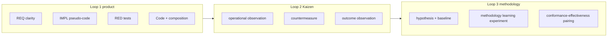

# TIED compact demo tool catalog

| Field | Value |
| --- | --- |
| **Purpose** | Human-readable idea bank for **compact TIED demo tools**—small CLIs, libraries, or in-memory sims built *through* TIED (REQ→ARCH→IMPL→tests→code)—so sponsors can pick exercises that stress traceability, TDD, composition, resilience, the **Kaizen loop**, and **methodology learning experiment** discipline with explicit **proof boundaries**. |
| **Audience** | Sponsors, facilitators, agent operators, methodology owners |
| **Status** | Draft catalog (ideas only; no registered REQ tokens for entries) |
| **Last updated** | 2026-10-11 |
| **CITDP posture** | **Defer persist** — documentation-only slice; no product behavior or project YAML traceability impact. Skip rationale: non-executable docs under `docs/demos/` only. |
| **Adversarial depth** | `minimal` (documentation) |
| **Related catalogs** | [Agent resilience exercise catalog](catalog-compact-programming-exercises.md) · [TIED feature demo](../tied-feature-demo.md) · [Client development index](../../tied-bundle/docs/client-development-index.md) |

---

## What this is / is not

| This catalog **is** | This catalog **is not** |
| --- | --- |
| A picker for TIED-shaped demo builds with grading dimensions and loop mapping | Canonical registered `[REQ-*]` / `[ARCH-*]` / `[IMPL-*]` tokens |
| A bridge to shared disturbance vocabulary (L0–L6) where an exercise ID applies | A universal **maturity score**, CMMI level map, or cross-client leaderboard |
| Pointers to runnable **runbooks** that already exist in the repo | An **evaluation corpus** registry or cohort publish pipeline |
| A **continuous improvement readout** composer (Loop 2 + Loop 3 fragments) | Proof that **methodology effectiveness** follows from catalog grades alone |

Distinct from: **async checklist catalog** (`REQ-ASYNC_CHECKLIST_CATALOG`) and checklist step **catalog-pseudocode-contracts**.

---

## Three nested loops (how to pick a demo)

Aligns with [TIED QMM methodology learning plan](../tied-qmm-methodology-learning-plan.md) §0.3 and [QMM × TIED comparison](../comparisons/qmm-kaizen-vs-tied.md).

| Loop | Focus | Catalog families (primary) | Success signal (when built) |
| --- | --- | --- | --- |
| **Loop 1** — product quality | TDD, module validation, composition, honest guarantees | A (spec), B (traceability), C (TDD/composition), D (resilience) | Tests green; composition evidence without UI-only glue; `tied_validate_consistency` where applicable |
| **Loop 2** — **Kaizen loop** | **Operational observation** → analysis → **countermeasure** → **outcome observation** vs **baseline** | E (Kaizen & methodology learning), partly meta | **Point-of-work capture**; friction recorded; not retrospectives-only |
| **Loop 3** — **methodology learning experiment** | Hypothesis, baseline, rule change, **conformance–effectiveness pairing**, **pairing disposition** | E, F (meta) | Persisted experiment + W2 readout; pairing disposition not `conformance_only_trap` |



---

## Disposition legend

| Tag | Meaning |
| --- | --- |
| `idea` | Not implemented; becomes a TIED exercise when built |
| `exercise-bridge` | Same underlying problem as an agent catalog ID (e.g. STATE-01) plus TIED deliverables |
| `runbook` | Existing runnable documentation—link only, no fictional commands |
| `meta-tool` | Exercises TIED MCP, checklist, gates, or bootstrap tooling |

---

## Universal entry schema

Each **compact TIED demo tool** row below maps to this schema (full template in [Appendix A](#appendix-a-entry-template)).

| Field | Description |
| --- | --- |
| `id` | Stable `TIED-DEMO-NN` |
| `name` | Short human title |
| `family` | `specification` · `traceability` · `tdd_composition` · `resilience` · `kaizen_methodology` · `meta` |
| `interface` | `CLI` · `library` · `in_memory_sim` |
| `related_exercise_id` | Optional bridge to [exercise catalog](catalog-compact-programming-exercises.md) (e.g. STATE-01) |
| `tied_behaviors` | Checklist slugs, `[PROC-*]`, module/composition/LEAP/vocabulary touchpoints |
| `artifacts_when_built` | `tied-project/requirements/REQ-*`, IMPL pseudo-code sidecar, unit + composition tests |
| `disturbances` | Reuse L0–L6 names from exercise catalog §5 |
| `properties` | safety, liveness, idempotency, convergence, observability, … (§6 of exercise catalog) |
| `proof_boundary` | `traceability_structure` · `executable_behavior` · `human_decision` |
| `suggested_sessions` | `1` · `2` · `3+` |
| `loop_primary` | `loop1` · `loop2` · `loop3` |

**Independent oracle:** When grading executable behavior, prefer reference state machines, property tests, and seeded chaos over agent self-report (see exercise catalog §4–§6).

---

## Grading model (human + agent)

**Separate scores** — do not collapse into one number. Catalog grades describe a *session readout*; they do **not** substitute for **process grade** (`process_grade.score`, bands A–D), **evidence chain profile** completeness, or cohort statistics unless each **proof boundary** is stated.

| Dimension | Weight (starting default) | TIED-specific signal |
| --- | --- | --- |
| Requirement interpretation | 15% | RESOLVE ambiguity; document REQ-01..REQ-06-style gaps in REQ text |
| Traceability closure | 20% | `[PROC-TOKEN_VALIDATION]`, block leads, three-way alignment |
| Test strategy | 20% | RED first; L2–L5 disturbances; mutation vs reference impl where applicable |
| Algorithm / implementation | 20% | Same rubric as exercise catalog when `related_exercise_id` is set |
| Process adherence | 15% | Tracker, gate receipts, envelope—maps to **process grade** rubric bands, not product quality |
| Methodology learning readout | 10% | Loop 3 only: hypothesis, baseline, **outcome observation**, **pairing disposition** |

### Disturbance ladder (reuse verbatim)

From [catalog-compact-programming-exercises.md §5](catalog-compact-programming-exercises.md#5-grade-the-tests-using-controlled-chaos):

| Level | Description |
| --- | --- |
| L0 — Nominal | Normal input, stable environment |
| L1 — Boundary | Empty, maximum, minimum, malformed inputs |
| L2 — Isolated failure | One timeout, crash, missing item, or duplicate |
| L3 — Combined failures | Two or more interacting faults |
| L4 — Changing conditions | Input or environment changes during execution |
| L5 — Adversarial | Fault timing or input chosen to expose assumptions |
| L6 — Long-running | Repeated disturbances, resource pressure, eventual convergence |

---

## Guardrails — forbidden maturity framing

Do **not** use catalog session scores to imply:

- A universal **maturity score** or org-wide CMMI-style level
- That **process grade** measures product correctness
- That checklist pass alone proves **methodology effectiveness readout**
- Leaderboard ranking across clients without compatible **client cohort** and **denominator fingerprint**

**Forbidden terms in grading prose:** `maturity_score`, `universal score`, `CMMI level`, leaderboard ranking (as maturity proxy).

**Loop 3 evidence pointers** (when a demo tests a methodology surface change):

- Record shape: `methodology-learning-experiment.v1` / [`tied-project/methodology-experiments.yaml`](../../tied-project/methodology-experiments.yaml)
- **Conformance–effectiveness pairing** with closed **pairing disposition** (`paired`, `effectiveness_not_measured`, `conformance_only_trap`, `waived`)
- **Evidence chain profile** + **report input manifest**; default **privacy tier** `operator_local` per [quality-assurance](../../tied-project/vocab/quality-assurance.md)

Vocabulary anchors: [feedback-to-tied](../../tied-project/vocab/feedback-to-tied.md) (**Kaizen loop**, **operational observation**, **baseline**, **outcome observation**) · [quality-assurance](../../tied-project/vocab/quality-assurance.md) (**proof boundary**, **process grade**, **evidence chain profile**, **pairing disposition**).

---

## Family A — Specification & vocabulary (`TIED-DEMO-01`–`04`)

| ID | Name | Disp. | Bridge | Interface | loop | proof_boundary | Primary TIED stress |
| --- | --- | --- | --- | --- | --- | --- | --- |
| TIED-DEMO-01 | Ambiguous policy resolver | `idea` | REQ-01 style | CLI | loop1 | human_decision | RESOLVE before REQ; record assumptions in REQ text |
| TIED-DEMO-02 | Partial configuration merger | `exercise-bridge` | DATA-01 | library | loop1 | executable_behavior | Multiple ARCH/IMPL modules; precedence in pseudo-code |
| TIED-DEMO-03 | Schema-evolution reader | `exercise-bridge` | DATA-03 | library | loop1 | executable_behavior | Contract PRE/POST across versions |
| TIED-DEMO-04 | Vocabulary rename consistency checker | `idea` | — | CLI | loop1 | traceability_structure | `[PROC-VOCABULARY_INDEX]` VALIDATE on demo `tied-project/vocab/` |

**Typical disturbances:** L0–L2 for 01–03 (ambiguous/missing fields); L1 for 04 (rename drift). **Properties:** observability, explicit failure reporting.

---

## Family B — Traceability & documentation-first (`TIED-DEMO-05`–`08`)

| ID | Name | Disp. | Bridge | Interface | loop | proof_boundary | Primary TIED stress |
| --- | --- | --- | --- | --- | --- | --- | --- |
| TIED-DEMO-05 | Token coverage auditor | `idea` | — | CLI | loop1 | traceability_structure | Token audit on demo codebase |
| TIED-DEMO-06 | Pseudo-code contract gate slice | `idea` | — | CLI | loop1 | traceability_structure | `pseudocode_validate` / Layer B on one IMPL |
| TIED-DEMO-07 | REQ→ARCH→IMPL graph tracer | `idea` | — | library | loop1 | traceability_structure | Impact discovery; `tied_validate_consistency` |
| TIED-DEMO-08 | Binding inventory table exercise | `idea` | — | in_memory_sim | loop1 | traceability_structure | Composition coverage; no E2E-only glue |

**Artifacts when built:** REQ-* detail files, IMPL `essence_pseudocode` sidecar with block token comments, no production code until pseudo-code validates.

---

## Family C — TDD, module validation, composition (`TIED-DEMO-09`–`13`)

| ID | Name | Disp. | Bridge | Interface | loop | proof_boundary | Primary TIED stress |
| --- | --- | --- | --- | --- | --- | --- | --- |
| TIED-DEMO-09 | Bounded worker pool | `exercise-bridge` | CON-01 | library | loop1 | executable_behavior | Module boundaries; unit then composition |
| TIED-DEMO-10 | Ordered parallel mapper | `exercise-bridge` | CON-03 | library | loop1 | executable_behavior | Composition test for ordering seam |
| TIED-DEMO-11 | Lease-based task queue | `exercise-bridge` | CON-04 | in_memory_sim | loop1 | executable_behavior | FAILURE_MODES; async contract rows |
| TIED-DEMO-12 | State-machine command processor | `exercise-bridge` | STATE-05 | library | loop1 | executable_behavior | Illegal transitions; idempotency |
| TIED-DEMO-13 | CLI composition harness | `idea` | — | CLI | loop1 | executable_behavior | Thin entry point; `[REQ-MODULE_VALIDATION]` |

**Disturbances:** CON/STATE family defaults L2–L4; **properties:** safety (no lost work), liveness, boundedness. **Sessions:** 2–3+ for 09–12.

---

## Family D — Resilience & changing reality (`TIED-DEMO-14`–`18`)

| ID | Name | Disp. | Bridge | Interface | loop | proof_boundary | Primary TIED stress |
| --- | --- | --- | --- | --- | --- | --- | --- |
| TIED-DEMO-14 | Crash-resumable batch processor | `exercise-bridge` | STATE-01 | CLI | loop1 | executable_behavior | LEAP after test/code drift; durability claims in REQ/IMPL |
| TIED-DEMO-15 | Out-of-order event aggregator | `exercise-bridge` | DATA-04 | library | loop1 | executable_behavior | Provisional vs final POST conditions |
| TIED-DEMO-16 | Reconciliation engine | `exercise-bridge` | STATE-06 | library | loop1 | executable_behavior | Partial success; convergence documentation |
| TIED-DEMO-17 | Deadline-aware search | `exercise-bridge` | ALG-02 | library | loop1 | executable_behavior | Honest incomplete optimality in REQ/IMPL |
| TIED-DEMO-18 | Retry storm simulator | `exercise-bridge` | ADV-04 | in_memory_sim | loop1 | executable_behavior | External-input-security profile row |

**High-value starter set (with Family B):** TIED-DEMO-14, 15, 11, 16, 17, 18 plus TIED-DEMO-05, 06, 08 and TIED-DEMO-01.

**Disturbances:** L3–L6 emphasis; inject crashes at persistence boundaries (exercise catalog STATE-01 guidance).

---

## Family E — Kaizen & methodology learning (`TIED-DEMO-19`–`22`)

| ID | Name | Disp. | Bridge | Interface | loop | proof_boundary | Primary TIED stress |
| --- | --- | --- | --- | --- | --- | --- | --- |
| TIED-DEMO-19 | Friction capture during demo build | `idea` | — | — | loop2 | human_decision | `tied_feedback_capture_observation`; **operational observation** |
| TIED-DEMO-20 | Demo-scoped methodology experiment | `idea` | — | — | loop3 | human_decision | W1 experiment record; hypothesis + **baseline** |
| TIED-DEMO-21 | Conformance vs effectiveness pairing drill | `idea` | — | — | loop3 | human_decision | **Conformance trap** awareness on same demo |
| TIED-DEMO-22 | Cohort profile before/after demo policy | `idea` | — | — | loop3 | traceability_structure | Two **evidence chain profile** snapshots; compatible **client cohort** |

**Loop 3 snippet (operator checklist):**

1. Upsert **methodology learning experiment** with hypothesis and **baseline** (MCP validate/upsert or project store).
2. Run demo build under Loop 1 evidence (tests, manifest as scoped).
3. Record **methodology conformance evidence** (typed gate/envelope refs—not generic prose).
4. Close **conformance–effectiveness pairing** with explicit **pairing disposition**; avoid `conformance_only_trap` when claiming methodology improvement.

---

## Family F — Meta (TIED tooling) (`TIED-DEMO-23`–`24`)

| ID | Name | Disp. | Bridge | Interface | loop | proof_boundary | Primary TIED stress |
| --- | --- | --- | --- | --- | --- | --- | --- |
| TIED-DEMO-23 | Disposable client bootstrap demo | `runbook` | `test-new-tied-client` | — | loop1 | traceability_structure | Onboarding + G4 audit; not a product feature |
| TIED-DEMO-24 | Checklist gate + envelope dry run | `meta-tool` | — | — | loop3 | traceability_structure | `tied gate check`; request evidence envelope gaps |

**Runbook links (existing docs only):**

- **TIED-DEMO-23:** [New-client TIED adherence runbook](../pseudocode-new-client-tied-adherence-runbook.md) · `test-new-tied-client` in [build-commands.sh](../../scripts/build-commands.sh) · [Pre-cohort client test grammar](../pre-cohort-client-test-grammar-v2-and-evidence.md)
- **TIED-DEMO-24:** [Client development index — `tied gate check`](../../tied-bundle/docs/client-development-index.md) · [Process adherence evidence grade plan](../process-adherence-evidence-grade-plan.md)

---

## Session progression matrix

| Session goal | Start here | Success evidence |
| --- | --- | --- |
| Learn traceability | TIED-DEMO-05 → 07 | `tied_validate_consistency` clean on demo client |
| Learn TDD + composition | TIED-DEMO-09 → 13 | Unit green + composition test without UI |
| Learn resilience + honest guarantees | TIED-DEMO-14 → 18 | L3+ disturbances; property tests pass |
| Learn Kaizen / Loop 3 | TIED-DEMO-19 → 22 | **Outcome observation** recorded; **pairing disposition** ≠ `conformance_only_trap` |
| Smoke TIED install | TIED-DEMO-23 | Client-root audit ok (`tied-new-client-audit.v1.json`) |

---

## Promoting an idea to implementation

1. Open a scoped REQ in the target client’s `tied-project/` (not in this catalog body).
2. Copy [agent implementation checklist](../../tied-bundle/docs/agent-req-implementation-checklist.yaml) to `working/{REQ-TOKEN}/`.
3. Build the **compact TIED demo tool** with strict TDD + composition ordering per `[PROC-TIED_DEV_CYCLE]`.
4. Optional disposable client under `$TIED_TEST_ROOT` — operator pattern only; not required for catalog authorship.

---

## Related references

- [Agent resilience exercise catalog](catalog-compact-programming-exercises.md)
- [QMM (Kaizen) × TIED comparison](../comparisons/qmm-kaizen-vs-tied.md)
- [Kaizen feedback loop plan](../tied-kaizen-feedback-loop-plan.md)
- [Methodology evaluation framework](../tied-methodology-evaluation-framework.md)
- [Process adherence evidence grade plan](../process-adherence-evidence-grade-plan.md)
- [TIED feature demo](../tied-feature-demo.md)
- [TIED QMM methodology learning plan](../tied-qmm-methodology-learning-plan.md)

---

## Appendix A — Entry template

```yaml
id: TIED-DEMO-01
name: string
family: specification | traceability | tdd_composition | resilience | kaizen_methodology | meta
disposition: idea | exercise-bridge | runbook | meta-tool
interface: CLI | library | in_memory_sim
related_exercise_id: optional  # e.g. STATE-01 — see catalog-compact-programming-exercises.md
tied_behaviors:
  - PROC-AGENT_REQ_CHECKLIST slug(s)
  - module_validation | composition_evidence | leap | vocabulary_sync
artifacts_when_built:
  - tied-project/requirements/REQ-*
  - IMPL-*-pseudocode.md
  - composition tests | unit tests
disturbances: []  # L0–L6 from exercise catalog §5
properties: []    # safety, liveness, idempotency, … — exercise catalog §6
proof_boundary: traceability_structure | executable_behavior | human_decision
suggested_sessions: 1 | 2 | 3+
loop_primary: loop1 | loop2 | loop3
```

Shared disturbance, oracle, and evaluation fields: [exercise catalog §8](catalog-compact-programming-exercises.md#8-a-reusable-exercise-specification).
