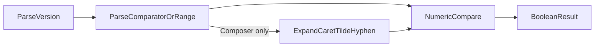

# PROMPT-WF-01: four-model implementation comparison

| Field | Value |
| --- | --- |
| **Purpose** | Cross-model comparison of product implementations after the same **traditional four-phase** trial prompt |
| **Trial prompt** | [PROMPT-WF-01](catalog-traditional-workflow-trial-prompts.md#prompt-wf-01) |
| **Workflow skills** | `add-feature` → `refine-plan` → `build-plan` → `close-out` |
| **Recorded** | 2026-10-31 |
| **Proof boundary** | Static code inspection, ephemeral matrix evaluation, and `npm test` in each disposable client |
| **Disclaimer** | Store documentation only — not a `[REQ-*]` token, not a maturity score, not a model leaderboard |

Facilitators grading **workflow choreography** should use the rubric in [catalog-traditional-workflow-trial-prompts.md](catalog-traditional-workflow-trial-prompts.md#facilitator-grading-readout). This page describes what was built and how implementations differ; it does not assign dimension bands or weights.

---

## Sponsor prompt (reference)

```text
Build a small library with one exported function that checks whether a semantic version string satisfies a simple comparator (e.g. ">=1.2.0"). Include a single script or documented command that runs all tests. Pick TypeScript or Python and stay consistent. No CLI required beyond test runner.
```

---

## Executive summary — similarities

All four disposable clients, despite different models, converged on the following:

- **Language:** TypeScript (Python was allowed but unused).
- **Surface:** One exported boolean predicate; no product CLI beyond the test runner.
- **Test command:** Documented **`npm test`** at the client or workspace root.
- **Core version shape:** Strict **`MAJOR.MINOR.PATCH`** with numeric ordering (`1.10.0` > `1.2.0`).
- **Invalid input:** Tests expect **`false`** and **no throw** for malformed strings (Composer is an exception for non-string callers; see matrix row 15).
- **Prompt example:** `satisfies("1.2.0", ">=1.2.0")` (or equivalent export name) evaluates to **`true`** in every client.
- **Traceability in code:** Source comments reference project **`REQ-*` / `ARCH-*` / `IMPL-*`** tokens.

They diverge on **scope of the second argument** (single comparator vs semver **range** subset), **export naming**, **layout**, **TIED close-out residue**, and **git hygiene** (committed feature vs working-tree-only code).

---

## Client index

| Model (operator label) | `CLIENT_ID` (`--tag`) | Absolute path | Code inspect | REQ token | Export | Tests |
| --- | --- | --- | --- | --- | --- | --- |
| GPT-5.6 Luna Low | `wf-01-gpt56-luna-low` | `/Users/fareed/Documents/dev/test/1793483171-wf-01-gpt56-luna-low` | **Working tree only** (`HEAD` = `ccfcd35` TIED baseline) | `REQ-SEMVER_COMPARATOR` | `satisfies` | 6 × `node:test` via `tsx` |
| Composer 2.5 | `wf-01-composer25` | `/Users/fareed/Documents/dev/test/1793497423-wf-01-composer25` | Commit `d1409b1` on `main` | `REQ-SEMVER_SATISFIES` | `satisfies(version, range)` | 7 × Vitest (incl. export boundary) |
| GPT-5.6 Luna Med | `wf-01-gpt56-luna-med` | `/Users/fareed/Documents/dev/test/1793499361-wf-01-gpt56-luna-med` | **Working tree only** (`HEAD` = `7417482` baseline) | `REQ-SEMVER_COMPARATOR` | `satisfiesVersion` | 4 × `node:test` after `tsc` |
| Grok 4.7 Med | `wf-01-grok47-med` | `/Users/fareed/Documents/dev/test/1793501328-wf-01-grok47-med` | Commit `ea10ee6` (+ untracked gate files) | `REQ-SEMVER_SATISFIES` | `satisfies` | 11 × `node --experimental-strip-types --test` |

**Inspect note:** For Luna Low and Luna Med, product **`src/`**, **`test/`**, and **`package.json`** exist only in the **uncommitted** working tree. `git show HEAD:` does not contain the library.

---

## Implementation differences

| Dimension | Luna Low | Composer 2.5 | Luna Med | Grok 4.7 Med |
| --- | --- | --- | --- | --- |
| **Layout** | Flat `src/index.ts`, `test/` | npm workspace `packages/semver-satisfies/` | Flat `src/satisfiesVersion.ts`, `test/` | Colocated `src/semver-satisfies.ts` + `.test.ts` |
| **Module split** | Monolith | `internal/parse-version`, `parse-range`, `compare-version` | Monolith | Monolith |
| **Runtime deps** | None (`tsx` dev) | Vitest + TypeScript dev | TypeScript dev only | **Zero** npm deps |
| **Second parameter** | Comparator string | **Range** string (documented subset) | Comparator string | Comparator string (operator **required**) |
| **Operators** | `>`, `>=`, `<`, `<=`, `=`; bare version → `=` | Comparators + **`^` `~` hyphen** + **space conjunction**; rejects `\|\|` and `*` | Above + **`!=`** | `>`, `>=`, `<`, `<=`, `=`, **`==`**, **`!=`** |
| **Bare `1.2.3` as comparator/range** | Yes (defaults to equality) | Yes (exact range via `>=` and `<=` pair) | Yes | **No** (parse fails → false) |
| **`v` / `V` prefix** | Neither | `v` or `V` on version | Neither | Lowercase **`v` only** |
| **Numeric type** | `number` | `number` (safe integer cap) | `bigint` (uncapped) | `bigint` (cap `9007199254740991`) |
| **Whitespace** | Trim comparator string | Trim range tokens | `String.trim()` both args | ASCII space/tab trim both args |
| **Side effects** | None | None | None | Optional **`DIAGNOSTIC:`** stderr when `SEMVER_SATISFIES_DEBUG=1` |
| **CITDP** | No | Yes (`tied-project/citdp/`) | Yes | Yes |
| **Linked PLAN** | No | `PLAN-refine-pass1.md` | No | `PLAN.md` (catalog trial header) |
| **CHANGELOG / README** | No | CHANGELOG; package README | No | CHANGELOG + root README |
| **Workflow inventory JSON** | No | No | No | **`trial-workflow-interaction-inventory.v1.json`** |
| **Gate JSON (pre / close)** | 0 / 0 | 3 / 1 | 0 / 0 | 3 / 3 (+ untracked ledger) |
| **REQ `status` (YAML)** | Planned | Draft | Planned | Planned |

---

## Shared processing pipeline



Every client parses a **core version**, parses the **second string** (comparator or range), compares major → minor → patch numerically, then maps the relation to **`true`/`false`**. Composer adds a **range expansion** step before conjunction matching.

---

## Same-input behavior matrix

Cells are the boolean returned by each client’s export for the given inputs. **`false`** includes “unsupported grammar” and parse failure unless noted.

| # | version | comparator / range | Luna Low | Composer | Luna Med | Grok |
| --- | --- | --- | --- | --- | --- | --- |
| 1 | `1.2.0` | `>=1.2.0` | true | true | true | true |
| 2 | `1.2.3` | `1.2.3` | true | true | true | false |
| 3 | `1.2.4` | `!=1.2.3` | false | false | true | true |
| 4 | `1.2.0` | `==1.2.0` | false | false | false | true |
| 5 | `v1.2.3` | `1.2.3` | false | true | false | false |
| 6 | `1.2.3` | `v1.2.3` | false | true | false | false |
| 7 | `V1.2.0` | `>=1.2.0` | false | true | false | false |
| 8 | `1.2.5` | `^1.2.3` | false | true | false | false |
| 9 | `1.2.5` | `~1.2.3` | false | true | false | false |
| 10 | `1.3.0` | `1.2.3 - 1.4.0` | false | true | false | false |
| 11 | `1.5.0` | `>=1.0.0 <2.0.0` | false | true | false | false |
| 12 | `01.2.0` | `>=1.0.0` | false | false | false | false |
| 13 | `1.2.0-alpha` | `>=1.0.0` | false | false | false | false |
| 14 | `1.2.0` | `^1.2.0` | false | true | false | false |
| 15 | `1` (number) | `>=1.2.0` | false | **throws** | false | false |

Matrix filled 2026-10-31 by loading each implementation from its client tree (Luna Low / Composer via `tsx`; Luna Med from `dist/` after `npm run build`; Grok via Node type stripping). Row 15: Composer **`satisfies`** expects strings and **throws** on a numeric first argument; the other three return **`false`**.

**Interpretation highlights:**

- **Row 2:** Grok requires an explicit operator in the comparator string; a bare target version is rejected.
- **Rows 8–11, 14:** Only Composer treats the prompt’s “simple comparator” as permission to implement a **documented range subset** (`^`, `~`, hyphen, conjunction).
- **Rows 3–4:** Inequality and `==` support split Luna Med/Grok vs the two Luna-low-scope parsers.

---

## Workflow choreography (observed evidence)

Descriptive mapping to [workflow choreography rubric](catalog-traditional-workflow-trial-prompts.md#workflow-choreography-rubric-15) sub-checks — **not scored** here.

| Sub-check | Luna Low | Composer | Luna Med | Grok |
| --- | --- | --- | --- | --- |
| **Phase boundary** | Product code **not committed**; only baseline install on `HEAD` | Feature commit **`d1409b1`** after baseline | Product code **not committed** | Feature commit **`ea10ee6`**; extra gate files still untracked |
| **Skill hygiene** | No interaction inventory | No interaction inventory | No interaction inventory | **`trial-workflow-interaction-inventory.v1.json`** present |
| **Plan carry-forward** | No `tied-project/working/{REQ}/PLAN.md` | `PLAN-refine-pass1.md` under `REQ-SEMVER_SATISFIES` | Working folder + npm-test evidence only | Full `PLAN.md` with catalog trial header lines |
| **Gate discipline** | No gate receipts | Multiple `pre_implementation` + `verification` + one `close_out` | Verification manifest + npm-test stdout only | Multiple pre/verification/close_out gates |
| **Close-out honesty** | No CHANGELOG; REQ still **Planned** | CHANGELOG + close_out gate; REQ still **Draft** | No CHANGELOG; REQ **Planned** | CHANGELOG + README; REQ still **Planned** despite close_out artifacts |

**Choreography takeaway:** Composer and Grok left the richest **process artifacts** (gates, CHANGELOG, PLAN). Luna variants delivered **runnable libraries in the working tree** but **did not** complete the git/traceability story the rubric associates with close-out. None of the four promoted REQ status to **Implemented** in project YAML at inspection time.

---

## Per-client notes

### GPT-5.6 Luna Low (`wf-01-gpt56-luna-low`)

Minimal **single-file** library: `satisfies(version, comparator)` with regex parsing and **`number`** tuple comparison. Closest literal reading of “**simple comparator**” among the monoliths (no `!=`, no ranges). Six focused **`node:test`** cases. TIED indexes and detail YAML exist; **no** CITDP, **no** feature commit.

### Composer 2.5 (`wf-01-composer25`)

Widest **semantic scope**: treats the second argument as a **range** with caret/tilde/hyphen/conjunction, internal module boundaries, **Vitest**, and a test that the public entry exports **only** `satisfies`. Only client with a **committed** feature history and structured **close-out** gate receipt. REQ remains **Draft** in YAML.

### GPT-5.6 Luna Med (`wf-01-gpt56-luna-med`)

Same REQ token family as Luna Low but **`satisfiesVersion`** naming, **`bigint`** components, and **`!=`**. Compile-to-`dist` test pipeline. CITDP + partial verification evidence under `working/REQ-SEMVER_COMPARATOR/`; library still **uncommitted**.

### Grok 4.7 Med (`wf-01-grok47-med`)

Strict **single-comparator** contract documented in **`PLAN.md`**: operator mandatory, `==`/`!=`, lowercase **`v`**, bigint cap, optional debug logging, zero npm dependencies. Eleven tests colocated with source. Strongest **trial metadata** (PLAN header + interaction inventory); REQ status still **Planned**.

---

## Verification appendix

| Client | `npm test` (2026-10-31) | Notes |
| --- | --- | --- |
| Luna Low | **Pass** — 6/6 | `tsc --noEmit` + `node --test` with `tsx` |
| Composer | **Pass** — 7/7 | Workspace delegates to Vitest in `packages/semver-satisfies` |
| Luna Med | **Pass** — 4/4 | `npm run build` then `node --test` on `dist/test/` |
| Grok | **Pass** — 11/11 | `node --experimental-strip-types --test` |

Primary sources:

| Client | Implementation | Tests |
| --- | --- | --- |
| Luna Low | `src/index.ts` | `test/index.test.ts` |
| Composer | `packages/semver-satisfies/src/index.ts` | `packages/semver-satisfies/tests/satisfies.test.ts` |
| Luna Med | `src/satisfiesVersion.ts` | `test/satisfiesVersion.test.ts` |
| Grok | `src/semver-satisfies.ts` | `src/semver-satisfies.test.ts` |

---

## Related links

- [Traditional four-phase workflow trial catalog](catalog-traditional-workflow-trial-prompts.md)
- [Demos index](README.md)
- [New-client adherence runbook](../pseudocode-new-client-tied-adherence-runbook.md) — `test-new-tied-client --tag <CLIENT_ID>`
