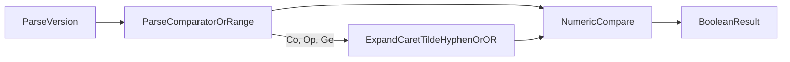

# PROMPT-WF-01: implementation comparison (seven IDE models + agentstream orchestrator)

| Field | Value |
| --- | --- |
| **Purpose** | Cross-model comparison of product implementations after the same **traditional four-phase** trial prompt |
| **Trial prompt** | [PROMPT-WF-01](catalog-traditional-workflow-trial-prompts.md#prompt-wf-01) |
| **Workflow skills** | `add-feature` → `refine-plan` → `build-plan` → `close-out` |
| **Recorded** | 2026-10-31 (first four models) · **2026-11-01** (Opus 5.5, Gemini 4 Argon Med, Muse Spark 1.3 Med) · **2026-11-02** (agentstream orchestrator reference, Composer 2.5) |
| **Proof boundary** | Static code inspection, ephemeral matrix evaluation, and `npm test` in each disposable client |
| **Disclaimer** | Store documentation only — not a `[REQ-*]` token, not a maturity score, not a model leaderboard |

Facilitators grading **workflow choreography** should use the rubric in [catalog-traditional-workflow-trial-prompts.md](catalog-traditional-workflow-trial-prompts.md#facilitator-grading-readout). This page describes what was built and how implementations differ; it does not assign dimension bands or weights.

---

## Sponsor prompt (reference)

```text
Build a small library with one exported function that checks whether a semantic version string satisfies a simple comparator (e.g. ">=1.2.0"). Include a single script or documented command that runs all tests. Pick TypeScript or Python and stay consistent. No CLI required beyond test runner.
```

---

## Agentstream orchestrator reference (2026-11-02)

| Field | Value |
| --- | --- |
| **Operator entry** | `source scripts/build-commands.sh && workflow-trial-agentstream wf-01` ([workflow-trial-agentstream.sh](../../scripts/workflow-trial-agentstream.sh)) |
| **Factory tag** | `wf-agentstream-wf-01` |
| **Client** | `/Users/fareed/Documents/dev/test/1793604353-wf-agentstream-wf-01` |
| **Harness** | `cursor-agentstream-four-phase` via [run-traditional-four-phase-agentstream.sh](../../scripts/run-traditional-four-phase-agentstream.sh) (four feature-spec batch turns; **new agent session per turn**) |
| **Model** | `composer-2.5-fast` / config `composer-2.5` |
| **Interaction inventory** | `tied-project/working/REQ-SEMVER_SATISFIES/evidence/trial-workflow-interaction-inventory.v1.json` |

Compared with **IDE** Composer 2.5 on the same prompt (`1793497423-wf-01-composer25`): the orchestrator run **locked** a **single-comparator** grammar in refine-plan (no ranges, no `!=`), delivered **17** colocated `node:test` cases vs **7** Vitest tests in a workspace package, and left REQ **`Draft`** in YAML despite a traceable feature commit **`647c641`**. Product semantics align with **strict comparator** clients (Grok-like operator requirement; `==` supported; `!=` fail-closed **`false`**).

---

## Executive summary — similarities

All eight disposable clients converged on the following:

- **Language:** TypeScript (Python was allowed but unused).
- **Surface:** One exported boolean predicate; no product CLI beyond the test runner.
- **Test command:** Documented **`npm test`** at the client or workspace root.
- **Core version shape:** Strict **`MAJOR.MINOR.PATCH`** ordering in tests (`1.10.0` > `1.2.0` where parsing accepts both operands).
- **Prompt example:** `satisfies("1.2.0", ">=1.2.0")` (or equivalent export name) evaluates to **`true`** in every client (matrix row 1).
- **Traceability in code:** Source comments reference project **`REQ-*` / `ARCH-*` / `IMPL-*`** tokens.

They diverge on **scope of the second argument** (single comparator vs documented **range** vs full semver **expression**), **invalid-input contract** (`false` vs **`TypeError`**), **export naming**, **layout**, **TIED close-out residue**, and **git hygiene** (committed feature vs working-tree-only code).

**Invalid-input families (matrix rows 12–15 and adversarial tests):**

| Family | Clients |
| --- | --- |
| Return **`false`** (fail-closed, no throw) | Luna Low, Luna Med, Grok, Gemini, **Agentstream Co** |
| **`TypeError`** on malformed strings or wrong types | Claude Opus 5.5, Muse Spark 1.3 Med |
| **`TypeError`** on non-string operands; **`false`** for bad strings in tests | Composer 2.5 IDE (Vitest); Agentstream Co (runtime `trim` on operands — row 15) |

---

## Client index

| Model (operator label) | `CLIENT_ID` (`--tag`) | Absolute path | Code inspect | REQ token | Export | Tests |
| --- | --- | --- | --- | --- | --- | --- |
| GPT-5.6 Luna Low | `wf-01-gpt56-luna-low` | `/Users/fareed/Documents/dev/test/1793483171-wf-01-gpt56-luna-low` | **Working tree only** (`HEAD` = `ccfcd35` TIED baseline) | `REQ-SEMVER_COMPARATOR` | `satisfies` | 6 × `node:test` via `tsx` |
| Composer 2.5 | `wf-01-composer25` | `/Users/fareed/Documents/dev/test/1793497423-wf-01-composer25` | Commit `d1409b1` on `main` | `REQ-SEMVER_SATISFIES` | `satisfies(version, range)` | 7 × Vitest (incl. export boundary) |
| GPT-5.6 Luna Med | `wf-01-gpt56-luna-med` | `/Users/fareed/Documents/dev/test/1793499361-wf-01-gpt56-luna-med` | **Working tree only** (`HEAD` = `7417482` baseline) | `REQ-SEMVER_COMPARATOR` | `satisfiesVersion` | 4 × `node:test` after `tsc` |
| Grok 4.7 Med | `wf-01-grok47-med` | `/Users/fareed/Documents/dev/test/1793501328-wf-01-grok47-med` | Commit `ea10ee6` (+ untracked gate ledger) | `REQ-SEMVER_SATISFIES` | `satisfies` | 11 × `node --experimental-strip-types --test` |
| Claude Opus 5.5 | `wf-01-claude-opus55` | `/Users/fareed/Documents/dev/test/1793545913-wf-01-claude-opus55` | Commit `58a736b` on `main` | `REQ-SEMVER_SATISFIES` | `satisfies(version, range)` | 115 × `node:test` |
| Gemini 4 Argon Med | `wf-01-gemini4-argon-med` | `/Users/fareed/Documents/dev/test/1793558700-wf-01-gemini4-argon-med` | **Working tree only** (`HEAD` = `c9d3049` baseline) | `REQ-SEMVER_COMPARATOR` | `satisfies` | 18 × `node:test` |
| Muse Spark 1.3 Med | `wf-01-muse-spark13-med` | `/Users/fareed/Documents/dev/test/1793560725-wf-01-muse-spark13-med` | **Working tree only** (`HEAD` = `fdd3673` baseline) | `REQ-SEMVER_COMPARATOR` | `satisfies` | 16 × `node:test` via `tsx` |
| Composer 2.5 (agentstream) | `wf-agentstream-wf-01` | `/Users/fareed/Documents/dev/test/1793604353-wf-agentstream-wf-01` | Commit `647c641` on `main` | `REQ-SEMVER_SATISFIES` | `satisfies(version, comparator)` | 17 × `node:test` via `tsx` |

**Inspect note:** Luna Low, Luna Med, Gemini Argon Med, and Muse Spark still have product **`src/`**, **`test(s)/`**, and **`package.json`** only in the **uncommitted** working tree. `git show HEAD:` does not contain the library on those clients. The **agentstream** client ships the library on **`647c641`** with full **`tied-project/working/REQ-SEMVER_SATISFIES/`** gate and envelope residue.

---

## Implementation differences

Legend: **Lo** = Luna Low · **Co** = Composer IDE · **Med** = Luna Med · **Gr** = Grok · **Op** = Opus · **Ge** = Gemini · **Mu** = Muse · **As** = Agentstream Composer.

| Dimension | Lo | Co | Med | Gr | Op | Ge | Mu | As |
| --- | --- | --- | --- | --- | --- | --- | --- | --- |
| **Layout** | Flat `src/index.ts` | Workspace `packages/semver-satisfies/` | Flat `src/satisfiesVersion.ts` | Colocated `src/semver-satisfies*` | Flat `src/` (`index`, `range`, `version`) | Multi-file `src/*` (parser, eval) | Monolith `src/semver.ts` | Colocated `src/semver-satisfies*` |
| **Second parameter** | Comparator | **Range** (documented subset) | Comparator | Comparator (op required) | **Range** (AND; `^` `~`) | **Expression** (AND, OR, wildcards) | Comparator | Comparator (locked in PLAN) |
| **Operators / grammar** | `> >= < <= =`; bare `=` | + `^` `~` hyphen, space AND; rejects `\|\|`, `*` | + `!=` | + `==`, `!=` | `> >= < <= =`; + `^` `~`; **no** `!=`, hyphen | Full README table: `!=`, `^`, `~`, `*`, hyphen, `\|\|` | `> >= < <= = == !=`; bare equality | `> >= < <= = ==`; **no** `!=`, ranges |
| **Bare `1.2.3` as comparator** | Yes | Yes | Yes | **No** | Yes | Yes | Yes | **No** |
| **`v` / `V` on version** | Neither | `v` or `V` | Neither | lowercase `v` | lowercase `v` | Per parser | Both | Both |
| **Numeric type** | `number` | `number` (safe int cap) | `bigint` | `bigint` (cap) | `number` (safe int) | Structured semver parts | `number`; **partial** `1.2` → `1.2.0` | `number` |
| **Invalid input** | `false` | `false` for bad strings; **throw** wrong types | `false` | `false` | **`TypeError`** | `false` | **`TypeError`** | `false`; **throw** non-string operands |
| **Runtime deps** | None (`tsx` dev) | Vitest + TS dev | TS dev | Zero npm deps | TS dev | Zero | `tsx` dev | `tsx` dev only |
| **CITDP** | No | Yes | Yes | Yes | Yes | Yes | Yes | Draft in `working/` |
| **Linked PLAN** | No | `PLAN-refine-pass1.md` | No | `PLAN.md` (trial header) | No standalone PLAN file | Checklist copy under `working/` | No | `PLAN.md` + locked vocab |
| **CHANGELOG / README** | No | CHANGELOG; package README | No | CHANGELOG + README | CHANGELOG + README | README only (untracked) | No | CHANGELOG + README |
| **Gate JSON under `working/.../gates/`** | 0 | 3 pre + 2 ver + 1 close | 0 | 3 + 2 + 3 | 0 (markdown evidence instead) | 0 | 0 (envelope embeds receipts) | 1 pre + 2 ver + 2 close |
| **REQ `status` (YAML, inspect time)** | Planned | Draft | Planned | Planned | **Implemented** | **Implemented** | Planned | **Draft** |
| **Harness** | Manual IDE skills | Manual IDE skills | Manual IDE skills | Manual IDE skills | Manual IDE skills | Manual IDE skills | Manual IDE skills | **`workflow-trial-agentstream wf-01`** |

---

## Shared processing pipeline



Every client parses a **core version**, parses the **second string**, compares major → minor → patch numerically, then maps the relation to **`true`/`false`** (or throws before that step). Composer, Opus, and Gemini add **range or expression expansion** before matching.

---

## Same-input behavior matrix

Cells are the boolean returned by each client’s export for the given inputs. **`throw`** = **`TypeError`** (or **`Error`** for Muse on unsupported `^`/`~`). **`false`** includes unsupported grammar where the client fail-closes without throwing.

| # | version | comparator / range | Lo | Co | Med | Gr | Op | Ge | Mu | As |
| --- | --- | --- | --- | --- | --- | --- | --- | --- | --- | --- |
| 1 | `1.2.0` | `>=1.2.0` | true | true | true | true | true | true | true | true |
| 2 | `1.2.3` | `1.2.3` | true | true | true | false | true | true | true | false |
| 3 | `1.2.4` | `!=1.2.3` | false | false | true | true | throw | true | true | false |
| 4 | `1.2.0` | `==1.2.0` | false | false | false | true | throw | true | true | true |
| 5 | `v1.2.3` | `1.2.3` | false | true | false | false | true | true | true | false |
| 6 | `1.2.3` | `v1.2.3` | false | true | false | false | true | true | true | false |
| 7 | `V1.2.0` | `>=1.2.0` | false | true | false | false | throw | true | true | true |
| 8 | `1.2.5` | `^1.2.3` | false | true | false | false | true | true | throw | false |
| 9 | `1.2.5` | `~1.2.3` | false | true | false | false | true | true | throw | false |
| 10 | `1.3.0` | `1.2.3 - 1.4.0` | false | true | false | false | throw | true | throw | false |
| 11 | `1.5.0` | `>=1.0.0 <2.0.0` | false | true | false | false | true | true | throw | false |
| 12 | `01.2.0` | `>=1.0.0` | false | false | false | false | throw | false | true | false |
| 13 | `1.2.0-alpha` | `>=1.0.0` | false | false | false | false | throw | true | throw | false |
| 14 | `1.2.0` | `^1.2.0` | false | true | false | false | true | true | throw | false |
| 15 | `1` (number) | `>=1.2.0` | false | throw | false | false | throw | false | throw | throw |

Matrix filled **2026-11-01** (seven IDE clients) and **2026-11-02** (**As**) by loading each tree: Lo / Mu via `tsx`; Co from `packages/semver-satisfies`; Med from `dist/` after `npm run build`; Gr / Op / Ge via Node native TypeScript test import paths; **As** via `tsx` import of `src/semver-satisfies.ts`. Row 15: Co, Op, Mu, and **As** throw on non-string operands; Lo / Med / Gr / Ge return **`false`** for a numeric version.

**Interpretation highlights:**

- **Row 2:** Grok still requires an explicit operator in the comparator string.
- **Rows 8–11, 14:** Composer and Gemini treat the prompt’s “simple comparator” as permission for a **documented superset**; Opus implements **caret/tilde/AND** but **rejects hyphen ranges** (row 10 throws).
- **Rows 3–4, 7:** Opus has no `!=` / `==` and rejects uppercase **`V`** on the version string.
- **Rows 8–14:** Muse implements **single-comparator** semantics only; `^`, `~`, hyphen, and conjunction throw at parse time.
- **Row 12:** Muse accepts leading-zero numeric parts because it pads to three tuple components; Gemini and **As** reject leading zeros fail-closed.
- **Row 2 / 5–6:** **As** matches Grok’s **operator-required** comparator grammar (bare version strings parse as invalid).
- **Rows 3–4:** **As** supports `==` but not `!=` (row 3 **`false`**, not Med/Grok **`true`**).

---

## Workflow choreography (observed evidence)

Descriptive mapping to [workflow choreography rubric](catalog-traditional-workflow-trial-prompts.md#workflow-choreography-rubric-15) sub-checks — **not scored** here.

| Sub-check | Lo | Co | Med | Gr | Op | Ge | Mu | As |
| --- | --- | --- | --- | --- | --- | --- | --- | --- |
| **Phase boundary** | Library uncommitted | Feature commit `d1409b1` | Library uncommitted | Feature commit `ea10ee6` | Feature commit `58a736b` | Library uncommitted | Library uncommitted | Feature commit `647c641` |
| **Skill hygiene** | No interaction inventory | No interaction inventory | No interaction inventory | **`trial-workflow-interaction-inventory.v1.json`** | No interaction inventory | No interaction inventory | Envelope gate receipts only | **`trial-workflow-interaction-inventory.v1.json`** (`cursor-agentstream-four-phase`) |
| **Plan carry-forward** | No REQ `PLAN.md` | `PLAN-refine-pass1.md` | Working evidence only | `PLAN.md` + trial header | Extensive step evidence markdown | Checklist YAML under `working/` | Git-hygiene receipt | `PLAN.md` locks comparator vocab |
| **Gate discipline** | None | 6 gate JSON files | Verification stdout only | 8 gate JSON files | Pseudocode + verify evidence chain | Pre-implementation notes | Envelope-embedded receipts | 5 gate JSON + envelope |
| **Close-out honesty** | REQ **Planned** | CHANGELOG + close_out gate; REQ **Draft** | REQ **Planned** | CHANGELOG; REQ **Planned** | CHANGELOG; REQ **Implemented** | REQ **Implemented** (uncommitted) | REQ **Planned** | CHANGELOG + close_out; REQ **Draft** |

**Choreography takeaway:** Opus and Composer IDE left the strongest **test depth** among manual IDE runs (115 vs 7 cases) and **traceability evidence**; Opus and Gemini are the only IDE clients with REQ **Implemented** in project YAML at inspection time, though Gemini’s product tree is still uncommitted. Luna variants and Muse delivered runnable libraries but weak **git/feature-commit** closure. Grok and **As** both ship a **trial interaction inventory**; **As** adds reproducible **`workflow-trial-agentstream`** bootstrap and four isolated agentstream sessions per skill turn.

---

## Per-client notes

### GPT-5.6 Luna Low (`wf-01-gpt56-luna-low`)

Minimal **single-file** library: `satisfies(version, comparator)` with regex parsing and **`number`** tuple comparison. Closest literal reading of “**simple comparator**” among the early monoliths (no `!=`, no ranges). Six focused **`node:test`** cases. TIED indexes exist; **no** CITDP, **no** feature commit.

### Composer 2.5 (`wf-01-composer25`)

Widest **documented range** in the first wave: caret/tilde/hyphen/conjunction, internal module boundaries, **Vitest**, export-boundary test. Committed feature history and structured **close-out** gate receipt; REQ remains **Draft** in YAML despite verify events in adherence JSONL.

### GPT-5.6 Luna Med (`wf-01-gpt56-luna-med`)

Same REQ token family as Luna Low but **`satisfiesVersion`** naming, **`bigint`** components, and **`!=`**. Compile-to-`dist` test pipeline. CITDP + verification evidence; library **uncommitted**.

### Grok 4.7 Med (`wf-01-grok47-med`)

Strict **single-comparator** contract in **`PLAN.md`**: operator mandatory, `==`/`!=`, lowercase **`v`**, bigint cap, optional debug logging, zero npm dependencies. Eleven colocated tests. Strong **trial metadata** (PLAN header + interaction inventory); REQ **Planned**.

### Claude Opus 5.5 (`wf-01-claude-opus55`)

**Throwing API** documented on `satisfies`: strict version grammar, **`range`** string with whitespace-separated AND comparators plus **`^`/`~`**, no **`!=`** or hyphen ranges. Split **`version` / `range` / `index`** modules; **115** tests including adversarial and performance cases. Full checklist **evidence markdown** under `working/REQ-SEMVER_SATISFIES/evidence/`; committed **`58a736b`**; REQ **Implemented**.

### Gemini 4 Argon Med (`wf-01-gemini4-argon-med`)

Broadest **expression** surface in the pilot: OR (`||`), wildcards, hyphen ranges, caret/tilde, and **`!=`**, with fail-closed **`false`** on malformed input. Five-module **`src/`** layout and eighteen tests (unit + composition). README documents the supported subset; entire product + TIED stack **uncommitted** on top of baseline **`c9d3049`**; REQ YAML reads **Implemented**.

### Muse Spark 1.3 Med (`wf-01-muse-spark13-med`)

Single-file **`semver.ts`** with **`==`/`!=`**, bare equality, and **`v`/`V`** stripping; **throws** on malformed version/comparator (including range tokens). Sixteen **`tsx`** tests. CITDP + request envelope with embedded gate receipts; library **uncommitted**; REQ **Planned**.

### Composer 2.5 agentstream (`wf-agentstream-wf-01`)

Orchestrator-produced disposable client for **PROMPT-WF-01**: **`workflow-trial-agentstream wf-01`** → factory tag **`wf-agentstream-wf-01`**. Refine-plan **RECORD** in `tied-project/vocab/semver-satisfies.md` locks **COMPARATOR_STRING** to six relational operators (no ranges, no `!=`). Colocated **`src/semver-satisfies.ts`** + **`node:test`** (**17** cases); **`false`** fail-closed parsing; **`v`/`V`** strip on the version operand only. Committed **`647c641`** with CHANGELOG, request envelope, and **`cursor-agentstream-four-phase`** interaction inventory. REQ remains **Draft** in project YAML at inspect time (same class of close-out drift as IDE Composer **`d1409b1`**).

---

## Verification appendix

| Client | `npm test` (2026-11-01) | Notes |
| --- | --- | --- |
| Luna Low | **Pass** — 6/6 | `tsc --noEmit` + `node --test` with `tsx` |
| Composer | **Pass** — 7/7 | Workspace Vitest |
| Luna Med | **Pass** — 4/4 | `npm run build` then `node --test` on `dist/test/` |
| Grok | **Pass** — 11/11 | `node --experimental-strip-types --test` |
| Opus | **Pass** — 115/115 | `tsc --noEmit` + `node --test` on `test/**/*.test.ts` |
| Gemini | **Pass** — 18/18 | `tsc --noEmit` + dual test entrypoints |
| Muse | **Pass** — 16/16 | `tsc --noEmit` + `tsx --test` |
| Agentstream Co | **Pass** — 17/17 (2026-11-02) | `node --import tsx --test src/**/*.test.ts` |

Primary sources:

| Client | Implementation | Tests |
| --- | --- | --- |
| Luna Low | `src/index.ts` | `test/index.test.ts` |
| Composer | `packages/semver-satisfies/src/index.ts` | `packages/semver-satisfies/tests/satisfies.test.ts` |
| Luna Med | `src/satisfiesVersion.ts` | `test/satisfiesVersion.test.ts` |
| Grok | `src/semver-satisfies.ts` | `src/semver-satisfies.test.ts` |
| Opus | `src/index.ts` | `test/satisfies.test.ts` |
| Gemini | `src/index.ts` | `test/semver-unit.test.ts`, `test/satisfies-composition.test.ts` |
| Muse | `src/semver.ts` | `tests/semver.test.ts` |
| Agentstream Co | `src/semver-satisfies.ts` | `src/semver-satisfies.test.ts` |

---

## Related links

- [Traditional four-phase workflow trial catalog](catalog-traditional-workflow-trial-prompts.md)
- [Demos index](README.md)
- [New-client adherence runbook](../pseudocode-new-client-tied-adherence-runbook.md) — `test-new-tied-client --tag <CLIENT_ID>` or **`workflow-trial-agentstream wf-01`**
- [WF trial orchestrator plan](../../tied-project/working/PLAN-WF-TRIAL-AGENTSTREAM-ORCHESTRATOR/PLAN-refine-pass1.md)
- [Agentstream WF-01 trial readout](trial-readout-PROMPT-WF-01-composer25-1793604353-wf-agentstream-wf-01.md) — seven-dimension facilitator grading
