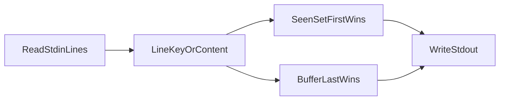

# PROMPT-WF-02: nine-model implementation comparison

| Field | Value |
| --- | --- |
| **Purpose** | Cross-model comparison of stdin line-dedup CLIs after the same **traditional four-phase** trial prompt |
| **Trial prompt** | [PROMPT-WF-02](catalog-traditional-workflow-trial-prompts.md#prompt-wf-02) |
| **Workflow skills** | `add-feature` → `refine-plan` → `build-plan` → `close-out` |
| **Recorded** | 2026-11-02 |
| **Proof boundary** | Static inspection, CLI matrix evaluation ([matrix-results.tsv](../../tied-project/working/FACILITATOR-WF-02-matrix/evidence/matrix-results.tsv)), and test runs in each disposable client |
| **Disclaimer** | Store documentation only — not a `[REQ-*]` token, not a maturity score, not a model leaderboard |

Facilitators grading **workflow choreography** should use the rubric in [catalog-traditional-workflow-trial-prompts.md](catalog-traditional-workflow-trial-prompts.md#facilitator-grading-readout). Per-client letter bands live in the nine [trial readouts](#related-links); this page compares products and behavior.

---

## Sponsor prompt (reference)

Catalog text (turn 1):

```text
Build a CLI that reads lines from stdin and prints a deduplicated stream to stdout. The requirement is intentionally vague about whether duplicate lines should keep first or last occurrence. Document your chosen policy and what you do not guarantee before shipping. Include tests for at least two input orderings.
```

Observed **add-feature** remainder on all nine runs: without pausing for approval, agents were told to implement **more comprehensive** products—so dual-policy CLIs and extra flags appear on several models, not only minimal first-wins filters.

---

## Executive summary — similarities

All nine disposable clients converged on:

- **Product shape:** A **CLI filter** (stdin → stdout), not a library-only deliverable.
- **Default semantics:** **First-seen** (first-occurrence) deduplication at the default invocation—global dedupe across the whole stream, not consecutive-only `uniq`.
- **Documentation:** Each run records a **chosen duplicate policy** and a **non-guarantee** list (README, `docs/dedup-policy.md`, or REQ acceptance text).
- **Tests:** At least **two input orderings** with permuted duplicate lines (prompt minimum met everywhere tests ran green).
- **Traceability:** Production and test code reference project **`REQ-*` / `ARCH-*` / `IMPL-*`** tokens.

They diverge on **whether last-wins is shipped**, **line identity** (UTF-8 text vs opaque bytes; CRLF normalization), **scope beyond the prompt**, **language** (TypeScript vs Python), **TIED close-out residue**, and **git hygiene** (feature commit vs working-tree-only product).

**Ambiguity resolution families:**

| Family | Clients |
| --- | --- |
| **First-only** (documented; no `--keep last`) | Composer, Luna Med, Sol, Fable, Muse Spark |
| **Default first + opt-in last** | Gemini, Grok, Opus, Muse Wonder |
| **First-only + extra comparison flags** | Muse Wonder (`--ignore-case`, `--trim-trailing-whitespace`, `--count`) |

**CRLF vs LF as duplicate keys (matrix row 5):**

| Behavior | Clients |
| --- | --- |
| **Single emitted line** (CRLF and LF collapse for dedupe) | Composer, Gemini, Grok, Luna, Fable |
| **Two lines emitted** (distinct byte keys) | Sol, Muse Spark, Muse Wonder, Opus |

---

## Client index

Legend: **WT** = product inspectable in **working tree only** (`HEAD` often TIED baseline).

| Model (operator label) | `CLIENT_ID` | Absolute path | Code inspect | REQ token | CLI entry | Tests (facilitator run) |
| --- | --- | --- | --- | --- | --- | --- |
| Composer 2.5 | `wf-02-composer25` | `/Users/fareed/Documents/dev/test/1793562432-wf-02-composer25` | Commit `0e5a4e1` | `REQ-STDIN_DEDUP_CLI` | `line-dedup` | 7 × Vitest |
| Gemini 4 Argon Med | `wf-02-gemini4-argon-med` | `/Users/fareed/Documents/dev/test/1793563063-wf-02-gemini4-argon-med` | Commit `8a91204` | `REQ-LINE_DEDUPE_STREAM` | `line-dedupe` / `dist/src/main.js` | 6 × `node --test` |
| Grok 4.7 Med | `wf-02-grok47-med` | `/Users/fareed/Documents/dev/test/1793574114-wf-02-grok47-med` | **WT** (`HEAD` `4296e8e`) | `REQ-LINE_DEDUPE` | `line-dedupe` / `src/cli.ts` | 21 × native TS test |
| GPT-5.6 Luna Med | `wf-02-gpt56-luna-med` | `/Users/fareed/Documents/dev/test/1793580151-wf-02-gpt56-luna-med` | **WT** (`HEAD` `9e6dc61`) | `REQ-DEDUP_STREAM_CLI` | `dedup_stream.py` | 5 × unittest |
| Muse Spark 1.3 Med | `wf-02-muse-spark13-med` | `/Users/fareed/Documents/dev/test/1793584262-wf-02-muse-spark13-med` | **WT** (`HEAD` `b43085f`) | `REQ-DEDUP_STREAM` | `src/dedup.py` | 7 × unittest (`PYTHONPATH=src`) |
| Muse Wonder Med | `wf-02-muse-wonder-med` | `/Users/fareed/Documents/dev/test/1793585717-wf-02-muse-wonder-med` | Commit `4cea38d` | `REQ-DEDUP_STREAM` | `src/dedup.py` | 18 × unittest |
| GPT-5.6 Sol Med | `wf-02-gpt56-sol-med` | `/Users/fareed/Documents/dev/test/1793587208-wf-02-gpt56-sol-med` | Commit `f481059` | `REQ-STREAM_LINE_DEDUPLICATION` | `dedup.py` | 11 × unittest |
| Claude Fable 5 Med | `wf-02-claude-fable5-med` | `/Users/fareed/Documents/dev/test/1793589777-wf-02-claude-fable5-med` | Commit `bbdc684` | `REQ-DEDUP_CLI` | `bin/dedup.js` | 12 × `node --test` |
| Claude Opus 5.5 Med | `wf-02-claude-opus55-med` | `/Users/fareed/Documents/dev/test/1793592181-wf-02-claude-opus55-med` | Commit `9750668` | `REQ-STDIN_LINE_DEDUP` | `bin/linededup` | 31 × unittest (`PYTHONPATH=src`) |

**REQ `status` in project YAML at inspect time:** Gemini and Fable **`Implemented`**; Composer **`Draft`**; all others **`Planned`** (including Opus despite full product commit).

---

## Implementation differences

Legend: **Co** Composer · **Ge** Gemini · **Gr** Grok · **Lu** Luna · **Sp** Spark · **Wn** Wonder · **So** Sol · **Fa** Fable · **Op** Opus.

| Dimension | Co | Ge | Gr | Lu | Sp | Wn | So | Fa | Op |
| --- | --- | --- | --- | --- | --- | --- | --- | --- | --- |
| **Language** | TS | TS | TS | Python | Python | Python | Python | Node JS | Python |
| **Default policy** | First | First | First | First | First | First | First | First | First |
| **`--keep last`** | No | Yes | Yes | No | No | Yes | No | No | Yes |
| **Extra flags** | — | — | — | — | — | case, trim, count | — | `DEDUP_DEBUG` | DEBUG, help |
| **Line identity** | Content key; CRLF→LF in key | UTF-8 exact; out LF | Split + CR strip option | Logical line LF out | Exact bytes | Exact bytes + opts | **Opaque bytes** | Exact string; strip CR | Exact bytes minus one NL |
| **Streaming (default)** | Yes | Yes | Yes | Yes | Yes | Yes | **Yes (flush per line)** | Yes | Yes |
| **Policy doc** | README | README | CITDP/PLAN | README | `docs/dedup-policy.md` | README | README | README | README + vocab |
| **CITDP persisted** | Yes | Yes | Yes (WT) | Yes (WT) | Yes (WT) | Yes | Yes | Yes | Yes |
| **Interaction inventory** | No | Yes | Yes | No | No | No | No | No | No |
| **Gate JSON (bundle)** | 6 | 2 | 3 | 0 | 3 | 3 | 4 | 8 | 1 |
| **CHANGELOG** | Yes | No | No (WT) | No (WT) | No | Yes | Yes | Yes | Yes |
| **Feature git commit** | Yes | Yes | **No** | **No** | **No** | Yes | Yes | Yes | Yes |

---

## Shared processing pipeline



Every client reads a line stream, derives a **duplicate key**, then either maintains a **seen set** (default) or **buffers for last-wins** (Ge, Gr, Op, Wn when `--keep last`). None sort output.

---

## Same-input behavior matrix

Cells are **stdout** for piped stdin (lines shown with `\|` between emitted lines). **`N/A`** = no last-wins mode. Matrix source: facilitator run 2026-11-02.

| # | Input | Co | Ge | Gr | Lu | Sp | Wn | So | Fa | Op |
| --- | --- | --- | --- | --- | --- | --- | --- | --- | --- | --- |
| 1 | Ordering A `a,b,a,c,b` | a\|b\|c | a\|b\|c | a\|b\|c | a\|b\|c | a\|b\|c | a\|b\|c | a\|b\|c | a\|b\|c | a\|b\|c |
| 2 | Ordering B `b,a,c,a,b` | b\|a\|c | b\|a\|c | b\|a\|c | b\|a\|c | b\|a\|c | b\|a\|c | b\|a\|c | b\|a\|c | b\|a\|c |
| 3 | Empty | *(empty)* | *(empty)* | *(empty)* | *(empty)* | *(empty)* | *(empty)* | *(empty)* | *(empty)* | *(empty)* |
| 4 | `a,b,a` no final NL | a\|b | a\|b | a\|b | a\|b | a\|b | a\|b | a\|b | a\|b | a\|b |
| 5 | `a\r\n` then `a\n` | a | a | a | a | a\|a | a\|a | a\|a | a | a\|a |
| 6 | Ordering A, **keep last** | N/A | a\|c\|b | a\|c\|b | N/A | N/A | a\|c\|b | N/A | N/A | a\|c\|b |
| 7 | Ordering B, **keep last** | N/A | c\|a\|b | c\|a\|b | N/A | N/A | c\|a\|b | N/A | N/A | c\|a\|b |

**Interpretation highlights:**

- **Rows 1–2:** All clients treat dedupe as **order-sensitive first-seen** at default—same multiset in different order yields different output order (prompt’s two-orderings requirement).
- **Row 5:** **Byte-exact** clients (Sp, Wn, So, Op) keep CRLF and LF as **distinct keys**; normalizing clients collapse to one `a`.
- **Rows 6–7:** Dual-policy clients agree on last-wins order for this fixture set (Ge, Gr, Wn, Op aligned on facilitator pipes).

---

## Workflow choreography (observed evidence)

Descriptive mapping to [workflow choreography rubric](catalog-traditional-workflow-trial-prompts.md#workflow-choreography-rubric-15) — **not scored** on this page.

| Sub-check | Co | Ge | Gr | Lu | Sp | Wn | So | Fa | Op |
| --- | --- | --- | --- | --- | --- | --- | --- | --- | --- |
| **Phase boundary** | Feature commits | Feature commit | Product **WT** | Product **WT** | Product **WT** | Feature commit | Feature commit | Feature commit | Feature commit |
| **Skill hygiene** | No inventory | Inventory present | Inventory present | No inventory | No inventory | No inventory | No inventory | No inventory | No inventory |
| **Plan carry-forward** | CITDP + gates | PLAN + CITDP | PLAN + CITDP | Working evidence | `docs/dedup-policy` | README + gates | CHANGELOG + gates | Strong README + gates | Extensive evidence chain |
| **Gate discipline** | 6 gate JSON | 2 gates | 3 gates (WT) | None on disk | 3 gates (WT) | 3 gates | 4 gates | 8 gates | Adversarial + verify evidence |
| **Close-out honesty** | REQ **Draft** | REQ **Implemented** | REQ **Planned** (WT) | REQ **Planned** | REQ **Planned** | REQ **Planned** | REQ **Planned** | REQ **Implemented** | REQ **Planned** (31 tests green) |

**Choreography takeaway:** Gemini and Fable are the only clients with REQ **`Implemented`** in YAML at inspect time; Composer and Opus show **verify/gate** strength but REQ status lags. Grok alone pairs **interaction inventory** with a **dual-policy** design but left the product **uncommitted**. Wonder interprets “more comprehensive” as **optional comparison modes**, not just last-wins.

---

## Per-client notes

### Composer 2.5 (`wf-02-composer25`)

Vitest unit + CLI composition tests; **`line-dedup`** bin with **first-occurrence-wins** README contract. Modular `src/` (`dedupe-lines`, `read-stdin-lines`, `run-cli`). Six gate receipts; REQ remains **Draft** after verify chore commit.

### Gemini 4 Argon Med (`wf-02-gemini4-argon-med`)

Ships **both keep policies** with documented ordering A/B/C examples; fail-closed CLI validation. **`npm test`** depends on store-relative `tsc` path (runs when stdd layout present). **Interaction inventory** on disk; REQ **Implemented**.

### Grok 4.7 Med (`wf-02-grok47-med`)

Twenty-one native TypeScript tests; **PARSE_KEEP_FLAG** + **DEDUPE_FIRST_SEEN** / **DEDUPE_LAST_SEEN** modules. Strong CITDP and **trial interaction inventory**; entire product tree still **uncommitted** on baseline HEAD.

### GPT-5.6 Luna Med (`wf-02-gpt56-luna-med`)

Single **`dedup_stream.py`** with README **stable first-occurrence** policy and normalized LF output. Five unittest cases including two orderings; **uncommitted** product on TIED baseline.

### Muse Spark 1.3 Med (`wf-02-muse-spark13-med`)

Minimal **`src/dedup.py`**; policy in **`docs/dedup-policy.md`** instead of root README. Seven tests with **`PYTHONPATH=src`**; first-only; **uncommitted**.

### Muse Wonder Med (`wf-02-muse-wonder-med`)

Broadest **surface area**: `--keep last`, **`--ignore-case`**, **`--trim-trailing-whitespace`**, **`--count`** (buffers to EOF). Eighteen tests; committed **`4cea38d`**; REQ still **Planned**.

### GPT-5.6 Sol Med (`wf-02-gpt56-sol-med`)

**Byte-oriented** duplicate keys; preserves original line bytes on emit with flush-before-read; CRLF and LF differ (matrix row 5). Eleven tests; excellent README on streaming vs last-wins non-goal.

### Claude Fable 5 Med (`wf-02-claude-fable5-med`)

Pure **`src/dedup.js`** + **`bin/dedup.js`**; README argues **first-only** for true streaming. Twelve **`node --test`** cases including CLI spawn tests; REQ **Implemented**; eight gate JSON files.

### Claude Opus 5.5 Med (`wf-02-claude-opus55-med`)

**`linededup`** with default **keep-first** streaming and **`--keep last`** buffer mode; client vocab **`line-dedup.md`**. Thirty-one tests with **`PYTHONPATH=src`**; adversarial inquiry artifacts; REQ YAML still **Planned** despite feature commit.

---

## Verification appendix

Facilitator logs: [build-plan-verification-evidence.md](../../tied-project/working/FACILITATOR-WF-02-matrix/evidence/build-plan-verification-evidence.md).

| Client | Result (2026-11-02) | Notes |
| --- | --- | --- |
| Composer | **Pass** — 7/7 | Vitest after `tsc` |
| Gemini | **Pass** — 6/6 | Store-path `tsc` |
| Grok | **Pass** — 21/21 | `--experimental-strip-types` |
| Luna Med | **Pass** — 5/5 | `tests/test_dedup_stream.py` |
| Muse Spark | **Pass** — 7/7 | `PYTHONPATH=src` required |
| Muse Wonder | **Pass** — 18/18 | `PYTHONPATH=src` |
| Sol Med | **Pass** — 11/11 | `tests/test_dedup.py` |
| Fable | **Pass** — 12/12 | `node --test` |
| Opus | **Pass** — 31/31 | `PYTHONPATH=src`; bare `pytest` not installed |

Primary sources:

| Client | Implementation | Tests |
| --- | --- | --- |
| Composer | `src/dedupe-lines.ts`, `src/run-cli.ts` | `test/dedupe-lines.test.ts`, `test/cli.test.ts` |
| Gemini | `src/dedupe.ts`, `src/main.ts` | `test/*.test.ts` |
| Grok | `src/dedupe-lines.ts`, `src/cli.ts` | `test/**/*.test.ts` |
| Luna | `dedup_stream.py` | `tests/test_dedup_stream.py` |
| Spark | `src/dedup.py` | `tests/test_dedup.py` |
| Wonder | `src/dedup.py` | `tests/test_dedup.py` |
| Sol | `dedup.py` | `tests/test_dedup.py` |
| Fable | `src/dedup.js`, `bin/dedup.js` | `test/*.test.js` |
| Opus | `src/linededup/` | `tests/test_cli.py`, `tests/test_core.py` |

---

## Related links

- [Traditional four-phase workflow trial catalog](catalog-traditional-workflow-trial-prompts.md)
- [PROMPT-WF-01 seven-model comparison](wf-01-four-model-implementation-comparison.md) — same workflow, semver library stress (grammar expansion vs ambiguity deferral)
- [Demos index](README.md)
- Per-client graded readouts: `trial-readout-PROMPT-WF-02-*-1793562432.md` … `trial-readout-PROMPT-WF-02-*-1793592181.md`
- [Facilitator evidence](../../tied-project/working/FACILITATOR-WF-02-matrix/evidence/)
