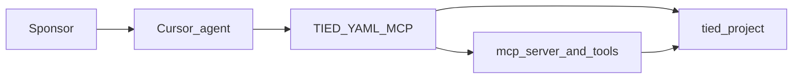
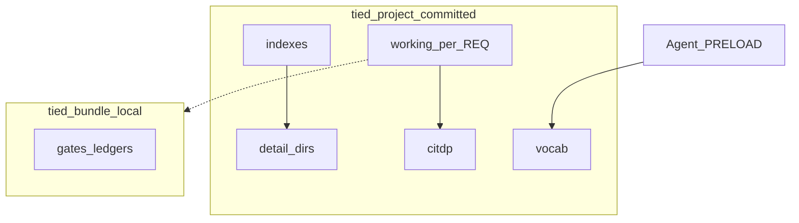
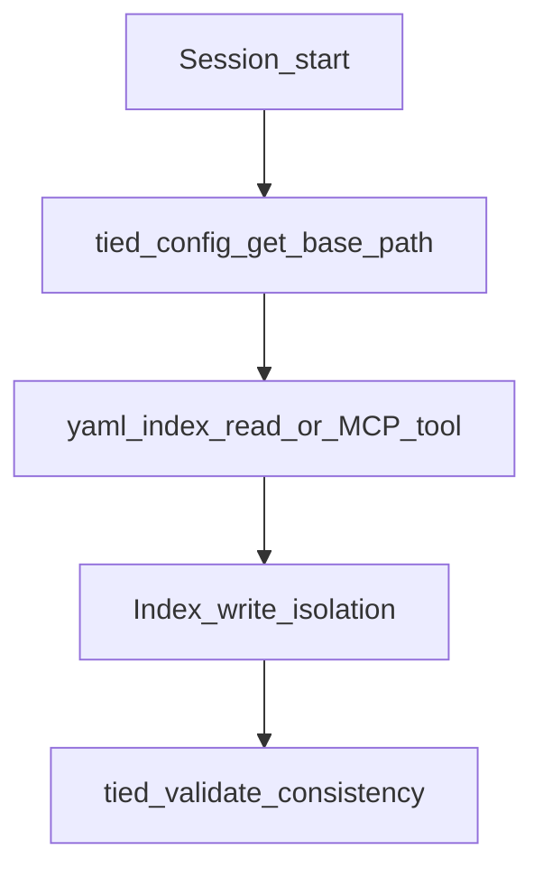

# stdd workflows

**Source engagement:** `DOC-STDD-TIED-PROJECT-BROWNFIELD` · **Baseline:** `cf321c96` · **Tier:** `toolchain_readonly`

Machine evidence: [tied-project/working/DOC-STDD-TIED-PROJECT-BROWNFIELD/](../tied-project/working/DOC-STDD-TIED-PROJECT-BROWNFIELD/) · Corpus map: [tied-project-corpus-map.md](../tied-project/working/DOC-STDD-TIED-PROJECT-BROWNFIELD/evidence/reports/tied-project-corpus-map.md)

## Workflow inventory

| Id | Flow | Class | Evidence |
| --- | --- | --- | --- |
| W1 | Agent / IDE → TIED YAML MCP → `tied-project/` indexes | integration | `mcp-server/src/tools/index.ts`, yaml-loader trace |
| W2 | `tied-install.sh` → client `tied-project/` + `tied-bundle/` stub | operator | `tools/bootstrap`, REQ layered install |
| W3 | REQ implement → working envelope + CITDP persist | operator | working-artifact-placement |
| W4 | EDPC brownfield → SCM + publish manifest | operator | EDPC MCP, DOC engagement edpc/ |
| W5 | `tied_verify` → REQ/IMPL status from tests | integration | verify.ts callers via getBasePath |
| W6 | Prompt-type skill → checklist gates | operator | agentstream / bundled skills |

## A1 — System context

## B4 — Declared vs observed (meta hub)

| Surface | Declared (indexes / REQ) | Observed (this comprehension pass) |
| --- | --- | --- |
| Traceability graph | REQ→ARCH→IMPL in YAML | Sample validate ok; full pseudo-code pass deferred |
| Implementation status | `tied_verify` when gated | **Not** inferred here |
| CITDP drafts | Canonical in `tied-project/citdp/` | 65 duplicate working copies removed |
| Code structure | IMPL pseudo-code + tests | Source graph 745 files under mcp-server |

## I1 — Meta: corpus navigation

## Primary operator path (W1)

## Verification gaps

- Runtime behavior of **marker_only** identity routing is not fully exercised in this doc pass (see intent control plane handoff).
- Source graph covers TS/JS under `mcp-server/` only — not full monorepo or YAML corpus.
- Envelope gap batch sampled **10** REQ tokens; not all **247** working folders.
- `tied_checklist_gate_validate` blocked by `identity` key in `tied-project/config.yaml` vs MCP schema (documented in DOC gate note).

## Related

- [README brownfield section](../README.md)
- [client-development-index.md](../tied-bundle/docs/client-development-index.md)
