# stdd workflows

**Product:** TIED methodology store and dogfood client (`stdd`) — ships the YAML MCP server, bootstrap/install tooling, bundled agent skills, and a committed `tied-project/` meta hub.

**Stack (Declared):** TypeScript/Node MCP under `mcp-server/`; client install via `tools/bootstrap` (`tied-install.sh`); agent orchestration via `@tied/agentstream` and bundled `.cursor/skills/`; traceability corpus in `tied-project/` + read-only methodology in `tied-bundle/`.

**Comprehension source:** `DOC-STDD-TIED-PROJECT-BROWNFIELD` · **Baseline:** `cf321c96` · **Tier:** `toolchain_readonly` (see [edpc-publish-manifest.v1.json](../tied-project/working/DOC-STDD-TIED-PROJECT-BROWNFIELD/evidence/edpc/edpc-publish-manifest.v1.json))

Machine evidence: [tied-project/working/DOC-STDD-TIED-PROJECT-BROWNFIELD/](../tied-project/working/DOC-STDD-TIED-PROJECT-BROWNFIELD/) · Corpus map: [tied-project-corpus-map.md](../tied-project/working/DOC-STDD-TIED-PROJECT-BROWNFIELD/evidence/reports/tied-project-corpus-map.md)

## Verification gaps

### Implementation status (read this first)

**EDPC and workflow docs do not certify that REQs are implemented.** Index `status` fields and corpus maps are navigational; **`tied_verify`** (W5) or verification-gated index updates are the only supported sign-off for obligation status. Publish manifests record `comprehension:req_implementation_status_requires_tied_verify` until sponsors attach verify receipts. EDPC claims about REQ status must stay **Unknown** without those receipts ([claims-ledger](../tied-project/working/DOC-STDD-TIED-PROJECT-BROWNFIELD/evidence/edpc/claims-ledger.v1.yaml) CL-DOC-005).

### Residual comprehension limits

- Runtime behavior of **marker_only** identity routing is not fully exercised in this doc pass (see [g6-gate-identity-debug.md](../tied-project/working/DOC-STDD-TIED-PROJECT-BROWNFIELD/evidence/g6-gate-identity-debug.md)).
- Source graph covers TS/JS under `mcp-server/` only — YAML corpus graph is partial ([EG-001](../tied-project/working/DOC-STDD-TIED-PROJECT-BROWNFIELD/evidence/edpc/edpc-queues.v1.yaml)).
- Envelope gap batch: full store corpus (**133** envelopes) in [envelope-gap-report.v1.yaml](../tied-project/working/evaluation/envelope-gap-report.v1.yaml); many working folders still lack envelopes (advisory).
- No build/test/DB observation window in this tier — deployment topology (B1) is **Declared** from repo layout only, not production truth.
- Charter deferred sponsor views **D** (integration plane) and **E** (data plane) as separate EDPC slices; integration flows below are **Derived** from static inventory and claims, not runtime traces.

## Related

- [README brownfield section](../README.md)
- [client-development-index.md](../tied-bundle/docs/client-development-index.md)
- [edpc-comprehension.md](../tied-project/vocab/edpc-comprehension.md) · [tied-yaml-mcp.md](../tied-project/vocab/tied-yaml-mcp.md)
- EDPC queues: [edpc-queues.v1.yaml](../tied-project/working/DOC-STDD-TIED-PROJECT-BROWNFIELD/evidence/edpc/edpc-queues.v1.yaml)

## Workflow inventory

| Id | Flow | Class | Evidence | Diagram |
| --- | --- | --- | --- | --- |
| W1 | Agent / IDE → TIED YAML MCP → `tied-project/` indexes | integration | yaml-loader trace, CL-DOC-003 | [W1](#w1--agent--ide--tied-yaml-mcp) |
| W2 | `tied-install.sh` → client `tied-project/` + `tied-bundle/` | operator | `tools/bootstrap`, layered install REQ | [W2](#w2--client-bootstrap-tied-install) |
| W3 | REQ implement → working envelope + CITDP persist | critical domain | working-artifact-placement, citdp dedupe | [W3](#w3--req-implementation-and-close-out) |
| W4 | EDPC brownfield → SCM + publish manifest | operator | EDPC MCP, charter A–C/F/G | [W4](#w4--edpc-brownfield-comprehension) |
| W5 | `tied_verify` → REQ/IMPL status from tests | integration | verify.ts via getBasePath | [W5](#w5--verification-gated-status) |
| W6 | Prompt-type skill → checklist gates | operator | agentstream, bundled skills | [W6](#w6--agentstream-and-checklist-gates) |

---

## A1 — System context

**Derived** from charter bounded paths and corpus map: sponsors and agents interact with this repo’s MCP and YAML corpus; implementation code serves the MCP and install surfaces.

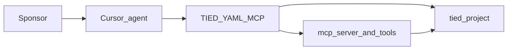

## A2 — Solution topology

**Declared** two-folder layout (CL-DOC-001): committed project YAML vs methodology bundle; local gitignored machine evidence on typical clients.

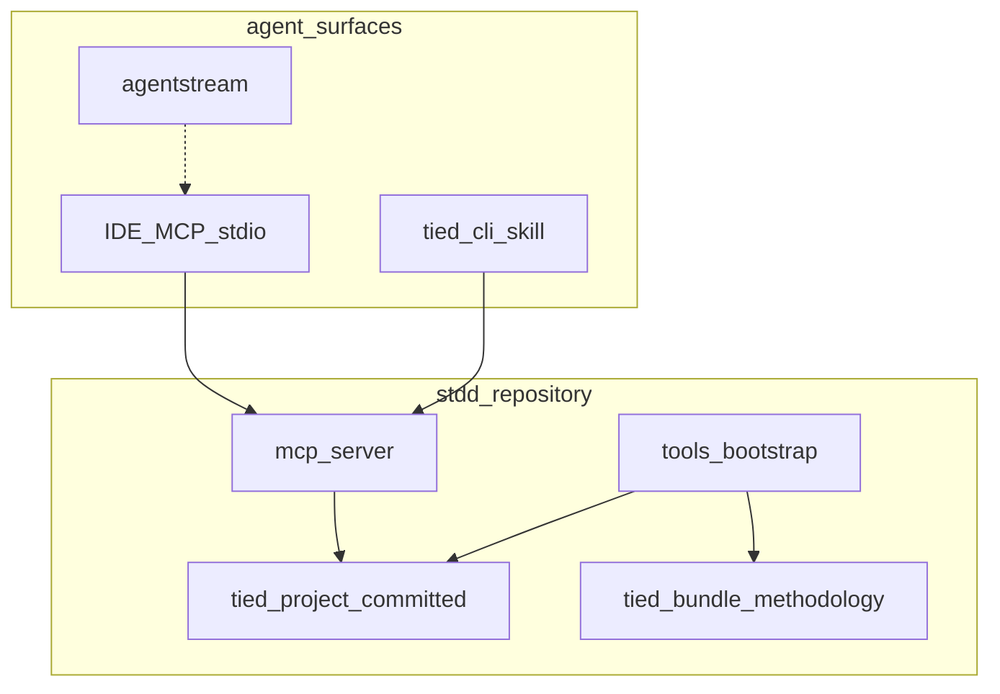

## A3 — Layer dependencies

**Derived** from AGENTS.md priority and MCP tool layering: indexes and detail files sit above working artifacts; MCP reads merged view but writes project indexes only.

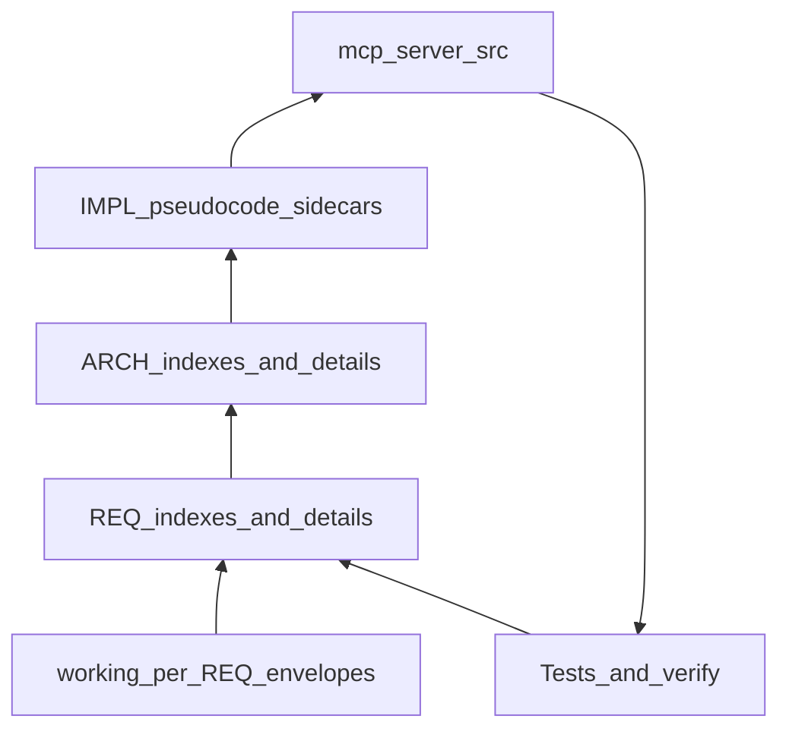

## A4 — Primary operator path (session YAML work)

**Derived** from client-development-index and tied-yaml vocab: confirm base path before any project YAML write.

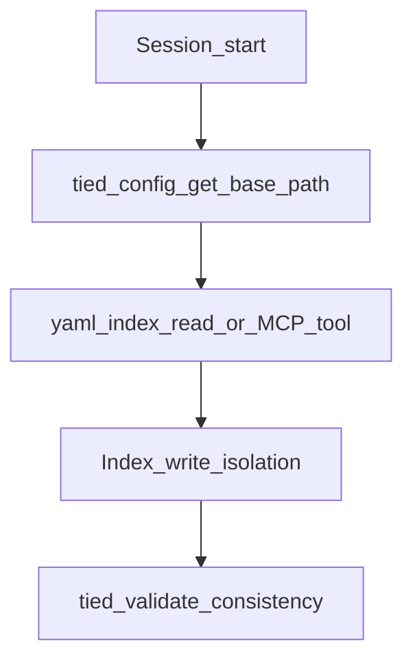

---

## B3 — Source-graph hot path (getBasePath)

**Derived** (CL-DOC-003): static trace shows `getBasePath` as hub for MCP YAML I/O, verify, envelope tools, and citdp-writer — dashed edges mark callers not individually cited in this doc.

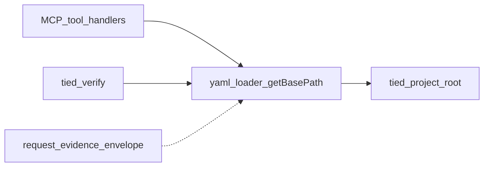

## B4 — Declared vs observed (meta hub)

| Surface | Declared (indexes / REQ) | Observed (this comprehension pass) |
| --- | --- | --- |
| Traceability graph | REQ→ARCH→IMPL in YAML | Sample validate ok (CL-DOC-002); full pseudo-code pass deferred |
| Implementation status | `tied_verify` when gated | **Not** inferred here |
| CITDP drafts | Canonical in `tied-project/citdp/` | 65 duplicate working copies removed (CL-DOC-004) |
| Code structure | IMPL pseudo-code + tests | Source graph ~646 TS files under `mcp-server/src/` (inventory) |

## G1 — Configuration / identity plane

**Declared** `TIED_BASE_PATH` and project identity routing; **Observed** gate behavior may lag until MCP restart (verification gaps). Treat production config as unknown.

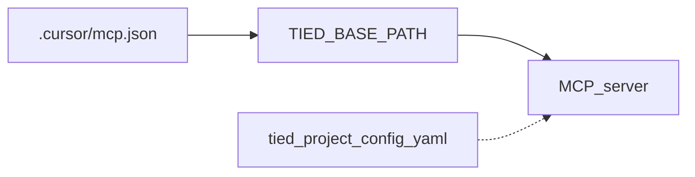

---

## W1 — Agent / IDE → TIED YAML MCP

**Integration boundary.** **Derived** from MCP entrypoint and yaml-loader trace; solid edges only where inventory or trace cites the path.

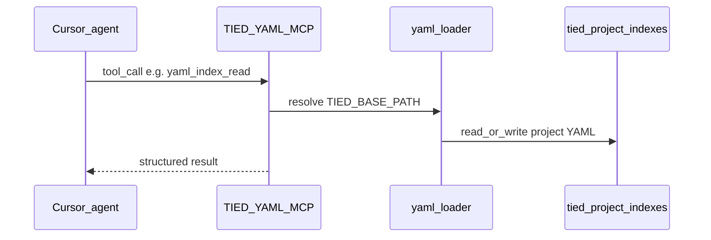

## W5 — Verification-gated status

**Integration boundary.** **Declared** process: test results drive status when verification-gated mode is enabled; this doc does not run verify.

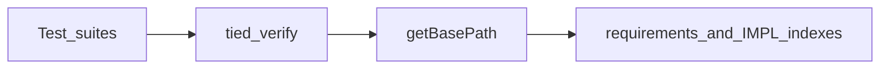

---

## W3 — REQ implementation and close-out

**Critical domain** for TIED clients: working folder lifecycle and CITDP persistence (FND-001/FND-002 in queues).

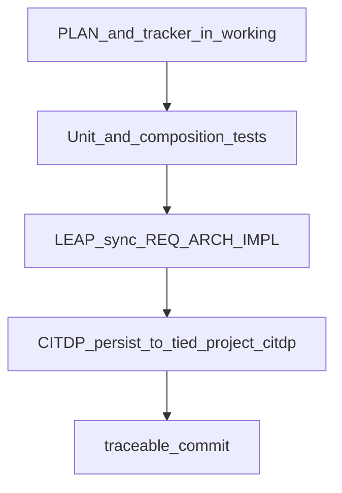

## W2 — Client bootstrap (tied-install)

**Operator path.** **Declared** from bootstrap README and layered install: linked vs full mode.

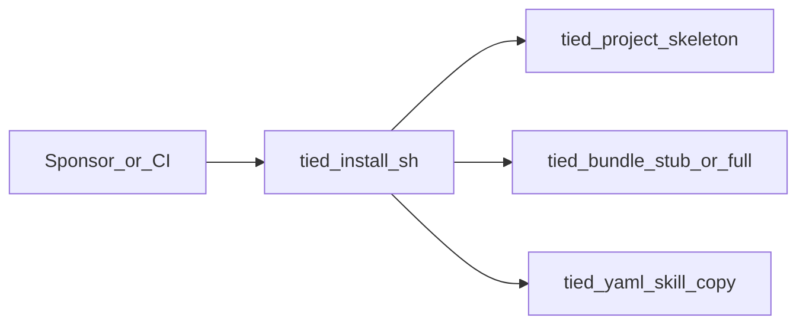

## W4 — EDPC brownfield comprehension

**Operator path** for program comprehension on this store (charter workflows A, B, C, F, G).

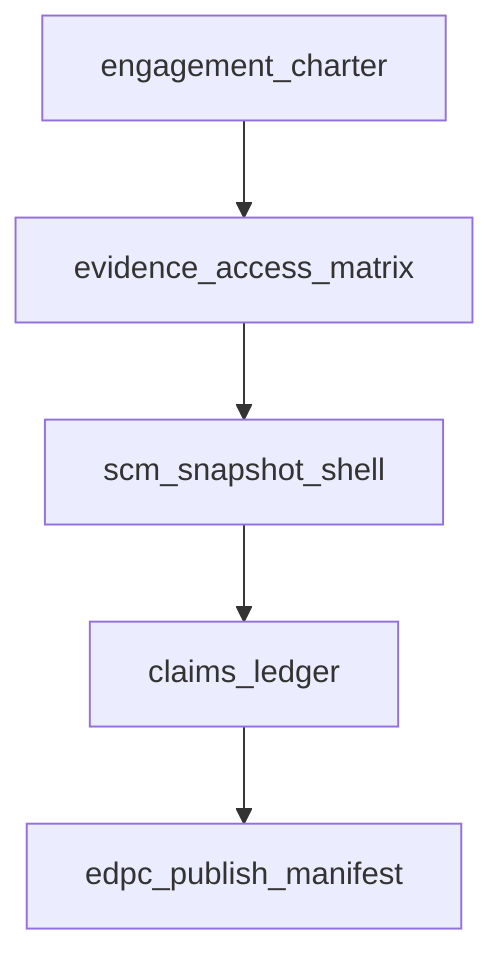

## W6 — Agentstream and checklist gates

**Operator path.** **Derived** from bundled skills catalog; dashed link where IDE MCP preflight is optional/off by default.

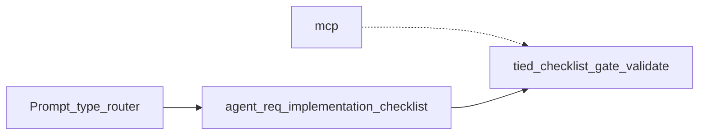

---

## F1 — Batch / CLI utilities

**Supporting.** **Declared:** `tied-cli.sh` mirrors MCP for headless YAML ops when IDE MCP is absent ([using-tied-without-mcp.md](../tied-bundle/docs/using-tied-without-mcp.md)).

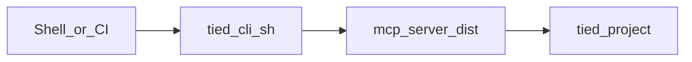

## I1 — Meta: corpus navigation

**Comprehension meta** — links machine evidence; no duplicate ledger tables.

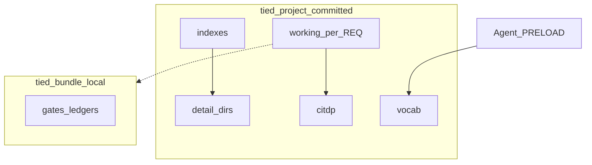

## I4 — Open questions (from EDPC queues)

| Id | Topic |
| --- | --- |
| Q-001 | Merge divergent working CITDP drafts into `citdp/` in a future close-out? |
| ACT-001 | Optional MCP rebuild so `identity.routing` validates in gate tools |
| EG-002 | Envelope completeness beyond sampled batches |
