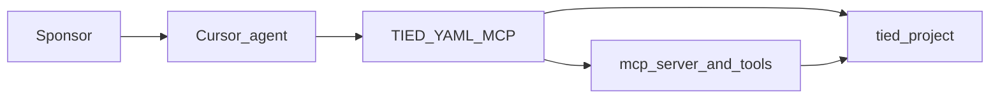
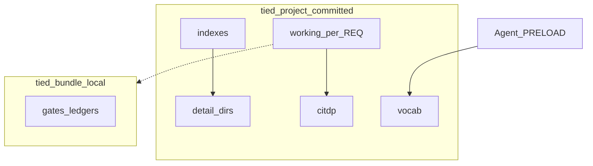
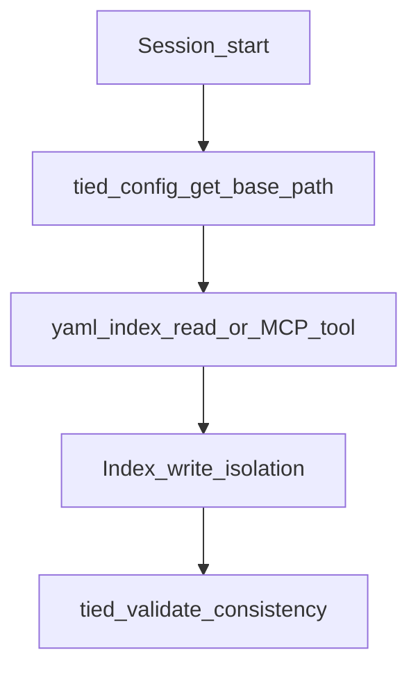

# stdd workflows

**Source engagement:** `DOC-STDD-TIED-PROJECT-BROWNFIELD` · **Baseline:** `cf321c96` · **Tier:** `toolchain_readonly`

Machine evidence: [tied-project/working/DOC-STDD-TIED-PROJECT-BROWNFIELD/](../tied-project/working/DOC-STDD-TIED-PROJECT-BROWNFIELD/) · Corpus map: [tied-project-corpus-map.md](../tied-project/working/DOC-STDD-TIED-PROJECT-BROWNFIELD/evidence/reports/tied-project-corpus-map.md)

## Workflow inventory

| Id | Flow | Class | Evidence |
| --- | --- | --- | --- |
| W1 | Agent / IDE → TIED YAML MCP → `tied-project/` indexes | integration | `mcp-server/src/tools/index.ts`, yaml-loader trace |
| W2 | `tied-install.sh` → client `tied-project/` + `tied-bundle/` stub | operator | `tools/bootstrap`, REQ layered install |
| W3 | REQ implement → working envelope + CITDP persist | operator | working-artifact-placement |
| W4 | EDPC brownfield → SCM + publish manifest | operator | EDPC MCP, DOC engagement edpc/ |
| W5 | `tied_verify` → REQ/IMPL status from tests | integration | verify.ts callers via getBasePath |
| W6 | Prompt-type skill → checklist gates | operator | agentstream / bundled skills |

## A1 — System context

## B4 — Declared vs observed (meta hub)

| Surface | Declared (indexes / REQ) | Observed (this comprehension pass) |
| --- | --- | --- |
| Traceability graph | REQ→ARCH→IMPL in YAML | Sample validate ok; full pseudo-code pass deferred |
| Implementation status | `tied_verify` when gated | **Not** inferred here |
| CITDP drafts | Canonical in `tied-project/citdp/` | 65 duplicate working copies removed |
| Code structure | IMPL pseudo-code + tests | Source graph 745 files under mcp-server |

## I1 — Meta: corpus navigation

## Primary operator path (W1)

## Verification gaps

### Implementation status (read this first)

**EDPC and workflow docs do not certify that REQs are implemented.** Index `status` fields and corpus maps are navigational; **`tied_verify`** (W5) or verification-gated index updates are the only supported sign-off for obligation status. Publish manifests record `comprehension:req_implementation_status_requires_tied_verify` until sponsors attach verify receipts. EDPC claims about REQ status must stay **Unknown** without those receipts ([claims-ledger example](../tied-project/working/DOC-STDD-TIED-PROJECT-BROWNFIELD/evidence/edpc/claims-ledger.v1.yaml) CL-DOC-005).

### Residual comprehension limits

- Runtime behavior of **marker_only** identity routing is not fully exercised in this doc pass (see intent control plane handoff).
- Source graph covers TS/JS under `mcp-server/` only — YAML corpus graph is partial ([REQ-TIED_CORPUS_COMPREHENSION](../tied-project/working/REQ-TIED_CORPUS_COMPREHENSION/PLAN.md)).
- Envelope gap batch: full store corpus (**133** envelopes) in [envelope-gap-report.v1.yaml](../tied-project/working/evaluation/envelope-gap-report.v1.yaml); **118** working folders still lack envelopes (advisory).
- Gate tools: store `identity.routing: marker_only` is allowed in current MCP; stale IDE sessions may still show `CONFIG_UNKNOWN_KEY` until MCP restart ([g6-gate-identity-debug.md](../tied-project/working/DOC-STDD-TIED-PROJECT-BROWNFIELD/evidence/g6-gate-identity-debug.md)).

## Related

- [README brownfield section](../README.md)
- [client-development-index.md](../tied-bundle/docs/client-development-index.md)
