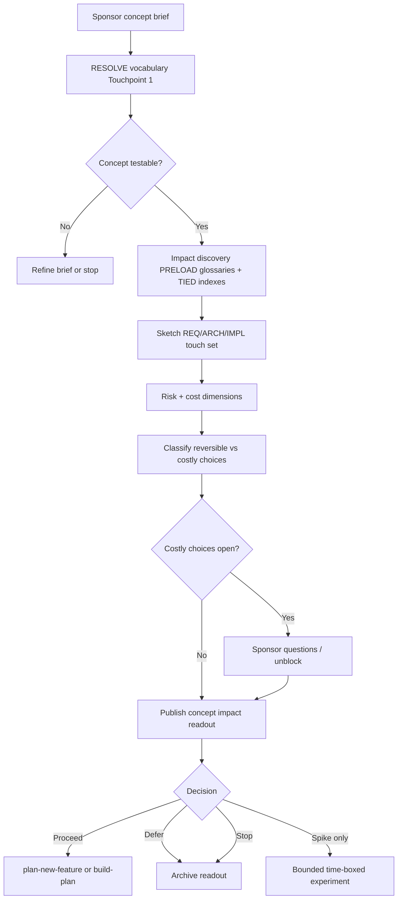

# TIED concept impact inquiry — specification and workflow

**Status:** Draft specification (v0) — intended to become the standard pre-engagement path before costly human investigation or implementation.

**Audience:** Sponsors, computing-services owners, and agents applying TIED to systems that sit inside a larger information-processing and value-delivery context (for example, services whose success contributes to business outcomes such as revenue or margin, without TIED alone proving enterprise-level profit).

**Process anchors:** `[PROC-VOCABULARY_INDEX]`, `[PROC-CITDP]`, `[PROC-AGENT_REQ_CHECKLIST]`, `[REQ-TIED_SPONSOR_AGENT_RELATIONSHIP]`, `[REQ-MODULE_VALIDATION]`

**Related reading:**

- [Client development index](../tied-bundle/docs/client-development-index.md) — vocabulary, TIED, CITDP, LEAP
- [Vocabulary layer, TIED, LEAP, and CITDP](../tied-bundle/docs/vocabulary-layer-tied-leap-citdp.md)
- [CITDP record policy](../tied-bundle/docs/citdp-policy.md)
- [Sponsor–agent relationship](../tied-project/vocab/sponsor-agent-relationship.md)
- [Working artifact placement](../tied-bundle/docs/working-artifact-placement.md)
- [Operating environment externalities](tied-operating-environment-externalities.md) — when complexity and dependencies live in the **operating environment** (external workflows, consumers); use **after** or alongside inquiry when §2 activation criteria apply

---

## 1. Purpose

Organizations use **TIED** to implement and evolve **computing systems** with traceable intent (REQ → ARCH → IMPL → tests → code) and evidence-backed gates. When TIED is applied to the **computing-services arm** of a business—modules, platforms, APIs, agents, and tooling that participate in a **larger information-processing system**—stakeholders still need answers *before* deep discovery or build:

- What is the **impact** on existing obligations and modules?
- What **risks** and **residual uncertainties** remain?
- What **costs** (human time, implementation, operational, opportunity) are implied?
- Which choices are **reversible** vs **costly**, and who must decide?

This document defines:

1. The **interface and contract** TIED requires between business intent and computing delivery.
2. A **concept impact inquiry** workflow that produces a structured readout (not a full implementation) so sponsors can choose proceed, refine, defer, or escalate.

The inquiry workflow **composes** with CITDP and the agent checklist; it does **not** replace `[PROC-AGENT_REQ_CHECKLIST]` when work is approved for implementation.

---

## 2. Context: computing services inside a larger system

| Layer | Role | TIED involvement |
| --- | --- | --- |
| **Enterprise / sponsor outcomes** | Why the business invests (e.g. profitability, market position) | Outcomes are **inputs** to inquiry; TIED does not model accounting or market dynamics unless captured in explicit `[REQ-*]` |
| **Information-processing system** | End-to-end flows of data, decisions, and actions across people and software | ARCH boundaries and dependency maps in inquiry |
| **Computing-services arm** | Software, automation, agents, infrastructure owned for delivery and change | Primary TIED client: `tied-project/` tokens, IMPL contracts, tests |
| **Methodology** | Inherited process and tools | Read-only `tied-bundle/`; gates via MCP / `tied-cli` |

**Translation rule (`/xlate`, Touchpoint 1 RESOLVE):** Sponsor language (“profits,” “reliable,” “AI does X”) must be resolved to **named concepts** in `tied-project/vocab/` and to **testable obligations** before they drive REQ authoring. RESOLVE changes **names**, not sponsor intent authority ([RESOLVE charter](../tied-project/vocab/sponsor-agent-relationship.md)).

---

## 3. Interface contract: what each side must provide

TIED is not a single REST API. The **interface** is a set of **obligations and artifacts** that bound the computing-services arm and the sponsor/reviewer.

### 3.1 Sponsor → computing services (intake)

Minimum **concept brief** for impact inquiry:

| Field | Content |
| --- | --- |
| **Working title** | Short name for the concept (becomes folder slug until `[REQ-*]` exists) |
| **Business purpose** | Why this matters to the organization (outcome language allowed here) |
| **Desired capability** | What the system should do differently when done (behavior, not stack) |
| **Non-goals** | Explicit exclusions |
| **Constraints** | Regulatory, security, budget, timeline, platform, data residency |
| **Stakeholders** | Sponsor, service owner, reviewer, data owner |
| **Success signals** | Measurable or observable criteria (even if rough) |
| **Known dependencies** | Other systems, teams, or REQ clusters already in `tied-project/` |
| **Open costly choices** | Decisions that would be expensive to unwind (if any are already known) |

Optional but valuable: links to existing glossaries, prior CITDP records, or production incidents.

### 3.2 Computing services → sponsor (inquiry deliverable)

Minimum **concept impact readout**:

| Section | Content |
| --- | --- |
| **Resolved vocabulary** | Preferred terms, demoted synonyms, naming bridges (UI / API / data) |
| **Traceability sketch** | Likely `[REQ-*]` / `[ARCH-*]` / `[IMPL-*]` touch set (existing + net-new) |
| **Impact summary** | Blast radius: modules, bindings, data, consumers, methodology surface |
| **Risk register** | Severity, likelihood, mitigation, residual risk, waivers |
| **Cost dimensions** | See §5 |
| **Consequence ladder** | Reversible vs costly choices; recommended defaults vs sponsor questions |
| **Proof boundary** | What TIED can prove after implementation vs what remains business measurement |
| **Recommended next step** | One of: refine brief, light spike, full `plan-new-feature`, defer, stop |

### 3.3 Implementation contract shape (when work is approved)

Every **new or changed** Active behavior in IMPL `essence_pseudocode` must declare a language-agnostic contract ([implementation-decisions guide](../tied-bundle/docs/implementation-decisions.md)):

- **Structure:** `INPUT`, `OUTPUT`, `DATA`, optional `CONTROL`
- **Precision:** `PRE`, `POST`, `EFFECTS`; plus `FAILURE_MODES`, `DATA_TRANSITION`, `TERMINATION` when applicable
- **Module boundaries:** Independent validation before integration; **binding inventory** and **composition evidence** for seams ([REQ-MODULE_VALIDATION](../tied-project/requirements/REQ-MODULE_VALIDATION.yaml))

Managed code, tests, and pseudo-code blocks share **semantic tokens** and literal block-lead alignment (`[PROC-IMPL_PSEUDOCODE_TOKENS]`, `[PROC-IMPL_CODE_TEST_SYNC]`).

### 3.4 Agency boundary

| Branch | Rule |
| --- | --- |
| **Instrument (agent / automation)** | Run inquiry, draft readouts, apply documented defaults for **reversible choices** inside the **delegated work envelope** |
| **Person (sponsor / reviewer)** | Owns intent, non-goals, approvals, and **costly choices**; must not be instrumentalized or over-asked on reversible work |

See [sponsor-agent relationship](../tied-project/vocab/sponsor-agent-relationship.md).

---

## 4. What TIED can and cannot certify

| Question | TIED can answer (with enrolled REQ + evidence) | TIED cannot answer alone |
| --- | --- | --- |
| Does this service meet specified behavior? | Yes — tests, gates, `tied_verify`, consistency | — |
| Are modules and bindings validated before integration? | Yes — module validation + composition evidence | — |
| Is change traceable and auditable? | Yes — tokens, CITDP, working evidence, envelope | — |
| Will the **company** achieve target profit? | — | No — unless explicit financial REQ + external measurement system |
| Is market demand sufficient? | — | No — business analysis outside default TIED stack |
| Is this the right portfolio priority? | — | Sponsor judgment; inquiry supplies cost/risk inputs |

Inquiry readouts must label **proof boundary** explicitly so sponsors do not treat a green technical gate as a business-outcome guarantee.

---

## 5. Cost dimensions (inquiry output)

Use consistent headings in every readout so decisions compare across concepts.

| Dimension | Includes | Typical evidence |
| --- | --- | --- |
| **Discovery cost** | Human time for inquiry, spikes, research, adversarial inquiry | Hours estimate, depth_tier, pilot scope |
| **Implementation cost** | Engineering to satisfy REQ/ARCH/IMPL + TDD/composition/E2E | Module count, new tokens, test surface, express_lane eligibility |
| **Integration cost** | Cross-system bindings, migrations, dual-write periods | Binding inventory rows, consumer teams |
| **Operational cost** | Run, monitor, on-call, data storage, LLM/API spend | ARCH notes, EFFECTS rows (IO, Async, cost) |
| **Opportunity cost** | What delayed work or REQ queue items compete | Backlog reference, `tied_backlog` / sponsor priority |
| **Reversibility cost** | Cost to unwind if the concept fails | Data migrations, public API, contractual commits |

**Costly choice:** any row where undo is hard or expensive → end-of-turn sponsor question with recommended default ([consequence ladder](../tied-project/vocab/sponsor-agent-relationship.md)).

---

## 6. Workflow: concept impact inquiry

### 6.1 When to use

Use **before**:

- Large human discovery (workshops, multi-team design)
- `plan-new-feature` / `build-plan` enrollment
- Significant spend on prototypes or production change

Skip or shorten when [CITDP policy](../tied-bundle/docs/citdp-policy.md) allows (docs-only, trivial reversible fix)—but still RESOLVE terms if the sponsor names new concepts.

### 6.2 Depth tiers

| Tier | Name | Output | Typical duration |
| --- | --- | --- | --- |
| **L0** | Term resolve only | Vocabulary table + RESOLVE notes | Minutes |
| **L1** | Light impact scan | Readout §3.2 skeleton, no CITDP file | Hours |
| **L2** | Structured inquiry | Full readout + draft CITDP sections in working folder | Days |
| **L3** | Enrolled change | `tied-project/working/{REQ-TOKEN}/`, Tracker, `pre_implementation` gate path | Same as feature program |

Default for **proposed concepts** from business sponsors: start at **L1**; escalate to **L2** when blast radius crosses module boundaries or costly choices appear.

### 6.3 Steps (normative sequence)



| Step | Checklist analogue | Actions |
| --- | --- | --- |
| 1. Intake | `translate-sponsor-intent`, `change-definition` | Capture §3.1; run `/xlate` or `sub-vocabulary-sync` RESOLVE |
| 2. Pre-read | `session-bootstrap`, `impact-discovery` | `tied-project/vocab/routing.md` → matched glossaries; scan `requirements.yaml`, related CITDP |
| 3. Impact sketch | CITDP impact (draft) | List affected tokens, modules, bindings, methodology tools; optional `tied_plumb_diff_impact_preview` when diff exists |
| 4. Risk assessment | `risk-assessment` | `depth_tier`, assurance profile hints, adversarial inquiry policy if behavior-changing |
| 5. Cost assembly | (this spec §5) | Fill cost table; flag costly choices |
| 6. Readout | — | Write committed artifact (§7) |
| 7. Decision | Sponsor | Proceed / defer / spike / stop; record in readout |

### 6.4 Tooling composition (optional, MCP-first)

| Goal | Tool / skill |
| --- | --- |
| Resolve costly-choice backlog | `tied_sponsor_questions`, `/unblock` skill |
| Project health snapshot | `tied_project_lint`, `tied_validate_consistency` (read-only) |
| Scoped analysis | `tied_scoped_analysis_run` (when parameters match enrolled scope) |
| Diff impact (existing branch) | `tied_plumb_diff_impact_preview` |
| Full change record | CITDP YAML via checklist after approval |
| Pre-implementation gate | `tied gate check --phase pre_implementation` (after Tracker + CITDP exist) |

Wrong `TIED_BASE_PATH` invalidates inquiry writes — confirm with `tied_config_get_base_path` before mutating project YAML.

---

## 7. Artifacts and placement

Until a concept earns a `[REQ-*]` token, use a **committed inquiry folder** under the repository project root:

```text
tied-project/working/INQUIRY-{SLUG}/
  concept-brief.md          # Sponsor intake (§3.1)
  impact-readout.md         # Deliverable (§3.2 + §5)
  vocabulary-resolved.md    # RESOLVE/RECORD output
  decision-record.md        # Proceed | defer | spike | stop + date + sponsor
  citdp-draft.yaml          # Optional at L2; promote to tied-project/citdp/ on enroll
```

When the concept enrolls as a feature:

- Rename or link folder to `tied-project/working/{REQ-TOKEN}/`
- Copy checklist tracker from [agent-req-implementation-checklist.yaml](../tied-bundle/docs/agent-req-implementation-checklist.yaml)
- Add `request-evidence-envelope.v1.json` when envelope tooling applies

Regenerable gate JSON remains under `tied-bundle/working/{REQ-TOKEN}/gates/` per [working artifact placement](../tied-bundle/docs/working-artifact-placement.md).

---

## 8. Readout template (copy for each inquiry)

```markdown
# Concept impact readout — {TITLE}

**Inquiry id:** INQUIRY-{SLUG}  
**Date:** YYYY-MM-DD  
**Depth tier:** L0 | L1 | L2 | L3  
**Sponsor:**  
**Service owner:**

## 1. Resolved vocabulary

| Sponsor term | Preferred term | Notes |
| --- | --- | --- |
| | | |

## 2. Concept summary

- **Purpose:**
- **Desired capability:**
- **Non-goals:**

## 3. Traceability sketch

| Token | Existing / new | Role |
| --- | --- | --- |
| REQ-… | | |

## 4. Impact

- **Modules / services:**
- **Bindings / integrations:**
- **Data / state:**
- **Methodology / tooling:**

## 5. Risks

| Id | Risk | Severity | Mitigation | Residual |

## 6. Costs

| Dimension | Estimate | Notes |
| --- | --- | --- |
| Discovery | | |
| Implementation | | |
| Integration | | |
| Operational | | |
| Opportunity | | |
| Reversibility | | |

## 7. Choices

| Decision | Reversible / costly | Default / recommendation | Owner |

## 8. Proof boundary

- **TIED can prove after build:**
- **Requires business measurement:**

## 9. Recommendation

- [ ] Refine brief  
- [ ] Time-boxed spike  
- [ ] Enroll plan-new-feature (`REQ-…`)  
- [ ] Defer  
- [ ] Stop  

**Sponsor decision:**  
**Next action:**
```

---

## 9. Relationship to CITDP and implementation

| Stage | CITDP | This inquiry |
| --- | --- | --- |
| Idea / concept | Optional | **Primary** — cheap structured readout |
| Approved feature | **Required** for behavior-changing work | Readout feeds `change-definition` and CITDP draft |
| Implementation | Tracker + gates + tests | Checklist owns execution |

CITDP remains the **audit trail** for behavior change; concept impact inquiry is the **front door** so CITDP authors start from aligned vocabulary and a pre-sketched blast radius.

---

## 10. Evolution (future TIED enrollment)

This document is specification text until promoted into project tokens. A future enrollment may add:

- `[REQ-TIED_CONCEPT_IMPACT_INQUIRY]` — mandatory readout before `plan-new-feature` over a size threshold
- `[ARCH-TIED_CONCEPT_INQUIRY_BOUNDARY]` — artifact paths and MCP readout schema
- `[IMPL-TIED_CONCEPT_INQUIRY]` — automation for linting readout completeness

Until then, teams adopt this workflow by convention and cite inquiry ids in CITDP `reference` fields and PLAN.md links.

---

**Document version:** 0.1  
**Last updated:** 2026-10-12
