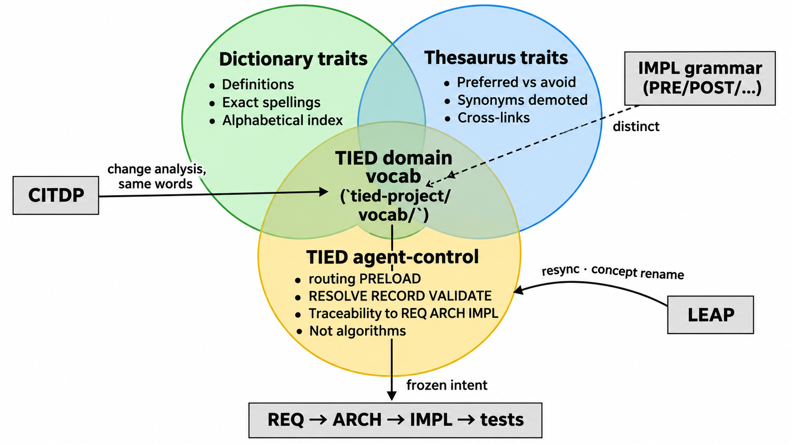
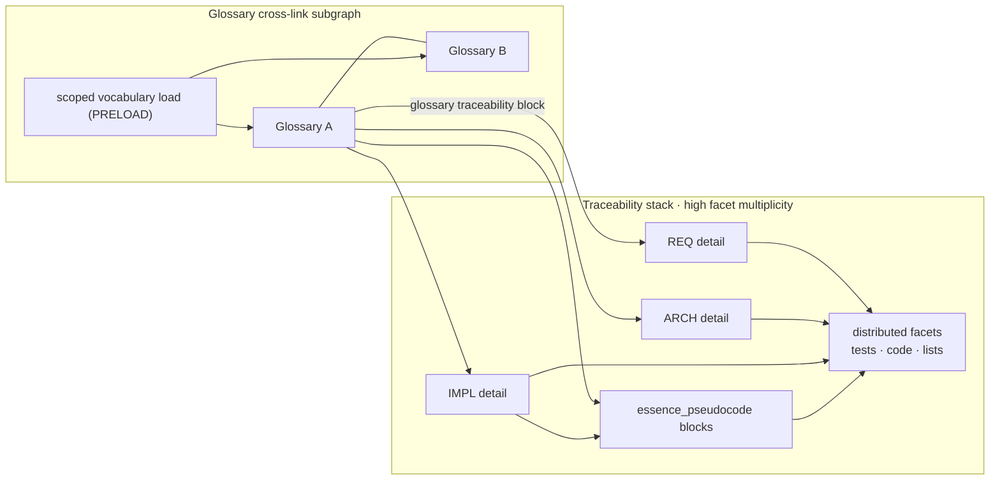
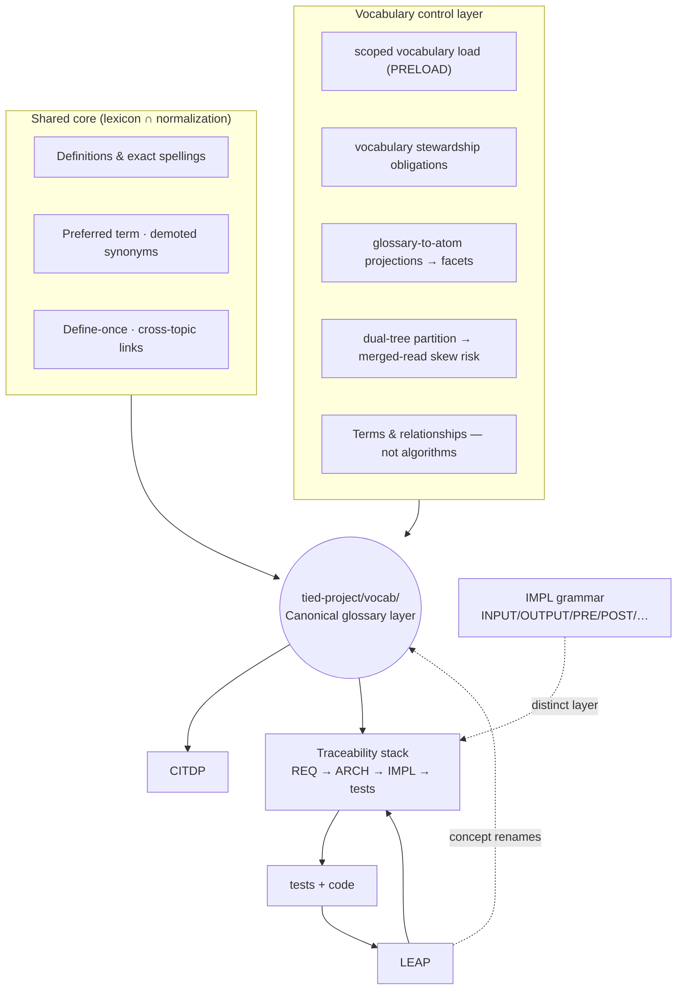

# TIED domain vocabulary — architecture and mental model

| Field | Value |
| --- | --- |
| **Purpose** | Explain what `tied-project/vocab/` is (and is not), how it relates to dictionary/thesaurus habits, IMPL grammar, and the REQ→ARCH→IMPL stack |
| **Audience** | Sponsors, engineers, agent operators, ontology practitioners onboarding to TIED |
| **Canonical operation** | [`tied-project/vocab/routing.md`](../tied-project/vocab/routing.md) (PRELOAD), [`vocabulary-index-analysis-and-standards.md`](../tied-bundle/docs/vocabulary-index-analysis-and-standards.md), [`vocabulary-layer-tied-leap-citdp.md`](../tied-bundle/docs/vocabulary-layer-tied-leap-citdp.md) |
| **Process token** | `[PROC-VOCABULARY_INDEX]` in [`processes.md`](../tied-bundle/docs/processes.md) |
| **Status** | Outreach / architecture explainer; does not mint REQ/ARCH/IMPL tokens |
| **Last updated** | 2026-11-07 (terminology pass: corpus, partition, stewardship, projections) |

---

## Terminology (this document)

Terms below align with [`tied-methodology.md`](../tied-project/vocab/tied-methodology.md) (**registry atom**, **distributed facet**, **atomized traceability graph**, **vocabulary control layer**).

| Preferred term | Avoid in this doc | Meaning |
| --- | --- | --- |
| **canonical vocabulary corpus** | vocabulary catalog (for all glossaries) | Glossary bodies: preferred terms, bridges, relations (`tied-project/vocab/` ∪ `tied-bundle/vocab/`) |
| **vocabulary directory** | whole catalog (for indices) | `routing.md`, `domain-references.md`, methodology mirror — index and dispatch, not definitions |
| **vocabulary term graph** | the graph (unqualified) | Cross-links among glossary files (low facet multiplicity) |
| **atomized traceability graph** | — | REQ/ARCH/IMPL tokens, blocks, facets — validated by **graph closure** |
| **vocabulary partition** | split ownership | **Project zone** vs **methodology zone**; agents use a merged read model |
| **scoped vocabulary load** | PRELOAD filter (alone) | Procedure mode **PRELOAD**: routing-selected glossary set from both partitions |
| **routing-selected glossary set** | query plan | Glossaries matched from `routing.md` for a task |
| **vocabulary stewardship obligations** | touchpoint contracts, maintenance contracts | RESOLVE / PRELOAD / RECORD / VALIDATE under `[PROC-VOCABULARY_INDEX]` |
| **glossary traceability block** | Traceability line (vague) | Bold **Traceability:** block; a **vocabulary facet** |
| **glossary-to-atom projections** | traceability extensions | Links from canonical terms to **registry atoms** in the stack |
| **high facet multiplicity** | high edge frequency | Many **distributed facets** per preferred term |
| **glossary cross-link subgraph** | in-vocab subgraph | Few links between glossary files |
| **merged-read skew** | incongruous catalog | **Semantically inconsistent merged vocabulary view** despite successful PRELOAD |
| **cross-partition REQ tension** | conflicting REQ (vague) | Methodology vs project REQs disagree under merged read |
| **vocabulary control layer** | TIED agent-control (alone) | Stewardship + scoped load + projections |
| **vocabulary control plane** | operational machinery | How the corpus stays aligned with the stack |
| **canonical glossary layer** | normative glossary | `(canonical)` glossary files |
| **definitional lexicon** | dictionary-like (heading) | Definitions, enums, spellings |
| **lexical normalization** | thesaurus-like (heading) | Preferred vs avoid, synonym demotion |
| **adjacent methodology layers** | neighbors (formal) | IMPL grammar, CITDP, LEAP, traceability stack |

---

## Executive summary

The **canonical vocabulary corpus** is TIED’s shared *understanding* layer: one preferred label per concept, demoted synonyms, exact spellings, and **naming bridges** to UI, YAML, CLI, and pseudo-code block names. The **vocabulary directory** (`routing.md`, `domain-references.md`, and the methodology mirror under `tied-bundle/vocab/`) indexes and dispatches that corpus. Glossary files form a **vocabulary term graph** (cross-links among topics). The **project zone** (`tied-project/vocab/`) holds **project-canonical terms**; the **methodology zone** (`tied-bundle/vocab/`) holds **methodology-canonical terms**.

It is **not** a replacement for requirements. It is **not** step-by-step logic (that stays in IMPL `essence_pseudocode`). It is **not** **IMPL grammar vocabulary** (INPUT/OUTPUT/PRE/POST/EFFECTS)—a **parallel naming system** documented separately.

In everyday terms: the **canonical glossary layer** combines **definitional lexicon** and **lexical normalization**, plus a **vocabulary control plane** on the corpus: **scoped vocabulary load** (PRELOAD) limits what agents read; **vocabulary stewardship obligations** keep the corpus and stack linkages current; **glossary-to-atom projections** tie terms into the **atomized traceability graph** with **high facet multiplicity** compared with the **glossary cross-link subgraph** alone.

---

## Architecture diagram

*Source asset:* [`docs/assets/tied-vocabulary-architecture-diagram.png`](assets/tied-vocabulary-architecture-diagram.png) (imported from sponsor diagram, 1672×941).

---

## Is vocab a dictionary and a thesaurus combined?

**Partly yes**—with important extras.

### Definitional lexicon (dictionary habit)

| Trait | In glossaries |
| --- | --- |
| Definitions of named concepts | Bold stable terms, concept tables |
| Exact spellings | YAML keys, tokens, enums in backticks |
| Catalogs / enums | Dispatch ladders, diagnostic IDs, etc. |
| Alphabetical index | `Term \| Section` table at file end |

### Lexical normalization (thesaurus habit)

| Trait | In glossaries |
| --- | --- |
| Preferred vs avoid | `Preferred \| Avoid in UI \| Notes` tables |
| Synonym demotion | One preferred term; others marked avoid or historical |
| Relations between concepts | Cross-topic notes in [`domain-references.md`](../tied-project/vocab/domain-references.md) |
| Naming bridges | One concept mapped across UI label, config key, CLI flag, UPPER_SNAKE block |

### Vocabulary control layer (outside a plain dictionary/thesaurus)

| Trait | Role |
| --- | --- |
| **Scoped vocabulary load** | `routing.md` yields a **routing-selected glossary set** over the **full corpus** (both partitions); the **vocabulary directory** in `domain-references.md` stays complete—not loaded wholesale each session |
| **Vocabulary stewardship obligations** | RESOLVE, PRELOAD, RECORD, VALIDATE (`[PROC-VOCABULARY_INDEX]`) govern how the corpus and its stack linkages stay current—not optional etiquette |
| **Glossary-to-atom projections** | **Glossary traceability blocks** project **project-canonical terms** onto **registry atoms** in REQ, ARCH, IMPL detail, and `essence_pseudocode`, spawning **distributed facets** at **high facet multiplicity** vs the **glossary cross-link subgraph** |
| **Vocabulary, not algorithm** | Terms and relationships only; behavior in `tied-project/implementation-decisions/*-pseudocode.md` |
| **Dual-tree partition · merged-read skew risk** | Project corpus in `tied-project/vocab/`; methodology corpus in `tied-bundle/vocab/`; project vs bundle REQs both feed merged read. **Cross-partition REQ tension** or conflicting definitions → **merged-read skew** even when PRELOAD succeeds |

---

## Vocabulary corpus as graph: partition, scope, stewardship, projections

Operational model behind the diagram (aligned with **registry atoms** and **distributed facets** in [`tied-methodology.md`](../tied-project/vocab/tied-methodology.md)).

### One corpus, two partitions

| Partition | Location | Role in corpus |
| --- | --- | --- |
| Project zone | `tied-project/vocab/` (+ client `domain-references.md`) | Project-canonical terms and client extensions |
| Methodology zone | `tied-bundle/vocab/` (refresh via `tied-install.sh`) | Methodology-canonical terms; read-only in clients |

Cross-topic notes and routing tables form the **glossary cross-link subgraph** of the **vocabulary term graph**.

### PRELOAD: scoped load over the full corpus

**PRELOAD** is the **scoped vocabulary load**. It does not replace the corpus; it selects what to read for a session or task:

1. Read the client [`routing.md`](../tied-project/vocab/routing.md) handoff (and methodology routes it dispatches when needed).
2. Match task keywords to glossary files across **both partitions**.
3. Load **only** the **routing-selected glossary set**—not the full [`domain-references.md`](../tied-project/vocab/domain-references.md) unless cross-topic scope requires it.

The **vocabulary directory** remains authoritative for the full corpus; PRELOAD is how agents choose a scoped subset.

### Vocabulary stewardship obligations (three touchpoints + inline)

`[PROC-VOCABULARY_INDEX]` defines when the corpus and stack linkages must be consulted or updated:

| Touchpoint | Mode | Stewardship obligation |
| --- | --- | --- |
| Prompt intake | RESOLVE (+ RECORD for new concepts) | Do not invent names that collide with or bypass canonical terms |
| Pre-read (bootstrap, impact discovery) | PRELOAD | Scoped load of the right glossaries before TIED YAML, pseudo-code, or code |
| Pre-commit | VALIDATE | Names in artifacts match the corpus; reconcile drift before commit |
| Inline | RESOLVE before naming; RECORD after artifact edits | Keep the vocabulary term graph and projections current as work proceeds |

Breaking these obligations does not break git—it breaks **shared understanding**, then traceability and tests.

### Glossary-to-stack projections and facet multiplicity

Each **glossary traceability block** (and REQ acceptance criteria that cite glossary paths) **projects** canonical terms onto the **atomized traceability graph**:

- **REQ / ARCH / IMPL** detail YAML — frozen intent and structure (**registry atoms**).
- **`essence_pseudocode`** — operational blocks (often UPPER_SNAKE, aligned to naming bridges).
- **Distributed facets** — aligned partial expressions in tests, code comments, index rows, and working evidence.

Versus the **glossary cross-link subgraph**, these projections share the same discipline but exhibit **high facet multiplicity**: many tokens, blocks, and facet occurrences per preferred term. **`tied_validate_consistency`** and **graph closure** check that facets still agree with registry atoms and preferred terms.

### Dual-tree partition and merged-read skew risk

The **vocabulary partition** enables refresh and client autonomy; it does **not** guarantee a semantically unified merged read:

- Methodology **`tied-bundle/requirements/`** and project **`tied-project/requirements/`** both contribute to the merged REQ view agents use.
- Both partitions can define or constrain the **same natural-language concept** with different preferred terms or scope.

**Cross-partition REQ tension** or conflicting glossary definitions yield **merged-read skew**: PRELOAD can return a coherent slice while the **merged vocabulary + obligation graph** is **semantically inconsistent**—false synonyms, duplicated obligations, or RESOLVE against the wrong partition.

Mitigations (operational, not automatic):

- Prefer **define-once-link-many** inside vocab; use cross-topic notes when a concept spans partitions.
- On methodology refresh, use **`--merge-vocab`** / install behavior so project glossaries are not silently overwritten while methodology shifts underneath.
- When a costly choice spans both trees, treat **project vs bundle REQ and corpus alignment** as explicit validation—not assumed from install layout alone.

---

## Overlap matrix (definitional lexicon × lexical normalization × TIED vocab)

| Trait | Definitional lexicon | Lexical normalization | TIED domain vocab |
| --- | :---: | :---: | :---: |
| Definitions of terms | ● | ○ | ● |
| Preferred vs avoid / synonyms | ○ | ● | ● |
| Spelling / enum catalogs | ● | ○ | ● |
| Cross-concept relations | △ | ● | ● |
| Scoped vocabulary load over full corpus | — | — | ● only |
| Vocabulary stewardship obligations | — | — | ● only |
| Glossary-to-atom projections · high facet multiplicity | — | — | ● only |
| Step-by-step behavior | — | — | ✗ (IMPL pseudo-code) |

● = core · ○ = weak · △ = sometimes · ✗ = explicitly out of scope

---

## How vocab sits beside adjacent methodology layers

| Layer | Epistemic role | Rough question |
| --- | --- | --- |
| **Vocabulary** (`tied-project/vocab/`) | Shared *understanding* | “When we say X, do we mean the same thing—and how does that name appear everywhere?” |
| **TIED stack** (REQ → ARCH → IMPL → tests → code) | Frozen *intent* | “What must be true, and how do we prove it?” |
| **CITDP** | Change *analysis* | “Given this shift, what moves, what risks, what tests?” |
| **LEAP** | Stack *resync* after intent exists | “Code/tests learned something the docs don’t—elevate IMPL → ARCH → REQ (and glossaries on rename).” |

**IMPL grammar vocabulary** is a **parallel naming system**. Domain glossaries and IMPL grammar must not be conflated; see [`pseudocode-and-citdp.md`](../tied-project/vocab/pseudocode-and-citdp.md).

---

## Directory layout (what lives where)

| Path | Partition | Use |
| --- | --- | --- |
| [`tied-project/vocab/routing.md`](../tied-project/vocab/routing.md) | Project (handoff) | **Start here** for scoped vocabulary load (PRELOAD) |
| [`tied-project/vocab/*.md`](../tied-project/vocab/) | Project | Project-canonical glossaries |
| [`tied-project/vocab/domain-references.md`](../tied-project/vocab/domain-references.md) | Project | **Vocabulary directory** — full corpus listing + cross-topic notes (on demand) |
| [`tied-bundle/vocab/`](../tied-bundle/vocab/) | Methodology (read-only in client) | Methodology-canonical glossaries; refreshed by `tied-install.sh` |

**Risk note:** merged reads combine `tied-project/` and `tied-bundle/` REQs and vocab. Cross-partition conflict yields **merged-read skew**—see [Dual-tree partition and merged-read skew risk](#dual-tree-partition-and-merged-read-skew-risk).

Meta-standard for authoring new glossaries: [`vocabulary-index-analysis-and-standards.md`](../tied-bundle/docs/vocabulary-index-analysis-and-standards.md).

---

## Euler view: lexicon, normalization, control layer

When reading the architecture diagram:

1. **Definitional lexicon** (left): definitions, catalogs, greppable spellings, A–Z index.
2. **Lexical normalization** (right): preferred vs avoid, synonyms, “same idea, different surface.”
3. **Vocabulary control layer** (bottom): scoped vocabulary load, vocabulary stewardship obligations, glossary-to-stack projections, dual-tree partition and merged-read skew risk, explicit exclusion of algorithms.

The **canonical glossary layer** ≈ the **center overlap of (1) and (2)**, wrapped by **most of (3)**.

**Adjacent methodology layers** (connected by arrows in the diagram):

| Layer | Relation to vocab |
| --- | --- |
| **IMPL grammar** | Parallel contract naming; do not merge into domain glossaries |
| **REQ/ARCH/IMPL** | Frozen intent; glossary traceability blocks cite tokens; obligations live in YAML + pseudo-code |
| **CITDP** | Change analysis using the same words |
| **LEAP** | Repairs stack drift; may write back glossary terms on renames |

For outreach framing and FAQ (including SKOS-adjacent vocabulary vs OWL ontologies), see [`vocabulary-layer-tied-leap-citdp.md`](../tied-bundle/docs/vocabulary-layer-tied-leap-citdp.md).

---

## Vocabulary discipline checklist

Per [`AGENTS.md`](../AGENTS.md) and `[PROC-VOCABULARY_INDEX]`:

1. Apply **scoped vocabulary load** (PRELOAD) over the **full corpus**: client [`routing.md`](../tied-project/vocab/routing.md) → **routing-selected glossary set**; open full `domain-references.md` when cross-topic scope demands it.
2. Honor **vocabulary stewardship obligations**—RESOLVE before naming; RECORD when the corpus changes; VALIDATE before commit.
3. Keep **glossary-to-atom projections** aligned: glossary traceability blocks and stack tokens/blocks/facets must agree under **`tied_validate_consistency`** (graph closure).
4. Guard against **merged-read skew**: when methodology and project REQs or glossaries disagree, resolve explicitly—do not assume the merged view is semantically consistent.

---

## See also

- [Vocabulary layer × TIED × LEAP × CITDP](../tied-bundle/docs/vocabulary-layer-tied-leap-citdp.md)
- [TIED × well-known methodologies — scope](comparisons/tied-vs-well-known-methodologies.md) (vocabulary row in “four pieces” table)
- [Client development index](../tied-bundle/docs/client-development-index.md) (Core seven includes domain vocabulary)
