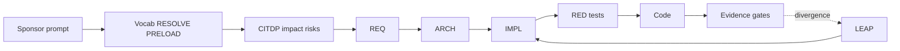
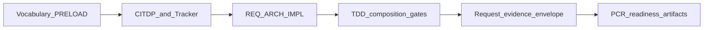
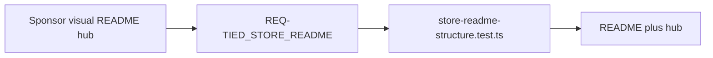

# Engineer and agent lens

**Audience:** Implementers and AI agents shipping REQ-scoped work in a TIED client—including this store repository.

---

## VCRAI spine (mnemonic)

**Vocab → CITDP → Requirement → Architecture → Implementation → Tests → Code → Evidence**



Session rules: [AGENTS.md](../../AGENTS.md). Executable checklist: [agent-req-implementation-checklist.md](../../tied-bundle/docs/agent-req-implementation-checklist.md).

---

## Compact feature rhythm (Cursor)

After `tied-install` (Prompt Composer skills under `.cursor/skills/`):

| Step | Invoke | Purpose |
| --- | --- | --- |
| 1 | `/add-feature` | New requirement + linked plan |
| 2 | `/refine-plan` | Improve plan before execution |
| 3 | `/build-plan` | Execute approved plan (TDD, checklist) |
| 4 | `/close-out` | LEAP sync, gates, CHANGELOG, traceable commit when allowed |

Also in [README § Compact feature rhythm](../../README.md#compact-feature-rhythm). FEAT lifecycle vs REQ-scoped work: [multi-harness entry matrix](../../tied-bundle/docs/client-development-index.md#multi-harness-entry-matrix-cursor-vs-claude-code).

---

## Executable process spine

1. **Vocabulary** — client [routing.md](../../tied-project/vocab/routing.md) → PRELOAD matched glossaries.
2. **Change analysis** — CITDP + per-request Tracker copy ([checklist YAML](../../tied-bundle/docs/agent-req-implementation-checklist.yaml)).
3. **Stack** — REQ → ARCH → IMPL pseudo-code (block token comments) before RED tests.
4. **Gates** — `tied gate check --request-token REQ-… --phase pre_implementation|verification|close_out`.
5. **Envelope** — request evidence envelope at close-out when the Tracker requires it.

### EDSE daily loop



### Certifiability readiness tooling

Read-only MCP/CLI: EDSE process spec, conformance matrix, capability profile, assessor pack — `[REQ-TIED_PROCESS_CERTIFICATION_READINESS]`.

```bash
export TIED_BASE_PATH="/absolute/path/to/tied-project"
node --import tsx --test src/process-certification-readiness/*.test.ts
```

CLI: `tied certification spec-validate`, `conformance-evaluate`, `capability-evaluate`, `independent-assess`, `adaptive-experiment-run`, `readiness-report-compose`, `assessor-pack-generate` — see `mcp-server/src/cli/process-certification-cli.ts`.

Prompt skills do not replace checklist gates or integrated adversarial inquiry when those apply.

---

## Brownfield comprehension

<a id="brownfield-comprehension"></a>

**Purpose.** Brownfield comprehension is how TIED learns a legacy or unfamiliar system *before* feature work assumes correct intent. The goal is an evidence-backed **Software Comprehension Model**—declared intent, what code can do, what was observed, environmental effects, failures, and explicit unknowns—not a one-shot repository summary or “tests pass, so we’re fine.” TIED orchestrates this through **Evidence-Driven Program Comprehension (EDPC)** (`[PROC-EDPC_COMPREHENSION]`) and **brownfield intent elevation** (`[PROC-BROWNFIELD_INTENT_ELEVATION]`). Reverse documentation (**Track C**) captures observed behavior in IMPL sidecars only; it does not by itself create approved requirements.

**Typical steps** (depth and tier vary by engagement):

1. **Commission (A)** — Charter, scope matrix, and **evidence-access tier** (`source_static`, `toolchain_readonly`, or `source_change`); validate with MCP `tied_edpc_access_validate` / `tied_edpc_engagement_validate`.
2. **Baseline (B)** — Structural inventory and graph receipts (EASAR workflow **B** under EDPC).
3. **Deep slices (C)** — Source graph, claims review, Track C pseudo-code where appropriate.
4. **Ops / change (D–E, when tier allows)** — Failure and operational state, or scoped change-impact analysis.
5. **Intent elevation** — Evidence-to-intent matrix; enrich REQ/ARCH from **`approved`** rows only; close with `brownfield_intent_evidence_validate`.
6. **Verify and publish (F)** — Publish manifest with explicit **`gaps[]`**; optional client assessment (workflow **H**).
7. **Refresh (G)** — Re-run when builds, access, or questions change material claims.
8. **Optional — workflow diagrams** — `@workflow-visualization` → `docs/<project>-workflows.md` (example in this store: [stdd-workflows.md](../stdd-workflows.md)).

Tracker: `brownfield_intent_elevation.engagement: edpc_full` with `mode: pilot` or `strict`. Artifacts under `tied-project/working/{REQ-TOKEN}/evidence/edpc/`.

**Benefits:** proof boundaries; reuse for TDD/LEAP; composable MCP passes; honest uncertainty via gaps.

**Costs:** sponsor attention for adjudication; artifact upkeep; bounded scope—not a health certificate.

Deep dives: [EDPC methodology](../../tied-bundle/docs/EDPC_Methodology_and_Workflows.md), [brownfield intent elevation](../../tied-bundle/docs/brownfield-intent-elevation.md), [EDPC vocabulary](../../tied-project/vocab/edpc-comprehension.md).

---

## Walk one REQ in the store: README operator spine

This documentation hub was shaped by the same traceability model it describes. **`REQ-TIED_STORE_README_OPERATOR_DELIVERY_SPINE`** required a named build→install spine in Band 1 and structure-test enforcement.

| Facet | This store (example) |
| --- | --- |
| **REQ** | [REQ-TIED_STORE_README_OPERATOR_DELIVERY_SPINE.yaml](../../tied-project/requirements/REQ-TIED_STORE_README_OPERATOR_DELIVERY_SPINE.yaml) — satisfaction criteria SC-README-SPINE, SC-README-STRUCTURE-TEST |
| **ARCH** | [ARCH-TIED_STORE_README_INFORMATION_ARCHITECTURE](../../tied-project/architecture-decisions/ARCH-TIED_STORE_README_INFORMATION_ARCHITECTURE.yaml) — three-band README IA |
| **IMPL** | [IMPL-TIED_STORE_README_SECTIONS](../../tied-project/implementation-decisions/IMPL-TIED_STORE_README_SECTIONS.yaml) — section contracts |
| **Test** | [store-readme-structure.test.ts](../../mcp-server/src/store-readme-structure.test.ts) — `NORMATIVE_H2`, `REQUIRED_SUBSTRINGS`, Quick start H3 order |
| **Docs** | [README.md](../../README.md) · this hub under `docs/tied-experience/` |



> **Agent aside:** Before editing README bands, read the structure test constants—they are the executable contract for merge regressions.


---

[← Hub index](index.md) · [Appendix — methodology](appendix-methodology.md)
