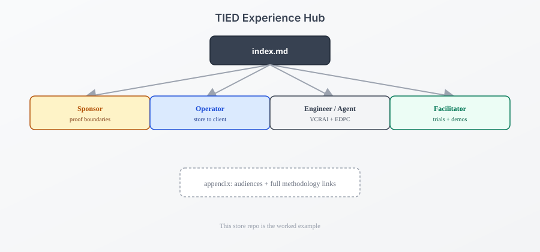

# TIED Experience Hub

**TIED Methodology Version**: 4.2.0

This hub teaches **Token-Integrated Engineering & Development** by example: the [TIED store](https://github.com/fareedst/tied) you are reading is also a TIED client (`tied-project/`). Structure here mirrors the methodology—aligned facets, audience lanes, and explicit proof boundaries—instead of one linear specification.

---

## The stack in 30 seconds

| Piece | What it does |
| --- | --- |
| **Vocabulary** | RESOLVE sponsor terms, PRELOAD glossaries, RECORD names, VALIDATE before commit |
| **TIED** | REQ → ARCH → IMPL → tests → code with semantic tokens |
| **CITDP** | Change analysis before code; persist `tied-project/citdp/CITDP-*.yaml` when policy requires |
| **LEAP** | When code or tests diverge from IMPL, update the stack bottom-up |

Full diagrams: [methodology-diagrams.md](../../tied-bundle/docs/methodology-diagrams.md). Narrative deep read: [graphic novel treatment](../visuals/2026-10-20.md).

---

## Choose your lane

| If you are… | Start here | You will learn |
| --- | --- | --- |
| **Sponsor / PM** | [Sponsor lens](sponsor-lens.md) | Agency, proof boundaries, certifiability vs certification |
| **Operator / integrator** | [Operator lens](operator-lens.md) | Clone → build → install → MCP; store ↔ primary topology |
| **Engineer / agent** | [Engineer and agent lens](engineer-agent-lens.md) | VCRAI, EDPC brownfield, compact feature rhythm, store REQ walkthrough |
| **Facilitator / trainer** | [Facilitator lens](facilitator-lens.md) | Disposable clients, trial catalogs, readouts |

> **Operator doorway:** clone, build, and install stay in root [README.md](../../README.md) Quick start—this hub adds context, not a second install path.

---

## Appendices

- [Audience matrix](appendix-audiences.md) — “I am … → start → also read”
- [Full methodology links](appendix-methodology.md) — Core seven, processes, LEAP, AGENTS

Return to [README](../../README.md) · [Client development index](../../tied-bundle/docs/client-development-index.md)
