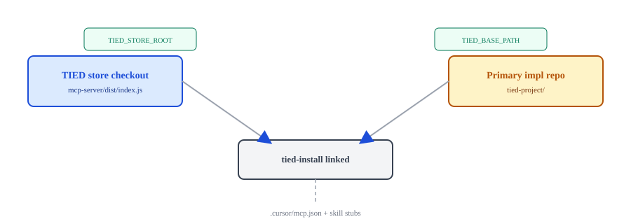

# Operator lens

**Audience:** Engineers and integrators who deliver TIED from the **store checkout** to a **client** or **primary implementation repository**.

Canonical quick start also lives in [README.md](../../README.md#quick-start-macos); this page adds topology and routing context.

---

## Configuration rhythm (store → client)

1. **Clone:** `git clone` the TIED store; `cd` to the store root.
2. **Store workspace build:** `./build-workspace.sh` — produces `mcp-server/dist/index.js`, `tied` CLI, `tied agentstream`. See `./build-workspace.sh --help`.
3. **Client install:** `./tied-install.sh /path/to/client` (or linked install from the greenfield table). `./tied-install.sh --help` (no arguments prints styled help). Methodology refresh: `--refresh`.
4. **Confirm MCP:** `tied_config_get_base_path` → client `tied-project/`.

Windows: [README Install and use](../../README.md#install-and-use).



---

## Greenfield routing

| Situation | Command (from store root) | Next step |
| --- | --- | --- |
| Disposable smoke client | `source scripts/build-commands.sh && test-new-tied-client` | Open client in Cursor; enable MCP |
| External client directory | `./tied-install.sh /path/to/your/project` | [Getting started with a new client project](../../README.md#getting-started-with-a-new-client-project) |
| Primary implementation repo | `tied-install.sh --mode linked --store /abs/path/to/tied-store .` from **primary** root | [Primary implementation repository](../../README.md#primary-implementation-repository) |

After bootstrap: confirm MCP base path, then [Compact feature rhythm](../../README.md#compact-feature-rhythm).

**Store-as-primary note:** This git repository is both store and TIED client. To linked-install into **other** primaries, use a **separate store clone** as `--store`.

---

## Brownfield routing (not EDPC depth)

| Situation | Start here |
| --- | --- |
| Methodology refresh | [methodology-migration.md](../../tied-bundle/docs/methodology-migration.md) and `tied-install --refresh` |
| Architecture recovery | [EASAR](../methodologies/evidence-assured-software-architecture-recovery.md) |
| External workflows | [Operating environment externalities](../tied-operating-environment-externalities.md) |

Full EDPC choreography: [Engineer lens — brownfield comprehension](engineer-agent-lens.md#brownfield-comprehension).

Bootstrap details: [tools/bootstrap/README.md](../../tools/bootstrap/README.md) · `how install-matrix` after `source scripts/build-commands.sh`.

---

## Certifiability tooling (operator smoke)

Read-only MCP/CLI layer for `[REQ-TIED_PROCESS_CERTIFICATION_READINESS]`: `tied certification spec-validate`, `conformance-evaluate`, `capability-evaluate`, and related commands — see [Sponsor lens](sponsor-lens.md) for what readiness does **not** claim.

After `cd mcp-server && npm run build`:

```bash
export TIED_BASE_PATH="/absolute/path/to/tied-project"
node --import tsx --test src/process-certification-readiness/*.test.ts
```

---

[← Hub index](index.md) · [Sponsor lens](sponsor-lens.md) · [Engineer lens](engineer-agent-lens.md)
