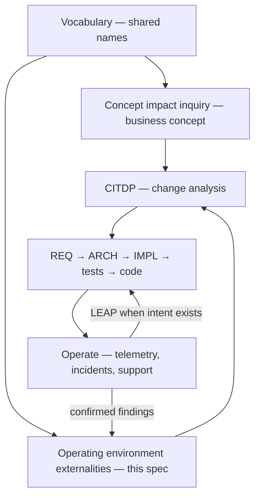
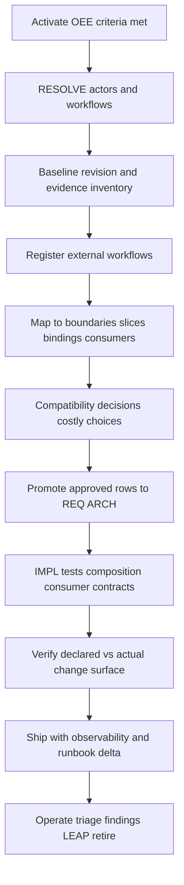

# TIED operating environment externalities — specification and workflow

**Status:** Draft specification (v0) — an **additional specification level** for systems where **application externalities** must be managed and complexity lives in the **operating environment**, not only inside the codebase.

**Audience:** Sponsors, service owners, operators, integrators, and agents working **brownfield** or **high-coupling** systems: growing interconnections, undocumented user workflows, partner integrations, and behavior that exists in production but is not yet traceable REQ → ARCH → IMPL.

**Process anchors:** `[PROC-VOCABULARY_INDEX]`, `[PROC-CITDP]`, `[PROC-AGENT_REQ_CHECKLIST]`, `[PROC-BROWNFIELD_INTENT_ELEVATION]`, `[REQ-TIED_SPONSOR_AGENT_RELATIONSHIP]`, `[REQ-MODULE_VALIDATION]`, `[REQ-QUALITY_ASSURANCE_EVIDENCE]`, `[REQ-TIED_FIDELITY_RESEARCH]`

**Related reading:**

- [Concept impact inquiry](tied-concept-impact-inquiry.md) — business concept and blast radius **before** costly build (complementary; narrower scope)
- [Brownfield intent elevation](../tied-bundle/docs/brownfield-intent-elevation.md) — observed code → adjudicated promotion to REQ/ARCH
- [Client development index](../tied-bundle/docs/client-development-index.md)
- [Operating environment externalities vocabulary](../tied-project/vocab/operating-environment-externalities.md) — preferred terms (canonical)
- [Behavior-Bounded Change Engineering](../tied-project/vocab/behavior-bounded-change-engineering.md) — behavioral slices and declared change surfaces
- [Residuality](../tied-project/vocab/residuality.md) — stressors and residues under environmental failure
- [Fidelity research](../tied-project/vocab/fidelity-research.md) — specification state vs translation defects
- [Quality assurance](../tied-project/vocab/quality-assurance.md) — assurance profiles, proof boundaries, residual risk
- [Working artifact placement](../tied-bundle/docs/working-artifact-placement.md)

---

## 1. Purpose

TIED’s default stack assumes behavior can be frozen as **testable intent** (REQ → ARCH → IMPL → tests → code). Brownfield and operationally dense systems violate that assumption in a specific way:

- **Known** processes are partially specified in TIED or in code.
- **Unknown or uncontrolled** processes—operator habits, partner call patterns, batch jobs, manual workarounds, “the way finance exports it”—depend on **current observable behavior**.
- **Complexity in the operating environment** (consumers, timing, partial failure, version skew, human procedure) dominates risk even when in-app modules are well tested.

This document defines **operating environment externalities (OEE)** management: a **specification and evidence layer** that sits **above** ordinary feature REQ work when externalities must be explicitly managed through the full development lifecycle.

OEE **composes** with the agent checklist and CITDP; it does **not** replace `[PROC-AGENT_REQ_CHECKLIST]` once work is approved. It **does** require additional artifacts and gates when activation criteria (§2) apply.

**Governing principle:**

> **Observed dependency is not approved obligation.** Approved obligation must become traceable, testable at public boundaries where feasible, observable in operation, and explicitly retired when no longer supported.

---

## 2. When to apply (activation criteria)

Use the OEE workflow when **any** of the following hold for the change or program under consideration:

| Signal | Examples |
| --- | --- |
| **External workflow dependency** | Users or partners follow multi-step procedures that are not fully documented in REQ; change may break “how people actually work.” |
| **Undocumented behavioral contract** | Support, SRE, or integrators cite behavior that tests and REQ do not mention. |
| **High consumer / integration fan-out** | Many callers, events, files, or teams depend on the same public boundary. |
| **Environmental stress dominates** | Retries, duplicates, clock skew, partial outages, manual reconciliation, or data repair loops drive outcomes. |
| **Brownfield promotion risk** | Intent elevation or a large refactor will alter behavior others already rely on. |
| **Compatibility is costly** | Breaking change would trigger migration projects, contractual penalties, or operational runbooks. |

When **none** of these apply and the change is a bounded in-app behavior with clear REQ coverage, **skip OEE** and use CITDP + checklist only. Do not treat OEE as mandatory overhead for trivial reversible fixes ([CITDP policy](../tied-bundle/docs/citdp-policy.md)).

**Relationship to concept impact inquiry:** [Concept impact inquiry](tied-concept-impact-inquiry.md) answers “should we invest in this capability?” OEE answers “what in the **operating environment** must we preserve, migrate, or retire while we change the system?” Run concept inquiry first when the idea is still provisional; add OEE when externalities are material to delivery or rollout.

---

## 3. Specification levels (where OEE sits)



| Level | Question | Primary artifacts |
| --- | --- | --- |
| **Vocabulary** | What do we call actors, triggers, and workflows? | `tied-project/vocab/*.md` |
| **Concept impact inquiry** | Is this concept worth building; what is blast radius at a glance? | `INQUIRY-{SLUG}/impact-readout.md` |
| **Operating environment externalities (OEE)** | Who depends on what behavior outside the repo; what must stay compatible? | `OEE-{SLUG}/external-workflow-register.md`, compatibility ledger |
| **CITDP + TIED** | What is approved intent and how is it implemented? | `CITDP-*.yaml`, REQ/ARCH/IMPL, Tracker |
| **Operation** | What still happens in prod after ship? | Telemetry, incidents, envelope, fidelity findings |

---

## 4. Scope: operating environment vs in-application

| In scope for OEE | Out of scope (unless they cross a public boundary) |
| --- | --- |
| Operator and user **workflows** spanning UI, CLI, API, batch, email, spreadsheets | Purely internal refactor with no public boundary change |
| **Integrator** call sequences, file formats, webhook expectations | Private module APIs with no external caller |
| **Downstream** analytics, billing, compliance extracts that consume outputs | Code style or internal logging only |
| **Runbooks** and manual steps that compensate for system behavior | Methodology-only doc changes |
| **Failure and recovery** behavior visible outside the process (retries, idempotency habits) | Hypothetical future integrations with no current consumer |

**Public behavioral boundary** (BBCE): HTTP, CLI, message handler, job trigger, file drop, webhook—where an external actor can observe or depend on behavior. OEE registers workflows **anchored** to those boundaries.

---

## 5. Core objects

### 5.1 External workflow (preferred term)

An **external workflow** is an end-to-end procedure **outside** the repository that achieves a goal by interacting with the system (and optionally other systems). It has:

- **Actor** (role, team, partner id class—not PII in committed artifacts unless policy allows)
- **Trigger** (schedule, event, human action)
- **Steps** (ordered interactions with public boundaries)
- **Observable effects** (data written, files produced, notifications, side effects in other systems)
- **Evidence** (support tickets, runbooks, integration docs, session recordings policy, sample payloads)
- **Disposition** (see §5.3)

Synonyms to **avoid** alone: “user story,” “use case” (without boundary), “integration” (without steps).

### 5.2 Operating environment

The **operating environment** is everything that executes or constrains the application in production: peer services, humans, clocks, networks, data stores, feature flags, deployment topology, and **habitual** procedures that are not encoded in REQ.

### 5.3 Workflow disposition (evidence → intent)

Aligned with [brownfield intent elevation](../tied-bundle/docs/brownfield-intent-elevation.md):

| Disposition | Meaning | May drive REQ? |
| --- | --- | --- |
| `observed` | Supported by evidence; not promoted | No — record only |
| `approved` | Sponsor/reviewer accepted as obligation | Yes — promotion via LEAP / author-requirement |
| `unresolved` | Evidence gap; proof boundary documented | No — until resolved or waived |
| `rejected` | Out of scope or contradicted | No |

**Compatibility stance** (per workflow or boundary), separate from disposition:

| Stance | Meaning |
| --- | --- |
| `preserve` | Current observable behavior must remain for this release scope |
| `migrate` | Change allowed with documented migration path and consumer comms |
| `break` | Intentional break; owner and expiry required |
| `unknown` | Treat as **costly choice** until resolved |

---

## 6. Lifecycle workflow (normative)

Apply across **discovery → design → build → verify → operate → evolve**. Map to checklist slugs in §8.



| Phase | Actions | Outputs |
| --- | --- | --- |
| **1. Activate** | Confirm §2; open `OEE-{SLUG}` folder; link parent `INQUIRY-*` or `{REQ-TOKEN}` | `activation-record.md` |
| **2. Resolve** | Touchpoint 1: actors, triggers, demoted synonyms | `vocabulary-resolved.md` |
| **3. Baseline** | Lock git revision; inventory code, tests, docs, telemetry samples, support themes | `baseline-lock.md` |
| **4. Register** | One row per external workflow; evidence paths; disposition | `external-workflow-register.md` |
| **5. Map impact** | BBCE slices, binding inventory rows, consumer list, shared mechanisms | `environment-dependency-map.md` |
| **6. Compatibility** | Stance per workflow/boundary; waivers with owner/expiry | `compatibility-ledger.md` |
| **7. Promote intent** | Brownfield sub-flow: only `approved` → REQ criteria / ARCH constraints | `intent-elevation-matrix.md` (optional) |
| **8. Implement** | TDD, composition, boundary tests; stateful-reliability / external-input profiles when triggered | Tests, CITDP matrix |
| **9. Verify scope** | Declared change surface vs actual diff; BBCE advisory; residuality pass if triggered | Verification evidence |
| **10. Operate & evolve** | Append-only operational findings; promote confirmed issues; retire workflows explicitly | Incidents → finding ledger; LEAP |

---

## 7. Composition with existing TIED processes

| Mechanism | Role in OEE |
| --- | --- |
| **[PROC-BROWNFIELD_INTENT_ELEVATION]** | Promotion path from `observed` → `approved` → REQ/ARCH |
| **BBCE** (`declared_change_surface`, locality, boundary violations) | Keeps change inside owning **behavioral slice**; detects scope drift across workflows |
| **Residuality** (`sub-residuality-analysis-pass`) | When environmental **stressors** (retry, partition, overload) threaten residues operators rely on |
| **Fidelity research** | Distinguishes missing specification vs implementation lag vs spec change when ops reports “regression” |
| **Quality assurance profiles** | `stateful-reliability`, `external-input-security`, `data-integrity-migration` when workflows imply those risks |
| **Adversarial inquiry** | Obligation and counterexample pass when behavior-changing CITDP depth warrants it |
| **Concept impact inquiry** | Upstream cost/risk readout; feed compatibility and costly-choice sections |
| **Request evidence envelope** | Wraps OEE artifacts alongside gate receipts when `[REQ-REQUEST_EVIDENCE_ENVELOPE]` applies |

OEE artifacts are **review-gated evidence** until promoted. Passing structural validation or registering a workflow does **not** prove runtime correctness ([proof boundary](../tied-project/vocab/quality-assurance.md)).

---

## 8. Checklist mapping (when `[REQ-*]` work is enrolled)

Run OEE steps **in parallel** with early checklist phases; complete **compatibility ledger** before `author-requirement` when activation criteria apply.

| OEE phase | Checklist analogue | Notes |
| --- | --- | --- |
| Resolve | `translate-sponsor-intent`, `change-definition` | RESOLVE external actor names |
| Baseline + register | `session-bootstrap`, `impact-discovery` | PRELOAD OEE vocab + BBCE + residuality when stressors likely |
| Map + compatibility | `risk-assessment`, CITDP impact | Costly choices → `/unblock`, `tied_sponsor_questions` |
| Promote | `brownfield-*` sub-flow when mode set | Only `approved` rows |
| Implement | `test-strategy` through `composition-integration` | Consumer contract tests at public boundary |
| Verify | `verification-gate`, `sub-bbce-advisory-verification-pass` (when enforced) | Compare planned vs actual surface |
| Operate | `traceable-commit`, `persist-citdp-record` | Link ops evidence; fidelity findings stay read-only until confirmed |

Tracker metadata (proposed field until schema promotion):

```yaml
operating_environment_externalities:
  activated: true
  slug: OEE-PAYMENTS-EXPORT-2026
  register_ref: tied-project/working/OEE-PAYMENTS-EXPORT-2026/external-workflow-register.md
  compatibility_ledger_ref: tied-project/working/OEE-PAYMENTS-EXPORT-2026/compatibility-ledger.md
```

---

## 9. Artifacts and placement

Committed working root ([working artifact placement](../tied-bundle/docs/working-artifact-placement.md)):

```text
tied-project/working/OEE-{SLUG}/
  activation-record.md           # Why OEE applied; link to INQUIRY-* or REQ-*
  concept-brief.md               # Optional copy or link to sponsor intake
  vocabulary-resolved.md         # RESOLVE/RECORD
  baseline-lock.md               # Revision, scope, evidence sources
  external-workflow-register.md  # Primary register (§10.1)
  environment-dependency-map.md  # Slices, bindings, consumers
  compatibility-ledger.md        # Stance, owner, expiry, waivers
  intent-elevation-matrix.md     # Optional; links to brownfield template
  operational-feedback.md        # Append-only post-ship notes (incidents, themes)
  decision-record.md             # Sponsor: proceed, narrow scope, defer, stop
```

When enrolled under a `[REQ-TOKEN]`, **link** from `tied-project/working/{REQ-TOKEN}/PLAN.md` and cite `OEE-{SLUG}` in CITDP `reference` or `risk_analysis` attachments.

Regenerable machine evidence (gates, manifests) stays under `tied-project/working/{REQ-TOKEN}/evidence/` and `tied-bundle/working/{REQ-TOKEN}/` per policy—not duplicated inside OEE unless human-readable summaries are needed.

### 9.1 Reference pilot (STDD)

Filled example for methodology **client delivery** externalities (MCP, install, gates, skills):

- [`tied-project/working/OEE-TIED-CLIENT-DELIVERY/`](../tied-project/working/OEE-TIED-CLIENT-DELIVERY/README.md) — copy this tree when starting a real `OEE-{SLUG}` program.

---

## 10. Templates

### 10.1 External workflow register (excerpt)

```markdown
# External workflow register — {TITLE}

**OEE id:** OEE-{SLUG}  
**Baseline revision:** `{git-sha}`  
**Last updated:** YYYY-MM-DD

| wf_id | Actor | Trigger | Public boundary | Summary steps | Observable effects | Evidence refs | Disposition | Compatibility | Owner |
| --- | --- | --- | --- | --- | --- | --- | --- | --- | --- |
| WF-001 | Finance analyst | Month-end | `POST /exports/ledger` | … | File on SFTP | runbook §3; INC-4421 | observed | preserve | … |
```

### 10.2 Compatibility ledger (excerpt)

```markdown
# Compatibility ledger — {TITLE}

| Target | Stance | Rationale | Consumer comms | Owner | Expiry | Waiver ref |
| --- | --- | --- | --- | --- | --- | --- |
| WF-001 / v1 CSV columns | preserve | Undocumented integrator | Email template TBD | @owner | 2026-12-31 | — |
| `POST /exports/ledger` latency | migrate | New async job | Partner bulletin | @owner | — | — |
```

### 10.3 Activation record (minimal)

```markdown
# OEE activation — {TITLE}

**Criteria met (§2):** [ ] external workflow  [ ] undocumented contract  [ ] fan-out  [ ] environmental stress  [ ] brownfield promotion  [ ] costly compatibility

**Delegated envelope:** …  
**Proof boundary:** TIED can prove in-app contracts after build; operating outcomes require …  
**Related:** INQUIRY-* / REQ-* / CITDP-*
```

---

## 11. Proof boundaries and agency

| Claim | Typical proof | Does not prove |
| --- | --- | --- |
| Workflow row is `observed` | Evidence refs, samples, runbooks | That behavior should continue |
| Workflow is `approved` | Hinge field / sponsor record | Implementation matches intent until tests pass |
| `preserve` through release | Boundary + contract tests, migration checks | All partner environments worldwide |
| No external regression | Targeted monitoring + support triage | Zero user inconvenience |
| Residuality pass | Stressor-residue records validated | Universal resilience |

**Agency:** Agents draft registers and maps; **compatibility `break`** and **`approved` promotion** are **costly choices** ([sponsor–agent relationship](../tied-project/vocab/sponsor-agent-relationship.md)). RESOLVE renames workflows; it does not approve breaking external behavior.

---

## 12. Tooling composition (optional, MCP-first)

| Goal | Tool / skill |
| --- | --- |
| RESOLVE costly backlog | `/unblock`, `tied_sponsor_questions` |
| Scoped structural scan | `tied_scoped_analysis_run` |
| Diff token impact | `tied_plumb_diff_impact_preview` |
| Claims vs evidence (frozen surface) | `tied_claims_evidence_review_run` |
| Fidelity / specification state | `[REQ-TIED_FIDELITY_RESEARCH]` pipeline |
| Stressor records | `stressor_residue_record_validate` |
| Consistency (read-only) | `tied_validate_consistency` |
| Pre-implementation gate | `tied gate check --phase pre_implementation` (after Tracker + CITDP) |

Confirm `tied_config_get_base_path` before any project YAML write.

---

## 13. Relationship to CITDP and implementation

| Stage | CITDP | OEE |
| --- | --- | --- |
| Idea / brownfield program | Optional | **Primary** for external workflow inventory |
| Approved change | **Required** for behavior-changing work | Register + ledger **attached**; compatibility in `risk_analysis` |
| Implementation | Tracker + gates | Boundary tests + profile evidence |
| Post-ship | Close-out envelope | `operational-feedback.md` → confirmed findings only → LEAP |

CITDP remains the audit trail for **approved** change. OEE ensures **operating environment** dependencies are visible before REQ authors encode incomplete intent.

---

## 14. Evolution (future TIED enrollment)

This document is specification text until promoted into project tokens. A future enrollment may add:

- `[REQ-TIED_OPERATING_ENVIRONMENT_EXTERNALITIES]` — activation rules and minimum register schema
- `[ARCH-TIED_OEE_BOUNDARY]` — artifact paths, disposition rules, compatibility stances
- `[IMPL-TIED_OEE_VALIDATION]` — lint/readout completeness, register validators
- `[PROC-OPERATING_ENVIRONMENT_EXTERNALITIES]` — checklist sub-procedures (`sub-oee-register-pass`, …)

Until then, adopt by convention; cite `OEE-{SLUG}` in PLAN.md, CITDP references, and PR descriptions when externalities are in scope.

---

**Document version:** 0.1  
**Last updated:** 2026-10-12
