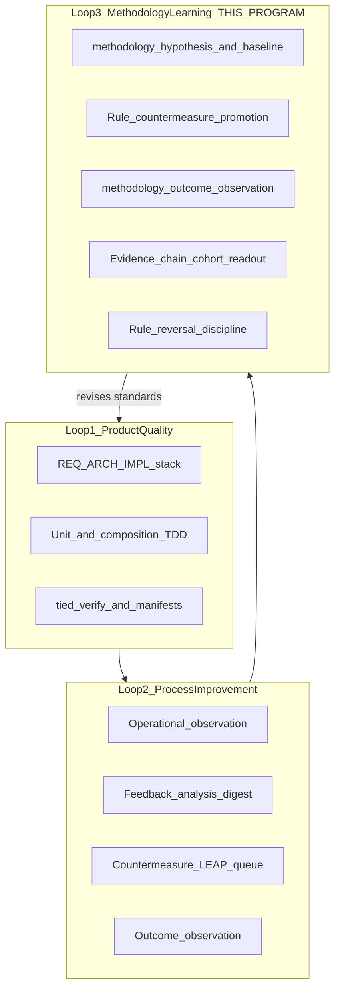

# TIED QMM methodology learning upgrade — program plan

| Field | Value |
| --- | --- |
| **Status** | **Program closed** (2026-10-10) — W1–W5 implement complete; **W6 waived** at program exit |
| **Change ID** | `PLAN-TIED-QMM-METHODOLOGY-LEARNING` |
| **Priority** | P1 (methodology learning — Loop 3 closure per QMM comparison) |
| **Owner** | Canonical TIED source repository (`stdd`) |
| **Source analysis** | [`docs/comparisons/qmm-kaizen-vs-tied.md`](comparisons/qmm-kaizen-vs-tied.md) |
| **Frozen study** | [`prompts/2026-10-10-1-qmm.md`](../prompts/2026-10-10-1-qmm.md) |
| **Program orchestrator** | [`tied-project/working/PLAN-TIED-QMM-METHODOLOGY-LEARNING/qmm-program-execution-checklist.yaml`](../tied-project/working/PLAN-TIED-QMM-METHODOLOGY-LEARNING/qmm-program-execution-checklist.yaml) |
| **Working entry** | [`tied-project/working/PLAN-TIED-QMM-METHODOLOGY-LEARNING/PLAN.md`](../tied-project/working/PLAN-TIED-QMM-METHODOLOGY-LEARNING/PLAN.md) |
| **Last updated** | 2026-10-10 (program close — W6 waived) |
| **Refine tracker** | [`checklist-tracker.yaml`](../tied-project/working/PLAN-TIED-QMM-METHODOLOGY-LEARNING/checklist-tracker.yaml) |

**Planning-artifact disclaimer:** This document and its orchestrator do **not** create project REQ/ARCH/IMPL tokens, do **not** change checklist gate behavior, and do **not** authorize edits to methodology YAML under `tied-bundle/` in the client (or the committed methodology corpus in the TIED store). Each behavior-changing wave runs its own `plan-new-feature` (or `build-plan` when a child linked plan already exists) with per-REQ Tracker, CITDP, gates, and traceable-commit.

**Program control state:** `program_phase: closed`, `current_step: EXIT`, `current_wave: W6` (waived), `execution_authority.mode: approved_full`. Program close authority: [`sponsor-authority-qmm-program-close-w6-waived-20261010.md`](../tied-project/working/PLAN-TIED-QMM-METHODOLOGY-LEARNING/evidence/sponsor-authority-qmm-program-close-w6-waived-20261010.md). Reconciliation index: [`doc-reconcile-evidence.md`](../tied-project/working/PLAN-TIED-QMM-METHODOLOGY-LEARNING/evidence/doc-reconcile-evidence.md).

### Delegated work envelope (this refine pass)

| Allowed | Forbidden |
| --- | --- |
| Edit this linked plan, `PLAN.md`, orchestrator YAML, and W0 refine tracker | Product REQ/ARCH/IMPL index or detail writes |
| Align wave table and matrix dispositions to the comparison | Edit committed methodology YAML under `tied-bundle/` |
| Document W1 entry/exit contract and child-plan section skeleton | Run W1 `pre_implementation` gate as if W1 CITDP existed |
| Record gate attempt outcome for W0 (expected `allowed: false`) | `git commit`, transport, or runtime behavior changes |

**Sibling programs (compose, do not merge):**

- **Loop 2 (closed):** [`docs/tied-kaizen-feedback-loop-plan.md`](tied-kaizen-feedback-loop-plan.md) — operational observation → analysis → countermeasure → outcome; Phase 3 transport **deferred**
- **Loop 1 (maintain):** LEAP, `[PROC-TIED_DEV_CYCLE]`, verification-gated mode — **Align** in the comparison; this program adds Loop 3 discipline, not a replacement for product-quality loops

---

## 0. Refine outcomes (`/xlate` from QMM comparison)

Touchpoint 1 maps sponsor study language onto TIED-preferred terms. Intent and non-goals stay with the sponsor; open hinges are listed under §0.4.

### Disposition key (program waves vs comparison matrix)

| Disposition | Meaning in this program |
| --- | --- |
| **Align** | TIED already satisfies the study objective for the scoped loop; maintain via regression and LEAP only |
| **Compose** | Reuse existing MCP, vocab, or closed programs without merging scope |
| **Implement** | Deliver new behavior in a sponsored wave with per-REQ Tracker + CITDP |
| **Partial implement** | Ship a bounded fragment (no full external framework) |
| **Maintain** | No new wave unless a methodology experiment breaks product gates |
| **Defer** | Explicit non-goal or backlog unless a future scoped REQ reopens |
| **Tension** | Both sides partially true; wave must document proof boundary and paired readouts |
| **Gap** | Honest missing capability; primary motivation for Loop 3 waves |

### 0.1 RESOLVE — study terms → TIED vocabulary

| Sponsor / QMM term | TIED preferred term | Notes |
| --- | --- | --- |
| Kaizen (cultural principle) | **Kaizen loop** | Sponsor label; not a score — [`feedback-to-tied.md`](../tied-project/vocab/feedback-to-tied.md) |
| PDSA / PDCA | CITDP + checklist slice; Kaizen **baseline** / **outcome observation** | **Gap:** methodology **rule** changes not yet uniform **hypothesis** logs |
| Methodology improvement experiment | **methodology learning experiment** (program label) | Composes Kaizen machinery + LEAP queue + evidence-chain readouts; distinct from feature CITDP alone |
| Hypothesis (before change) | **operational hypothesis** (scoped) · **change-definition** + declared prediction (methodology) | Fidelity vocab holds **operational hypothesis** for outreach; methodology wave must not conflate with **fidelity finding** |
| Study (compare prediction to result) | **outcome observation**, verification manifests, **proof boundary** | Values include `inconclusive`, `not_measured` |
| Act (retain or reverse) | LEAP proposal queue; Kaizen **regression** → analysis; **rule reversal** (program) | Reversal of failed methodology rules is a **costly choice** when canonical |
| SPC (interpret variation) | **proof boundary**, **denominator**, pilot **stop criteria** | **Non-goal:** control charts in TIED core (comparison explicit) |
| CMMI Optimizing (aspiration) | **evidence chain profile**, **client cohort**, **evidence-chain statistics report** | Partial today; program extends to methodology experiments, not org-wide CMMI |
| Conformance | Checklist completion, gate receipts, **adherence ledger** | Strong today |
| Effectiveness (process rules) | Paired readout for *methodology* changes | **Gap** — “conformance trap” in comparison |
| Production system | **production system** | TIED work system: checklists, gates, assurance profiles, prompt-type workflows |
| Countermeasure (methodology) | Reviewed change promoted via LEAP / sponsor-approved methodology change | Not a hotfix **correction** |

**PRELOAD for all waves:** [`feedback-to-tied.md`](../tied-project/vocab/feedback-to-tied.md), [`quality-assurance.md`](../tied-project/vocab/quality-assurance.md), [`leap-proposal-queue.md`](../tied-project/vocab/leap-proposal-queue.md), [`pseudocode-and-citdp.md`](../tied-project/vocab/pseudocode-and-citdp.md), [`sponsor-agent-relationship.md`](../tied-project/vocab/sponsor-agent-relationship.md). Add [`fidelity-research.md`](../tied-project/vocab/fidelity-research.md) when **operational hypothesis** or adversarial depth appears.

### 0.2 Strategic direction (authoritative wording from comparison)

Strengthen **Loop 3** by composing existing Kaizen and evidence-chain machinery so changes to the TIED **production system** (checklist steps, gate policies, assurance profiles, prompt-type workflows) follow **hypothesis → baseline → countermeasure → outcome observation**, including cohort-level readouts where privacy and **client cohort** compatibility allow, and **reversing rules that fail to demonstrate value**.

**Explicit non-goals (program guardrails — do not expand scope without new sponsor REQ):**

- No universal KPI or Kaizen score
- No mandatory Six Sigma / org-wide DMAIC
- No DORA ingestion spec in TIED core
- No control-chart / SPC time-series infrastructure in TIED core
- No implied approval to edit committed methodology YAML without a separate sponsor change request (`[PROC-TIED_METHODOLOGY_READONLY]` in clients)

Adoption of execution is a **costly choice** — recorded here as **proposed**, not enacted.

### 0.3 Three loops — program center of gravity



| Loop | Comparison disposition | This program |
| --- | --- | --- |
| 1 — Product quality | **Align** | **Maintain** — regression-only unless a methodology experiment breaks product gates |
| 2 — Kaizen / process | **Align** (Phases 1–2, 4–7 closed) | **Compose** — reuse MCP `tied_feedback_*`; optional **W6** if Phase 3 transport hinge reopens |
| 3 — Methodology learning | **Gap** / **Tension** on PDSA for rules | **Primary scope** — waves **W1–W5** |

### 0.4 Open items (do not block W0 authoring; resolve before W1 `pre_implementation`)

| # | Hinge | Default planning stance | Authority for change |
| --- | --- | --- | --- |
| 1 | Storage shape for methodology PDSA records (extend `feedback.yaml` vs new working schema vs LEAP-only metadata) | Prefer **compose existing stores** first; spike in W1 refine | **Costly:** W1 CITDP + sponsor |
| 2 | Pilot depth: `minimal` doc vs `integrated` for first persistence/MCP wave | W1 behavior-changing batch defaults **`integrated`** | **Costly:** W1 risk-assessment; any waiver needs owner, expiry, rationale, and approval |
| 3 | Canonical promotion path for a winning methodology rule | LEAP queue + explicit sponsor methodology change | **Costly:** W1/W5 sponsor decision |
| 4 | Cross-client readouts | **Report input manifest** + **privacy tier** `operator_local` until export owner named | **Costly:** W4; no `shareable_hashed` export without owner and expiry |
| 5 | Kaizen Phase 3 transport | **Waived at QMM program close** (2026-10-10); Kaizen program Phase 3 still **deferred** | **Costly:** separate Kaizen hinge reopen for transport |

Reversible planning defaults are adopted without further sponsor questioning: keep W0 documentation-only; keep Loop 2 Phase 3 deferred; keep SPC, DORA, and universal DMAIC outside the strategic core; require a separate W1 child plan; and use local, privacy-bounded working evidence until a later owner/expiry decision changes that boundary. The five hinges above remain sponsor-owned costly choices.

### 0.5 Vocabulary RECORD/VALIDATE (W0)

- **RESOLVE:** Table §0.1 (Touchpoint 1).
- **RECORD:** Optional glossary pass after W1 names stabilize; W0 does not require new `tied-project/vocab/*.md` rows.
- **VALIDATE:** Touchpoint 3 at each wave `traceable-commit`.

### 0.6 Adversarial inquiry (W0)

- **depth_tier:** `minimal` (documentation only).
- **sub-adversarial-inquiry-pass:** `not_applicable`.
- W1+ re-select depth when external input, persistence, or gate behavior changes.

### 0.7 W0 refine-pass evidence and limits

- **Tracker:** [`tied-project/working/PLAN-TIED-QMM-METHODOLOGY-LEARNING/checklist-tracker.yaml`](../tied-project/working/PLAN-TIED-QMM-METHODOLOGY-LEARNING/checklist-tracker.yaml).
- **CITDP:** deferred under the project CITDP policy because W0 is a non-behavioral documentation refinement; no `CITDP-*.yaml` is created.
- **Pre-implementation gate:** **`tied_checklist_gate_validate`** invoked with W0 tracker + deferred CITDP → **`allowed: false`**, diagnostic `malformed_citdp:adversarial_inquiry` (expected). W0 does not treat this as a blocker for documentation edits; W1 must pass with a full CITDP adversarial block before RED.
- **Verification:** YAML syntax and orchestrator field alignment; runtime tests not applicable.
- **Consistency:** No REQ/ARCH/IMPL index edits in W0 passes. Pre-existing `tied_validate_consistency` failures on the project index are out of scope for W0 success claims.

### 0.8 Sponsor execution authority (template — fill in orchestrator)

W0 cannot advance to `ready_to_execute` or authorize W1 until the sponsor records authority in `qmm-program-execution-checklist.yaml` → `execution_authority`:

```yaml
execution_authority:
  mode: approved_partial   # approved_partial | approved_full | pending_sponsor | paused
  sponsor_statement: >
    Short text naming which waves are authorized (typically W1 plan-only vs W1 implement).
  recorded_at: "ISO-8601"
  evidence_ref: tied-project/working/PLAN-TIED-QMM-METHODOLOGY-LEARNING/evidence/sponsor-authority-YYYYMMDD.md
  pre_approved_hinges:
    storage_shape: compose_existing_stores   # or leap_only | new_working_schema — costly if changed later
    w1_depth_tier: integrated
    canonical_promotion: leap_plus_sponsor_methodology_change
    cross_client_readout: operator_local_until_owner_named
    kaizen_phase3: deferred
```

**Agency boundary:** Filling this block records sponsor intent for orchestrator resume; it does **not** replace W1 `plan-new-feature`, per-REQ Tracker, W1 CITDP, or successful W1 `pre_implementation` gate.

---

## 1. Executive summary

The QMM comparison concludes TIED is strong on **Loop 1** (product quality) and has closed a substantial **Loop 2** Kaizen program locally, while **Loop 3** (methodology improvement) remains the largest honest gap: methodology rule changes are not yet uniformly treated as **logged experiments** with predictions, baselines, outcome readouts, and reversal discipline.

This program plan sequences a **full upgrade aligned to the comparison** into waves **W0–W6** plus a **deferred backlog** for items the strategic direction explicitly excludes from TIED core. The **first implementation deliverable** is the complete **Strategic suggestion** (§0.2) — captured as **Wave W1** below. A **separate child linked plan and per-wave checklist** will be authored next for W1 only; other waves receive their own checklists when sponsored.

**Default recommendation (pre-execution):** **Adopt (revise)** — execute W1–W5 as optional methodology-learning layers feeding the canonical REQ → ARCH → IMPL → tests → evidence → LEAP chain; treat SPC charts, DORA, and universal DMAIC as **defer** unless a future scoped REQ reopen them.

---

## 2. Goals and non-goals

### Goals

- Close comparison **Gap/Tension** rows for **PDSA on methodology rules** and **conformance–effectiveness pairing** without importing a parallel QMS.
- Reuse Kaizen loop vocabulary, MCP tools, LEAP proposal queue, evidence-chain profile, and adherence machinery.
- Provide a **single orchestrator** and **wave exit criteria** so each phase can run as an independent `plan-new-feature` with its own Tracker.
- Document disposition for every primary QMM system in the comparison matrix (§4).

### Non-goals

- ISO 9001 certification, CMMI appraisal, or org-wide maturity scoring.
- Replacing `[PROC-AGENT_REQ_CHECKLIST]` or making Jev/BBCE/residuality mandatory.
- Implementing W1–W6 in this documentation pass.

---

## 3. Current state audit (2026-10-10)

| Capability | Evidence | Loop |
| --- | --- | --- |
| Product LEAP + TDD ordering | `tied-bundle/docs/LEAP.md`, `[PROC-TIED_DEV_CYCLE]` | 1 |
| Kaizen Phases 1–2, 4–7 | [`tied-kaizen-feedback-loop-plan.md`](tied-kaizen-feedback-loop-plan.md), `tied_feedback_*` | 2 |
| Kaizen Phase 3 transport | **Deferred** hinge | 2 |
| Evidence-chain profile + cohort stats | `quality-assurance.md`, existing MCP generators | 3 (partial) |
| Feedback pilot + stop criteria | Phase 7 close-out | 3 (partial) |
| Methodology rule = PDSA experiment | **Not uniform** | 3 (**gap**) |
| SPC control charts | **Not implemented** | 3 (explicit defer) |
| DORA / delivery telemetry in TIED index | **Deferred** | 2 |

---

## 4. QMM systems — program disposition (from comparison)

| System | Loop | Program disposition | Primary wave |
| --- | --- | --- | --- |
| PDCA / PDSA | 2–3 | **Tension** → **Implement** methodology slice (W1 closes prediction-log gap) | W1, W2 |
| TQM (whole work system) | 1–2 | **Maintain** | — |
| Lean / Kaizen | 2 | **Compose** (existing program) | W3, optional W6 |
| Six Sigma / DMAIC | 2 | **Defer** (scoped adversarial/CITDP only) | Backlog |
| SPC | 3 | **Defer** in core; honor **proof boundary** discipline | Backlog |
| ISO 9001-shaped traceability | 1–3 | **Maintain** + extend manifests for methodology experiments | W1–W5 |
| CMMI L4–5 | 3 | **Partial implement** via cohort statistics, not maturity levels | W4 |
| XP / TDD | 1 | **Maintain** | — |
| Scrum | 2 | **Defer** | — |
| DORA | 2 | **Defer** | Backlog |
| SRE (error budget) | 1 | **Tension** — waivers/residual risk only | W2 (readout pairing) |

---

## 5. Proposed waves (top-level checklist)

Each wave **CALL**s a child workflow, then **RETURN**s to the orchestrator. A wave cannot advance from `planned` to `in_progress` until its entry evidence exists. Exit requires the wave-specific evidence under `tied-project/working/PLAN-TIED-QMM-METHODOLOGY-LEARNING/` or per-REQ `working/{REQ-TOKEN}/`, plus `tied_validate_consistency` when project YAML changes. A proposed depth or gate policy is not evidence of activation.

| Wave | Goal | Depth (default) | Child plan / REQ | Status |
| --- | --- | --- | --- | --- |
| **W0** | Program charter: this linked plan + orchestrator + RESOLVE | minimal | *(this document)* | **Complete** |
| **W1** | Methodology PDSA — hypothesis, baseline, countermeasure, outcome observation, cohort hooks, rule reversal | integrated | [`docs/tied-qmm-w1-methodology-pdsa-plan.md`](tied-qmm-w1-methodology-pdsa-plan.md) · `REQ-METHODOLOGY-LEARNING-EXPERIMENT` | **Complete** |
| **W2** | Conformance–effectiveness pairing for methodology changes | integrated | [`docs/tied-qmm-w2-conformance-effectiveness-plan.md`](tied-qmm-w2-conformance-effectiveness-plan.md) · `REQ-METHODOLOGY-CONFORMANCE-EFFECTIVENESS-PAIRING` | **Complete** |
| **W3** | Kaizen → Loop 3 bridge (explicit MCP only) | integrated | [`docs/tied-qmm-w3-kaizen-methodology-bridge-plan.md`](tied-qmm-w3-kaizen-methodology-bridge-plan.md) · `REQ-METHODOLOGY-KAIZEN-EXPERIMENT-BRIDGE` | **Complete** |
| **W4** | Cohort-level methodology experiment readouts | integrated | [`docs/tied-qmm-w4-evidence-chain-report-plan.md`](tied-qmm-w4-evidence-chain-report-plan.md) · `REQ-EVIDENCE_CHAIN_REPORT` | **Complete** |
| **W5** | Prompt-type / gate-policy / assurance **production-system enrollment** | integrated | [`docs/tied-qmm-w5-prompt-type-gate-enrollment-plan.md`](tied-qmm-w5-prompt-type-gate-enrollment-plan.md) · `REQ-METHODOLOGY-PRODUCTION-SYSTEM-ENROLLMENT` | **Complete** (commit `e9e56a8`) |
| **W6** | Optional Kaizen Phase 3 transport (QMM wave) | integrated | [`tied-kaizen-feedback-loop-plan.md`](tied-kaizen-feedback-loop-plan.md) Phase 3 | **Waived at program close** |
| **Backlog** | SPC charts, DORA ingestion, universal DMAIC, Six Sigma tooling | — | Explicit **non-goals** unless new REQ | **Deferred** |

### W0 — Documentation and orchestrator

**Entry:** Sponsor `/xlate` + request for top-level program plan.

**Checklist (W0):**

- [x] RESOLVE table and strategic wording aligned to comparison
- [x] Wave table with W1 marked first implementation
- [x] Orchestrator YAML with `program_phase: proposed`
- [x] Link from comparison doc to this plan (Related docs §)
- [x] Refine-plan pass 2: disposition key, W1 skeleton §5.1, test strategy §6.1, gate attempt §0.7
- [x] Sponsor execution authority block (§0.8 template) — [`sponsor-authority-20261010.md`](../tied-project/working/PLAN-TIED-QMM-METHODOLOGY-LEARNING/evidence/sponsor-authority-20261010.md)
- [ ] `plan-close-out` for W0 doc batch — **pending sponsor**

**Exit evidence:** This file + orchestrator + refine tracker on disk; no REQ/ARCH/IMPL writes. W0 may move to `complete` in the orchestrator when sponsor authority and optional close-out are recorded.

**TIED loop handoff:** Vocabulary RESOLVE only.

---

### W1 — Methodology PDSA (strategic suggestion — **next checklist document**)

**Scope (from comparison § Strategic suggestion):**

Treat changes to checklist steps, gate policies, assurance profiles, and prompt-type workflows as **first-class PDSA experiments**:

1. Record **hypothesis** and **baseline** before promoting a **countermeasure** into canonical methodology or project practice.
2. Close with **outcome observations** (including `inconclusive` / `not_measured`).
3. Where allowed, attach **evidence-chain statistics** across **client cohorts**.
4. **Reverse** rules that fail to demonstrate value.

**W1 does not authorize:** editing `tied-bundle/` methodology in clients without separate sponsor scope; universal scores; control charts.

**Entry (after sponsor approves program execution):** `plan-new-feature` on W1 child linked plan.

**Entry evidence required before the orchestrator changes `current_wave`:** recorded sponsor authority naming W1 scope; the W1 child linked plan; a W1 per-REQ Tracker copied from the canonical checklist; a W1 CITDP with independently selected `profile_depth`, `depth_tier`, `gate_policy`, and risk triggers; and a successful `pre_implementation` gate. The W0 tracker does not satisfy these W1 requirements.

**Orchestrator action after entry evidence:** Set `current_wave: W1`, set `program_phase: in_progress`, then `CALL` the child plan checklist. Return to the orchestrator only after W1 exit evidence and verification are recorded.

#### 5.1 W1 child linked plan — required sections (author next)

When the sponsor requests W1 planning, create `docs/tied-qmm-w1-methodology-pdsa-plan.md` (name may change at W1 RESOLVE) with at least:

1. **Refine** — RESOLVE for **methodology learning experiment**, **operational hypothesis** vs **fidelity finding**, **rule countermeasure** vs Kaizen **countermeasure**; reconfirm strategic non-goals.
2. **Delegated envelope** — what W1 may change (project YAML, MCP, working evidence) vs forbidden (`tied-bundle/` methodology without separate change request).
3. **Change definition** — minimum record shape for one end-to-end experiment (fields TBD at hinge #1 spike): hypothesis, baseline, countermeasure reference, outcome observation, proof boundary, optional cohort hook.
4. **CITDP** — independent `profile_depth`, `depth_tier` (default **integrated** if persistence/MCP), `gate_policy`, risk triggers, costly hinges §0.4 resolved or explicitly waived with owner/expiry.
5. **Test strategy** — unit tests for normalization/validation of experiment records; composition tests for MCP write/read paths; no E2E unless UI-only (unlikely).
6. **Tracker copy** — fresh per-REQ checklist under `tied-project/working/{REQ-TOKEN}/`, not the W0 refine tracker.
7. **Demonstration path** — one **methodology learning experiment** on `stdd` working evidence before close-out.
8. **LEAP / promotion** — explicit path for candidates vs working-only experiments.

**Compose pointers (optional, not W1 blockers):** Jev advisory ([`jev-for-tied-improvement.md`](comparisons/jev-for-tied-improvement.md)); BBCE locality loop ([`tied-bbce-alignment-plan.md`](tied-bbce-alignment-plan.md)) for change-surface discipline on MCP edits.

**Exit criteria (summary — detailed in child plan):**

- REQ/ARCH/IMPL stack for W1 capability with IMPL pseudo-code token comments
- Unit + composition tests; integrated gates when persistence/MCP changes
- Demonstration path: at least one **methodology learning experiment** recorded end-to-end on this repo (working evidence)
- LEAP or sponsor record for any canonical promotion candidate
- Verification gate allowed, with evidence provenance and proof boundaries attached
- Explicit disposition for each costly hinge; no canonical methodology edit without a separate sponsor-approved change request

---

### W2 — Conformance ↔ effectiveness pairing

**Addresses comparison objective **Conformance** vs **Effectiveness** for *methodology* changes.**

**Checklist themes:**

- Pair `tied_checklist_gate_validate` / adherence ledger evidence with methodology **outcome observation** rows
- Explicit **proof boundary** on what gate pass does and does not prove for rule changes
- Process-grade / envelope gaps documented where methodology effectiveness is `not_measured`

**Depends on:** W1 experiment record shape.

---

### W3 — Loop 2 → Loop 3 bridge

**Compose Kaizen without reopening closed program scope unless needed.**

- Route **`methodology_improvement`** / relevant **observation kind** entries into W1 experiment lifecycle
- Reuse `tied_feedback_analysis_digest`, review bridge, outcome loop where compatible
- Do **not** require Phase 3 transport for local Loop 3 proof

**Depends on:** W1 contract.

---

### W4 — Cohort readouts for methodology experiments

**Implements comparison **CMMI Optimizing** fragment without maturity scoring.**

- **Report input manifest** lists methodology experiment profile artifacts
- **Evidence-chain statistics report** with **denominator fingerprint** / subcohorts
- **Privacy tier** defaults per Kaizen sponsor decisions until export owner named

**Depends on:** W1 metrics and proof boundaries.

---

### W5 — Production-system surface enrollment

**Explicit coverage of prompt-type workflows and assurance profile evolution.**

- Map prompt-type skills (`plan-new-feature`, `build-plan`, …) to **production system** components in experiments
- Assurance profile / gate policy changes use same PDSA envelope as checklist step changes
- Alignment with `[PROC-PROMPT_TYPE_GLOBAL_SKILLS]` traceability where REQ exist

**Depends on:** W1–W4.

---

### W6 — Optional Kaizen Phase 3 transport

**Only if sponsor reopens transport hinge** on existing Kaizen CITDP. Does not block W1–W5 local proof.

---

### Deferred backlog (comparison honest gaps — out of strategic core)

| Item | Reason |
| --- | --- |
| SPC control charts | Strategic suggestion **non-goal** |
| DORA ingestion | Comparison **Defer** |
| Universal DMAIC / Six Sigma | Comparison **Defer** |
| Full CMMI L4–5 | Partial cohort tooling only |

Reopen only via explicit scoped REQ, not this program’s default waves.

---

## 6. Gate and depth policy (program defaults)

### 6.1 Program test strategy outline (not W1 RED)

| Layer | W0 | W1 (expected) | W2–W5 |
| --- | --- | --- | --- |
| **Documentation** | RESOLVE tables match comparison; orchestrator `current_wave` consistent | Child plan + CITDP + IMPL pseudo-code before RED | Extend contracts from W1 record shape |
| **Unit** | N/A | Validators for experiment record schema, enum guards (`inconclusive`, `not_measured`) | Pairing logic for conformance vs effectiveness readouts |
| **Composition** | N/A | MCP tools read/write experiment lifecycle without UI | Bridge from `tied_feedback_*` where W3 applies |
| **Integration / E2E** | N/A | Only if a wave introduces UI-only surfaces | Cohort report generation with privacy tier fixtures |
| **Verification** | YAML/orchestrator alignment | `tied_verify` + manifests when REQ gated | Same per wave |
| **Consistency** | No index mutation | `tied_validate_consistency` on touched project YAML | Same |

W1 must not inherit W0 `depth_tier: minimal`; re-select at W1 `risk-assessment`.

| Wave | Expected `depth_tier` | `gate_policy` | Notes |
| --- | --- | --- | --- |
| W0 | minimal | advisory | Documentation |
| W1–W5 | integrated (default) | per CITDP | Persistence or MCP ⇒ integrated adversarial eligibility review |
| W6 | integrated | per Kaizen Phase 3 CITDP | Transport hinge |

Every behavior-changing wave:

1. Copy per-REQ Tracker from [`agent-req-implementation-checklist.yaml`](../tied-bundle/docs/agent-req-implementation-checklist.yaml)
2. `tied_checklist_gate_validate` at `pre_implementation` before RED
3. `tied_validate_consistency` before traceable-commit

---

## 7. Agent entry — program closed

1. Read [`qmm-program-execution-checklist.yaml`](../tied-project/working/PLAN-TIED-QMM-METHODOLOGY-LEARNING/qmm-program-execution-checklist.yaml) → `program_phase: closed`, `current_step: EXIT`.
2. Resume from [`session-handoff.md`](../tied-project/working/PLAN-TIED-QMM-METHODOLOGY-LEARNING/evidence/session-handoff.md) and [`doc-reconcile-evidence.md`](../tied-project/working/PLAN-TIED-QMM-METHODOLOGY-LEARNING/evidence/doc-reconcile-evidence.md).
3. **W6** is **waived_at_program_close** on this program only; Kaizen Phase 3 transport remains **deferred** until a separate Kaizen reopen.
4. New Loop 3 work requires a **new** sponsor program or scoped REQ — do not extend this orchestrator without CITDP.

---

## 8. Related documents

- [`docs/comparisons/qmm-kaizen-vs-tied.md`](comparisons/qmm-kaizen-vs-tied.md) — source analysis
- [`docs/tied-kaizen-feedback-loop-plan.md`](tied-kaizen-feedback-loop-plan.md) — Loop 2 program
- [`docs/tied-bbce-alignment-plan.md`](tied-bbce-alignment-plan.md) — wave/gate exemplar
- [`docs/comparisons/jev-for-tied-improvement.md`](comparisons/jev-for-tied-improvement.md) — optional advisory compose
- [`tied-project/vocab/feedback-to-tied.md`](../tied-project/vocab/feedback-to-tied.md)
- [`tied-project/vocab/quality-assurance.md`](../tied-project/vocab/quality-assurance.md)

---

## 9. Program closure (2026-10-10)

Loop 3 deliverable for this program: **waves W1–W5** (local proof on `stdd`). **W6 waived** at exit per [`sponsor-authority-qmm-program-close-w6-waived-20261010.md`](../tied-project/working/PLAN-TIED-QMM-METHODOLOGY-LEARNING/evidence/sponsor-authority-qmm-program-close-w6-waived-20261010.md). W5 implement traceable-commit: **`e9e56a8`**. Optional follow-up: Kaizen Phase 3 transport only via **separate** Kaizen program hinge reopen.

### Post-program follow-on (outside W0–W6 orchestrator)

| Track | REQ / plan | Status (2026-10-10) | Commit / evidence |
| --- | --- | --- | --- |
| **(a)** Pre-implementation experiment gate habit | [`REQ-METHODOLOGY-SURFACE-EXPERIMENT-GATE`](../tied-project/requirements/REQ-METHODOLOGY-SURFACE-EXPERIMENT-GATE.yaml) · [`docs/tied-qmm-followon-a-methodology-surface-experiment-gate-plan.md`](tied-qmm-followon-a-methodology-surface-experiment-gate-plan.md) | **Implement complete** — integrated `close_out`, envelope `blocking_gap_count=0` | **`d641081`** · [session-handoff](../tied-project/working/REQ-METHODOLOGY-SURFACE-EXPERIMENT-GATE/evidence/session-handoff.md) |
| **(b)** Kaizen Phase 3 transport | Kaizen program | **Deferred** | Not authorized by QMM close |
| **(c)** Shareable hashed cohort export | [`REQ-METHODOLOGY-LEARNING-COHORT-EXPORT`](../tied-project/requirements/REQ-METHODOLOGY-LEARNING-COHORT-EXPORT.yaml) · [`docs/tied-qmm-followon-c-methodology-cohort-export-plan.md`](tied-qmm-followon-c-methodology-cohort-export-plan.md) | **Implement complete** — integrated `close_out`, envelope `blocking_gap_count=0` | [session-handoff](../tied-project/working/REQ-METHODOLOGY-LEARNING-COHORT-EXPORT/evidence/session-handoff.md) · [`sponsor-authority-followon-c-shareable-hashed-20261010.md`](../tied-project/working/PLAN-TIED-QMM-METHODOLOGY-LEARNING/evidence/sponsor-authority-followon-c-shareable-hashed-20261010.md) |

This follow-on table is **status translation only** (`/xlate`); it does not reopen the closed program orchestrator.

### Costly choices (sponsor-owned before W1 `pre_implementation`)

| Hinge | Default in this plan | Change authority |
| --- | --- | --- |
| Methodology PDSA storage shape | Compose existing stores first | W1 CITDP + sponsor |
| W1 `depth_tier` below integrated | Not pre-approved for persistence/MCP | Owner, expiry, rationale in CITDP |
| Canonical rule promotion | LEAP + explicit methodology change request | Sponsor + methodology owner |
| Cross-client export tier | **`shareable_hashed` authorized** for methodology experiment cohort export (2026-10-10); owner + expiry at follow-on **(c)** implement CITDP | W4 + privacy owner |
| Kaizen Phase 3 transport | W6 only on hinge reopen | Separate change request |
