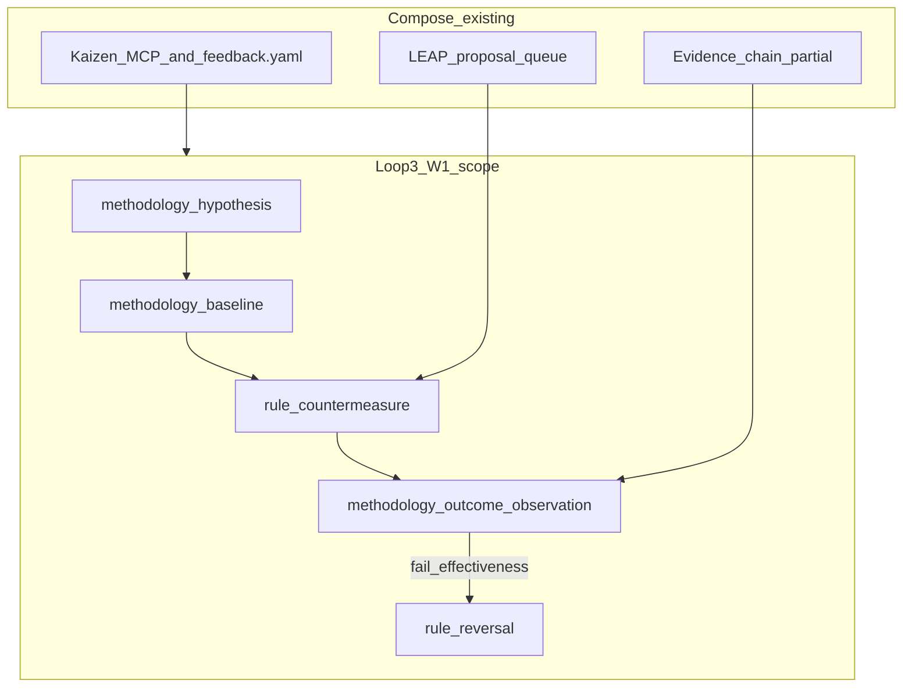

# TIED W1 — Methodology PDSA (Loop 3 strategic suggestion)

| Field | Value |
| --- | --- |
| **Status** | **Implement complete** (2026-10-10) — `REQ-METHODOLOGY-LEARNING-EXPERIMENT`; gates under `tied-project/working/REQ-METHODOLOGY-LEARNING-EXPERIMENT/evidence/` |
| **Change ID** | `PLAN-TIED-QMM-W1-METHODOLOGY-PDSA` |
| **Parent program** | [`PLAN-TIED-QMM-METHODOLOGY-LEARNING`](tied-qmm-methodology-learning-plan.md) |
| **Future REQ** | `REQ-METHODOLOGY-LEARNING-EXPERIMENT` (implement pass only — not minted in plan-only) |
| **Priority** | P1 (Loop 3 — closes comparison **PDSA prediction log** gap for methodology rules) |
| **Owner** | Canonical TIED source repository (`stdd`) |
| **Source analysis** | [`docs/comparisons/qmm-kaizen-vs-tied.md`](comparisons/qmm-kaizen-vs-tied.md) — Strategic suggestion |
| **Program orchestrator** | [`tied-project/working/PLAN-TIED-QMM-METHODOLOGY-LEARNING/qmm-program-execution-checklist.yaml`](../tied-project/working/PLAN-TIED-QMM-METHODOLOGY-LEARNING/qmm-program-execution-checklist.yaml) |
| **Working entry** | [`tied-project/working/PLAN-TIED-QMM-W1-METHODOLOGY-PDSA/PLAN.md`](../tied-project/working/PLAN-TIED-QMM-W1-METHODOLOGY-PDSA/PLAN.md) |
| **Documentation CITDP** | [`tied-project/citdp/CITDP-PLAN-TIED-QMM-W1-METHODOLOGY-PDSA.yaml`](../tied-project/citdp/CITDP-PLAN-TIED-QMM-W1-METHODOLOGY-PDSA.yaml) |
| **Last updated** | 2026-10-10 (build-plan plan-only pass) |

**Planning-artifact disclaimer:** This document and its plan-only CITDP do **not** create project REQ/ARCH/IMPL tokens, do **not** add MCP tools or persistence, and do **not** authorize edits to methodology YAML under `tied-bundle/` in clients. The behavior-changing capability runs under `REQ-METHODOLOGY-LEARNING-EXPERIMENT` with its own per-REQ Tracker, integrated CITDP, gates, and traceable-commit.

**Agency boundary:** Recording **execution_authority** for W1 **plan-only** in the program orchestrator names sponsor intent to author this child plan; it does **not** authorize RED tests, MCP changes, or canonical methodology promotion.

**Program exit:** Parent QMM program **closed** 2026-10-10; **W6 waived** at exit; Kaizen Phase 3 unchanged (**deferred**).

---

## 0. Refine (Touchpoint 1 — RESOLVE)

PRELOAD for implement and review: [`feedback-to-tied.md`](../tied-project/vocab/feedback-to-tied.md), [`quality-assurance.md`](../tied-project/vocab/quality-assurance.md), [`leap-proposal-queue.md`](../tied-project/vocab/leap-proposal-queue.md), [`pseudocode-and-citdp.md`](../tied-project/vocab/pseudocode-and-citdp.md), [`sponsor-agent-relationship.md`](../tied-project/vocab/sponsor-agent-relationship.md), [`fidelity-research.md`](../tied-project/vocab/fidelity-research.md).

### 0.1 RESOLVE — study terms → W1 vocabulary

| Sponsor / QMM term | W1 preferred term | Notes |
| --- | --- | --- |
| PDSA experiment on rules | **methodology learning experiment** | One end-to-end record; program label for Loop 3 |
| Hypothesis before rule change | **methodology hypothesis** | Scoped prediction; not a Kaizen **operational observation** alone |
| Outreach / research hypothesis | **operational hypothesis** | Fidelity vocab — do not conflate with **methodology hypothesis** or **fidelity finding** |
| Baseline for a rule | **methodology baseline** | Prior gate/checklist behavior or named metric snapshot |
| Promoted checklist/gate change | **rule countermeasure** | vs Kaizen **countermeasure** on production friction |
| Study result | **methodology outcome observation** | Reuse outcome enum: `improved`, `unchanged`, `regressed`, `inconclusive`, `not_measured` |
| Failed rule | **rule reversal** | **Costly choice** when canonical; LEAP + sponsor methodology change |
| Loop 2 friction → rule idea | **methodology_improvement** feedback | Bridge in program **W3**; W1 defines contract only |
| Production system | **production system** | Checklist steps, gate policies, assurance profiles, prompt-type workflows |

### 0.2 Strategic non-goals (reconfirmed)

- No universal KPI or Kaizen score
- No mandatory Six Sigma / org-wide DMAIC
- No DORA ingestion spec in TIED core
- No control-chart / SPC time-series infrastructure in TIED core
- No implied approval to edit committed methodology YAML without a separate sponsor change request (`[PROC-TIED_METHODOLOGY_READONLY]` in clients)

### 0.3 Costly hinges (plan-only defaults — implement CITDP may waive with owner/expiry)

| # | Hinge | Default for W1 planning | Authority to change |
| --- | --- | --- | --- |
| 1 | Storage shape for methodology PDSA records | **Compose existing stores** first; spike (A) working pilot → (B) `feedback.yaml` envelope | W1 implement CITDP + sponsor |
| 2 | Pilot depth | **integrated** reserved for persistence/MCP implement pass | Owner, expiry, rationale if below integrated |
| 3 | Canonical promotion path | LEAP queue + explicit sponsor methodology change | Sponsor + methodology owner |
| 4 | Cross-client readouts | **privacy tier** `operator_local` until export owner named | W4 + privacy owner |
| 5 | Kaizen Phase 3 transport | **Out of W1**; optional program **W6** | Separate sponsor change request |

### 0.4 Adversarial inquiry (plan-only)

- **depth_tier:** `minimal`
- **sub-adversarial-inquiry-pass:** `not_applicable`
- Implement pass must re-select **integrated** when persistence/MCP changes.

---

## 1. Executive summary

The QMM comparison’s **Strategic suggestion** asks TIED to treat changes to its own **production system** as **first-class PDSA experiments**: **methodology hypothesis** and **methodology baseline** before a **rule countermeasure**; close with **methodology outcome observation**; optional cohort readouts; **rule reversal** when value is not demonstrated.

**W1 (this child plan)** defines the contract, record shape, test strategy, demonstration narrative, and LEAP/promotion path. **W1 implement** (`REQ-METHODOLOGY-LEARNING-EXPERIMENT`) delivers validators, MCP (or composed store paths), and one end-to-end **methodology learning experiment** on `stdd` working evidence.

---

## 2. Delegated work envelope

| Allowed (plan-only pass) | Forbidden (plan-only pass) |
| --- | --- |
| This linked plan, working folder, documentation CITDP | Product REQ/ARCH/IMPL index or detail writes |
| Program orchestrator updates for W1 plan-only authority | `mcp-server/` code, tests, runtime behavior |
| Non-normative example record under `working/.../pilot/` | Edit committed methodology YAML under `tied-bundle/` |
| Cross-links from parent program and comparison doc | Treat plan-only authority as implement authorization |

| Allowed (future W1 implement) | Forbidden (implement without scope) |
| --- | --- |
| Project YAML, MCP tools, working + local evidence for `REQ-METHODOLOGY-LEARNING-EXPERIMENT` | Canonical `tied-bundle/` methodology edit without separate sponsor methodology change |
| Integrated adversarial inquiry when eligibility triggers match | Universal scores, SPC charts, DORA in core |

---

## 3. Change definition

### 3.1 This pass (plan-only)

| | |
| --- | --- |
| **Current** | Parent program §5.1 listed required W1 sections but no authored child plan; no uniform **methodology hypothesis** log for rule changes. |
| **Desired** | One linked plan with RESOLVE, envelope, record shape, CITDP sketches, test strategy, tracker paths, demonstration narrative, LEAP path; committed working folder; orchestrator `child_plan_status: authored`. |
| **Unchanged** | All Kaizen MCP tools, `feedback.yaml` behavior, checklist gates, LEAP queue semantics. |
| **Non-goals** | REQ/ARCH/IMPL tokens, MCP, RED tests, git commit (unless sponsor `plan-close-out`). |
| **Success** | Child plan on disk; plan-only CITDP persisted; implement handoff forbids inheriting `depth_tier: minimal`. |

### 3.2 Later capability (REQ-METHODOLOGY-LEARNING-EXPERIMENT)

Enable sponsors and agents to record a **methodology learning experiment** end-to-end before promoting a **rule countermeasure** into canonical or project practice, and to close with **methodology outcome observation** (including `inconclusive` / `not_measured`) and optional **rule reversal**.

#### Minimum record shape (hinge #1 — normative target for implement)

| Field | Purpose |
| --- | --- |
| `experiment_id` | Stable id |
| `production_system_surface` | `checklist_step` \| `gate_policy` \| `assurance_profile` \| `prompt_type_workflow` |
| `methodology_hypothesis` | Declared prediction before countermeasure |
| `methodology_baseline` | Refs + snapshot (gate receipt, metric row, or `not_measured`) |
| `rule_countermeasure_ref` | LEAP id, working patch ref, or checklist diff pointer |
| `methodology_outcome_observation` | Closed enum + evidence refs |
| `proof_boundary` | What pass/fail proves for the experiment |
| `privacy_tier` | Default `operator_local` |
| `cohort_hook` | Optional manifest ref for program W4 |
| `rule_reversal` | Boolean + rationale when act = reverse |

#### Storage spike order (document only)

1. **(A)** Committed working YAML/JSON pilot (`tied-project/working/.../pilot/`)
2. **(B)** Compose `feedback.yaml` / **methodology_improvement** envelope
3. **(C)** Dedicated `methodology-experiments.yaml`
4. **(D)** LEAP-only metadata

**Recommendation:** First implement slice **(A) then (B)** unless implement CITDP selects otherwise.

Non-normative example: [`tied-project/working/PLAN-TIED-QMM-W1-METHODOLOGY-PDSA/pilot/methodology-experiment-record.example.yaml`](../tied-project/working/PLAN-TIED-QMM-W1-METHODOLOGY-PDSA/pilot/methodology-experiment-record.example.yaml).

---

## 4. CITDP

### 4.1 Plan-only — `CITDP-PLAN-TIED-QMM-W1-METHODOLOGY-PDSA`

- **depth_tier:** `minimal`
- **gate_policy:** `advisory`
- **tied_tokens_new:** `[]`
- **Success:** Naming bridge, record shape, storage spike documented; implement section states Phase 1 **must not** inherit minimal depth.

Persisted at [`tied-project/citdp/CITDP-PLAN-TIED-QMM-W1-METHODOLOGY-PDSA.yaml`](../tied-project/citdp/CITDP-PLAN-TIED-QMM-W1-METHODOLOGY-PDSA.yaml).

### 4.2 Implement sketch — `CITDP-REQ-METHODOLOGY-LEARNING-EXPERIMENT` (not created in plan-only)

| Attribute | Default |
| --- | --- |
| **profile_depth** | Select at impact discovery |
| **depth_tier** | `integrated` (persistence/MCP triggers) |
| **gate_policy** | `per_citdp` |
| **Eligibility** | External input, persistence, MCP writes — expect integrated adversarial block |
| **Hinges** | Resolve or waive §0.3 with owner, expiry, rationale |

---

## 5. Test strategy

| Layer | Plan-only | W1 implement (expected) |
| --- | --- | --- |
| **Documentation** | RESOLVE + record shape align with comparison | Child plan + CITDP + IMPL pseudo-code before RED |
| **Unit** | N/A | Validators for experiment record schema; enum guards |
| **Composition** | N/A | MCP write/read lifecycle (e.g. new `tied_methodology_experiment_*` or composed feedback envelope) |
| **Integration / E2E** | N/A | Only if UI-only surfaces (unlikely) |
| **Demonstration** | Narrative example §7 | One live **methodology learning experiment** on `stdd` working evidence |
| **Verification** | Gate attempt recorded (expect not allowed for RED) | `tied_verify` + manifests when REQ gated |
| **Consistency** | No index mutation | `tied_validate_consistency` on touched project YAML |

Implement must not inherit W0 or W1 plan-only `depth_tier: minimal`.

---

## 6. Tracker copy

| Pass | Path |
| --- | --- |
| **Plan-only** | [`tied-project/working/PLAN-TIED-QMM-W1-METHODOLOGY-PDSA/checklist-tracker.yaml`](../tied-project/working/PLAN-TIED-QMM-W1-METHODOLOGY-PDSA/checklist-tracker.yaml) |
| **Implement** | Copy fresh from [`tied-bundle/docs/agent-req-implementation-checklist.yaml`](../tied-bundle/docs/agent-req-implementation-checklist.yaml) → `tied-project/working/REQ-METHODOLOGY-LEARNING-EXPERIMENT/checklist-tracker.yaml` |

Do not reuse the W0 program refine tracker or this plan-only tracker for implement RED.

---

## 7. Demonstration path (narrative — plan-only)

**Scenario:** A sponsor hypothesizes that requiring an explicit **methodology hypothesis** field on a checklist step before `pre_implementation` will reduce “conformance trap” changes (gate pass without outcome readout).

1. **methodology_hypothesis:** “Teams that declare a hypothesis before RED will record at least one **methodology outcome observation** within 14 days for methodology-surface changes.”
2. **methodology_baseline:** Snapshot: prior month gate receipts show `pre_implementation` allowed with no linked outcome row (`not_measured` baseline count documented).
3. **rule_countermeasure_ref:** Working-only checklist copy adds optional step `methodology-hypothesis-declare` (not promoted to canonical `[PROC-AGENT_REQ_CHECKLIST]` in plan-only).
4. **methodology_outcome_observation:** `inconclusive` — pilot window too short; proof boundary states this does not prove effectiveness.
5. **proof_boundary:** Proves the record lifecycle and validator accept the shape; does not prove the hypothesis true.
6. **rule_reversal:** `false` — countermeasure remains in working evidence pending W2 pairing and sponsor review.

Implement pass must execute a similar path with persisted records and tests.

---

## 8. LEAP / promotion

| Stage | Path |
| --- | --- |
| **Working experiment** | Committed working folder + optional local evidence only |
| **Canonical promotion candidate** | `tied_leap_proposal_add` → review → approve |
| **Methodology YAML in store/clients** | Separate sponsor-approved methodology change; not implied by experiment close-out |
| **rule reversal** | When **methodology outcome observation** fails effectiveness pairing (program **W2**); costly when rule was canonical |

Compose: existing [`leap-proposal-queue.md`](../tied-project/vocab/leap-proposal-queue.md) — no second queue.

---

## 9. Current state audit (2026-10-10)

| Capability | Evidence | W1 disposition |
| --- | --- | --- |
| Kaizen loop (Loop 2) | Closed program; `tied_feedback_*` MCP | **Compose** — not duplicated |
| **methodology_improvement** feedback type | `feedback.ts`, Kaizen phases | **Compose** — optional envelope in storage spike (B) |
| LEAP proposal queue | `tied_leap_proposal_*` | **Compose** — promotion path |
| Evidence-chain / cohort (partial) | `quality-assurance.md`, MCP generators | **Compose** — W4 extends readouts |
| Methodology rule = logged experiment | **Gap** | **Implement** — REQ-METHODOLOGY-LEARNING-EXPERIMENT |
| SPC / DORA / universal DMAIC | Comparison defer | **Out of scope** |

---

## 10. Implement batches (authorization boundaries)

| Batch | Scope | Gate to start |
| --- | --- | --- |
| **B1** | Record schema + unit validators; working pilot persistence | W1 implement `pre_implementation` allowed |
| **B2** | MCP read/write (or composed feedback envelope) + composition tests | B1 green + integrated CITDP |
| **B3** | End-to-end demonstration on `stdd` + verification | B2 green |

Optional compose (non-blocking): [jev-for-tied-improvement.md](comparisons/jev-for-tied-improvement.md) advisory; [tied-bbce-alignment-plan.md](tied-bbce-alignment-plan.md) for MCP edit locality.

---

## 11. Exit criteria (W1 implement — summary)

- REQ/ARCH/IMPL stack for `REQ-METHODOLOGY-LEARNING-EXPERIMENT` with IMPL pseudo-code token comments
- Unit + composition tests; integrated gates when persistence/MCP changes
- At least one **methodology learning experiment** recorded end-to-end on this repo (working evidence)
- LEAP or sponsor record for any canonical promotion candidate
- Verification gate allowed, with evidence provenance and proof boundaries attached
- Explicit disposition for each costly hinge §0.3; no canonical methodology edit without separate sponsor-approved change request

Plan-only exit: child plan + working folder + documentation CITDP + orchestrator `child_plan_status: authored`.

---

## 12. Agent entry — do this first

1. Read [`qmm-program-execution-checklist.yaml`](../tied-project/working/PLAN-TIED-QMM-METHODOLOGY-LEARNING/qmm-program-execution-checklist.yaml) → `execution_authority` and `waves.W1`.
2. If **plan-only complete** and **implement not named** in authority: do **not** start RED or mint `REQ-METHODOLOGY-LEARNING-EXPERIMENT`.
3. For **W1 implement:** sponsor extends `execution_authority` → fresh Tracker under `working/REQ-METHODOLOGY-LEARNING-EXPERIMENT/` → integrated CITDP → pass `pre_implementation` → TDD per §5.
4. PRELOAD orchestrator `vocabulary_preload` before TIED YAML or MCP writes.

---

## 13. Related documents

- [`docs/tied-qmm-methodology-learning-plan.md`](tied-qmm-methodology-learning-plan.md) — parent program (W0–W6)
- [`docs/comparisons/qmm-kaizen-vs-tied.md`](comparisons/qmm-kaizen-vs-tied.md) — Strategic suggestion source
- [`docs/tied-kaizen-feedback-loop-plan.md`](tied-kaizen-feedback-loop-plan.md) — Loop 2 (closed)
- [`tied-project/working/PLAN-TIED-QMM-W1-METHODOLOGY-PDSA/PLAN.md`](../tied-project/working/PLAN-TIED-QMM-W1-METHODOLOGY-PDSA/PLAN.md) — resume surface
