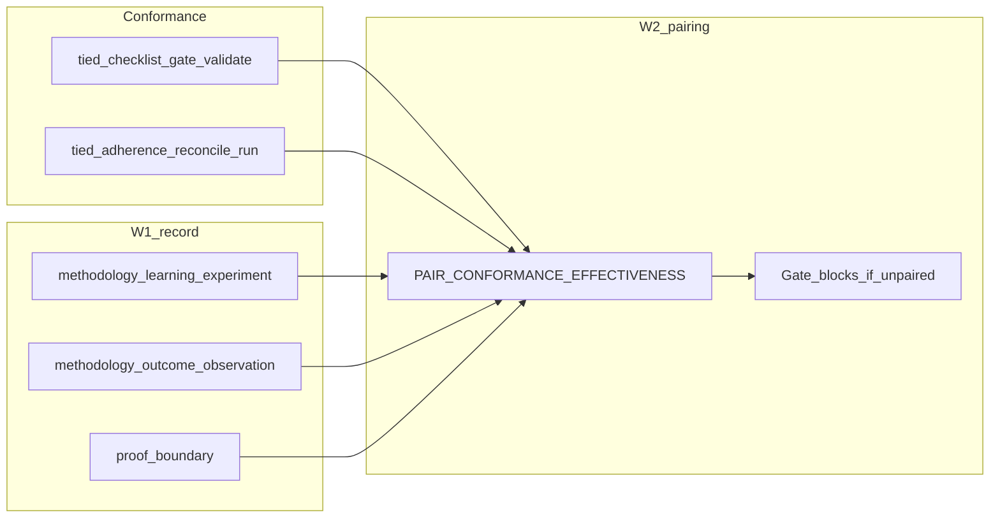

# TIED W2 — Conformance–effectiveness pairing

| Field | Value |
| --- | --- |
| **Status** | **Implement complete** (2026-10-10) — `REQ-METHODOLOGY-CONFORMANCE-EFFECTIVENESS-PAIRING`; close_out: `tied-project/working/REQ-METHODOLOGY-CONFORMANCE-EFFECTIVENESS-PAIRING/evidence/close_out-gate-result.json` |
| **Change ID** | `PLAN-TIED-QMM-W2-CONFORMANCE-EFFECTIVENESS` |
| **Parent program** | [`PLAN-TIED-QMM-METHODOLOGY-LEARNING`](tied-qmm-methodology-learning-plan.md) |
| **Future REQ** | `REQ-METHODOLOGY-CONFORMANCE-EFFECTIVENESS-PAIRING` (implement pass only — not minted in plan-only) |
| **Priority** | P1 (Loop 3 — closes comparison **Effectiveness (process rules)** gap vs strong **Conformance**) |
| **Owner** | Canonical TIED source repository (`stdd`) |
| **Source analysis** | [`docs/comparisons/qmm-kaizen-vs-tied.md`](comparisons/qmm-kaizen-vs-tied.md) — conformance trap |
| **Program orchestrator** | [`tied-project/working/PLAN-TIED-QMM-METHODOLOGY-LEARNING/qmm-program-execution-checklist.yaml`](../tied-project/working/PLAN-TIED-QMM-METHODOLOGY-LEARNING/qmm-program-execution-checklist.yaml) |
| **Working entry** | [`tied-project/working/PLAN-TIED-QMM-W2-CONFORMANCE-EFFECTIVENESS/PLAN.md`](../tied-project/working/PLAN-TIED-QMM-W2-CONFORMANCE-EFFECTIVENESS/PLAN.md) |
| **Documentation CITDP** | [`tied-project/citdp/CITDP-PLAN-TIED-QMM-W2-CONFORMANCE-EFFECTIVENESS.yaml`](../tied-project/citdp/CITDP-PLAN-TIED-QMM-W2-CONFORMANCE-EFFECTIVENESS.yaml) |
| **Implement authority** | [`sponsor-authority-w2-implement-20261010.md`](../tied-project/working/PLAN-TIED-QMM-METHODOLOGY-LEARNING/evidence/sponsor-authority-w2-implement-20261010.md) |
| **Last updated** | 2026-10-10 (refine-plan — implement authority) |

**Planning vs implement disclaimer:** The plan-only CITDP (`CITDP-PLAN-TIED-QMM-W2-CONFORMANCE-EFFECTIVENESS`) does **not** authorize RED or runtime changes. **Implement** runs under `REQ-METHODOLOGY-CONFORMANCE-EFFECTIVENESS-PAIRING` with integrated CITDP, per-REQ Tracker, and gates. No edits to methodology YAML under `tied-bundle/` without separate sponsor scope.

**Agency boundary:** **`w2_scope: implement`** (orchestrator) authorizes **build-plan** to mint the REQ stack and deliver MCP + **CITDP-scoped** gate-blocking. It does **not** bypass implement **`pre_implementation`** or integrated adversarial inquiry when triggers match. Plan-only gate receipts are **not** reusable for implement.

**Non-implication (QA vocab):** `gate_decided` / checklist gate pass does **not** prove **methodology effectiveness readout**; W2 pairing makes that gap explicit and fail-closed only when CITDP scope + trap disposition apply.

**Inconclusive ≠ trap:** W1 demo `methodology_outcome_observation.value: inconclusive` with a recorded row and `proof_boundary` can satisfy **paired** (linked readout exists); **conformance_only_trap** is conformance evidence without a typed outcome link or with **generic prose** refs only.

**Program exit:** Parent QMM program **closed** 2026-10-10; **W6 waived** at exit; Kaizen Phase 3 unchanged (**deferred**).

---

## 0. Refine (Touchpoint 1 — RESOLVE)

PRELOAD for implement and review: [`feedback-to-tied.md`](../tied-project/vocab/feedback-to-tied.md), [`quality-assurance.md`](../tied-project/vocab/quality-assurance.md), [`pseudocode-and-citdp.md`](../tied-project/vocab/pseudocode-and-citdp.md), [`sponsor-agent-relationship.md`](../tied-project/vocab/sponsor-agent-relationship.md), [`fidelity-research.md`](../tied-project/vocab/fidelity-research.md).

### 0.1 RESOLVE — study terms → W2 vocabulary

| Sponsor / QMM term | W2 preferred term | Notes |
| --- | --- | --- |
| Conformance trap | **conformance trap** | Gate/adherence pass without linked effectiveness readout |
| Conformance evidence | **methodology conformance evidence** | Gate receipts + adherence ledger refs tied to an experiment |
| Effectiveness readout | **methodology effectiveness readout** | Outcome row + proof boundary; not implied by gate pass alone |
| Pairing | **conformance–effectiveness pairing** | Explicit link + pass/fail/waiver disposition |
| Gate pass proves… | **proof boundary** (per row) | Extend W1 field semantics in pairing report |
| Unmeasured effectiveness | **`not_measured`** + **process-grade gap** | Document in envelope when pairing cannot assert effectiveness |
| Failed pairing → reverse rule | **rule reversal** | Costly when canonical; gate may block promotion paths |

### 0.2 Strategic non-goals (reconfirmed)

- No universal KPI or Kaizen score
- No SPC / DORA in TIED core
- No edits to committed methodology YAML under `tied-bundle/` without separate sponsor scope
- No **global** gate behavior change without CITDP-scoped experiment linkage (future implement)

### 0.3 Costly hinges (plan-only defaults — implement CITDP may waive with owner/expiry)

| # | Hinge | Default for W2 planning | Authority to change |
| --- | --- | --- | --- |
| 1 | Pairing enforcement | **Gate-blocking** on `verification` / `close_out` for explicitly linked methodology-surface changes | W2 implement CITDP + sponsor |
| 2 | Schema | **Extend v1** with optional `conformance_evidence_refs` + pairing report vs **v2** bump | W2 implement CITDP; LEAP if v2 |
| 3 | Gate integration surface | CITDP flag + Tracker `request` token + experiment linkage | Avoid silent global hook |
| 4 | Demo | Reconcile **mle-demo-20261010-001** + pilot **conformance_only_trap** row | Narrative in plan-only §7 |
| 5 | SRE / error budget | **Waivers / residual risk only** | No error-budget MCP in W2 |

### 0.4 Adversarial inquiry (plan-only)

- **depth_tier:** `minimal`
- **sub-adversarial-inquiry-pass:** `not_applicable`
- Implement pass must re-select **integrated** when persistence/MCP/gate behavior changes.

### 0.6 Refine pass — implement authority (2026-10-10)

| Change | Disposition |
| --- | --- |
| Sponsor **`w2_scope: implement`** | Recorded — [`sponsor-authority-w2-implement-20261010.md`](../tied-project/working/PLAN-TIED-QMM-METHODOLOGY-LEARNING/evidence/sponsor-authority-w2-implement-20261010.md) |
| Gate-blocking hinge | **Costly choice — affirmed** (verification/close_out, CITDP-scoped only) |
| Plan-only `pre_implementation` evidence | **Invalidated for implement path** — new REQ Tracker + `CITDP-REQ-METHODOLOGY-CONFORMANCE-EFFECTIVENESS-PAIRING` required |
| `depth_tier` / `gate_policy` for implement | **`integrated`** / **`per_citdp`** — independent of plan-only minimal/advisory |

### 0.5 Pairing disposition rules (normative for implement)

| Disposition | When | Gate-blocking (implement) |
| --- | --- | --- |
| `paired` | Typed **methodology conformance evidence** refs + **methodology outcome observation** row (any closed enum including `inconclusive`) + report `proof_boundary` | Allow verification/close_out for scoped change |
| `effectiveness_not_measured` | Outcome value `not_measured` + envelope **process-grade gap** or reconcile gap documented; conformance present | Allow only if gap rows exist (no silent pass) |
| `conformance_only_trap` | Gate/adherence evidence without satisfiable outcome link | **Block** verification/close_out |
| `waived` | CITDP **accepted risk** with owner/expiry | Allow per waiver record |

---

## 1. Executive summary

W1 delivered **methodology learning experiment** records (`methodology-learning-experiment.v1`) and MCP lifecycle tools. W2 closes the comparison **Conformance vs Effectiveness** gap for *methodology* changes: require explicit **conformance–effectiveness pairing** before treating gate/adherence success as sufficient for methodology-surface promotion.

**Plan-only pass:** contract, disposition table, test strategy, demonstration narrative, orchestrator GOTO W2, and implement handoff for `REQ-METHODOLOGY-CONFORMANCE-EFFECTIVENESS-PAIRING`. **Implement pass:** pairing validator/MCP + CITDP-scoped gate hook (verification/close_out only).

---

## 2. Delegated work envelope

| Allowed (plan-only pass) | Forbidden (plan-only pass) |
| --- | --- |
| This linked plan, working folder, documentation CITDP | Product REQ/ARCH/IMPL index or detail writes |
| Program orchestrator updates for W2 plan-only authority | `mcp-server/` code, tests, runtime gate changes |
| Non-normative pilot under `working/.../pilot/` | Edit committed methodology YAML under `tied-bundle/` |
| Vocabulary RECORD in `quality-assurance.md` | Treat plan-only authority as implement authorization |

| Allowed (W2 implement — **authorized** 2026-10-10) | Forbidden (implement without scope) |
| --- | --- |
| Project YAML, MCP pair tool, CITDP-scoped gate hook | Global gate blocking for unlinked REQs |
| Integrated adversarial inquiry when triggers match | Canonical `tied-bundle/` edit without separate sponsor change |
| Fresh Tracker under `working/REQ-METHODOLOGY-CONFORMANCE-EFFECTIVENESS-PAIRING/` | Reusing plan-only tracker for RED |

---

## 3. Change definition

### 3.1 This pass (plan-only)

| | |
| --- | --- |
| **Current** | W1 experiment shape exists; no pairing contract or trap disposition; gates do not enforce effectiveness readout for methodology changes. |
| **Desired** | Child plan with RESOLVE, pairing dispositions, gate-blocking policy (future only), CITDP, test strategy, batches, orchestrator W2 fields. |
| **Unchanged** | Runtime gate behavior, MCP surface (except W1 tools), Kaizen/LEAP semantics. |
| **Non-goals** | REQ/ARCH/IMPL tokens, RED, git commit unless sponsor asks. |
| **Success** | Child plan + CITDP + orchestrator `child_plan_status: authored`; `pre_implementation` gate attempt recorded (`allowed: false` expected). |

### 3.2 Later capability (REQ-METHODOLOGY-CONFORMANCE-EFFECTIVENESS-PAIRING)

For a `methodology-learning-experiment.v1` record (or `experiment_id` + external refs):

1. **Inputs:** `conformance_evidence_refs` (typed: `gate_receipt`, `envelope_ref`, `manifest_ref`, `file_path` — reject **generic prose**); optional adherence reconcile summary ref; experiment fields from W1 store.
2. **Output:** `MethodologyConformanceEffectivenessPairingReport` with `ok`, `disposition`, `diagnostics`, `proof_boundary`, optional `experiment_id`.
3. **MCP:** e.g. `tied_methodology_conformance_effectiveness_pair` (pure read/validate); register in `mcp-server`; no `tied-bundle/` writes.
4. **Gate-blocking:** When implement CITDP + Tracker declare `methodology_surface_experiment_link`, **`tied_checklist_gate_validate`** for `verification` and `close_out` composes pairing check; fail closed on **conformance_only_trap** unless waiver.
5. **Process-grade:** When effectiveness is `not_measured`, require `tied_adherence_reconcile_run` with `include_process_grade: true` and documented envelope/reconcile gaps.

**Depends on:** [REQ-METHODOLOGY-LEARNING-EXPERIMENT](../tied-project/requirements/REQ-METHODOLOGY-LEARNING-EXPERIMENT.yaml), [REQ-TIED_CHECKLIST_GATE_ENFORCEMENT](../tied-project/requirements.yaml).

Non-normative example: [`tied-project/working/PLAN-TIED-QMM-W2-CONFORMANCE-EFFECTIVENESS/pilot/pairing-readout.example.yaml`](../tied-project/working/PLAN-TIED-QMM-W2-CONFORMANCE-EFFECTIVENESS/pilot/pairing-readout.example.yaml).

---

## 4. CITDP

### 4.1 Plan-only — `CITDP-PLAN-TIED-QMM-W2-CONFORMANCE-EFFECTIVENESS`

- **depth_tier:** `minimal`
- **gate_policy:** `advisory`
- **tied_tokens_new:** `[]`
- **Success:** Pairing contract documented; implement section forbids inheriting minimal depth; gate-blocking labeled future-only.

Persisted at [`tied-project/citdp/CITDP-PLAN-TIED-QMM-W2-CONFORMANCE-EFFECTIVENESS.yaml`](../tied-project/citdp/CITDP-PLAN-TIED-QMM-W2-CONFORMANCE-EFFECTIVENESS.yaml).

### 4.2 Implement sketch — `CITDP-REQ-METHODOLOGY-CONFORMANCE-EFFECTIVENESS-PAIRING` (not created in plan-only)

| Attribute | Default |
| --- | --- |
| **depth_tier** | `integrated` (persistence/MCP/gate behavior) |
| **gate_policy** | `per_citdp` |
| **Eligibility** | Persistence, MCP, gate behavior change — integrated adversarial block expected |
| **Hinges** | Resolve or waive §0.3; counterexamples: gate allows with trap; pairing bypass without CITDP scope |

---

## 5. Test strategy

| Layer | Plan-only | W2 implement (expected) |
| --- | --- | --- |
| **Documentation** | RESOLVE + pairing contract + gate-blocking policy | IMPL pseudo-code with [PROC-IMPL_PSEUDOCODE_TOKENS] |
| **Unit** | N/A | Trap detection, `not_measured` + proof_boundary, waiver paths |
| **Composition** | N/A | MCP pair tool; gate rejects unpaired methodology-scoped close_out |
| **Demonstration** | Narrative §7 (`mle-demo-20261010-001` + trap pilot) | Live pairing report + gate replay script |
| **Verification** | Gate attempt (expect not allowed for RED) | `tied_verify` + integrated activation per CITDP |
| **Consistency** | Orchestrator + plan docs | `tied_validate_consistency` |

Implement must not inherit W2 plan-only `depth_tier: minimal`.

---

## 6. Tracker copy

| Pass | Path |
| --- | --- |
| **Plan-only** | [`tied-project/working/PLAN-TIED-QMM-W2-CONFORMANCE-EFFECTIVENESS/checklist-tracker.yaml`](../tied-project/working/PLAN-TIED-QMM-W2-CONFORMANCE-EFFECTIVENESS/checklist-tracker.yaml) |
| **Implement** | Copy fresh → `tied-project/working/REQ-METHODOLOGY-CONFORMANCE-EFFECTIVENESS-PAIRING/checklist-tracker.yaml` |

Do not reuse this plan-only tracker for implement RED.

---

## 7. Demonstration path (narrative — plan-only)

### 7.1 Paired + inconclusive (W1 demo)

**Experiment:** [`mle-demo-20261010-001`](../tied-project/methodology-experiments.yaml)

1. **methodology conformance evidence (future field):** gate receipt ref to W1 `pre_implementation-gate-result.json`; adherence ledger edge optional.
2. **methodology outcome observation:** `inconclusive` with typed `evidence_refs[]`.
3. **proof_boundary:** “Demonstrates validate/upsert/list lifecycle; does not prove hypothesis.”
4. **Pairing disposition:** `paired` — linked readout exists; effectiveness is not proven, but trap is avoided.

### 7.2 Conformance-only trap (pilot fixture)

**Scenario:** `pre_implementation` gate receipt exists; outcome link missing or refs are generic prose (“tests passed”).

1. **Disposition:** `conformance_only_trap`.
2. **Implement behavior:** block `verification` / `close_out` when CITDP declares methodology-surface experiment linkage.
3. **Pilot row:** [`pilot/pairing-readout.example.yaml`](../tied-project/working/PLAN-TIED-QMM-W2-CONFORMANCE-EFFECTIVENESS/pilot/pairing-readout.example.yaml) — trap case only (non-normative).

---

## 8. LEAP / promotion

| Stage | Path |
| --- | --- |
| **Working pairing report** | `working/REQ-METHODOLOGY-CONFORMANCE-EFFECTIVENESS-PAIRING/evidence/` |
| **Failed pairing on canonical surface** | **rule reversal** + LEAP queue + sponsor methodology change (same pattern as W1 §8) |
| **Gate-blocking promotion** | Do not promote gate hook to global default without CITDP + composition tests |

W2 implement does **not** auto-reverse rules in `methodology-experiments.yaml` without explicit upsert + sponsor scope.

---

## 9. Current state audit (2026-10-10)

| Capability | Evidence | W2 disposition |
| --- | --- | --- |
| Methodology experiment record (W1) | `methodology-experiments.yaml`, MCP validate/upsert/list | **Compose** — pairing reads this store |
| Checklist gates + adherence | `tied_checklist_gate_validate`, reconcile MCP | **Compose** — conformance evidence source |
| Pairing report + trap disposition | **Gap** | **Implement** — REQ-METHODOLOGY-CONFORMANCE-EFFECTIVENESS-PAIRING |
| Gate-blocking for methodology surface | **Gap** (documented only) | **Implement** — CITDP-scoped |
| SPC / DORA | Comparison defer | **Out of scope** |

---

## 10. Implement batches (authorization boundaries)

| Batch | Scope | Gate to start |
| --- | --- | --- |
| **B1** | Pairing disposition pure function + unit tests (trap, inconclusive paired, not_measured + gap) | W2 implement `pre_implementation` allowed |
| **B2** | MCP pair tool + register; composition tests | B1 green |
| **B3** | CITDP-scoped gate hook for verification/close_out + demo on `mle-demo-20261010-001` + trap fixture | B2 green + integrated CITDP |

---

## 11. Exit criteria

**Plan-only exit:**

- Child linked plan on disk
- Plan-only CITDP persisted
- Orchestrator `waves.W2.child_plan_status: authored`
- `pre_implementation` gate attempt recorded
- No REQ index rows for pairing token

**W2 implement exit (summary):**

- REQ/ARCH/IMPL + tests; pairing MCP; scoped gate-blocking proven by composition test
- At least one **paired** demo + one **trap** fixture
- `tied_validate_consistency`; verification/close_out with envelope + reconcile when Tracker requires

---

## 12. Agent entry — do this first

1. Read [`qmm-program-execution-checklist.yaml`](../tied-project/working/PLAN-TIED-QMM-METHODOLOGY-LEARNING/qmm-program-execution-checklist.yaml) → **`execution_authority.w2_scope: implement`** and `waves.W2.implement_checklist`.
2. **build-plan implement:** Copy Tracker → `working/REQ-METHODOLOGY-CONFORMANCE-EFFECTIVENESS-PAIRING/` → mint REQ/ARCH/IMPL + IMPL pseudo-code → persist **`CITDP-REQ-METHODOLOGY-CONFORMANCE-EFFECTIVENESS-PAIRING`** (`integrated`, `per_citdp`) → pass **`pre_implementation`** → TDD batches §10.
3. Do **not** treat plan-only gate JSON as implement authorization ([`pre_implementation-gate-result.json`](../tied-project/working/PLAN-TIED-QMM-W2-CONFORMANCE-EFFECTIVENESS/evidence/pre_implementation-gate-result.json)).
4. PRELOAD orchestrator `vocabulary_preload` + W2 QA terms before TIED YAML or MCP writes.

---

## 13. Related documents

- [`docs/tied-qmm-methodology-learning-plan.md`](tied-qmm-methodology-learning-plan.md) — parent program (W0–W6)
- [`docs/tied-qmm-w1-methodology-pdsa-plan.md`](tied-qmm-w1-methodology-pdsa-plan.md) — W1 child plan (complete)
- [`docs/comparisons/qmm-kaizen-vs-tied.md`](comparisons/qmm-kaizen-vs-tied.md) — conformance trap source
- [`tied-project/working/PLAN-TIED-QMM-W2-CONFORMANCE-EFFECTIVENESS/PLAN.md`](../tied-project/working/PLAN-TIED-QMM-W2-CONFORMANCE-EFFECTIVENESS/PLAN.md) — resume surface
