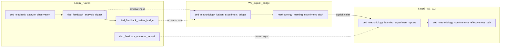

# TIED W3 — Kaizen → methodology bridge

| Field | Value |
| --- | --- |
| **Status** | **W3 implement in progress** — MCP + tests landed; integrated verification gate pending |
| **Change ID** | `PLAN-TIED-QMM-W3-KAIZEN-METHODOLOGY-BRIDGE` |
| **Parent program** | [`PLAN-TIED-QMM-METHODOLOGY-LEARNING`](tied-qmm-methodology-learning-plan.md) |
| **Future REQ** | `REQ-METHODOLOGY-KAIZEN-EXPERIMENT-BRIDGE` (implement pass only — not minted in plan-only) |
| **Priority** | P1 (Loop 2 → Loop 3 — explicit bridge from Kaizen feedback to methodology experiment drafts) |
| **Owner** | Canonical TIED source repository (`stdd`) |
| **Program orchestrator** | [`tied-project/working/PLAN-TIED-QMM-METHODOLOGY-LEARNING/qmm-program-execution-checklist.yaml`](../tied-project/working/PLAN-TIED-QMM-METHODOLOGY-LEARNING/qmm-program-execution-checklist.yaml) |
| **Working entry** | [`tied-project/working/PLAN-TIED-QMM-W3-KAIZEN-METHODOLOGY-BRIDGE/PLAN.md`](../tied-project/working/PLAN-TIED-QMM-W3-KAIZEN-METHODOLOGY-BRIDGE/PLAN.md) |
| **Documentation CITDP** | [`tied-project/citdp/CITDP-PLAN-TIED-QMM-W3-KAIZEN-METHODOLOGY-BRIDGE.yaml`](../tied-project/citdp/CITDP-PLAN-TIED-QMM-W3-KAIZEN-METHODOLOGY-BRIDGE.yaml) |
| **Plan-only authority** | [`sponsor-authority-w3-plan-only-20261010.md`](../tied-project/working/PLAN-TIED-QMM-METHODOLOGY-LEARNING/evidence/sponsor-authority-w3-plan-only-20261010.md) |
| **Last updated** | 2026-10-10 (build-plan — plan-only) |

**Planning vs implement disclaimer:** The plan-only CITDP does **not** authorize RED or runtime changes. **Implement** runs under `REQ-METHODOLOGY-KAIZEN-EXPERIMENT-BRIDGE` with integrated CITDP, per-REQ Tracker, and gates. No edits to methodology YAML under `tied-bundle/` without separate sponsor scope.

**Agency boundary:** **`w3_scope: implement`** (orchestrator) authorizes **build-plan** to mint the REQ stack and deliver bridge MCP. It does **not** bypass implement **`pre_implementation`** or integrated adversarial inquiry when triggers match. Plan-only gate receipts are **not** reusable for implement.

**Sponsor choice (confirmed):** **Explicit MCP bridge only** — no auto-create on `methodology_improvement` capture.

---

## 0. Refine (Touchpoint 1 — RESOLVE)

PRELOAD for implement and review: [`feedback-to-tied.md`](../tied-project/vocab/feedback-to-tied.md), [`quality-assurance.md`](../tied-project/vocab/quality-assurance.md), [`leap-proposal-queue.md`](../tied-project/vocab/leap-proposal-queue.md), [`pseudocode-and-citdp.md`](../tied-project/vocab/pseudocode-and-citdp.md), [`sponsor-agent-relationship.md`](../tied-project/vocab/sponsor-agent-relationship.md).

### 0.1 RESOLVE — study terms → W3 vocabulary

| Sponsor / Loop 2 term | W3 preferred term | Notes |
| --- | --- | --- |
| Process friction → rule idea | **Kaizen → methodology bridge** | Program label; not a second Kaizen program |
| `methodology_improvement` entry | **bridge-eligible feedback** | Primary filter; optional **observation kind** allowlist in implement CITDP |
| Kaizen **countermeasure** | **rule countermeasure** (Loop 3) | Bridge maps *intent*; does not rename Kaizen storage |
| Kaizen **baseline** / **outcome observation** | **methodology baseline** / **methodology outcome observation** | Copy or link-by-ref; do not conflate enums without mapping table |
| Digest → LEAP | **review bridge** | **Compose** `feedback-review-bridge.ts` — bridge is *parallel* path to experiment upsert, not a replacement |
| Experiment spawn | **explicit bridge invocation** | Sponsor-confirmed; fail-closed if feedback ineligible |

### 0.2 Strategic non-goals (reconfirmed)

- Kaizen Phase 3 transport (W6)
- SPC/DORA, universal scores
- Edits to committed `tied-bundle/` methodology YAML
- Silent global hooks on capture, digest, or **review bridge**

### 0.3 Costly hinges (plan-only defaults — implement CITDP may waive with owner/expiry)

| # | Hinge | W3 plan default | Authority to change |
| --- | --- | --- | --- |
| 1 | Link shape | Optional `source_feedback_refs[]` (+ digest hash) on **methodology-learning-experiment.v1** extend v1 vs v2 bump | Implement CITDP; LEAP if v2 |
| 2 | Eligibility | `type: methodology_improvement` required; observation kinds as documented allowlist | Sponsor may narrow in implement CITDP |
| 3 | Outcome sync | Bridge creates **draft** only; Kaizen **outcome loop** does not auto-fill methodology outcome | Separate slice or manual upsert |
| 4 | LEAP vs experiment | **review bridge** → LEAP remains; bridge → experiment is **orthogonal** | Document when to use which |
| 5 | W2 pairing | Bridged experiments use same close-out pairing when CITDP links methodology surface | **Compose** `tied_methodology_conformance_effectiveness_pair` |
| 6 | Bridge proof boundary | Bridge proves eligibility + draft shape only | Does not prove hypothesis true or methodology effectiveness |

### 0.4 Adversarial inquiry (plan-only)

- **depth_tier:** `minimal`
- **sub-adversarial-inquiry-pass:** `not_applicable`
- Implement pass must re-select **integrated** when MCP and optional schema extension land.

### 0.5 When to use bridge vs existing Kaizen paths

| Intent | Path | W3 role |
| --- | --- | --- |
| Local friction captured | `tied_feedback_capture_observation` | Source data only; **no** auto-bridge |
| Recurrence / grouping | `tied_feedback_analysis_digest` | Optional **input** to bridge (observation_group + hash) |
| Promote product/process change via LEAP | `tied_feedback_review_bridge` | **Unchanged**; orthogonal to experiment draft |
| Start Loop 3 PDSA record | **`tied_methodology_kaizen_experiment_bridge`** (proposed) | Explicit call after sponsor/agent decision |
| Persist experiment | `tied_methodology_learning_experiment_upsert` | **Separate** explicit step after draft review |
| Close methodology change with pairing | `tied_methodology_conformance_effectiveness_pair` | **Compose** W2; after upsert when surface linked |

### 0.6 Draft field mapping (implement normative target)

| Feedback source | Experiment field | Rule |
| --- | --- | --- |
| `entries[].id` | `source_feedback_refs[]` (optional v1) | Typed ref; at least one when bridging from feedback |
| `title` + `description` | `methodology_hypothesis` | Concatenate or template; must be non-empty |
| `context.baseline_ref` / capture context | `methodology_baseline` | Map or `{ value: not_measured }` |
| — | `methodology_outcome_observation` | **Omit** on initial bridge draft (close later via upsert) |
| — | `proof_boundary` | Fixed bridge text: draft/eligibility only |
| — | `privacy_tier` | Default `operator_local` |
| Digest | optional `digest_projection_hash` + `observation_group` | Reject bridge if hash stale vs live digest |

---

## 1. Executive summary

W1 delivered **methodology learning experiment** records and MCP lifecycle tools. W2 delivered **conformance–effectiveness pairing** for methodology-surface close-out. W3 closes the Loop 2 → Loop 3 gap: an **explicit MCP bridge** that turns **bridge-eligible feedback** into a **methodology learning experiment draft** without writing `methodology-experiments.yaml` on bridge invocation.

**Plan-only pass:** RESOLVE, bridge contract, field mapping, test strategy, demonstration narrative, orchestrator W3 fields, and implement handoff for `REQ-METHODOLOGY-KAIZEN-EXPERIMENT-BRIDGE`. **Implement pass:** bridge validator/MCP + composition tests proving read/draft-only boundary.

---

## 2. Delegated work envelope

| Allowed (plan-only pass) | Forbidden (plan-only pass) |
| --- | --- |
| This linked plan, working folder, documentation CITDP | Product REQ/ARCH/IMPL index or detail writes |
| Program orchestrator updates for W3 plan-only authority | `mcp-server/` code, tests, runtime behavior |
| Non-normative pilot under `working/.../pilot/` | Edit committed methodology YAML under `tied-bundle/` |
| Vocabulary RECORD in project glossaries | Treat plan-only authority as implement authorization |
| Optional `sponsor-authority-w3-plan-only-*.md` | `w3_scope: implement` without sponsor evidence |

| Allowed (W3 implement — **not authorized** until sponsor extends scope) | Forbidden (implement without scope) |
| --- | --- |
| Project YAML, MCP bridge tool, optional v1 link fields | Auto-bridge on capture/digest/review_bridge |
| Integrated adversarial inquiry when triggers match | Bridge store write on invocation |
| Fresh Tracker under `working/REQ-METHODOLOGY-KAIZEN-EXPERIMENT-BRIDGE/` | Reusing plan-only tracker for RED |

**Compose (read-only for planning):** [REQ-METHODOLOGY-LEARNING-EXPERIMENT](../tied-project/requirements/REQ-METHODOLOGY-LEARNING-EXPERIMENT.yaml), [REQ-METHODOLOGY-CONFORMANCE-EFFECTIVENESS-PAIRING](../tied-project/requirements/REQ-METHODOLOGY-CONFORMANCE-EFFECTIVENESS-PAIRING.yaml), [REQ-FEEDBACK_TO_TIED](../tied-project/requirements/REQ-FEEDBACK_TO_TIED.yaml), Kaizen REQ neighborhood (`REQ-KAIZEN-FEEDBACK-ANALYSIS`, `REQ-KAIZEN-REVIEW-BRIDGE`, `REQ-KAIZEN-OUTCOME-LOOP`).

---

## 3. Change definition

### 3.1 This pass (plan-only)

| | |
| --- | --- |
| **Current** | Kaizen feedback and W1 experiments coexist; no bridge contract or explicit draft builder. |
| **Desired** | Child plan with RESOLVE, path table, field mapping, CITDP, test strategy, batches, orchestrator W3 fields. |
| **Unchanged** | Capture, digest, review_bridge, outcome loop, W1 upsert, W2 pairing MCP. |
| **Non-goals** | REQ/ARCH/IMPL tokens, RED, git commit unless sponsor asks. |
| **Success** | Child plan + CITDP + orchestrator `child_plan_status: authored`; `pre_implementation` gate attempt recorded (`allowed: false` expected). |

### 3.2 Later capability (REQ-METHODOLOGY-KAIZEN-EXPERIMENT-BRIDGE)

- **Input:** `feedback_id`(s) and/or digest `observation_group` + `projection_hash`; optional `production_system_surface` defaulting from context.
- **Behavior:** Validate eligibility → build **draft** `methodology-learning-experiment.v1` → return draft + diagnostics. **No** write to `methodology-experiments.yaml`.
- **MCP (proposed):** `tied_methodology_kaizen_experiment_bridge` — pure read + draft builder; persistence via existing W1 upsert after explicit caller review.
- **Module home:** `mcp-server/src/methodology-kaizen-experiment-bridge/` (parallel to `methodology-conformance-effectiveness-pairing/`).
- **Compose:** Read paths in `feedback.ts`, `feedback-analysis.ts`, `methodology-learning-experiment/`; register in `mcp-server/src/tools/index.ts`.

Non-normative example: [`tied-project/working/PLAN-TIED-QMM-W3-KAIZEN-METHODOLOGY-BRIDGE/pilot/bridge-draft.example.yaml`](../tied-project/working/PLAN-TIED-QMM-W3-KAIZEN-METHODOLOGY-BRIDGE/pilot/bridge-draft.example.yaml).

---

## 4. CITDP

### 4.1 Plan-only — `CITDP-PLAN-TIED-QMM-W3-KAIZEN-METHODOLOGY-BRIDGE`

- **depth_tier:** `minimal`
- **gate_policy:** `advisory`
- **tied_tokens_new:** `[]`
- **Success:** Bridge contract documented; implement section forbids inheriting minimal depth; explicit-trigger policy recorded.

Persisted at [`tied-project/citdp/CITDP-PLAN-TIED-QMM-W3-KAIZEN-METHODOLOGY-BRIDGE.yaml`](../tied-project/citdp/CITDP-PLAN-TIED-QMM-W3-KAIZEN-METHODOLOGY-BRIDGE.yaml).

### 4.2 Implement sketch — `CITDP-REQ-METHODOLOGY-KAIZEN-EXPERIMENT-BRIDGE` (not created in plan-only)

| Attribute | Default |
| --- | --- |
| **depth_tier** | `integrated` (persistence/MCP) |
| **gate_policy** | `per_citdp` |
| **Eligibility** | Persistence, MCP — integrated adversarial block expected |
| **Hinges** | Resolve or waive §0.3; counterexamples: bridge writes store; auto-hook on review_bridge |

---

## 5. Test strategy

| Layer | Plan-only | W3 implement (expected) |
| --- | --- | --- |
| **Documentation** | RESOLVE + bridge contract + explicit-trigger policy | IMPL pseudo-code with [PROC-IMPL_PSEUDOCODE_TOKENS] |
| **Unit** | N/A | Eligibility, draft field mapping (§0.6), reject non-`methodology_improvement`, stale digest hash |
| **Composition** | N/A | MCP bridge + fixture `feedback.yaml`; assert read/draft-only, then explicit draft → upsert → list; optional pairing compose |
| **Demonstration** | Narrative §7 + pilot YAML | Live bridge from seeded `methodology_improvement` entry |
| **Verification** | Gate attempt (expect not allowed for RED) | `tied_verify` on implement REQ |
| **Consistency** | Orchestrator + plan docs | `tied_validate_consistency` on touched project YAML |

Implement must not inherit W3 plan-only `depth_tier: minimal`.

---

## 6. Tracker copy

| Pass | Path |
| --- | --- |
| **Plan-only** | [`tied-project/working/PLAN-TIED-QMM-W3-KAIZEN-METHODOLOGY-BRIDGE/checklist-tracker.yaml`](../tied-project/working/PLAN-TIED-QMM-W3-KAIZEN-METHODOLOGY-BRIDGE/checklist-tracker.yaml) |
| **Implement** | Copy fresh → `tied-project/working/REQ-METHODOLOGY-KAIZEN-EXPERIMENT-BRIDGE/checklist-tracker.yaml` |

Do not reuse this plan-only tracker for implement RED.

---

## 7. Demonstration path (narrative — plan-only)

### 7.1 Pilot fixture (non-normative)

1. **Feedback:** fictional `fb-w3-bridge-pilot-20261010-001`, `type: methodology_improvement`, title/description implying a checklist friction.
2. **Bridge request:** explicit MCP call with `feedback_ids: [fb-w3-bridge-pilot-20261010-001]`.
3. **Draft output:** hypothesis from title/description; baseline `not_measured` if context absent; `proof_boundary` states draft/eligibility only; **no** `methodology_outcome_observation`.
4. **Persist (manual in demo):** operator passes validated draft to `tied_methodology_learning_experiment_upsert` (pattern `mle-demo-20261010-001`).
5. **Close-out (when surface linked):** `tied_methodology_conformance_effectiveness_pair` per W2.

Pilot row: [`pilot/bridge-draft.example.yaml`](../tied-project/working/PLAN-TIED-QMM-W3-KAIZEN-METHODOLOGY-BRIDGE/pilot/bridge-draft.example.yaml).

### 7.2 Loop-back invalidation

If implement scope adds **write** on bridge invocation, **auto-hook** on `review_bridge`, or **global** eligibility beyond explicit MCP call: invalidate B2 composition evidence, re-run `risk-assessment`, and refresh CITDP before RED continues.

---

## 8. LEAP / promotion

| Stage | Path |
| --- | --- |
| **Working bridge diagnostics** | `working/REQ-METHODOLOGY-KAIZEN-EXPERIMENT-BRIDGE/evidence/` |
| **Product/process change via LEAP** | **`tied_feedback_review_bridge`** — unchanged; bridge does not replace LEAP |
| **Methodology rule change** | Explicit upsert + sponsor methodology change (same pattern as W1 §8) |

W3 implement does **not** auto-promote feedback entries or LEAP proposals into experiments without **explicit bridge invocation** and reviewed upsert.

---

## 9. Current state audit (2026-10-10)

| Capability | Evidence | W3 disposition |
| --- | --- | --- |
| Methodology experiment record (W1) | `methodology-experiments.yaml`, MCP validate/upsert/list | **Compose** — upsert after draft review |
| Kaizen feedback capture/digest | `feedback.yaml`, analysis MCP | **Compose** — source only; no auto-bridge |
| Review bridge → LEAP | `feedback-review-bridge.ts` | **Unchanged** — orthogonal |
| Bridge MCP + draft builder | **Gap** | **Implement** — REQ-METHODOLOGY-KAIZEN-EXPERIMENT-BRIDGE |
| Feedback linkage on experiment v1 | **Gap** (no `source_feedback_refs` today) | **Implement** — optional v1 fields (hinge §0.3) |
| W2 pairing on upserted experiments | W2 MCP complete | **Compose** at close-out |

---

## 10. Implement batches (authorization boundaries)

| Batch | Scope | Gate to start |
| --- | --- | --- |
| **B1** | Bridge eligibility + draft builder in `methodology-kaizen-experiment-bridge/` + unit tests | W3 implement `pre_implementation` allowed |
| **B2** | MCP tool + register; composition with feedback fixtures; prove **no store write** during bridge | B1 green |
| **B3** | Optional v1 source-link fields + explicit upsert integration demo; vocabulary RECORD if stabilized | B2 green |

No gate-blocking expansion in W3 (unlike W2); pairing remains W2’s CITDP-scoped hook.

---

## 11. Exit criteria

**Plan-only exit:**

- Child linked plan on disk
- Plan-only CITDP persisted
- Orchestrator `waves.W3.child_plan_status: authored`; W2 `status: complete`; `current_wave: W3`
- `pre_implementation` gate attempt recorded
- No REQ index rows for bridge token

**W3 implement exit (summary):**

- REQ/ARCH/IMPL + tests; bridge MCP; composition proves draft-only boundary
- At least one demo: feedback → bridge → explicit upsert
- `tied_validate_consistency`; verification/close_out per implement CITDP

---

## 12. Agent entry — do this first

1. Read [`qmm-program-execution-checklist.yaml`](../tied-project/working/PLAN-TIED-QMM-METHODOLOGY-LEARNING/qmm-program-execution-checklist.yaml) → **`w3_scope: plan_only`** until sponsor extends **`w3_scope: implement`**.
2. **Future build-plan implement:** Copy Tracker → `working/REQ-METHODOLOGY-KAIZEN-EXPERIMENT-BRIDGE/` → mint REQ/ARCH/IMPL + IMPL pseudo-code → persist **`CITDP-REQ-METHODOLOGY-KAIZEN-EXPERIMENT-BRIDGE`** (`integrated`, `per_citdp`) → pass **`pre_implementation`** → TDD batches §10.
3. Do **not** treat plan-only gate JSON as implement authorization ([`pre_implementation-gate-result.json`](../tied-project/working/PLAN-TIED-QMM-W3-KAIZEN-METHODOLOGY-BRIDGE/evidence/pre_implementation-gate-result.json)).
4. PRELOAD orchestrator `vocabulary_preload` + W3 bridge terms before TIED YAML or MCP writes.

---

## 13. Related documents

- [`docs/tied-qmm-methodology-learning-plan.md`](tied-qmm-methodology-learning-plan.md) — parent program (W0–W6)
- [`docs/tied-qmm-w1-methodology-pdsa-plan.md`](tied-qmm-w1-methodology-pdsa-plan.md) — W1 child plan (complete)
- [`docs/tied-qmm-w2-conformance-effectiveness-plan.md`](tied-qmm-w2-conformance-effectiveness-plan.md) — W2 child plan (implement complete)
- [`tied-project/vocab/feedback-to-tied.md`](../tied-project/vocab/feedback-to-tied.md) — `methodology_improvement` filter
- [`tied-project/working/PLAN-TIED-QMM-W3-KAIZEN-METHODOLOGY-BRIDGE/PLAN.md`](../tied-project/working/PLAN-TIED-QMM-W3-KAIZEN-METHODOLOGY-BRIDGE/PLAN.md) — resume surface
