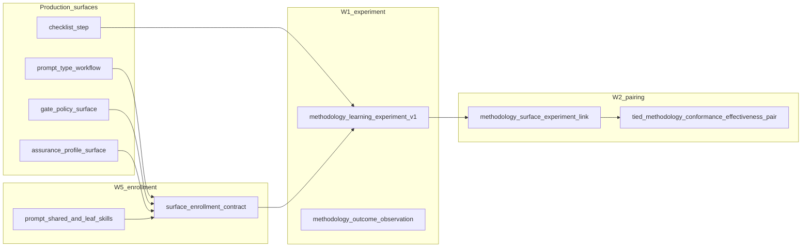

# TIED W5 — Prompt-type and gate-policy production-system enrollment

| Field | Value |
| --- | --- |
| **Status** | **Implement complete (local proof)** (2026-10-10) — `REQ-METHODOLOGY-PRODUCTION-SYSTEM-ENROLLMENT`; traceable-commit **`e9e56a8`**; implement gates under `tied-project/working/REQ-METHODOLOGY-PRODUCTION-SYSTEM-ENROLLMENT/evidence/` (plan-only receipts remain under `PLAN-TIED-QMM-W5-…/evidence/` — non-activation) |
| **Change ID** | `PLAN-TIED-QMM-W5-PROMPT-TYPE-GATE-ENROLLMENT` |
| **Parent program** | [`docs/tied-qmm-methodology-learning-plan.md`](tied-qmm-methodology-learning-plan.md) § W5 |
| **Working entry** | [`tied-project/working/PLAN-TIED-QMM-W5-PROMPT-TYPE-GATE-ENROLLMENT/PLAN.md`](../tied-project/working/PLAN-TIED-QMM-W5-PROMPT-TYPE-GATE-ENROLLMENT/PLAN.md) |
| **Tracker (plan-only)** | [`tied-project/working/PLAN-TIED-QMM-W5-PROMPT-TYPE-GATE-ENROLLMENT/checklist-tracker.yaml`](../tied-project/working/PLAN-TIED-QMM-W5-PROMPT-TYPE-GATE-ENROLLMENT/checklist-tracker.yaml) |
| **REQ** | `REQ-METHODOLOGY-PRODUCTION-SYSTEM-ENROLLMENT` (minted 2026-10-10 implement pass) |
| **Traceability anchor** | `[REQ-PROMPT_TYPE_GLOBAL_SKILLS]` / `[ARCH-PROMPT_TYPE_GLOBAL_SKILLS]` / `[IMPL-PROMPT_TYPE_GLOBAL_SKILLS]` |
| **Last updated** | 2026-10-10 (build-plan plan-only pass) |

## 0. Authority and delegated work envelope

**Plan-only pass (this document):** child linked plan, plan-only Tracker, documentation CITDP, orchestrator W5 fields, non-activation `pre_implementation` gate receipt.

**Implement pass (authorized 2026-10-10):** enrollment contract (optional schema/helpers), prompt-skill/shared-doc alignment, extended tests/demos, integrated gates on implement REQ — see [`sponsor-authority-w5-implement-20261010.md`](../tied-project/working/PLAN-TIED-QMM-METHODOLOGY-LEARNING/evidence/sponsor-authority-w5-implement-20261010.md).

Plan-only CITDP does **not** authorize RED, MCP behavior changes, or prompt-skill contract edits in clients. No edits to committed methodology YAML under `tied-bundle/` without separate sponsor scope.

**Program exit:** Parent QMM program **closed** 2026-10-10; **W6 waived** at exit; Kaizen Phase 3 unchanged (**deferred**).

**Agency boundary:** Plan-only gate receipts and this plan do **not** bypass implement **`pre_implementation`** or integrated adversarial inquiry when persistence/MCP triggers match.

PRELOAD for implement and review: [`prompt-composer.md`](../tied-project/vocab/prompt-composer.md), [`quality-assurance.md`](../tied-project/vocab/quality-assurance.md), [`pseudocode-and-citdp.md`](../tied-project/vocab/pseudocode-and-citdp.md), [`fidelity-research.md`](../tied-project/vocab/fidelity-research.md), [`sponsor-agent-relationship.md`](../tied-project/vocab/sponsor-agent-relationship.md), [`feedback-to-tied.md`](../tied-project/vocab/feedback-to-tied.md).

### 0.1 RESOLVE — study terms → W5 vocabulary

| Sponsor / program term | W5 preferred term | Notes |
| --- | --- | --- |
| Prompt-type skills in production | **prompt-type workflow** / **global prompt skill** | Leaf skills under `tools/bundled-prompt-type-skills/`; installed to `.cursor/skills/` |
| Map skills to PDSA | **production-system surface enrollment** | Uses W1 enum value `prompt_type_workflow` on experiment records |
| Gate policy change | **CITDP gate_policy** *and* experiment surface `gate_policy` | **Two namespaces** — see §0.5 |
| Assurance profile evolution | **assurance profile** (QA vocab) + surface `assurance_profile` | Profile *selection* for a change vs experiment surface label |
| Same envelope as checklist steps | **methodology learning experiment** + **methodology_surface_experiment_link** | **Compose** W1 store + W2 pairing; CITDP-scoped only |
| plan-new-feature / build-plan | Named **prompt types** in taxonomy | 13 leaf types; router `prompt-type-router` |
| Effectiveness of rule change | **methodology outcome observation** + **proof boundary** | Not implied by gate pass ([NON_IMPLICATION_RULE]) |
| Enrollment | **surface enrollment contract** | Normative when/how to open/update experiment for non-`checklist_step` surfaces |

**Vocabulary RECORD (plan-only):** Candidate terms (**surface enrollment contract**, **surface_ref**) documented here; RECORD deferred until implement scope confirms names.

### 0.2 Strategic non-goals (reconfirmed)

- No second PDSA store or parallel experiment schema unless LEAP + sponsor hinge
- No **global** pairing/gate hook without `methodology_surface_experiment_link` (W2 sponsor boundary preserved)
- No canonical promotion of enrollment rules into `[PROC-AGENT_REQ_CHECKLIST]` or `tied-bundle/` without separate methodology change request
- No maturity scoring, SPC/DORA, or W4-style cohort reimplementation (W4 closed; optional demo *consumes* existing report CLI only)
- No Kaizen Phase 3 transport (W6)

### 0.3 Costly hinges (plan-only defaults — implement CITDP may waive with owner/expiry)

| # | Hinge | W5 plan default | Classification | Authority to change |
| --- | --- | --- | --- | --- |
| 1 | **Surface identifier** | Extend v1 with optional `surface_ref` (prompt type id, profile id, CITDP id) vs v2 bump | Reversible → costly if breaking | Implement CITDP + LEAP if v2 |
| 2 | **Enrollment enforcement** | Document + MCP **assist** (validate/enroll helpers); gate-blocking only when CITDP declares link (same as W2) | Reversible default | Sponsor may require stricter demo |
| 3 | **Prompt skill contract** | Add **advisory** enrollment steps to `prompt-shared` / leaf skills; blocking only via Tracker on implement REQ | Costly if mandatory global skill gate | Sponsor + `[REQ-PROMPT_TYPE_GLOBAL_SKILLS]` LEAP |
| 4 | **Which prompt types in scope** | All 13 leaf types *eligible*; demonstration uses `plan-new-feature`, `build-plan`, `refine-plan` minimum | Reversible | Sponsor may narrow demo set |
| 5 | **Assurance profile changes** | Log as experiments with `production_system_surface: assurance_profile` + profile id in `surface_ref` / `rule_countermeasure_ref` | Reversible | Profile owner for regulated-privacy |
| 6 | **Canonical PROC token** | Align docs to **REQ-PROMPT_TYPE_GLOBAL_SKILLS**; do not mint `[PROC-PROMPT_TYPE_GLOBAL_SKILLS]` ad hoc | Reversible documentation | Methodology owner |

### 0.4 Adversarial inquiry (plan-only vs implement)

| Pass | `depth_tier` | `gate_policy` | `sub-adversarial-inquiry-pass` |
| --- | --- | --- | --- |
| **Plan-only CITDP** | `minimal` | `advisory` | `not_applicable` |
| **Implement CITDP (expected)** | `integrated` | `per_citdp` | Required at structural / pre-RED / verification when triggers match (MCP/persistence) |

Program handoff defaults (`profile_depth: integrated`, `depth_tier: integrated`, `gate_policy: per_citdp`) apply to **implement** selection; plan-only must **not** inherit them for gate activation.

### 0.5 Dual meaning of **gate_policy** (normative RESOLVE)

| Context | Field / artifact | Allowed values (examples) | Proof boundary |
| --- | --- | --- | --- |
| **CITDP / checklist gate** | CITDP `gate_policy`, Tracker context | `advisory`, `per_citdp`, strict variants | Controls checklist evidence gate composition |
| **Methodology experiment** | `production_system_surface: gate_policy` | Surface *category* only | Experiment record labels *what* changed, not CITDP policy enum |
| **Activation disposition** | `citdp-async-triggers` assurance + gate_policy | `advisory` \| `blocking` (activation) | Distinct from `per_citdp` |

Implement docs and tests must use fully qualified phrases (**CITDP gate_policy** vs **experiment surface gate_policy**) in proof boundaries and diagnostics.

### 0.6 W1 surface enum (already shipped — W5 operationalizes)

From [`mcp-server/src/methodology-learning-experiment/constants.ts`](../mcp-server/src/methodology-learning-experiment/constants.ts):

- `checklist_step` — primary W1 demos/tests
- `gate_policy` — partial test coverage
- `assurance_profile` — **under-tested** in fixtures/demos
- `prompt_type_workflow` — **under-tested** in fixtures/demos

W5 success includes at least one **paired** demonstration per previously under-covered surface (or explicit `effectiveness_not_measured` with process-grade gaps documented).

---

## 1. Executive summary

W1–W4 delivered experiment records, conformance–effectiveness pairing, Kaizen bridge, and cohort readouts. W5 closes the parent program gap **“explicit coverage of prompt-type workflows and assurance profile evolution”** by enrolling those **production-system surfaces** in the same Loop 3 PDSA envelope as checklist step changes—without a parallel stack.

---

## 2. Delegated work envelope

| Allowed (plan-only pass) | Forbidden (plan-only pass) |
| --- | --- |
| Child plan doc, working folder, documentation CITDP | Product REQ/ARCH/IMPL index writes (except future sketch in plan text) |
| Orchestrator W5 plan-only fields | `mcp-server/` code, tests, runtime changes |
| Pilot YAML under `working/.../pilot/` | Treat plan-only as `w5_scope: implement` |
| Vocabulary RECORD when terms stabilize | Global pairing without experiment link |

| Allowed (W5 implement — **not authorized yet**) | Forbidden without scope |
| --- | --- |
| Project YAML, MCP enrollment helpers, skill/shared doc updates | Global gate blocking for all prompt-type edits |
| Integrated adversarial inquiry when triggered | `tied-bundle/` methodology edits |
| Fresh Tracker under `working/REQ-METHODOLOGY-PRODUCTION-SYSTEM-ENROLLMENT/` | Reusing plan-only tracker for RED |

---

## 3. Change definition

### 3.1 Current behavior

- W1 validator accepts all four `production_system_surface` values; tests/demos skew **`checklist_step`**.
- W2 pairing + CITDP-scoped gate hook works when `methodology_surface_experiment_link` is present; no enrollment **procedure** for prompt-type or assurance-profile edits.
- Prompt-type skills require gates in prose but do **not** require opening/updating a methodology learning experiment.
- W3 bridge accepts optional `production_system_surface`; W4 readouts consume experiment/profile artifacts—W5 does not add a new report REQ.

### 3.2 Desired behavior (implement)

1. **Enrollment contract:** When a change touches `prompt_type_workflow`, CITDP **`gate_policy`** evolution, or **assurance profile** selection for a methodology-surface change, operators follow: hypothesis → experiment record (upsert) → conformance refs → outcome observation → W2 pairing before verification/close_out on linked CITDP.
2. **Optional machine assist:** MCP or pure functions to validate enrollment completeness — fail-closed only when CITDP declares linkage (compose W2).
3. **Prompt composer alignment:** `prompt-shared/tied-plan-citdp.md` (and selected leaf skills) reference enrollment without substituting for Tracker/CITDP evidence.
4. **Demonstrations:** At least one stdd working demo per under-covered surface with `operator_local` privacy tier.

### 3.3 Unchanged / non-goals

- W1 lifecycle MCP semantics unless optional v1 fields approved
- W2 disposition table and trap semantics
- Prompt-type install/bootstrap mechanics (`tied-install.sh` skills copy)
- Effectiveness ranking via W4 statistics report

### 3.4 Plan-only success criteria

- This child plan on disk
- `CITDP-PLAN-TIED-QMM-W5-PROMPT-TYPE-GATE-ENROLLMENT.yaml` persisted (`minimal` / `advisory`)
- Plan-only Tracker + `pre_implementation` gate attempt (`allowed: false` expected for RED)
- Orchestrator W5 `child_plan_status: authored`, `plan_only_status: complete`

---

## 4. CITDP

### 4.1 Plan-only — `CITDP-PLAN-TIED-QMM-W5-PROMPT-TYPE-GATE-ENROLLMENT`

| Attribute | Value |
| --- | --- |
| **depth_tier** | `minimal` |
| **profile_depth** | `integrated` (documented target for implement only) |
| **gate_policy** | `advisory` |
| **tied_tokens_new** | `[]` |
| **Success** | Enrollment contract + implement sketch + gate attempt recorded |

### 4.2 Implement sketch — `CITDP-REQ-METHODOLOGY-PRODUCTION-SYSTEM-ENROLLMENT` (not created in plan-only)

| Attribute | Default |
| --- | --- |
| **depth_tier** | `integrated` |
| **gate_policy** | `per_citdp` |
| **Assurance profiles** | `baseline-functional`; add triggered profiles per `[PROC-QUALITY_ASSURANCE]` when MCP/external-input surfaces touched |
| **methodology_surface_experiment_link** | Required on implement CITDP when demonstrating gate-blocking pairing |
| **Eligibility** | Persistence/MCP + prompt-skill contract tests ⇒ integrated adversarial block expected |

---

## 5. Reuse map (compose — do not reimplement)

| Layer | Artifact | W5 use |
| --- | --- | --- |
| W1 | `methodology-learning-experiment/*`, `REQ-METHODOLOGY-LEARNING-EXPERIMENT` | Store + validate; optional `surface_ref` |
| W2 | `methodology-conformance-effectiveness-pairing/*`, pairing-gate | Same trap/disposition semantics |
| W3 | `methodology-kaizen-experiment-bridge/*` | Optional input path; not W5 blocker |
| W4 | `evidence-chain-report` CLI/tests | Optional cohort demo input manifest only |
| Product | `tools/bundled-prompt-type-skills/`, `REQ-PROMPT_TYPE_GLOBAL_SKILLS` | Contract tests + shared doc updates |
| Gates | `checklist-validator.ts`, `tied_checklist_gate_validate` | No global hook; CITDP-scoped only |

---

## 6. Test strategy outline (implement — not RED in plan-only)

| Layer | Focus |
| --- | --- |
| **Unit** | Validate/store for `prompt_type_workflow`, `assurance_profile`; enrollment validator if added |
| **Composition** | Pairing gate with each surface + link block; unlinked REQ still passes |
| **Contract** | Extend `prompt-type-skills.test.ts` if shared docs change |
| **MCP** | Parity tests pattern from W1/W2 MCP suites |
| **Demonstration** | Working folder YAML/MD demos (no absolute paths); pairing dispositions `paired` / `effectiveness_not_measured` |
| **Verification** | `tied_verify`, envelope, integrated activation, `tied_validate_consistency` |

---

## 7. Implement batches (authorization boundaries)

| Batch | Scope | Gate to start |
| --- | --- | --- |
| **B1** | REQ/ARCH/IMPL stack + sidecar with block token comments | W5 implement `pre_implementation` allowed |
| **B2** | Optional v1 `surface_ref` (or v2 LEAP) + validator tests | B1 green |
| **B3** | Enrollment MCP/helper (pure read/validate) | B2 green |
| **B4** | Prompt-shared + selected leaf skill updates + contract tests | B3 green |
| **B5** | Demonstrations + orchestrator implement checklist | B4 green |
| **B6** | Integrated gates, `tied_verify`, close_out evidence sync | B5 green |

---

## 8. Current state audit (2026-10-10)

| Capability | Evidence | W5 disposition |
| --- | --- | --- |
| Methodology experiment record (W1) | MCP validate/upsert/list | **Compose** — enrollment upserts same store |
| Pairing + trap (W2) | pairing MCP + CITDP-scoped gate | **Compose** — enrollment feeds link block |
| Prompt-type skills | `tools/bundled-prompt-type-skills/` | **Align** — advisory enrollment prose on implement |
| Surface coverage in tests | W1 constants + skew to `checklist_step` | **Implement** — demos for under-tested surfaces |
| Enrollment procedure | **Gap** | **Implement** — REQ-METHODOLOGY-PRODUCTION-SYSTEM-ENROLLMENT |

---

## 9. Refine / plan-only changelog

| Pass | Date | Changes |
| --- | --- | --- |
| **1** | 2026-10-10 | Full RESOLVE; dual gate_policy table; costly hinges; reuse map; CITDP split; test/batch outline; mermaid; future REQ name |
| **build-plan** | 2026-10-10 | Child doc materialized; CITDP + Tracker + orchestrator + gate receipt |

---

## 10. Exit criteria

**Plan-only exit:**

- Child linked plan on disk
- Plan-only CITDP persisted
- Orchestrator `waves.W5.child_plan_status: authored`; W1–W4 `status: complete`; `current_wave: W5`
- `pre_implementation` gate attempt recorded (`allowed: false` expected)
- No REQ index rows for `REQ-METHODOLOGY-PRODUCTION-SYSTEM-ENROLLMENT`

**W5 implement exit (summary):**

- REQ/ARCH/IMPL + tests; enrollment helper/MCP; prompt-shared alignment
- At least one demo per under-covered surface (or documented `effectiveness_not_measured`)
- `tied_validate_consistency`; verification/close_out per implement CITDP

---

## 11. Agent entry — do this first

1. Read [`qmm-program-execution-checklist.yaml`](../tied-project/working/PLAN-TIED-QMM-METHODOLOGY-LEARNING/qmm-program-execution-checklist.yaml) → **`current_wave: W5`**; **`w5_scope: implement`** is **not** set until sponsor authority is recorded.
2. **Future build-plan implement:** Copy Tracker → `working/REQ-METHODOLOGY-PRODUCTION-SYSTEM-ENROLLMENT/` → mint REQ/ARCH/IMPL + IMPL pseudo-code → persist **`CITDP-REQ-METHODOLOGY-PRODUCTION-SYSTEM-ENROLLMENT`** (`integrated`, `per_citdp`) → pass **`pre_implementation`** with fresh activation → TDD batches §7.
3. Do **not** treat plan-only gate JSON as implement authorization ([`pre_implementation-gate-result.json`](../tied-project/working/PLAN-TIED-QMM-W5-PROMPT-TYPE-GATE-ENROLLMENT/evidence/pre_implementation-gate-result.json)).
4. PRELOAD orchestrator `vocabulary_preload` + [`prompt-composer.md`](../tied-project/vocab/prompt-composer.md) before TIED YAML or MCP writes on implement.

---

## 12. Related documents

- [`docs/tied-qmm-methodology-learning-plan.md`](tied-qmm-methodology-learning-plan.md) — parent program (W0–W6)
- [`docs/tied-qmm-w1-methodology-pdsa-plan.md`](tied-qmm-w1-methodology-pdsa-plan.md) — W1 (complete)
- [`docs/tied-qmm-w2-conformance-effectiveness-plan.md`](tied-qmm-w2-conformance-effectiveness-plan.md) — W2 (complete)
- [`docs/tied-qmm-w3-kaizen-methodology-bridge-plan.md`](tied-qmm-w3-kaizen-methodology-bridge-plan.md) — W3 (complete)
- [`docs/tied-qmm-w4-evidence-chain-report-plan.md`](tied-qmm-w4-evidence-chain-report-plan.md) — W4 (complete)
- [`tied-project/vocab/prompt-composer.md`](../tied-project/vocab/prompt-composer.md) — prompt-type taxonomy
- [`tied-project/working/PLAN-TIED-QMM-W5-PROMPT-TYPE-GATE-ENROLLMENT/PLAN.md`](../tied-project/working/PLAN-TIED-QMM-W5-PROMPT-TYPE-GATE-ENROLLMENT/PLAN.md) — resume surface

---

## 13. Sponsor next step

1. Accept plan-only scope (or note deltas in invocation remainder).
2. Record **`w5_scope: implement`** + evidence ref before RED (mirror W4 pattern).
3. Run **build-plan** on implement authority with fresh integrated CITDP and per-REQ Tracker — not the plan-only Tracker.

**Costly choices for sponsor review before implement:** hinge §0.3 #1 surface identifier shape; #3 mandatory prompt-skill enrollment language; #6 PROC vs REQ documentation alignment.
