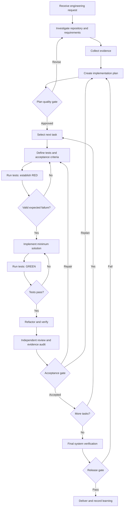

# LangGraph for Evidence-Driven Software Engineering

## Purpose

LangGraph can serve as the orchestration layer for a disciplined, stateful software engineering process. AI agents investigate, plan, write tests, implement code, and review changes. The workflow—not the agents' own claims—determines when work may proceed and when results may be accepted.

**Governing principle:** An agent may propose that an engineering obligation has been satisfied. Only a verification process operating on admissible evidence may authorize its completion.

This approach combines planning, checklists, evidence collection, test-driven development (TDD), verification, traceability, human review, and continuous process improvement.

LangGraph supplies graph execution, typed state, conditional transitions, cycles, persistence, parallel dispatch, and human intervention. It does **not** automatically impose an engineering methodology: the methodology must be encoded as explicit workflow logic, validation rules, and acceptance gates.

## 1. From Agent Loops to Engineering Obligations

A conventional agent loop is approximately:

```text
Prompt → Tool → Observation → Reasoning → Tool → Finish
```

An evidence-driven engineering workflow instead operates as:

```text
Obligation → Action → Evidence → Verification → Decision → Next obligation
```

The difference is consequential. An implementation is not complete because the implementing agent says it is complete, nor because an isolated test run succeeds. Completion requires traceable, relevant, current evidence evaluated against explicit acceptance policy.

### High-Level Workflow



Each quality gate should be a testable policy decision based on stored state and independently generated evidence. A language model can inform a gate, but simply asking a model whether its own work is sufficient is not strong enforcement.

## 2. Engineering Practices as Workflow Contracts

| Engineering practice | Orchestration mechanism | Enforced condition |
|---|---|---|
| Planning | Planner nodes, persistent plan, conditional routing | Each task has scope, dependencies, and acceptance criteria |
| Checklists | Typed task state and checklist validators | Items cannot be closed without required evidence |
| Requirements traceability | Stable identifiers across requirements, tasks, tests, and code | Missing coverage or unimplemented requirements are detectable |
| Repository investigation | Research nodes invoking inspection tools | Findings record source locations and repository revision |
| Test-driven development | Reusable red–green–refactor subgraph | Implementation follows a validated failing test when TDD is required |
| Automated testing | Tool-execution nodes | Exit status, output, environment, and revision are captured |
| Code review | Independent reviewer node | Changes are examined against intent, architecture, and constraints |
| Acceptance | Deterministic policy gates | Incomplete, stale, or contradictory evidence blocks acceptance |
| Change management | Replanning edges and dependency invalidation | Modified assumptions reopen affected obligations |
| Human decisions | Interrupt/resume checkpoints | High-risk or underspecified choices can be escalated |
| Recovery | Persistent checkpoints and bounded retries | Interrupted runs resume with reconciled external side effects |
| Improvement | Measurement and retrospective nodes | Process weaknesses produce reviewed, versioned proposals |

The fundamental design decision is to treat engineering requirements and process rules as **contracts**, not reminders in a prompt.

## 3. Persistent State as the Engineering Record

A weak system relies on an agent's conversation history to remember its progress. A stronger system maintains a structured engineering record shared by specialized agents and deterministic validators.

An illustrative YAML record for a single task is:

```yaml
run_id: ENG-0042
policy_version: 2
baseline_commit: "a48f92e"
candidate_commit: "c913b74"

requirement:
  id: REQ-TCP-TIMEOUT
  description: Every connection attempt terminates
  acceptance:
    - All requested targets have a final result
    - Timeout is enforced independently per target
    - Process exits with failure if any target fails

task:
  id: TASK-007
  status: verifying
  plan_revision: 3
  implementation_scope:
    - internal/connect/dial.go
    - internal/connect/dial_test.go

checklist:
  red_test:
    status: verified
    evidence: EV-101
  green_test:
    status: verified
    evidence: EV-102
  regression_suite:
    status: verified
    evidence: EV-103
  independent_review:
    status: pending
    evidence: null

evidence:
  EV-101:
    kind: tdd_red
    commit: "a48f92e"
    result: expected_failure
    artifact: evidence/red-101.json
  EV-102:
    kind: tdd_green
    commit: "c913b74"
    result: passed
    artifact: evidence/green-102.json
  EV-103:
    kind: regression
    commit: "c913b74"
    result: passed
    artifact: evidence/regression-103.json

decision:
  accepted: false
  blocked_by:
    - independent_review
```

The checklist and evidence records are deliberately distinct: an agent can report that it performed a step, but a validator determines whether the supporting evidence is acceptable.

### Three Classes of Information

1. **Claims:** Agent assertions such as “the implementation is correct.” Claims are useful inputs for review, but they are not proof.
2. **Observations:** Tool-derived facts, such as a test command's exit status, standard output, environment, and tested commit.
3. **Verification decisions:** Outcomes of applying a defined policy to the available observations.

Evidence should be traceable to its producer and scope. Useful metadata includes the tool version, execution time, tested source revision, inputs, artifact hash, and execution environment. Large logs and binaries should generally be stored as immutable external artifacts, with references and hashes retained in graph state.

A successful test is evidence that particular assertions held under particular conditions. It is not by itself evidence of complete requirements satisfaction.

## 4. Enforcing Test-Driven Development

TDD is a good example of an engineering discipline that can become an executable state machine rather than an aspirational instruction.

```text
RED      Establish a valid test that fails for the expected reason.
GREEN    Implement the minimum behavior required to pass.
REFACTOR Improve the design without violating established behavior.
```

A test-authoring agent derives test cases from acceptance criteria. A tool runner executes them against the pre-implementation baseline. A validation gate confirms that the failure represents the missing behavior, rather than a syntax error, unavailable dependency, incorrect fixture, or unrelated test failure.

Only after that gate passes may the implementation agent advance. Subsequent gates require the targeted tests and relevant regression tests to pass at the candidate revision.

Two useful invariants are:

```text
ImplementAllowed => ValidRedEvidence

AcceptAllowed => GreenEvidence
                 AND RegressionEvidence
                 AND ReviewEvidence
```

These are **application policies**, not built-in LangGraph guarantees.

Additional protections should detect tests weakened or deleted merely to obtain a green result, ensure that tests actually exercise the changed behavior, and verify that the accepted code is the revision that was tested. Property-based testing and mutation testing can provide stronger evidence about test quality when appropriate.

TDD should be configurable at the task level: a pure documentation correction and a behavior change need not have identical evidence requirements. Any exception should be explicit, scoped, and recorded rather than silently bypassing the gate.

## 5. Deterministic Acceptance Gates

The key separation is between components that **produce work** and components that **authorize progress**.

A simplified policy validator might be:

```python
def acceptance_gate(state):
    evidence = state["evidence"]
    revision = state["candidate_commit"]

    required = (
        "green_test",
        "regression_suite",
        "static_analysis",
        "independent_review",
    )

    if any(
        evidence.get(kind, {}).get("result") != "passed"
        or evidence.get(kind, {}).get("commit") != revision
        for kind in required
    ):
        return "repair"

    if not state["requirements_covered"]:
        return "replan"

    if state["unresolved_blockers"]:
        return "escalate"

    return "accept"
```

A LangGraph node can use a conditional edge to route the result to repair, replanning, escalation, or acceptance. A production validator should additionally check the evidence schema, provenance, hashes, policy version, complete checklist, and any approval requirements.

The accepting agent must not be able to edit the evidence store or redefine acceptance policy unilaterally. Otherwise the process is merely a self-assessment loop with extra steps.

Independent review need not mean an independent language model. For many claims, a compiler, test runner, static analyzer, deterministic reproduction harness, or security scanner is a more trustworthy verifier. Model-based review remains useful for semantic, architectural, and maintainability judgments, provided those judgments are scoped and recorded.

## 6. Hierarchical Graph Architecture

For nontrivial projects, use several reusable graphs instead of one monolithic workflow.

```text
Project Orchestration Graph
  ├── Requirements and Plan Validation
  ├── Task Execution Subgraph (repeated per task)
  │     ├── Investigation
  │     ├── RED: Test Design and Validation
  │     ├── GREEN: Implementation and Testing
  │     ├── Refactoring
  │     └── Verification Subgraph
  │            ├── Evidence Validation
  │            ├── Independent Review
  │            └── Acceptance Decision
  ├── Integration and System Verification
  └── Delivery and Retrospective
```

The **project graph** coordinates requirements, dependencies, scheduling, integration, and release. The **task graph** executes individual vertical slices. The **verification graph** evaluates evidence and enforces acceptance rules. Each graph can have its own well-defined state schema and policy checks.

LangGraph subgraphs support this composition. Parallel dispatch (for example, through `Send`) can be useful for independent tasks or reviews. Concurrent code-writing agents should generally use isolated worktrees or branches rather than sharing a writable working tree. Once changes are merged, integration and regression verification must run on the combined candidate revision.

## 7. Uncertainty, Failure, and Replanning

An engineering process needs pathways for discoveries that invalidate earlier work. A timeout failure initially attributed to one component may actually originate in shared cancellation handling; that observation can invalidate the original test design, implementation scope, and plan.

The workflow should distinguish between **local repair** and **replanning**.

| New observation | Required response |
|---|---|
| Test assertion fails | Return to implementation or diagnosis |
| Test is invalid | Reopen test design |
| Architectural assumption disproven | Reopen planning and impacted tasks |
| Requirement is ambiguous | Record the uncertainty and request a decision |
| Requirement changes | Revise plan and invalidate affected evidence |
| Tool is temporarily unavailable | Retry with bounded policy or mark evidence unavailable |
| Verification repeatedly fails | Escalate with the accumulated evidence |
| Source revision changes | Recheck revision-dependent test and approval evidence |

This implies that evidence has a **validity domain**. Test results, reviews, and approvals are not permanent tokens: they apply to particular revisions, environments, assumptions, and policy versions. A graph should automatically identify evidence that has become stale.

LangGraph persistence and interrupt/resume behavior support long-running workflows and human review. However, a checkpoint is not a transaction across shell commands, Git operations, and external services. Re-executed nodes must be idempotent where possible; otherwise the process needs explicit reconciliation or compensating operations. Bounded retries and failure classification prevent infinite repair loops.

## 8. Traceability from Request to Accepted Code

Traceability allows the system to answer engineering questions such as:

- Which requirements are not covered by tests?
- Which tasks or code changes implement a particular requirement?
- Which acceptance criteria were verified, and by what evidence?
- Which approvals or tests became stale after a revision?
- Which failures caused replanning, and what changed?

A useful set of stable identifiers is:

```text
REQ-*    Requirement
ARCH-*   Architecture decision or constraint
TASK-*   Executable work item
TEST-*   Test or verification obligation
IMPL-*   Implementation element
EV-*     Evidence artifact
DEC-*    Recorded decision
```

These identifiers can be linked in a machine-readable plan and evidence manifest. Structural validation can then detect missing links, orphaned tests, undocumented decisions, or requirements with no accepted implementation. Stable identifiers facilitate both automated checks and independent audits.

## 9. Continuous Improvement of the Process

The same evidence collected to verify software can evaluate the development methodology itself. This creates two feedback loops:

```text
Product loop:
Implement → Test → Detect defect → Repair → Retest

Process loop:
Execute method → Measure outcomes → Identify weakness
               → Propose policy change → Evaluate change
```

Useful measures include first-pass acceptance rate, requirements with verified coverage, reopened task rate, failure categories, rework effort, stale-evidence incidence, escaped defects, and the rate at which reviews detect genuine problems.

A retrospective agent can identify recurring weaknesses and propose better planning rules, test strategies, checklists, or graph transitions. Such proposals should be versioned and assessed against historical engineering cases.

**The process must not optimize merely for green tests or rapid acceptance.** Its more meaningful objective is improving the ability to distinguish satisfactorily verified work from work that only appears satisfactory.

Process-policy changes should therefore require their own verification and, where appropriate, human approval. An agent should not be able to make the current task pass by weakening the method that judges it.

## 10. Practical System Boundaries

A straightforward implementation divides responsibility into four layers:

| Layer | Responsibility |
|---|---|
| LangGraph | Orchestration, routing, persistence, checkpoints, interrupts, retries |
| AI agents | Investigation, planning, test design, implementation, semantic review |
| Engineering tools | Git, compilers, test runners, static analysis, CI, coverage, mutation testing |
| Policy and evidence services | Contracts, checklists, provenance, traceability, acceptance, audit history |

The orchestration language need not match the product's implementation language. A Python-based LangGraph application can coordinate Ruby, Bash, Go, C#, or other projects through isolated tool execution.

### Incremental Implementation

Start with the smallest enforceable workflow:

1. **Persistent plan:** One machine-readable plan containing requirements, tasks, dependencies, and acceptance criteria.
2. **Evidence manifest:** A uniform format for tool observations, source revisions, and artifact references.
3. **Single-task TDD graph:** Validated RED, GREEN, refactor, regression testing, and review.
4. **Deterministic acceptance gate:** A policy validator that refuses completion when evidence is missing or stale.
5. **Checkpoint and recovery:** Durable task state, bounded retries, and safe external operations.
6. **Multi-task coordination:** Dependency scheduling, isolated parallel work, merge validation, and system-level acceptance.
7. **Process assessment:** Metrics, retrospectives, and versioned methodology improvements.

This sequence keeps early complexity contained while establishing the critical property from the beginning: a task cannot pass solely on an agent's assertion.

## 11. A Testable Quality System, Not Just an Autonomous Developer

The resulting architecture produces two important artifacts:

1. **The software implementation**—the code, tests, documentation, and delivered changes.
2. **The acceptance record**—the obligations, evidence, verification decisions, and reasons the implementation was approved.

That second artifact makes the system auditable and provides a basis for comparing agents, testing strategies, engineering methodologies, and verification policies. Evaluation can address not only whether the final program works, but also whether the process identified uncertainty, recognized invalid assumptions, collected suitable evidence, and resisted premature completion.

**Conclusion:** LangGraph is most valuable here not because it makes individual agents more intelligent, but because it provides the execution structure for an engineering process that is explicit, persistent, inspectable, interruptible, and governed by verification.

## References

- [LangGraph Graph API](https://docs.langchain.com/oss/python/langgraph/graph-api)
- [LangGraph Subgraphs](https://docs.langchain.com/oss/python/langgraph/use-subgraphs)
- [LangGraph Persistence](https://docs.langchain.com/oss/python/langgraph/persistence)
- [LangGraph Interrupts](https://docs.langchain.com/oss/python/langgraph/interrupts)

*Examples and policy rules in this document are illustrative designs, not built-in LangGraph software-engineering features.*
