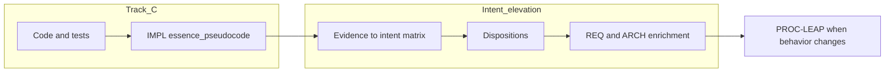

# Brownfield intent elevation

**Audience:** TIED client projects reverse-documenting legacy code (Track C) and sponsors promoting **adjudicated** claims into REQ/ARCH without treating IMPL sidecars as approved product intent.

**Tokens:** `[REQ-TIED_BROWNFIELD_INTENT_ELEVATION]`, `[ARCH-TIED_BROWNFIELD_EVIDENCE_MODEL]`, `[IMPL-TIED_BROWNFIELD_VALIDATION]`, `[PROC-BROWNFIELD_INTENT_ELEVATION]`. Mode C superset: `[REQ-TIED_EASAR_RECOVERY]`, `[PROC-EASAR_RECOVERY]` when Tracker `brownfield_intent_elevation.engagement` is `easar_full` (requires `mode: pilot` or `strict`).

---

## Mode C engagement facet (`engagement: easar_full`)

When the per-request Tracker sets **`brownfield_intent_elevation.engagement: easar_full`**, follow **`[PROC-EASAR_RECOVERY]`** for staged receipts (inventory, graph-matrix linkage, claims choreography, reflexion synthesis). Keep **`brownfield_intent_elevation.mode`** as the authority for pilot/strict vs report-only; do **not** add a parallel `recovery_engagement.mode` field. Vocabulary: [easar-recovery.md](../../tied-project/vocab/easar-recovery.md).

---

## Track C vs intent elevation

| Path | Source of truth | Promotes to REQ? |
| --- | --- | --- |
| **Track C** (reverse documentation) | Code survey → IMPL sidecars + PAGE stubs | No — observed behavior only |
| **Intent elevation** | Evidence matrix with dispositions | Yes — only `approved` claims |

**LEAP boundary:** `[PROC-LEAP]` resynchronizes the stack **after** approved intent exists. It is **not** the first step that creates approved REQ from code alone.

---

## Dispositions

Each matrix row carries:

| Disposition | Meaning |
| --- | --- |
| `observed` | Supported by evidence; not promoted to REQ |
| `approved` | Sponsor-reviewed; eligible for REQ/ARCH promotion |
| `unresolved` | Evidence gap; proof boundary documented |
| `rejected` | Contradicted or out of scope |

---

## Checklist entry points

| Audience | Start | Brownfield slugs |
| --- | --- | --- |
| **Store feature build** (this repo ships the validator) | `session-bootstrap` → `author-requirement` | Mark `brownfield-*` **not_applicable** until the MCP tool exists |
| **Client legacy adoption** | `brownfield-baseline-lock` when Tracker `brownfield_intent_elevation.mode` is `pilot` or `strict` | Full sub-flow below, then `author-requirement` to enrich REQ from **approved** rows |

Executable checklist YAML lists brownfield steps **before** `author-requirement` in file order—that ordering targets **adoption**, not the store’s first-time token authoring path.

## Checklist sub-flow (before project YAML mutation)

When `brownfield_intent_elevation.mode` is `pilot` or `strict` (see per-request Tracker metadata), run **before** `author-requirement`:

1. `brownfield-baseline-lock` — git revision + scope tokens
2. `evidence-inventory` — sources (code, sidecar, help, tests)
3. `evidence-adjudication` — assign dispositions
4. `req-intent-promotion` — enrich REQ criteria from `approved` rows only
5. `arch-boundary-promotion` — ARCH seams, binding inventory refs
6. `brownfield-closure` — metrics + `brownfield_intent_evidence_validate` (report-only by default)

`report_only` mode runs validators and records diagnostics without blocking checklist progression.

---

## Tool choreography

| Step | Tool / artifact |
| --- | --- |
| Scoped scan | `tied_scoped_analysis_run` |
| Fidelity stages | `[REQ-TIED_FIDELITY_RESEARCH]` pipeline |
| Claims review | `tied_claims_evidence_review_run` |
| Evidence chain | `evidence_chain_profile_generate` |
| Out of scope | LEAP proposal queue |

Working copy: `tied-project/working/{REQ-TOKEN}/evidence/intent-elevation-matrix.md` from template `tied-bundle/templates/brownfield-evidence-to-intent-matrix.md`.

---

## Related process tokens

- `[PROC-PROJECT_SURVEY_AND_SETUP]`, `[PROC-TIED_BOOTSTRAP_FROM_TESTS]`
- `[PROC-IMPL_CODE_TEST_SYNC]` Phase A discovery
- `[PROC-CITDP]` change-definition and risk-assessment
- `[REQ-TIED_FIDELITY_RESEARCH]`

See `[PROC-BROWNFIELD_INTENT_ELEVATION]` in [processes.md](processes.md).
