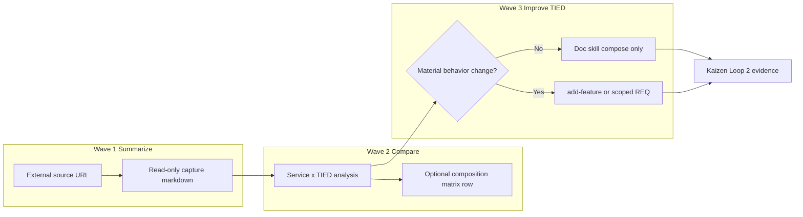
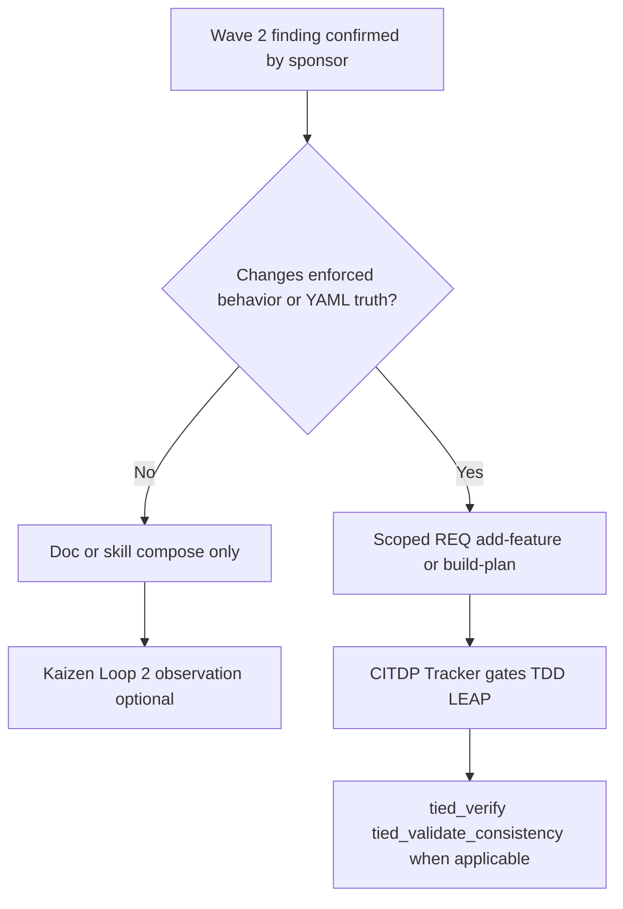

# External service three-wave comparison — operator template

**Audience:** Sponsors, methodology owners, and agents ingesting **external** articles, product posts, or vendor methodologies into this repository without conflating vendor claims with TIED proof.

**Purpose:** Repeatable **three-wave** process: (1) **summarize service**, (2) **compare to TIED**, (3) **improve TIED** where warranted. Use this template for each new external source; copy section skeletons into deliverables under `docs/comparisons/` (allowlisted paths only—see [Wave 1 git publish](#wave-1--summarize-service-capture)).

**Proof boundary:** Waves 1–2 are **outreach / reference** unless a scoped REQ says otherwise. Wave 3 may mint or change `[REQ-*]` / `[ARCH-*]` / `[IMPL-*]` only through normal TIED workflows (`add-feature`, `build-plan`, LEAP)—never from comparison prose alone.

**Worked examples:** [LangChain harness capture](../../docs/comparisons/langchain-improving-deep-agents-harness-engineering.md) → [LangChain × TIED](../../docs/comparisons/langchain-harness-engineering-vs-tied-agent-management.md) → [REQ-TIED_HARNESS_TRACE_OBSERVATION_LOOP](../../tied-project/requirements/REQ-TIED_HARNESS_TRACE_OBSERVATION_LOOP.yaml); [Cursor harness capture](../../docs/comparisons/cursor-continually-improving-agent-harness.md) → [Cursor × TIED](../../docs/comparisons/cursor-harness-engineering-vs-tied-agent-management.md) → harness trace loop + matrix §2 row 14.

---

## Process overview



| Wave | Question | Default prompt-type / mode | Primary output |
| --- | --- | --- | --- |
| **1 — Summarize service** | What did the vendor/service claim, in their words (cleaned)? | **`@external-service-comparison`** (preferred) or `non-tied-plan` | `{vendor}-{topic-short}.md` capture |
| **2 — Compare to TIED** | How does that map to TIED surfaces here—compose, gap, defer—without adoption claims? | **`@external-service-comparison`** (Wave 1+2 default) or doc-only plan | `{vendor}-{topic}-vs-tied-agent-management.md` (or domain-specific suffix) |
| **3 — Improve TIED** | What should change in TIED docs, skills, gates, or YAML—and with what proof? | `add-feature` / `build-plan` when behavior changes; else doc PR | Working REQ, bundle docs, skills, matrix row |

**Compose-don’t-replace:** External ideas tune **harness-adjacent** surfaces (skills, PRELOAD, observations). **Gate authority**, **MCP project YAML writes**, **token graph truth**, and **sponsor costly choices** stay on the TIED/checklist plane ([Traefik harness/platform × TIED](../../docs/comparisons/traefik-harness-platform-vs-tied-agent-management.md)).

---

## Before you start

1. **RESOLVE** the external name and scope in vocab if the study introduces durable concepts ([PROC-VOCABULARY_INDEX](processes.md)).
2. **Assign doc ownership** when a sibling comparison already exists (seam vs benchmark vs telemetry)—do not duplicate Traefik/LangChain/Cursor scopes; cross-link instead.
3. **Label claims:** `{Vendor}-reported`, `TIED-existing`, `Recommendation-only`, `Defer`, **`not_measured`** for effectiveness.
4. **Record depth:** Wave 1–2 = minimal; Wave 3 = CITDP + checklist when REQ-bound.

---

## Wave 1 — Summarize service (capture)

### Intent

Read-only **article capture**: offline-readable text, no site chrome, no new REQ tokens in the file body.

### File naming and location

| Item | Convention |
| --- | --- |
| Path | `docs/comparisons/{vendor-kebab}-{topic-kebab}.md` |
| Title | `# {Title as published}` |
| Git | Add `!docs/comparisons/{filename}` to root [`.gitignore`](../../.gitignore) if new (parent `docs/comparisons/*` is ignored by default) |

### Capture metadata table (copy and fill)

```markdown
| Field | Value |
| --- | --- |
| **Source** | [{Vendor}]({canonical URL}) |
| **Authors** | {names} |
| **Published** | {date} |
| **Purpose** | Read-only article capture for comparison and architecture reference — **external content**; this document does not mint REQ/ARCH/IMPL tokens. |
| **Captured** | {YYYY-MM-DD} |
| **Analysis (sibling)** | *({link after Wave 2})* |
| **Related capture (sibling)** | *(optional peer captures)* |
```

### Body normalization

| Remove | Keep |
| --- | --- |
| Nav, footer, related posts, locale picker | Metadata, optional hero image URL, `---` separators |
| Duplicate scraped body | Full article sections |
| Anchor junk in headings (`## # Foo` → `## Foo`) | Inline code for product identifiers |
| | **TLDR** (3–5 bullets) before main prose |
| | **Notes for stdd readers** (proof boundary + links to Wave 2 when done) |

### Wave 1 exit checklist

- [ ] No duplicated sections or navigation leakage
- [ ] Numeric claims preserved; label **{Vendor}-reported** in Notes if cited elsewhere
- [ ] `.gitignore` exception added; file tracks in git
- [ ] Sibling captures updated if opening narrative cites this post

### Suggested invocation

`non-tied-plan`: extract/clean external URL into `docs/comparisons/` per this wave.

---

## Wave 2 — Compare to TIED (analysis)

### Intent

**Agent management lens** (default): map external **harness / process / quality** ideas to TIED as implemented in **this repo**—not product adoption, not certification.

### File naming

| Item | Convention |
| --- | --- |
| Path | `docs/comparisons/{vendor-kebab}-{topic-kebab}-vs-tied-agent-management.md` (adjust suffix if not agent-mgmt, e.g. `-vs-tied.md`) |
| Git | Same allowlist pattern as Wave 1 |

### Analysis metadata table (copy and fill)

```markdown
| Field | Value |
| --- | --- |
| **Purpose** | Map {Vendor}'s **{one-line mechanism}** to TIED in this repository — {emphasis}. |
| **Audience** | Sponsors, harness authors, prompt-type operators, methodology owners |
| **Source URL** | {link} ({Vendor}, {date}) |
| **Article capture (sibling)** | [{capture filename}]({capture filename}) — read-only; **reference only** |
| **Status / date** | Outreach / analysis snapshot, **{date}** — **reference only; this document does not mint REQ/ARCH/IMPL tokens** |
| **Executable follow-up** | *(Wave 3 targets: working REQ paths, bundle docs—no token mint in this file)* |
| **Distinct from** | *(sibling analyses — avoid scope overlap)* |
| **TIED anchors (reference only)** | [AGENTS.md](../../AGENTS.md), [agent-req-implementation-checklist](agent-req-implementation-checklist.md), [fresh-client-prompt-activation-map](fresh-client-prompt-activation-map.md), [sponsor-agent-relationship](../../tied-project/vocab/sponsor-agent-relationship.md), … |
```

### Required sections (in order)

1. **Executive summary** — Vendor center of gravity vs TIED center of gravity; **compose-don’t-replace** one paragraph; optional comparison table.
2. **Source summary ({Vendor} claims only)** — Bullets; every metric **{Vendor}-reported**.
3. **Relationship to sibling comparisons** — What this doc **owns** vs Traefik seam / LangChain trace bench / Cursor telemetry / etc.
4. **Harness lessons → TIED agent management** — Thematic subsections with **mapping tables** (`External pattern | TIED surface | Notes`).
5. **Touchpoint 1 — RESOLVE** — Vocabulary table + disposition key + claim labeling.
6. **Primary capability matrix** — ~10–15 rows: concern | TIED COG | Disposition | rationale.
7. **Authority boundary** — Mermaid: external loop → harness-adjacent → TIED core (gates, MCP, verify, sponsor ladder).
8. **Anti-patterns** — Vendor lesson → TIED risk → remedy.
9. **Compose-don’t-replace table** — Tune harness vs keep platform authority.
10. **Bounded operator recommendations (Recommendation-only)** — Numbered list.
11. **Phased recommendations (doc-first)** — Phase 0 = this doc; Phase 1+ = Wave 3 candidates with **Defer** defaults.
12. **Explicit non-adoptions**
13. **Proof boundary**
14. **Related documents**

### Disposition vocabulary (reuse in matrices)

| Disposition | Meaning |
| --- | --- |
| **Align** | TIED materially represents the external intent (scoped). |
| **Composable** | Can combine without equivalence claims. |
| **Tension** | Partial overlap; proof boundary must be explicit. |
| **Gap** | External emphasis not in TIED core. |
| **Defer** | Client infra, vendor product, or sponsor-owned choice. |

### Optional Wave 2 deliverables

| Deliverable | When |
| --- | --- |
| [methodology-composition-matrix.md](../../docs/comparisons/methodology-composition-matrix.md) §2 row | Sponsor wants matrix inventory updated (costly; increment row contract) |
| Back-links | Update capture **Analysis (sibling)**; peer analyses **Distinct from** / related docs |
| [harness-trace-observation-loop.md](harness-trace-observation-loop.md) | External metrics or trace patterns → failure-mode taxonomy (**compose only**) |

### Wave 2 exit checklist

- [ ] No new REQ/ARCH/IMPL tokens **in analysis body**
- [ ] All vendor metrics labeled **{Vendor}-reported**; TIED effectiveness **`not_measured`** unless experiment exists
- [ ] Capture ↔ analysis ↔ siblings linked
- [ ] `.gitignore` allowlist for analysis file

### Suggested invocation

`non-tied-plan` or `refine-plan` + `build-plan` for doc-only execution.

---

## Wave 3 — Improve TIED

### Intent

Turn **confirmed** gaps from Wave 2 into **durable** TIED artifacts: methodology docs, skills, checklist evidence, or REQ/ARCH/IMPL + tests—with proof appropriate to the change class.

### Decision tree



| Change class | Typical Wave 3 outputs | TIED loop |
| --- | --- | --- |
| **Outreach only** | None (Wave 2 sufficient) | — |
| **Harness compose** | `tied-bundle/docs/*.md`, `.cursor/skills/*`, comparison cross-links | Loop 2 Kaizen |
| **Operator procedure** | Bundle doc + `@skill`; `tied_feedback_capture_observation` path documented | Loop 2 |
| **Methodology rule / gate** | `tied-project/working/{REQ}/`, project YAML via MCP, tests | Loop 2–3; LEAP |
| **Matrix / composition** | `methodology-composition-matrix.md` row + sponsor review | Outreach + Loop 3 **Defer** until promoted |

### Wave 3 work packages (copy per initiative)

```markdown
### Wave 3 initiative: {TITLE}

| Field | Value |
| --- | --- |
| **Source analysis** | [{analysis}](../../docs/comparisons/{analysis}.md) |
| **Finding** | {one sentence; disposition from Wave 2} |
| **Change class** | doc-only | skill | REQ-behavior |
| **REQ token** | {REQ-… or "none"} |
| **Proof** | {tests, gate receipts, doc review} |
| **Out of scope** | {explicit non-adoptions from Wave 2} |
| **Status** | planned | in-progress | done |
```

### Authority rules (non-negotiable)

- Observations from harness review **do not** auto LEAP or mint YAML ([harness trace observation loop](harness-trace-observation-loop.md)).
- **`tied_config_get_base_path`** before MCP writes; wrong base path = platform seam failure.
- Checklist gates (**`tied_checklist_gate_validate`**, **`tied_verify`**) are not replaced by vendor self-verify or product telemetry narratives.
- **Costly choices** on [consequence ladder](../../tied-project/vocab/sponsor-agent-relationship.md)—default Wave 3 doc-only when reversible.

### Wave 3 exit checklist

- [ ] Wave 2 phased table updated (Phase 1+ marked implemented or Defer with owner)
- [ ] If REQ: Tracker + test-strategy + gate receipts per [agent-req-implementation-checklist](agent-req-implementation-checklist.md)
- [ ] If doc-only: proof boundary unchanged; no effectiveness overclaim
- [ ] Vocab RECORD/VALIDATE if new durable terms shipped
- [ ] **`tied_validate_consistency`** when project YAML changed

### Suggested invocation

| Scope | Prompt-type |
| --- | --- |
| Doc/skill only | `non-tied-plan`, `build-plan` on linked plan |
| New or changed enforced behavior | `add-feature` → `build-plan` → `close-out` |

---

## End-to-end checklist (all waves)

| Step | Artifact | Location |
| --- | --- | --- |
| 1 | Capture | `docs/comparisons/{vendor}-{topic}.md` |
| 2 | Analysis | `docs/comparisons/{vendor}-{topic}-vs-tied-….md` |
| 3 | Cross-links | Capture, analysis, siblings, optional matrix |
| 4 | Git allowlist | Root `.gitignore` `!docs/comparisons/…` |
| 5 | Improve | `tied-bundle/docs/`, skills, and/or `tied-project/working/{REQ}/` |
| 6 | Validate | Grep links; row counts; consistency tool if YAML touched |

---

## Related documents

- [Working artifact placement](working-artifact-placement.md) — committed vs regenerable evidence
- [Traefik harness/platform × TIED](../../docs/comparisons/traefik-harness-platform-vs-tied-agent-management.md) — seam vocabulary
- [LangChain harness × TIED](../../docs/comparisons/langchain-harness-engineering-vs-tied-agent-management.md) — trace/benchmark wave example
- [Cursor harness × TIED](../../docs/comparisons/cursor-harness-engineering-vs-tied-agent-management.md) — telemetry/reliability wave example
- [Methodology composition matrix](../../docs/comparisons/methodology-composition-matrix.md)
- [Client development index](client-development-index.md)

**Last updated:** 2026-10-21
