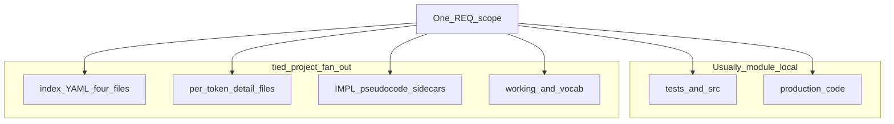
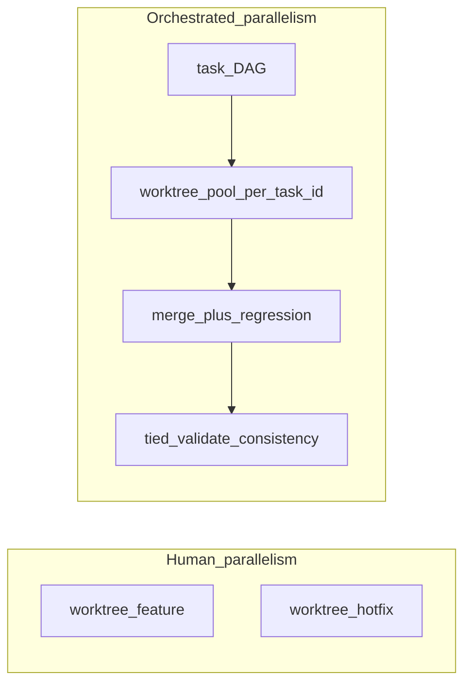

# Plan: git worktrees × parallel TIED-driven changes

**Slug:** `git-worktree-parallel-tied`  
**Track:** `@non-tied-plan` → `@non-tied-refine` (this revision) → `@non-tied-build` (optional polish) → optional `@non-tied-close`  
**Linked Cursor plan:** `.cursor/plans/git_worktrees_×_tied_deac58e2.plan.md`  
**Source essay:** [Explaining git worktree (f20x, 2026-06-29)](https://f20x.com/posts/explaining-git-worktree/)

---

## Sponsor question (locked)

Given TIED’s pattern—**module-local** tests/code but **distributed** `tied-project/` indexes, detail YAML, pseudo-code sidecars, and working evidence—when does **git worktree** parallelism help parallel TIED-driven work, and when is merge + MCP path risk the real bottleneck (versus “small diffs only”)?

**Proof boundary:** Analysis and operator guidance under this plan folder only. No project REQ/ARCH/IMPL YAML writes, no feature-orchestration git automation, no LangGraph code changes. Cross-refs to existing **P6** pilot behavior as **reference machinery**.

**Accepted ambiguity:** Sponsor may later promote a subset into `docs/` or a TIED REQ; this plan does not commit to promotion.

---

## RESOLVE (Touchpoint 1)

| Sponsor term | Resolved meaning |
| --- | --- |
| **Parallel TIED-driven changes** | Two or more concurrent implementation streams that each would normally touch `tied-project/` (indexes + details) plus product code/tests, coordinated by checklist/MCP gates—not merely parallel CI jobs on `main`. |
| **Distributed in `tied-project/`** | One logical REQ fans out across shared **index** files (`requirements.yaml`, `architecture-decisions.yaml`, `implementation-decisions.yaml`, `semantic-tokens.yaml`) and per-token **detail** paths under `tied-project/{requirements,architecture-decisions,implementation-decisions}/`, plus optional `working/` and `vocab/`. |
| **Git worktree** | Multiple working directories attached to one `.git` history (`git worktree add` / `list` / `prune`); distinct from **disposable client clones** under `TIED_TEST_ROOT`. |
| **Conflict domain** | Set of paths and index keys two branches may edit; dominates merge cost more than raw file count. |
| **Merge regression** | Post-integrate test/validation pass on merged tree (P6 naming: combined regression + `tied_validate_consistency`). |

---

## Refinements applied (`@non-tied-refine`)

1. **Discriminant locked:** Fit is determined by **disjoint REQ/token ownership** and **MCP base path per tree**, not “few files vs many files.”
2. **Three parallelism modes** documented with explicit pick-one guidance (human worktree, orchestrated P6, disposable clients).
3. **stdd operator runbook** added (paths, MCP JSON, merge checklist)—store repo layout as reference.
4. **RISK-010** citation corrected to multi-root / wrong `TIED_CLIENT_PROJECT_PATH` literature ([`CITDP-REQ-TIED_TWO_FOLDER_LAYOUT.yaml`](../../citdp/CITDP-REQ-TIED_TWO_FOLDER_LAYOUT.yaml), [AGENTS.md](../../../AGENTS.md)).
5. **Vocab RECORD** remains **optional** on build (non-tied boundary: refine does not RECORD).

---

## Baseline: what the f20x article optimizes

| Benefit | Mechanism |
| --- | --- |
| No stash/checkout whiplash | Branch A stays dirty in folder A while hotfix runs in folder B |
| Independent build state | Separate `node_modules`, dev-server cache, IDE window per folder |
| Side-by-side review | Additional worktree for reviewer’s branch |

Worktrees improve **context switching** and **environment isolation**. They do **not** automatically make **semantic integration** easier.

---

## TIED tension (one REQ → many artifact classes)



Parallel worktrees help **process** (two agents, two test runs, two MCP sessions). They do **not** remove the need to **merge indexes** and run **consistency validation** once at integrate time.

---

## Mode selection (when to use what)

| Mode | Best for | TIED integrate point | Merge / validation |
| --- | --- | --- | --- |
| **A. Human git worktree** | Hotfix vs deep feature; sponsor-owned branches; 2 IDE windows | Manual merge or PR | Sponsor runs `lint_yaml` + `tied_validate_consistency` on integrated branch |
| **B. LangGraph P6 pool** | DAG-independent tasks (`task-alpha` / `task-beta`) in pilot | [`project_multi`](../../../tools/langgraph-pilot/tied_langgraph/graphs/project_multi.py) merge node + merge regression evidence | Automated barrier before merge; abuse cases in [`CITDP-PLAN-TIED-LG-P6-MULTI-TASK.yaml`](../../citdp/CITDP-PLAN-TIED-LG-P6-MULTI-TASK.yaml) |
| **C. Disposable client under `TIED_TEST_ROOT`** | WF trials, cohort compare, zero shared history | None (separate repos) | No git merge; compare evidence read-only ([`project-size-batch-discover-compare`](../project-size-batch-discover-compare/PLAN.md)) |

**Rule of thumb:** Use **C** when the question is empirical comparison across clients; use **B** when orchestration owns barriers; use **A** for day-to-day sponsor/agent context switching (f20x pattern).

---

## When worktrees **do** support parallel TIED work

1. **Orthogonal streams** — TIED `build-plan` on `feature/X` while `non-tied-debug` or narrow hotfix runs on `main` in another tree.
2. **Disjoint token sets** — Parallel tasks each mint **different** `REQ-*` / `ARCH-*` / `IMPL-*` keys so index edits are mostly non-overlapping inserts; detail files live at separate paths.
3. **Best-of-N attempts** — Exploratory implementations in isolated worktrees; **one** LEAP-consistent stack after sponsor picks a winner (not two production features without merge).
4. **Per-tree MCP binding** — One Cursor window per worktree; `TIED_CLIENT_PROJECT_PATH` (or legacy `TIED_BASE_PATH`) absolute to **that** tree’s `tied-project/` ([`tied-yaml` skill](../../../.cursor/skills/tied-yaml/SKILL.md), RISK-010 class).

---

## When worktrees are weak or misleading

| Situation | Why |
| --- | --- |
| Same REQ, parallel agents | Shared indexes + one tracker under `tied-project/working/{REQ}/` → merge conflicts and dual-write |
| Parallel MCP without path check | Silent YAML writes to wrong `tied-project/` in multi-root or stale MCP JSON |
| LangGraph + agentstream same tracker | Dual-write warning in [`tools/langgraph-pilot/README.md`](../../../tools/langgraph-pilot/README.md) |
| Feature orchestration batches 0–6 | Branch/worktree integration **deferred** ([`feature-orchestration.md`](../../vocab/feature-orchestration.md)) |

**Answer: “small file changes only?”** **No.** f20x uses 15+ file WIP. For TIED, **high merge cost** = same REQ / same indexes / shared tracker; **low merge cost** = disjoint tokens + integrator-owned merge gate.

---

## Pre-flight partition checklist (before second worktree)

- [ ] **Intent:** Second stream is truly independent (different REQ or non-TIED scope), not two agents on one REQ.
- [ ] **Branch:** `git worktree add -b {branch} {sibling-dir} {start-point}` — branch not already checked out elsewhere.
- [ ] **MCP:** Copy or regenerate `.cursor/mcp.json` so `TIED_CLIENT_PROJECT_PATH` resolves to `{sibling-dir}/tied-project` (run `tied_config_get_base_path` in that window).
- [ ] **Tracker:** Separate checklist tracker paths if using LangGraph or agentstream (never share one tracker file).
- [ ] **Tokens:** No overlapping new keys planned in the four index files (coordinate via sponsor or sequential token mint).
- [ ] **Integrator:** Named role runs post-merge `tied_validate_consistency` and module tests.

---

## stdd store repo — human worktree runbook (reference)

Assume primary clone: `/Users/fareed/Documents/dev/chatgpt/stdd`.

```bash
# Example: parallel feature vs hotfix (sibling directories, shared .git)
git fetch origin
git worktree add -b feature/parallel-req-a ../stdd-req-a origin/main
git worktree add -b hotfix/urgent ../stdd-hotfix origin/main
git worktree list
```

Per worktree:

1. Open **separate** Cursor window rooted at the sibling path.
2. Confirm MCP: `tied_config_get_base_path` → `{sibling}/tied-project`.
3. Implement; commit on branch in that tree only.
4. Integrate via PR or local merge into integration branch; **then** run project lint/test + `tied_validate_consistency` once.
5. Remove: delete sibling folder → `git worktree prune`.

**Costly choice:** Raising concurrent worktrees on large monorepos duplicates `node_modules` / `mcp-server/dist` build state unless using shared tooling or selective install—same tradeoff as f20x’s 2-minute dev-server note.

---

## Post-merge integration checklist (TIED)

- [ ] Resolve git conflicts preferring **single** index entries per token (no duplicate YAML keys).
- [ ] `lint_yaml` on changed `tied-project/**/*.yaml`.
- [ ] `tied_validate_consistency` (MCP or `tied-cli.sh`).
- [ ] Full targeted test suite for touched modules (AGENTS.md priority: tests before close-out narrative).
- [ ] If architectural surprise: advisory LEAP proposal path (P6 **`replan`** edge)—no automatic REQ mutation.

---

## Mental model



Worktrees sit at the **harness** layer (cf. [Traefik harness × TIED](../../../docs/comparisons/traefik-harness-platform-vs-tied-agent-management.md)); TIED **gate authority** remains MCP/checklist/consistency at merge.

---

## Executive conclusions

| Question | Answer |
| --- | --- |
| Do worktrees support how TIED expands the repo? | **Partially:** parallel execution + per-tree MCP; **not** sharded indexes—merge + validation remain the bottleneck. |
| Better for small file changes? | **No** — better for **independent branches/tasks** and heavy local environments. |
| Closest in-repo authority | P6 task DAG + [`WorktreePool`](../../../tools/langgraph-pilot/tied_langgraph/worktree_pool.py); human = f20x pattern; fleet = `TIED_TEST_ROOT` disposables. |

---

## Build scope (`@non-tied-build`)

| Artifact | Action |
| --- | --- |
| `test-strategy.md` | Manual QA scenarios (see file) |
| `CITDP-git-worktree-parallel-tied.yaml` | Optional draft, `tied_tokens_new: []` |
| `docs/` promotion | **Out of scope** unless sponsor asks |
| `tied-project/vocab/git-workflow.md` | Optional RECORD — sponsor opt-in |

**Non-goals:** REQ/ARCH/IMPL promotion; feature-orchestration git commands; P6 code changes.

---

## Authoritative refs

- [plan-tied-lg-p6-multi-task.md](../../../docs/langgraph/plan-tied-lg-p6-multi-task.md)
- [CITDP-PLAN-TIED-LG-P6-MULTI-TASK.yaml](../../citdp/CITDP-PLAN-TIED-LG-P6-MULTI-TASK.yaml)
- [AGENTS.md](../../../AGENTS.md) — MCP base path, one window per repo when editing YAML