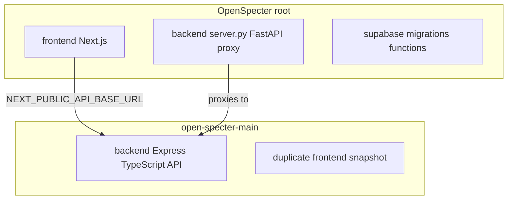

# Plan: Open Specter × TIED — Waves 1–2 (refined)

**Slug:** `open-specter-legal-workspace-vs-tied`  
**Track:** `@external-service-comparison` subject + **`@non-tied-refine`** (this plan) → **`@non-tied-build`** → optional **`@non-tied-close`**  
**Target path:** `/Users/fareed/Documents/dev/legal/OpenSpecter` (record `git remote` URL in capture)  
**Template:** [`tied-bundle/docs/external-service-three-wave-comparison-template.md`](../../../tied-bundle/docs/external-service-three-wave-comparison-template.md) Waves 1–2  
**Evaluation charter:** [`docs/tied-methodology-evaluation-framework.md`](../../../docs/tied-methodology-evaluation-framework.md) — Q1–Q6 literacy in Wave 2 executive summary; **not** comparable-arms or legal-outcome proof

## Scope

| Boundary | Choice |
| --- | --- |
| Waves | **1–2 only** (sponsor-confirmed); Wave 3 rows **Defer** |
| Lenses | **Agent-management** + **legal-product** in one Wave 2 doc |
| Deliverables | `docs/comparisons/open-specter-legal-workspace.md`, `docs/comparisons/open-specter-legal-workspace-vs-tied-agent-management.md` |
| Publish | **Git allowlist** (sponsor-aligned with morluto-rea pattern) — add `!docs/comparisons/open-specter-legal-workspace*.md` |
| Execution policy | **`static_only`** — read local tree + README/SECURITY/schema; **no** `yarn dev`, Supabase apply, legal API keys, or target test runs |
| TIED sync | **None** — no project REQ/ARCH/IMPL, no `tied_verify` update, no `tied-project/working/{REQ}/` tracker |

## Artifact root (non-tied track)

Primary folder (replaces standalone `DOC-OPENSPECTER-COMPARISON` working package):

| Artifact | Path |
| --- | --- |
| Plan | [`tied-project/non-tied-plans/open-specter-legal-workspace-vs-tied/PLAN.md`](../open-specter-legal-workspace-vs-tied/PLAN.md) |
| Test strategy | [`tied-project/non-tied-plans/open-specter-legal-workspace-vs-tied/test-strategy.md`](../open-specter-legal-workspace-vs-tied/test-strategy.md) |
| Session handoff | [`tied-project/non-tied-plans/open-specter-legal-workspace-vs-tied/evidence/session-handoff.md`](../open-specter-legal-workspace-vs-tied/evidence/session-handoff.md) |
| Target receipt | [`tied-project/non-tied-plans/open-specter-legal-workspace-vs-tied/evidence/target-repo-receipt.md`](../open-specter-legal-workspace-vs-tied/evidence/target-repo-receipt.md) |

`@non-tied-build` copies this refined plan into `PLAN.md` and fills handoff checkboxes.

## Refine outcomes (Touchpoint 1 — RESOLVE)

| Term (Open Specter) | Wave mapping intent (TIED lens) |
| --- | --- |
| **Project** | Matter/client container with RLS — not a TIED client repo or `tied-project/` |
| **Tabular review** | Column prompts × document batch → structured cells + citations — compose with comparison capability matrices; not `tied_verify` |
| **Workflow** | `prompt_md` + optional `columns_config` (assistant \| tabular) — compose with TIED prompt-types/skills; not checklist slugs |
| **Builtin workflow** | System `builtinWorkflows.ts` legal templates (CP checklist, CoC DD, etc.) — **target-repo-observed** domain content only |
| **Citation** | Quote + source in UI (`cite-button`, tabular `citation-utils`) — compose with claims-evidence / proof-boundary labeling |
| **Document version** | Versioned uploads per matter — metaphor for LEAP stack sync; not interchangeable |
| **LegalDataHunter / Vaquill** | External legal research APIs — **Defer** TIED adoption; vendor API boundary |
| **`generate_docx` tool** | LLM tool output (landscape CP checklists, etc.) — product artifact; not TIED YAML |
| **Guest / anonymous auth** | Supabase anonymous + cleanup job — **Defer** for methodology; sponsor security choice |
| **AGPL-3.0** | Hosted legal workspace license — explicit non-adoption as TIED component |
| **Runtime proxy** | Root `backend/server.py` → Node Express in `open-specter-main/backend` — document layout; not harness seam doc |

**Gate cleared:** Ambiguity on **canonical trees** accepted — UI at repo root `frontend/`; API at `open-specter-main/backend/`; nested `open-specter-main/frontend` cited only if parity gap observed.

## Evidence inputs (read-only)

| Role | Path (absolute) |
| --- | --- |
| Product narrative | `README.md`, `SECURITY.md`, `design_guidelines.md` |
| UI workflows / tabular | `frontend/src/app/components/workflows/builtinWorkflows.ts`, `frontend/src/app/components/tabular/*`, `frontend/src/app/lib/legalDataApi.ts` |
| API + LLM tools | `open-specter-main/backend/src/routes/*.ts`, `src/lib/llm/tools.ts`, `src/lib/chatTools.ts`, `src/lib/builtinWorkflows.ts` |
| Data / RLS | `supabase_open_specter_schema.sql`, `open-specter-main/backend/migrations/*.sql` |
| Fork credit | Mike / `willchen96/mike` (README) |

## Center-of-gravity (compose-don’t-replace)

| Layer | Open Specter | TIED (stdd) |
| --- | --- | --- |
| **Legal product** | Matters, documents, tabular batch review, jurisdiction-scoped research integrations, practice-tagged workflows | No matter model; methodology not legal advice |
| **Harness / process** | Reusable prompts, tool-backed assistant, structured extraction tables, inline citations | REQ→ARCH→IMPL, vocab RESOLVE/RECORD, checklist gates, external-service comparison skill, sponsor ladder |

**Compose:** Treat tabular columns and workflow `prompt_md` as **domain procedure libraries** analogous to skill PRELOAD and comparison matrices — without equating cell outputs to gate receipts or legal citations to `tied_verify`.

## Wave 1 capture contract

- Metadata table: Source (local + remote URL), Quantera.ai, **Captured** date, Purpose (no token mint), sibling analysis link after build.
- TL;DR: 5–8 bullets (features, stack, fork, legal integrations, dual-tree layout).
- Sections: architecture table; projects/documents/chat/tabular/workflows; auth/RLS/sharing; legal research routes; builtin workflow summary (counts + 2–3 examples, not full paste); design/enterprise UI constraints (`design_guidelines.md`); troubleshooting/schema.
- Labels: **OpenSpecter-reported** / **target-repo-observed**; Mike fork **target-repo-observed**.
- **Notes for stdd readers:** `static_only`; legal accuracy **not_measured**; link Wave 2.

## Wave 2 analysis contract

1. All **14 template sections** in order.
2. Executive summary: dual COG paragraph + optional comparison table + **Q1–Q6** evaluation-framework table (per-cell: compose / defer / not_applicable).
3. **§3 Distinct from** — own **legal matter workspace + tabular legal extraction + workflow library**; defer REA, Ossie interchange, ontology observability, Google skill registry, AI-SDLC factory, Traefik seam (cross-link only).
4. **§4 Harness lessons** — minimum **10** subsections with mapping tables, including both lenses:
   - Workflow templates vs prompt-types / `@external-service-comparison`
   - Tabular column prompts vs capability / CITDP tables
   - Citations vs claims-evidence + proof boundary
   - Document versions vs LEAP consistency metaphor
   - LLM tools (`generate_docx`, search) vs MCP tool surface discipline
   - Legal research APIs vs external defer boundary
   - RLS/sharing vs sponsor agency / client data
   - Matter-centric UI vs repo-centric TIED client
   - AGPL product vs methodology distribution
   - FastAPI proxy + nested backend vs operator mental model (harness-adjacent clarity)
5. **§6 matrix** — 12–15 rows; disposition vocabulary only.
6. **§7 mermaid** — legal app loop → harness-adjacent (workflows, citations discipline) → TIED core (gates, MCP project YAML, verify, sponsor ladder).
7. **§11** — Wave 3 **Defer** for all behavior; doc-only **Recommendation-only** bullets allowed.
8. **§13** — no legal-outcome or citation-accuracy claims; TIED effectiveness **not_measured**.

## Distinct from (scope ownership)

| Sibling | This doc owns |
| --- | --- |
| morluto/rea × TIED | **Legal workspace SaaS patterns** — not RE MCP / binary evidence |
| Google / Persante skills × TIED | **In-app workflow editor + tabular** — not dev-repo skill shipping |
| Netflix / NDTP / Ossie × TIED | **Matter/document legal AI** — not ontology interchange or observability RDF |
| AI-SDLC factory × TIED | **Legal batch extraction UI** — not factory TDD pipeline |
| Traefik × TIED | Cite only if separating **product runtime** from **agent harness** |

## Forbidden

- REQ/ARCH/IMPL mint in capture/analysis body; claiming Open Specter citations prove TIED gates; running target install scripts from stdd without scope; conflating tabular pass with `tied_verify`; automatic git push; `pbpaste`/`pbcopy` per skill pack.

## Verification (test-strategy outline)

`test-strategy.md` at build time mirrors apache-ossie pattern:

- Wave 1/2 section parity checklists
- Claim-label grep (`OpenSpecter-reported`, `target-repo-observed`, `TIED-existing`, `Recommendation-only`, `Defer`, `not_measured`)
- `git check-ignore -v` on both comparison paths after allowlist
- No `tied_validate_consistency` (no YAML touched)

## Plan execution steps (for session-handoff)

**Next:** `@non-tied-build`

| Step | Task |
| --- | --- |
| `plan-folder` | Create non-tied-plans folder + PLAN/test-strategy/handoff from this refine |
| `receipt` | `target-repo-receipt.md` — HEAD sha, dual-tree note, key paths |
| `wave1-capture` | `docs/comparisons/open-specter-legal-workspace.md` |
| `draft-wave2` | 14-section analysis + Q1–Q6 + matrix |
| `backlink-capture` | Wave 1 **Analysis (sibling)** → Wave 2 |
| `allowlist` | Root `.gitignore` negation rules |
| `consistency-pass` | Labels, no token mint, sibling cross-links |
| `verify-local` | test-strategy checklist |

Optional: `@non-tied-close` for traceable commit when sponsor asks.

## Out of scope

Wave 3 REQ, methodology composition matrix row, vocab RECORD for legal domain (unless follow-on), live legal API evaluation, proving citation or research quality.