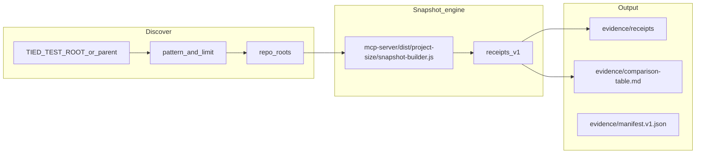

# Plan: batch project size discover + comparison table

**Slug:** `project-size-batch-discover-compare`  
**Track:** `@non-tied-plan` → **@non-tied-refine** (this revision) → `@non-tied-build` → optional `@non-tied-close`  
**Linked Cursor plan:** `.cursor/plans/batch_project_size_compare_8d393c99.plan.md`

---

## Sponsor question (locked)

How can a facilitator **batch** [REQ-TIED_PROJECT_SIZE_LAYERS] **project size snapshots** across disposable WF clients under **`TIED_TEST_ROOT`** and read a single **comparison table** without hand-editing cohort JSONL or opening one MCP receipt per repo?

**Proof boundary:** Facilitator read-only evidence and regenerable markdown — **not** a leaderboard, **not** a maturity score, does not prove REQ **Implemented** or trial grades. No project REQ/ARCH/IMPL YAML writes. Cohort **`runs.jsonl`** append remains out of scope ([`cohort-jsonl-automation`](../../working/REQ-TIED_PROJECT_SIZE_LAYERS/evidence/session-handoff.md) follow-on).

**Sponsor choices (2026-11-09):**

| Choice | Value |
| --- | --- |
| Repo input | **Discover** under parent (`TIED_TEST_ROOT`) |
| Deliverable | **Evidence only** under this plan folder (no `docs/demos/` commit) |

---

## RESOLVE (Touchpoint 1)

| Sponsor term | Resolved meaning |
| --- | --- |
| **Snapshot** | `project-size-snapshot-receipt.v1` from [`buildProjectSizeSnapshot`](../../../mcp-server/src/project-size/snapshot-builder.ts) (same as MCP [`tied_project_size_snapshot`](../../../mcp-server/src/tools/index.ts)) |
| **Discover parent** | `${TIED_TEST_ROOT:-$HOME/Documents/dev/test}` per [`new-tied-client-pipeline.mjs`](../../../tools/bootstrap/lib/new-tied-client-pipeline.mjs) |
| **Eligible client** | **Direct child** of parent with readable `tied-project/requirements.yaml` (one level; no recursion) |
| **Disposable dirname** | `{epoch}` or `{epoch}-{tag}`; WF tag often contains `wf-agentstream` ([catalog automated path](../../../docs/demos/catalog-traditional-workflow-trial-prompts.md)) |
| **Label** | Basename of child dir (e.g. `1794231848-wf-agentstream-wf-08-cursor-gpt56lunalow`) |
| **Comparison table** | Markdown matrix keyed by label; column labels from [`project-size-metrics.registry.yaml`](../../config/project-size-metrics.registry.yaml) plus `cross_layer` ratios |

**Accepted ambiguity:** Clients removed from disk after catalog registration simply **omit** from discover output; no registry backfill in this plan.

---

## Refinements applied (non-tied-refine)

1. **Default filter:** When `--pattern` is omitted, CLI uses substring **`wf-agentstream`** on basename (not match-all `.*`), aligning with WF disposable naming without scanning every non-trial folder under `TIED_TEST_ROOT`.
2. **Pattern modes:** Default **substring** on basename; optional **`--pattern-regex`** uses full `RegExp` (document pattern in `manifest.v1.json`).
3. **Sort order:** **`--newest-first`** (default on): prefer leading **epoch** digits in basename when parseable; tie-break by directory `mtime` descending.
4. **Discover depth:** **Single level** only — matches factory layout (`testRoot/<clientId>`).
5. **Skip rules:** Symlinks, non-directories, and dirs failing eligibility log to **`diagnostics`** in `manifest.v1.json` (not table rows).
6. **v1 manifest input:** **`--manifest path`** ships in same build (one `repo_root` or `label<TAB>repo_root` per line) **in addition to** discover; manifest rows are **unioned** with discovered set (dedupe by resolved `repo_root`).
7. **Snapshot concurrency:** **Sequential** snapshots only in v1 (corpus graph refresh per repo is CPU/IO heavy).
8. **Receipt filenames:** Sanitize label → `receipts/<safe-label>.json` (`[^\w.-]+` → `_`, max 120 chars).
9. **Store row:** **`--include-store`** adds one row labeled `stdd-store` for `--store-root`; default **off** so WF cohort tables stay disposable-only unless sponsor opts in.
10. **Build prerequisite:** Fail fast if `mcp-server/dist/project-size/snapshot-builder.js` missing (same as dogfood path in [REQ handoff](../../working/REQ-TIED_PROJECT_SIZE_LAYERS/evidence/session-handoff.md)).

---

## Architecture



**Engine choice:** Dynamic `import()` of compiled `snapshot-builder.js` — one Node process, no per-repo `tied-cli.sh` JSON-RPC.

---

## CLI design (`@non-tied-build`)

**Entry:** [`tools/bootstrap/lib/project-size-batch-compare.mjs`](../../../tools/bootstrap/lib/project-size-batch-compare.mjs)

| Module | Responsibility |
| --- | --- |
| [`project-size-discover-clients.mjs`](../../../tools/bootstrap/lib/project-size-discover-clients.mjs) | Eligible children; pattern; limit; sort |
| [`project-size-comparison-render.mjs`](../../../tools/bootstrap/lib/project-size-comparison-render.mjs) | Registry-driven markdown + `proof_boundary` footer |

**Example:**

```bash
cd /Users/fareed/Documents/dev/chatgpt/stdd
npm run build --prefix mcp-server

node tools/bootstrap/lib/project-size-batch-compare.mjs \
  --store-root "$PWD" \
  --parent "${TIED_TEST_ROOT:-$HOME/Documents/dev/test}" \
  --pattern wf-agentstream \
  --limit 25 \
  --out-dir tied-project/non-tied-plans/project-size-batch-discover-compare/evidence
```

**Flags (v1):**

| Flag | Default | Notes |
| --- | --- | --- |
| `--store-root` | required | Absolute TIED store root (dist + registry YAML) |
| `--parent` | `TIED_TEST_ROOT` or `~/Documents/dev/test` | Discover root |
| `--pattern` | `wf-agentstream` | Substring on basename unless `--pattern-regex` |
| `--pattern-regex` | off | Treat `--pattern` as RegExp |
| `--limit` | `50` | Max eligible rows after sort |
| `--newest-first` | on | Epoch/mtime sort |
| `--manifest` | — | Optional extra roots (union) |
| `--include` | repeatable | Force-include `repo_root` with optional label |
| `--include-store` | off | Add store methodology row |
| `--include-trial-factors` | off | Pass-through to snapshot builder |
| `--verbose-table` | off | Second table with all registry metric ids |
| `--dry-run` | off | List discovered paths only |
| `--out-dir` | plan `evidence/` | Writes `comparison-table.md`, `manifest.v1.json`, `receipts/*.json` |

**Optional post-build:** `build-commands.sh` alias `project-size-batch-compare` wrapping the node CLI (only if sponsor wants shell ergonomics).

---

## Markdown table shape (v1)

**Summary table** (one row per successful snapshot):

| Group | Columns |
| --- | --- |
| Identity | `label`, `ok`, tail of `repo_root` |
| Atoms | `index_req`, `index_arch`, `index_impl`, `vocab_preferred_terms` |
| Operational intent | `applied_lines`, `procedure_count`, `operational_intent_hash` (8-hex prefix) |
| Proof facets | `unit_tests`, `composition_tests`, `e2e_tests`, `verify_evidence_files` |
| Cross-layer | `operational_intent_per_atom`, `proof_facets_per_atom` (3 decimal places) |

**Footer:** static receipt `proof_boundary` + generation timestamp + discover parameters.

**Failures:** separate **Failed / skipped** section with receipt `diagnostics` or discover skip reasons.

**Forbidden in rendered prose:** `leaderboard`, `maturity_score`, model ranking language ([record-wf-trial § Project size layers](../../../tools/bundled-record-wf-trial-skill/reference.md#project-size-layers)).

---

## Test strategy

See [test-strategy.md](./test-strategy.md).

---

## Out of scope

- D-C4 (~102 WF rows) backfill
- `appendWfTrialCohortRun` / hand-edited `runs.jsonl`
- [`traditional-workflow-trial-runs-registry.md`](../../../docs/demos/traditional-workflow-trial-runs-registry.md) columns
- New REQ/ARCH/IMPL tokens
- Changes to [`mcp-server/src/project-size/`](../../../mcp-server/src/project-size/) unless snapshot bug found (separate TIED lane)

---

## Handoff

**Next:** `@non-tied-build` — implement modules + tests, run first discover pass, populate [`evidence/comparison-table.md`](./evidence/comparison-table.md) and update [`evidence/session-handoff.md`](./evidence/session-handoff.md).
